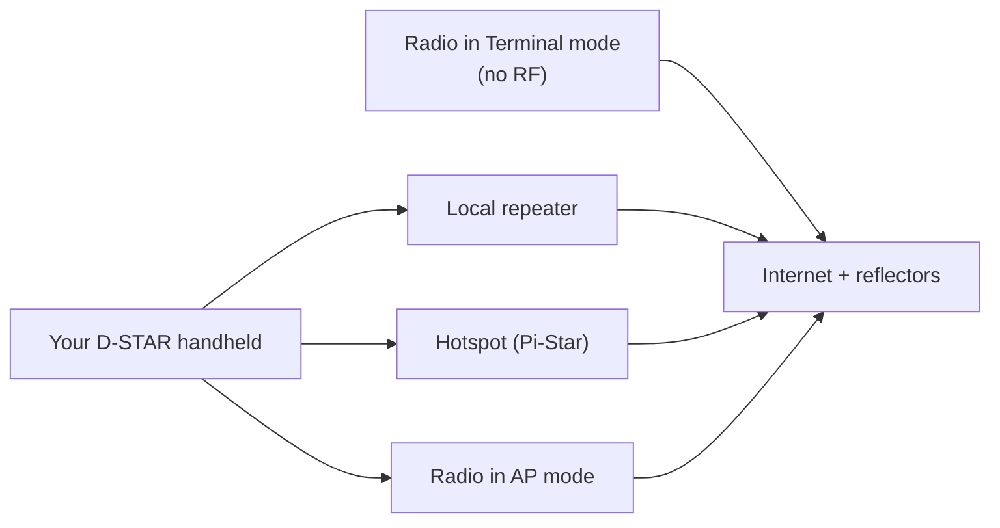
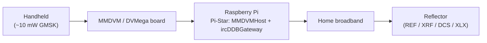
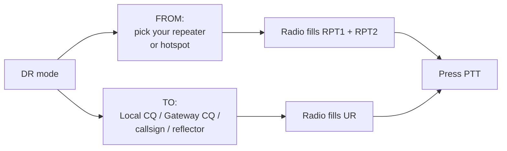
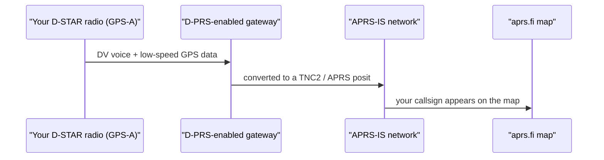

# Operating D-STAR

You have a D-STAR handheld in your hand, a registered callsign, and — this is the awkward part — no D-STAR repeater within thirty kilometres. Or perhaps there is a repeater, but you want to know how to actually _work_ it without fumbling four callsign fields on your first over. This chapter is the practical one: how to get on the air with a matchbox-sized hotspot or the radio's own internet gateway, how to make an ordinary call in DR mode, how to put your position on the world map through DPRS, and the handful of etiquette rules that keep you welcome. It is the last of the three D-STAR chapters, so it also ties the knot back to where digital voice began.

If the earlier chapters explained _what_ D-STAR is and _how_ its callsign routing and [reflectors](outpost:entry/logbook73.handbook/dstar-reflectors) work, this one is about the buttons you press on a Tuesday evening.

## Three ways onto D-STAR

There are exactly three routes to get your voice onto the D-STAR network, and which one you use depends entirely on your local geography.

The first is the obvious one: a **local D-STAR repeater**. You key up on its input, your callsign header identifies you, and its gateway forwards you to whichever [reflector](outpost:entry/logbook73.handbook/dstar-reflectors) it is linked to. Lovely — if you have one in range.

The second is a **hotspot**: a tiny personal transceiver-plus-computer on your own bench that bridges your handheld's RF straight to the internet. It is the answer for most people, because it works anywhere you have home broadband and it is entirely yours to point wherever you like.

The third is unique to D-STAR and worth knowing about: some Icom radios can act as their own gateway through **Terminal mode** (no RF at all — the radio talks to the network purely over the internet) or **Access Point mode** (the radio becomes a personal RF hotspot for other handhelds). No separate hardware required.

Notice that all four paths converge on the same place — the internet gateway network and the reflectors hanging off it. The differences are only in how the last few metres between you and the network are bridged. Get any one of them working and the operating that follows is identical.

## The hotspot: a personal gateway on your bench

A **hotspot** is the single most transformative gadget in modern digital voice. For D-STAR it is usually a small radio board — an **MMDVM** (Multi-Mode Digital Voice Modem) board or a **DVMega** — sitting on a Raspberry Pi single-board computer, running the free **Pi-Star** software. Pi-Star bundles two open-source programs that do the real work: `MMDVMHost`, which talks to the radio board, and `ircDDBGateway` (written by G4KLX under an open licence), which handles the D-STAR gateway and reflector linking. Your handheld transmits low-power GMSK to the hotspot across the room; the hotspot pipes it to the reflectors over your home broadband.

Setting one up follows a well-trodden path:

1. **Flash and boot.** Write the Pi-Star image to a memory card and power up. On first boot the hotspot creates its own Wi-Fi **access point** — you join it from a phone or laptop and use the web page to tell Pi-Star your home Wi-Fi details.
2. **Configure over the web.** Everything after that is done in a browser: enter your callsign, enable the D-STAR (`ircDDBGateway`) mode, and set the hotspot's simplex frequency within your national band plan's guidance for personal hotspots.
3. **Choose the module.** A D-STAR hotspot presents a port letter just like a repeater. Most hotspots use module `B` (the 70 cm convention), so you will point your radio's `RPT1` at your hotspot callsign with `B` in the eighth character — or, far more easily, let DR mode handle it.
4. **Link a reflector.** Pick a **startup reflector** (Pi-Star connects to it automatically on boot) or leave it manual and link from the radio.

Two practical notes. A **simplex** hotspot (one frequency, transmit and receive alternately) is perfectly fine for one operator in one house; a **duplex** hotspot costs more and behaves more like a real repeater, which you rarely need. And DVMega boards come as single-band (UHF only) or dual-band (VHF/UHF) — match the board to the radio you own.

A hotspot transmits RF, however feeble, so your amateur licence and its conditions apply exactly as they would to any other transmitter. Ten milliwatts is tiny, but it is still radio.

## Terminal and Access Point mode

Some Icom radios (the ID-51 PLUS2 and ID-52, for example) can bridge to the network _without_ a separate hotspot, using Icom's companion apps — `RS-MS3W` on Windows or `RS-MS3A` on Android — or built-in features. There are two flavours, and the difference matters.

**Terminal mode** makes the radio behave as a pure internet gateway: it sends and receives D-STAR traffic over your data connection and transmits **no RF at all**. This is ideal when you have no local repeater and simply want network access from the radio on your desk — a quiet way to join a reflector net from an flat where a hotspot's transmissions might not be welcome.

**Access Point (AP) mode** turns the radio itself into a low-power RF hotspot: the base radio bridges to the internet, and _other_ D-STAR handhelds work through it over the air. Use this when you want to wander the house and garden on a pocket radio while the base set does the internet lifting.

Both modes share the same Achilles' heel. They need a **routable global IPv4 address** and a gateway that supports the underlying `RS-RP3`/`G3` protocol. If your internet provider uses **CGNAT** (carrier-grade NAT — many households on a single shared public address) or is IPv6-only, Terminal and AP mode commonly refuse to connect, with no obvious explanation. A Pi-Star hotspot, by contrast, reaches _out_ to the reflectors and sidesteps most of this — which is one reason hotspots remain the more popular route despite Icom's built-in cleverness.

## Your daily driver: DR mode

Under the bonnet, every D-STAR transmission is defined by four callsign fields — `MYCALL`, `UR`, `RPT1` and `RPT2` — dissected in the [routing chapter](outpost:entry/logbook73.handbook/dstar-routing). You _could_ edit them by hand every time. Almost nobody does. Modern radios (the ID-31, ID-51, ID-52, ID-50) hide all four behind **DR mode** (D-STAR Repeater mode), which turns getting on the air into filling in two menus.

- **FROM** is _where you are keying up_ — your local repeater or your hotspot, chosen from the radio's built-in list. Setting FROM fills in `RPT1` (the access port) and `RPT2` (the gateway port) automatically, with the fiddly module letters in the right places.
- **TO** is _who you are calling_. The common choices are **Local CQ** (a general call heard only on that repeater's RF), **Gateway CQ** (a general call out through the gateway to a linked reflector), a specific **callsign** to route to a person, or **a reflector** to link to.

Set FROM once for your usual site, leave TO on a Gateway or reflector call, and day-to-day operating is: pick TO, press the push-to-talk switch, wait a beat, speak. The one housekeeping task DR mode demands is a **current repeater list** — import the latest CSV into the radio so your local machines and any new reflectors appear as pickable entries. A stale list is why a nearby repeater sometimes refuses to show up as a FROM option.

The raw four fields remain the mental model — when something is not working, you reason about them — but DR mode is the daily interface. If you find yourself hand-typing `CQCQCQ` into `UR`, you have probably slipped out of DR mode by accident.

## Linking a reflector — and unlinking it

A [reflector](outpost:entry/logbook73.handbook/dstar-reflectors) is a conference bridge: many repeaters and hotspots join one **module** (a lettered room — `A`, `B`, `C`…) and everyone linked to that module hears everyone else. In DR mode you link by choosing the reflector as your **TO** destination and keying up briefly; a voice prompt usually confirms the link. To leave, you select **Unlink** in the TO menu and key up again. A short over on `TO = Unlink` drops the link; the reflector then falls quiet for you.

On a **hotspot** this is entirely your own business — link, unlink, hop between reflectors as often as you like, because you are the only user. Pi-Star can also connect to a **startup reflector** automatically on boot so your hotspot is always sitting somewhere useful.

On a **shared repeater** the same action carries a social weight that trips up newcomers, so say it plainly: **linking a repeater moves the whole machine.** Every other operator on that repeater is now connected to your chosen reflector, whether they wanted it or not. So the etiquette is firm:

- **Listen first** and check the current link state before you change anything.
- **Unlink when you are finished**, returning the repeater to its resting state (or to whatever it is normally linked to) for the next person.
- If in doubt, use your **hotspot** for long ragchews and reserve repeater linking for shorter, sociable use.

None of this is unique to D-STAR — it is ordinary repeater courtesy — but D-STAR's one-command linking makes it unusually easy to commandeer a machine without meaning to.

## DPRS: your position on the APRS map

Here is a genuinely clever D-STAR feature that beginners often miss. Recall that a D-STAR **DV** transmission is a 4800 bit/s stream, of which 3600 bit/s carries voice and error correction and the remaining budget carries sync plus a **low-speed data channel** of roughly 900 bit/s that runs _alongside_ your voice. You do not have to choose between talking and sending data — both go at once.

The most popular use of that channel is position reporting. An Icom radio with GPS can beacon your location while you speak, and **DPRS** (D-STAR Position Reporting System, often written **D-PRS**) is the conversion that turns that low-speed data into ordinary [APRS](outpost:entry/logbook73.handbook/aprs) strings at the gateway. Your D-STAR position then appears on the same maps as every APRS tracker — `aprs.fi` and the rest — even though you never transmitted an APRS packet.

To make it work, set your radio's GPS to **GPS-A** mode, which produces a compact single-line APRS position with a **CRC** (cyclic redundancy check) for integrity — prefer it over the older `GPS-G` format, which uses a weaker checksum. Choose a sensible map symbol and a polite beacon interval, and enable transmit.

Two honest caveats. DPRS is a **conversion specification, not a protocol** — the magic happens at the gateway, so your position only reaches APRS if you are working through a **D-PRS-enabled gateway**. A plain simplex contact or a hotspot that is not bridging position data may carry your GPS bytes over the air but never forward them to the APRS network. And, as always, position beaconing must respect your national band plan and licence conditions.

## Low-speed data, text and identity

The same low-speed channel does more than positions. It carries **short text messages** — a line of free text that pops up on the receiving radio's screen alongside your callsign — and it carries the **callsign header** itself, which is why a D-STAR radio can display who is talking _before_ it has finished decoding the voice. That header, `MYCALL`, also satisfies station identification in each over, though you should still follow your national rules on periodic voice identification.

It is worth being clear about what this data channel is _not_: it is not a general internet pipe, and it is emphatically not a route to privacy. D-STAR voice is unencrypted and your callsign travels in clear — which is exactly as it should be. Content encryption to obscure meaning is prohibited under most national amateur rules (the FCC's Part 97 in the United States and the Ofcom licence terms in the United Kingdom are two examples), so D-STAR's open, identifiable design is a feature, not a shortcoming.

## Etiquette and honest notes

D-STAR rewards a few good habits and asks you to forgive a couple of quirks.

**Operating manners** are mostly the manners of any repeater, with digital timing added:

- **Listen before you call.** Make sure the reflector or repeater is not in the middle of a net or a QSO.
- **Leave a gap after each over.** Wait a second or two before replying — this lets other stations and other _linked systems_ break in, and D-STAR nets often ask for exactly this so late-joining hotspots and repeaters can get a word in.
- **Wait a beat after pressing PTT before speaking.** The vocoder and network add a fraction of a second of latency; talk too soon and your first word is clipped. Everyone learns this the hard way once.
- **Unlink shared machines** when you are done, as above.

**The honest notes**, so you buy and configure with eyes open:

- **It is Icom-centric.** D-STAR is an open air-interface standard — anyone may implement it, which is why the gateway and hotspot software is open-source — but in practice Icom builds nearly all the radios. If you dislike being tied to one manufacturer's ecosystem, that is a real consideration.
- **Registration is a one-time hurdle.** Before _any_ gateway or reflector traffic works, your callsign must be registered once at an ircDDB gateway; the registration propagates worldwide. It is free and administrative, not regulatory, but the classic web flow trips people up — you create an account, wait for approval, then log back in and create a **terminal** entry, which involves ticking your row and putting a single **space** in the initial field. That blank-space step baffles almost everyone the first time. RF-only use of a local repeater or simplex needs no registration; the internet does.
- **The silent-failure trap.** If `MYCALL` does not exactly match your registered callsign, your local repeater will work but nothing reaches the internet — with no error message. Beginners misdiagnose this as broken hardware. If your voice repeats locally but the reflector never hears you, check `MYCALL` and check that `RPT2` (the gateway port) is not left blank.
- **Cross-mode is not free.** D-STAR's AMBE vocoder is not bit-compatible with the AMBE+2 used by DMR and Fusion, so bridging D-STAR to those modes needs **transcoding hardware** (an XLX reflector with an AMBE transcoder, for instance). Do not assume any digital radio can hear any other over the air.

## Try it yourself

1. **Register, if you have not.** Complete the one-time ircDDB gateway registration for your callsign — account, approval, then the terminal entry with the single space in the initial field. This unlocks every reflector.
2. **Build or borrow a hotspot.** Flash Pi-Star to a Raspberry Pi with an MMDVM or DVMega board, join its setup Wi-Fi, enter your callsign and a band-plan-appropriate frequency, and enable the D-STAR mode. Set a startup reflector and confirm your handheld links through it.
3. **Make a DR-mode call.** In DR mode, set **FROM** to your hotspot or local repeater and **TO** to a Gateway CQ or a busy reflector. Listen for a gap, key up, wait a beat, and call. Log the contact in LogBook73's Console with mode `DSTAR`.
4. **Put yourself on the map.** Set GPS to **GPS-A**, choose a symbol, enable transmit through a D-PRS-enabled gateway, then open `aprs.fi` and search your callsign. Watch a D-STAR radio appear on the APRS map without ever sending an APRS packet.
5. **Listen without transmitting.** No hotspot yet? Point an [RTL-SDR](outpost:entry/logbook73.handbook/software-defined-radio) at a local D-STAR repeater, watch the crisp ~6 kHz GMSK block on [the waterfall](outpost:entry/logbook73.handbook/ffts-and-waterfalls), and log the callsigns you catch in LogBook73's **Receive Log** as mode `DSTAR`.

## Key takeaways

- There are three routes onto D-STAR: a **local repeater**, a **hotspot** (Pi-Star on a Raspberry Pi with an MMDVM/DVMega board), or the radio's own **Terminal mode** (no RF) or **Access Point mode** (radio as personal hotspot).
- **DR mode** is the daily interface: set **FROM** (your repeater/hotspot) and **TO** (Local CQ, Gateway CQ, a callsign, or a reflector) and the radio fills the four raw callsign fields for you — but keep the repeater list current.
- **Linking a shared repeater moves the whole machine**, so listen first, unlink when done, and prefer your own hotspot for long ragchews.
- **DPRS** rides the ~900 bit/s low-speed data channel alongside your voice; set **GPS-A** and work through a **D-PRS-enabled gateway** and your position appears on the APRS map — a conversion, not a separate transmission.
- The low-speed channel also carries **short text** and the **callsign header**; D-STAR voice is unencrypted by design, matching most amateur rules that bar concealment.
- Honest caveats: D-STAR is **Icom-dominated**, needs a **one-time gateway registration** (the blank-space terminal step catches everyone), fails **silently** if `MYCALL` is wrong or `RPT2` is blank, and needs **transcoding** to reach DMR or Fusion.
- Leave a gap after every over and wait a beat after keying up — the network's latency will clip your first word until you do.

That completes the tour of the three digital-voice families — DMR's talkgroups, Fusion's Wires-X rooms, and D-STAR's callsign routing. To step back and see how they fit together, and to remind yourself why any of them beat plain FM for reaching the world on a handheld, return to the shared overview in [Digital Voice](outpost:entry/logbook73.handbook/digital-voice).
