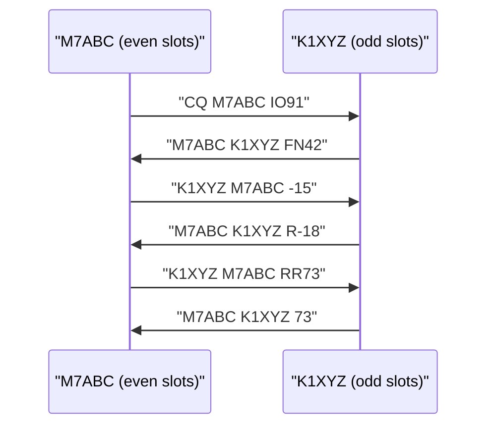
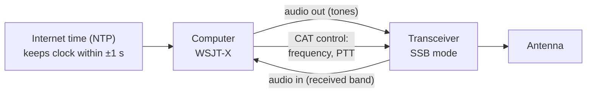

# FT8

In 2017 a new digital mode appeared, and within two years it was carrying more amateur contacts than every other mode combined. FT8 lets a modest station — 25 W and a wire, entry-licence territory in most countries — work the world even when the bands seem dead, by trading everything negotiable (speed, chattiness, bandwidth) for the one thing that matters at the margin: the ability to decode signals _far below the noise you can hear_. Whether you come to love it or merely respect it, FT8 is now the weather system of the amateur bands, and understanding it will change how you read every waterfall.

## Why a 15-second, 50-hertz mode conquered the bands

FT8 (named for its designers, Steven **F**ranke K9AN and Joe **T**aylor K1JT, and its **8**-tone modulation) is ruthlessly minimal. Each transmission lasts about 13 seconds, fits in a slot exactly 15 seconds long, occupies just **50 Hz** of spectrum — an SSB voice signal is about 2,700 Hz wide, so more than fifty FT8 signals fit in the space of one voice — and carries a fixed **77-bit** payload. Seventy-seven bits is not a sentence; it is barely a callsign pair, a grid locator and a report, packed by clever source coding. That is the entire vocabulary.

```viz
{
  "type": "waterfall",
  "title": "One FT8 sub-band: a whole crowd inside a single voice channel",
  "caption": "Every 50 Hz stripe is a different station, transmitting in alternating 15-second slots (time runs downwards) — and the entire picture is barely the width of one SSB voice signal.",
  "xLabel": "audio offset 0 → 3,000 Hz (dial on 14.074 MHz)",
  "yLabel": "time ↓ (15 s slots)",
  "signals": [
    { "f": 8, "width": 2, "kind": "ft8" },
    { "f": 15, "width": 2, "kind": "ft8" },
    { "f": 22, "width": 2, "kind": "ft8" },
    { "f": 31, "width": 2, "kind": "ft8" },
    { "f": 40, "width": 2, "kind": "ft8" },
    { "f": 52, "width": 2, "kind": "ft8" },
    { "f": 63, "width": 2, "kind": "ft8" },
    { "f": 74, "width": 2, "kind": "ft8" },
    { "f": 88, "width": 2, "kind": "ft8" }
  ]
}
```

What does this austerity buy? Recall from [Noise](outpost:entry/logbook73.handbook/noise) and [Sensitivity](outpost:entry/logbook73.handbook/sensitivity) that the noise power a receiver collects is proportional to bandwidth: narrow the bandwidth, exclude the noise. Add slow, precisely-timed signalling that a computer can integrate over seconds, plus a powerful error-correcting code (an LDPC code, cousin of those in your phone and Wi-Fi), and FT8 decodes reliably at signal-to-noise ratios around **−20 dB** — a signal one _hundredth_ of the noise power. For comparison, SSB voice needs very roughly +10 dB to be comfortable, and skilled Morse operators manage around −15 dB or so. FT8 hears what humans cannot.

The practical consequence rewrote operating habits: a band that sounds empty on SSB is often teeming on FT8, because paths with too much loss for voice still pass 77 bits happily. Marginal [propagation](outpost:entry/logbook73.handbook/propagation) — a whisper of sporadic-E, a closing band's last gasp — becomes workable. Five watts to an indoor antenna crosses oceans on FT8 not occasionally but _routinely_, and the public reporting map at pskreporter.info — or LogBook73's own DX Cluster live-spot map — will show you it happening tonight.

## The rhythm: time slots and the structured exchange

FT8 is synchronous: the world's FT8 stations all transmit and receive in the same global 15-second slots, aligned to real clock time (slots begin at 0, 15, 30 and 45 seconds past each minute). You transmit in either the "even" or "odd" slots and listen in the other; your contact does the opposite. This is why **your computer's clock must be right** — more below.

A complete QSO is a fixed six-message ballet, each message one slot, alternating turns. Suppose `M7ABC` in grid square `IO91` (grid locators are the four/six-character location codes covered with [VHF operating](outpost:entry/logbook73.handbook/vhf)) calls CQ and is answered by `K1XYZ` in `FN42`:



Reading it line by line: the CQ carries callsign and grid; the answer carries both callsigns and the caller's grid; then each station sends the **signal report** — the SNR in dB at which it decoded the other (`-15` means "I received you at −15 dB"); `R-18` means "Roger, I got your report, here is mine"; `RR73` compresses "report received, best regards" into one message; and the final `73` closes. Ninety seconds, start to finish, and both stations have exchanged everything a valid contact needs: callsigns, locations, reports.

Notice what is _absent_: names, rigs, weather, personality. FT8 is not conversation; it is a handshake. That is both its power and the heart of the criticism we will come to.

### What −20 dB actually means

FT8 SNR reports are quoted relative to a standard **2,500 Hz reference bandwidth** (roughly an SSB channel). So `-20` means: if you listened to that 2.5 kHz slice by ear, the signal's power would be 1% of the noise power — total, glassy silence to a human. It is only because the actual signal hides in a 50 Hz sliver, and the decoder knows exactly where and when to look, that those bits emerge. When you see a `+05` report, that station would be comfortably audible; at `-10`, faint traces on the waterfall; below about `-15`, typically nothing your eye or ear can find — yet the decode is solid. Watching signals you cannot see get decoded is FT8's party trick, and it never quite stops feeling like magic. ([Decibels](outpost:entry/logbook73.handbook/decibels) has the refresher if −20 dB → 1% did not feel automatic.)

```viz
{
  "type": "spectrum",
  "title": "Below the noise: where a −20 dB FT8 signal actually sits",
  "caption": "The FT8 carrier's power lies beneath the average noise in the channel — silence to your ear — yet because the decoder knows exactly where and when to look inside its 50 Hz sliver, all 77 bits come back.",
  "xLabel": "one 2,500 Hz receive channel →",
  "noiseFloor": 0.28,
  "components": [
    { "f": 32, "amp": 0.14, "label": "FT8 at −20 dB", "tone": "primary" },
    { "f": 72, "amp": 0.8, "label": "comfortably audible (+10 dB)", "tone": "muted" }
  ]
}
```

## Reading the WSJT-X screen

FT8's home is **WSJT-X**, the free software by the mode's designers (several compatible alternatives exist and interoperate fully). The learning curve is really about knowing where to look:

- **The waterfall** (a separate "Wide Graph" window) shows the whole receive passband, usually 200–3,000 Hz of audio: dozens of 50 Hz stripes, each one a station. Everything you learned in [FFTs & Waterfalls](outpost:entry/logbook73.handbook/ffts-and-waterfalls) applies at miniature scale.
- **Band Activity** lists every signal decoded in each slot: time, signal strength (`dB` — the SNR just discussed), `DT` (the station's clock offset from yours, in seconds), audio frequency in Hz, and the decoded message. A busy 20 m slot might produce thirty lines every fifteen seconds.
- **Rx Frequency** shows only messages involving _you_ — your ongoing QSO, and anyone calling you.
- Double-clicking a CQ line answers it: the software sets up the reply, transmits in the correct slots, and steps through the six-message sequence semi-automatically, asking you only to click "Log QSO" at the end.

Two habits mark the competent FT8 operator. First, **transmit where it is quiet**: your audio offset (say, 1,480 Hz) is independent of the station you are calling — pick a clear stripe on the waterfall rather than piling onto theirs. Second, **watch DT**: if everyone shows `DT` near ±0.2 s but one station shows 2.5 s, _their_ clock is off and they will decode poorly; if _everyone_ shows a large DT, the wandering clock is yours.

## Setting up: the three connections

An FT8 station is a transceiver, a computer, and three links between them. Modern radios provide all three through a single USB cable; older rigs use a small audio interface.



1. **Audio.** FT8 tones go out through the radio as if they were speech (the radio sits in USB — upper sideband — mode on the standard band frequencies, e.g. `14.074 MHz` on 20 m, `7.074 MHz` on 40 m), and received audio comes back for decoding. The classic beginner error is **too much transmit audio**: overdriving distorts the signal and splatters neighbours. Set levels so the radio's ALC (automatic level control) meter barely registers — FT8 is 100% duty cycle while transmitting, so many operators also run reduced power to keep the radio's output stage cool. Clean and modest beats loud and dirty, always.
2. **CAT control** (Computer Aided Transceiver) lets WSJT-X read and set the radio's frequency and key the transmitter. Not strictly essential — you can tune by hand and use VOX — but it makes logging accurate and operation painless.
3. **Time.** The non-negotiable one. Slots are global, so your computer clock must be within about **±1 second** of true time; beyond that, decodes fail mysteriously. Enable internet time synchronisation (NTP) and, if decodes seem inexplicably absent some day, check the clock _first_. Every FT8 operator has lost an evening to this exactly once.

Receive-only needs even less: any SDR or radio feeding audio to WSJT-X decodes the world with no licence required — the perfect [Receive Log](outpost:entry/logbook73.handbook/amateur-radio) project.

### FT4, in brief

FT4 is FT8's impatient sibling from the same authors: 7.5-second slots, about 90 Hz wide, roughly 3.5 dB less sensitive, twice as fast. It was designed for contesting, where rate beats reach. Everything above applies with the numbers halved; if you learn FT8, you know FT4.

## Etiquette, and the great argument

FT8's etiquette is mostly automated, but a few human choices remain. Do not call someone already mid-QSO — watch a slot or two first. Keep your transmit power honest: if stations report you at `+15`, you are running far more power than the mode needs, taking decoder headroom from weaker signals. On a crowded band, answering CQs off your own transmit frequency (which the software does naturally) keeps the waterfall civilised. For rare DXpeditions there is a special "Fox and Hound" mode with its own rules — read the expedition's instructions before joining the crowd. And when the sequence completes, log it: the other station has.

Now, the argument you will meet in every clubroom: **is an FT8 contact a "real" QSO?** The critical case deserves a fair hearing: the exchange is machine-generated, the operator's role can shrink to double-clicking, no human personality crosses the path, and some feel the bands' conversational culture — the rag-chew, the accents, the craft of pulling a voice from the noise by ear — is being displaced by silent stripes on waterfalls. Those losses are real, and the people who mourn them are not being precious.

The defence is equally sincere. FT8 QSOs are genuine two-way radio contacts: real RF, real propagation, real skill — in station building, antenna work, timing, and reading band openings — with the intelligence moved from the operator's ear to the operator's _preparation_. It has brought flat-dwellers, antenna-restricted amateurs and low-power experimenters into DXing who were locked out before; a −20 dB decode threshold is 25 dB of forgiveness that an operator with a compromised antenna desperately needs. And it is a propagation instrument without equal: millions of automated reception reports flow to public spotting networks daily, mapping the ionosphere in real time. The kind view — and this handbook takes it — is that FT8 and rag-chewing are different pleasures, not competitors. Most amateurs who sniffed at FT8 have quietly worked a hundred countries on it since; most FT8 devotees still light up when a voice answers their CQ.

## Logging FT8 in LogBook73

FT8 practically logs itself. WSJT-X prompts after each completed QSO and writes standard **ADIF** records — callsign, band, mode `FT8`, both SNR reports (they go in the RST fields — `-15` instead of `59`, and that is correct), grid locators, exact UTC times. LogBook73 imports ADIF directly, so the flow is: work stations all evening, export or auto-log, import, done. Because every FT8 QSO carries a grid locator, your log grows unusually rich geographic data — which is exactly what the Awards page and per-callsign tracking feed on. One habit worth keeping even in this automated world: skim each session's entries afterwards. The log is still _your_ diary; know what is in it.

## Try it yourself

1. **Decode tonight, licence-free.** Install WSJT-X (free, all platforms), feed it audio from an RTL-SDR tuned to `14.074 MHz` USB — or even a shortwave receiver's speaker near your laptop microphone — check your clock is NTP-synced, and watch the Band Activity window fill. Seeing thirty stations decode from an "empty-sounding" frequency is the whole argument for FT8 in one screen.
2. **Chase a distance record.** Note the grid locators you decode and look up the farthest. Log your best catches — callsign, frequency, mode `FT8`, SNR — in LogBook73's **Receive Log**. A modest wire regularly hears 15,000 km on 20 m FT8.
3. **Watch yourself being heard** (licensed readers). Transmit a few CQs, then look yourself up on **pskreporter.info**: within a minute you will see exactly who decoded you, where, and at what SNR — instant, honest antenna feedback no signal report on SSB ever gave you.
4. **Run the numbers.** Your station at 25 W is reported at `-10` by a distant station. How much power would put you at their −20 dB decode floor? Ten dB less — 2.5 W. Try it: drop the power and watch the reports. This is [Decibels](outpost:entry/logbook73.handbook/decibels) becoming instinct.
5. **Compare the bands.** Leave WSJT-X decoding on 40 m for an hour after dark, then on 20 m mid-morning, and compare the grids heard. You have just reproduced the day/night propagation story of [chapter 27](outpost:entry/logbook73.handbook/propagation) with your own data.

## Key takeaways

- FT8 trades chat for reach: 15-second slots, 50 Hz bandwidth, a fixed 77-bit structured exchange, and decoding down to about −20 dB SNR — signals a hundred times weaker than the noise, far below human hearing.
- A QSO is six alternating messages — CQ, answer, report, roger-report, RR73, 73 — completing in about ninety seconds with callsigns, grids and reports exchanged.
- Reports are SNR in dB (referenced to 2,500 Hz), not RST: `-15` is a perfectly good report, and logging it as such is correct.
- Setup essentials: clean (never overdriven) audio, CAT control for convenience, and a clock synced within ±1 second — bad time is the classic silent failure.
- FT4 is the same idea at double speed for contesting; Fox/Hound handles DXpedition pile-ups — read the rules before joining one.
- The "is it real radio?" debate has merit on both sides; hold your view kindly. Meanwhile FT8 is unmatched as a propagation tool and as the low-power, small-antenna operator's key to worldwide DX.

From exchanging 77-bit handshakes, we turn to a mode that broadcasts your position, weather and messages across a live network map of the airwaves: [APRS](outpost:entry/logbook73.handbook/aprs).
