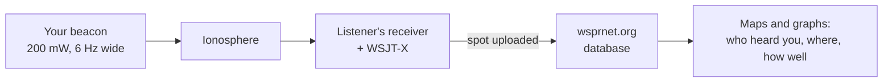
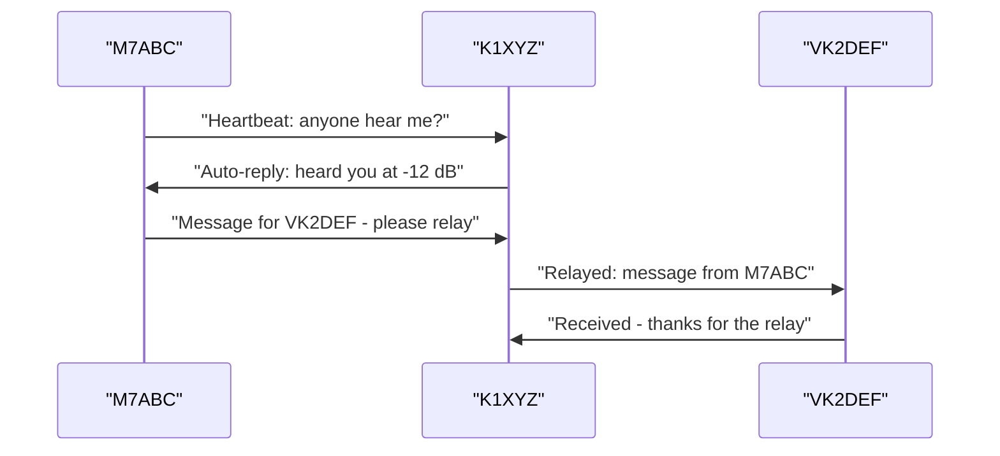
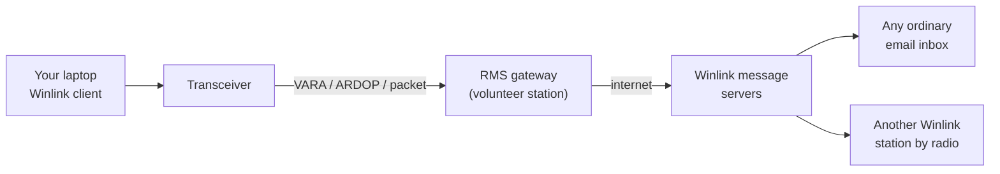

# HF Data Modes

[FT8](outpost:entry/logbook73.handbook/ft8) taught you that 77 bits, exchanged in ninety seconds, can cross an ocean on the power of a torch bulb. But a signal report is all FT8 can say — and HF data has far more to offer than handshakes. This chapter meets four modes that each answer a different "what if": what if you sent _nothing but a beacon_ and let the world's receivers map propagation for you (WSPR); what if you could actually _type to a person_ (PSK31); what if FT8's below-the-noise magic carried _conversation_ (JS8); and what if radio could deliver _real email_ to an ordinary inbox when the internet is gone (Winlink)? Between them they cover almost everything a small HF station might want data to do.

## Four questions, four modes

It helps to sort digital modes not by their modulation but by **what actually travels**. FT8 carries a fixed, structured contact. WSPR carries no contact at all — just "I exist, here, at this power". PSK31 carries live keyboard text, as fast as you type. JS8 carries free-form messages in FT8-sized parcels. Winlink carries complete emails, attachments and all. Same bands, same [propagation](outpost:entry/logbook73.handbook/propagation), wildly different purposes — and all four run through exactly the station you built for FT8: a transceiver in SSB mode, a computer, an audio link and an accurate clock. Nothing new to buy; only new software to run.

One more idea before the tour: bandwidth. All four modes are narrow — the widest is thinner than a fiftieth of an SSB voice channel for most sessions — but _how_ narrow varies by a factor of ten, and as [Noise](outpost:entry/logbook73.handbook/noise) taught you, bandwidth is destiny: the narrower the signal, the less noise competes with it, and the weaker it can be and still decode.

```viz
{
  "type": "spectrum",
  "title": "How much spectrum each mode actually uses",
  "caption": "Three hundred hertz of band — a tenth of one SSB voice channel — comfortably holds all of them: WSPR is a 6 Hz sliver, FT8 and JS8 use about 50 Hz, PSK31 about 60 Hz.",
  "xLabel": "0 → 300 Hz of spectrum",
  "noiseFloor": 0.12,
  "components": [
    { "f": 8, "amp": 0.7, "width": 2, "label": "WSPR (6 Hz)", "tone": "primary" },
    { "f": 34, "amp": 0.7, "width": 17, "label": "FT8 / JS8 (50 Hz)", "tone": "muted" },
    { "f": 70, "amp": 0.7, "width": 20, "label": "PSK31 (~60 Hz)", "tone": "ink" }
  ]
}
```

## WSPR: the beacon that never says hello

**WSPR** (Weak Signal Propagation Reporter, pronounced "whisper", from the same K1JT stable as FT8) is the strangest mode in this chapter, because it is deliberately _not_ a QSO mode. Nobody answers a WSPR transmission. Nobody is meant to. A WSPR station transmits a tiny beacon — its **callsign, grid locator and transmit power** packed into a 50-bit message — and every station anywhere on Earth that decodes it uploads a "spot" to the public database at **wsprnet.org**. The product is not contacts; it is _data_: a live, crowd-sourced map of which paths are open, on which bands, at what signal levels, minute by minute.

The engineering is FT8's philosophy pushed to its limit. Each transmission lasts **110.6 seconds** — nearly two minutes to send about as much information as a car number plate — and occupies roughly **6 Hz** of bandwidth, using four tones spaced about 1.5 Hz apart. Transmissions fill two-minute slots beginning just after the start of an even UTC minute, so the same clock discipline as FT8 applies. That glacial pace buys astonishing sensitivity: WSPR decodes at around **−28 dB** SNR (in the usual 2,500 Hz reference bandwidth) — several dB _deeper_ into the noise than FT8, signals well under a thousandth of the noise power.

Power is reported in **dBm** — decibels relative to one milliwatt, so `P(dBm) = 10 × log₁₀(P / 1 mW)`. A typical WSPR beacon runs 200 mW: `10 × log₁₀(200) ≈ 23 dBm`. Many run less — 10 mW (+10 dBm) beacons cross continents on a good day — and few run more than 5 W (+37 dBm), because the whole point is to measure the _margin_: if 200 mW reaches New Zealand at −25 dB, you know precisely how a real QSO-power signal would fare. ([Decibels](outpost:entry/logbook73.handbook/decibels) makes this arithmetic second nature.)



What is it _for_? Two things, both wonderful. First, **propagation science**: millions of spots a day, from every band and continent, make WSPR the finest amateur-built instrument for studying the ionosphere — researchers genuinely use the archive. Second, and closer to home, **antenna testing**. Words like "seems to get out well" become numbers: run 200 mW into antenna A for a day, antenna B the next, and compare who heard you and at what SNR. It is the cheapest antenna range in the world, and it spans the planet. Dedicated WSPR transmitter kits the size of a matchbox (a ~$50/€50 class gadget) run for months from a USB socket; solar-powered party balloons carrying WSPR beacons have circumnavigated the globe. One note for transmitters: a beacon left running unattended may fall under special rules in your country — check your licence conditions for automatic or beacon operation before you leave one on overnight.

## PSK31: the keyboard-to-keyboard original

Now for the opposite temperament. **PSK31**, released to the amateur world in the late 1990s by Peter Martinez, `G3PLX`, is a _conversation_ mode: what you type appears, live, character by character, on the other operator's screen, and their reply flows back the same way. No fixed exchange, no message templates — names, weather, rigs, bad jokes, the whole rag-chew culture that FT8's critics miss, carried in a signal barely wider than FT8 itself.

The name tells the story: **phase-shift keying at 31.25 baud**. Instead of shifting between tones, PSK31 flips the _phase_ of a single audio tone — the carrier's rhythm inverts, or it doesn't, and that binary choice carries the bits (the BPSK idea from [IQ Signals](outpost:entry/logbook73.handbook/iq-signals), in its plainest form). Why 31.25 baud? Because that is roughly the bit rate of a human typing at conversational speed — about 50 words per minute. The mode is matched to your fingers, and the result occupies only about 31 Hz at its core, some 60 Hz on the air: dozens of simultaneous conversations fit inside one voice channel.

```viz
{
  "type": "constellation",
  "title": "BPSK: two phases, one bit",
  "caption": "PSK31's entire alphabet of states — the tone's phase is either 'normal' or 'inverted', and the pattern of flips spells out your typing.",
  "preset": "bpsk"
}
```

Martinez's second elegant idea is **varicode**: characters get variable-length bit codes, with the commonest letters shortest — `e` and `t` are two bits, rare punctuation much longer — exactly the economy Morse code discovered a century earlier. (Two zero-bits in a row never occur inside a character, which is how the decoder knows where one character ends and the next begins.)

Operating PSK31 is a waterfall sport. The traditional home is a small cluster just above **`14.070 MHz`** on 20 m (with similar niches near 7.040 or 7.070 MHz on 40 m and 3.580 MHz on 80 m — check your band plan). Tune there in USB with free software such as **fldigi** and the waterfall shows a row of fine twin traces, each one a conversation; click one and the text streams out. Everything from [FFTs & Waterfalls](outpost:entry/logbook73.handbook/ffts-and-waterfalls) applies — you are picking individual 60 Hz threads out of the display by eye. PSK31 is less sensitive than FT8 — it wants signals around the noise floor rather than 20 dB under it — but it still works fine at power levels and antennas that would embarrass SSB, and a clean, _unoverdriven_ signal matters even more here: an overdriven PSK31 transmission sprouts sidebands that trample the neighbours a few tens of hertz away. Watch the ALC, keep it barely moving, same rule as FT8. A QPSK31 variant (four phases, with error correction) and faster PSK63/PSK125 cousins exist, but plain BPSK31 remains the lingua franca.

## JS8: FT8 learns to chat

If PSK31 is conversation without FT8's sensitivity, and FT8 is sensitivity without conversation — could you have both? That is precisely the question **JS8Call**, created by Jordan Sherer, `KN4CRD`, set out to answer. JS8 takes FT8's modem — the same 15-second, roughly 50 Hz, 8-tone transmissions, with sensitivity still deep in the minus-twenties of dB — and repurposes it to carry **free text**. Long messages are chopped into frame-sized pieces and sent over consecutive slots, so a sentence takes a few cycles rather than one; typical throughput in normal mode is around the speed of very patient typing. Slower and faster variants trade the usual currencies: a "slow" mode gains sensitivity with 30-second frames, "fast" and "turbo" modes spend bandwidth to move text at a brisker clip.

The interesting part is not the modem but the _network manners_ built on top:

- **Directed messages**: text addressed to a specific callsign, so stations can filter what is meant for them out of a busy band.
- **Heartbeats**: a periodic "I am here" transmission; other JS8 stations can auto-acknowledge with your SNR, so you learn who can hear you _right now_ without troubling a human.
- **Relaying and store-and-forward**: ask an intermediate station to pass a message onward beyond your own propagation, or leave a message in a station's inbox for a friend who is currently away — the network holds it until they call in.



That toolkit explains who loves JS8: off-grid and emergency-minded operators, low-power experimenters, and anyone who wanted FT8's reach but felt the six-message ballet said too little. A common arrangement is a shared calling frequency per band (around `14.078 MHz` on 20 m is the customary spot); operation, clock discipline and audio settings are all identical to FT8, so if your WSJT-X station works, JS8Call works the moment you install it. A QSO in JS8 has no script — it is two people typing across an ocean at signal levels neither could hear — and the first time someone answers your heartbeat from another continent on 5 W, the FT8-versus-conversation argument of the [last chapter](outpost:entry/logbook73.handbook/ft8) dissolves: here is both at once, at the cost of patience.

## Winlink: email over the air

The final mode answers the most practical question of all: _can radio deliver ordinary email?_ **Winlink** can, and does, every day. A Winlink account is a real email address — your callsign `@winlink.org` — that can exchange messages, within-reason attachments included, with any normal email address on the internet. The radio part is the **last mile**: your station connects over HF or VHF to a volunteer **RMS gateway** (Radio Message Server), which passes traffic to Winlink's redundant central message servers on the internet, which deliver it like any other mail. When you are at sea, up a mountain, or standing in the blackout after a storm, that last mile is the only mile that matters.



Unlike everything else in this chapter, Winlink is a **session** mode, not a broadcast: your station connects to a gateway in the formal, acknowledged, retransmit-until-perfect manner you will meet properly in [Packet Radio](outpost:entry/logbook73.handbook/packet-radio) — an email with a paragraph missing is not an email, so every byte is verified. What varies is the modem carrying the session:

- **Packet (AX.25)** on VHF/UHF: the classic choice for reaching a local gateway across town, through any FM radio.
- **ARDOP** on HF: a free, open-source HF protocol — modest speed, no cost, works everywhere.
- **VARA HF**: a modern, high-performance HF modem (proprietary; a free version runs at reduced speed) that moves mail several times faster than ARDOP through the same 2.5 kHz channel — currently the most popular HF choice. A VARA FM sibling serves VHF.
- **Pactor**: hardware modems beloved of ocean sailors — fast and robust, but the boxes cost more than many transceivers.
- **Telnet**: no radio at all — a plain internet connection to the message servers, which sounds like cheating but is the sanctioned way to practise the software, keep your account alive, and pre-position yourself before an emergency.

That last word is Winlink's centre of gravity. **Emergency communicators** drill with it because it does what voice nets cannot: deliver _written_, _verbatim_, _attachable_ traffic — welfare lists, standard incident forms, supply requests — with no possibility of mis-hearing, over infrastructure that cannot fail because it barely exists. The network is deliberately designed to degrade gracefully: if the internet is gone regionally, gateways route around it; in the extreme, stations exchange mail purely radio-to-radio. During real hurricanes and earthquakes, Winlink traffic from amateur stations has carried exactly this load. The most common client is Winlink Express on Windows; the open-source **Pat** client covers Linux and macOS. Sending yourself a test message by telnet takes ten minutes; graduating to an RF session with a real gateway is the rite of passage the [Packet Radio](outpost:entry/logbook73.handbook/packet-radio) chapter will equip you for.

## Choosing your mode

| Mode    | What travels                         | Bandwidth      | Typical use                        |
| ------- | ------------------------------------ | -------------- | ---------------------------------- |
| FT8     | Fixed 77-bit contact exchange        | 50 Hz          | DXing, awards, marginal paths      |
| WSPR    | One-way beacon: callsign, grid, dBm  | ~6 Hz          | Propagation study, antenna testing |
| PSK31   | Live keyboard text                   | ~60 Hz         | Relaxed rag-chew QSOs              |
| JS8     | Free text, directed messages, relays | 50 Hz (varies) | Weak-signal chat, off-grid nets    |
| Winlink | Complete emails with attachments     | up to ~2.5 kHz | Email off-grid, emergency traffic  |

The choice follows the question you are asking. _"Is my antenna working, and where is the band open?"_ — WSPR, no contest: it answers with a map. _"I want contacts in the log tonight"_ — FT8 remains the highest-probability tool ever built for that. _"I want to actually talk to someone"_ — PSK31 when signals are reasonable and you fancy the classic waterfall craft; JS8 when the path is too weak for anything but FT8-class modes, or when you want heartbeats and relays watching over an off-grid trip. _"I need to send real information — a document, a form, a message to someone without a radio"_ — Winlink, which is less a hobby mode than a public service you happen to be allowed to join. Most HF data operators end up fluent in two or three: WSPR running quietly in the background as instrumentation, one conversational mode for pleasure, and Winlink in the toolkit for the day it is needed.

## Try it yourself

Everything below the transmit button needs no licence — an SDR and free software make you a full citizen of two of these networks tonight.

1. **Become a WSPR listening post.** Feed HF audio to WSJT-X — an RTL-SDR v3/v4 in direct-sampling mode with a few metres of wire will do, or any HF receiver — select mode **WSPR**, set the dial to `14.0956 MHz` USB (the 20 m WSPR window), confirm your clock is NTP-synced, and wait two minutes. Callsigns, grids and dBm figures appear from signals you cannot hear at all. Tick "Upload spots" and your receiver becomes part of the worldwide instrument — your first contribution to radio science, licence-free.
2. **Read the beacons you caught.** Look your loudest spots up on wsprnet.org: a 200 mW station four thousand kilometres away, decoded at −26 dB in your kitchen, is [Noise](outpost:entry/logbook73.handbook/noise) and [Propagation](outpost:entry/logbook73.handbook/propagation) made flesh. Log the best in LogBook73's Receive Log — callsign, band, mode `WSPR`, SNR — and watch the pattern change between morning and midnight.
3. **Eavesdrop on PSK31.** Install fldigi, tune `14.070 MHz` USB, and click the twin-line traces on the waterfall. Live conversations scroll out — names, locations, antennas being debated in real time. Notice how many fit into a couple of hundred hertz.
4. **Decode JS8 traffic.** Install JS8Call, tune around `14.078 MHz`, and watch directed messages and heartbeats flow — a working message network, visible from the outside.
5. **Licensed already?** Transmit WSPR at 1 W for 24 hours and screenshot the map — then swap antennas and run it again: your first properly controlled antenna experiment. And create a Winlink account over telnet, email yourself, and put "first RF gateway session" on the list for the [Packet Radio](outpost:entry/logbook73.handbook/packet-radio) chapter.

## Key takeaways

- The modes beyond FT8 divide by **what travels**: WSPR sends beacons, PSK31 and JS8 send conversation, Winlink sends email — all through the same FT8-style station of radio, computer, audio link and accurate clock.
- **WSPR** is a 6 Hz, 110.6-second beacon carrying callsign, grid and power in dBm, decodable near −28 dB; wsprnet.org turns the world's receivers into your propagation lab and antenna range, at milliwatt powers.
- **PSK31** is live keyboard-to-keyboard chat: 31.25-baud phase-shift keying matched to typing speed, varicode's Morse-like economy, and a friendly cluster of ~60 Hz conversations near `14.070 MHz`.
- **JS8** reuses FT8's modem for free text, adding directed messages, heartbeats with automatic signal reports, relaying and store-and-forward — conversation at signal levels only FT8-class modes can reach.
- **Winlink** delivers real email (attachments included) via volunteer RMS gateways using packet, ARDOP or VARA — the written-traffic backbone of amateur emergency communication when the internet is gone.
- Receiving WSPR, PSK31 and JS8 needs no licence: an SDR plus WSJT-X, fldigi or JS8Call makes you a working part of these networks tonight; keep clocks NTP-synced and transmit audio clean, exactly as for FT8.

Next, we leave HF for a mode that broadcasts positions, weather and messages across a live map of VHF: [APRS](outpost:entry/logbook73.handbook/aprs).
