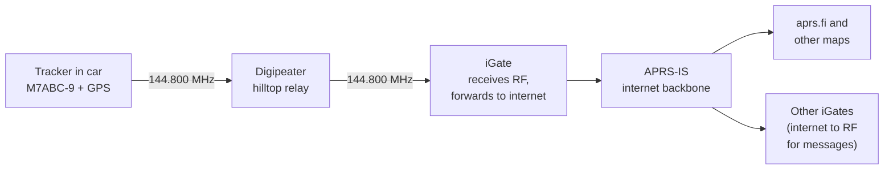
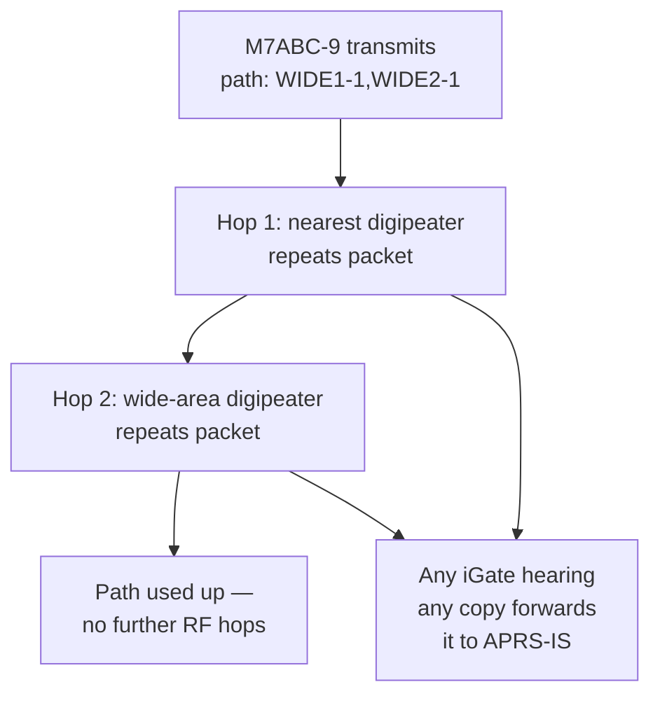
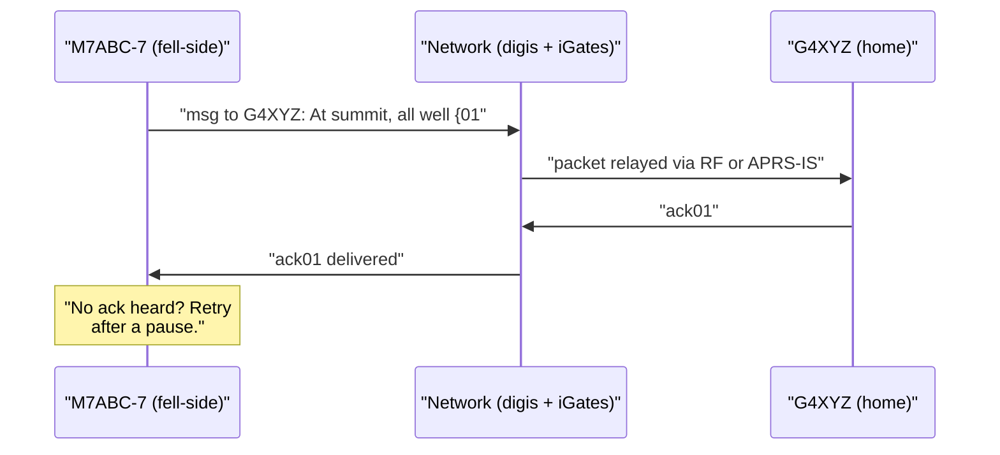

# APRS

Open the aprs.fi website and you will see something quietly wonderful: amateur radio happening live. Cars with callsigns crawling along motorways, weather stations reporting from hilltops, balloons drifting across the stratosphere, digipeaters blinking on summits — all of it carried by short bursts of packet radio on a single VHF frequency, stitched together by volunteers into one worldwide, real-time picture. That is APRS, and this chapter shows you how the picture gets drawn — and how to appear on it.

## What APRS is (and is not)

**APRS** — the Automatic Packet Reporting System — was created in the 1980s by Bob Bruninga, `WB4APR`, a US Naval Academy instructor who wanted a _tactical, local, real-time_ information channel: who is where, doing what, right now. Everyone assumes the P stands for _position_, and position is indeed the headline act, but Bruninga insisted on _packet reporting_ — because APRS carries far more than dots on a map:

- **Position beacons** — "here I am", from cars, walkers, boats, aircraft, balloons.
- **Weather reports** — hundreds of amateur weather stations feed live conditions into the network.
- **Short text messages** — two-way, station to station, with acknowledgements.
- **Telemetry** — battery voltages, temperatures, anything a sensor can measure (a balloon at 30 km reporting −55 °C is APRS at its most romantic).
- **Objects and events** — a net controller can place a marker ("checkpoint 3", "talk-in on 145.500") that appears on everyone's map.

Technically, APRS rides on **AX.25 packet radio** — the amateur data protocol whose full story belongs to the [next chapter](outpost:entry/logbook73.handbook/packet-radio) — sent as short bursts of 1,200-baud audio tones over ordinary narrow FM. Each burst, or **packet**, lasts under a second and contains the sender's callsign, the payload (position, weather, message…) and a _path_ — routing instructions we will decode shortly. Nearly all APRS activity lives on one shared channel per region: **`144.800 MHz`** across Europe and Africa, `144.390 MHz` in North America — check your region's APRS frequency. One shared channel per region is the design, not an accident: APRS is a _party line_, and everything about its etiquette follows from that.

What APRS is _not_: a tracking service you subscribe to, a private channel, or an internet product. It is amateur radio — every RF participant is licensed, everything is in the clear, and the network exists because individual amateurs choose to put infrastructure on hilltops and windowsills.

## The ecosystem: how a beacon becomes a dot on the map

Follow one packet from a car in the hills to a browser on the far side of the world:

Four kinds of station make the system work:

- **Trackers** originate packets. A tracker can be a handheld with APRS built in, a small GPS-plus-transmitter box in a vehicle, a weather station, or a solar-powered balloon payload weighing less than a slice of bread.
- **Digipeaters** (_digital repeaters_) sit on high ground and re-transmit packets they hear, extending range far beyond line of sight. Unlike a voice [repeater](outpost:entry/logbook73.handbook/repeaters), a digipeater is store-and-forward: it hears the burst, checks the path instructions, and repeats it on the same frequency a moment later.
- **iGates** (internet gateways) are receive stations — often nothing more than an RTL-SDR and a Raspberry Pi on a windowsill — that forward every packet they hear into the **APRS-IS**, the internet backbone that merges the world's RF traffic into one stream. Transmit-capable iGates also pass traffic the _other_ way, sending internet messages back out over RF to local stations. Running a receive-only iGate requires no transmitter and, in most countries, no licence, making it a superb first piece of infrastructure to host.
- **Clients and maps** — websites like aprs.fi and dedicated apps — subscribe to the APRS-IS and turn the packet stream into a live picture. (LogBook73's DX Cluster page has an APRS tab for the same feed; it shows sample data until a live bridge is connected — the badge on the page says which.)

The elegance is that no one owns it. Each layer is volunteers: the digipeater is one amateur's kit in a farmer's barn; the iGate is another's spare Pi; the map is a labour of love. Your beacon works because strangers built you a network.

## Callsigns with hats: SSIDs and symbols

One amateur may have several APRS stations at once — a home station, a car, a handheld. APRS distinguishes them with an **SSID** (secondary station identifier), a suffix from `-0` to `-15` on the callsign: `M7ABC-9` is a different station from `M7ABC-1`. Conventions have grown up so a raw callsign hints at what it is:

| SSID          | Conventional use            |
| ------------- | --------------------------- |
| (none) / `-0` | Home station                |
| `-1` … `-4`   | Digipeaters, fill-in relays |
| `-5`          | Smartphone client           |
| `-7`          | Handheld / walkie-talkie    |
| `-9`          | Vehicle / mobile            |
| `-10`         | iGate                       |
| `-11`         | Balloons and aircraft       |
| `-13`         | Weather station             |

These are customs, not law — nothing breaks if your car is `-2` — but following them helps everyone read the map. Each station also chooses a **symbol** from a standard set (car, runner, house, balloon, yacht, jeep…), which is the icon drawn on the map. Between callsign, SSID and symbol, a glance at `M7ABC-9` rendered as a little car tells the whole story.

## Paths: WIDE1-1,WIDE2-1 in plain English

Every packet carries a **path** — its request for relaying. This is the piece of APRS that looks most like an incantation, so let's translate the standard one. A path of **`WIDE1-1,WIDE2-1`** means: _"Any fill-in or wide-area digipeater, please repeat me once (`WIDE1-1`); then any wide-area digipeater, please repeat me once more (`WIDE2-1`)."_ Net effect: your packet gets at most **two hops**, which from any reasonable location floods coverage across a county or three — comfortably enough to reach an iGate, which is all that reaching the world map requires.

The numbers count remaining hops down as digipeaters handle the packet, and when they reach zero the relaying stops. Which invites the obvious question: why not ask for five hops and cover the nation? Because the channel is shared. Every unnecessary repeat of your packet occupies the shared channel across an enormous area, crowding out other stations — one long-path beacon from a hilltop can clog the channel for half a region. Hence the golden rules of APRS citizenship: **two hops is plenty** (mobile stations sometimes use just `WIDE1-1` in well-covered areas; balloons at altitude use _no_ path at all, since half a country hears them directly), and **beacon no faster than you need** — every few minutes when moving, every 10–30 minutes when stationary. Smart trackers help: most modern ones use _SmartBeaconing_, transmitting more often when you are moving fast or cornering and rarely when parked.

## Messages, weather and the rest of the payload

**Messaging** is APRS's underrated feature. Any station can send a short text to any other callsign; the network attempts RF delivery, iGates bridge across the internet, and the recipient's station sends an acknowledgement (retrying until it gets one). It feels like SMS with a soul — and unlike SMS it works on a fell-side with no phone coverage, which is exactly why event and emergency communicators love it. Various gateway services extend APRS messaging into email and other systems; offerings change over time, so explore what is current.

A message exchange looks like this on the air. Notice that the acknowledgement is itself just another packet, and that the sender keeps retrying until it arrives — APRS's shared channel drops packets routinely (two stations transmitting in the same instant collide, and there is no coordinator to prevent it), so persistence is built into the protocol rather than assumed of the channel:

The `{01` tail is the message number; `ack01` confirms that specific message. If the fell-walker's first attempt collides with someone's beacon, their radio quietly resends a minute later. It is a beautifully honest system: no delivery promises, just repetition, acknowledgement and patience — engineering values that predate the internet and still work when the internet does not.

**Weather stations** deserve their own mention. A standard APRS weather packet carries temperature, wind speed and direction, rainfall, pressure and humidity, and amateur stations feeding APRS form a surprisingly dense mesh of hyper-local weather data — many public weather services quietly ingest it. If you run a home weather station, joining this mesh is a weekend project.

And because every packet is timestamped, positioned and archived by the APRS-IS, the system doubles as a research dataset: propagation studies, balloon-flight reconstruction, even analysing how far VHF packets travel during a lift (a topic [Propagation](outpost:entry/logbook73.handbook/propagation) explains).

## Getting on the map

Routes in, from cheapest to most integrated:

- **Listen first (no licence).** An RTL-SDR on your region's APRS frequency plus free decoding software turns packet bursts into readable text on your screen — every passing car and local weather station, decoded live.
- **Phone apps.** APRS clients on a smartphone connect to the APRS-IS over the internet (position, messages, the works) — no RF involved, so opinions differ on whether it "counts", but it is a fine way to learn the culture before buying anything. Transmitting on RF, as ever, needs your licence.
- **A dedicated tracker.** Small tracker boards with GPS take your callsign and beacon from a car or rucksack. Pair with a licence and you are a moving dot within the hour.
- **An APRS-capable handheld.** Several handhelds have APRS built in: beaconing, messaging and a map or station list on the radio itself. The one-box solution for walkers — the [RT-950 Pro guide](outpost:entry/logbook73.guide.rt-950-pro) walks through one such radio's APRS menus.
- **Host infrastructure.** A receive-only iGate (RTL-SDR + Pi) fills coverage gaps and needs no licence; a digipeater (licensed) on good ground is a genuine gift to your local network.

Worth knowing before you compare technologies: APRS's job — low-rate position and message beaconing over shared radio — is nowadays also done by licence-free **LoRa** trackers and the Meshtastic mesh network, which trade the amateur network's mature infrastructure and 25 W legs for licence-free operation and weeks of battery life. [Chapter 40](outpost:entry/logbook73.handbook/lora-and-meshtastic) compares them properly; many amateurs happily run both.

## Try it yourself

1. **Watch the party line.** Open aprs.fi and find your own area — the party line, live. Identify one mobile (`-9`), one weather station (`-13`) and your nearest digipeater and iGate. On aprs.fi, click a moving station and watch its track history — note its beacon rate and path, and judge its citizenship.
2. **Decode it off the air.** Tune an RTL-SDR to your region's APRS frequency in FM and listen: APRS packets are unmistakable _brrraaap_ bursts. Feed the audio to free packet-decoding software (the well-known ones decode APRS out of the box) and watch raw AX.25 become callsigns and positions. Log the stations you hear — callsign, frequency, mode `PKT` — in LogBook73's **Receive Log**.
3. **Read a raw packet.** On the map, view a station's "raw packets" and pick apart one line: source callsign and SSID, the path (count the `WIDE`s — has it been digipeated? by whom?), and the position payload. Five minutes of this and APRS stops being magic and becomes machinery.
4. **Plan your first beacon.** Licensed? Choose your SSID and symbol using the table above, set path `WIDE1-1,WIDE2-1` and a sensible beacon interval, and take a tracker for a walk. Then find your own trail on aprs.fi — there are few better feelings in the hobby than meeting your own dot.
5. **Estimate your coverage.** From your tracker's spots, note which digipeaters and iGates heard you and how far away they were. You have just measured real VHF coverage from your area — data most amateurs only guess at.

## Key takeaways

- APRS is a real-time _tactical information_ network — positions, weather, telemetry, objects and two-way messages — riding on AX.25 packet bursts over FM, on one shared regional frequency (**`144.800 MHz`** in Europe/Africa, `144.390 MHz` in North America).
- The ecosystem is volunteer-built layers: trackers originate packets, hilltop digipeaters extend them, iGates bridge RF to the APRS-IS internet backbone, and clients like aprs.fi draw the result.
- SSIDs distinguish one amateur's several stations (`-9` mobile, `-7` handheld, `-13` weather), and map symbols make the picture readable at a glance.
- The standard path `WIDE1-1,WIDE2-1` asks for at most two digipeater hops — enough to reach an iGate; longer paths and fast beaconing clog a channel everyone shares.
- Messaging with acknowledgements works without phone coverage, and amateur weather stations make APRS a serious environmental data network.
- Start free: watch the map, then decode your region's APRS frequency with an RTL-SDR; a licence turns you from spectator into a moving dot.

This chapter is the whole picture at a glance. If it has hooked you — and APRS hooks a lot of people — the next five chapters take the system apart properly, building from a single packet up to running your own station. Start with how one beacon is actually built, byte by byte, in [APRS: Anatomy of a Packet](outpost:entry/logbook73.handbook/aprs-anatomy).
