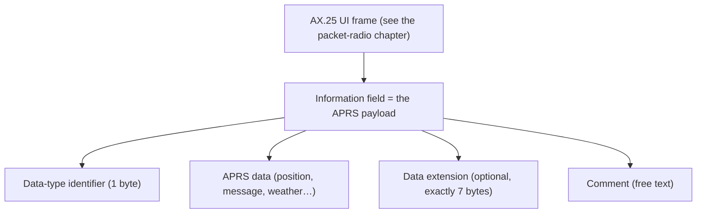
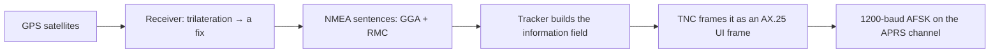

# APRS: Anatomy of a Packet

A single APRS burst lasts less than a second — a short _brrraap_ of tones on a shared VHF channel — yet packed inside it is a callsign, a position accurate to a few metres, an icon to draw on the map, and often a speed, a heading and a line of free text. This chapter takes one packet apart byte by byte, from the outer envelope down to the individual characters that spell out where a station is. If the [friendly APRS overview](outpost:entry/logbook73.handbook/aprs) told you _what_ the system does, this one shows you exactly what a tracker puts on the air the moment it presses transmit.

We build from the outside in: the field APRS is allowed to fill, then the single character that says what kind of report this is, then the two ways a position can be written, and finally where those numbers came from — a GPS receiver quietly doing geometry.

## The information field: where APRS lives

APRS does not define its own radio protocol. It is a passenger. Every APRS packet rides inside an **AX.25 UI frame** — the unnumbered, unacknowledged "postcard to everyone" you met in [Packet Radio](outpost:entry/logbook73.handbook/packet-radio). That chapter drew the whole frame — flags, callsign addresses, the via-path of digipeaters, the control byte, the checksum — so we will not redraw it here. We only need the one field APRS is given to fill: the **information field**, the frame's payload.

Two small details of the envelope matter for what follows. The control byte of a UI frame is fixed (`0x03`), and the protocol identifier that follows it is `0xF0`, meaning "no layer-3 protocol" — AX.25's way of saying _there is nothing between me and the application; the bytes after this are for whoever is listening_. Those bytes are the information field, and everything in this chapter happens inside it.

The other detail is a quiet piece of cleverness. In an ordinary AX.25 conversation the **destination** address is the callsign you are talking to. APRS broadcasts and has no one recipient, so it repurposes that field into a **to-call**: not a station, but a code identifying the _software or hardware_ that sent the packet (Dire Wolf, a particular tracker, a Kenwood radio). One position format, Mic-E, goes further and smuggles the latitude itself into the destination — a trick for the [payloads chapter](outpost:entry/logbook73.handbook/aprs-payloads). For now, hold the thought that in APRS the "address" is often carrying data, not routing.

The information field has a fixed skeleton, the same for a car beacon and a weather station:



One leading byte announces the type. Then the data proper. Then an optional seven-byte extension in a rigid format. Then a free-text comment to the end of the frame. Learn those four parts and you can read almost any packet.

## The data-type identifier: the first character tells you everything

The very first byte of the information field is the **data-type identifier**, or DTI: a single printable character, and the Rosetta Stone of the whole protocol. Before a decoder reads anything else, it reads this one character to know whether it is holding a position, a message, a weather report or a status line. Get it wrong and the rest is gibberish; get it right and every following byte falls into place.

Here are the identifiers you will actually meet on the air:

| DTI     | Name              | Meaning                                                 |
| ------- | ----------------- | ------------------------------------------------------- |
| `!`     | exclamation mark  | Position, no timestamp, station **not** message-capable |
| `=`     | equals            | Position, no timestamp, station **is** message-capable  |
| `/`     | forward slash     | Position, **with** timestamp, not message-capable       |
| `@`     | at sign           | Position, **with** timestamp, message-capable           |
| `;`     | semicolon         | Object                                                  |
| `)`     | close parenthesis | Item                                                    |
| `:`     | colon             | Message, bulletin or acknowledgement                    |
| `>`     | greater-than      | Status report                                           |
| `_`     | underscore        | Weather report (positionless)                           |
| `T`     | capital T         | Telemetry report                                        |
| `?`     | question mark     | Query                                                   |
| `}`     | close brace       | Third-party (a packet wrapped inside another)           |
| `` ` `` | backtick          | Current Mic-E position                                  |
| `'`     | apostrophe        | Old Mic-E (still current on the Kenwood TM-D700)        |

The four position identifiers repay a second look, because they are not four unrelated symbols — they encode two independent yes/no questions. _Does this report carry a timestamp?_ and _can this station receive messages?_ That gives a two-by-two grid: `!` is no-timestamp / no-messaging, `=` is no-timestamp / messaging, `/` is timestamp / no-messaging, `@` is timestamp / messaging. A modern messaging-capable tracker beaconing its live position uses `=`; a stationary weather-and-position station stamping every report with the time uses `@`. Once you see the grid you never have to memorise the four characters again.

One identifier breaks its own rule. The `!` position report is the single exception to "the DTI is the first byte": it may appear anywhere in the first 40 characters of the information field. This is a scar from history — some early hardware (the X1J TNC) prepended a text header to outgoing frames, and rather than break those stations the specification says a decoder must scan up to the 40th character for a `!` before giving up. Every other DTI must be first.

## Uncompressed position: latitude, a symbol, longitude

The oldest and most readable position format writes the coordinates as plain text you can decode with your eyes. Its layout, straight after the DTI, is exactly this:


Take the canonical example, `!4903.50N/07201.75W-`, and read it left to right:

- **`!`** — data-type identifier: a position, no timestamp, not message-capable.
- **`4903.50N`** — latitude, always eight characters in the form `ddmm.hhN`: degrees `49`, minutes `03`, hundredths of a minute `.50`, hemisphere `N`. That is 49 degrees 03.50 minutes north — decimal 49.0583°N.
- **`/`** — the **symbol table identifier** (more on this in a moment).
- **`07201.75W`** — longitude, always nine characters in the form `dddmm.hhW`: `072` degrees, `01.75` minutes, `W` for west. Longitude gets a third leading digit because it runs to 180°, latitude only to 90°.
- **`-`** — the **symbol code**.

Notice the oddity: the symbol is split in two. Its **table identifier** sits _between_ latitude and longitude, and its **code** sits _after_ longitude. This looks perverse until you realise the format is fixed-width by design — a decoder can slice out latitude by taking bytes 1–8 and longitude by taking bytes 10–18 without parsing anything, and the two symbol bytes tuck neatly into the gaps that fixed widths leave. Awkward to read; trivial to machine-parse.

### Reading the symbol

An APRS **symbol** is two characters: a table identifier and a code, together choosing the little icon drawn on the map. The table identifier is normally `/` for the **primary** table or `\` for the **alternate** table — roughly 94 symbols each, so about 188 in the base set. The code then selects one icon within that table. Our example's `/-` is a house; `/>` is a car. A representative slice of the primary table:

| Symbol | What it draws        |
| ------ | -------------------- |
| `/-`   | House (home station) |
| `/>`   | Car                  |
| `/k`   | Truck                |
| `/j`   | Jeep                 |
| `/v`   | Van                  |
| `/<`   | Motorcycle           |
| `/b`   | Bicycle              |
| `/[`   | Person / jogger      |
| `/'`   | Small aircraft       |
| `/^`   | Large aircraft       |
| `/O`   | Balloon              |
| `/R`   | Recreational vehicle |
| `/_`   | Weather station      |
| `/#`   | Digipeater           |
| `/&`   | HF gateway           |
| `/!`   | Police               |

A famous trap: `/'` is the _small_ aircraft and `/^` the _large_ one — do not swap them. That table-identifier slot has a third possibility, added around 2007: instead of `/` or `\`, a station may put a digit `0`–`9` or a letter (uppercase, and lowercase since 2009). That is an **overlay** — "draw the alternate-table symbol, but stamp this character on top of it", which is how you see a digipeater icon with a letter inside it. Overlays expand the roughly 188 base symbols to over 3,000 combinations without a single new icon.

### Two more conventions

**Position ambiguity.** Sometimes you want to say roughly where you are without pinpointing your home. APRS lets you blank the trailing digits of the coordinates by replacing them with spaces: `4903.5 N` drops the last digit, and a decoder reads the position as accurate only to a tenth of a minute. It is a deliberate, coarse privacy control built into the format itself.

**Altitude does not go here.** The position field has no room for height, so altitude is written into the comment instead, as `/A=` followed by six digits of feet — `/A=001234` means 1,234 feet above sea level. That surprises people, but it keeps the position field a fixed size while still letting a balloon at 30 km report its climb.

## Compressed position: the same fix in 13 characters

The uncompressed format spends 19 characters on a position (eight for latitude, one table id, nine for longitude, one code) before it has said anything about speed or heading. On a shared channel where every station's airtime steals from everyone else's, and where two stations transmitting at once simply destroy each other's packets, characters are not free — **shorter packets spend less time on the channel and collide less often**. That is the whole motivation for the compressed format: the identical fix, plus course and speed, in a fixed **13 characters**.

The layout, after the DTI, is `/YYYYXXXX$csT`:

- **1 byte** — symbol table identifier (here `/`).
- **4 bytes `YYYY`** — compressed latitude.
- **4 bytes `XXXX`** — compressed longitude.
- **1 byte `$`** — symbol code.
- **2 bytes `cs`** — a compressed course-and-speed, or radio range, or altitude.
- **1 byte `T`** — the compression-type byte, which says how to read those `cs` bytes.

The clever part is the encoding. Every byte except the two symbol bytes is a single printable ASCII character in the range `!` (value 33) up to `{` (value 123) — a numbering scheme called **Base-91**, so named because 123 − 33 + 1 gives 91 usable values per character. To turn a character into its numeric value you subtract 33; the four latitude characters together form one number in base 91. The formulas the specification uses are:

```
YYYY = 380926 × (90 − latitude)      (encoded in Base-91)
XXXX = 190463 × (180 + longitude)    (encoded in Base-91)
```

and to decode you reverse them:

```
latitude  =  90 − (Base-91 value of YYYY) / 380926
longitude = −180 + (Base-91 value of XXXX) / 190463
```

Worked through: suppose the four latitude characters decode (each byte minus 33, combined positionally in base 91) to the value **15,595,745**. Then latitude = 90 − 15,595,745 ÷ 380,926 = 90 − 40.942 = **49.058°N** — the very same fix as our uncompressed example, now in four bytes instead of eight. Four Base-91 characters give a resolution of about one foot anywhere on Earth, finer than the GPS behind it, so nothing is lost by compressing.

### The course/speed bytes and the type byte

The two `cs` bytes are read according to the compression-type byte `T`, and can mean one of three things:

- If the leading `c` byte is a **space**, there is no course/speed data — the `cs` bytes are unused.
- Normally, **course = c × 4°** and **speed = 1.08ˢ − 1 knots**, where `c` and `s` are the Base-91 values of the two bytes. So a `c` value of 20 encodes a heading of 80°; an `s` value of 30 encodes 1.08³⁰ − 1 ≈ 9 knots. Because course is quantised in 4° steps, a compressed heading is only good to about ±2° — fine for a map arrow, useless for navigation.
- If the `c` byte is `{`, the pair encodes a **radio range** instead: 2 × 1.08ˢ miles.
- If the type byte says the fix came from a GGA sentence (see below), the pair encodes **altitude** as 1.002 raised to the combined `cs` value, in feet.

The type byte `T` itself is a little bit-field (again, value = character − 33):

| Bits     | Field              | Values                                                                  |
| -------- | ------------------ | ----------------------------------------------------------------------- |
| bit 5    | GPS fix currency   | 0 = old (last known), 1 = current                                       |
| bits 4–3 | NMEA source        | 00 = other, 01 = GLL, 10 = GGA, 11 = RMC                                |
| bits 2–0 | compression origin | 000 = compressed, … 100 = KPC-3, 101 = Pico, 111 = digipeater-converted |

Two consequences worth remembering. First, the compressed format cannot carry a **PHG** transmitter-description extension (there is no room), so fixed stations that advertise their power and antenna tend to stay uncompressed. Second, a decoder tells compressed from uncompressed by the very first character after the DTI: if it is a symbol-table _character_ (`/`, `\` or a letter) the position is compressed; if it is a **numeric digit**, the position is the old text form. That single test is why the two formats can share one channel without ambiguity — and it is exactly why a compressed overlay is written as a letter rather than a digit, so it can never be mistaken for the leading digit of an uncompressed latitude.

## Timestamps, the extension and the comment

Three parts remain in the skeleton, and they apply to both position formats.

**Timestamps.** For the `/` and `@` reports, a seven-character timestamp sits immediately after the DTI, before the position. The common form is day-hour-minute in UTC, written `ddhhmm` followed by `z` for Zulu (UTC) — so `092345z` means the 9th day of the month at 23:45 UTC. An hour-minute-second form ending in `h` is also permitted. The point of the timestamp is honesty about staleness: a packet that took several digipeater hops and an internet relay to reach you might be a minute old, and the stamp lets a map show _when_ the station was there, not merely _where_.

**The data extension.** If present, this is _exactly seven bytes_ in one of a few rigid formats, sitting between the position and the comment:

| Form           | Pattern   | Carries                                                      |
| -------------- | --------- | ------------------------------------------------------------ |
| Course / speed | `nnn/nnn` | Course in degrees true, then speed in knots                  |
| PHG            | `PHGphgd` | Transmitter power, antenna height, gain, directivity         |
| Radio range    | `RNGrrrr` | Omnidirectional range in miles                               |
| DF signal      | `DFSshgd` | Direction-finding signal strength, height, gain, directivity |

A moving car uses the `nnn/nnn` course/speed form — `088/036` is heading 088° true at 36 knots. A fixed digipeater instead uses PHG to tell the network how well it should be heard. (Note the overlap: the _compressed_ format bakes course and speed into its `cs` bytes, so a compressed packet rarely needs this extension as well.)

**The comment.** Everything left over, to the end of the frame, is free text: a station's name, a rig description, an antenna note, a `/A=` altitude, or nothing at all. Decoders display it verbatim. It is the one place in an APRS packet where a human, not a format, decides what the bytes say.

## Where the position comes from: the GPS fix

Every position in this chapter began as geometry. A tracker does not _know_ where it is; it works it out from satellites, and understanding that step explains a lot of tracker behaviour — why a cold radio sits silent for a minute, why the first beacon is sometimes wrong, and why trackers parse two different NMEA sentences.

**Trilateration.** Each GPS satellite continuously broadcasts its own orbital position and an extremely precise time. Your receiver notes when each signal arrives and multiplies the travel time by the speed of light to get its **distance** — its range — from that satellite. One range puts you on a sphere; two ranges narrow you to a circle; three to a pair of points, one of which is absurd (out in space) and discarded. In practice a receiver needs a **fourth** satellite, because its own clock is cheap and slightly wrong, and that fourth range lets it solve for the clock error as well as position. Four satellites in view: three to fix where you are, one to fix _when_ you are. That process is called trilateration.

**Cold, warm and hot starts.** How long that first fix takes — the **time to first fix**, TTFF — depends entirely on what the receiver already remembers, and the vocabulary trackers use comes straight from GPS:

- A **cold start** is a receiver that knows nothing useful — no valid position, time, almanac or ephemeris. It must download the satellites' orbital data from scratch, which is slow because that data trickles out of the satellites at a fixed low rate. TTFF is the longest: roughly 29 seconds under an open sky, but two to four minutes in poor conditions.
- A **warm start** has a valid **almanac** and an approximate position and time, but its **ephemeris** has gone stale. TTFF is around 30–45 seconds.
- A **hot start** has both a current almanac _and_ still-valid ephemeris, so it can fix almost immediately — anywhere from about 1 to 20 seconds.

The distinction hiding in there is **almanac versus ephemeris**. The almanac is a coarse, whole-constellation catalogue — rough orbits for _every_ satellite — that takes about 12.5 minutes to download in full but stays valid for weeks to months, and tells the receiver which satellites to look for. The ephemeris is precise data for _one_ satellite, repeated every 30 seconds, refreshed roughly every two hours, and good for only about four hours. It is the ephemeris going stale that separates a warm start from a hot one — which is why a tracker switched on where it was used yesterday fixes quickly, and the same tracker flown to another continent sulks for a minute.

**The NMEA sentences a tracker reads.** A GPS module reports its results as **NMEA-0183** sentences — comma-separated lines of ASCII beginning with a `$`. Two of them matter for APRS, and, frustratingly, neither is complete on its own:

| Sentence | Carries                                                                        | Missing                   |
| -------- | ------------------------------------------------------------------------------ | ------------------------- |
| `$GPGGA` | Fix time, latitude/longitude, fix quality, satellites used, HDOP, **altitude** | Date, speed, course       |
| `$GPRMC` | Fix time, status, latitude/longitude, **speed**, **course**, **date**          | Altitude, satellite count |

Because GGA has altitude but no speed or course, and RMC has speed and course but no altitude, a tracker that wants position _and_ velocity _and_ height must read **both** and stitch them together before it can fill in the fields we dissected above. (There is also a "raw NMEA" APRS position format in which the tracker skips all the encoding and simply puts the literal `$GPRMC` or `$GPGGA` line into the packet as the payload — rare today, but legal, and a decoder must handle it.)

Put the whole journey in one line and the packet's origin becomes clear:



From satellite geometry to NMEA text to an encoded position to a UI frame to tones on the air — that is one beacon, and it happens every time a tracker's timer fires. The step from GGA and RMC into the information field is exactly the encoding we spent this chapter reading; you now know every field it fills.

## Try it yourself

You can dissect real packets tonight, no transmitter required — receiving needs no licence in most countries.

1. **Grab a live position off the air.** Tune an [RTL-SDR](outpost:entry/logbook73.handbook/software-defined-radio) to your region's APRS channel in FM and feed the audio to Dire Wolf (the software TNC from the [packet chapter](outpost:entry/logbook73.handbook/packet-radio)). Each decoded line prints the raw information field. Find a position report and identify its DTI — is it `!`, `=`, `/` or `@`? From that one character alone, state whether the station is message-capable and whether the report is timestamped.
2. **Tell compressed from uncompressed.** Look at the first character _after_ the DTI (and after any timestamp). A digit means the old text form `ddmm.hhN`; a `/`, `\` or letter means a 13-character compressed fix. Decode a text-form one by hand: read off degrees, minutes and hundredths, and confirm the hemisphere letters.
3. **Read a raw packet on aprs.fi.** Open [aprs.fi](https://aprs.fi/), click any station, and open its raw-packets view. Pick one line apart into source callsign, the digipeater path, the DTI, the position, any `nnn/nnn` course/speed extension, and the comment. Look for a `/A=` altitude hiding in the comment.
4. **Check a symbol.** From the same packet, find the two symbol bytes (table id before the longitude, code after it) and look them up — does the icon aprs.fi drew match the table above? Spot an overlay: a digit or letter where you expected `/` or `\`.
5. **Watch a cold start.** Power up a GPS tracker (or a phone GPS app) that has been off and travelled since its last fix, and time how long until the first valid position. You are watching a warm-or-cold start download its ephemeris in real time.

## Key takeaways

- An APRS packet is the **information field** of an AX.25 UI frame; APRS defines only what goes inside that payload, not the radio protocol carrying it.
- The information field is **DTI + data + optional 7-byte extension + comment**, and the single leading **data-type identifier** character decides how everything after it is read.
- The four position DTIs (`!` `=` `/` `@`) encode two independent bits — _timestamped?_ and _message-capable?_ — so you can read them without memorising.
- **Uncompressed** positions are fixed-width text (`ddmm.hhN` … `dddmm.hhW`) with the symbol split either side of the longitude; a leading digit after the DTI marks this format.
- **Compressed** positions pack the identical fix plus course/speed into a fixed **13 Base-91 characters** to cut airtime and collisions on a shared channel; a leading symbol-table character marks this format.
- Altitude lives in the comment as `/A=`, not in the position field; course and speed live either in the 7-byte `nnn/nnn` extension or in a compressed packet's `cs` bytes.
- Every position starts as a **GPS fix** by trilateration; trackers parse both `$GPGGA` (altitude) and `$GPRMC` (speed, course, date), and TTFF depends on whether the almanac and ephemeris are still valid (cold, warm or hot start).

Now that you can read one packet, the next chapter follows it out of the antenna and across the country: [APRS: How a Packet Travels](outpost:entry/logbook73.handbook/aprs-paths).
