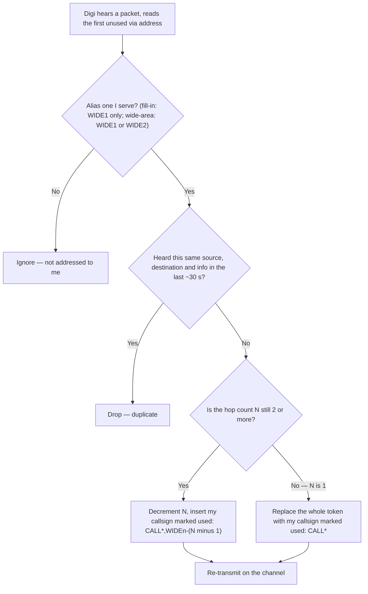
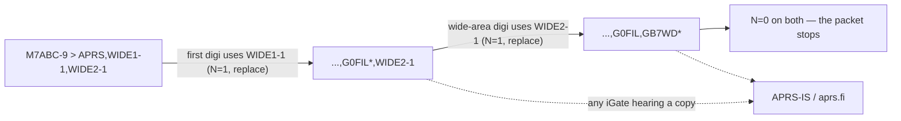

# APRS: Paths & Digipeaters

You have met the incantation already: `WIDE1-1,WIDE2-1`, the little string of letters and digits that rides along in every mobile APRS beacon. In [APRS: Anatomy of a Packet](outpost:entry/logbook73.handbook/aprs-anatomy) you built one packet and saw where the path sits inside the frame; this chapter is about what that path _does_ — how a half-second burst from a car in a valley climbs a hill, crosses a county, and reaches an internet gateway, all under the control of those few characters. Master this and you will read a raw packet's routing the way a postman reads an address, and you will understand the single most important act of APRS citizenship: asking for exactly as many hops as you need, and not one more.

## The problem a path solves

A digipeater — a _digital repeater_ — is a store-and-forward relay: unlike the voice [repeaters](outpost:entry/logbook73.handbook/repeaters) that receive and re-transmit simultaneously on two frequencies, a digipeater hears a complete packet, decides whether to repeat it, and re-transmits it a moment later **on the same frequency**. That single-frequency, one-at-a-time design is the root of everything here. Every APRS station in a region shares one channel — `144.800 MHz` across Region 1 (Europe, Africa, the Middle East), `144.390 MHz` in North America — so every time a digipeater repeats your packet, it occupies that shared channel across its entire (often enormous) footprint, and for that fraction of a second nobody else in earshot can be heard.

That is the tension a path resolves. You want your beacon to travel far enough to reach an internet gateway (an [iGate](outpost:entry/logbook73.handbook/aprs-igates), the subject of the next chapter), but every hop you ask for is spectrum you take from everyone around you. A path is therefore two decisions rolled into one short string: **which** digipeaters may repeat you, and **how many times**. Get it right and you are a good neighbour who still appears on the map; get it wrong — ask for five or seven hops from a hilltop — and one station's beacon can clog a channel across half a continent.

The routing rules that make this work sensibly are collectively called the **New N-Paradigm**, and they are worth learning precisely, because almost every path you will ever see is built from them.

## The New N-Paradigm

The scheme was designed by Bob Bruninga, `WB4APR`, adopted across the United States around 2004, and ratified for Region 1 at the IARU Region 1 plenary in Cavtat on 20 November 2008. It replaced an older, looser set of routing aliases (which we will bury at the end of the chapter) with one consistent, self-limiting grammar.

### Reading a path token: XXXn-N

Every modern path is built from tokens of the form **`XXXn-N`**. It looks cryptic; it is actually three separate pieces of information stuck together:

| Piece | Meaning                                               | In practice                          |
| ----- | ----------------------------------------------------- | ------------------------------------ |
| `XXX` | The **prefix** — the alias the packet is addressed to | Almost always `WIDE`                 |
| `n`   | The **digipeater class** requested                    | `1` = local fill-in, `2` = wide-area |
| `-N`  | The **remaining hop count**                           | Counts down to `-0`, then stops      |

So `WIDE2-1` reads as: _"any wide-area (`2`) digipeater, please repeat me — I have one (`-1`) hop left."_ And `WIDE1-1` reads as: _"any fill-in-class (`1`) digipeater, one hop left."_ The digit `n` after the prefix and the digit `N` after the dash start out equal when you set the path, but they mean different things: `n` names a _class of digi_ and never changes, while `N` is a _budget_ that every digipeater decrements as it spends a hop. The class digit is, in theory, allowed to run `1`–`7`, but in real networks only `1` and `2` are ever used.

### The two kinds of digipeater

That class digit only makes sense once you know there are two deliberately different kinds of digipeater on the air:

- A **fill-in digipeater** is a low, modest station — often a home installation with a rooftop antenna — placed to cover a hole in coverage: a valley, a built-up area, a stretch of road the hilltop machines cannot hear. A fill-in digi answers **only** to `WIDE1-1`. Its job is to lift a weak packet from a bad location just high enough for a proper wide-area digi to hear it.
- A **wide-area digipeater** is the classic hilltop or tall-mast machine with commanding coverage. It answers to **both** `WIDE1` and `WIDE2` tokens. Its job is to carry a packet across real distance.

This is why the recommended mobile path leads with `WIDE1-1`: a car is often in exactly the sort of hole a fill-in digi exists to plug. The `WIDE1-1` gives your nearby fill-in a chance to grab the packet and boost it, and the following `WIDE2-1` then lets a wide-area machine carry it onward. If instead a wide-area digi hears you directly, it happily acts on that leading `WIDE1-1` too (it serves `WIDE1` as well), so you lose nothing — the path works whichever kind of digi hears you first.

## Recommended paths, and the one hard rule

For everyday operating the community has settled on a very short list of sensible paths. Depart from it only when you know exactly why.

| Station                  | Recommended path  | Reasoning                                                                                          |
| ------------------------ | ----------------- | -------------------------------------------------------------------------------------------------- |
| Mobile / portable        | `WIDE1-1,WIDE2-1` | One fill-in hop, then one wide hop — two hops total, enough to reach an iGate from almost anywhere |
| Fixed, ordinary location | `WIDE2-1`         | You chose your antenna; you can usually reach a wide-area digi directly, so skip the fill-in hop   |
| Fixed, flat or rural     | `WIDE2-2`         | Two wide hops where digis are sparsely spread                                                      |
| Fixed, high site         | _(none — direct)_ | You already reach iGates yourself; asking for a hop only adds channel load                         |

Notice fixed stations do **not** begin with `WIDE1-1`. A home station's whole point is a decent, chosen antenna, so it should go straight for a wide-area digi rather than triggering every little fill-in in the neighbourhood. That leads to the single hard rule of path-building, the one thing you must never get wrong:

> **Never place `WIDE1-1` anywhere but the first position of a path.**

The reason is brutal arithmetic. Fill-in digis are configured to react to a `WIDE1-1` token, and there can be dozens or hundreds of home fill-in digis in a busy area. Put `WIDE1-1` first and only your _immediate_ local fill-in acts on it — once used, later digis see it as already-repeated and leave it alone. Put `WIDE1-1` second (say `WIDE2-1,WIDE1-1`) and after the first wide hop carries your packet across a whole region, _every fill-in digi in that region's footprint_ suddenly sees a fresh, unused `WIDE1-1` and re-keys at once. That is how one carelessly ordered path sets off a channel-wide chorus of needless transmissions.

(For how these choices appear in a real radio's menu — where you tick "PATH 1" and "PATH 2" boxes rather than typing a string — see the companion guide's [APRS menus](outpost:entry/logbook73.guide.rt-950-pro/menus-aprs).)

## Inside a digipeater: decrement, insert, replace

Here is the mechanism at the heart of the whole system. When a digipeater hears a packet, it looks at the **first via-path address that has not yet been used**, and — if that address names an alias it serves — it does one of two things depending on the hop count `N`:

- **If `N` is 2 or more:** it _decrements_ `N` by one and _inserts_ its own callsign (marked as used) ahead of the token. So `WIDE2-2` handled by station `GB7WD` becomes `GB7WD*,WIDE2-1`. The packet still has hops left, and now the path also records who spent one.
- **If `N` is 1:** the hop budget is about to run out, so instead of leaving an exhausted `WIDEn-0` token cluttering the path, the digi _replaces_ the whole token with its own callsign, marked used. So `WIDE2-1` handled by `GB7WD` becomes simply `GB7WD*`.
- **When `N` reaches 0**, the token is spent and no digipeater will repeat the packet any further. (A packet should never arrive with `N` already 0 — that would mean it was sent malformed.)



Let us walk the standard mobile path through two hops so the abstract rules become concrete. You transmit:

```
M7ABC-9>APRS,WIDE1-1,WIDE2-1:!5132.07N/00007.24W>...
```

The first via token is `WIDE1-1`, and here `N` is 1, so the first digi to act on it — call it `G0FIL` — _replaces_ it. The path becomes `G0FIL*,WIDE2-1`. The next digi to hear that copy looks past the used `G0FIL*` to the first unused token, `WIDE2-1`; its `N` is also 1, so a wide-area machine `GB7WD` replaces it in turn. Now the path reads `G0FIL,GB7WD*`, both hops are spent, and the packet stops.



For the _insert_ branch, picture a rural fixed station beaconing `WIDE2-2`. The first wide-area digi sees `N`=2, so it decrements and inserts: `GB7WD*,WIDE2-1`. A second wide-area digi then sees `WIDE2-1` with `N`=1 and replaces it: `GB7WD,GB7XX*`. Two hops, and the finished path names both machines that carried you.

### The has-been-repeated bit and the asterisk

That `*` is not actually transmitted as a character. It is a _rendering_ of something carried in the frame itself: the **has-been-repeated bit**, sometimes written the **H bit**. Every [AX.25](outpost:entry/logbook73.handbook/packet-radio) address — destination, source, and each via-path digipeater — ends in a single "SSID octet", and the top bit of that octet is the H bit. A digipeater that uses a hop sets that address's H bit to 1.

| Bit(s) in the SSID octet | Mask   | Meaning                                     |
| ------------------------ | ------ | ------------------------------------------- |
| Bit 7 (top)              | `0x80` | **H** — has-been-repeated flag              |
| Bits 6–5                 | `0x60` | Reserved (`RR`), normally left set          |
| Bits 4–1                 | `0x1e` | The SSID value (0–15)                       |
| Bit 0 (bottom)           | `0x01` | Last-address marker (ends the address list) |

When a client such as aprs.fi prints a packet as `source>dest,digi1,digi2:info`, it walks that list and puts a single `*` after the **last** address whose H bit is set. By convention only that one asterisk appears — it means "this address, and every address before it, has been used". So `G0FIL,GB7WD*` tells you both `G0FIL` and `GB7WD` handled the packet, and the next unused hop (if any) would be whatever follows. A path printed with the asterisk in the _middle_ of unused tokens, or with _two_ asterisks, is malformed — the display is only ever meant to carry one.

## Duplicate suppression: the 30-second memory

Because the same packet can reach a digipeater by several routes at once — heard directly, and again a moment later via a neighbouring digi — every well-behaved digipeater keeps a short memory and **refuses to repeat a packet it has already repeated within roughly the last 30 seconds**. This is what stops a packet echoing endlessly around a ring of overlapping digipeaters.

The subtle and important part is _what counts as "the same packet"_. The duplicate key is built from three fields only — the **source** callsign, the **destination**, and the **information field** (the actual payload). The **via-path is deliberately ignored.** That has to be so: by the time two copies of your beacon reach a digi, their paths look different (different callsigns inserted, different asterisk positions), yet they are plainly the same beacon and must be treated as one. Stripping the path from the comparison is exactly what makes that work.

The flip side is a trap for the unwary: anything that makes the _payload_ unique defeats the duplicate check. Stamp a running sequence number or a fresh timestamp into every beacon's information field and each copy looks brand new, so nothing gets suppressed and your packet propagates as many times as there are paths to it. Delaying a re-transmission beyond the ~30-second window has the same effect. Both are classic ways a well-meaning tracker becomes a channel hog.

## Why the old aliases had to go

Before the New N-Paradigm, paths were built from named aliases — chiefly `RELAY`, `WIDE`, `TRACE` and `TRACEn-N`. They worked, loosely, but they had a fatal flaw: no consistent hop counting and, crucially, **no duplicate checking**, so a single beacon could ricochet through a dense area many times over, flooding the shared channel. The migration to New-N was, in effect, a network-wide rewrite of the routing rules, and by `WB4APR`'s own field estimate it cut duplicate traffic and interference by roughly two to four times in the United States. (That figure is an on-air observation, not a laboratory measurement — treat it as the order of magnitude it is.)

| Deprecated alias     | Modern equivalent                      |
| -------------------- | -------------------------------------- |
| `RELAY`              | `WIDE1-1` — the local fill-in hop      |
| `WIDE` (unqualified) | `WIDEn-N` — counted wide-area hops     |
| `TRACE`, `TRACEn-N`  | folded into New-N's callsign insertion |

The bare `WIDE` alias survives today in only a few special corners — most notably satellite and ISS digipeating on `145.825 MHz`, where the routing conventions differ from the terrestrial channel. On the everyday APRS frequency, seeing an unqualified `RELAY` or `WIDE` in a path is a sign of a very old or badly configured station.

## Proportional pathing

There is one elegant refinement worth knowing, also from `WB4APR` (around 2006): **proportional pathing**. The idea is that not every beacon needs the same reach. Your nearest neighbours can hear you directly and want frequent updates; the far-away network only needs to see you occasionally. So a proportional-pathing tracker _cycles_ through paths of increasing reach at decreasing frequency — sending short, cheap, direct beacons often and long, expensive, multi-hop beacons rarely.

At `WB4APR`'s published `/2` rate, a mobile cycles like this:

| Beacon reach | Path sent         | Interval at `/2` | Interval at `/3` |
| ------------ | ----------------- | ---------------- | ---------------- |
| Direct only  | _(no path)_       | every 1 min      | every 1 min      |
| One hop      | `WIDE1-1`         | every 2 min      | every 3 min      |
| Two hops     | `WIDE1-1,WIDE2-1` | every 4 min      | every 9 min      |
| Three hops   | `WIDE1-1,WIDE2-2` | every 8 min      | every 27 min     |

So every minute the local area gets a fresh, zero-cost direct beacon, while the wider network still sees you — just less often the further out it is. It is a genuinely clever way to be generous locally and frugal globally. Bear in mind these exact intervals are the published examples; the real numbers depend on your tracker's base beacon rate and firmware, so treat the table as the _pattern_ rather than a guarantee.

## Ceilings, trapping, and why real paths look untidy

Two practical realities round this out. First, the AX.25 frame that carries the path has room for **at most 8 digipeater addresses** in the via list — a hard structural ceiling. In practice you will never approach it deliberately, but the insert behaviour can eat into it: each hop that _inserts_ rather than replaces adds a callsign to the list. Second, and more to the point, most terrestrial wide-area digipeaters **trap** paths that ask for too much — they simply refuse to act on a `WIDE5-5` or `WIDE7-7`, dropping abusive long-path requests on the floor to protect the channel. Ask for more than about two hops and you will often find your extra hops quietly ignored anyway.

Finally, a caveat to keep you sane when you start reading real packets. The APRS 1.0.1 specification does not actually define digipeater behaviour, so different digipeater firmware formats the path differently on the air. Dire Wolf (a software digipeater we will use in a later chapter) uses an **adaptive insert/replace** strategy that keeps the path as short and tidy as the rules above describe. Older hardware such as the Kantronics KPC-3+ uses **unconditional insert**, which can leave spent `WIDE1` tokens lingering in the path even after they are used up. Both are legitimate; both get your packet where it is going. So do not be surprised when a raw path from the wild looks a little messier than the textbook version — the _routing_ is standard, but the exact _formatting_ is implementation-dependent.

## Try it yourself

You can study every idea in this chapter from real traffic, without transmitting.

1. **Read a raw path on aprs.fi.** Find a mobile station near you and open its raw packets. Take one line and dissect the via-path: which digipeaters carried it, where the single `*` sits (so which hops are spent), and how many `WIDE` tokens remain unused. Do this for a station in a valley and one on a hill and watch how their paths differ.
2. **Watch a path decrement live.** Feed your region's APRS frequency (`144.800 MHz` in Region 1, `144.390 MHz` in North America) from an RTL-SDR into Dire Wolf, or any packet decoder, and watch the terminal. You will often see the _same_ beacon appear two or three times within a couple of seconds — the direct copy, then digipeated copies — each with a different, more-used-up via-path. You are watching decrement-and-replace happen in real time.
3. **Spot a bad citizen.** Look for a packet with more than two hops requested, an unqualified `RELAY`/`WIDE`, or a `WIDE1-1` sitting anywhere but first. Then look at how far its copies spread on the map, and you will _see_ why the rules exist.
4. **Plan your own path.** If you are licensed, decide — from where you operate and how you move — whether you are a `WIDE1-1,WIDE2-1` mobile, a `WIDE2-1` home station, or a high site that needs no path at all. That single decision is your biggest contribution to a healthy channel.

## Key takeaways

- A path answers two questions at once: **which** digipeaters may repeat you (`WIDE1` = fill-in, `WIDE2` = wide-area) and **how many** hops (`-N`). Every hop is shared channel you spend on everyone's behalf.
- The everyday paths are `WIDE1-1,WIDE2-1` for mobiles and `WIDE2-1` (or less) for fixed stations; the one unbreakable rule is that **`WIDE1-1` goes first or not at all**, or countless fill-in digis re-key needlessly.
- A digipeater acting on a hop **decrements N and inserts its callsign** when `N ≥ 2`, and **replaces the token with its callsign** when `N = 1`; the packet stops at `N = 0`.
- The `*` you see is a display of the **has-been-repeated (H) bit** — the top bit of each address's SSID octet — and by convention marks only the last used address.
- **Duplicate suppression** stops echoes by refusing to repeat the same source + destination + information field within ~30 seconds; the via-path is ignored, so stamping a unique serial or timestamp into the payload defeats it and floods the channel.
- The **New N-Paradigm** replaced the loose `RELAY`/`WIDE`/`TRACE` aliases (which lacked duplicate checking) and cut interference several-fold; **proportional pathing** goes further, sending direct beacons often and multi-hop ones rarely.
- Real paths look untidy because the spec never defined digipeater formatting — adaptive-insert (Dire Wolf) and unconditional-insert (KPC-3+) firmware format the same routing differently, and the 8-address AX.25 ceiling plus digipeater "trapping" quietly cap abusive long paths.

Your packet has now travelled as far across RF as its path allows — the next step is how it leaves the airwaves entirely, as we meet the internet side of APRS in [APRS: iGates & the Internet](outpost:entry/logbook73.handbook/aprs-igates).
