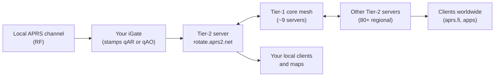
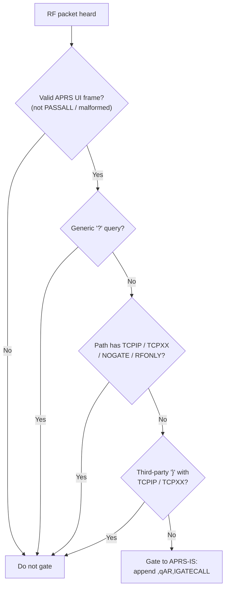
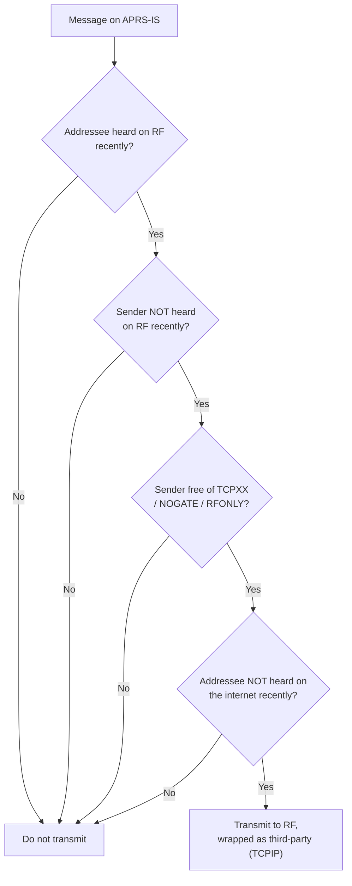

# APRS: iGates & the APRS-IS

The last two chapters built one packet and then walked it across the RF world of digipeaters. But the little dot you watch on aprs.fi did not reach your screen by radio — somewhere near its origin it crossed a boundary from the airwaves onto the internet, through a piece of volunteer infrastructure called an **iGate**, and into a worldwide server mesh called the **APRS-IS**. This chapter is about that boundary: what carries packets across it, in which direction, under what rules — and why the whole arrangement does not collapse into an endless loop.

You have already met these pieces in passing in [APRS](outpost:entry/logbook73.handbook/aprs). Here we open them up.

## What an iGate actually does

An **iGate** (internet gateway) is a station that straddles two worlds. On one side it has a VHF receiver listening to your local APRS channel; on the other, an ordinary internet connection to an APRS-IS server. Its job is translation between the two — taking the [AX.25 UI frames](outpost:entry/logbook73.handbook/packet-radio) it hears off the air and re-presenting them as lines of text on a TCP link, and (sometimes) the reverse.

There are two kinds, and the difference is entirely about direction:

- A **receive-only iGate** hears RF and forwards it to the internet, and never transmits. It needs no transmitter and, in most countries, no licence — a receiver, a Raspberry Pi and some software on a windowsill. It is the single most useful first piece of infrastructure you can host.
- A **transmit (bidirectional) iGate** does everything the receive-only kind does, and can also transmit selected traffic from the internet _back_ onto your local RF channel — chiefly text messages meant for stations it can hear. That needs a transmitter and your licence.

The original APRS-IS guidance mildly discouraged receive-only iGates, on the theory that a gateway ought to work both ways. Current consensus among the people who run the network — the operator of aprs.fi, among others — is the opposite: where transmit iGates already provide the internet-to-RF path, extra receive-only iGates are purely beneficial, because more receivers means more of the channel is heard and gated.

### The q-construct: stamping a packet's provenance

When an iGate injects a packet into the APRS-IS, it must record _how_ that packet got onto the internet. It does this by appending a **q-construct** to the path — a short token beginning `qA`, followed by the callsign of the station responsible. (The callsign always comes _after_ the construct, and names the origin.) This is the internet side's equivalent of the [has-been-repeated marks](outpost:entry/logbook73.handbook/aprs-paths) you met on RF: a tamper-evident record of a packet's journey that every downstream server and client can trust.

| q-construct | Meaning                                                        |
| ----------- | -------------------------------------------------------------- |
| `qAC`       | Injected by a verified client connected directly to a server   |
| `qAR`       | Gated in from RF by a verified, transmit-capable iGate         |
| `qAO`       | Gated in from RF by a receive-only iGate                       |
| `qAS`       | Arrived from another server (the normal server-to-server case) |
| `qAX`       | From an _unverified_ login — deprecated                        |

Modern servers reject unverified injection (`qAX` and the old `TCPXX` route) entirely: if you want to put a packet onto the APRS-IS at all, you must be verified. We will see what "verified" means in a moment.

## The APRS-IS: one stream from a mesh of servers

The **APRS-IS** (APRS Internet System) is not a single computer. It is a worldwide mesh of servers that constantly exchange packets, so that a frame injected by _any_ iGate appears, within about a second, on _every_ server — and therefore to every client — around the globe. It behaves like one enormous shared stream, even though no single machine holds it.

The mesh is tiered. A small **Tier-1 "core"** backbone (reports suggest around nine servers, though these counts drift over time) forms the hub that everything fans out from. Feeding into it is the much larger **Tier-2** network at `aprs2.net` — reports suggest 80-plus regional servers grouped behind roughly five hubs. The rule for you is short: **clients and iGates connect to Tier 2, never to the core.** The core exists to glue the regional servers together, not to serve end users.



You reach a Tier-2 server by name, and the names use DNS round-robin so that one hostname resolves to whichever nearby server is healthy:

| Hostname           | Scope                                     |
| ------------------ | ----------------------------------------- |
| `rotate.aprs2.net` | Global — any Tier-2 server, load-balanced |
| `noam.aprs2.net`   | North America                             |
| `soam.aprs2.net`   | South America                             |
| `euro.aprs2.net`   | Europe                                    |
| `asia.aprs2.net`   | Asia                                      |
| `aunz.aprs2.net`   | Australia / New Zealand                   |

The server software itself is now mostly **aprsc**, a C reimplementation of the original javAPRSSrvr. It is worth knowing that aprsc does _not_ itself igate or digipeat — it neither touches RF nor invents packets. It only receives, deduplicates, filters and forwards the stream. All the intelligence about _what to gate and when_ lives out at the edges, in the iGates. The servers are plumbing; the iGates are the taps.

## Ports: which door you knock on

A single APRS-IS server listens on several TCP ports, and the port you choose decides how much of the stream you get. Most people want just one of them.

| Port                  | What you get                                                                                                                     |
| --------------------- | -------------------------------------------------------------------------------------------------------------------------------- |
| `14580`               | **User-defined filter port** — the everyday client and iGate port. You send a filter at login and receive only matching packets. |
| `10152` (legacy `23`) | Full, unfiltered feed — the whole worldwide firehose                                                                             |
| `10151`               | Full feed _plus_ roughly 30 minutes of history on connect                                                                        |
| `1314`                | Message traffic only                                                                                                             |
| `1313`                | Server-to-server link (the backbone between servers)                                                                             |
| `14501`               | HTTP status page for the server                                                                                                  |
| `8080`                | HTTP / UDP submit — send-only                                                                                                    |

The full-feed ports (`10152`, `10151`, `23`) are a genuine firehose, intended for servers and specialist tools, not for a typical client — you would be pulling every packet on Earth to look at your own county. Almost everyone, iGates included, wants **`14580`** with a filter.

One caveat on accuracy: port **`20146`** is sometimes cited for APRS-IS, but it could not be confirmed on the canonical ports documentation. Treat it as unconfirmed or legacy, and reach for `14580` instead.

## The login line and your passcode

The first thing your client sends after opening the TCP connection is a single **login line** in plain text:

```
user MYCALL-SS pass PASSCODE vers SW VER [UDP port] [filter ...]
```

Taking the tokens in turn: `user` gives your callsign and [SSID](outpost:entry/logbook73.handbook/aprs-anatomy); `pass` gives your passcode; `vers` names your software and its version (two tokens); an optional `UDP port` requests packet delivery over UDP; and an optional `filter` clause sets your server-side filter.

The **passcode** is the part that confuses newcomers, so be clear about what it is not: it is _not_ a password you choose, and it is not really a security secret. It is a fixed number derived from your callsign, which your client software works out for you. Its purpose is to mark your connection as belonging to a real amateur claiming that callsign:

- The **correct passcode** makes your connection **verified**. A verified station may both read the stream _and inject_ — that is, gate packets in from RF, or send messages.
- The passcode **`-1`** marks you **unverified**. An unverified connection is **receive-only**: it may read everything, but must never inject anything.

That distinction matters for iGates. Even a _receive-only_ iGate is injecting packets (it forwards RF into the APRS-IS with a `qAO` stamp), so it must be verified with the correct passcode. The `-1` passcode is for pure spectators — a map, a monitoring script, someone just watching the stream.

A small but common trap: a transmit iGate connecting to `14580` with **no filter** starts completely silent. The filter port sends you nothing until you ask for something. So the login line and the filter are two halves of one thought.

Here is a read-only login you could use to watch traffic near a point, with no callsign and no risk of injecting:

```
user N0CALL pass -1 vers Handbook 1.0 filter r/51.5/-0.1/50
```

## Server-side filters: subscribing to a slice

The single most important idea about filters is counter-intuitive, so hold onto it: **filters are additive — they combine with logical OR.** Every filter clause you add subscribes you to _more_ data, never less. There is no way to narrow a stream by piling on filters; each one opens another tap. To _exclude_ something, you prefix a clause with a minus sign (`-`), which carves that subset back out.

So `r/51.5/-0.1/50 t/m` does not mean "messages within 50 km". It means "everything within 50 km of that point, **or** any message packet anywhere on Earth" — the two clauses union together. If you only wanted local messages, you would filter geographically and let a message-type clause narrow _within_ that, which the OR model cannot do directly — a subtlety that catches people out constantly.

The main filter clauses:

| Filter                   | Selects                                                                                             |
| ------------------------ | --------------------------------------------------------------------------------------------------- |
| `r/lat/lon/dist`         | **Radius** — everything within `dist` km of a point                                                 |
| `m/dist`                 | **My range** — within `dist` km of your own last posted position                                    |
| `f/call/dist`            | **Friend range** — within `dist` km of station `call`                                               |
| `a/latN/lonW/latS/lonE`  | **Area box** — a latitude/longitude rectangle                                                       |
| `p/prefix`               | Callsign **prefix** (e.g. `p/VK` for all Australian calls, or `p/G/M` for several prefixes at once) |
| `b/call`                 | **Budlist** — one or more exact callsigns                                                           |
| `o/obj`                  | **Objects** by name                                                                                 |
| `d/call`                 | **Digipeated-by** — packets relayed by `call`                                                       |
| `e/call`                 | **Entry-station** — packets that entered the APRS-IS via iGate `call`                               |
| `g/addressee`            | **Group / addressee** — messages to a group (e.g. `g/BLN*` for bulletins)                           |
| `u/tocall`               | **Destination / TOCALL**                                                                            |
| `s/symbol`               | Packets using a given map **symbol**                                                                |
| `t/poimqstunw[/call/km]` | **Type** — by packet type (see below)                                                               |
| `q/con`                  | By **q-construct** — how a packet entered the APRS-IS                                               |

The type filter `t/` takes a string of letters, each selecting one kind of packet: `p` position, `o` object, `i` item, `m` message, `q` query, `s` status, `t` telemetry, `u` user-defined, `n` NWS bulletins, `w` weather — and an optional `/call/km` to limit it to the neighbourhood of a station.

In practice a modest home iGate might log in with `filter m/50 f/M0XYZ/10`, meaning "everything within 50 km of me, plus everything within 10 km of my friend M0XYZ". A transmit iGate additionally wants to _see_ the messages it might need to gate, which is where the gating rules below take over from the filter.

## Gating RF to the internet: the receive rules

Now the heart of it. An iGate does **not** blindly forward everything it hears — several kinds of packet must be held back, mostly to keep rubbish out of the network and to stop packets looping between RF and the internet forever.

The rule is stated as an exclusion list: **gate every RF packet you hear, except**

- **non-UI frames** — connected-mode AX.25 traffic (the numbered, acknowledged frames from [Packet Radio](outpost:entry/logbook73.handbook/packet-radio)); APRS lives entirely in UI frames, so anything else is not APRS;
- **malformed or PASSALL packets** — some decoders can be told to accept frames that failed their checksum, a mode called PASSALL; those, and anything otherwise malformed, are untrustworthy and must not be gated;
- **generic queries** — a packet whose information field begins with `?` (a [query](outpost:entry/logbook73.handbook/aprs-anatomy)) is a _request_, not a report, and re-broadcasting it network-wide would be spam;
- **anything whose path contains `TCPIP`, `TCPXX`, `NOGATE` or `RFONLY`** — the first two mark a packet that already came _from_ the internet (re-gating it would loop), and the last two are a station's explicit request to be kept off the internet;
- **third-party packets** — those whose information field begins with `}` — that contain `TCPIP` or `TCPXX` inside, again for loop prevention.

When a packet passes all of those tests, the iGate gates it: it appends `,qAR,IGATECALL` to the path (its own callsign after the `qAR` construct, or `qAO` for a receive-only gate) and **must not modify the data portion**. The information field crosses the boundary byte-for-byte untouched, which is why the raw packet you read on aprs.fi is exactly what left the transmitter — nothing is cleaned up, corrected or reformatted on the way in.



The `NOGATE` and `RFONLY` conventions are worth remembering as a courtesy control you can use yourself: put either in your own path and well-behaved iGates will keep your packets off the internet — handy for purely local testing or a beacon you would rather not publish.

## Gating the internet back to RF

The reverse direction is harder, needs a licence, and needs restraint, because the internet stream is a _global_ firehose and your local channel is a scarce shared resource. A transmit iGate therefore transmits almost nothing from the internet. What it does relay is **addressed messages** — and only when the message is genuinely for someone it can reach on RF.

Specifically, a message is transmitted from the internet to RF only if **all four** of these are true:

1. the **addressee has been heard locally on RF** within a predefined period — the person the message is for is actually here, on your channel;
2. the **sender has _not_ been heard on RF** within that period — if the sender were local, RF would deliver the message directly and gating it would be pointless duplication;
3. the sender's packet carries **no `TCPXX`, `NOGATE` or `RFONLY`** — nobody has asked to be kept off RF;
4. the **addressee has _not_ been heard on the internet** within that period — if they are reachable another way, there is no need to spend airtime on them.



What counts as "recently"? The **predefined period is version-dependent**, so treat it as _typically 30 to 60 minutes, implementation-dependent_. The canonical guidance says "within 1 hour (or less)"; Dire Wolf, the common software iGate, keeps a 30-minute list of stations it has heard directly and defaults its messaging filter to 180 minutes. The principle — recently enough to believe the addressee is still local — is what matters, not a single hard number.

Two refinements close the loop neatly. First, when Dire Wolf gates a message to RF it also transmits the _sender's_ next position report, so the local addressee can see where the person messaging them actually is — a thoughtful "courtesy posit". Second, and more importantly for our theme: the gated message is transmitted **wrapped as a third-party packet** (information field beginning `}`) with `TCPIP` in its third-party header. Look back at the receive rules and you will see why that is elegant — any _other_ iGate that hears this transmission on RF will find the `}` with `TCPIP` and refuse to gate it back to the internet. The two rule-sets interlock: the outbound wrapping is exactly the pattern the inbound filter is watching for. That is how a message can cross from internet to RF without ever finding its way back and circling forever.

## Why nothing loops forever: duplicate suppression

Provenance stamps and the four gating conditions are two of the three defences against loops and floods. The third is **duplicate suppression**, and it runs on the servers themselves.

Every APRS-IS server applies a **hard 30-second dedup window**. If the same packet arrives twice within 30 seconds, only the first passes; the rest are dropped. The "same packet" is judged by a key of **source callsign + destination + information field** — the path and the q-construct are deliberately ignored, so the same beacon relayed by three different digipeaters still counts as one packet. This is the internet-side twin of the ~30-second dedup the [digipeaters](outpost:entry/logbook73.handbook/aprs-paths) perform on RF, and it uses the same key for the same reason.

Two things break dedup, and knowing them explains a lot of odd behaviour:

- **Changing the information field** — inserting a unique serial number or timestamp into every transmission — makes each copy look new, defeating suppression. This is why well-behaved trackers do _not_ stamp per-transmission uniqueness onto plain beacons.
- **Delaying a packet past 30 seconds** before forwarding it — the window has closed, so it is treated as fresh.

Be careful not to conflate this with application-level deduplication. This server 30-second window is a low-level anti-flood measure. A map like aprs.fi separately compares _positions_ over a much longer span — of the order of 30 minutes — to decide whether a station has actually moved enough to warrant a new track point. Different mechanism, different purpose, different timescale.

A final implementation note that ties it together: Dire Wolf removed its own RF-to-internet dedup in version 1.5 (the servers dedup anyway, so doing it twice was pointless) and _deliberately does not_ dedup in the internet-to-RF direction — because message delivery relies on rapid retries, and suppressing sub-30-second repeats would kill exactly the retries that make [APRS messaging](outpost:entry/logbook73.handbook/aprs-payloads) reliable. The right amount of deduplication depends on which way the packet is going.

## Try it yourself

You can explore the entire internet side with nothing but a terminal — no radio, no licence, no injecting.

1. **Read a packet's provenance.** On aprs.fi (or your own [live spots](outpost:entry/logbook73.handbook/aprs) view), open a station's raw packets and find the `qA` token. Is it `qAR`, `qAO` or `qAC`? Read the iGate callsign after it — you are seeing exactly how that packet entered the internet.
2. **Connect to the APRS-IS yourself.** With `netcat` or `telnet`, open `rotate.aprs2.net` on port `14580` and send a read-only login line: `user N0CALL pass -1 vers test 1.0 filter r/LAT/LON/50` (fill in your own latitude and longitude). Watch local packets stream past as text.
3. **Prove that filters are additive.** With that connection open, note how much arrives. Then reconnect with a second clause added — say `filter r/LAT/LON/50 t/m` — and watch _more_ appear (every message on Earth), not less. That "more, never less" behaviour is the whole mental model in one experiment.
4. **Feel the firehose.** Briefly connect to port `10152` (the full unfiltered feed) and watch two seconds of the entire planet's APRS traffic scroll by. Then go back to your filtered `14580` connection and appreciate why nobody runs a client on the firehose.

When you are ready to run a real receive-only iGate of your own — a receiver, a Pi and Dire Wolf — the [next-but-one chapter](outpost:entry/logbook73.handbook/aprs-running) walks through the build, and your own callsign will start appearing on aprs.fi as an `e/` entry-station for the packets you gate. (Your handheld's own APRS features, like those in the companion [RT-950 Pro guide](outpost:entry/logbook73.guide.rt-950-pro/menus-aprs), are simply clients of this same system when bridged through a phone or an iGate.)

## Key takeaways

- An **iGate** bridges RF and the APRS-IS; **receive-only** gates hear RF and forward it (needing no transmitter or, usually, licence), while **transmit** iGates can also send selected internet traffic back onto RF.
- Every injected packet is stamped with a **q-construct** (`qAR` from a transmit iGate, `qAO` from a receive-only one, `qAC` from a direct client) recording how it reached the internet — the internet-side equivalent of the has-been-repeated marks on RF.
- The **APRS-IS** is a tiered server mesh: connect clients and iGates to **Tier 2** via `rotate.aprs2.net` or a regional name, never to the core; the servers (mostly **aprsc**) only move and filter the stream, they never igate or digipeat.
- Use port **`14580`** with a filter for normal work; the full-feed ports (`10152`/`10151`/`23`) are a firehose for servers. A **correct passcode** verifies you (may inject); **`-1`** is receive-only. Port `20146` is unconfirmed on the canonical docs — avoid it.
- **Server-side filters are additive (logical OR)** — each clause adds data, and `-` excludes; the key clauses are geographic (`r/`, `m/`, `f/`, `a/`), identity (`p/`, `b/`, `u/`, `q/`) and type (`t/...`).
- **RF-to-internet:** gate everything _except_ non-UI frames, malformed/PASSALL packets, `?` queries, anything carrying `TCPIP`/`TCPXX`/`NOGATE`/`RFONLY`, and third-party `}` packets marked `TCPIP`/`TCPXX`; append `,qAR,IGATECALL` and never alter the data.
- **Internet-to-RF** transmits a message only when the addressee is heard locally, the sender is _not_ on RF, the sender permits gating, and the addressee is not already reachable online — within a period that is _typically 30–60 minutes, implementation-dependent_.

With the network plumbing understood, the last thing to learn is the rest of what packets actually carry — the compact encodings and message types we have kept referring to: [APRS payloads: Mic-E, objects, messages, telemetry and weather](outpost:entry/logbook73.handbook/aprs-payloads).
