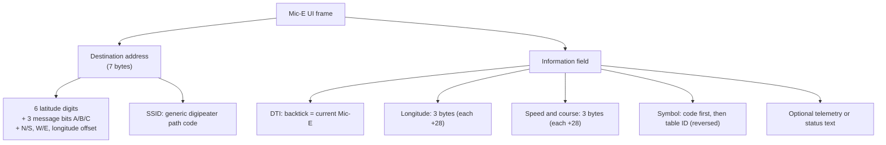
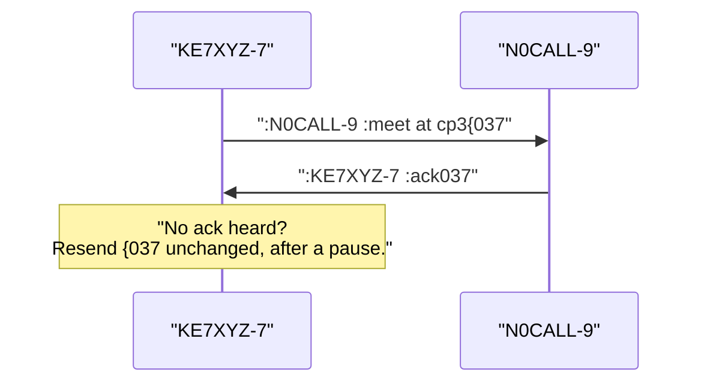
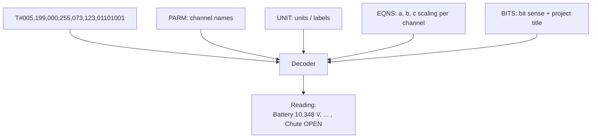

# APRS: Mic-E, Messages, Objects & Telemetry

A plain position report tells the map where a station is. But APRS was designed to carry far more than dots — status, warnings, live text conversations, sensor readings and weather — and each of those has its own carefully packed format riding in the very same information field you dissected in [APRS: anatomy of a packet](outpost:entry/logbook73.handbook/aprs-anatomy). This chapter opens the rest of the toolbox: the ruthlessly compressed Mic-E position, the map markers a station can place for _other_ things, two-way messaging with acknowledgements, telemetry channels with their own scaling equations, and the weather format that makes APRS one of the densest amateur sensor networks on the air.

Everything here rides in the AX.25 UI frame from [Packet radio](outpost:entry/logbook73.handbook/packet-radio), and every format below is chosen by the one-byte **data-type identifier (DTI)** you met in the anatomy chapter — the first character of the information field that says "what follows is a message", "an object", "telemetry", and so on. We will lean on that idea constantly, so it is worth having fresh.

## Mic-E: a whole position hidden in the destination field

Of all the position formats, **Mic-E** (Microphone-Encoder) is the cleverest and the strangest. A minimal Mic-E packet is only **25 bytes** on the air — smaller than an uncompressed position report, and it still carries latitude, longitude, course, speed, a symbol _and_ a status code. On a shared channel where every station's transmission blocks everyone else's, keying up for the shortest possible time is not a nicety; it is good citizenship. Mic-E was built for exactly that, and it is what many Kenwood radios (the TH-D7 handheld and TM-D700 mobile) and the original Mic-Encoder and PIC-Encoder hardware transmit.

### Why it is so small: stealing a field nobody was using

Recall from [APRS: how a packet travels](outpost:entry/logbook73.handbook/aprs-paths) that an APRS packet is routed by its **source** callsign and its **digipeater path** — the AX.25 _destination_ address plays no part in getting the packet anywhere. In ordinary APRS that destination is used as a "tocall" that quietly identifies the sending software or device. Mic-E does something audacious with those seven wasted bytes: it fills them with **data**. In a Mic-E packet the destination "callsign" is not a callsign at all — it is a numeric payload dressed up to look like one so that AX.25 will carry it unaltered.

That single trick is why Mic-E fits so much into so little. The report is split across **two parts of the frame**:



### What the destination address carries

The six letter/digit positions of the destination encode the **six latitude digits** — degrees, minutes and hundredths of a minute — but each character does _double duty_. Because a given latitude digit can be written with more than one character, the _choice_ of character also signals a status bit. Packed into those same six positions, therefore, are:

- the three **message bits** A, B, and C (more on these in a moment);
- the **north/south** indicator;
- the **east/west** indicator;
- the **longitude offset** indicator (whether 100° is added to the longitude decoded from the information field).

The destination's **SSID** octet — normally a station number from 0 to 15 — carries the **generic digipeater path code**, a compact way of requesting a standard path such as `WIDE1-1,WIDE2-1` without spelling it out. It is a dense, unforgiving format, but it means the whole "who and where and how to relay me" question is answered before the information field even begins.

### The message bits: tactical status in two button-presses

The three message bits A, B and C together select one of **15 canned status messages** — no free text, no typing, just a status a moving operator can set with a couple of button presses. That breaks down as **7 standard** messages, **7 custom** (radio-defined) messages, and one reserved combination: when **all three bits are zero, the status is Emergency**, which receiving software typically raises an alarm for. The standard seven are tactical labels aimed at public-service and search-and-rescue work:

| Macro        | Standard message |
| ------------ | ---------------- |
| M0           | Off Duty         |
| M1           | En Route         |
| M2           | In Service       |
| M3           | Returning        |
| M4           | Committed        |
| M5           | Special          |
| M6           | Priority         |
| (all bits 0) | **Emergency**    |

The seven **custom** slots (often shown as C0–C6) mean whatever a given radio or group decides — a convoy, a net, a role — so read them with the sending station's convention in mind, not as universal meanings.

### What the information field carries

The rest of the report lives in the information field, in this order:

| Bytes | Field                | Notes                                                                                                         |
| ----- | -------------------- | ------------------------------------------------------------------------------------------------------------- |
| 1     | Data-type identifier | `` ` `` (backtick) = current Mic-E; `'` (apostrophe) = "old" Mic-E, but still current for the Kenwood TM-D700 |
| 3     | Longitude            | each byte offset by +28                                                                                       |
| 3     | Speed and course     | each byte offset by +28                                                                                       |
| 1     | Symbol code          | note the order is **reversed** vs. every other position format                                                |
| 1     | Symbol table ID      | code comes _first_ here, then the table                                                                       |
| …     | Optional             | telemetry, or a status-text string (which may include altitude)                                               |

Two things to internalise. First, the symbol pair is **code-then-table**, the opposite of the uncompressed and compressed formats from the anatomy chapter — a classic decoder bug. Second, an information field shorter than **9 bytes is malformed and the packet must be ignored**.

### Decoding caveats — where Mic-E bites

Mic-E is a format you should decode with a reference implementation beside you, not from memory:

- The speed and course bytes (and some longitude bytes) have **two valid ASCII representations** of the same value, so a correct decoder always applies the wrap-around corrections — subtract 800 from any speed ≥ 800 knots and 400 from any course ≥ 400 degrees.
- The **status-text altitude** convention (a Base-91 group at the start of the status text) is very widely implemented but is not a rigorously tabulated field in the original 1.0 protocol reference, so treat its exact byte offsets as something to confirm against a real decoder — the source in [running APRS in practice](outpost:entry/logbook73.handbook/aprs-running), Dire Wolf, has a well-tested `decode_aprs.c` that is the honest arbiter.

If you configure Mic-E on a real radio, the menu usually just asks for a "position comment" (the message macro) and a symbol; the byte-shuffling above happens invisibly. LogBook73's [RT-950 Pro APRS guide](outpost:entry/logbook73.guide.rt-950-pro/menus-aprs) walks through those menu choices on one such handheld.

## Objects and items: putting other things on the map

So far every format has reported the sending station's _own_ position. **Objects** and **items** let a station place a marker for something else entirely — a net's talk-in frequency, a road hazard, an event checkpoint, a landmark, a station that cannot beacon for itself. The map shows the marker at the reported location, labelled with a name the sender chose, not with the sender's callsign.

The two are near-twins with one deliberate difference: an **object** always carries a timestamp and can be formally "killed"; an **item** is the stripped-down version for things that just sit there.

|           | Object (DTI `;`)                               | Item (DTI `)`)                         |
| --------- | ---------------------------------------------- | -------------------------------------- |
| Name      | fixed **9 characters**, space-padded           | variable **3–9 characters**            |
| Timestamp | **always present**                             | none                                   |
| Live flag | `*` (live)                                     | `!` (live)                             |
| Kill flag | `_` (killed)                                   | `_` (killed)                           |
| Good for  | events, nets, hazards — things with a lifetime | fixed markers — a repeater, a landmark |

An object report looks like `;LEADER   *092345z4903.50N/07201.75W>` — the DTI `;`, a 9-character name (`LEADER` padded with three spaces), the live flag `*`, a timestamp (`092345z`), then an ordinary position and symbol exactly as in the anatomy chapter. To **kill** it — remove it from everyone's map — the same station re-sends the report with `_` in place of `*`. An item is the same idea without the timestamp: `)Hazard!4903.50N/07201.75W!` names `Hazard`, marks it live with `!`, and gives a position.

Two consequences worth understanding. Because objects and items are re-broadcast periodically (they vanish from maps if they stop being heard), placing one is a small ongoing transmission commitment, not a fire-and-forget event. And because a marker is keyed only by its **name**, _any_ station may **take over** an object or item by transmitting the same name — the most recent sender wins. That is a feature (a net can hand off ownership of a marker) but also a way for two stations to fight over one name if they are not coordinating.

## Messages: APRS as radio SMS

APRS messaging is genuine two-way text between callsigns, with acknowledgements — the feature that makes APRS useful on a hillside with no phone coverage. The [friendly APRS chapter](outpost:entry/logbook73.handbook/aprs) showed the idea; here is the wire format.

An addressed message uses DTI `:` and this exact shape:

```
:ADDRESSEE:message text{msgno
```

- **Addressee** — always **9 characters, space-padded**. A message to `WU2Z` is sent to `WU2Z` followed by five spaces. (Whole callsigns with SSIDs, like `N0CALL-9`, are padded to nine the same way.)
- A separating `:`.
- **Message text** — up to **67 characters**. Three characters are forbidden inside it: the pipe `|`, tilde `~`, and open-brace `{`, because those are structural markers elsewhere.
- An optional `{msgno` — up to five characters. **This is the switch that turns on acknowledgement:** a message _with_ a message number must be acked by the recipient; a message _without_ one is a one-shot that is never acked.

So `:WU2Z     :please call the net{037` asks `WU2Z` to acknowledge message `037`. The recipient replies with an **ack**, which is itself just another addressed message whose text is `ack` followed by the number:



If the recipient cannot or will not accept the message it may send a **reject** instead — `rej037` — but far more often the sender simply hears nothing (the shared channel drops packets routinely) and **retries** the identical message. Over a long path the recipient may send several acks, spaced at least ~30 seconds apart, to survive collisions on the way back. There is no delivery guarantee anywhere in this — only numbering, acknowledgement and patient repetition.

### Broadcast addressees: bulletins and announcements

Some "addressees" are not stations at all but **broadcast slots** every station reads. General group addressees like `ALL`, `QST` and `CQ` are read by everyone — but stations **never acknowledge** a group or broadcast addressee, because dozens of acks would swamp the channel. The formalised broadcast forms all begin with `BLN`:

| Addressee (9 chars)               | Type                            | Example                    |
| --------------------------------- | ------------------------------- | -------------------------- |
| `BLN` + digit 0–9 + 5 spaces      | General **bulletin**            | `BLN3` + spaces            |
| `BLN` + letter A–Z + 5 spaces     | **Announcement** (longer-lived) | `BLNA` + spaces            |
| `BLN` + digit + 5-char group name | **Group bulletin**              | `BLN1WX___` (a `WX` group) |
| `NWS-xxxxx`                       | Weather-service bulletin        | `NWS-WARN`                 |

None of these are acked. Bulletins are how a net or emergency group posts a running notice that every local station sees — and on the internet side, the `g/BLN*` group filter from [iGates and APRS-IS](outpost:entry/logbook73.handbook/aprs-igates) is how you subscribe to them.

## Telemetry: five needles and eight switches

APRS telemetry is a fixed little instrument panel: **five analogue channels** and **eight digital (on/off) channels**, reported together. It is how a balloon reports battery voltage and cabin temperature, or a remote site reports whether a door is open. The report uses DTI `T`:

```
T#005,199,000,255,073,123,01101001
```

- `T#` then a **3-character sequence number** (`005`), which increments each report so receivers can spot gaps. Some encoders (the KPC-3+ and MIM hardware) send the literal text `MIC` here instead of a number.
- Five **analogue values**, each an 8-bit count from **000 to 255** (`199,000,255,073,123`).
- One **8-bit digital value** written as eight `1`/`0` characters (`01101001`) — the eight digital channels in one byte.

On its own that is just seven raw numbers with no meaning. The meaning comes from **four definition messages** — ordinary addressed messages (DTI `:`) that a station sends **to its own callsign** to describe its telemetry once, so any decoder that hears them can label and scale every future `T#` report:

| Message | Defines                                                                    |
| ------- | -------------------------------------------------------------------------- |
| `PARM`  | the **name** of each channel (5 analogue + 8 digital)                      |
| `UNIT`  | the **unit or label** for each channel                                     |
| `EQNS`  | three coefficients **a, b, c** per analogue channel, scaling the raw count |
| `BITS`  | the sense (active-high/low) of the 8 digital bits, plus a project title    |

The scaling in `EQNS` is a quadratic: for each analogue channel,

```
value = a·v² + b·v + c
```

where `v` is the raw 0–255 count. Worked example: suppose channel 1 is a battery voltage with coefficients **a = 0, b = 5.2, c = 0**, and a report arrives with raw value **199**. Then `0·199² + 5.2·199 + 0 = 1034.8`. The matching `UNIT` for that channel is declared as `v/100` — hundredths of a volt — so the decoder presents **10.348 V**. The polynomial and the unit label work together: `EQNS` does the maths, `UNIT` says what the number means.

`BITS` does the same job for the digital channels: it says whether each `1` means "on" or "off" and gives the whole set a human title (the "project title") that clients show as the telemetry group's name.

### A newer, tighter form

Because five 8-bit channels is a coarse instrument, a later **experimental extension** — **not** part of the original 1.0.1 protocol reference, so treat it as newer and less universal — packs telemetry into a station's ordinary position **comment** using Base-91. It is pipe-delimited (`|ss…|`), each value is two Base-91 characters (a range of 0–8280, far finer than 0–255), and it is still named and scaled by the same `PARM`/`UNIT`/`EQNS`/`BITS` messages. If you see telemetry riding inside a comment rather than as a `T#` packet, this is what you are looking at.



## Weather: the densest sensor net on the band

An APRS weather station reports wind, rain, temperature, humidity and pressure in a compact string of tagged fields. Each field is a **single-letter identifier** followed by a **fixed number of digits** — no separators, so the widths are load-bearing:

| ID  | Field                          | Digits | Units                   |
| --- | ------------------------------ | ------ | ----------------------- |
| `c` | Wind direction                 | 3      | degrees (000–360)       |
| `s` | Sustained wind speed           | 3      | mph                     |
| `g` | Gust (recent peak)             | 3      | mph                     |
| `t` | Temperature                    | 3      | °F                      |
| `r` | Rainfall, last hour            | 3      | hundredths of an inch   |
| `p` | Rainfall, last 24 hours        | 3      | hundredths of an inch   |
| `P` | Rainfall, since local midnight | 3      | hundredths of an inch   |
| `h` | Humidity                       | 2      | % (`00` means 100%)     |
| `b` | Barometric pressure            | 5      | tenths of a hectopascal |

A worked read: `b09900` is not 9,900 of anything — it is **990.0 hPa** (five digits, tenths of a hPa). Note the unit mixture, which trips up newcomers everywhere outside North America: temperature is **Fahrenheit**, wind is **mph**, rainfall is **hundredths of an inch**, but pressure is metric tenths of a hectopascal. These are the on-air units; your client software converts them for display.

A weather station may report in one of two ways:

- **Positionless weather** (DTI `_`) — a weather-only packet with no position, beginning `_` followed by an 8-digit month/day/hour/minute timestamp, then the fields above. For example `_10090556c220s004g005t077r000p000P000h50b09900`.
- **Complete weather report** — an ordinary timestamped position report (from the anatomy chapter) whose **symbol is the weather symbol `_`** (as `/_` or `\_`). Here the wind is _not_ carried by the `c` and `s` fields. Instead it rides in the 7-byte **course/speed data extension** as `ddd/sss` — wind direction over wind speed — reusing the same extension that normally means a moving station's course and speed. Everything after that (gust, temperature, rain, humidity, pressure) follows in the tagged fields.

Whichever form is used, the **minimum** a valid weather report must include is a timestamp plus wind direction, wind speed, gust and temperature; the rest are optional. Because hundreds of amateur stations feed this format continuously, APRS weather is a genuinely dense, hyper-local mesh — which is exactly why several public weather services quietly ingest it.

## Try it yourself

You can read every format in this chapter straight off aprs.fi — no transmitter, no licence — because the site exposes the raw packets behind each pretty icon.

1. **Catch a Mic-E in the wild.** On aprs.fi, open a moving vehicle station and view its raw packets. A Mic-E packet has a "destination" that looks like nonsense (`T1PWTU`, `SUSWU4`) — that is the latitude and status bits masquerading as a callsign. Notice the DTI is a backtick `` ` `` or apostrophe `'`, and that speed and course appear even though the destination looked garbled.
2. **Find an object, then its owner.** Look for a map marker whose label is a place or event (`W1AW-NET`, a checkpoint) rather than a callsign. Its raw packet starts with `;`, and the _source_ callsign is the station that placed it — different from the label. Watch it re-appear on a regular interval; that is the owner keeping it alive.
3. **Decode a weather string by hand.** Open a weather station (a `-13` SSID is a good bet) and find the `_…c…s…g…t…` string in its raw packet. Read out the wind direction, speed and temperature yourself, then check your answer against the decoded panel aprs.fi shows. Remember temperature is °F.
4. **Watch telemetry scale itself.** Find a station showing telemetry graphs (balloons and remote sites are ideal). In its raw packets you will see both the `T#` reports _and_, less often, the `PARM`/`UNIT`/`EQNS`/`BITS` messages it sends to itself. Match a raw count against its graphed value and you have watched `EQNS` do its arithmetic.
5. **Send a message (once licensed).** From an APRS radio or client, send an acknowledged message (`{01`) to a station you can hear, and watch for the `ack01` to come back — the smallest complete round trip in all of APRS.

## Key takeaways

- **Mic-E** achieves a 25-byte position report by hiding the six latitude digits, three message bits, and N/S · W/E · longitude-offset indicators in the AX.25 **destination address** (which APRS never uses for routing), while longitude, speed, course and symbol ride in the information field — with the symbol bytes in _reversed_ order.
- Mic-E's three message bits select 1 of 15 canned statuses — **7 standard** (Off Duty … Priority), **7 custom**, and **Emergency** (all three bits zero) — a tactical status set with no typing.
- **Objects** (DTI `;`, fixed 9-char name, always timestamped, killable) and **items** (DTI `)`, variable name, no timestamp) let a station place a marker for something other than itself; any station can take one over by re-sending its name.
- **Messages** (DTI `:`) use a 9-char space-padded addressee; a trailing `{msgno` demands an `ackNN` (or `rejNN`) and triggers retries, while `BLN`-prefixed broadcast addressees carry bulletins that are read but never acked.
- **Telemetry** (DTI `T`) reports a 3-char sequence, five 8-bit analogue counts and eight digital bits; the raw counts are named and scaled by four self-addressed definition messages — `PARM`, `UNIT`, `EQNS` (value = a·v² + b·v + c) and `BITS`.
- **Weather** reports pack single-letter fields (`c s g t r p P h b`) of fixed width, either positionless (DTI `_`) or as a position report with the `_` symbol (wind then rides the course/speed extension) — in mixed °F/mph/inch units with pressure in tenths of a hectopascal.

With every format a packet can carry now on the table, the last step is putting it on the air yourself — building a tracker, a receive-only iGate or a weather station, and reading a real raw packet end to end — in [Running APRS in practice](outpost:entry/logbook73.handbook/aprs-running).
