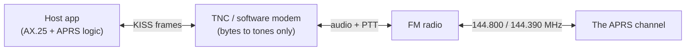
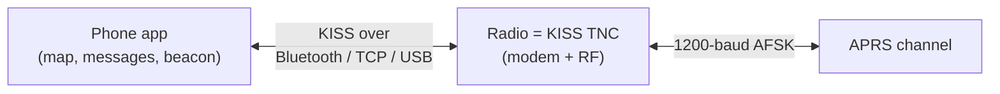
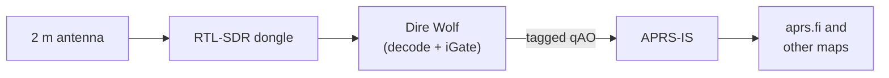

# APRS: Running It — TNCs, KISS & Apps

You have taken a packet apart, watched it hop across a region, followed it onto the internet and back, and unpacked everything a packet can carry. What is left is the best part: building the station that does all of it. This closing chapter turns the four you have read — [anatomy](outpost:entry/logbook73.handbook/aprs-anatomy), [paths](outpost:entry/logbook73.handbook/aprs-paths), [iGates](outpost:entry/logbook73.handbook/aprs-igates) and [payloads](outpost:entry/logbook73.handbook/aprs-payloads) — into a box on your desk that beacons, listens, gates and messages, and then takes one real packet off the air and reads it, field by field, back through the whole book.

## KISS: the two-wire contract between host and modem

You met the [TNC](outpost:entry/logbook73.handbook/packet-radio) as packet radio's modem, and heard in a single line that it usually speaks a protocol called KISS. That line hid one of the quietly important design decisions in amateur data radio, so here we open it up.

**KISS** stands for "Keep It Simple, Stupid" — genuinely its name. The idea (Brian Lloyd, `WB6RQN`) and the protocol (Phil Karn, `KA9Q`, in August 1986, first built into the TAPR TNC-2 by Mike Chepponis, `K3MC`) answered a specific frustration. Early hardware TNCs tried to be clever: the little microprocessor inside the box held the AX.25 connection, ran a command interpreter, decided when to retransmit. That made them rigid — every new idea, APRS included, needed new TNC firmware.

KISS throws that away. Under KISS the TNC becomes deliberately dumb: a modem and nothing more. It turns bytes into tones and tones back into bytes, keys the transmitter, and does not so much as glance at what the bytes mean. All the intelligence — building AX.25 frames, computing the checksum, running the [New-N paradigm](outpost:entry/logbook73.handbook/aprs-paths), deciding what to beacon — moves up into the **host**: your computer, your Pi, your phone. The two meet at one narrow, unchanging contract, which is why a program written in 1990 and a program written last year can drive the very same hardware.



### The framing

The contract does just two things: mark where each run of bytes begins and ends, then get out of the way. KISS borrows the trick from an older protocol called SLIP: one special byte, **FEND** (frame-end, hex `0xC0`), tops and tails every frame. See a `0xC0` and you know one frame has ended and the next begins.

That raises the obvious problem — what if the data itself contains a `0xC0`? KISS handles it with _escaping_. A second special byte, **FESC** (frame-escape, `0xDB`), means "the next byte is literal data, not a marker." A data `0xC0` is sent as the pair `FESC, TFEND`; a data `0xDB` is sent as `FESC, TFESC`. The receiver reverses the substitution and hands clean bytes up. Four reserved values, one rule, and any byte at all can pass through untouched.

| Byte    | Hex    | Meaning                                        |
| ------- | ------ | ---------------------------------------------- |
| `FEND`  | `0xC0` | Frame delimiter — start and end of every frame |
| `FESC`  | `0xDB` | Escape — the next byte is literal data         |
| `TFEND` | `0xDC` | Stands for a data `0xC0` (only after `FESC`)   |
| `TFESC` | `0xDD` | Stands for a data `0xDB` (only after `FESC`)   |

Immediately after the opening `FEND` sits one **command byte**. Its low four bits say what the frame is; its high four bits select a port (0–15), so one KISS link can drive several radios. Command 0 means "the rest of this frame is data" — a whole AX.25 frame to transmit, or one just received — and command 0 carries almost all the traffic. The remaining commands set the modem's timing:

| Cmd  | Name        | Sets                                           |
| ---- | ----------- | ---------------------------------------------- |
| 0    | Data        | the AX.25 frame itself                         |
| 1    | TXDELAY     | key-up delay before data (×10 ms, default ~50) |
| 2    | Persistence | the _p_ in p-persistent CSMA (P = p·256 − 1)   |
| 3    | SlotTime    | CSMA slot time (×10 ms, default ~10)           |
| 4    | TXtail      | obsolete                                       |
| 5    | FullDuplex  | half- vs full-duplex                           |
| 6    | SetHardware | modem-specific settings                        |
| 0xFF | Return      | leave KISS mode                                |

`TXDELAY` earns its place because an FM transmitter needs a few tens of milliseconds to reach full power before the tones start — too short and the first bytes are clipped, too long and you hog a shared channel. `Persistence` and `SlotTime` are how a KISS station decides _when_ to grab the idle channel without everyone lunging at once. Treat the numbers as the original specification's defaults: individual firmware varies, so a real setup wants its levels and timing checked, not assumed.

## Dire Wolf: the sound card that became the standard TNC

The [packet-radio chapter](outpost:entry/logbook73.handbook/packet-radio) traced the TNC's evolution from a paperback-sized box to a program. That program, for most amateurs today, is **Dire Wolf** — a free, GPL-licensed software sound-card TNC and APRS modem written by John Langner, `WB2OSZ`, running on Windows, macOS and Linux, very much including the Raspberry Pi. It is not one tool but several wearing one coat: a decoder that prints raw frames, a GPS tracker, a [digipeater](outpost:entry/logbook73.handbook/aprs-paths), an [iGate](outpost:entry/logbook73.handbook/aprs-igates), an APRStt gateway — and, underneath all of them, a virtual TNC that speaks KISS to whatever client you point at it.

Its modems span the field: 300 bps AFSK for HF, the standard 1200 bps Bell-202 AFSK for VHF/UHF (the _braaap_ you decoded in the packet chapter), 2400 and 4800 bps PSK, and 9600 bps GMSK/G3RUH. It also implements two error-correcting layers — FX.25, which adds forward error correction while staying AX.25-compatible, and IL2P (from around version 1.7), a more recent error-correcting scheme that is **not** AX.25-compatible, so both ends must agree to use it.

The point at which your client connects to Dire Wolf is a network port, and two matter:

| Interface     | Default port | Config name |
| ------------- | ------------ | ----------- |
| KISS over TCP | 8001         | `KISSPORT`  |
| AGW / AGWPE   | 8000         | `AGWPORT`   |

Both are _defaults you can change_. Dire Wolf will also present KISS over a real serial line or a pseudo-terminal, and over Bluetooth. The pattern is always the same: Dire Wolf owns the radio and the tones; your application — a desktop map such as Xastir or YAAC, an iGate feed, a terminal — talks to it in KISS and never has to know a sound card exists. That clean split is exactly what the next two ideas are built on.

## Your phone as the brains: APRSdroid and the modern handheld

Once you accept that the TNC is just a modem and the host holds all the intelligence, a phone becomes an obvious host. **APRSdroid**, an open-source Android client by Georg Lukas, `DO1GL`, connects three ways, and the three are a neat map of everything in this series:

1. **APRS-IS over the internet** — TCP (also UDP/HTTP), no radio at all. This is the [iGate-side](outpost:entry/logbook73.handbook/aprs-igates) network: you appear on the map through a server, not the air.
2. **AFSK through the phone's own speaker and microphone** — hold the phone to a radio and it becomes the modem itself, no TNC hardware.
3. **KISS to an external TNC** — over Bluetooth (serial-port profile), over KISS-over-TCP (straight to a Dire Wolf instance on your network), or over USB/serial.

That third mode is the interesting one, because it is _exactly_ how a modern APRS handheld works internally. Open up the model: the radio contains a 1200-baud TNC that speaks KISS, and it hands its decoded frames to a companion phone app over Bluetooth, receiving beacons to transmit the same way. The radio does the modem and the RF; the phone does the map, the station list and the message composer. The APRS menus on such a radio are really configuring the KISS TNC at one end of a Bluetooth link — which is why the [RT-950 Pro APRS guide](outpost:entry/logbook73.guide.rt-950-pro/menus-aprs) spends its time on beacon interval, path and the phone pairing rather than on anything you have not already met here.



The lesson to carry away: "an APRS radio" and "a dumb radio plus Dire Wolf plus a laptop" are the same architecture drawn at different sizes. Learn the KISS boundary once and every APRS station you ever meet is legible.

## aprs.fi in practice

You have used [aprs.fi](outpost:entry/logbook73.handbook/aprs) since the first chapter as _the map_. It is more than a map. Run by Heikki Hannikainen, `OH7LZB`, it takes the live worldwide [APRS-IS](outpost:entry/logbook73.handbook/aprs-igates) feed and lays it over OpenStreetMap, and its real value is in the panels beside the map.

- **Raw packets.** Click any station, open its info, and choose "raw packets" to see the actual `source>dest,path:info` lines it has sent — the same text Dire Wolf prints, complete with the [q-construct and iGate](outpost:entry/logbook73.handbook/aprs-igates) that carried each one onto the internet. This is the single most useful learning tool in APRS, and the capstone below is built on it.
- **Telemetry and weather graphs.** A station sending [telemetry or weather](outpost:entry/logbook73.handbook/aprs-payloads) gets its channels plotted over time — battery voltage sagging overnight, a cold front crossing a hilltop station's pressure trace.
- **Saveable filters and alerts.** You can store a view (an area, a callsign, a symbol) and set an alert to e-mail you when a particular station appears — handy for catching a balloon launch or a friend setting off on a drive.
- **Messaging.** With a (small) subscription for extra features — on the order of a ~€0.50/$0.50-a-month class, and worth confirming as it can change — you can send an APRS [message](outpost:entry/logbook73.handbook/aprs-payloads) from the browser. It reaches an RF station only if a local transmit iGate chooses to gate it under the Internet-to-RF rules from the iGates chapter; the web is the easy half, the last radio hop is the conditional one.

For anything programmatic there is a documented HTTP API (`api.aprs.fi/api/get?name=…&what=loc|wx|msg&apikey=…`), which needs a key and is rate-limited — it is for looking up a handful of stations, not harvesting the firehose.

## Three starter projects

Everything above assembles into three projects, in rough order of ambition. Each reuses parts you likely own.

### A tracker

The one-afternoon build: a 2 m FM radio configured as a KISS TNC (either a genuine APRS handheld, or any radio plus a Dire Wolf box), a GPS source, and a host that formats the beacon — a phone running APRSdroid is the tidiest. Set a sensible SSID and [symbol](outpost:entry/logbook73.handbook/aprs-anatomy), a path of `WIDE1-1,WIDE2-1` for a mobile ([never more](outpost:entry/logbook73.handbook/aprs-paths)), and a beacon interval — or better, let the tracker use SmartBeaconing, transmitting more often through corners and less when parked. Take it for a walk, then find your own dot on aprs.fi. Transmitting is the one step that needs your licence.

### An RX-only iGate

The best first _infrastructure_, because in most countries receiving needs no licence and no transmitter at all. An [RTL-SDR](outpost:entry/logbook73.handbook/software-defined-radio) dongle on a 2 m antenna, Dire Wolf decoding its audio, and a Raspberry Pi to run it around the clock: every packet Dire Wolf hears is forwarded into APRS-IS, tagged `qAO` to mark it as coming from a receive-only gate. You are not competing with the transmit iGates that carry messages back to RF — you are [filling the gaps in coverage](outpost:entry/logbook73.handbook/aprs-igates), and a well-sited receiver on a windowsill genuinely improves the map for everyone downhill of you.



### A weather station

If you have a home weather station — an Ultimeter, a Peet Bros, or any modern unit — software that speaks APRS can wrap its readings into a [weather packet](outpost:entry/logbook73.handbook/aprs-payloads) (the positionless `_` form, or a complete report on the `/_` symbol) and feed it to the network, where amateur and public weather services alike will ingest it. The packet chapter gives you the exact field IDs, so you can read your own station's output back and confirm every number before you trust the graph.

## Capstone: taking one real packet apart

Here is a single line, of the kind the raw-packet view on aprs.fi shows you thousands of times a day. It is doing nothing special, and that is the point — read it once and you have read them all. Everything in it points back to an earlier chapter.

```
M0ABC-7>APDW17,GB7XX-1*,WIDE2-1,qAR,G8DEF-10:!5203.50N/00009.10W[Walking the dog
```

Take it a field at a time.

| Piece             | What it is                                                                                                                                                                                                      | Where it comes from                    |
| ----------------- | --------------------------------------------------------------------------------------------------------------------------------------------------------------------------------------------------------------- | -------------------------------------- |
| `M0ABC-7`         | Source callsign, SSID **-7** — the human-portable / handheld convention. A person on foot.                                                                                                                      | [Anatomy](outpost:entry/logbook73.handbook/aprs-anatomy)      |
| `>`               | The monitor-format separator between source and destination.                                                                                                                                                    | [Packet radio](outpost:entry/logbook73.handbook/packet-radio) |
| `APDW17`          | The destination — not a real station but a **tocall**: APRS reuses the AX.25 destination to carry a software-and-version code. (In a **Mic-E** packet this same field would instead hold the encoded latitude.) | [Payloads](outpost:entry/logbook73.handbook/aprs-payloads)    |
| `,GB7XX-1*`       | First via-path element — a **fill-in digipeater** that consumed the `WIDE1-1` hop and replaced it with its own callsign. The single `*` means this address, and everything before it, is used up.               | [Paths](outpost:entry/logbook73.handbook/aprs-paths)          |
| `,WIDE2-1`        | Second via-path element, **no asterisk** — still unspent, waiting for a wide-area digipeater. So an iGate heard the fill-in's copy before any high-site digi repeated it.                                       | [Paths](outpost:entry/logbook73.handbook/aprs-paths)          |
| `,qAR,G8DEF-10`   | The APRS-IS **q-construct**: `qAR` = gated from RF by a verified iGate, and `G8DEF-10` (SSID -10, an iGate) is that gateway. Added by the server, never sent over the air.                                      | [iGates](outpost:entry/logbook73.handbook/aprs-igates)        |
| `:`               | End of the header, start of the information field.                                                                                                                                                              | [Anatomy](outpost:entry/logbook73.handbook/aprs-anatomy)      |
| `!`               | The **data-type identifier**: position, no timestamp, no messaging.                                                                                                                                             | [Anatomy](outpost:entry/logbook73.handbook/aprs-anatomy)      |
| `5203.50N`        | Latitude 52°03.50′N, in `ddmm.hhN`.                                                                                                                                                                             | [Anatomy](outpost:entry/logbook73.handbook/aprs-anatomy)      |
| `/`               | **Symbol table ID** — the primary table. Note the symbol is split around the longitude.                                                                                                                         | [Anatomy](outpost:entry/logbook73.handbook/aprs-anatomy)      |
| `00009.10W`       | Longitude 000°09.10′W, in `dddmm.hhW`.                                                                                                                                                                          | [Anatomy](outpost:entry/logbook73.handbook/aprs-anatomy)      |
| `[`               | **Symbol code** — with the primary table, `/[` draws a person/jogger. It matches the -7 SSID: someone on foot.                                                                                                  | [Anatomy](outpost:entry/logbook73.handbook/aprs-anatomy)      |
| `Walking the dog` | Free-text comment.                                                                                                                                                                                              | [Anatomy](outpost:entry/logbook73.handbook/aprs-anatomy)      |

Read as prose: _a walker with an APRS handheld sent an uncompressed position report from just north of London; a home fill-in digipeater, `GB7XX-1`, repeated it once and used up the first hop; before any wide-area digipeater could take the second hop, the iGate `G8DEF-10` heard the fill-in's copy and gated it onto the internet, where a server stamped the `qAR` and aprs.fi drew a little runner on the map._ Three words of comment and thirteen fields of machinery — and you now understand every one.

## Try it yourself

1. **Watch the KISS bytes.** Run Dire Wolf in receive mode and enable KISS on port 8001, then connect a client (Xastir, YAAC, or APRSdroid over TCP). With Dire Wolf's verbose logging on you can see frames leave it as KISS and the client turn them into map dots — the host/modem split from this chapter, live.
2. **Build the RX-only iGate.** RTL-SDR, Dire Wolf, a Pi, a passcode of `-1` for receive-only, and a Tier-2 APRS-IS server. Within the hour your callsign appears on aprs.fi as an iGate, and packets you hear carry your `qAO` tag on their raw lines.
3. **Tear down your own packet.** Beacon once (licensed), find yourself on aprs.fi, open "raw packets", and decode your own line against the capstone table above. Then decode a _neighbour's_ — especially a Mic-E one, where the destination stops being text and starts being latitude.
4. **Trace a message.** From aprs.fi, send a message to a station you can see, and watch whether it reaches RF. If it does not, work out which Internet-to-RF condition blocked it — that failure teaches the [gating rules](outpost:entry/logbook73.handbook/aprs-igates) better than any success.

## Key takeaways

- **KISS** ("Keep It Simple, Stupid") is the minimal contract that makes a TNC a dumb modem and puts all AX.25/APRS intelligence in the host — `FEND` (`0xC0`) frames every packet, `FESC` escapes any `0xC0`/`0xDB` in the data, and one command byte carries the port and the timing settings.
- Because that contract is tiny and unchanging, decades-old and brand-new software drive the same radios — which is why KISS underlies **Dire Wolf**, APRSdroid and the TNC inside a modern APRS handheld alike.
- **Dire Wolf** is the standard software sound-card TNC: 1200-baud Bell-202 by default, KISS-over-TCP on port 8001, and roles from decoder to digipeater to iGate.
- A modern APRS handheld is just _radio-as-KISS-TNC over Bluetooth + phone-as-host_ — the same architecture as a dumb radio plus Dire Wolf plus a laptop, only smaller.
- **aprs.fi** is a study tool, not just a map: its raw-packet view, telemetry graphs, filters and messaging let you watch everything in this series happen in real time.
- Three starter projects — a tracker, an RX-only iGate (no licence to receive, in most places), and a weather station — assemble from parts you likely own.
- Any raw `source>dest,path:info` line decodes cleanly into SSID, tocall, New-N path with asterisks, q-construct, data-type identifier and split symbol — the whole book in one line.

That is APRS, end to end — from a single packet's anatomy to a working station on the air. If it has caught you, the natural next stop is [Winlink and connected-mode packet](outpost:entry/logbook73.handbook/packet-radio), where the same AX.25 you have mastered carries real e-mail across the world without a scrap of internet in the middle; or loop back to the [APRS overview](outpost:entry/logbook73.handbook/aprs) and re-read it — it will look very different now.
