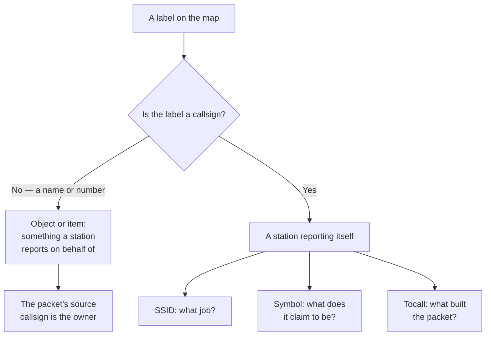
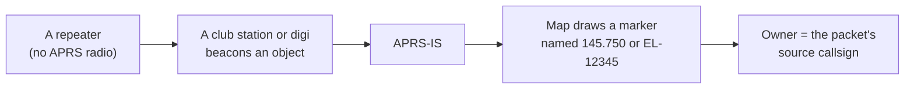

# APRS: What Is That Thing?

You open the map, zoom into your own town, and cannot tell what a single icon actually _is_. A diamond with a letter in it. A house that is apparently a "LoRa iGate/Digipeater". Something called `MB7XYZ-B` announcing "70cm Voice (D-Star) 438.80000MHz +0.0000MHz". A van with a battery voltage in its comment. This chapter is the field guide for exactly that moment: how to look at one unfamiliar station and work out what it is, why somebody put it there, and which chapter explains it.

The previous five chapters built APRS from the inside out. This one starts from what is on the screen and works backwards.

## Three clues, and not one of them is a rule

Every station gives you three independent hints, and you read all three together because any one can be missing or wrong.

1. **The callsign and its SSID** — `M0ABC-9` versus `M0ABC-10`. A hint at the station's job.
2. **The symbol** — the icon the station chose, plus any letter or digit stamped on top of it.
3. **The tocall** — the AX.25 destination field, which in APRS carries a code identifying the _software or hardware_ that built the packet.

Hold on to this: **all three are conventions, not enforcement.** Nothing stops a weather station using SSID `-9`, drawing itself as a jeep and beaconing a tocall that says "unknown". They are reliable because almost everyone follows them, not because anything checks. When they disagree, trust the tocall (a machine chose it) over the symbol and the SSID (a human chose those, possibly years ago and never again).

## Clue 1: the SSID

An **SSID** (secondary station identifier) is the `-0` to `-15` suffix on a callsign. Sixteen values, because AX.25 gives each address exactly four bits for a station number. The [APRS overview](outpost:entry/logbook73.handbook/aprs) gave you the short list; here is the full one, published by Bob Bruninga, `WB4APR`, in its February 2012 revision:

| SSID        | Conventional meaning                                         |
| ----------- | ------------------------------------------------------------ |
| `-0` / none | Primary station, usually fixed and message capable           |
| `-1` … `-4` | Generic additional station — digi, mobile, weather, anything |
| `-5`        | Other networks — D-Star, iPhones, Androids, Blackberrys      |
| `-6`        | Special activity, satellite operating, camping, or 6 metres  |
| `-7`        | Walkie-talkies, handhelds, human portable                    |
| `-8`        | Boats, sailboats, campervans, or a second main mobile        |
| `-9`        | Primary mobile, usually message capable                      |
| `-10`       | Internet, iGates, Echolink, Winlink, AVRS, APRN              |
| `-11`       | Balloons, aircraft, spacecraft                               |
| `-12`       | APRStt, DTMF, RFID, one-way trackers                         |
| `-13`       | Weather stations                                             |
| `-14`       | Truckers or full-time drivers                                |
| `-15`       | Generic additional station                                   |

Now the part the short version left out. That document was **deliberately retitled in 2012** to make clear it holds _recommendations_ and not, in its author's words, "any kind of decoding standard". It closes: "Of course these are not rigid… These are only guidelines to hint at a station's possible application." In 1992 SSIDs really did choose the map icon for stations sending raw GPS strings, but that job moved elsewhere in the mid-1990s and the meanings left the specification entirely.

Two consequences. `-1` to `-4` and `-15` are **intentionally vague**, left generic so one amateur with six digipeaters — or six trackers — can give each a unique suffix. And a **non-numeric SSID** — `M0ABC-B`, or something ending `-63`, `-tt`, `-ID` — is a strong sign the thing was **not** created by an AX.25 radio, because the four-bit limit binds RF stations only. Documented examples include `-63` for PSK63 HF stations, `-tt` for APRS TouchTone users, `-ID` for RFID and `-A` to `-Z` for D-Star. The APRS-IS specification is blunt: SSIDs may be one or two alphanumeric characters, but "if you are going to transmit on RF directly… you must use a SSID from 0 to 15". That single test — _is the suffix a letter?_ — clears up a lot before you look at anything else.

## Clue 2: the symbol

You met the two-character symbol code in [Anatomy of a packet](outpost:entry/logbook73.handbook/aprs-anatomy). What that chapter did not show is the **overlay alphabets** — a character stamped on top of an alternate-table icon — where symbols stop being decoration and start being information. Two families do real work.

**Digipeaters use `#`, and the overlay says which kind:**

| Overlay | Meaning                                                 |
| ------- | ------------------------------------------------------- |
| `1#`    | `WIDE1-1` digipeater — a fill-in                        |
| `A#`    | Alternate-input digipeater (a second receive frequency) |
| `E#`    | Emergency powered                                       |
| `I#`    | iGate-equipped digipeater                               |
| `L#`    | `WIDEn-N` with path-length trapping                     |
| `S#`    | `SSn-N` digipeater (also serves `WIDEn-N`)              |
| `V#`    | Viscous digipeater (repeats only if nobody else did)    |
| `W#`    | `WIDEn-N`, `SSn-N` and trapping                         |

So a digipeater icon with a `1` in it says, without a word of text, that it is the low fill-in machine the [paths chapter](outpost:entry/logbook73.handbook/aprs-paths) said should answer only to `WIDE1-1`. A `W` says the opposite: a hilltop machine that traps abusive long paths.

**Gateways use `&`, and the overlay says which kind:**

| Overlay | Meaning                                            |
| ------- | -------------------------------------------------- |
| `/&`    | HF gateway (the original primary-table definition) |
| `I&`    | Generic iGate                                      |
| `L&`    | LoRa iGate                                         |
| `R&`    | Receive-only iGate — do not send messages back     |
| `T&`    | Transmit iGate, path set to one hop only           |
| `2&`    | Transmit iGate, path set to two hops               |
| `W&`    | WIRES-X                                            |

An `R&` diamond is a station telling you by symbol alone that it is receive-only — which you can confirm from the `qAO` in other stations' paths.

Two more families: the diamond `a` group, where `Da` is D-Star, `Ya` is C4FM (Yaesu) and `Wa` is Winlink; and the numbered circles, where `E0` is an Echolink node, `I0` an IRLP repeater, `V0` a node doing both and `A0` an AllStar node. Balloons have their own set on `O` — `/O` a ham balloon, `\O` an amateur rocket, `MO` manned, `TO` tethered, `CO` a constant-pressure long-duration flight.

Firmware authors do not always follow the register, though. The MMDVM digital-voice gateways below default to a symbol pair `D&`, which appears nowhere in the published gateway list — a de-facto convention with no standing.

## Clue 3: the tocall — a fingerprint of the software

This is the clue most people never learn to read, and the most informative of the three.

In APRS the AX.25 **destination address** plays no part in routing (that is the source callsign and the digipeater path), so the specification repurposes it: a leading `AP` marks the packet as APRS, and "the remaining 4 bytes of the field are available to indicate the software version number or application". That is the **tocall**, and unlike an SSID or symbol it is written by firmware, not by a person.

The registry used to be a hand-maintained text file on aprs.org. Since **19 February 2022** the primary database has been the [aprs-deviceid project](https://github.com/aprsorg/aprs-deviceid), maintained by Hessu, `OH7LZB` — who also runs aprs.fi, which is why the device names shown there track this file. The data is published at [aprs-deviceid.aprsfoundation.org](https://aprs-deviceid.aprsfoundation.org/); the old aprs.org lists are marked deprecated. A sample, with `?` marking a wildcard position:

| Tocall             | What sent the packet                      |
| ------------------ | ----------------------------------------- |
| `APDW??`           | Dire Wolf (`WB2OSZ`) — the software TNC   |
| `APRX??`           | Aprx (`W6KWF`) — a Linux/Unix iGate       |
| `APWW??`           | APRSIS32 (`KJ4ERJ`), Windows              |
| `APDR??`, `APAND?` | APRSdroid (Android)                       |
| `APX???`           | Xastir                                    |
| `APK003/4/5`       | Kenwood TH-D72 / TH-D74 / TH-D75          |
| `APY01D/02D/05D`   | Yaesu FT1D / FT2D / FT5D                  |
| `APAT81`           | AnyTone AT-D878                           |
| `APN3??`           | Kantronics KPC-3                          |
| `APOT??`           | Argent Data OpenTracker                   |
| `APAVT5`           | SainSonic AP510 (also sold as AVRT5)      |
| `APLG??`, `APLT??` | OE5BPA LoRa gateway / LoRa tracker        |
| `APLRG?`, `APLRT?` | CA2RXU ESP32 LoRa iGate / LoRa tracker    |
| `APDG??`           | ircDDB Gateway (`G4KLX`) — D-Star         |
| `APBM??`           | BrandMeister DMR                          |
| `APRS`             | **Unknown** — the sender told you nothing |

The same database carries a **device class** for each entry, from a fixed list: `wx`, `tracker`, `gadget`, `rig`, `ht`, `app`, `software`, `daemon`, `service`, `network`, `digi`, `igate`, `dstar`, `satellite`. This matters more than it sounds. When a map shows the words "iGate", "Digipeater" or "Tracker" beside a device name, **those words usually came out of this file** — a lookup result, not something the station transmitted about itself.

**The Mic-E exception.** One large class defeats the trick: [Mic-E](outpost:entry/logbook73.handbook/aprs-payloads) fills the destination with encoded latitude, so it looks like line noise (`UQTXXX`, `S32U6T`) and tells you nothing. Those devices are identified instead by a **type code at the start of the comment or status text, plus sometimes two characters at the end** — originally `>` for the Kenwood TH-D7 and `]` for the TM-D700. The database records both forms: `>` with a trailing `=` is a TH-D72, with `^` a TH-D74, with `&` a TH-D75; `]` with `=` is a TM-D710. Trailing pairs identify others — `_$` a Yaesu FT1D, `_(` an FT2D, `_3` an FT5D, `|3` a Byonics TinyTrak3. Impressively fragile, and it usually works.

## Station, object or item — the insight that makes the map legible

Here is the realisation that turns a confusing map into a readable one: **a great deal of what you see is not a station at all.**

APRS lets any station report the position of something that cannot report itself, in two formats covered in [Payloads](outpost:entry/logbook73.handbook/aprs-payloads). An **object** (data-type identifier `;`) has a fixed nine-character name, a compulsory timestamp, and can be explicitly killed — `*` live, `_` killed; it is "intended primarily for plotting the positions of moving objects". An **item** (identifier `)`) has a variable three-to-nine-character name, no timestamp and `!` for live, and is "really intended for inanimate things that are occasionally posted on a map".

The label on either is a **name the sender chose**, not a callsign; the owner is the _source_ callsign of the packet, and the specification recommends clients show it alongside. That is why **almost all the infrastructure on an APRS map is an object placed by somebody else** — repeater frequency markers, Echolink and IRLP nodes, event checkpoints, weather hazards, road closures. None of those owns a radio that can beacon, so a digipeater or club station does it for them. Any station may take over an object by transmitting a new report with the same name, which is how a net hands a marker between operators — and occasionally how two stations end up fighting over one.

At the time of writing, aprs.fi encodes the distinction in the **colour of the callsign label**: white for a station capable of messaging, grey for one that is not, violet for objects, purple for items, yellow for weather stations, green for AIS ships (commercial marine traffic, which shares the map). Messaging capability comes from the packet's data-type identifier — the `=` and `@` reports from the [anatomy chapter](outpost:entry/logbook73.handbook/aprs-anatomy) — not from anything the operator claims. The key is in the site's own [real-time map guide](https://aprs.fi/doc/guide/aprsfi-real-time-map.html); as with anything in a live web interface, check it rather than trusting a printed book.

## The catalogue

For each entry: what it is, what you see, and how to tell it from its lookalike.

### Mobile trackers

A GPS and a transmitter in a vehicle. It is how most people first appear on APRS.

**You see:** `-9` (sometimes `-8` or `-14`), a vehicle symbol — car `/>`, van `/v`, truck `/k`, jeep `/j`, RV `/R` — a track line, a course and a speed. Most use Mic-E, so the destination is gibberish and any device name came from the comment. The path is usually `WIDE1-1,WIDE2-1`.

**Tell it from:** a portable, which shares the idea but not the sustained motion; and from a fixed station beaconing off a GPS instead of fixed coordinates, which invents spurious "movement" days and is the one thing every guide asks fixed stations not to do.

### Portable and handheld trackers

Somebody walking with an APRS handheld or a tracker in a rucksack — hillwalking, [portable activations](outpost:entry/logbook73.handbook/portable-operating), events, search and rescue.

**You see:** `-7` by convention, symbol `/[` (person or jogger), a short path or none at all from somewhere high, and track points that start and stop with the operator.

**Tell it from:** a `-5` smartphone client, which may also be a person walking but runs on the internet side rather than RF.

### Fixed home stations

Somebody's shack, on the map for presence and messaging.

**You see:** no SSID or `-0`, house symbol `/-`, a single unmoving dot, often a `PHG` extension advertising power, antenna height, gain and directivity. Crucially a fixed station leaves **no track**: a map that stores only new positions has nothing new to store, so there is no trail and no history to browse. That absence is itself the identification.

**Tell it from:** a digipeater or iGate, also a fixed dot. The difference is behavioural, and you find it in _other_ stations' packets.

### Digipeaters

The store-and-forward relays from the [paths chapter](outpost:entry/logbook73.handbook/aprs-paths), lifting packets out of valleys.

**You see:** the `#` symbol with a class overlay, an SSID somewhere in `-1`…`-4`, often a `PHG` extension. But the definitive evidence is not on its own dot at all — it is in **other stations' paths**, where the digipeater's callsign appears marked used with an asterisk.

**Tell it from:** an iGate. A digipeater's callsign sits _inside_ the digipeated part of a path; an iGate's sits _after_ a `q`-construct. Plenty of stations are both. Treat any "stations heard by this digipeater" figure as indicative only: it is derived from paths, and many digipeaters never insert their callsign, many substitute rather than insert, and duplicate suppression credits only the first iGate to gate each packet.

### iGates

The internet gateways from [iGates and the APRS-IS](outpost:entry/logbook73.handbook/aprs-igates). Without them nothing reaches a map.

**You see:** `-10` by convention, a `&` gateway diamond with an overlay, a fixed dot — and again the real evidence elsewhere: the callsign immediately **after** a `q`-construct in other stations' paths.

**Telling receive-only from bidirectional** is easy, because only two constructs may ever be generated by a client. **`qAR`** means gated from RF by a verified iGate that can also gate messages back. **`qAO`** means gated from RF by an iGate that **cannot** gate messages to that station — the specification says receive-only iGates "will use this exclusively for all packets gated to APRS-IS". So a path ending `,qAO,GB7XYZ` says `GB7XYZ` heard that packet on radio and will not carry a reply back. Two honest complications: a bidirectional iGate also emits `qAO` if the station is outside its configured range or the packet came from a non-APRS source, and `qAO` has a separate _server_-generated meaning. In a position packet's path followed by a gateway-style callsign, it is the client case.

**A common variety** is an SDR web receiver gating as a sideline. Those very often carry the literal comment `OpenWebRX APRS gateway` — that software's shipped default beacon text — with its default `R&` symbol. Because the beacon is actually produced by Dire Wolf underneath, the device lookup usually reports Dire Wolf, so the comment is the only thing naming the real application, and only until the operator edits it.

### Weather stations

An amateur weather station feeding the network — collectively one of the densest hyper-local weather meshes anywhere, which public services quietly ingest.

**You see:** the weather symbol `/_`, or `\_` with an overlay where a weather site shares a digipeater's location, plus temperature, wind, rain, pressure and humidity panels.

**Tell it from:** a station that merely mentions weather in its comment. The identification is **the symbol, not the SSID** — `-13` is only the convention. Note also that the positionless weather report (data-type identifier `_`) is a different thing from the `_` symbol.

### Telemetry stations

Anything reporting numbers — battery voltage, temperature, channel-busy percentage, packets received, transmitter keydowns.

**You see:** graphs, and very often channels labelled nothing more helpful than "Ch 1" through "Ch 5" with a bare "Bit 1", plotting raw integers. That is not a fault in the map. Names, units, scaling and bit meanings are **not carried in the telemetry packet** — they arrive as four separate APRS messages the station sends to _its own callsign_: `PARM.` for names, `UNIT.` for units, `EQNS.` for scaling coefficients, `BITS.` for bit sense and a project title. A station that never sends those leaves every decoder in the world with nothing but numbers.

**One diagnostic:** the classic format caps analogue values at **000–255**, because they are single bytes. So a raw channel reading 741 almost certainly did not arrive in the classic format — it came either from the newer **base-91 comment telemetry** extension (a pipe-delimited group such as `|ss1122334455!"|` inside an ordinary position comment, range 0 to 8280) or from a relaxed telemetry format permitting larger and fractional values. Both are widely supported; neither is in the original specification.

### Digital-voice hotspots and gateways

The category that baffles people most. What you are looking at is a D-Star, DMR, C4FM or NXDN hotspot or repeater — usually an MMDVM board on a small computer — beaconing its own position and frequency so people can find a local access point for a [digital voice](outpost:entry/logbook73.handbook/digital-voice) network.

**You see** comments in a recognisable house style, built by a format string inside the gateway software:

- `70cm Voice (D-Star) 438.80000MHz +0.0000MHz` — ircDDB Gateway. The absence of "MMDVM" is the tell.
- `70cm MMDVM Voice (DMR) 430.60000MHz +9.0000MHz, APRS for DMRGateway` — DMRGateway. `MMDVM Voice (C4FM)` and `MMDVM Voice (NXDN)` come from the Fusion and NXDN equivalents.

Read the numbers and they stop being intimidating. The five-decimal frequency is the **downlink** — what the hotspot transmits and you listen to. The offset is **receive minus transmit**, so a simplex hotspot has them equal, the arithmetic yields exactly zero and the sign test picks `+`, which is why **every simplex hotspot reads `+0.0000MHz`**. A duplex repeater transmitting on 430.600 and listening on 439.600 reads `+9.0000MHz`. The band word in front is derived purely from the transmit frequency. And the trailing `APRS for DMRGateway` is not from the gateway author at all — it is the **default description written by the Pi-Star dashboard**, so it positively identifies a Pi-Star box; a description ending `_Pi-Star` is the same dashboard naming other configurations.

**These strings are not the machine-readable APRS frequency format**, which wants exactly ten bytes at the very start of the comment (`FFF.FFFMHz`) and an offset written `oXXX` in tens of kilohertz, so +600 kHz would be the four characters `+060`. The MMDVM strings use five decimals, spell the offset in MHz and put a band name first, so a radio with a QSY button cannot act on them. They are for humans.

**SSIDs here are single characters, and they collide.** A Pi-Star DMR hotspot appends only the **first character** of its configured suffix, so the shipped default of "DMR" produces `-D`. A D-Star hotspot uses its **module letter**, so a 70 cm module is `-B`. C4FM defaults to `-Y`, NXDN to `-N`. Nothing allocates these; two of your own hotspots will happily collide on `-D`. A useful negative, too: the P25 gateway from the same family has no APRS support at all.

**Tell it from a repeater's object:** a hotspot beacons _itself_, with a callsign-style label; a repeater frequency marker is an object with a name, placed by a third party. And note that the **users are separate**. A DMR user's dot does not come from their hotspot at all: the radio sends its fix as DMR data to the network, and **BrandMeister** decodes it, looks up which callsign-and-SSID that DMR ID registered, and injects the APRS packet under its own login. Since 2017 it has inserted the repeater callsign into the digipath, so such packets carry a literal `DMR*` element — a published example reads `DC6RN-9>APRS,DB0CJ,DMR*,qAR,DB0CJ:@043233h4925.11N/01152.85Ev148`. That `DMR*` is your fingerprint. D-Star differs again: **D-PRS** converts the GPS data an Icom radio puts in the voice stream, producing destination `APDPRS` with `DSTAR*` in the path — and letter SSIDs, since a user whose eighth-character ID is "A" becomes `KE5C-A`. See [Operating D-Star](outpost:entry/logbook73.handbook/dstar-operating).

### LoRa iGates and trackers

APRS carried over LoRa — long-range, low-power chirp modulation — instead of 1200-baud FM. Tiny cheap hardware, long battery life, useful range from low power.

**You see:** tocalls in the `APL` family, an `L&` LoRa-iGate diamond or an `L`-overlaid alternate-table symbol, and a beacon comment that is very often an untouched firmware default. The frame on the air is not AX.25 at all — three magic bytes followed by a plain-text `SRC>DEST,PATH:payload` line — but by the time it reaches the internet that header is stripped and it is an ordinary APRS packet. **Nothing marks it as having arrived by LoRa**; the tocall, the `q`-construct and the symbol are all you get.

**Frequencies are convention, not allocation.** Both major firmware projects ship 433.775 MHz, spreading factor 12, 125 kHz bandwidth as defaults, and that became the de-facto European channel. Some countries differ and say so in a national band plan rather than in firmware — the UK's plan, for instance, names 439.9125 MHz for low-power LoRa within a digital segment. Check your own band plan; never assume a firmware default is legal where you are.

**Tell it from Meshtastic.** They look similar and can share a band, but differ at every layer: Meshtastic encodes as protocol buffers with per-channel encryption and floods a mesh by hop limit, while LoRa APRS sends plain unencrypted text and routes by `WIDEn-N`. Their modem settings differ too, so in practice the two are mutually deaf even on one frequency — and the legal basis differs entirely, Meshtastic running under licence-exempt short-range rules where LoRa APRS is amateur operation. [LoRa and Meshtastic](outpost:entry/logbook73.handbook/lora-and-meshtastic) compares them properly.

### Balloons and other high fliers

A payload at 30 km is heard for hundreds of kilometres and is among the most-watched things on the network. **You see** `-11` by convention, the balloon symbol family on `O`, very fast altitude changes, and often no digipeater path at all — a station that high does not need one and would flood half a continent if it used one. Some tracker firmware enforces that in code, blanking the path above 200 km/h or 9,000 m. Altitude plus the total absence of a path is what separates one from a fast surface station.

### Stations that never touched a radio

A position that arrived on the internet directly: phone apps, web tools, network gateways, services placing markers.

**You see:** a `q`-construct of **`qAC`** (verified login via a bidirectional port), `qAU` (direct via UDP) or `qAS` (from another server, or generated by the server) instead of `qAR`/`qAO`. One rule catches everyone out, so state it precisely: **the callsign immediately after the `q`-construct is not always the same kind of thing.** For `qAR`, `qAr` and `qAo` it is the **iGate**; for `qAC`, `qAX` and `qAU` it is the **server**; for `qAS` it is the first identifiable server.

## Reading the comment: firmware fingerprints

The comment is free text, which sounds useless for identification. In practice it is one of the best clues you have, because **most of what appears there was written by firmware, not a person** — and the exact punctuation identifies the firmware.

| You see                  | It came from                                     |
| ------------------------ | ------------------------------------------------ |
| ` Batt=5.09V`            | CA2RXU LoRa iGate firmware, internal supply rail |
| ` Bat=4.02V`             | CA2RXU LoRa **tracker** (one `t`)                |
| ` - Bat.: 4.02V`         | OE5BPA LoRa tracker (full stop and colon)        |
| `OpenWebRX APRS gateway` | OpenWebRX default beacon text                    |
| `LoRa APRS`              | CA2RXU LoRa iGate default beacon comment         |
| `APRS for DMRGateway`    | Pi-Star's default DMRGateway description         |
| `…_Pi-Star`              | Pi-Star naming for several other gateway configs |
| `4.33V 26.3C X`          | AP510 / AVRT5 tracker — volts, temperature, and… |

That last one is the perfect illustration. On an AP510 tracker (sold as the AVRT5), the manual documents the comment tail as "Sent at the end of packet, also includes `x.xxV xx.xC TFStatus`", driven by three tick-boxes in its configuration software. The lonely `X` on the end is not a typo, a symbol or a signal report — it is the memory-card status flag, shown "in place of TF" when the card is missing or has a write error. Somebody's tracker is quietly telling the world its SD card has fallen out. The same radio defaults to SSID 9 and enables Mic-E by default, which is why its position packets have a garbled destination while its _status_ packets, not being Mic-E, still carry the `APAVT5` tocall. That is very often how a Mic-E device gets identified at all — and it is worth remembering that **the comment and the status are two different transmissions**, so a second line that looks like a comment is usually the status beacon.

## A worked example

Suppose you tap a van icon labelled `M0ABC-9` and find a nonsense destination of `UQTXXX`, a path of `WIDE1-1,qAO,GB7XYZ`, and a comment ending `4.33V 26.3C X`.

- **`-9`** — conventional primary mobile, consistent with the van symbol `/v`. (The symbol table annotates `/v` as "SSID-15", a fossil of the 1992 icon scheme that means nothing today.)
- **`UQTXXX`** — a Mic-E destination, so this is latitude in disguise. Through the specification's encoding table: `U`=5, `Q`=1, `T`=4, `X`=8, `X`=8, `X`=8, giving 51 degrees, 48 minutes, .88 hundredths — **51°48.88′N**. Bytes 4, 5 and 6 all fall in the `P`–`Z` range, which sets north, west and a longitude offset of +100°; bytes 1–3 are also in that range, so the message bits read 1/1/1 — **"Off Duty"**, the state most trackers sit in. That west-plus-`+100` combination is expected near the Greenwich meridian, not an error: the specification states that for longitudes of 0–9 degrees the offset is +100.
- **`WIDE1-1`** carries no asterisk, so it was requested but never used — nobody digipeated this packet.
- **`qAO,GB7XYZ`** — `GB7XYZ` heard it directly on radio, gated it, and will not carry messages back.
- **`4.33V 26.3C X`** — AP510 firmware: supply voltage, board temperature, missing memory card.

One tracker, six independent facts, none of them guessed.

## Quick reference: you saw X, it means Y

| You saw                                   | It means                                        | Read                                                 |
| ----------------------------------------- | ----------------------------------------------- | ---------------------------------------------------- |
| A label that is a name, not a callsign    | An object or item — look at the packet's source | [Payloads](outpost:entry/logbook73.handbook/aprs-payloads)                  |
| A letter SSID (`-B`, `-A`, `-tt`)         | Not created by an AX.25 radio                   | This chapter, "Clue 1"                               |
| `qAR` in a path                           | Gated from RF by a bidirectional iGate          | [iGates](outpost:entry/logbook73.handbook/aprs-igates)                      |
| `qAO` in a path                           | Gated from RF, no message return path           | [iGates](outpost:entry/logbook73.handbook/aprs-igates)                      |
| `qAC` / `qAU` / `qAS`                     | Never touched RF — injected on the internet     | [iGates](outpost:entry/logbook73.handbook/aprs-igates)                      |
| A callsign with `*` inside the path       | A digipeater that spent a hop                   | [Paths](outpost:entry/logbook73.handbook/aprs-paths)                        |
| `DMR*` in the path                        | A DMR network gated this user's position        | This chapter, "digital-voice"                        |
| `DSTAR*` with tocall `APDPRS`             | D-PRS: an Icom radio's GPS, converted           | [Operating D-Star](outpost:entry/logbook73.handbook/dstar-operating)        |
| A garbled destination like `UQTXXX`       | Mic-E — the destination is the latitude         | [Payloads](outpost:entry/logbook73.handbook/aprs-payloads)                  |
| A destination of `APRS`                   | Unknown device — the sender told you nothing    | This chapter, "Clue 3"                               |
| `MMDVM Voice (DMR) …MHz +0.0000MHz`       | A simplex digital-voice hotspot                 | [Digital voice](outpost:entry/logbook73.handbook/digital-voice)             |
| `APRS for DMRGateway`                     | A Pi-Star box running DMRGateway                | This chapter, "digital-voice"                        |
| An `L&` diamond or an `APL…` tocall       | LoRa APRS                                       | [LoRa and Meshtastic](outpost:entry/logbook73.handbook/lora-and-meshtastic) |
| An `R&` diamond                           | A receive-only iGate                            | [iGates](outpost:entry/logbook73.handbook/aprs-igates)                      |
| A `#` star with `1` in it                 | A fill-in digipeater (`WIDE1-1` only)           | [Paths](outpost:entry/logbook73.handbook/aprs-paths)                        |
| A `/_` weather symbol                     | A weather station, whatever its SSID            | [Payloads](outpost:entry/logbook73.handbook/aprs-payloads)                  |
| Telemetry channels labelled "Ch 1"…"Ch 5" | The station never sent `PARM.`/`UNIT.`/`EQNS.`  | [Payloads](outpost:entry/logbook73.handbook/aprs-payloads)                  |
| A fixed dot with no track history         | A stationary station — nothing new to store     | This chapter, "fixed home stations"                  |
| A dashed border round a label             | Deliberately reduced position precision         | [Anatomy](outpost:entry/logbook73.handbook/aprs-anatomy)                    |

## Try it yourself

1. **Classify ten stations near you.** Pick ten icons at random and for each write down the SSID, the symbol and the tocall, then say what you think it is and why. You will get most of them; the ones that defeat you are the interesting ones.
2. **Find the same station twice.** Pick a digipeater, look at its own dot, then find its callsign inside three other stations' paths. Two completely different sources of evidence about one machine — cross-checking them is the whole skill.
3. **Decode a hotspot comment.** Find any `MMDVM Voice` or `Voice (D-Star)` station near you and work out, from the offset alone, whether it is simplex or duplex — and if duplex, what its input frequency must be. Check it against your local repeater list in LogBook73.
4. **Log what you hear.** If you are decoding your region's APRS channel with an [SDR](outpost:entry/logbook73.handbook/software-defined-radio), record the stations you receive in LogBook73's Receive log — callsign, mode `PKT` — and note your classification for each.

## Key takeaways

- Every station gives three clues — **SSID, symbol and tocall** — and all three are conventions, not rules. When they disagree, trust the tocall: firmware chose it, a person chose the other two.
- The `-0`…`-15` SSID list is explicitly **recommendations, not a decoding standard**; a **non-numeric** suffix means the station was almost certainly created on the internet or digital-voice side, not by an AX.25 radio.
- Symbol **overlays** carry real information — `1#` a fill-in digipeater, `W#` a trapping wide-area one, `R&` a receive-only iGate, `L&` a LoRa iGate, `Da` D-Star — though some firmware invents unregistered ones such as `D&`.
- The **tocall** is a software fingerprint from the [aprs-deviceid database](https://github.com/aprsorg/aprs-deviceid), primary registry since 19 February 2022; words like "iGate" or "Tracker" beside a device name come from that file, not from the station. **Mic-E** packets carry no tocall, so those devices are identified from punctuation at the ends of their comment.
- Much of the map is **not stations**: infrastructure is normally beaconed as an **object** or **item** by a third party, and the owner is the packet's source callsign, not the label.
- `qAR` versus `qAO` separates a bidirectional iGate from one that cannot return messages; `qAC`, `qAU` and `qAS` mean the packet never touched RF — and the callsign after the construct is an iGate for some constructs and a **server** for others.
- Firmware writes most comments: ` Batt=`, ` Bat=`, `- Bat.:`, a trailing `X` for a missing memory card, `OpenWebRX APRS gateway`, `APRS for DMRGateway` — each fingerprints an exact piece of software.

You can now look at any dot on an APRS map and say what it is. To go the other way and build a station other people will have to identify, return to [Running APRS in practice](outpost:entry/logbook73.handbook/aprs-running).
