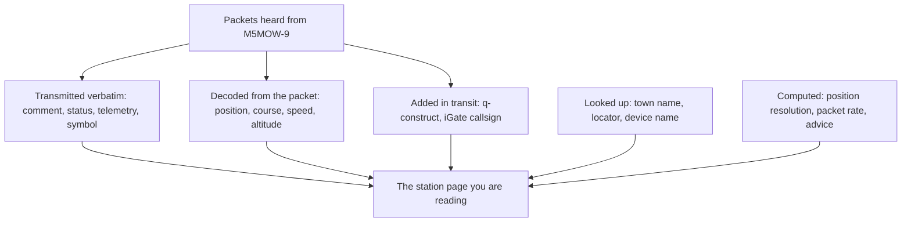
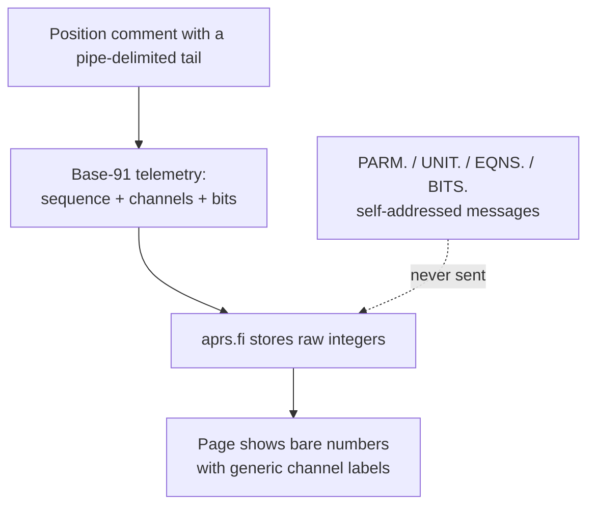

# APRS: Reading a Station Page

Click any dot on aprs.fi and you land on a **station page** — a wall of labelled fields, half of which look like typing accidents. `UQTXXX`. `qAO`. `Position resolution: 1.1 yards`. `4.33V 26.3C X`. Nothing there is decorative and nothing is a mistake, but nothing is explained either. This chapter takes one real page apart until nothing on it is a mystery.

[Running APRS in practice](outpost:entry/logbook73.handbook/aprs-running) ended by dissecting a single raw line of text. This is the other half of that skill: reading the page a website _builds_ out of hundreds of such lines, where some fields are quoted from the air, some are calculated, and some were never transmitted by anybody.

## Our worked example

Everything below decodes one genuine UK station, as a real aprs.fi page presented it:

```
Station              M5MOW-9        Symbol: Van
Station type         APRS station
Destination          UQTXXX
Packet path          WIDE1-1,qAO,MB7UWG
Position             0°12.24' W, speed 1 MPH, course 264°, altitude 344 ft
Position resolution  1.1 yards
Location             Welwyn Garden City, England
Comment              m5mow mobile 4.33V 26.3C X|<mangled>|
Status               @qsl.net 4.35V 28.8C X AVRT5 20151103
Telemetry            Ch1 7   Ch2 741   Ch3 432   Ch4 8   Ch5 0   Bit 1 0
```

A van pottering around Hertfordshire at walking pace. By the end you will know which of those lines the van transmitted, which the website worked out, and which one nobody can currently explain.

## The page is not the packet

One idea dissolves most of the confusion: **the fields come from four completely different places.**



"Comment" is the operator's own words, byte for byte. "Position" is arithmetic performed on the packet. The `qAO` was stamped on by somebody else after the packet left the antenna. "Welwyn Garden City" was never transmitted at all — the van has no idea what town it is in. Ask of every line: _who put that there?_ It is also the honest answer to most "aprs.fi is showing the wrong thing" complaints, because quite often aprs.fi is showing exactly what was sent, and what was sent was wrong. One caution before we start: units and coordinate format are **your** preferences, not the station's — this page shows miles per hour, feet and yards because that account is set to imperial.

## The station: M5MOW-9, drawn as a van

### The `-9` is a suggestion, not a rule

`M5MOW-9` is the callsign `M5MOW` with the **SSID** (secondary station identifier) `-9`. The [APRS overview](outpost:entry/logbook73.handbook/aprs) gave you the conventional list — `-7` handheld, `-9` vehicle, `-10` iGate, `-13` weather station — and this is the moment to be precise about its status, because beginners over-read it badly.

It is a **recommendation and nothing more.** Its author, Bob Bruninga `WB4APR`, retitled the document in February 2012 specifically "to clarify the title of this document to be SSID RECOMMENDATIONS not to imply any kind of decoding _standard_", and it closes: "Of course these are not rigid... These are only guidelines to hint at a station's possible application." No decoder anywhere reads the SSID and changes behaviour. In 1992 it genuinely did pick your map icon, for stations beaconing raw GPS sentences with no symbol of their own; that job moved to the destination field in the mid-1990s and "the original SSID associations are no longer a required part of the spec." What survives is etiquette.

One structural fact does hold: the ceiling of sixteen comes from the four SSID bits in an [AX.25](outpost:entry/logbook73.handbook/packet-radio) address, so a _letter_ SSID (`-A`, `-tt`) is a strong tell that what you are looking at was created on the internet side, not by a radio.

### The symbol is a separate choice

"Symbol: Van" is APRS symbol `/v`, which the master symbol list records as `/v LV VAN (SSID-15)`. That parenthetical does **not** mean a van must use `-15`; it is a fossil of the same 1992 scheme. Symbol and SSID are independent choices — this station picked the mobile SSID and the van icon, which agree with each other and with reality, but a house symbol on `-9` is perfectly legal and merely confusing. The symbol mechanism, including overlays, is in [Anatomy of a packet](outpost:entry/logbook73.handbook/aprs-anatomy).

### "Station type: APRS station"

This answers a question you did not know you had: _is this thing a real station at all?_ aprs.fi keeps no free-text taxonomy — internally it uses five single-letter target types, documented in its own API: `a` AIS (commercial marine traffic), `l` APRS station, `i` item, `o` object, `w` weather station. A separate `class` field adds `w` for **Web**: positions uploaded through aprs.fi's own browser "share location" tool, which never touched a radio. So "APRS station" means reporting _its own_ position over APRS — not a marker placed on its behalf ([an object or item](outpost:entry/logbook73.handbook/aprs-payloads)), not a ship, not a weather site, not a browser.

On the map the same distinction is carried by the **colour of the callsign label**:

| Label colour | What it is                                |
| ------------ | ----------------------------------------- |
| White        | APRS station **capable** of messaging     |
| Gray         | APRS station **not** capable of messaging |
| Violet       | Objects                                   |
| Purple       | Items                                     |
| Green        | AIS stations                              |
| Yellow       | Weather stations                          |

The white-versus-gray split is not declared by the operator. It comes from the packet's [data-type identifier](outpost:entry/logbook73.handbook/aprs-anatomy): `=` and `@` are the messaging-capable position reports, `!` and `/` are not. Message a gray station and you are talking to firmware that cannot answer.

## The destination that looks like a fault: `UQTXXX`

Not a callsign, not a word, not anything you can pronounce — the field that makes beginners assume the packet is corrupt. In ordinary APRS the AX.25 destination plays no part in routing (the source callsign and the digipeater path do that), so APRS repurposes it as a **tocall** naming the software or hardware that sent the packet. One position format, **Mic-E**, goes further and fills those six characters with _data_: the latitude plus a fistful of status bits, dressed up to look like a callsign so AX.25 will carry it unchanged. [Mic-E in depth](outpost:entry/logbook73.handbook/aprs-payloads) has the full mechanism; here we only need to read this one. The encoding table maps `P` through `Y` onto the digits 0 through 9:

| Character | `U` | `Q` | `T` | `X` | `X` | `X` |
| --------- | --- | --- | --- | --- | --- | --- |
| Digit     | 5   | 1   | 4   | 8   | 8   | 8   |

Read as degrees, minutes and hundredths of a minute that is **51° 48.88′**, and 51 + 48.88 ÷ 60 = **51.8147° N**. Hertfordshire. The station's latitude was hiding in the field you thought was broken.

The _choice_ of character does double duty. Because bytes 4, 5 and 6 fall in the `P`–`Z` block they simultaneously set north/south to **North**, the longitude offset to **+100**, and east/west to **West**; and because bytes 1, 2 and 3 are also in that block, the three Mic-E message bits are all 1, which the specification's table maps to **M0: Off Duty** — the default most trackers sit in and never change. That `+100` offset is not an error: the specification states that "for longitude values in the range 0–9 degrees, the longitude offset is +100 degrees", so stations near the Greenwich meridian _systematically_ produce destination bytes in that late-alphabet block.

One consequence matters later: a Mic-E destination **cannot also carry a tocall**. There is no room, so the device name on this page had to come from somewhere else.

## Reading the path: `WIDE1-1,qAO,MB7UWG`

The most information-dense line on the page. Read it strictly left to right and it gives you the packet's whole life story: **what the sender asked for, how it got onto the internet, and who put it there.**


### `WIDE1-1` — the request, unfulfilled

`WIDE1-1` is the fill-in-digipeater hop of the New N-Paradigm, covered in [Paths and digipeaters](outpost:entry/logbook73.handbook/aprs-paths). What matters here is what is _missing_: no asterisk, and no digipeater callsign has replaced it. The natural reading is that no digipeater ever acted on this packet — the [iGate](outpost:entry/logbook73.handbook/aprs-igates) heard the van directly, and the requested hop went unused.

That is an inference rather than a rule stated outright anywhere: the APRS-IS documentation's worked examples consistently show a _used_ hop carrying the has-been-repeated mark (`AE5PL>APRS,WIDE1*,qAR,AE5PL-10`), and an unmarked token is the absence of that. Every experienced operator reads it this way and is almost certainly right, but it is read off the examples rather than quoted. Note too that the van asked for one hop rather than the usual `WIDE1-1,WIDE2-1` — where iGate coverage is good, that is citizenship, not misconfiguration.

### `qAO` — the provenance stamp, and the star of the page

Everything after `WIDE1-1` was added _after_ the packet left the antenna. The **q-construct** is the APRS-IS's tamper-evident record of how a packet reached the internet, and reading it is the biggest single step from "looking at a map" to "understanding a network". The [iGates chapter](outpost:entry/logbook73.handbook/aprs-igates) introduced the common five; the details below are where the meaning lives. First, the rule that reframes everything: **only two q-constructs may ever be generated by a client** — "Only the qAR and qAO constructs may be generated by a client (IGate) on APRS-IS." Everything else was written by a _server_.

| Construct | Written by | Meaning                                                                 |
| --------- | ---------- | ----------------------------------------------------------------------- |
| `qAR`     | iGate      | Gated from RF by an iGate that can also send messages back to RF        |
| `qAO`     | iGate      | Gated from RF by an iGate that **cannot** gate messages to that station |
| `qAC`     | server     | Verified login over a bidirectional port — the sender _is_ the client   |
| `qAU`     | server     | Arrived directly over UDP                                               |
| `qAS`     | server     | Arrived from another server, or was generated by this server            |
| `qAr`     | server     | Gated by a remote iGate, reaching this server indirectly                |
| `qAo`     | server     | Gated via a client-only port, matching the login                        |
| `qAX`     | server     | Unverified login — deprecated on APRS-IS                                |

Second, the rule that catches everybody: **the callsign after the construct is not always the same kind of thing.** For `qAR`, `qAr` and `qAo` it is the _iGate_; for `qAC`, `qAX` and `qAU` it is the _server_; for `qAS` it is "the login or IP address of the first identifiable server". Reading `qAC,T2GREECE` as "an iGate in Greece" is a classic beginner error — that is a server, and the station logged straight into it over the internet. Third, the case matters: `qAr` versus `qAR` means _received indirectly via an intermediate server_ versus _received directly_, and `qAo`/`qAO` likewise. Both use the letter O, never a zero.

Put those together and you get the skill that makes a path worth reading at all — **did this packet touch radio?** `qAR`, `qAr`, `qAo` and a client-generated `qAO` mean **yes**: an iGate heard it on the air. `qAC`, `qAX` and `qAU` mean **no**: the station logged into a server and injected the packet, and there was never a transmitter. (A synthesis rather than a quoted sentence, but it follows directly — those three are each _defined_ by the source callsign matching the login.)

For our van, `qAO` is the client-generated kind, and its definition says more than "receive-only": _"Gated packet from RF without messaging. Packet is placed on APRS-IS by an IGate from RF which the IGate cannot gate messages to... Receive-only IGates will use this exclusively for all packets gated to APRS-IS."_ A receive-only gateway is the commonest cause, but the specification lists two others: the station was **outside the iGate's configured range**, or the packet was **translated from a non-APRS source** such as D-STAR. So one `qAO` does not prove the gateway has no transmitter — only that it will not carry a message _back_ to that station. Want to message this van? That route will not deliver; you would need a transmit-capable iGate within earshot of it. (`qAO` also has a _server_-generated meaning, "non-gated packet via send-only port or indirect packet via client-only port" — but a `qAO` followed by a gateway-style callsign in a position packet's path is the client case, which is what we have.)

Finally, **`MB7UWG`** is that iGate, and clicking it on aprs.fi takes you to its own page. One honest gap: `MB7U` looks like a callsign series set aside for unattended stations, and you will see that asserted all over the web, but the research behind this chapter could not confirm it from a primary regulator source — so this chapter does not claim it. A great deal of confident APRS folklore has no primary source behind it.

## Position, altitude, and the trap of "1.1 yards"

**The coordinates.** `0°12.24' W` is **12.24 minutes** of arc, not seconds — APRS carries positions as degrees plus decimal minutes, and the marks get muddled in transcription. So 0 + 12.24 ÷ 60 = **0.204° W**. Pair that with the 51.8147° N pulled out of the Mic-E destination and you have a point in Welwyn Garden City, exactly where aprs.fi says the van is. The destination field and the position field agree because they are the same number decoded two ways.

**Speed and course.** APRS carries speed on the wire in **knots**; aprs.fi converts to your preferred units. Course is degrees clockwise from true north, so 264° is very nearly due west. One mile per hour is realistically a stationary vehicle with a twitching GPS — which is the moment for aprs.fi's own FAQ, unusually blunt about its own data: the positions are "so inaccurate that it is in no way useful for giving speed tickets".

**Altitude.** `344 ft` did **not** come from the position field — an APRS position has no room for height. Two carriers exist: a `/A=` group in the comment, always six digits and always in **feet**; or, for Mic-E, a Base-91 group in the status text, in **metres**, measured from a datum 10 km _below_ mean sea level. Which one this packet used cannot be recovered from the transcribed fields. This tracker does emit `/A=` in the manufacturer's documented example, which makes that the likely route — but "likely" is as far as the evidence goes.

### "Position resolution: 1.1 yards"

Now the interesting field, because a beginner reads it as _"this van's position is accurate to about a metre"_ and that is emphatically not what it says.

aprs.fi computes it with its own open-source parser, `Ham::APRS::FAP` — the site's documentation says so, which makes that parser a legitimate primary source for the website's behaviour. And what it computes is not accuracy. It is a function of **how many digits the sender chose to transmit**: resolution in metres = 1.852 × 1000 × 10<sup>−n</sup>, where _n_ is the number of decimal-minute digits present (one minute of latitude being 1,852 m). Run the ladder:

| What the packet carried                             | _n_ | Stated resolution         |
| --------------------------------------------------- | --- | ------------------------- |
| Position deliberately blurred by one digit          | −1  | ~18.5 km (~11.5 miles)    |
| Plain uncompressed or Mic-E, hundredths of a minute | 2   | ~18.5 m (~20.3 yd)        |
| `!DAO!` precision extension, human-readable form    | 3   | ~1.85 m (~2.03 yd)        |
| `!DAO!` precision extension, Base-91 form           | 4   | ~0.19 m (~0.20 yd)        |
| Compressed (Base-91) position                       | —   | 0.291 m (~0.32 yd), fixed |

`!DAO!` is the usual cause of sub-metre claims: a five-byte field — `!`, a datum letter, an added-latitude byte, an added-longitude byte, `!` — that may sit anywhere in a position comment. An **uppercase** datum letter means the two bytes are extra decimal digits of minutes, good "to the nearest 6 feet or so"; a **lowercase** letter means Base-91, good to "about one foot". Datum letters include `W` for WGS84 and `O` for OSGB36 — but aprs.fi performs **no datum conversion** ("The only supported datum is still WGS84"), so a station honestly declaring OSGB36 is plotted as WGS84 anyway, tens or hundreds of metres out.

And now the honest part. **"1.1 yards" matches no rung of that ladder.** It is about 1.01 m; the parser's outputs are 18.52, 1.852, 0.291 and 0.1852 m. The research behind this chapter could not reproduce the figure, nor check the live page by hand — aprs.fi's terms of service forbid programmatic scraping of its interface, and its station pages sit behind an anti-bot challenge. Two untested explanations exist: aprs.fi may run a newer parser than the published one, or the figure may be clamped by its own stored coordinate precision, since one hundred-thousandth of a degree of latitude is 1.11 m. Neither is verified. **Do not build a reading on that number.**

What _is_ certain is the lesson underneath: **position resolution is a statement about encoding, not accuracy.** It says how finely the sender wrote the number down, not whether the number is true. A tracker with a poor sky view can transmit a wrong position to four decimal places of a minute, and the page will report sub-yard resolution for a fix fifty metres out.

The opposite case is displayed rather well: a station transmitting a _deliberately_ imprecise position gets a purple dashed border round its callsign label, a purple rectangle on hover showing the ambiguity area, and a page that reads "Position ambiguous: Precision reduced at transmitter by 3 digits, position resolution approximately 18.5 km" — the bottom rung of the table.

## Two comments that are not both comments

The page shows two lines that both look like free text. They are two **different kinds of APRS transmission**, sent at different moments: aprs.fi's guide lists **Comment** and **Last status** as separate fields — "Last status: The most recent status message transmitted." A comment rides on the tail of a position packet; a status is its own packet with its own data-type identifier (`>`), carrying up to 62 characters. Note the two lines report different voltages and temperatures — two transmissions minutes apart, not two halves of one message.

This tracker is an **AVRT5**, better known as the SainSonic **AP510**: a self-contained 1 W VHF tracker with built-in GPS, TNC and Bluetooth, registered in the APRS device database as tocall `APAVT5`, class `tracker`. Its public manual accounts for every character:

- **`m5mow mobile`** and **`@qsl.net`** are the operator's own text — the configurable comment and status strings. (The status text defaults to the literal `AP510` if never changed, itself a nice tell.)
- **`4.33V 26.3C`** is _not_ typed by anybody: the firmware appends it whenever the "Volt" and "Temp" boxes are ticked, since "Comment Text – Sent at the end of packet, also includes x.xxV xx.xC TFStatus (if last three selected)".
- **`X`** is the character everyone assumes is a typo. It is the memory-card status flag: "TF/X – Status packet with X means TF-Card missing or write error to TF-Card". This van's tracker has no card fitted, or cannot write to it; a healthy unit shows `TF`.
- **`AVRT5 20151103`** is the firmware stamping its own product name and build. The manual gives the status format exactly: `"Status Text" Altitude Volts Temp X AVRT5 (version)`. The trailing number reads as a date-formatted build stamp — 3 November 2015 — though the manual never spells out that field's format, so treat that as interpretation.

The same manual explains a pattern you will see elsewhere: the status packet is sent at power-on and then repeatedly _until the GPS locks_ ("Will only send 'Status Text' until GPS Lock!"), so a burst of status-only packets with no position is a tracker waiting for satellites.

**So how did aprs.fi know it was an AVRT5**, given that a Mic-E destination cannot carry a tocall? The AP510's status packets are _not_ Mic-E, so they can carry the `APAVT5` tocall — the likeliest source; Mic-E devices are separately identified by a type code at the start and end of the comment text. Either way the name came from a lookup table, not from anything the van said in words. That table is the `aprsorg/aprs-deviceid` registry, "the primary database for APRS device identifier allocations" since 19 February 2022, and it also supplies the _class_ words shown beside a device — `tracker`, `igate`, `digi`, `wx`, `app`, `software`. When aprs.fi calls a station an "iGate", that word came out of this file. **It is not something the station transmitted about itself.**

## Telemetry: five numbers with no labels

`Ch1 7   Ch2 741   Ch3 432   Ch4 8   Ch5 0   Bit 1 0` — six readings, no names, no units. This is the commonest "is aprs.fi broken?" moment on the site, and the answer is a clean no.

[APRS telemetry](outpost:entry/logbook73.handbook/aprs-payloads) carries only numbers. The _meaning_ arrives separately, in four ordinary APRS messages a station addresses **to its own callsign**: `PARM.` names the channels, `UNIT.` labels their units, `EQNS.` gives three scaling coefficients per analogue channel, `BITS.` sets the sense of the digital bits. Send them and every decoder on Earth can label and scale your telemetry forever; don't, and nobody can. aprs.fi states the resulting rule in its own words: _"If any channel names have been sent using the 'PARM.' message, only those channels (and bits) are displayed... If no names have been sent, all 5 analog channels and 8 bits are shown."_



So `Ch2 741` is not a failure. It is aprs.fi being scrupulous: it has a number, it does not know what the number means, and it declines to invent a unit. Had the station declared coefficients `0, 0.01, 0` with the unit `VDC` — a real pattern in tracker firmware — the same 741 would render as **7.41 V** on a channel labelled "Voltage". Without those messages, 741 could be volts, hundredths of a volt, a raw converter count or a packet counter, and the website will not guess.

**One thing the number itself tells you.** Classic `T#` telemetry defines its five analogue values as 8-bit, "expressed as 3-digit decimal numbers in the range 000–255". 741 does not fit, so this did not arrive as classic `T#` values. Two possibilities remain: **Base-91 comment telemetry**, whose range is 0 to 8280, or a relaxed `T#` format permitting larger and fractional values, which aprs.fi has accepted since 2020. A three- or four-digit unnamed channel hints strongly at the former. (That combines two verified rules rather than quoting either — a strong inference, not a fact.)

**The pipes in the comment** are structural, not noise. **Base-91 comment telemetry** — a 2012 specification by Heikki Hannikainen `OH7LZB`, author of both aprs.fi and the parser it uses — puts telemetry inside the comment field of an ordinary position packet, "delimited at both ends by the | (pipe / vertical bar) character". Two Base-91 characters per value give "over 13 bits of resolution (values 0 to 8280)": a sequence counter, then up to five analogue channels, then optionally a two-character group holding eight binary bits, which **must** come last. A full house is exactly **14 characters between the pipes**. Ordering is strict because "a valid-looking !DAO! extension may appear in the middle of a Base91 encoded telemetry extension" purely by chance — so telemetry "MUST appear after the free-form comment text entered by the end-user, but before any DAO or Mic-E type codes".

**What this chapter will not claim.** The comment tail as captured cannot be decoded: it contains a non-ASCII character, which cannot legally occur in a Base-91 field, and it is roughly ten characters where a full house needs fourteen. It was mangled between the packet and the page — the structure is solid, the values are gone. Separately, the AP510's 2015 manual documents plain-text voltage and temperature and separate telemetry packets, but says nothing about a pipe-delimited Base-91 comment extension; later firmware may add it. So: aprs.fi shows five channels and a bit, the comment plainly carries a pipe-delimited field, and which firmware build produced it is not something the published manual can tell us.

## The rest of the page

- **Location** is derived, not transmitted — aprs.fi's guide describes it as also carrying a Maidenhead locator and "a list of some cities or towns which are close, together with distance and bearing". The formula is not published, so do not treat those distances as survey-grade.
- **Positions stored.** aprs.fi keeps "only unique new positions of a station, together with start and end timestamps" — which is why a mobile draws a track and a fixed station does not. The sting: a _fixed_ station beaconing from a GPS generates spurious "movement" days as its fix jitters, so the guide advises "Fixed stations should use fixed coordinates instead of a GPS."
- **Packet rate** and **Last path** come with advisors: below a 30-second average interval the first warns of "a high rate, which can cause congestion in the APRS network", and the second calls anything above three hops suboptimal.
- **Hovering on the map** colours the packet's path — **green** to the first receiver where it is positively identified, **purple** on the final leg to the iGate, **blue** in between. Ours draws a single purple leg from the van to `MB7UWG`.
- **The iGate's own page** carries statistics to read sceptically: aprs.fi infers the digipeater and iGate roles from observed behaviour rather than any declared field, and warns that duplicate suppression credits only the _first_ iGate to gate a packet.

## Now go and read your own

1. **Pick a station.** Open [aprs.fi](https://aprs.fi/) and find a moving vehicle near you — or LogBook73's APRS view, which subscribes to the same feed (the badge says whether it is live or sample data). A mobile fills in more fields than a home station.
2. **Sort the page into four piles.** Label every field _transmitted verbatim_, _decoded from the packet_, _added in transit_ or _worked out by the website_. That exercise alone teaches more than re-reading this chapter.
3. **Read the path aloud, left to right,** then find the q-construct and ask: _did this touch radio?_ Compare a phone-app user against a car tracker and watch the difference appear.
4. **Find a bare telemetry channel** and check whether the station ever sent `PARM.` — open its raw packets and look for a message it addressed to itself. If it is missing, you have found somebody who could improve their station in ten minutes.
5. **Check the position resolution against the ladder.** About 20 yards means plain hundredths of a minute; a fraction of a yard means a precision extension or a compressed position. Then say out loud that none of it is a claim about accuracy.
6. **Be a good guest.** aprs.fi's terms forbid writing software to scrape its interface; it publishes a documented API with a free key instead, on condition you credit and link back. Use that, and log what you hear off the air in LogBook73's Receive log.

## Key takeaways

- Station-page fields come from **four different places** — transmitted verbatim, decoded, added in transit, or computed by the website — so "who put that there?" resolves most confusion instantly. Units and coordinate formats are the _reader's_ preferences.
- **SSIDs are recommendations, not a standard**, and the symbol is an independent choice: `-9` plus a van is a convention agreeing with itself, not a rule being obeyed.
- A Mic-E **destination like `UQTXXX` is the latitude** — 51° 48.88′ — and because the bytes fall in the `P`–`Z` block it also encodes North, West, a +100° longitude offset (normal near Greenwich) and the message bits for "Off Duty".
- The **q-construct is the provenance stamp**: only `qAR` and `qAO` may be written by an iGate, the callsign after it is an _iGate_ for some constructs and a _server_ for others, case matters (`qAr` ≠ `qAR`), and `qAO` means messages cannot be gated back to that station.
- **Position resolution is about encoding, not accuracy** — computed from how many digits were transmitted, laddering from ~18.5 m for a plain position to ~0.19 m with a Base-91 `!DAO!`. The "1.1 yards" here matches no rung and could not be reproduced.
- Two text lines are usually a **comment and a status**, sent minutes apart as different packet types; here the firmware appends voltage, temperature and an `X` meaning "no memory card".
- **Bare telemetry channels mean the station never sent `PARM.`** — a value above 255 cannot be classic `T#`, and a pipe-delimited tail in a comment is Base-91 comment telemetry. The device name comes from the `aprsorg/aprs-deviceid` registry, not from the station.

When you can read a page this way, the next step is making one of your own worth reading: [Running APRS in practice](outpost:entry/logbook73.handbook/aprs-running) builds the tracker, the receive-only iGate and the weather station whose pages other people will one day pick apart.
