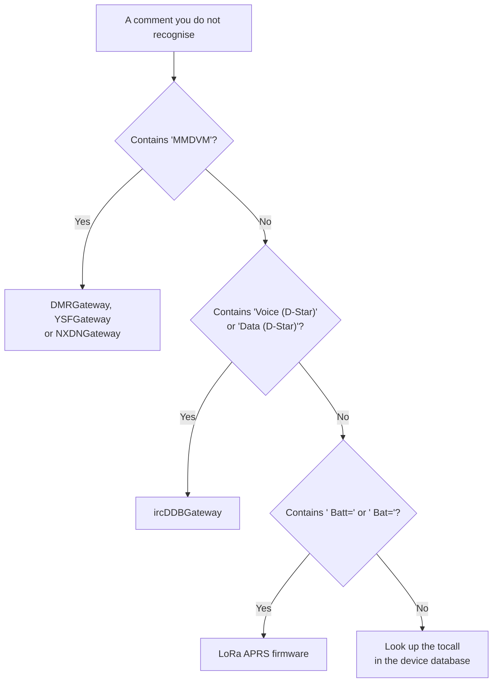
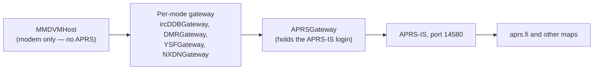
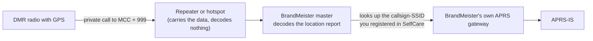
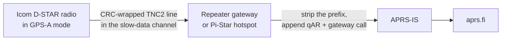

# APRS: Hotspots, Repeaters & LoRa

Zoom aprs.fi in on any town and a good half of the dots turn out not to be trackers at all. They are hotspots on bookshelves, repeaters on masts, LoRa gateways in loft windows and software receivers on spare Raspberry Pis — infrastructure with an APRS beacon bolted on the side. Their comments are baffling on first reading: fragments of frequency, offsets spelled out to four decimal places, battery voltages, phrases that sound as though a machine wrote them. One did. This chapter decodes them, names the program behind each, and shows you how to switch the same beacon on — or off — for your own kit.

Nothing here is a new APRS format. Every string below sits in an ordinary [position report](outpost:entry/logbook73.handbook/aprs-anatomy) whose free-text comment happens to have been written by firmware rather than a person. Once you know which firmware, the string reads itself.

## Five strings, and who wrote them

| What you see on the map                          | Who wrote it                                                                     |
| ------------------------------------------------ | -------------------------------------------------------------------------------- |
| `70cm Voice (D-Star) 438.80000MHz +0.0000MHz`    | **ircDDBGateway** (the D-STAR gateway program), on a simplex hotspot             |
| `70cm MMDVM Voice (DMR) 430.60000MHz +9.0000MHz` | **DMRGateway**, on a duplex hotspot or repeater                                  |
| `APRS for DMRGateway`                            | **Pi-Star**, whose dashboard writes that literal phrase as a default description |
| `LoRa iGate/Digipeater Batt=5.09V`               | A **LoRa APRS iGate**; the ` Batt=` tail is appended by CA2RXU's firmware        |
| `OpenWebRX APRS gateway`                         | **OpenWebRX**, whose shipped default beacon text is exactly that                 |

Two things follow immediately. First, every one is a **default nobody changed**, which is why you meet the same phrase over and over across a continent. Second, none of these stations reached the map by radio: they log straight into the [APRS-IS](outpost:entry/logbook73.handbook/aprs-igates) and inject their own beacon, which is why their paths read `TCPIP*` rather than a chain of digipeaters. aprs.fi's preferences carry an option to hide stations that did not transmit over a radio channel; tick it and most of this chapter's traffic vanishes at a stroke.

## The published frequency format — and why hotspots do not use it

Long before hotspots existed, Bob Bruninga `WB4APR` specified how a station should advertise a frequency, under the name **AFRS** (Automatic Frequency Reporting System). A mobile radio was meant to read a passing repeater object off the map and offer to tune to it, so the frequency had to sit somewhere rigid. There are two sanctioned places: the **first 10 bytes of the comment**, written either `FFF.FF MHz` (nearest 10 kHz) or `FFF.FFFMHz` (nearest 1 kHz) — count them, both are 10 bytes on the nose, and the spec insists "MHz" appear in mixed case — or the **object's own name**, as `FFF.FFxyz`.

The repeater shift gets its own tiny field, `oXXX`, defined as "+XXX or -XXX in 10's of KHz": a +600 kHz shift is written `+060`, five megahertz down is `-500`, `-000` means forced simplex, and 9.90 MHz is the largest the field can express. A CTCSS tone rides in an optional second field, forced to three bytes with the tenths dropped. Two of the spec's own examples, the second reading as 442.440 MHz, 107.2 Hz tone, 5 MHz negative shift:

```
146.40 MHz T067 +100 Repeater
442.440MHz T107 -500 Repeater
```

Now look again at what a hotspot sends:

```
70cm MMDVM Voice (DMR) 430.60000MHz +9.0000MHz, APRS for DMRGateway
```

It matches none of that. The comment does not begin with the frequency (a band name is in the way), the frequency has five decimal places rather than three, and the shift is spelled out in megahertz instead of packed into four bytes as tens of kilohertz. No source states the conflict outright — it is a comparison you can make yourself between the spec text and the program's source — and I have not seen a test of what a radio with a "tune to this" button does when handed one. Treat these strings as human-readable, not machine-readable. **SvxLink**, the software behind many EchoLink and repeater nodes, is the spec-compliant counter-example: its `TX_OFFSET` is entered in kilohertz but, its manual says, "when the APRS packet is transmitted the value is expressed in tens of kHz."

### Reading a hotspot comment at a glance



The tocall — the AX.25 destination field APRS repurposes to name the sending software, met in the [anatomy chapter](outpost:entry/logbook73.handbook/aprs-anatomy) — is the fallback that never lies. Since 19 February 2022 the authoritative registry has been [github.com/aprsorg/aprs-deviceid](https://github.com/aprsorg/aprs-deviceid), maintained by Heikki Hannikainen `OH7LZB`, who also runs aprs.fi — which is why the two agree. Bruninga's old `tocalls.txt` is deprecated, and aprs.org now says it is kept for historical purposes only: its plain-text specification files are still primary references, but its HTML pages currently carry injected spam.

## MMDVM and Pi-Star: who actually sends the beacon

The most useful correction in this chapter: **MMDVMHost — the program that talks to the modem board — does not send APRS at all.** Its shipped configuration has no `[APRS]` section and no APRS code, and people blame it constantly. The beacons come from the **per-mode gateway programs** above it, each written by Jonathan Naylor `G4KLX`, each with its own `[Info]` and `[APRS]` sections:

| Program       | Mode          | Comment it writes                      | Tocall                                 |
| ------------- | ------------- | -------------------------------------- | -------------------------------------- |
| ircDDBGateway | D-STAR        | `Voice (D-Star) …` / `Data (D-Star) …` | `APDG01` (object), `APDG02` (position) |
| DMRGateway    | DMR           | `MMDVM Voice (DMR) …`                  | `APDG03`                               |
| YSFGateway    | C4FM / Fusion | `MMDVM Voice (C4FM) …`                 | `APDG03`                               |
| NXDNGateway   | NXDN          | `MMDVM Voice (NXDN) …`                 | `APDG04` fixed, `APDG03` mobile        |
| P25Gateway    | P25           | _(none — no APRS support at all)_      | —                                      |

That table alone decodes two of our five strings, because the presence or absence of the word **MMDVM** is the tell: ircDDBGateway does not use it, the other three do. Above them all sits one more program, **APRSGateway**, whose stated purpose is to give the others "one point of access into aprs.fi… to reduce the load on aprs.fi and avoid contention between the other gateway programs". It is the only piece holding an APRS-IS login and passcode, and it connects to `rotate.aprs2.net` on port `14580` — the ordinary user-filter port from the [iGates chapter](outpost:entry/logbook73.handbook/aprs-igates).



### Where every character of the string comes from

DMRGateway builds its description with one C format string, which explains the whole line:

```
"MMDVM Voice (DMR) %.5LfMHz %c%.4lfMHz%s%s"
```

`%.5Lf` is five decimal places, which is why you get `430.60000MHz`. `%.4lf` is four, which is why the shift reads `+9.0000MHz`. The final two `%s` are a `, ` separator and the operator's description — so strings two and three from our list are almost certainly **one comment**, joined by that comma. The **band word** in front comes from the transmit frequency alone, by a ladder of thresholds:

| Transmit frequency | Band word     |
| ------------------ | ------------- |
| ≥ 1 200 MHz        | `23cm/1.2GHz` |
| ≥ 420 MHz          | `70cm`        |
| ≥ 144 MHz          | `2m`          |
| ≥ 50 MHz           | `6m`          |
| ≥ 28 MHz           | `10m`         |
| anything else      | `4m`          |

That last row is a quirk: `4m` is the variable's initial value rather than a real 70 MHz test, so an unset frequency is labelled 4 m. ircDDBGateway uses the same thresholds with no default, so below 28 MHz its band word is empty.

The **offset** is plain arithmetic: receive frequency minus transmit frequency, where the transmit frequency is what the hotspot sends — the downlink you listen to. A **simplex** hotspot has receive equal to transmit, so the subtraction yields exactly zero, and because the sign test asks only "is this less than zero?", zero prints as **plus**. That is why every simplex hotspot on Earth reads `+0.0000MHz`, and why our D-STAR example is a simplex hotspot on 438.800 MHz. A **duplex** station has a real split: `430.60000MHz +9.0000MHz` transmits on 430.600 and listens on 439.600 — and since its input is your output, that `+9.0000` is also the repeater shift you would program into your radio. Pi-Star does the same subtraction before writing the file, and in the simplex branch of the form hard-sets `0.0000`.

### The rest of the packet

A complete DMRGateway beacon looks like this on the wire:

```
M0ABC-D>APDG03,TCPIP*,qAC,M0ABC-DS:!5123.45ND00012.34W&/A=00032870cm MMDVM Voice (DMR) 430.60000MHz +9.0000MHz, APRS for DMRGateway
```

Four details repay attention:

- **The SSID is `-D`.** Pi-Star's default suffix is the word `DMR`, but DMRGateway appends only its _first character_; YSFGateway's shipped suffix is `Y` and NXDNGateway's is `N`. Nothing stops two of your own hotspots colliding on `-D` — APRS [SSIDs](outpost:entry/logbook73.handbook/aprs) are a convention, never an allocation.
- **The symbol is `D&`** — overlay `D` on the gateway diamond — the hard-coded fallback when none is configured. It appears nowhere in Bruninga's published overlay list, which registers `/&` HF gateway, `I&` generic iGate, `L&` LoRa iGate, `R&` receive-only iGate, `T&` and `2&` transmit iGates and `W&` WIRES-X. `D`-for-digital-voice is one author's convention, not a registered symbol — though ircDDBGateway's _object_ packet does use the registered D-STAR symbol, `Da`.
- **`/A=000328`** is altitude in feet, from the height you gave in metres — and the band word butts straight up against it with no space, which is why these comments look mangled.
- **`TCPIP*,qAC,…`** is written by the program itself. These stations never touch RF as APRS, and a well-behaved iGate refuses to gate a `TCPIP` packet back onto the air — the loop protection from the [iGates chapter](outpost:entry/logbook73.handbook/aprs-igates).

D-STAR is the odd one out once more: ircDDBGateway emits **two packets per module**, an object from `CALL-S` and a position report whose source callsign uses the **module letter as its SSID**, so a 70 cm D-STAR hotspot appears as `M0ABC-B`. Letter SSIDs are impossible in plain AX.25 — there are only four SSID bits — but legal on the internet side, which is why they appear only on gateway-generated stations. Both programs beacon 60 seconds after start and then every 20 minutes, so expect a wait after any change.

### Running one yourself, and switching it off

If you already have a hotspot — the [DMR hotspots chapter](outpost:entry/logbook73.handbook/dmr-hotspots) covers building one, from a roughly $30/€30 bare MMDVM board on a Raspberry Pi to a ~$200/€200 all-in-one — adding APRS costs nothing and takes two minutes. On the Pi-Star configuration page set a non-zero latitude and longitude, enter your radio frequency (one field for simplex, an RX and TX pair for duplex), then turn on the switch labelled **APRS Host Enable** and pick a server; it works out your APRS-IS passcode for you. Pi-Star's own tooltip is worth quoting: _"Enabling this feature will make your location public."_ One form submission fans the same data into every gateway's configuration file, which is why a wrong latitude shows up as `CALL-D` and `CALL-B` at once.

To change `APRS for DMRGateway` into something of your own, edit the `Description` key in the `[APRS]` section of DMRGateway's configuration, reachable through Pi-Star's Expert full-edit view; the same section holds the symbol. To come **off** the map, use that same dashboard switch, or set latitude and longitude to zero — the more thorough option, because both DMRGateway and ircDDBGateway contain an early return whose source comment reads _"Default values aren't passed on"_, so at zero the beacon is never built.

One caution about versions. DMRGateway's sample configuration carried `Address=127.0.0.1` and `Port=8673` under `[APRS]` in 2022 and 2023; by mid-2024 those keys were gone, replaced by an `[MQTT]` section. A reader on a stock Pi-Star image still sees the old keys, because Pi-Star's dashboard writes them; a reader building from current source does not. **Check the project's own repository rather than any book, this one included** — [DMRGateway](https://github.com/g4klx/DMRGateway) and [APRSGateway](https://github.com/g4klx/APRSGateway).

## DMR GPS on the map: the network does the work, not your hotspot

A distinction that trips up almost everyone: DMRGateway's APRS feature puts **the hotspot** on the map and nothing else. Its APRS code has no per-user write path — no function for "this DMR user just reported a position" — so your hotspot never gates anybody's GPS. That job belongs to the network, and on BrandMeister the chain runs like this:



**What the radio must do.** It sends its fix as DMR data over one of two documented transports. _NMEA Location Reporting_ uses UDP port 10110 (IANA's NMEA port), carrying CRLF-terminated NMEA lines — and BrandMeister processes only `$GPRMC`, so a radio sending only `$GPGGA` never appears. _Compressed Location Reporting_ is BrandMeister's own scheme on UDP port 10111, one MessagePack record per datagram with latitude, longitude, altitude in metres, speed in knots and course in degrees; BrandMeister warns it is _not_ compatible with Hytera's or Motorola's compressed reports. Both are one-way, with no confirmation.

The destination is a private call to the master's APRS gateway ID — that master's three-digit MCC followed by `999`, so `234999` on a UK master, `262999` on a German one, `310999` on a US one. That is the number you program as a Private Call contact in your codeplug. (I have deliberately not named the menu items in any vendor's programming software: those names vary by vendor and firmware, and I could not verify them from a primary source.)

**What the network must do.** BrandMeister decodes the report, looks up the callsign _with SSID_ you associated with your DMR ID in SelfCare, builds an APRS packet and injects it over its own APRS-IS login — configured server-side, with its own callsign and passcode, in which you have no part. Whether your in-call GPS may leave the network at all is governed by a capability flag BrandMeister names `CAPABILITY_PUBLIC_LOCATION_MODE`: _"Permit to in-call GPS data to public resources such as APRS."_

Since master version 20170909 the repeater's callsign is inserted into the APRS digipath, giving you two ways to recognise a DMR-sourced position — a literal `DMR*` element, and the repeater or hotspot callsign just before it:

```
DC6RN-9>APRS,DB0CJ,DMR*,qAR,DB0CJ:@043233h4925.11N/01152.85Ev148
```

One honest gap: BrandMeister's wiki says its main software uses a tocall in the `APBMxx` family, yet the only raw packets it has published show the generic tocall `APRS`. I could not reconcile the two without watching live traffic, so take neither as certain.

The same gateway carries text: an APRS message to the callsign-with-SSID you registered reaches your radio, and a DMR text message formatted `<CALLSIGN> <message text>`, sent to that same `MCC999` ID, comes out as an APRS message.

**Running it yourself.** Cost is the barrier: a DMR set with a working GPS is a step up from the cheapest, and the fix has to be acquired outdoors. Difficulty is moderate — a codeplug edit for the private-call contact and location reporting, plus one association in BrandMeister SelfCare with the public-location capability enabled. Nothing on your hotspot changes; the [DMR networks chapter](outpost:entry/logbook73.handbook/dmr-networks) covers SelfCare more broadly.

## D-STAR: D-PRS, the conversion that pre-dates all of this

D-STAR got here first, by a different route. **D-PRS** — the D-STAR Position Reporting System, designed by Pete Loveall `AE5PL` — is, in his words, "not a protocol but a conversion specification". Of D-STAR's 4800 bit/s stream, 3600 bit/s is AMBE voice and the rest sync plus user data, of which roughly 900 bit/s is usable for serial data. D-PRS turns whatever the radio puts in that sub-channel into ordinary APRS text. Radios offer two GPS modes, and the choice matters:

- **GPS (NMEA) mode** sends `$GPRMC` and `$GPGGA` plus a user-set identification message. The gateway translates it into a packet with destination `APDPRS` and path `DSTAR*` — `KE5C>APDPRS,DSTAR*:!3104.33N/09723.58W>220/001 IC-91AD/A=000518`. Course and speed come from RMC and `/A=` from GGA, so a missing sentence means a missing field.
- **GPS-A mode** sends a complete TNC2-format APRS packet with a CCITT CRC wrapper, and Loveall recommends it plainly: "a CRC is more reliable than an XOR checksum." On the air it reads `$$CRCCE3E,AE5PL-T>API282,DSTAR*:!3302.39N/09644.66W>/`, and the gateway strips the ten-byte `$$CRCxxxx,` prefix before passing the rest to APRS-IS.

GPS-A has one configuration trap: the radio's UNPROTO must be `APInnn,DSTAR*` — the letters `API` plus the first three digits of the model number — with, the specification insists, no spaces and no digipeater other than `DSTAR*`, asterisk included.

| Radio   | UNPROTO         | Radio   | UNPROTO         |
| ------- | --------------- | ------- | --------------- |
| IC-2820 | `API282,DSTAR*` | ID-31   | `API31,DSTAR*`  |
| IC-7100 | `API710,DSTAR*` | ID-51   | `API51,DSTAR*`  |
| IC-9100 | `API910,DSTAR*` | ID-4100 | `API410,DSTAR*` |
| IC-9700 | `API970,DSTAR*` | ID-5100 | `API510,DSTAR*` |
| IC-80   | `API80,DSTAR*`  | ID-880  | `API880,DSTAR*` |



Three consequences worth carrying away. First, **your Pi-Star D-STAR hotspot is itself a D-PRS iGate**: ircDDBGateway watches the slow-data stream for `$GPGGA`, `$GPRMC` and `$$CRC`, then re-emits what it finds with `,qAR,` and its own callsign-plus-module — so an ID-51 with GPS-A on appears as `CALL-A>API51,DSTAR*,qAR,HOTSPOT-B`. Second, **D-PRS is where letter SSIDs come from**: a non-space eighth character in the radio's callsign field becomes an SSID with a hyphen, so `KE5C` with ID `A` becomes `KE5C-A`. Third, the gating rule is specified — `qAR` for GPS-A packets, `qAO` for GPS-mode translations, `qAO` for everything if the gateway is receive-only.

The operating rules are short: beacon no more often than every five minutes, and _turn beaconing off when you are active on voice_, because every transmission carries the GPS data with it. To reach a repeater's gateway set URCALL to `CQCQCQ`, RPT1 to the repeater and RPT2 to the gateway — the repeater callsign with `G` in the eighth position — and no registration is needed. (Two Kenwood caveats from the specification's own author: the TH-D74 will not allow its message field to be modified, so gateways may translate it to a posit with a Kenwood symbol, and the TH-D75 uses the _APRS_ callsign-SSID rather than the D-STAR one, which Loveall reports as a bug.)

**Running it yourself.** If you already own an Icom D-STAR radio with GPS this costs nothing but menu time, and the [D-STAR operating chapter](outpost:entry/logbook73.handbook/dstar-operating) covers the rest of the mode; the only difficulty is typing the UNPROTO exactly. Buying in is another matter — a GPS-equipped D-STAR handheld is a several-hundred-currency-unit purchase, and there are far cheaper ways onto the map.

## LoRa APRS: the 433 MHz ecosystem

LoRa arrived from a completely different direction. Where everything above is digital voice with a beacon attached, **LoRa APRS** is APRS proper — positions, digipeating, messaging — carried by [chirp spread spectrum](outpost:entry/logbook73.handbook/lora-and-meshtastic) instead of 1200-baud AFSK, on 70 cm instead of 2 m, from a board that costs less than a decent microphone.

### The link parameters, and where they come from

The de facto settings are **433.775 MHz, spreading factor 12, bandwidth 125 kHz, coding rate 4/5, 20 dBm** — and be clear about their status. They are not a coordinated channel assignment; they are the values shipped as firmware defaults, and everybody uses them because everybody uses them.

The United Kingdom is the exception, because there the frequency genuinely sits in a national band plan: the RSGB plan allocates `439.900–439.9875 MHz` to "Digital Communications including Low Power Lora Gateways; Pagers etc", and its Note 9 names **439.9125 MHz** for low-power LoRa at 125 kHz maximum bandwidth. You will also read that IARU Region 1 "recommends 433.775 for LoRa APRS" — version 9.01 of the Region 1 VHF Handbook does not say that. It carries only a `LORA` marker in the 433.625–434.000 MHz digital segment noting "125 kHz Max BW Data (such as LoRa etc)": a sanctioned bandwidth for experiments, not a named channel.

CA2RXU's tracker firmware ships four regional presets, and the second is a trap for the unwary:

| Preset         | Frequency    | Spreading factor | Coding rate |
| -------------- | ------------ | ---------------- | ----------- |
| EU / world     | 433.775 MHz  | SF12             | 4/5         |
| Poland         | 434.855 MHz  | **SF9**          | **4/7**     |
| United Kingdom | 439.9125 MHz | SF12             | 4/5         |
| United States  | 915.000 MHz  | SF12             | 4/5         |

Poland is not merely a different frequency: a different spreading factor and coding rate leaves a Polish station and a standard one mutually deaf even on the same channel. Check your national band plan before you key up, and remember that on an amateur allocation you operate under **your licence conditions**, not the licence-exempt short-range-device rules that govern the same silicon in a Meshtastic node.

### What is actually on the air

A LoRa APRS frame is **not AX.25**: no address field, no bit stuffing, no frame check sequence — LoRa's own CRC handles integrity. The payload is three magic bytes, `0x3C 0xFF 0x01`, followed by the packet as plain TNC2 text, `SRC>DEST,PATH:payload` — exactly the line you read on aprs.fi. Two entirely separate codebases validate and transmit that same header, which is what makes it the de facto standard.

The `WIDEn-N` path convention rides along as text, and LoRa digipeaters honour it: CA2RXU's iGate substitutes its own callsign for `WIDE1-1` in fill-in mode and additionally handles `WIDE2-1` and `WIDE2-2` in full digipeater mode, exactly as the [New N-Paradigm](outpost:entry/logbook73.handbook/aprs-paths) describes — the same routing grammar on a different physical layer. Once gated, nothing marks a packet as having come by LoRa: gateways may not modify the path except to append the q-construct, and the header is stripped before upload. Your only clues are the tocall, the q-construct and the symbol.

| Tocall   | Project                        |
| -------- | ------------------------------ |
| `APLG01` | OE5BPA LoRa iGate / digipeater |
| `APLT00` | OE5BPA LoRa tracker            |
| `APLRG1` | CA2RXU ESP32 LoRa iGate        |
| `APLRT1` | CA2RXU ESP32 LoRa tracker      |

`APL` is _not_ reserved for LoRa: the registry also holds `APLM??` for desktop software and `APLIG?` for the LightAPRS tracker.

### Where "Batt=" comes from

The tail `Batt=5.09V` comes from CA2RXU's LoRa iGate firmware, which formats the measured voltage to two decimals and does, literally, `beaconPacket += " Batt="`. The exact spelling is a useful fingerprint, because three closely related projects each spell it differently:

| Tail in the comment | Firmware                     |
| ------------------- | ---------------------------- |
| ` Batt=5.09V`       | CA2RXU **LoRa_APRS_iGate**   |
| ` Bat=4.02V`        | CA2RXU **LoRa_APRS_Tracker** |
| ` - Bat.: 4.02V`    | OE5BPA **LoRa_APRS_Tracker** |

The same firmware emits ` Ext V=` for an external battery, undervoltage sleep warnings, and ` de CALLSIGN` when a tactical callsign is in use. And 5.09 V is itself informative: no single lithium cell exceeds about 4.2 V, so that is the board's internal supply rail — a USB- or 5 V-fed gateway. Both CA2RXU firmwares can also send the voltage as encoded [telemetry](outpost:entry/logbook73.handbook/aprs-payloads) rather than comment text, so the _absence_ of a `Batt=` string does not mean the station is silent about its battery.

The words in front are less certain, and I would rather say so than guess. `LoRa iGate/Digipeater` could be the operator's own comment — CA2RXU's firmware ships `LoRa APRS` and OE5BPA's ships `LoRa iGATE & Digi, Info: github.com/lora-aprs/LoRa_APRS_iGate`, so either operator might have typed something close. It could equally be the _device model name_ aprs.fi looked up from the tocall, because the registry holds several LoRa entries whose model strings read almost exactly like that. Open the raw packets to settle it: whatever is in the comment field was transmitted; anything else on the page was added by the website. (One inconsistency to note while you are there: Bruninga registered `L&` as the LoRa iGate symbol in March 2021, yet CA2RXU's firmware ships overlay `L` with symbol code `a`.)

### Running one yourself

This is the cheapest infrastructure in the chapter by a wide margin: an ESP32-plus-LoRa board in the $25–45 / €25–45 class, a small 70 cm antenna and a USB supply is the whole bill of materials. Difficulty is moderate — flash the firmware, edit a JSON configuration file with your callsign, APRS-IS passcode, position and beacon comment, and that is the job. The firmware ships receive-only with digipeating off, so an unconfigured gateway is a good citizen by default.

Choose the live project. Peter Buchegger `OE5BPA`'s originals — the repositories that started the ecosystem — were **archived in September 2025**, their READMEs recommending Ricardo `CA2RXU`'s successors, which remain actively developed and support the current Heltec V3 and LilyGO boards. Start at [github.com/richonguzman/LoRa_APRS_iGate](https://github.com/richonguzman/LoRa_APRS_iGate), and treat every configuration key above as version-dependent.

### LoRa APRS is not Meshtastic

These two get confused constantly, and understandably: the same board, the same band, sometimes the same shop. They share nothing above the antenna.

|                  | LoRa APRS                    | Meshtastic                                           |
| ---------------- | ---------------------------- | ---------------------------------------------------- |
| Payload          | Plain ASCII TNC2 text        | Protocol-buffer encoded                              |
| Encryption       | None                         | AES per channel, by default                          |
| Routing          | APRS `WIDEn-N` digipeating   | Flood mesh with a hop limit                          |
| Typical settings | SF12, BW 125 kHz             | LongFast: SF11, BW 250 kHz                           |
| Legal basis      | Your amateur licence, 20 dBm | Licence-exempt SRD; EU 433 is 10 dBm, 10% duty cycle |

Even on the same centre frequency, a different spreading factor _and_ a different bandwidth leaves the two mutually undecodable. (That conclusion is an inference from how LoRa works rather than a quoted statement, though the parameters come straight from each project's shipped configuration.) Encryption is the sharp edge: harmless on a licence-exempt band, generally not permitted on an amateur allocation, which is why Meshtastic's own documentation tells licensed operators to enable HAM mode and switch it off. There is no native bridge either, though gateway daemons exist — the registry lists `APM2A?` for one. [Chapter 40](outpost:entry/logbook73.handbook/lora-and-meshtastic) covers Meshtastic properly.

## OpenWebRX: a receive-only iGate by construction

The last string is the simplest to explain and the most surprising. **OpenWebRX** is open-source, multi-user SDR receiver software with a web interface — the thing that lets strangers tune your [SDR](outpost:entry/logbook73.handbook/software-defined-radio) from a browser. It also gates APRS, though it does not decode APRS itself: it spawns **Dire Wolf** — the software TNC from [running APRS in practice](outpost:entry/logbook73.handbook/aprs-running) — as a child process, feeding it audio from its own DSP chain and reading decoded frames back over a local KISS socket. The generated configuration hard-codes `MODEM 1200`, so its APRS is 1200-baud AFSK only and cannot touch LoRa APRS.

When you enable the iGate, OpenWebRX appends exactly two directives to that configuration: `IGSERVER` and `IGLOGIN`. It never writes `IGTXVIA`, the directive Dire Wolf requires before it will transmit anything from the internet back to RF. So an OpenWebRX gateway is **receive-only by construction**, not by policy — no setting makes it transmit. Dire Wolf's own sample configuration agrees from the other side: `IGSERVER` plus `IGLOGIN` is "all you need for a receive only IGate."

And the string itself? `OpenWebRX APRS gateway` is the literal shipped default of `aprs_igate_comment`. The same block sets `aprs_igate_symbol` to `R&`, the registered receive-only iGate symbol, which is why these stations plot as a diamond with an R and pair naturally with a `qAO` [q-construct](outpost:entry/logbook73.handbook/aprs-igates). Seeing that phrase proves one thing only: somebody enabled the beacon and never edited the text; its absence proves nothing at all. The beacon comes from a Dire Wolf `PBEACON` line with `sendto=IG` — APRS-IS only, never keyed on the air — 30 seconds after start and then hourly. Reading the code, the frame carries **Dire Wolf's** tocall, `APDW` plus its version digits, because Dire Wolf builds it and OpenWebRX does not override the destination; so expect aprs.fi to name the device DireWolf while only the comment says OpenWebRX.

**Running one yourself.** If you already run an OpenWebRX receiver this is free: Settings → Reporting, where the fields are "APRS callsign", "APRS-IS server", "APRS-IS network password", "Send the receiver position to the APRS-IS network", "APRS beacon symbol", "APRS beacon text" and "Antenna height". One caveat catches people out: gating happens only when the APRS decoder runs as a _background service_, not merely when someone has it open in a browser tab. From nothing, the bill is an RTL-SDR dongle in the ~$30/€30 class, a 2 m antenna and a Raspberry Pi — and receiving needs no licence in most countries.

## Try it yourself

1. **Hide the internet.** In aprs.fi's preferences, turn on the option that filters out stations which did not transmit over a radio channel, and watch a town's worth of hotspots disappear. That is how much of your local map is a web login rather than RF.
2. **Decode a comment cold.** Read a nearby hotspot's comment against the flowchart above: which program wrote it, which mode, simplex or duplex, what its input frequency must be. Then check the tocall and see whether it agrees.
3. **Spot a DMR position.** On aprs.fi — or LogBook73's own APRS feed — find a moving station whose raw path contains `DMR*`. The callsign just before that element is the repeater or hotspot that carried it; the position never touched an APRS radio in its life.
4. **Find a LoRa gateway.** Filter for the tocall `APLRG1` or `APLG01` and open the raw packets. Find the ` Batt=` tail, then decide from the voltage whether the station is mains-fed or on a cell. Log what you hear locally in LogBook73's Receive log.
5. **Beacon your own hotspot deliberately.** Set the description to something true of your station rather than `APRS for DMRGateway` — frequency, modes, whether visitors are welcome — then admire the only hotspot on the map whose comment a human wrote.

## Key takeaways

- Most infrastructure dots are **defaults nobody changed**, injected into APRS-IS over the internet with a `TCPIP*` path, never over the air.
- The published APRS frequency format is a 10-byte field at the **start** of the comment plus a four-byte `oXXX` shift in tens of kilohertz. MMDVM comments match none of it; SvxLink follows it exactly.
- **MMDVMHost sends no APRS.** The beacons come from ircDDBGateway (`Voice (D-Star)`), DMRGateway, YSFGateway and NXDNGateway (all `MMDVM Voice (…)`) via APRSGateway to port 14580; P25Gateway has none.
- The offset printed is **receive minus transmit**, so a simplex hotspot always reads `+0.0000MHz` and a duplex one prints the shift you would program. `APRS for DMRGateway` is a Pi-Star default; zeroing latitude and longitude suppresses the beacon at source.
- Digital-voice positions reach the map two ways, and **neither uses your hotspot's APRS setting**: BrandMeister decodes a DMR radio's report server-side and injects it under its own login, leaving `DMR*` in the path; **D-PRS** converts D-STAR slow data — GPS-A mode, CRC-wrapped, `APInnn,DSTAR*` UNPROTO — at whichever gateway hears it.
- **LoRa APRS** is plain TNC2 text behind three magic bytes, not AX.25, on 433.775 MHz by firmware convention or 439.9125 MHz in the UK by band plan; ` Batt=` is CA2RXU's iGate firmware. It shares only the band and the chip with **Meshtastic**.
- **OpenWebRX** gates through Dire Wolf at 1200 baud, is receive-only because it never writes `IGTXVIA`, and its comment and `R&` symbol are both shipped defaults.

Everything here is version-dependent in a way the rest of APRS is not: keys move between releases, and each project's repository is the only authority on today's spelling. When you would rather build the RF side than the internet side, [Running APRS in practice](outpost:entry/logbook73.handbook/aprs-running) puts a real receiver, a real TNC and a real iGate on your desk.
