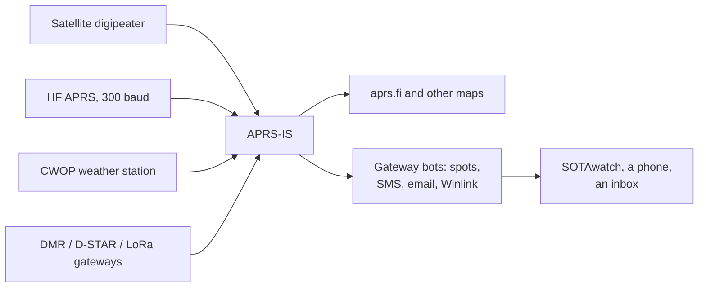
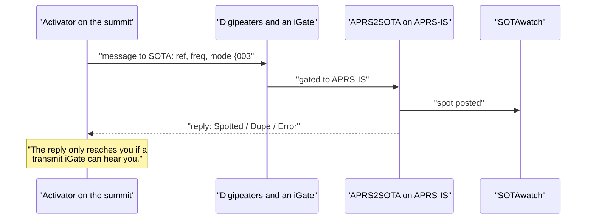
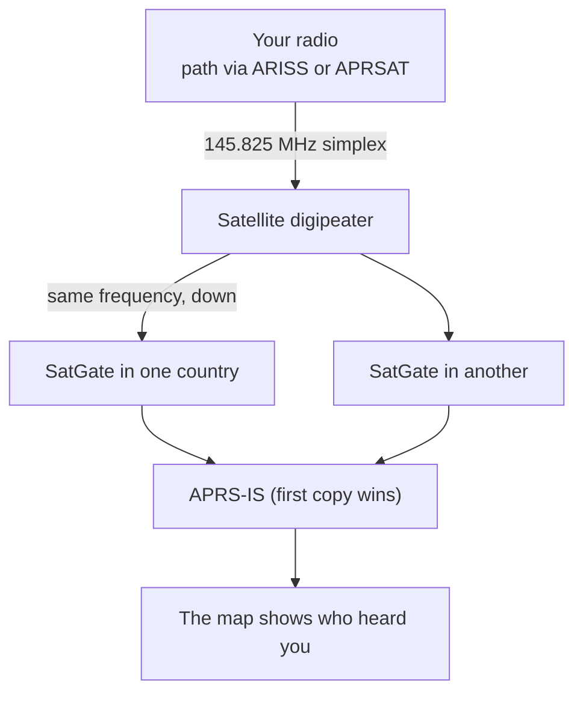
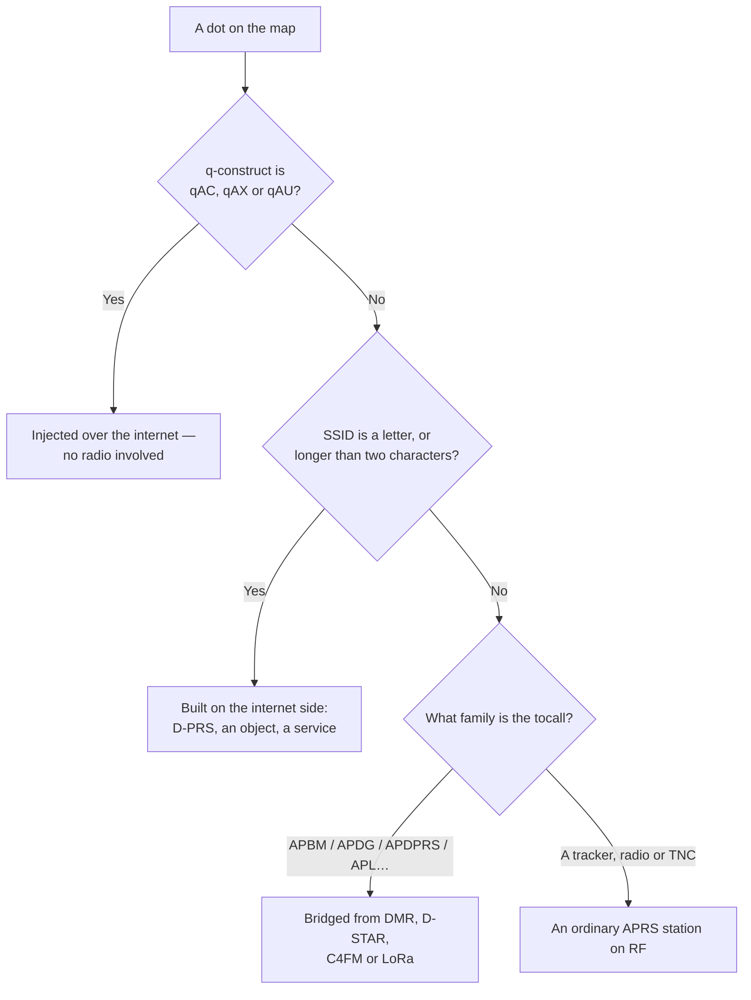

# APRS: Unusual Ways Onto the Map

Most of the dots on an [APRS](outpost:entry/logbook73.handbook/aprs) map arrived exactly the way the previous chapters described: a tracker beaconed, a digipeater relayed, an iGate gated. But scroll around for a few minutes and you will find dots that plainly did not. A summit activator whose spot appeared on a mountaineering website. A packet repeated by a spacecraft. A weather station owned by somebody with no amateur licence at all. A hotspot on a bookshelf advertising a D-STAR frequency. This chapter is about the unusual ways a station ends up on the map — and, just as usefully, how to tell those stations apart from ordinary amateurs on the air.

## The map is wider than the protocol

Almost everything here rests on one slightly startling fact: the APRS specification never promised any of it.

Look back at the [message format](outpost:entry/logbook73.handbook/aprs-payloads). An APRS message is a data-type identifier `:`, a **fixed nine-character addressee** padded with spaces, another `:`, up to 67 characters of text, and an optional `{msgno` asking the recipient to acknowledge it. That is the whole mechanism. The addressee is just a **name** — nine characters that look like a callsign but need not be one — and the protocol has no opinion about whether a human, a radio or a computer program is listening.

So people pointed programs at names. A gateway is software logged in to [APRS-IS](outpost:entry/logbook73.handbook/aprs-igates) that watches for messages addressed to a name it has claimed, parses the text, does something in the outside world, and messages you back. Address `SOTA` and a summit-spotting service answers. Address `EMAIL` and an email goes out. Address `WLNK-1` and you are reading your Winlink inbox from a radio's front panel.

The specification is refreshingly honest about this: its own worked example of an email message is annotated with the remark that APRS does not support email delivery. The format is shown, the service disclaimed. Everything below is convention layered on top by volunteers — which has three consequences that matter more than any syntax in this chapter:

- **A gateway can only acknowledge you if you number your message.** Send `{003` on the end and the service can reply "spotted" or "error"; send nothing and you are shouting into a void.
- **Services are people, and people stop.** The famous names below include one that is definitively dead and still recommended in hundreds of guides.
- **The addressee is not reserved, and nothing validates it.** A misaddressed message simply vanishes, with no error and no clue.



## Spotting yourself from a summit: APRS2SOTA

Here is the situation this solves. You have walked up a hill with a radio, and [Summits on the Air](outpost:entry/logbook73.handbook/portable-operating) works best when you tell the world you are on the air — a **spot** turns a silent frequency into a queue of callers within two minutes, as [Alerts and spots](outpost:entry/logbook73.handbook/alerts-and-spots) explains. On most summits you post one from a phone. On a good many summits there is no phone signal at all, and the only path off the hill is the radio in your hand.

**APRS2SOTA**, run by Stewart Wilkinson `G0LGS`, is that path. It sits on APRS-IS listening for messages addressed to either `SOTA` or `APRS2SOTA`, parses the summit reference, frequency and mode out of the text, and posts the spot to SOTAwatch for you. Your packet takes the ordinary route — digipeaters, then any iGate that hears you — and the gateway does the rest from the internet side.



### What it accepts, and what it silently ignores

The commonest failure is not a typo. It is sending the right words in the wrong kind of packet. APRS2SOTA accepts **only** APRS messages, bulletins and announcements — the `:` packets from the payloads chapter. It does **not** read position-report comments or status beacons. Putting `G/CE-001 144.320 SSB` in your tracker's comment field feels like it ought to work and does absolutely nothing: the gateway never looks at it.

Two smaller points. The **destination needs no SSID** — set it to `0` if your radio insists on one. Your own callsign may carry any SSID; most activators use `-5`, `-6` or `-7`.

### The shape of a spot

The message text is a short parameter list. The preferred order is **reference, frequency, mode**, then optionally the callsign you want spotted, then a comment; several other orders are accepted, any callsign must come before any comment, and nothing is case-sensitive. Parameters may be separated by a space or by a generous list of punctuation — apostrophe, quote, backtick, caret, `#`, `@`, `%`, comma, colon, semicolon, `<`, `>`, `|`, underscore or tilde — which exists because radio front panels differ wildly in the characters they can produce. Frequency units, if given, attach with nothing between number and unit (`7031.2k`, `144.320mh`). Modes are `AM`, `CW`, `DATA`, `DV`, `FM`, `SSB` and `OTHER`.

One of the operator's own published examples, as it appears on the air:

```
G0LGS-2>APRS,WIDE2-1*::SOTA     :ON/ON-010 144.320 SSB ON/G0LGS/P Calling now{003
```

Note the addressee `SOTA` padded to nine characters with five spaces, and the `{003` that lets the gateway answer you.

**Say this part out loud before you leave the house**: a wrongly formatted spot fails _silently_, on a hilltop where you cannot debug anything. The syntax has genuinely changed more than once — the gateway no longer appends `/P` for you, and `!` stopped being a separator so it could be used inside comments — so read the current user guide at [sotaspots.co.uk](https://www.sotaspots.co.uk/) shortly before a trip rather than trusting anything printed, this chapter included. Then test it from home, where a failure costs nothing.

### The limits that will catch you out

- **You must be pre-approved.** Spots are accepted only from registered users, and registration means emailing the operator, in English, with your name and callsign for him to verify. Do this weeks ahead, not on the walk in.
- **There are rate limits.** Five requests in any five-minute window; exceed it and your callsign is ignored for a further five minutes. An identical spot is not re-posted within ten minutes, and duplicate commands are dropped within three.
- **Replies need a two-way path.** The gateway acknowledges and replies with lines beginning `Spotted:`, `Dupe:`, `Error:` or `Sorry:`, retrying up to three times — but a reply reaches you only if a **transmit-capable iGate** nearby gates it back to RF under the [internet-to-RF rules](outpost:entry/logbook73.handbook/aprs-igates). No reply does not always mean no spot.
- **It queries as well as spots.** Commands such as `/spots` and `/alerts`, with band and mode filters, ask the gateway what is currently active — genuinely useful on a summit, and subject to that same limitation.

### Two other spotting gateways

The alternatives use entirely different command sets — another reason to check documentation rather than muscle memory. **DAGA** (addressee `DAGA`, Radio Club Foronda, Iñigo `EA2CQ`) takes one command per message: you _join_, store your callsign and summit reference on the server, then post with something as short as `P14064C` — helpful when your keyboard is a numeric keypad and a hailstorm. It can also send spots back to you filtered by band, mode and continent, and it forgets you four hours after your last command. **APSPOT** (addressee `APSPOT`, Josh Mesilane `VK2MES`) covers SOTA, POTA, WWFF and SiOTA through ParksNPeaks, but posts only if you are already a registered user of the target programme.

## Space: the ISS and the digipeating satellites

The [ISS chapter](outpost:entry/logbook73.handbook/iss) covers working the packet digipeater — the antenna, the pass, the etiquette of beaconing once or twice rather than machine-gunning. What belongs here is the part it does not cover: what the path looks like, and how a frame repeated by a spacecraft ends up on a map on the ground.

### Aliases, not `WIDEn-N`

Satellites do not use the [New N-Paradigm](outpost:entry/logbook73.handbook/aprs-paths). They answer to **generic aliases**, so that you set your path once and it works for several different birds without reconfiguring anything. The aliases in general use are `ARISS`, `APRSAT` and the bare `WIDE`; the first two appear consistently across both the ISS documentation and the AMSAT listings, so those are the safe choices. Individual satellites also answer to their own callsigns.

Do not put `WIDE2-1` on a satellite frame. From orbit the footprint is an ellipse thousands of kilometres across, and every ground digipeater inside it that acts on your path floods a continent's worth of channel with a packet nobody needed twice.

### The frequencies, and why you must check them

The ISS carries two radios: `NA1SS` in the Columbus laboratory and `RS0ISS` in the Zvezda service module. ARISS publishes packet on **`145.825 MHz`** worldwide and on **`437.825 MHz`**, uplink and downlink being the _same_ frequency in both cases, because this is a simplex digipeater and not a crossband repeater. But here is why this section exists: when this chapter was written (late July 2026), the ARISS status page reported the Zvezda radio still being troubleshot, with **APRS currently active on `437.825 MHz`** rather than the usual 2 m frequency, and the station powered down for a Soyuz undocking with no announced power-up time. A printed frequency is a snapshot. **Check [ariss.org](https://www.ariss.org/current-status-of-iss-stations.html) before a pass**, every time.

That changes the tuning job too. On 2 m the Doppler shift across a pass is small enough — under about ±3 kHz — to leave the radio on one frequency and forget it. On UHF you cannot: a 437 MHz pass wants you to start high, cross the nominal frequency at closest approach and finish low, in steps of a few kilohertz.

Nor is the ISS the only digipeater in orbit, and several share `145.825 MHz` — exactly why generic aliases matter. At the time of writing AMSAT's live-digipeater list included LAPAN-A2 (IO-86, via `YB0X`), SONATE-2 (via `DP0SNX`), NO-44 (via `W3ADO-1` or `PCSAT-1`) and KNACKSAT-2 alongside the ISS; check [amsat.org](https://www.amsat.org/live-digipeater-satellites/) for the current set and their data rates.

### How a satellite packet reaches the internet

There is no special space infrastructure. A **SatGate** is an ordinary iGate whose receiver happens to be pointed at the satellite channel. Because a downlink is heard across an enormous area at once, many SatGates hear the same frame; APRS-IS deduplicates them and the first copy through wins.



Here is a real frame, logged through the ISS packet system in July 2026:

```
9Y4QA>1Q0Y4U,RS0ISS,NA1SS,DP0SNX*,qAR,8P6PE-1:'XLbl K\]Greeting ham operator Worldwide 73!=
```

Read it with the previous chapters in hand. `9Y4QA` is a station in Trinidad. The destination `1Q0Y4U` is not a tocall at all but a [Mic-E](outpost:entry/logbook73.handbook/aprs-payloads) encoded latitude, which is why it looks like nonsense — and the apostrophe opening the information field is the matching Mic-E data-type identifier. The path names three spacecraft, and the used-address marker `*` sits on `DP0SNX`, which is SONATE-2. Then `qAR,8P6PE-1` — gated from RF by a station in Barbados. One line, and you can watch a packet leave the Caribbean, bounce off a small German satellite and land on an island 300 km away, in under a second.

## HF APRS: 300 baud and no path at all

APRS on VHF is 1,200 baud. APRS on HF is **300 baud** AFSK, because the ionosphere will not carry 1,200 reliably — and everything else follows from that one number. It exists to track boats, vehicles and expeditions far outside any VHF network's reach.

The frequency convention needs care, because it is routinely quoted two ways that mean the same thing. The long-standing tracking frequency is **`10.151 MHz` on an LSB dial with 1600/1800 Hz tones**, which puts the mark tone at **`10.1492 MHz`** on the air. Tune `10.1476 MHz` USB and you are listening to precisely the same signal. Which dial reading is right for you depends on your TNC's tone pair: one using tones centred at 2210 Hz or 2125 Hz needs the LSB dial set 510 Hz higher.

Bruninga's published table also lists regional and DX frequencies, with an honest caveat attached in the original document — that other than the 30 m one, they may be out of date:

| Mark on air   | Typical dial | Mode | Use                            |
| ------------- | ------------ | ---- | ------------------------------ |
| `10.1492 MHz` | `10.151 MHz` | LSB  | National HF tracking frequency |
| `7.0832 MHz`  | `7.085 MHz`  | LSB  | Regional HF tracking nets      |
| `14.0982 MHz` | `14.100 MHz` | LSB  | Recommended DX tracking        |
| `14.1032 MHz` | `14.105 MHz` | LSB  | Packet keyboarding             |

Treat 30 m as the one genuinely populated frequency, and check your national band plan before transmitting anywhere in that table — 30 m in particular is a narrow, data-oriented allocation with its own restrictions in most countries.

The routing rule is the exact opposite of the VHF advice: **use no digipeater path whatsoever**. Packet length is the single biggest killer of an HF packet, so every byte of path measurably reduces the chance of the frame surviving. Bruninga was blunt about it — generic digipeating on HF was a bad idea in 1992 and remains one, and the legacy habit of tacking `GATE,WIDE1-1` onto HF beacons adds fourteen wasted bytes for nothing. (APRSdos even swaps the HF alias to `ECHO` so that HF frames cannot trigger unintentional digipeating.)

So how does an HF beacon reach the map with no path? By listeners. iGates monitor HF all over the world, and collectively behave as an enormous diversity receiver: some iGate somewhere copies each packet, and it takes only one to get onto APRS-IS. The network does the work a path would have done, and does it better.

## Weather from outside the hobby: CWOP

[APRS weather packets](outpost:entry/logbook73.handbook/aprs-payloads) form one of the densest amateur sensor networks on the air. What is less well known is that a substantial slice of the weather stations you see are not amateur at all.

The **Citizen Weather Observer Program** ([wxqa.com](http://www.wxqa.com/)) is a scheme in which private weather stations — many owned by people with no amateur licence — report using the same APRS weather format and the same APRS-IS plumbing. Licensed amateurs join using their callsign; everyone else is issued a station identifier instead, and the programme publishes which of its servers to use for which kind of identifier. The observations are passed on to national meteorological infrastructure, which is the whole point: a mesh of hyper-local sensors assembled for nothing.

Two tells help when reading the map. A **weather station is identified by its symbol, not its SSID** — `/_` is the weather-station symbol, while `-13` is a convention nothing enforces. And the set of fields such a station can populate is modest: temperature, pressure, humidity, wind direction, wind speed, gust, rainfall over the last hour, the last 24 hours and since midnight, and luminosity. Anything else is telemetry, not weather.

## Messaging gateways: what is live, and what is dead

This is the section most likely to send you somewhere useless, so it is written defensively.

### The famous dead one

**SMSGTE** was, for years, _the_ APRS-to-SMS gateway, and it is gone. The APRS Foundation's own services list annotates it as offline, and fetching its former domain in July 2026 returns an unrelated commercial site with nothing to do with amateur radio. It is nonetheless still recommended by a great many blog posts, videos and printed guides, all of which will have you addressing messages to a name nobody is listening on — with no error, no bounce and no clue. If SMSGTE is saved in a radio of yours, delete it.

### SMS at the time of writing

The live APRS-to-SMS service is run by `NA7Q` and documented at [aprs.wiki](https://aprs.wiki/). Messages go to the addressee `SMS`, and the text begins with `@`, the recipient's number, a space, then your message; the phone sees it prefixed with your callsign. Going the other way, the recipient texts the gateway's number with `@` your callsign and their reply.

Two limitations decide whether it is any use to you, and both want checking on the site rather than here. It serves **a specific list of countries** — at the time of writing the USA, Puerto Rico, Canada, Australia and the UK, with different digit counts each. And **the phone owner must opt in first** through a web form: a mobile-carrier regulatory requirement, not a preference, with no way around it. Get your family opted in at the kitchen table before the trip, not from the side of a mountain.

### Email and Winlink

The email gateways are addressed to `EMAIL` and `EMAIL-2`, documented at [aprs-is.net](https://www.aprs-is.net/Email.aspx). The basic use is a single message whose first word is the recipient's address and whose remainder is the body — one line, with the 67-character limit covering the address too, a tighter budget than it sounds. `EMAIL-2` also lets you register a short **shortcut** for an address you use often. Two cautions: the original service was retired by its long-time operator in 2019 and replaced by different software, so old instructions may not match; and the gateways are explicitly **interactive-only** — stations sending mail unattended may be blocked, and pointing one at an automated responder is how mail loops start.

**APRSLink** lets an APRS station read and send short Winlink email with no computer at all, by messaging `WLNK-1`. It is a genuine command shell — list, read by number, reply, compose, manage aliases, log off — with a challenge-and-response login rather than a password over the air. Two prerequisites trip people up: you must **already have a Winlink account** (APRSLink cannot create one), and your station must have **beaconed a position at least once**, because that is how the service learns your callsign and location. Details are on [winlink.org](https://www.winlink.org/APRSLink); the wider Winlink story is in [HF data modes](outpost:entry/logbook73.handbook/hf-data-modes).

### The list to trust

Because services come and go, the durable advice is a pointer rather than a list: the APRS Foundation publishes an **APRS Information Services** page at [how.aprs.works](https://how.aprs.works/aprs-information-services/) tracking which bots and gateways are currently alive, including callsign-lookup and group-announcement services alongside the ones above. Check it before you rely on anything — including this chapter. And if you would rather test your messaging setup against a friendly human than a robot, **#APRSThursday** is a weekly APRS messaging net with a public check-in log, still running in July 2026.

## Bridges from other systems, and how to spot them

A great many dots on the map were never on an amateur APRS channel at all, and telling them apart is a genuinely useful skill.

### Not amateur radio at all

- **AIS ships.** aprs.fi receives Automatic Identification System traffic from marine VHF and draws it on the same map. A completely separate maritime system; it just shares the display.
- **The Open Glider Network.** Gliders and light aircraft on OGN maps use the _APRS packet format_ but on **their own servers**, not the amateur APRS-IS. The format was borrowed; the network was not.
- **FireNet.** A parallel APRS-IS subnet carrying non-amateur data — weather observations, river gauges, buoys — as objects. Useful, but not amateur traffic, and its objects have no business on an amateur RF channel.

### Amateur, but not on the APRS channel

These fool people, because the callsigns are real amateurs.

- **DMR.** On [BrandMeister](outpost:entry/logbook73.handbook/dmr-networks), the radio's GPS travels as DMR data to the master server, which looks up the callsign and SSID the user registered, builds an APRS packet and injects it under its own login. Your hotspot is not involved at any point. The tells are the tocall — the `APBM` family is allocated to BrandMeister — and a literal `DMR*` element in the path, often preceded by the repeater's callsign. BrandMeister's own gateway source notes that positions are uploaded as APRS objects without correct path information, so do not read that path as an RF route.
- **D-STAR.** A radio's GPS data, converted by the repeater or [hotspot](outpost:entry/logbook73.handbook/dmr-hotspots) gateway, appears with the tocall `APDPRS` and a path of `DSTAR*`. Its signature is a **letter SSID** such as `KE5C-A`, taken from the eighth character of the D-STAR callsign field — impossible in plain AX.25, which has only four SSID bits, so seeing one proves the packet was built on the internet side. The [D-STAR operating chapter](outpost:entry/logbook73.handbook/dstar-operating) covers the radio end.
- **System Fusion.** The common open-source C4FM gateway emits user positions with a `C4FM*` path and a comment ending "via MMDVM" — and, awkwardly, the `APDPRS` tocall that was allocated for D-STAR. Observed behaviour, not endorsed practice.
- **LoRa APRS.** Covered properly in [LoRa and Meshtastic](outpost:entry/logbook73.handbook/lora-and-meshtastic). Once gated, a LoRa packet is an ordinary line of text with nothing marking it as LoRa — because iGates are forbidden from modifying paths. The tells are the tocall (the `APLG`, `APLT`, `APLRG` and `APLRT` families belong to the two dominant firmwares), the registered `L&` LoRa iGate symbol, and firmware-generated comment text such as the ` Batt=` voltage tail one popular iGate build appends.
- **Meshtastic** has no native APRS bridge — different modulation, and encrypted by default, so nothing crosses at RF. Mesh positions reach the map only through gateway _daemons_ that read a mesh and inject into APRS-IS under their own registered tocall.
- **DTMF.** APRStt lets an operator with nothing but a tone pad on an ordinary FM radio place themselves on the map, via a gateway that turns tone sequences into APRS objects. Dire Wolf, from the [running APRS chapter](outpost:entry/logbook73.handbook/aprs-running), can act as one.

### Hotspots that put themselves on the map

This one surprises everybody. A digital-voice hotspot on a bookshelf is not a tracker, but its gateway software will happily beacon it with a comment describing its own frequency. Those strings are machine-generated, which makes them excellent fingerprints:

| Comment fragment                                | What it means                                                               |
| ----------------------------------------------- | --------------------------------------------------------------------------- |
| `Voice (D-Star) …MHz +0.0000MHz`                | The D-STAR gateway software; the absence of "MMDVM" is the giveaway         |
| `MMDVM Voice (DMR) …`                           | The DMR gateway software                                                    |
| `MMDVM Voice (C4FM) …` / `MMDVM Voice (NXDN) …` | The Fusion and NXDN gateways                                                |
| `APRS for DMRGateway`                           | A Pi-Star default that nobody edited — a positive identification of Pi-Star |

The `+0.0000MHz` on so many of them is not a bug: the offset is receive frequency minus transmit frequency, so a simplex hotspot produces exactly zero. If you run one, note that the SSID is usually the first character of a configured suffix (a Pi-Star DMR hotspot appears as `CALL-D`), that the dashboard's warning about making your location public is entirely accurate, and that setting latitude and longitude to zero stops the beacon at source.

### Reading the provenance

The [iGates chapter](outpost:entry/logbook73.handbook/aprs-igates) listed the q-constructs. Here is how to _read_ them, which is the skill that makes all of the above legible:



Some detail the diagram cannot hold. `qAC`, `qAX` and `qAU` all mean the _source station itself_ logged in and injected the packet — no radio anywhere in the chain. `qAR` and its relatives mean an iGate heard it on the air. `qAS` means it arrived from another server and tells you nothing about the origin. Note too that lowercase `qAo` and uppercase `qAO` are different constructs, and that `qAO` means one thing when a client generates it (a receive-only iGate) and something else when a server does. Read it as a hint, not a verdict.

Three more shortcuts worth memorising:

- **Non-numeric SSIDs prove internet origin.** AX.25 has four SSID bits, so an RF station can only ever be `-0` to `-15`. Anything else — a letter, `-tt`, `-ID`, `-63` — was created on the internet side or is an object name.
- **The tocall names the software, not the station.** Since 2022 the authoritative registry has been the community-maintained `aprs-deviceid` database, which is what map sites use to turn a tocall into "DireWolf" or "ESP32 LoRa iGate". When a map labels something an iGate or a digipeater, that is usually a _lookup_ from the destination field, not something the station announced.
- **aprs.fi will do the filtering for you.** Its preferences offer four display classes — APRS stations, items and objects, weather stations, AIS ships — plus an option to hide stations that did not transmit their position over a radio channel. Its label colours encode type directly too: white for a messaging-capable APRS station, grey for one that is not, violet for objects, purple for items, green for AIS, yellow for weather.

One last caution, because it applies to all of the above. Both identity systems this section leans on are **recommendations, not rules**. The SSID list was explicitly retitled by its author so nobody would mistake it for a decoding standard, and it closes by calling the associations mere guidelines hinting at a station's possible application. Tocalls are allocated by convention in a community database, and a station is free to send the bare tocall `APRS`, which tells you nothing at all. Evidence, never proof.

## Try it yourself

1. **Read the provenance of ten stations.** On aprs.fi, or in LogBook73's APRS feed on the DX cluster page, open ten stations' raw packets and classify each with the flow above: RF station, bridged from another network, or injected over the internet. You will be surprised how few are plain trackers.
2. **Make the internet-only stations vanish.** In aprs.fi's preferences, turn on the option that hides stations which did not transmit their position over a radio channel. The difference is the clearest single demonstration of what this chapter is about.
3. **Find a satellite frame.** Pick a digipeating satellite from the AMSAT list and read a frame that passed through it — the aliases in the path, the used-address marker, and the SatGate callsign after the `qA` construct. If you catch a digipeat of your own, log it in LogBook73's **Receive log** as the reception it is.
4. **Check before you climb.** Two habits, thirty seconds each: read the ARISS status page before any ISS pass, and the APRS2SOTA guide before any summit trip. Then register with the spotting gateway you intend to use — weeks early, from a comfortable chair.
5. **Test a gateway from home.** Send a numbered message to a live service — a `/help`-style query, not a spot for a frequency you are not on. Watch for the acknowledgement, and if none arrives, work out whether the fault was your format or the absence of a transmit iGate that could reach you. That failure teaches the whole system.

## Key takeaways

- Every gateway here is a **convention on top of the plain APRS message** — a nine-character addressee, 67 characters of text, and a `{msgno` that is the only reason a service can ever reply. The protocol promises none of it.
- **APRS2SOTA** accepts only APRS _messages_ (never beacon comments), only from **pre-approved users**, under rate limits — and a wrong format fails silently where you cannot debug it, so check [sotaspots.co.uk](https://www.sotaspots.co.uk/) and test from home first. DAGA and APSPOT are alternatives with entirely different command sets.
- **Satellites use generic aliases** (`ARISS`, `APRSAT`), never `WIDEn-N`, and reach the map through ordinary iGates pointed at the satellite channel. Published frequencies move — ISS APRS was on `437.825 MHz` rather than `145.825 MHz` at the time of writing — so check [ariss.org](https://www.ariss.org/current-status-of-iss-stations.html) and [amsat.org](https://www.amsat.org/live-digipeater-satellites/) before a pass, and expect Doppler on UHF but not 2 m.
- **HF APRS runs at 300 baud**, with the 30 m frequency quoted two equivalent ways (`10.151 MHz` LSB or `10.1476 MHz` USB, depending on tone pair) and **no digipeater path at all** — worldwide iGate diversity reception does that job instead.
- Many weather stations are **CWOP** feeds from unlicensed observers on the same format and plumbing; a weather station is identified by its `/_` symbol, and `-13` is only a convention.
- **SMSGTE is dead** despite countless guides still recommending it; the live SMS, email and Winlink gateways each have prerequisites, and the durable reference is the APRS Foundation's [information services list](https://how.aprs.works/aprs-information-services/).
- Read a dot's origin from its **q-construct** (`qAC`/`qAX`/`qAU` mean no radio was involved), its **SSID** (anything non-numeric was made on the internet side), its **tocall family** (`APBM` DMR, `APDG`/`APDPRS` D-STAR, `APL…` LoRa) and its **symbol** — all conventions, all evidence, none of them proof.

If the orbital section caught your attention, the practical companion is [the ISS chapter](outpost:entry/logbook73.handbook/iss), which takes you from a first listening pass to a digipeat of your own.
