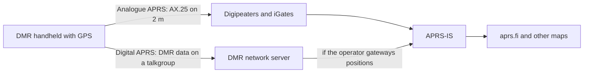
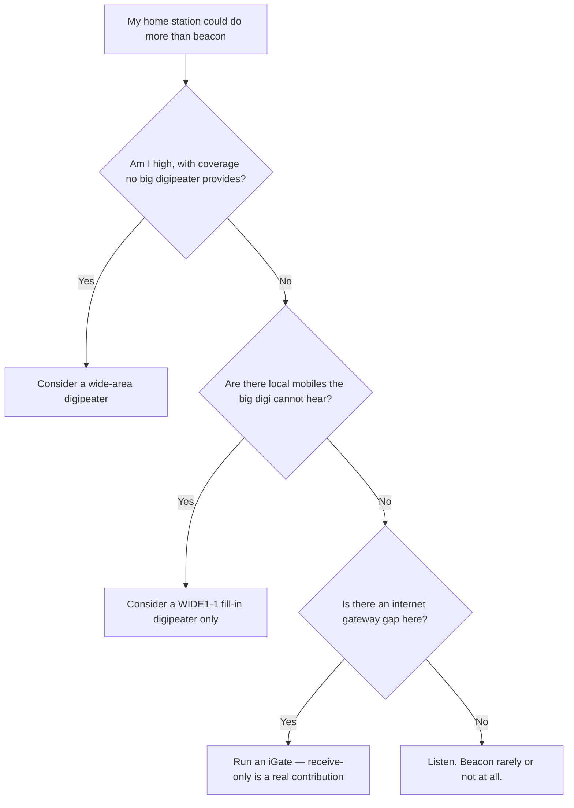

# APRS: Your Own Station

You have taken an APRS packet apart, followed it across a county and watched it cross onto the internet. This chapter is the shopping and the settings: which box actually puts you on the map, what each route can and cannot do, and what to configure for the way you really operate. It starts with the question worth asking before you spend anything, which is whether you should be transmitting at all.

## Why put yourself on the map — and when the answer is "don't"

APRS is one shared channel per region — `144.800 MHz` across Region 1 (Europe, Africa, the Middle East), `144.390 MHz` in North America, `145.175 MHz` in Australia — and one channel has a hard ceiling. Bob Bruninga, `WB4APR`, who designed the system, put the working figure at roughly **60 to 100 stations or objects** in one RF domain: past that, "the more stations you see... the more packets you don't see due to collisions". His conclusion is worth memorising: _"An APRS (ALOHA) system cannot perform well (for everyone) unless the channel is QUIET most of the time!"_

Every beacon is spent from a budget belonging to everyone in earshot, so the question is not "can I transmit?" — with a licence, of course you can — but "does my transmitting add something?" Sometimes it plainly does: you are moving and someone cares where you are; or you want two-way messaging over RF, which is the reason most newcomers miss — a transmit-capable iGate will only pass an internet message down to you on RF if it has **heard you on RF recently**, so beaconing is the price of being reachable.

And sometimes it plainly does not. A house does not move, and a fixed station beaconing every few minutes for years is a permanent cost on a capacity-limited channel in exchange for a dot that never changes. There is no shame in choosing not to: listening is a complete way to take part, and a receive-only iGate — no transmitter, and in most countries no licence — makes you a contributor without spending a packet of channel time. Keep that as the spine of everything below: **reach as far as you need and no further, as often as you need and no more often.**

## The kit, by route

Five routes get you onto APRS. They are genuinely different products, not price tiers of one product, and the differences are mostly about what you can _see_ and whether you can _talk back_.

| Route                              | Rough cost                                        | Transmits on RF | Shows other stations | Two-way messaging   | Extras                                                 |
| ---------------------------------- | ------------------------------------------------- | --------------- | -------------------- | ------------------- | ------------------------------------------------------ |
| Radio with APRS built in           | mid-range handheld up to the $700–800 class       | Yes             | Yes, on the radio    | Yes                 | Kenwood adds digipeater + KISS TNC; Yaesu adds neither |
| Any FM radio + external TNC + host | ~$150 class TNC, plus cable, plus a radio you own | Yes             | Yes, on phone/laptop | Yes                 | Full software station: tracker, digipeater, iGate      |
| Phone alone, over the internet     | free to the ~$7 class                             | **No**          | Yes                  | Yes (app-dependent) | None — you are on the map with no radio involved       |
| Dedicated tracker                  | ~$30 to ~$280 class                               | Yes             | Usually **no**       | Usually **no**      | Some models also digipeat or act as a TNC              |
| Receive-only (SDR + software)      | ~$30 class dongle                                 | **No**          | Yes, everything      | No                  | Receive-only iGate — the best first infrastructure     |

Prices are indicative, from vendor listings around mid-2026; treat every figure as a band and check before buying.

### A radio with APRS built in

GPS, 1200-baud modem and APRS client in one box. **Kenwood** is the reference implementation: at the time of writing the **TH-D75A** is the only portable on Kenwood USA's amateur index, and its feature list includes **"APRS standalone digipeater & messaging"**, a **"KISS mode TNC"** for driving APRS software over USB or Bluetooth, and a **"GPS module with track logging"**. One US dealer listed it at $739.95 in late July 2026. But the **TH-D74A** has gone — absent from Kenwood's index, its product page a 404 — and the **TM-D710G** and **TM-V71A** mobiles are discontinued too, so as of 2026 there is **no in-production Kenwood APRS mobile** at all.

**Yaesu** is the other built-in line, and a persistent myth needs killing: Yaesu radios **do** decode and display APRS. The **FT5D** handheld has an APRS modem selectable off / 1200 bps / 9600 bps, a built-in GPS, beacons shown with direction, distance and speed, and messaging up to **67 characters** — though its manual states flatly that **"The APRS will operate only in Band B."** The mobiles are freer, and the **FTM-510DR** adds SmartBeaconing, proportional pathing and DECAY. But two limits matter more than any specification number. Across the complete APRS set-mode lists of the FT5D, FTM-300D, FTM-310D and FTM-510D, **no Yaesu radio examined can act as a digipeater** — the only related setting is `DIGI PATH`, the path for the radio's _own_ beacons — and **none offers a KISS TNC mode**, so driving APRS software from a Yaesu handheld needs an external TNC where a TH-D75 needs only a lead. (Both findings rest on exhaustive absence in the manuals rather than a Yaesu statement, but the absence is total.) Icom is not covered here, because its manuals were not among those checked.

### Any FM radio plus an external TNC

A **TNC** (terminal node controller) is the modem: it turns bytes into the 1200-baud tones your radio transmits, and back again, while the map, station list and message composer live in a phone or laptop. That split is the [KISS protocol](outpost:entry/logbook73.handbook/aprs-running). The current hardware answer is the **Mobilinkd TNC4** at $149.95 — Bluetooth 4.2 **dual-mode**, classic and Low Energy, which is what makes iPhone use possible at all. Two things catch people out: **cables are not included** and are sold by connector family (roughly $10–25), so check the exact cable for your exact radio first; and Mobilinkd itself asks you to "consider purchasing a ferrite bead" if you are connecting to a Baofeng or a re-badged one — a vendor flagging a known RF-feedback problem with the cheapest radios. The free software alternative is **Dire Wolf**, which also plays tracker, digipeater and iGate.

### Your phone as the brains

On **Android**, **APRSdroid** (open source, GPLv2) connects three ways: to APRS-IS over the internet with no radio at all; by **acoustic coupling**, where the phone's own speaker and microphone become the modem and you use VOX or manual PTT; or by Bluetooth serial to a real TNC. That middle mode is the genuinely zero-hardware RF route, and nothing on iOS matches it. On **iOS**, the official **aprs.fi app** (around the $7 class) offers a **BLE KISS TNC** path or a software modem driving a radio through hardware VOX, the latter behind the paid subscription. Its guide names the BLE TNCs it supports, among them the Mobilinkd TNC4 and the Island Magic B.B. Link Adapter for the Kenwood TH-D74/D75 — that last exists precisely because those Kenwoods speak classic Bluetooth, not BLE.

One trap outweighs the rest. In that app, **beaconing to APRS-IS and messaging both require the paid subscription**, and by default your position uploads only to aprs.fi as a "Web station" — you must explicitly enable a **"Beacon via APRS-IS"** switch. Installing the app and seeing yourself in it is **not** the same as being on the APRS network. The guide is blunt about the licence too: _"Transmitting positions on the APRS-IS requires an amateur radio license and valid callsign."_ And the rule governing this whole route deserves quoting verbatim: **"It MUST be assumed that every packet on APRS-IS will be gated to or was gated from RF."**

### A dedicated tracker

A tracker's job is to be a dot; most cannot show you anything, and that is the trade. **Byonics TinyTrak4** — $100 alone, $170 with a GPS — is current, despite forum claims otherwise, and is "an APRS tracker controller, digipeater, and KISS TNC"; note _controller_, because it does not transmit by itself, while the **MicroTrak** line adds a built-in transmitter pre-programmed with your callsign. **PicoAPRS V4**, by Taner Schenker `DB1NTO`, is the exception that does everything: a matchbox-sized transceiver (about 60 g) that transmits and receives APRS on 2 m at up to 1 W, with GPS, colour screen, messaging, a Bluetooth KISS TNC mode and a standalone WiFi iGate mode, in the **£200–240 class**. It ships **without antenna or charger**, and comes in **three variants of which only one does conventional APRS** — the VHF one, a **LoRa** variant on 70 cm, and a **shortwave receiver** variant where, in the manual's words, "APRS can only be used via WiFi connection".

That last point generalises into the buying trap most worth knowing. The **LilyGO T-Beam** — an ESP32 board with LoRa, GPS and an 18650 holder for about $31 — looks like an irresistibly cheap tracker, but LoRa APRS is third-party firmware you flash yourself, and **it is not the network this chapter is about**: LoRa uses chirp spread-spectrum modulation on UHF, is not AX.25, and cannot be heard by any conventional APRS radio or digipeater, so it reaches the map only where a much rarer **LoRa iGate** is in range. [LoRa & Meshtastic](outpost:entry/logbook73.handbook/lora-and-meshtastic) covers it properly.

### Receive only

An **RTL-SDR** dongle and Dire Wolf decode every packet in earshot: about $30, no licence to receive in most countries, and more learning in an afternoon than any amount of reading. The dongle cannot transmit, so you see everything and appear nowhere. Add an internet connection and you have a **receive-only iGate** — of everything here, the best ratio of benefit to channel cost, and the [iGates chapter](outpost:entry/logbook73.handbook/aprs-igates) has the detail.

## "But my DMR radio says it does APRS"

The marketing and the capability are not the same shape, and AnyTone prints the answer in its own manual:

| Capability       | D868UV | D878UV | D878UV PLUS | D878UVII | D878UVII PLUS |
| ---------------- | ------ | ------ | ----------- | -------- | ------------- |
| Analogue APRS TX | No     | Yes    | Yes         | Yes      | Yes           |
| Analogue APRS RX | No     | No     | No          | No       | **Yes**       |
| Digital APRS TX  | Yes    | Yes    | Yes         | Yes      | Yes           |
| Digital APRS RX  | No     | Yes    | Yes         | Yes      | Yes           |

Read the second row again. Of five models, exactly **one** can receive analogue APRS — and even that is conditional, because the manual heads the feature "APRS Receive (**optional with installed BT+APRS board**)". It gets narrower: AnyTone's "Analog APRS" is **position beaconing only** — upload power, frequency, text ("Set the text to be shown on aprs.fi"), a timed interval, and a GPS or fixed beacon. There is **no analogue messaging and no digipeater function**. A radio advertised as doing APRS is, on the real APRS channel, a one-way tracker transmitting blind.

"Digital APRS" is a different mechanism entirely: your position goes as **DMR data** on a configured report channel and time slot through the [DMR network](outpost:entry/logbook73.handbook/dmr), not as an AX.25 packet on 2 m, and reaches the map only because the network operator chooses to gateway positions across. The radio's menu makes you pick one or the other: `Upload Type: None / Sel A Aprs (analog) / Sel D Aprs (DMR)`.



So are they the same thing? **Sharing a map is not sharing a network.** Both can end as a dot on aprs.fi; only the analogue route puts you on the channel where digipeaters, iGates and APRS messaging live — and on most of these radios, blind and one-way. TYT and Retevis handhelds are not covered here because their manuals were not checked; given how far the AnyTone reality diverged from the marketing, check each against its own manual.

## Scenario one: driving

A car is the case APRS was designed around, and the settings follow from one fact: you are moving through other people's coverage, so both your path and your rate are borrowed from strangers. Convention puts a vehicle at SSID `-9` with a car symbol — a recommendation, not a standard, but one that carries information, because someone scrolling callsigns on a small display can tell a `-9` (a driving amateur, probably contactable) from a `-12` (a tracker nobody is monitoring).

**Path.** Bruninga's own table reads, verbatim: _"GENERAL MOBILES: WIDE2-2 / LOCAL MOBILES: WIDE1-1,WIDE2-1 (if there are FILL-IN digis in the area)"_. Both are **two hops**; the difference is only which digipeater may take the first. `WIDE1-1,WIDE2-1` gives a low-level fill-in digipeater — the sort of home station that exists to plug a valley — the chance to lift you out of a hole, which is exactly where a car finds itself. For Europe he published: _"The best path for Mobiles is WIDE1-1,WIDEn-N (Small N, 2 or less)."_ That is not merely imported convention — IARU Region 1 adopted the New n-N Paradigm at Cavtat in 2008, as a recommendation to member societies rather than a licence condition. Above that, _"Any path with WIDEn-N where N is 5 or greater are not welcome. Period."_ And the arithmetic answers anyone asking whether one extra hop matters: _"for each N that you drop, you improve the network efficiency by a FACTOR of THREE or more."_ The mechanics live in [APRS: Paths & Digipeaters](outpost:entry/logbook73.handbook/aprs-paths); the rule you must not break is that `WIDE1-1` goes first or not at all.

**Rate.** A fixed interval suits a car badly — too slow through town, wastefully fast on a motorway. **SmartBeaconing™**, invented by Tony Arnerich `KD7TA` and Steve Bragg `KA9MVA` in 1998 on the HamHUD project, beacons on _distance and cornering_ instead of time:

- Below a **low speed** threshold you count as stopped and beacon at the **slow rate**.
- Above a **high speed** threshold you beacon at the **fast rate**.
- In between the interval scales: `interval = fast_rate × high_speed / speed`. Half the speed, twice the gap.
- Separately you beacon on a **turn** if your heading changed by more than `turn_min + turn_slope / speed` degrees and at least `turn_time` seconds have passed, so corners get marked.

```viz
{
  "type": "wave",
  "title": "SmartBeaconing: interval against speed (Kenwood TH-D75 defaults)",
  "caption": "Below 5 units of speed you beacon every 30 minutes; above 70 you beacon every 120 s; in between the interval scales inversely with speed, so each report covers roughly the same distance.",
  "xLabel": "Speed (0 to 90)",
  "traces": [
    {
      "kind": "points",
      "label": "Beacon interval (0 to 1800 s)",
      "tone": "primary",
      "points": [[0, 1], [0.054, 1], [0.056, 0.867], [0.111, -0.067], [0.167, -0.378], [0.222, -0.533], [0.333, -0.689], [0.444, -0.767], [0.556, -0.813], [0.778, -0.867], [1, -0.867]]
    }
  ]
}
```

Think of it as a distance chooser. The authors' own examples: _"120 seconds and 60 mph"_ gives a beacon every two miles on a motorway; _"60 seconds and 15 mph"_ gives one every quarter-mile on a bicycle. Pick the spacing you want between breadcrumbs, then set `fast_rate = distance ÷ high_speed`. For real numbers, Kenwood's factory defaults on the TH-D75A/E (menus 530–535) are **Low Speed 5**, **High Speed 70**, **Slow Rate 30 min**, **Fast Rate 120 s**, **Turn Angle 28°**, **Turn Slope 26**, **Turn Time 60 s**. Community tables circulate too, but they are wiki pages rather than manufacturer guidance — one records an unresolved argument over whether Turn Slope should be 255 or 25 — so treat them as starting points. And note the Kenwood trap: enabling SmartBeaconing **disables** TX Interval Time, the Decay Algorithm and Proportional Pathing, so you are choosing one strategy, not stacking three.

**Two finishing touches.** Some societies ask for a specific deviation — the RSGB wants UK users on **2.5 kHz peak**, because the channel next to the European APRS frequency carries digital-voice gateways — so check whether yours has too. And turn on **Voice Alert**: a CTCSS tone on the APRS channel (100 Hz in the USA, **136.5 Hz in Europe**, 91 Hz in Australia) so your squelch opens only for stations in **direct simplex range**, meaning anyone you hear is close enough for a chat. One instruction is aimed squarely at fixed stations: _"Do not TX with CTCSS 100 (136.5 in Europe) if you are not listening for a call! (this means home stations!)"_

## Scenario two: at home

The default answer for a fixed station is **beacon rarely, or not at all** — then ask whether the useful thing is to stop beaconing and start being infrastructure.

**If you do beacon**, APRS-IS publishes rate minimums, and they are a floor rather than a target: _"never faster than 1 minute for mobile, 5 minutes for weather, 10 minutes for local infrastructure (repeaters, for instance), and 20 minutes for fixed stations"_. Better still, use the **decay algorithm**, the original design intent that most radios implement: compare each new position with the last transmitted, and if unchanged **double** the interval up to a maximum of 30 minutes, resetting the moment it changes. Bruninga's complaint has aged well — _"Too many APRS clones ignored this fundamental principal and operate at fixed rates."_ On a Kenwood, a 1-minute interval with decay produces 2, 4, 8, 16, 32, 32, 32 minutes, so a stationary house settles at one beacon every half hour on its own. For the path his table says `WIDE2-2` for home stations, but if your own antenna reaches a wide-area digipeater directly you do not need the fill-in hop, and if you already reach an iGate you need no path at all. His test for how far is far enough is the **ALOHA circle**: _"Draw a circle around your nearest N (was 60) stations, and if you are sending packets beyond that range, you are being inconsiderate and adding QRM to others."_

**The better question: iGate, digipeater, or neither?**



That flow is Bruninga's own rule, written for Europe: home stations should not be digipeaters unless the station is high and not already covered by a big digipeater, or is needed as a fill-in for nearby mobiles the big digipeater cannot hear — and in that second case it should support **only** the `WIDE1-1` alias. The default answer is **no**.

A fill-in digipeater has specific settings: alias `WIDE1-1`, digipeat on, identification beacons off, and — the part people get wrong — its own beacon goes out **direct, with no path at all**, roughly every 10 minutes, "to limit their visibility to only their coverage area and to minimize QRM on surrounding systems". An **iGate** needs the same restraint on its own beacon. Between the two, an iGate is almost always the better first project and a **receive-only** iGate better still: no transmitter, no unattended-transmission permissions, no channel time, and it improves the map for everyone downhill of you.

That last rule also explains a common mystery. Because a transmit-capable iGate only passes a message down to RF for a station it has **heard on RF recently**, a station that never beacons is unreachable. If your first APRS message vanished without trace, that is usually why.

## Scenario three: hiking and summits

Here is the counter-intuitive part: **a station at height needs more path discipline, not less.**

The clearest published statement of the principle comes from balloon guidance, where Bruninga writes _"No path (simplex direct) is all that is needed above 1000 feet since every APRS station within hundreds of square miles will hear it directly,"_ and, bluntly, _"DO NOT USE WIDE1-1,WIDE2-1 Path! This is much worse then even WIDE2-2."_ That was written about balloons, not walkers, and it is fair to say so — but the physics is the same. From a summit your direct footprint is enormous, so a requested hop is not reaching into a gap; it is asking a distant hilltop machine to rebroadcast a packet half the region already heard. So on a hill, **start with no path, or one hop, and check afterwards** — as in this real 2026 summit activation:

```
WJ7V-7>APFII0,WIDE1-1,WIDE2-1,qAR,MERWIN::SOTA     :W7w/lc-080 144.200 cw WJ7V with WJ7WJ{82AF9
```

Neither `WIDE1-1` nor `WIDE2-1` carries the has-been-repeated asterisk, so **no digipeater touched it** — the iGate `MERWIN` heard the summit directly and gated it straight to the internet, and both hops went unused. (That station's beacon comment read `Mobilnkd->VX-6r`: a phone app driving a Mobilinkd TNC into a Yaesu handheld — the external-TNC route, on a mountain.)

**Battery.** The instinct is to beacon less to save power; the arithmetic disagrees. Kenwood publishes the numbers for the TH-D75E: **2.0 A** transmitting at high power against **155 mA** receiving with the squelch closed on one band, and about six hours from the 1,820 mAh battery, "approximately 10 % shorter when GPS is ON". A one-second beacon every ten minutes costs roughly 3.3 mAh per hour, against 155 mAh per hour spent merely listening — **the receiver and GPS dominate, and beaconing barely registers.** Drop transmit power and enable battery save rather than talking yourself into a fast beacon rate on the grounds that it is cheap; it is cheap for your battery and expensive for everyone's channel. Note too that SmartBeaconing behaves oddly on foot, because the turn threshold `turn_min + turn_slope / speed` _rises_ as speed falls, so slow, twisty walking triggers almost nothing. Car settings do not transfer, no authoritative walking parameter set appears to exist, and a plain slow interval with decay is usually the better tool.

**When APRS is the wrong tool and a spot is the right one.** If you are activating a summit and want chasers to find you on HF, a position beacon is not what you want — a **spot** is, and the two are not interchangeable. A beacon says where you are; a spot says what frequency to turn to. The APRS route to a spot is a gateway called APRS2SOTA, run by Stewart Wilkinson `G0LGS`, which reads **APRS messages** — not beacons, not position comments — addressed to `SOTA` or `APRS2SOTA` and carrying a summit reference, a frequency and a mode. Registration is mandatory and manual, which is the commonest reason a first attempt from a hill does nothing; the companion chapter on APRS2SOTA covers the syntax and the failure modes properly.

The part that belongs here is the caveat behind all of it: APRS gives **no negative acknowledgement**. The gateway's `Spotted:` reply only reaches you if a **transmit-capable** iGate heard you recently, so behind a receive-only gate you get silence whether you succeeded or failed. And if no iGate heard you at all, your packet did not fail — it never became data, and nothing anywhere records the attempt. Build your plans for a hill around that.

## Scenario four: events and public service

Events concentrate exactly what the channel cannot take: many stations, in a small area, all moving. Forty trackers on one field is a large fraction of the 60–100 the channel supports, before a single ordinary user is counted. So the discipline is the same as everywhere, only more so: **short paths — often direct or one hop, since everyone is within a few miles — slow rates, and no exceptions for the organisers.**

Three payload types earn their keep, all covered in [Mic-E, Messages, Objects & Telemetry](outpost:entry/logbook73.handbook/aprs-payloads). **Objects** put a marker on everyone's map that is not a station — "checkpoint 3", "talk-in on 145.500" — and they are the documented answer to a rule that catches organisers out: _"Do NOT inject non-amateur radio content falsely identifying it as amateur radio stations. Use APRS Objects instead."_ **Bulletins** (addressee `BLN` plus a digit or letter) broadcast to everyone and are never acknowledged, so one transmission reaches the whole field. And **messages** carry up to **67 characters**, retried until acknowledged — but retries closer together than **30 seconds** may be swallowed by duplicate suppression, so patience is designed in. Use SSIDs that say what people are looking at (`-9` vehicle, `-12` unattended tracker, `-7` on foot), and remember that anything left running unattended moves you into a category your licence probably treats differently.

## Privacy, permanence, and what your licence actually says

**An APRS position is public and effectively permanent.** aprs.fi declines to delete position history on request, and states the position plainly: _"Amateur radio transmissions are defined to be in the public domain... If you do not wish your position to be published on the Internet, the only guaranteed way is not to transmit it."_ Retention is quoted inconsistently on its own site — the FAQ says two years, the privacy policy "up to 36 months" — and both were live at the time of writing.

The mitigation is partial. Appending **`NOGATE`** or **`RFONLY`** to your path asks iGates not to pass your packets to the internet, but honouring those tags is listed in the iGate specification as **optional**, aprs.fi warns that "there is no guarantee that everyone would obey" them, each consumes one of your limited path slots, and using one silently breaks anything that needs your packet to reach APRS-IS — summit spotting included. It is a request, not a control. Which leaves the decision where it belongs: a home beacon marks your house, a mobile beacon records your routine and shows when you are away, and the choice is binary. Make it deliberately.

**On the legal side, this chapter is not advice and should not read like it.** What follows is a worked example of the kind of document you need to read for yourself, using the UK terms because they are public and specific. Your own regulator — Ofcom in the UK, the FCC in the US, ACMA in Australia — has its own, and the categories will not map across.

- **Unattended operation is permitted, subject to conditions** — it means "the use of Radio Equipment by a person in a different location from that of the Radio Equipment", with obligations to keep control links secure, terminate transmissions promptly, and display the licence number next to equipment sited away from the main station address.
- **A "Data Station" is "radio equipment that transmits or receives data".** Up to **5 W ERP** any licence class may run one, subject to minimising interference, closing it down within two hours if required, and ensuring only amateurs use it. Above 5 W and up to **25 W ERP** the same applies but only to Intermediate and Full classes, using a callsign allocated and published by the RSGB.
- **A "Radio Beacon"** is "automatic transmitting-only Radio Equipment... for the purposes of determining radio propagation characteristics; **position reporting**; direction finding or other telemetry". The definition names position reporting, yet Ofcom does not say which category an unattended APRS tracker falls into and the two clauses impose different conditions — a question for your regulator or national society, not one to answer by guessing.
- **Condition 20** permits, among transmissions "for general reception", "Messages transmitted by a Beacon or via a Data Station for reception by Amateurs" — the limb that makes ordinary APRS beaconing lawful under this licence.

Wherever you live the shape is the same: **listening is unregulated almost everywhere; transmitting needs your licence; leaving a transmitter running unattended is usually a third category with extra conditions.** Those conditions also change: Ofcom's October 2025 guidance says most beacons, gateways and data stations "no longer require an NoV", so older UK advice on running an iGate is out of date.

## The mistakes that annoy the network

Bruninga kept his own list of what breaks APRS, and it still reads true: not understanding the channel's severe limitations; too many hops and duplicate packets; digipeaters left with identification beacons on; and _"Unrealistic user Expectations (expecting to see hundreds of stations for hundreds of miles. Can't happen on RF)."_ The practical version, in the order beginners meet them:

1. **Beaconing a stationary station at mobile rates.** Turn on decay, or set 20–30 minutes and forget it.
2. **Putting `WIDE1-1` anywhere but first in a path** — every fill-in digipeater in the region re-keys at once.
3. **Asking for extra hops "to be safe".** Each dropped hop is a threefold improvement for everyone else.
4. **Treating APRS-IS as a softer option.** Every packet on it must be assumed to have been, or be about to be, on RF.
5. **Stamping a sequence number or timestamp into every beacon** — each copy then looks unique, defeats the 30-second duplicate suppression, and propagates by as many routes as exist.
6. **A fill-in digipeater beaconing itself with a two-hop path.** Direct, no path, every ten minutes.
7. **Sending your first message before ever beaconing on RF.** Nothing can be gated back to a station no iGate has heard.
8. **Buying a "GPS APRS" DMR handheld expecting to see other stations.**

## Try it yourself

1. **Decide honestly whether you should beacon.** Open aprs.fi on your own area and count the stations within about 30 km. If it is already well past sixty, your best contribution is an antenna and a receiver, not another transmitter.
2. **Search your radio's manual for two words** — "digipeat" and "KISS". Their presence or absence tells you more about what you bought than any review; it is how the Yaesu limitations above were established.
3. **Take one drive with SmartBeaconing and check your work.** Set a fast rate and high speed that should give a beacon every two miles, drive a motorway stretch, then measure the spacing on your own track against `distance = fast_rate × high_speed`.
4. **Watch a summit path go unused.** Find a station on high ground, open its raw packets, and look for `WIDE` tokens with no asterisk: hops requested and never needed.
5. **Log what you hear.** Point an RTL-SDR at your region's APRS channel for an afternoon with a packet decoder, then record the stations you copied in LogBook73's Receive log. The APRS tab on the DX cluster page lists stations heard on APRS-IS with one-tap buttons to add them to your logbook or receive log, and the badge by the title says whether the feed is live or sample data. If you activate summits, log those in a portable session, noting which iGate heard you from each hill.

## Key takeaways

- The first decision is whether to transmit at all: the channel holds roughly **60–100 stations** in one RF domain and works only when quiet most of the time, so a beacon must earn its place — and receive-only is a complete way to take part.
- The routes differ mainly in what you can **see** and whether you can **reply**. Kenwood's current handheld is the only one here that also digipeats and works as a KISS TNC; Yaesu radios decode and display APRS well but do neither, and there is currently no in-production Kenwood APRS mobile at all.
- Of five AnyTone DMR models exactly **one** receives analogue APRS, and only with an optional board fitted — while their "digital APRS" is a DMR-network mechanism that puts nothing on the APRS channel.
- **Driving**: two hops maximum, SSID `-9`, and SmartBeaconing set by choosing the distance you want between breadcrumbs — `fast_rate = distance ÷ high_speed`.
- **At home**: beacon rarely and let decay stretch you to 30 minutes, or stop beaconing and run an iGate instead. **On a hill**: less path, not more, and the receiver and GPS dominate battery use rather than the beacon.
- **Privacy is binary**: an APRS position is public, archived for years and cannot be retracted, and `NOGATE`/`RFONLY` are requests rather than controls. Unattended transmitters are a separate licence category almost everywhere — read your regulator's terms, not anybody's summary.

If this chapter has you reaching for a soldering iron rather than a catalogue, [APRS: Running It — TNCs, KISS & Apps](outpost:entry/logbook73.handbook/aprs-running) is where the station gets built; if it has you reaching for boots, [Portable Operating](outpost:entry/logbook73.handbook/portable-operating) picks up the hill-and-rucksack half of the story.
