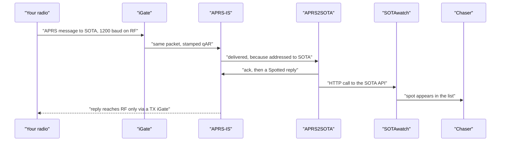
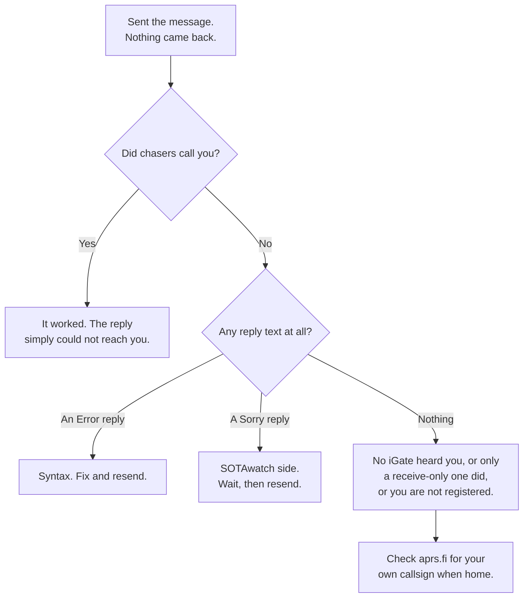

# APRS: Follow the Packet

You are on a summit in a cold wind with no mobile signal, an HF wire in the heather and a handheld in your pocket. You type twenty-odd characters into the radio, press send, and a second or two later a list of chasers on the other side of the country knows your callsign, your summit, your frequency and your mode. Nothing about that is magic, and every step of it can be traced — so this chapter follows one packet, hop by hop, from your thumb on the PTT to a row on SOTAwatch and a pin on a map.

The journey is an APRS self-spot to **APRS2SOTA**, the gateway that turns an APRS text message into a Summits on the Air spot. It is worth understanding in detail not because SOTA is the only thing you can do this way, but because it is the clearest example of a pattern APRS uses everywhere — park a well-known callsign on the network, listen for messages addressed to it, act on them — and because when it fails, it fails **silently**, on a hill, with cold hands. The last third of this chapter is about that. It leans on [APRS: paths and digipeaters](outpost:entry/logbook73.handbook/aprs-paths) and [APRS: iGates and the APRS-IS](outpost:entry/logbook73.handbook/aprs-igates), and deliberately does not restate them; for SOTA itself, see [Portable operating](outpost:entry/logbook73.handbook/portable-operating).

## The whole chain in one picture

Seven hops. The first two are radio, the iGate straddles the boundary, and the rest is software running on other people's computers. Notice how few of them you control.



The dashed arrow is the one to watch. Everything else is best-effort but reliable in practice; that last leg is conditional, and it is the difference between knowing you succeeded and guessing.

## Hop 1 — you press the button

What leaves the antenna is an ordinary **AX.25 UI frame**, exactly as described in [Packet radio](outpost:entry/logbook73.handbook/packet-radio) and [APRS: anatomy of a packet](outpost:entry/logbook73.handbook/aprs-anatomy). Nothing about it is special to SOTA. It carries a source address (your callsign and [SSID](outpost:entry/logbook73.handbook/aprs-anatomy)), a destination address used as a "tocall" that identifies your software rather than any recipient, a digipeater path, and an information field.

The information field is an **APRS message**, data-type identifier `:`. The wire format is normative and unchanged since the 2000 protocol reference: a colon, then a **9-character addressee field padded with spaces**, then another colon, then up to **67 characters** of text, then optionally `{` and a message number of up to five alphanumeric characters. Text may not contain `|`, `~` or `{`, because those are structural markers elsewhere. The message number is the switch that turns on acknowledgement: with one, the recipient is expected to `ack`; without one, nothing is expected back. (The original `APRS101.pdf` is still correct on this, but it has been formally declared obsolete — the consolidated living specification is now maintained by the APRS Foundation.)

The addressee is either `SOTA` or `APRS2SOTA`. Both work, and the gateway replies from whichever one you used. `APRS2SOTA` happens to be exactly nine characters, so no padding is needed; `SOTA` needs five trailing spaces to fill the field. Your radio or app almost certainly does that for you — but it is why the raw packet looks like it has a gap in it.

The **body** needs three things and accepts two more:

| Part             | Required | Notes                                                                        |
| ---------------- | -------- | ---------------------------------------------------------------------------- |
| Summit reference | Yes      | The full reference, association and all — `G/LD-003`, not `LD-003`           |
| Frequency        | Yes      | Units optional; if given, attached with no space — `7031.2k`, `10368.120MHz` |
| Mode             | Yes      | `AM`, `CW`, `DATA`, `DV`, `FM`, `SSB`, `OTHER`                               |
| Callsign         | No       | Derived from your APRS source callsign if you leave it out                   |
| Comment          | No       | Anything that does not look like the fields above                            |

The documented preferred order is summit reference, frequency, mode, then optional callsign, then optional comment. Several other orders are accepted, and the system is not case sensitive — but the rule that actually bites is that **any callsign you give must come before the comment**, because anything left over that does not parse as a reference, frequency, mode or callsign is treated as comment text.

Finally, the **path**. On a summit the polite New-N path is `WIDE1-1,WIDE2-1` — one fill-in hop, one wide-area hop. Do **not** put `NOGATE` or `RFONLY` in it: those are the conventional "please keep me off the internet" tags, and here they would silently destroy the entire chain at hop 3.

So this is roughly what leaves your antenna, with a placeholder callsign standing in for yours (the `APFII0` in the destination slot is a tocall identifying the sending software — here a phone app driving an external modem):

```
M0ABC-7>APFII0,WIDE1-1,WIDE2-1::SOTA     :G/LD-003 144.300 SSB{2A1
```

**An honest warning about syntax.** APRS2SOTA is one amateur's server, written and paid for by Stewart Wilkinson, `G0LGS`. The format above was read from his user guide at `sotaspots.co.uk`, which is the only authoritative source for it and which he changes from time to time — the automatic `/P` suffix, for example, used to be added and no longer is. Read that page before you go up a hill. Nothing in a handbook, this one included, is a substitute for the service's own documentation; the companion chapter "APRS2SOTA: the operator's manual" goes through the syntax in full, and it too defers to that page.

## Hop 2 — across the air

Here is the thing that surprises people: **a digipeater has no idea you sent a message.** A digipeater reads only the AX.25 address field — the path. It checks whether one of its aliases is next in the list, decrements the hop count, sets the has-been-repeated mark, applies a roughly 30-second duplicate memory, and re-transmits. The information field is opaque to it. A message, a position beacon, a weather report and a piece of telemetry are all handled identically. Every difference between a message and a beacon appears later, at the iGate and on the internet.

Which means the interesting question on a summit is not "will it be digipeated" but "**will anything at all hear me**" — and the answer is usually better than you expect, because you are the highest thing for miles. A direct hop of tens of kilometres from a hilltop into a distant iGate is entirely normal, and is exactly the case this arrangement exists to serve. In a real activation observed on the network, both `WIDE` entries in the path came through **without** a has-been-repeated asterisk: no digipeater touched the packet at all. It went straight from the summit into an iGate listening a long way off.

Your path, in other words, is a request rather than a plan. If you are heard direct it is simply never used, and asking for more hops would change nothing except the channel time other people lose when a digipeater _does_ pick you up. Two hops is plenty; from a commanding summit some operators use fewer.

There is no feedback at this layer. If nobody hears the burst, nothing happens — the packet is not rejected, not queued, not retried, it simply never becomes data. Hold that thought; it is the root of most of the failures later in this chapter.

## Hop 3 — into the internet

An **iGate** hears your packet on RF and re-presents it as a line of text on a TCP connection to an APRS-IS server. The rules it follows — what it must gate, what it must hold back, and why — are the subject of [APRS: iGates and the APRS-IS](outpost:entry/logbook73.handbook/aprs-igates), so here only two things matter.

First, the iGate **must not alter the data**. The information field crosses the boundary byte for byte, which is why a typo in your summit reference arrives at the gateway exactly as you typed it.

Second, it appends a **q-construct** — a provenance stamp — to the path. Two of those concern us:

- `qAR` means a transmit-capable iGate heard you on RF. This iGate **can** put a reply back on the air.
- `qAO` means a receive-only iGate heard you. This iGate gates your spot request perfectly and can **never** tell you it worked.

So the packet arriving on the internet looks like this — same bytes, one stamp added:

```
M0ABC-7>APFII0,WIDE1-1,WIDE2-1,qAR,IGATE-1::SOTA     :G/LD-003 144.300 SSB{2A1
```

That single token, `qAR` versus `qAO`, decides whether you find out on the summit or in the car park two hours later — and you have no say in which iGate hears you.

## Hop 4 — through APRS-IS

Once injected, the packet is on a worldwide mesh of servers that all carry the same stream within about a second. Two behaviours of that mesh matter here.

**Duplicate suppression works in your favour.** Servers de-duplicate on the source callsign and SSID, the destination (its SSID ignored), and the content of the information field, over a 30-second sliding window — the **path is deliberately ignored**. So if three different iGates all hear your summit message, and a digipeater relays a fourth copy, the network collapses them into one packet. You do not get four spots. Redundant coverage is pure benefit.

**Messages are delivered, not merely broadcast.** A position beacon reaches a client only if that client's filter happens to ask for it. Messages are different: on the standard filtered client port, a server begins by sending message packets addressed to the client, or to stations the client itself gated, **before any user filter is applied**. That delivery is a mandatory baseline of the server specification, not something you subscribe to — which is why a service like APRS2SOTA can sit on a very narrow filter, ignore the planet's position traffic, and still reliably receive everything addressed to it. Positions flood; messages are routed.

## Hop 5 — the gateway

**APRS2SOTA is not a digipeater, a webhook, or a bot on the air.** It is a long-running client program logged in to APRS-IS over an ordinary internet connection with a server-side filter, and it has been running since 2010. Its status page shows a single persistent connection with an uptime measured in days.

It logs in as `G0LGS-6` but injects packets whose source callsign is `SOTA` or `APRS2SOTA`. Because the source does not match the login, APRS-IS stamps everything it sends with `,qAS,G0LGS-6` — which is how anyone can see from outside which login is behind the service. Its tocall is `APZS20`, in the `APZ` range for experimental and unregistered software.

When a message addressed to it arrives, it does several things in quick succession:

1. **Checks you are registered.** Registration is mandatory and entirely manual: you email G0LGS with your name and callsign, he verifies you against a public source and emails back. There is no self-service signup. At the time of writing the service had a little over 1,600 registered users and had posted around 35,000 spots since 2012 — a typical day is a couple of dozen worldwide. This is a small, personal service, not an institution.
2. **Acknowledges.** If your message carried a number, it sends `ack` plus that number, immediately.
3. **Parses the body**, deriving your callsign from the APRS source callsign if you did not supply one. That derivation handles regional variants and adds a DXCC prefix when it judges one is needed; G0LGS describes the code as complex and says it may not always do what you expect. Supplying a callsign explicitly turns the guessing off.
4. **Checks for a duplicate.** An identical spot within 10 minutes is not re-posted; you get a `Dupe:` message instead. It also enforces a rate limit: more than five requests in any five-minute period from one callsign and the server silently ignores you for a further five.
5. **Posts the spot**, then sends you a second message telling you what it did.

The replies are ordinary APRS messages with their own message numbers, so the gateway wants an ack back from you too, and will retry its response up to three times before giving up. A successful round trip on the air looks like this:

```
SOTA>APZS20,TCPIP*,qAS,G0LGS-6::M0ABC-7  :ack2A1
SOTA>APZS20,TCPIP*,qAS,G0LGS-6::M0ABC-7  :Spotted: M0ABC on G/LD-003 144.300 SSB{5d9
```

Two details in there repay attention. The addressee is padded to nine characters, same as yours. And the callsign in the spot has no `/P` — the gateway used to append it automatically and, following user requests, no longer does. If you want `/P`, or a portable prefix, put the callsign you want in the message yourself.

If a transmit-capable iGate can reach you, the gateway is genuinely interactive: query commands — `/help`, `/time`, `/last`, `/mylast`, `/spots`, `/alerts` — return information from the SOTA database over the air, with band and mode filters, and `?` may replace the leading `/` on radios with awkward keypads. Repeat the same command within three minutes and it is silently ignored.

## Hop 6 — onto SOTAwatch

When the parse succeeds, the gateway makes an HTTP call to what G0LGS calls the SOTA API. That write path is not publicly documented — SOTA describes its API as private — but you can see it working from the outside, because when it fails the gateway hands you the failure: its error replies may include HTTP status codes such as 400 or 500 along with descriptive text.

What a chaser sees is an ordinary SOTAwatch spot with two tells: the **spotter callsign is `APRS2SOTA`**, and the **comment is prefixed `[APRS2SOTA]`**. In the SOTA API's JSON, the `callsign` field holds the spotter and `activatorCallsign` holds you.

Be precise about what SOTAwatch is, because "how does it show on the map" contains a hidden assumption. **SOTAwatch is not a map.** It is a live list with three tabs — spots, alerts and reflector posts — showing time, callsign, summit reference, frequency, mode and comment, newest first. That list is the canonical destination; everything map-shaped comes later, and comes from somebody else.

Two more things about this hop. A comment containing `QRT` or `TEST`, in any mix of case, flags the spot accordingly and filters it out of the `/spots` results other people request. And there is no undo: neither you nor the gateway can edit or delete a spot once posted — only a SOTAwatch administrator can. If you spot yourself wrongly, the fix is another spot.

The end-to-end timing, measured on a real activation, is startling: the message reached APRS-IS, the ack went out and the `Spotted:` reply followed all within about a second, the SOTAwatch spot carries the same minute stamp, and just over a minute later the activator's radio acknowledged the gateway's reply back over RF. **One to two seconds, summit to spot.** Remember that number when we compare alternatives.

## Hop 7 — onto the map and into the apps

The map most SOTA operators mean is **SOTLAS** (`sotl.as`), built and maintained by Manuel Kasper, `HB9DQM`. It pulls from the SOTA database, SOTAwatch, SOTA Maps, Wikipedia and the Reverse Beacon Network, and pushes updates to open browsers over a WebSocket — which is why a spot appears on a chaser's map without them reloading anything. SOTLAS is also a spot _source_ in its own right; spots posted through it carry a `[sotl.as]` tag.

Alongside it are the phone apps and third-party clients reading the same feed, and a genuinely useful reader's skill falls out of this: **every automated route stamps its own tag into the comment**. In a few minutes of the live list you will find `[APRS2SOTA]`, `[RBNHole]` followed by the skimmer, speed and signal-to-noise ratio that generated it, `[SOTAmat.com by FT8 via ...]`, an SMS-gateway tag of the form `[CALLSIGN{GB}]`, and app tags such as `[sotl.as]`. Learn the tags and you can tell a robot spot from a human self-spot at a glance — which tells you, as a chaser, how much to trust the frequency.

Your own packet and the gateway's replies, meanwhile, remain visible on the APRS side of the fence — the basis of the after-the-fact diagnosis we come to next. In LogBook73, the APRS tab on the DX Cluster page shows APRS stations heard, with a badge saying whether it is a live feed or sample data; a portable session works offline on a summit with no coverage; and contacts logged with a summit reference roll up in your SOTA tracker.

## Where it breaks

This is the section that matters. Read the others once; read this one before every activation until it is boring.

The chain has one structural weakness: **the leg that tells you it worked is the least reliable leg in it.** Your message travelling summit-to-internet needs any one of possibly several iGates to hear you. The reply travelling internet-to-summit needs a _transmit-capable_ iGate that has heard you recently — and not every iGate transmits. So the common failure is not an error. It is silence, which is also exactly what success looks like from inside a receive-only iGate's coverage.



### Not registered

Your message is gated perfectly, reaches the gateway, and no spot appears. This is the single most common reason a first attempt on a summit fails, and it is entirely preventable: registration is a human emailing you back, so do it weeks ahead, not the night before.

There is a nastier variant. In a documented case from 2019, a registered user spotting an _unregistered_ third party got a `Spotted:` reply back — with his own callsign substituted for the intended operator's. G0LGS found and fixed the underlying bug the same evening, but the shape of the failure is the lesson: not a refusal, a wrong-but-plausible success.

### Wrong syntax

The gateway does tell you, in plain text on your radio's screen: `Error: No Summit Ref.` or, when several things are wrong at once, `Error: No/Invalid Freq, No Summit Ref, No/Unknown Mode.` But that reply is itself an APRS message that has to get back down to RF — which needs a transmit iGate that heard you recently. Behind a receive-only iGate you get identical silence whether you succeeded or failed.

A subtler syntax trap: because anything unparseable becomes the comment, **a comment containing something that looks like a callsign can hijack the spot**. Avoid writing other people's callsigns in the comment unless you mean them.

### Nothing heard you

No iGate in range means no packet, no data, no record, no error. There is no negative acknowledgement anywhere in APRS. If you are in a valley, behind the summit shoulder, or in a genuinely thin part of the network, you can send a perfect message ten times and produce nothing whatsoever.

### Invalid summit reference

The gateway validates against SOTAwatch and will tell you if the reference is not valid — subject, again, to the reply reaching you. And there is no test mode: anything that parses as a valid spot **is sent to SOTAwatch**. Do not rehearse with a made-up spot.

### The gateway itself, or SOTAwatch, is having a bad day

`Sorry: Failed to send to Sota` means your request parsed fine and the onward HTTP call failed. This genuinely happens — that exact string appeared repeatedly on the live network across a single afternoon in July 2026. There is one volunteer, one server and no service-level agreement behind any of it.

### How you actually find out, in order of reliability

1. **The `Spotted:` message arriving on your radio.** Definitive — but conditional on a transmit iGate.
2. **Chasers calling you.** Blunt, but it is the outcome you wanted anyway.
3. **Afterwards, on aprs.fi.** Look up the raw packets for your own callsign. You will see your outgoing message, the q-construct that tells you which kind of iGate heard you, and any replies the gateway sent, all timestamped. Raw packets are kept for a couple of days, so do this the same evening. G0LGS also keeps server-side logs and will help diagnose if you tell him roughly when you sent it.

## Before you leave the house

Concrete, and all of it doable at the kitchen table:

- **Register, and get the confirmation email back.** Weeks ahead. A human does this.
- **Confirm your radio can send an APRS _message_, not just a beacon.** This is not a given. Kenwood's current APRS handheld does messaging and a good deal more; Yaesu's handhelds and mobiles send and receive APRS messages too, though on the FT5D handheld APRS runs on the B band only. But several DMR handhelds market an "analogue APRS" that is **position beaconing only**, with no messaging at all — and no amount of correct syntax helps a radio that cannot send a message. The [FT5DR APRS guide](outpost:entry/logbook73.guide.ft5dr/aprs) and the [RT-950 Pro APRS menus](outpost:entry/logbook73.guide.rt-950-pro/menus-aprs) walk through two examples; if your radio cannot do it alone, a phone plus an external modem can.
- **Rehearse the round trip without creating a spot.** Send `/time` or `/help` to the gateway from your driveway. A query command exercises the entire chain — RF, iGate, APRS-IS, gateway, and the reply path back to you — and posts nothing. If you get an answer at home, your radio's message setup is right. This is the single most valuable five minutes in this chapter.
- **Check the summit reference** against the SOTA database and write it on paper. Full reference, association included.
- **Decide your frequency and mode now**, and if you write units, attach them with no space.
- **Check your path** is a sane two hops, and that it contains no `NOGATE` or `RFONLY`.
- **Check the channel and deviation.** Use your region's APRS frequency, and set narrow deviation where your national society asks for it — in the UK the RSGB asks APRS users on 144.800 MHz for 2.5 kHz peak deviation, because the adjacent 12.5 kHz channel is used for digital-voice gateways.
- **Assume silence, and have a plan B.** Registering with a second route costs one email and nothing else. The alternatives are next.
- **Know that you cannot undo a spot.** Type carefully; nobody can retract it for you.

## Same problem, different chain

APRS is one of several ways to tell the world you are on a summit. Each has the same shape — get a short message off a hill with no phone signal, get it into a database — and each breaks differently. What follows is a sketch, not a catalogue: the companion chapters on unusual routes onto the APRS map, and on alerts and spots, take the wider view. Each service's own site is the authority for its syntax, and every one of them is volunteer-run.

**SMS.** The SOTA SMS gateway, run by Andy, `MM0FMF`, is the only spotting gateway documented on SOTA's own website, and its format page lives there. Registration is by email to Andy, quoting your callsign and mobile number; several national node numbers are listed on that page and change from time to time. Its notable design decision: it deliberately does **not** check the summit database, so it keeps working when the database does not. Spots appear with spotter callsign `SMS`. It needs mobile coverage, which is exactly what APRS does not — the two are complements, not rivals.

**SOTAmāt.** Created by Brian Mathews, `AB6D`, this one is ingenious: the app encodes your pre-arranged command as a **callsign suffix** inside an FT8 transmission, monitoring stations report that callsign to PSKreporter, and the SOTAmāt server decodes the suffix and posts the spot. It rides your HF rig, needing no VHF at all. The costs are latency — typically one to three minutes — and, by AB6D's own honest admission, dependence on the minority of monitoring stations whose software reports free-text callsign suffixes at all. It also cannot confirm anything: skimmers only listen. Spots carry a `[SOTAmat.com ...]` tag naming the station that relayed you.

**RBN auto-spotting.** RBNHole, taken on by Andrew, `VK3ARR`, after its original author became a Silent Key, needs no registration at all — **the alert is the registration**. Post a SOTAwatch alert, then call CQ in CW from the summit; the worldwide network of skimmer stations that automatically spot anyone calling CQ feeds the Reverse Beacon Network, and RBNHole matches your callsign and time against your alert. The window runs from an hour before the alerted time to three hours after, adjustable from the alert comment, and opt-out keywords suppress it entirely. In practice this is a CW technique, and the spot comment names the skimmer, your sending speed and your signal-to-noise ratio there — a small gift of propagation data every time.

**APSPOT**, by Josh `VK2MES`, is worth knowing if you also do POTA or WWFF: one APRS front end for several programmes, routing SOTA spots via ParksNPeaks, which cross-posts onward. One more hop in the chain, one fewer service to learn. None of these costs money; the costs are hardware, registration effort, and — for SMS — ordinary text charges to a possibly foreign number.

## Try it yourself

1. **Watch the gateway work, live.** On aprs.fi, look up the raw packets for the callsign `SOTA`. You are now watching every spot request and every reply, worldwide, as they happen — acks, `Spotted:`, `Dupe:`, `Error:`. Ten minutes here teaches more about the format than any table.
2. **Read one packet's provenance.** Pick any station on aprs.fi and find the `qA` token in its path. `qAR` or `qAO`? Now you know whether that station could receive a reply.
3. **Count the tags on SOTAwatch.** Classify twenty spots on the live list by their comment tag: human self-spot, `[APRS2SOTA]`, `[RBNHole]`, `[SOTAmat...]`, SMS. You have just measured how the community actually gets spotted.
4. **Do the driveway rehearsal.** Once registered, send `/time` from home and time the reply. If it comes back, your whole chain works except the bit involving a mountain.
5. **Find the mismatch that makes the point.** At the time of writing, APRS2SOTA's own statistics show its spots dominated by 20 m and 40 m, with 2 m a distant third — most people send the message on VHF to advertise an HF frequency. The packet is the messenger, not the mode.

## Key takeaways

- The chain is: AX.25 UI frame carrying an **APRS message** (DTI `:`, 9-character padded addressee `SOTA` or `APRS2SOTA`, ≤67 characters, optional `{msgno`) → RF → **iGate** → **APRS-IS** → the gateway → an HTTP call to the SOTA API → a SOTAwatch spot → third-party maps and apps. Measured on a real activation, **one to two seconds** end to end.
- **Digipeaters are content-blind.** A message and a position beacon are handled identically on RF; the distinction only begins at the iGate. On a summit the path is often never used at all, because an iGate hears you direct.
- **Messages are routed, positions flood.** Servers deliver messages addressed to a client _before_ any filter is applied, so a gateway can sit on a narrow filter and still get all its mail; and dedup on source, destination and content means several iGates hearing you produces one spot, not several.
- **APRS2SOTA is one volunteer's long-running APRS-IS client**: manual registration by email, five requests per five minutes, identical spots de-duplicated for ten minutes, posting to SOTAwatch over HTTP. The syntax on `sotaspots.co.uk` is the only authority, and it changes.
- **The reply is the weak leg.** It needs a _transmit-capable_ iGate that heard you recently; behind a receive-only iGate, success and total failure look identical. `qAR` can talk back to you, `qAO` cannot.
- **Rehearse before you climb:** register weeks ahead, confirm your radio can send messages at all (not every "APRS" radio can), and send `/time` or `/help` from home — it exercises the whole chain and creates no spot. There is no test mode, and no way to delete a spot once posted.
- SMS, SOTAmāt and RBN auto-spotting solve the same problem down different chains, trading latency, coverage and confirmation — registering with a second one costs an email.

Now that you can trace a packet from a summit to a database, the activation around it is the other half of the job: [Portable operating](outpost:entry/logbook73.handbook/portable-operating) covers alerts, spots, batteries, antennas that pack small, and the field craft that keeps the radio the least important thing on the hill.
