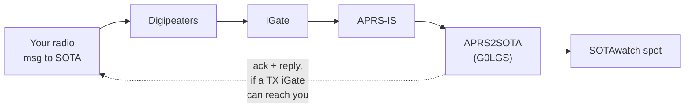
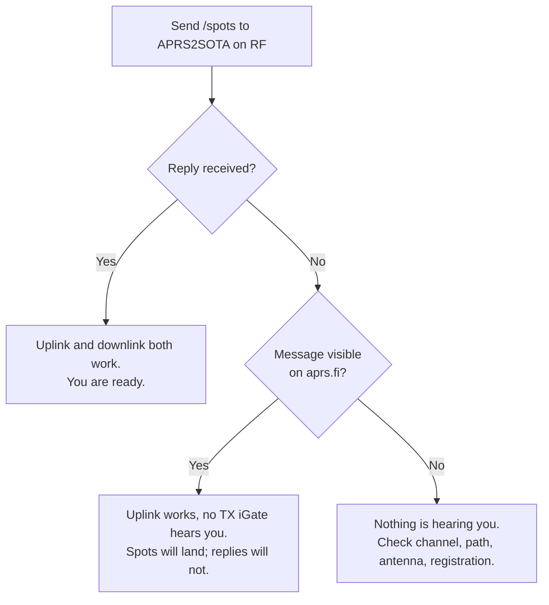
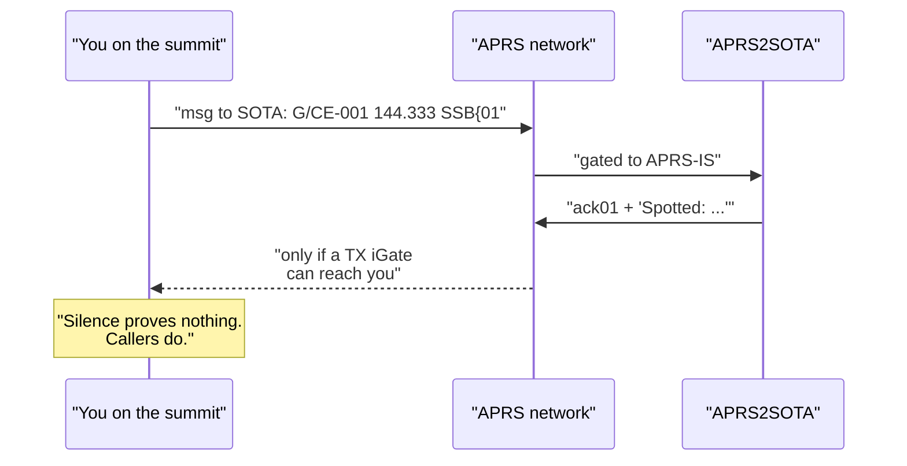

# APRS2SOTA: The Operator’s Manual

You are on a summit, two contacts short of a valid activation, and your phone says _No Service_. The frequency is empty because nobody knows you are there. **APRS2SOTA** is one answer to that: a gateway that turns a short APRS text message — sent from your radio, over the air, through the same digipeaters that carry everyone else's beacons — into a spot on SOTAwatch. This chapter is the operator's manual for it: how to get access, exactly what to send, and everything that can quietly go wrong.

## What it is, and who it is for

APRS2SOTA is a **gateway between the APRS network and SOTAwatch**. It watches for APRS _messages_ addressed to `SOTA` or `APRS2SOTA`, reads the summit reference, frequency and mode out of the text, and posts a spot on your behalf. It does not see position beacons, location reports or plain AX.25 beacons — its own FAQ is explicit that the server sees nothing but messages, bulletins and announcements to those two addressees. How your message travels from a hilltop to a server in England is ordinary APRS, taken apart elsewhere in this handbook: the hops in [paths and digipeaters](outpost:entry/logbook73.handbook/aprs-paths), the jump to the internet in [iGates and the APRS-IS](outpost:entry/logbook73.handbook/aprs-igates), the message format in [Mic-E, messages, objects and telemetry](outpost:entry/logbook73.handbook/aprs-payloads). A companion chapter, _APRS: The Journey of a Packet_, walks this exact spot hop by hop, and _APRS: Unusual Routes onto the Map_ catalogues the other odd ways dots arrive. This page assumes the packet gets there, and concerns itself with what you type.

It is for one operator in particular: **the activator whose phone signal is too poor for data, or absent entirely.** A summit is a wonderful place for VHF and a terrible one for mobile coverage, so an APRS message often escapes a hill when nothing else will. It is not for you if you have a working data connection — self-spotting on SOTAwatch is faster, editable and needs nobody's permission. And it is not for you if your station can only beacon its position, which rules out a great deal of cheap tracker hardware, and is the commonest reason people find that "APRS2SOTA does not work".

> **APRS2SOTA is a community-run service**, created in 2010 and operated, maintained and personally funded by one amateur — Stewart Wilkinson, `G0LGS`. The authoritative documentation is his, at **https://www.sotaspots.co.uk/Aprs2Sota_Info.php**, with an FAQ at `/FAQ.php` and a live service state at `/Status.php`. Everything here is taken from those pages, which carried a "last update" of 2 November 2024 when this was written. **If a command here does not behave as described, believe his site, not this page.**

The gateway is alive and busy, not a fossil: at the time of writing its Facts and Figures page reports on the order of 250 spots a month, more than 1,600 registered users, and over 35,000 spots since logging began in September 2012. Worth saying plainly, because a confident manual for a dead service is worse than none.



## Getting set up

### Yes, you must register — and it is a human, by email

APRS2SOTA accepts spots **only from pre-approved users**. There is no self-service form: you use the Contact link on the site and ask to be added. His page states what he needs and what he will refuse:

- Your **name** and your **callsign**.
- The email **must be written in English** — he says he may ignore emails that are not.
- Your callsign must be **verifiable**, on QRZ, the SOTA Reflector or some other web resource.
- You get **an email back** once the request is processed. Do this weeks before the hike, not the night before.

Registration is free; he funds the hosting himself.

### What your station must actually be able to do

Here is the part that catches people: **your station must be able to send APRS _messages_, not merely beacon its position.** A tracker that transmits where it is — a Mic-E beacon, a GPS puck with a TNC, a car tracker board — cannot spot you, however good its coverage, because APRS2SOTA never sees that traffic. You need something that composes an addressed message to an arbitrary callsign:

- **A handheld or mobile with APRS messaging built in.** Some do this well, some badly. Radio firmware messaging is often the last feature finished, and it shows — this handbook's own [RT-950 Pro APRS guide](outpost:entry/logbook73.guide.rt-950-pro/menus-aprs) is blunt that the radio's beacon is solid while its messaging is not to be relied on.
- **A radio in KISS mode driven by a phone app**, over Bluetooth or a cable. The dependable route: the app's message composer is mature software where the radio's is a menu bolted on late. [Running APRS](outpost:entry/logbook73.handbook/aprs-running) covers KISS and the apps.
- **A standalone messaging-capable APRS device** with a keyboard.

Two things will not work. **D-STAR / D-PRS**: the FAQ says that as far as its author knows there is no way to send a suitably formatted message to APRS2SOTA from a D-PRS radio. And **APRS position comments** — putting your summit reference in your beacon's comment field does nothing here, however sensible it feels. Your SSID does not matter: any is accepted, and most users run `-5`, `-6` or `-7`.

Last, establish that **there is APRS coverage where you are going**, by looking at aprs.fi around your summit for digipeaters and iGates heard nearby. A clean take-off usually beats what the map suggests, but "usually" is not "always". The channel is regional too: 144.800 MHz in ITU Region 1, 144.390 MHz across most of North America. Travelling abroad with your home channel programmed in is a silent, complete failure.

### Test it from the car park

Theory is worth very little here. Do this instead, in two stages, the first weeks ahead.

**Stage one, from home.** Once your registration email arrives, send the gateway a **command** — not a spot — and see whether anything comes back. Its FAQ names this as the way to test your access: "you can send any of the commands as shown in Other Commands". `/help` is the natural first. If you have a phone app that logs into the APRS-IS over the internet, use it: that removes RF from the experiment, so a reply proves the gateway knows you and accepts your syntax.

**Stage two, from the lay-by at the foot of the hill.** Repeat on RF, with the exact radio, antenna and path you will use on the summit. Send `/spots` to `APRS2SOTA` and wait a minute or two.



That aprs.fi check is the important half: it separates "my message never left the hillside" from "my message arrived but nothing can talk back to me", and those need different responses. Case E is not a fault — it is normal in plenty of places; your spots still get posted, you simply are not told about it.

One firm rule while testing: **do not test by sending spots.** The FAQ is explicit that there is no test facility and that any apparently valid spot goes straight to SOTAwatch, where chasers act on it. Use the commands.

## Sending a spot: the syntax

A spot is not a slash command. It is a plain APRS message, **addressed to `SOTA` or `APRS2SOTA`** (no SSID needed; set it to `0` if your radio insists), whose text carries what the gateway needs.

| Field            | Rule as published                                                                                                                    |
| ---------------- | ------------------------------------------------------------------------------------------------------------------------------------ |
| Summit reference | **Required.** A full reference as it appears in the SOTA database — association and region, e.g. `G/CE-001`                          |
| Frequency        | **Required.** With or without units; for most bands it may be given as kHz or MHz                                                    |
| Mode             | **Required.** One of `AM,CW,DATA,DV,FM,SSB,OTHER` — others may be accepted but are converted to one of these, and the set can change |
| Callsign         | Optional, with or without any prefix or suffix                                                                                       |
| Comment          | Optional, short                                                                                                                      |

The system is **not case sensitive**, so mixed case is fine anywhere.

### Order of the parameters

The preferred order, as published, is:

```
<Ass/Ref> <Freq> <Mode> [callsign] [comment]
```

The following are also documented as valid:

```
<Ass/Ref> <callsign> <Freq> <Mode> [comment]
<callsign> <Mode> <Freq> <Ass/Ref> [comment]
<Mode> <Freq> <callsign> <Ass/Ref> [comment]
```

The parser is forgiving about sequence with one condition: **any optional callsign must come before any comment.** Anything that does not look like a mode, frequency, callsign or summit reference is treated as comment.

### Separators

Parameters may be separated by a space or by any of these characters, reproduced exactly as the site prints them:

```
'   "   `   ^   #   @   %   ,   :   ;   <   >   |   _   ~   (or a space)
```

That generosity exists because some radios make spaces awkward to type. The consequence: **any of those characters inside your comment may be replaced by spaces during processing.**

### Worked examples

These three are copied verbatim from the user guide and are safe to imitate — the first uses spaces and mixed case, the second semicolons and a bare kHz figure, the third percent signs throughout:

```
ON/on-010 144.320 ssb on/G0LGS/P Calling Now
G/CE-001;144320;SSB Need 2 more
w6/ct-071%na6mg%7063%cw%CQ CQ
```

On the air, wrapped in AX.25, the same messages look like this — again verbatim, including the trailing message numbers:

```
G0LGS-2>APRS,WIDE2-1*::SOTA     :ON/ON-010 144.320 SSB ON/G0LGS/P Calling now{003
G0LGS-9>APRS,WIDE2-1*::APRS2SOTA:G/CE-001;144.320;SSB Need 2 more{0A3
NA6MG-7>APU25N,TCPIP*,qAC,T2GREECE::APRS2SOTA:w6/ct-071%na6mg%7063%cw%CQ CQ{a1b
```

The five spaces padding `SOTA` out to nine characters are the ordinary [APRS addressee rule](outpost:entry/logbook73.handbook/aprs-payloads) — your radio or app does that for you.

### Frequency units, if you give them

If you attach units they **must** be joined to the number with no spaces or other characters. The guide's own examples of acceptable forms:

```
7031.2k     10111.5kz     144.320mh     10368.120MHz
```

Yes, `kz` and `mh` are as printed. That is the parser's business, not ours — do not tidy them.

### What happens to your callsign

Leave the callsign out and the gateway works it out. It understands UK regional variations (`G`, `GW`, `GM`; `M`, `MU`, `MW`; `2E`, `2W`, `2M`) and picks the one matching the summit's region; activating in another DXCC it tries to add a suitable prefix — `ON/G0LGS`, `MW/F6ENO`. The author is candid that this matching code is complex and does not always land where you expect. Two rules follow:

- **Include a callsign and no matching is applied at all.** If you want a DXCC prefix or any suffix, send the complete callsign you want spotted — `Call/Suffix`, or `Prefix/Call/Suffix`.
- **`/P` is no longer added automatically.** It once was; that was disabled at users' request. If you want `/P`, type it.

### Three things to know before you send

It **cannot edit a spot** and it **cannot delete one** — only a SOTAwatch administrator can, and the FAQ's advice for a wrong spot is to send another, correct one. Identical spots are **de-duplicated within 10 minutes**, so hammering the send button after silence achieves nothing. And a comment containing **QRT** or **TEST**, in any mix of case, flags the spot accordingly — added 28 October 2024. Useful when you are going off the air; a nuisance if you casually write "testing the new antenna" in a genuine spot.

### Spotting from JS8Call

The FAQ carries a JS8Call format and caveats it: its author has not used JS8Call and is reporting what he was told. Reproduced as published, with its worked example:

```
@APRSIS CMD :APRS2SOTA:<CallSign> <Summit_Ref> <Freq in MHz> <MODE> <Comment> {001

@APRSIS CMD :APRS2SOTA:GW8OGI/P GW/NW-073 7.032 CW TEST ONLY PSE IGNORE{001
```

Treat this as second-hand even at source. If you intend to rely on it, test it well in advance and check the FAQ for changes.

## The other commands

These are the query commands — the ones that ask APRS2SOTA a question and expect an answer back over APRS. The user guide prefaces the list with a condition worth reading twice: they are useful **"when a bi-directional i-Gate is available"**. Without one you can send them all day and hear nothing.

| Command                                                      | What it does                                                                                       |
| ------------------------------------------------------------ | -------------------------------------------------------------------------------------------------- |
| `/help`                                                      | A reminder of the preferred parameter order and a summary of these commands                        |
| `/last(/number)(/full)`                                      | Information on the last _N_ APRS2SOTA spots. The guide notes the newer `/spots` may be more useful |
| `/mylast(/number)(/ful)`                                     | Information on **your** last _N_ spots posted via APRS2SOTA                                        |
| `/time(/zone)`                                               | The current time, normally UTC; other time zones can be requested                                  |
| `/spots(/number)(/name)(/ref)(/full)(/[band])(/[mode])(/by)` | Up to **5** most recent spots, default **3**, via the SOTA API                                     |
| `/alerts(/number)(/ref)(/full)(/name)(/by)`                  | Up to **5** alerts, default **3**, via the SOTA API                                                |

The `/mylast` entry is printed on the site as `(/ful)`, not `(/full)`, and is reproduced exactly rather than corrected — a manual that quietly "fixes" a syntax is a manual that lies. If `/mylast/full` misbehaves, try `/mylast/ful` and check the source page.

**Punctuation.** The `?` character may be used in place of `/` **at the start of** all commands. The `-` and `?` characters may be used in place of `/` **within** all commands that take additional parameters. So `?spots-5` is the same request as `/spots/5` — which matters on a radio that hides the slash three menus deep.

**The option words**, combinable in any order:

| Option    | Effect                                                                               |
| --------- | ------------------------------------------------------------------------------------ |
| `/full`   | Shows the comment posted with the spot or alert — `/spots/full/5` or `/spots/5/full` |
| `/ref`    | Shows summit details: name, height and points (since 22 October 2022)                |
| `/name`   | Shows the activator's name, if the SOTA API has it (since 27 November 2022)          |
| `/by`     | Shows the spotter's callsign, or the system name (since 27 November 2022)            |
| `/[band]` | Filters spots by band (since 25 November 2022)                                       |
| `/[mode]` | Filters spots by mode (since 25 November 2022)                                       |

Permitted band values are exactly `160m,80m,60m,40m,30m,20m,17m,15m,12m,10m,6m,4m,2m,70cm,23cm,hf,vhf`; permitted mode values are exactly `am,cw,data,dv,fm,ssb`. Worked combinations, taken verbatim from the guide:

```
/spots/10m
/spots/full/5/cw
/spots/5/cw/ref
/spots/5/name/ref/full/10m/ssb/by
/alerts/5/ref/full
/time/GB
/time/Europe/Paris
/time/Pacific/Honolulu
/time/America/Chicago
```

An unrecognised time zone returns an error. `/alerts` is a snapshot of the first _n_ items with an alert time 30 minutes prior to the current time — what is about to happen, not a full diary. Since 28 October 2024, spots flagged `QRT` or `TEST` are filtered out of what `/spots` returns.

Three limits govern all of this:

- A **3-minute window** during which duplicate commands are silently ignored.
- **5 requests in any 5-minute period.** Exceed it and the server ignores everything further from your callsign — apart from any requested ack — for another 5 minutes. It exists because the APRS network was flooded once, in April 2024.
- Replies may arrive as **several APRS messages**, and the gateway tries up to **3 times** to deliver each before discarding it.

If the SOTA API itself is unwell, your reply may contain an HTTP error code such as `400` or `500` with descriptive text. That is a fault at SOTAwatch, not at your end.

## How you know it worked

Honestly: **you may not know.** Better to carry that up the hill than discover it there.

The gateway's side of the bargain is clear — it "will attempt to send APRS acks and attempt to respond via APRS with information informing the APRS user of successful, failed, duplicate spots etc." Replies begin with words like `Spotted:`, `Dupe:`, `Error:` or `Sorry:`. (It also ignores incoming messages starting with those words, so its own replies bouncing back cannot be mistaken for new spots.)

The catch is the return path: a reply must travel from the APRS-IS back onto RF, which needs a **transmit-capable iGate within earshot of you** willing to gate it. As [the iGate chapter](outpost:entry/logbook73.handbook/aprs-igates) sets out, such a gate transmits only when several conditions hold at once — most relevantly, that it has heard _you_ on RF recently. A receive-only iGate hears your spot perfectly and cannot say a word back.



So build confidence from three sources. **The car-park test** tells you in advance which world you are in. **The callers** are the real acknowledgement — an empty frequency going busy two minutes later is the one that counts. **Afterwards**, check SOTAwatch back in coverage for what was actually posted, callsign included.

## Gotchas

- **You are not registered.** Nothing happens, quietly. _Fix:_ register by email and wait for the confirmation.
- **Your station can only beacon.** Position beacons, location reports and plain AX.25 beacons are never seen by the server. _Fix:_ a messaging-capable station, or KISS mode with a phone app.
- **You put the summit reference in your beacon comment.** Same failure, different disguise. _Fix:_ send a message addressed to `SOTA` or `APRS2SOTA`.
- **`/spots` is not how you spot yourself.** The commands query the gateway; a spot is plain text in a message. _Fix:_ no leading slash on a spot.
- **Your frequency units have a space in them.** `7031.2 k` fails; `7031.2k` is right. _Fix:_ glue them on, or leave units off.
- **Your comment contains something that looks like a callsign.** The guide warns the wrong callsign may be spotted. _Fix:_ plain words only — `Calling now`, `Need 2 more`.
- **You included a callsign and lost the prefix you wanted.** No matching is applied when a callsign is present. _Fix:_ send the complete callsign, prefix and suffix included. The same goes for `/P`, which is no longer added for you.
- **Punctuation in your comment vanished.** Separator characters inside a comment may become spaces. _Fix:_ write comments without them.
- **You resent an identical spot and nothing happened.** Identical spots inside 10 minutes are dropped; duplicate commands inside 3 minutes are ignored. _Fix:_ wait, or change something meaningful.
- **You sent five things quickly and it went silent.** The rate limiter: 5 requests per 5 minutes, then a further 5-minute freeze. _Fix:_ slow down.
- **You saw a `rej` message.** The guide states APRS2SOTA never sends `rej`, that the true source was still being investigated in 2021, and that addressing to `APRS2SOTA` rather than `SOTA` did not appear to attract them. _Fix:_ ignore it; use `APRS2SOTA` if it bothers you.
- **You wrote "test" in a real spot's comment.** `QRT` or `TEST` flags the spot. _Fix:_ save those words for when you mean them.
- **Your callsign is blocked.** At the SOTA Management Team's request, certain callsigns may not post spots or have spots posted for them. _Fix:_ take it up with the SOTA MT, not the gateway.

## How it compares

| Route                                | Registration?                          | Needs a messaging radio?            | Confirms back?                                     | Works with no phone signal?              |
| ------------------------------------ | -------------------------------------- | ----------------------------------- | -------------------------------------------------- | ---------------------------------------- |
| SOTAwatch self-spot (web or app)     | SOTA account                           | No                                  | Yes — you see the spot                             | **No** — needs mobile data               |
| SMS gateway                          | Yes — phone number registered by email | No                                  | Not directly on the handset                        | Only where voice/SMS coverage exists     |
| **APRS2SOTA**                        | Yes — name and callsign, by email      | **Yes**                             | Attempts to; needs a TX iGate in range             | **Yes**, given APRS coverage             |
| SOTAmāt over HF FT8                  | Yes — account at sotamat.com           | No, but needs an HF rig and the app | No — its FAQ says there is no way to know off-grid | **Yes** — no internet, cell or satellite |
| A chaser or S2S station spotting you | No                                     | No                                  | Yes — you hear it on the air                       | **Yes**                                  |

Read it as a decision, not a league. With data, self-spot on SOTAwatch. With voice and text but no data, an SMS gateway is simpler. With nothing but a VHF radio and a hill, APRS2SOTA is the natural fit — the only route here that rides the 2 m FM channel you were carrying anyway. And the oldest method still works best: ask the station you are working to spot you, or work another activator summit-to-summit. The wider picture — what alerts and spots are for, and the etiquette around them — belongs to the companion chapter _Alerts and Spots_.

## When to check the source instead of this page

This chapter is a snapshot of one person's documentation, taken at one moment. Go and read **https://www.sotaspots.co.uk/Aprs2Sota_Info.php**, and the FAQ and Status pages beside it, whenever:

- **A command does not do what is written here.** The guide says further commands may be possible and changes may be made. The site is updated; this page is not live.
- **You are planning a trip abroad**, where prefix and association matching surprises most.
- **Nothing has worked for a while** — check `/Status.php` before you debug your radio.
- **You are about to depend on it.** Anything that must work on a given day deserves ten minutes with the primary source the week before.

## Try it yourself

1. **Register now, activate later.** Send the request email today, with your name and callsign, and file the confirmation long before you need it.
2. **Send `/help` from home over the APRS-IS.** No RF, no hill, no risk — it proves the gateway knows you.
3. **Do the car-park test.** At the foot of your next summit, send `/spots` on RF and watch aprs.fi at the same time. "Replies reach me here" or "they do not" changes how you operate on that hill forever.
4. **Compose the spot before you climb**, into your radio's message draft at home — cold fingers and a small keypad are a bad place to learn syntax. Afterwards, check SOTAwatch for what was posted, then log the contacts against the summit reference so your SOTA tracker keeps the score.

## Key takeaways

- APRS2SOTA turns an **APRS message** — never a position beacon — addressed to `SOTA` or `APRS2SOTA` into a SOTAwatch spot; it is a community service run and funded by one amateur, `G0LGS`, and **sotaspots.co.uk** is the authority.
- **Registration is required, by email**, with your name and a verifiable callsign; do it weeks ahead.
- A spot needs a **full summit reference, a frequency and a mode**, with an optional callsign before an optional comment; the parser is case-insensitive and accepts a generous list of separators.
- **Units must be glued to the frequency** (`7031.2k`), a supplied callsign disables all prefix matching, and `/P` is no longer added for you.
- The **`/` commands query the gateway** — `/help`, `/last`, `/mylast`, `/time`, `/spots`, `/alerts` — with combinable `/full`, `/ref`, `/name`, `/by`, band and mode options, and `?` or `-` standing in for `/`.
- **Confirmation is attempted, not guaranteed**: acks and `Spotted:` replies reach you only if a transmit-capable iGate is in range, so silence proves nothing and callers are the real acknowledgement.
- **Test with commands, never with spots** — there is no test facility, and every apparently valid spot goes live to chasers who will act on it.

If this has you thinking about what else a hill and a small radio can do, [Portable & Off-Grid](outpost:entry/logbook73.handbook/portable-operating) covers the activation itself, while [Running APRS](outpost:entry/logbook73.handbook/aprs-running) covers the KISS-and-an-app setup that makes the messaging half of this reliable.
