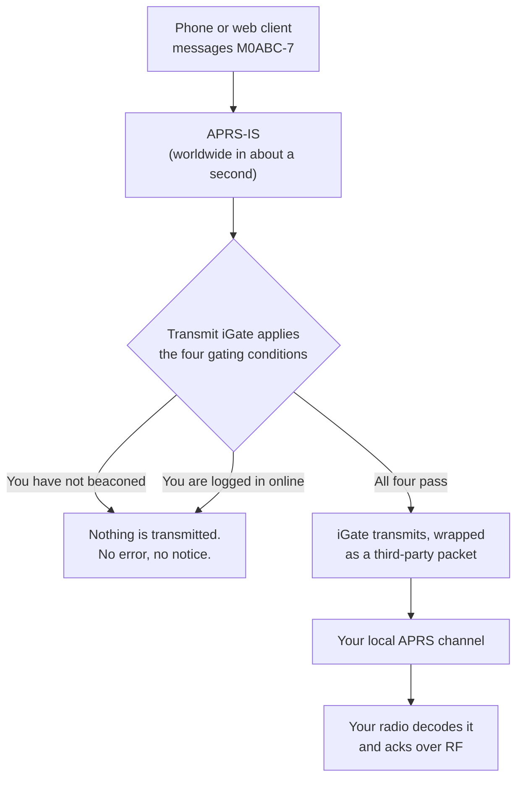
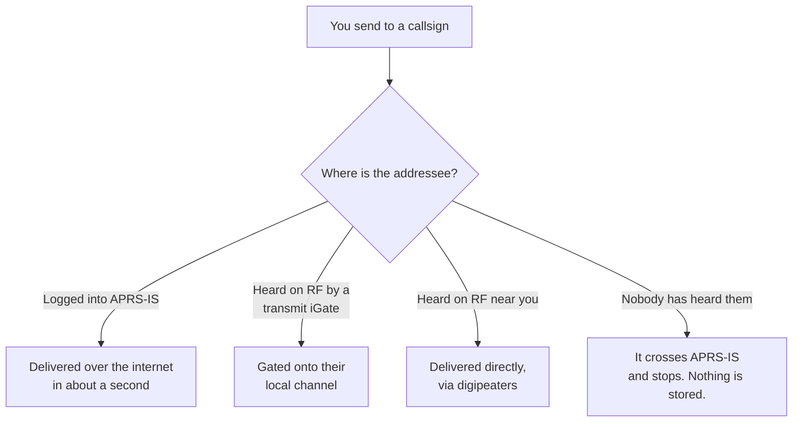

# APRS: Messaging

Almost everyone discovers APRS messaging by accident and reacts the same way twice: first delight — _you can send text to a callsign, with no phone signal, for free?_ — and a week later quiet disappointment, because the messages do not seem to arrive. Both reactions are correct. APRS messaging is genuinely useful and genuinely fragile, and the gap between the two is almost always one fixable misunderstanding about how a message finds you. This chapter spends most of its length on the harder half of that problem: not sending, but **being reachable**.

## Start here: it is not a chat system

Say this before your first message, because it prevents most of the frustration that follows. APRS messaging is not instant messaging: there is no inbox, no "delivered" tick, no presence indicator that means what you think it means, and no server holding your message until the other person comes back. It is closer to leaving a note with a passing stranger heading roughly the right way. Three design facts cause that, none of them bugs:

- **The channel is shared and lossy.** One VHF frequency carries an entire region ([`144.800 MHz`](outpost:entry/logbook73.handbook/aprs) across Europe and Africa, `144.390 MHz` in North America). Two stations transmitting in the same instant destroy each other's packets. Loss is the normal case.
- **Nothing is stored.** The [APRS-IS](outpost:entry/logbook73.handbook/aprs-igates) is a live stream, not a mailbox. A packet exists for about a second and afterwards is only history in someone's log.
- **Delivery to a radio is conditional.** A message crosses from the internet onto your local channel only when a transmit-capable iGate decides the conditions are right — and those conditions are the whole subject of this chapter.

What it _is_ good for is what SMS is good for, in the places SMS is not: "at the summit, all well", "running an hour late", "meet at checkpoint 3". Judge it by that standard and it is excellent.

## The packet: an addressee, some text, and a number

The wire format is the plainest thing in APRS: a message is an [information field](outpost:entry/logbook73.handbook/aprs-anatomy) whose data-type identifier is a colon. The [payloads chapter](outpost:entry/logbook73.handbook/aprs-payloads) gives it in full; here is the operator's-eye view, as a whole packet would appear in a raw-packet log:

```
M0ABC-7>APDW17,WIDE1-1,WIDE2-1::G4XYZ    :QRV on the summit repeater{07
```

Everything before the double colon is the ordinary envelope — source callsign, the software's tocall, the [via path](outpost:entry/logbook73.handbook/aprs-paths). The message itself is everything after it:

- **`:`** — the data-type identifier. A message, a bulletin or an acknowledgement; the addressee decides which.
- **`G4XYZ␣␣␣␣`** — the **addressee**, a fixed **nine characters**, padded with spaces. `G4XYZ` is five characters, so four spaces follow; `M0ABC-7` gets two, `WU2Z` gets five. The field never changes width, so a decoder can slice out characters 2 to 10 without parsing anything — which is why callsigns in APRS messages always look shoved against a left margin.
- **`:`** — a second colon, closing the addressee, then the **text**.
- **`{07`** — the optional **message number**: an open brace and up to five alphanumeric characters. This tiny tail is the most consequential part of the packet, because it is the switch that turns acknowledgement on. Without it, the message is a one-shot that is never acked and never retried. (A number written `{MM}AA` is the **reply-ack** extension, piggybacking an acknowledgement of that station's last message onto your next one.)

One practical consequence of that fixed field: **the SSID is part of the address**. `M0ABC` and `M0ABC-7` are two different destinations. If somebody messages you without your SSID, your radio will never see it as addressed to itself, and you will spend an evening blaming the network.

### Where the specification and the real world part company

The specification says the text may be up to **67 characters**, and the maintained 1.2 draft adds a sceptical footnote about where that number came from: an article from around the turn of the century recorded that the Kenwood TH-D7 had a 45-character message limit and the TM-D700 a 67-character one, and the spec's own editor asks whether one product's ceiling was written into the standard by accident. Longer text does appear on the air and receiving software is expected to cope, so **treat 67 as your budget, not a promise about what arrives.**

Read old pages with care generally: `APRS101.pdf`, the famous 2000 protocol reference, has been formally declared obsolete by the people who now curate the specification, in favour of the merged 1.2 drafts at [github.com/wb2osz/aprsspec](https://github.com/wb2osz/aprsspec).

## What an acknowledgement actually proves

An ack is just another message going the other way, whose text is the literal letters `ack` followed by the number being acknowledged:

```
G4XYZ>APDW17,WIDE1-1,WIDE2-1::M0ABC-7  :ack07
```

The addressee is padded to nine characters the same way. A station that cannot accept a message may send `rej07` instead, though in practice you far more often hear nothing at all.

**An ack proves** that a station identifying itself with that callsign and SSID received your bytes intact, its software replied, and that reply travelled all the way back. That is a genuine round trip, and the smallest complete transaction in APRS. **An ack does not prove:**

- **that a human read it.** Acks are generated by software the instant a message decodes; the radio may be in a rucksack, the app on a windowsill at home.
- **that it arrived by radio.** If the addressee is logged into APRS-IS from a laptop, the ack came entirely over the internet. You have proved no RF path at all.
- **that it reached the person you meant.** It reached whatever is claiming that callsign-SSID — which, if a friend left an app logged in as their car, may not be them.
- **that no ack means no delivery.** Acks collide too: your message may have arrived perfectly and the reply been destroyed on the way home.

**Retries** follow from that. The specification is deliberately vague — the sender "will repeatedly send the message until it receives an acknowledgement or it is canceled, or it times out" — and mandates no interval, so retry behaviour is an implementation question, not a protocol one. Coming back the other way, a station acking over a long path may send several copies deliberately, spaced **at least 30 seconds apart** so they are not swallowed by the [30-second duplicate suppression](outpost:entry/logbook73.handbook/aprs-igates) running on digipeaters and servers alike. That same window is why Dire Wolf deliberately does _not_ deduplicate internet-to-RF: killing sub-30-second repeats would kill exactly the retries messaging depends on.

## Can your radio even do this?

Many people spend months assuming their radio can message when it can only beacon. Sort this out first; it is the cheapest diagnosis there is.

The free self-test: find your own station on aprs.fi, open its raw packets and look at the data-type identifier — the character right after the `:` that ends the header. From the [anatomy chapter](outpost:entry/logbook73.handbook/aprs-anatomy), `!` and `/` mean **not message-capable**, `=` and `@` mean **message-capable**. If your radio beacons `!`, its own firmware is telling the world not to bother. (Mic-E encodes things differently, so for those read the manual instead.)

For hardware, the most useful public inventory is the APRS Foundation's **[APRS Radios](https://how.aprs.works/aprs-radios/)** list, compiled by Jay `DV7GDL` in November 2024 — attributed and dated, because line-ups move. Its ground rule is that the radios listed send and receive APRS text messages and have user-accessible TNCs _unless otherwise stated_, and the exceptions are where people get caught:

| Category                                                                                                   | Messaging on the radio itself                                                        |
| ---------------------------------------------------------------------------------------------------------- | ------------------------------------------------------------------------------------ |
| Kenwood `TH-D75`; out of production `TH-D7`, `TH-D72`, `TH-D74`, `TM-D700`, `TM-D710`                      | Yes, with an accessible TNC as well                                                  |
| Yaesu `FT-5D`, `FTM-200D/300D/500D`; out of production `FT-1D/2D/3D`, `FTM-100D/400D`, `FTM-350`, `VX-8DR` | Yes, but only through the radio's own interface                                      |
| Vero `VR-N76` and its siblings (BTECH `UV-PRO`, Radioddity `GA-5WB`)                                       | Yes, plus a KISS TNC                                                                 |
| LANCHONLH `HG-UV98`                                                                                        | **No** — beaconing only; messaging requires pairing it to a phone app over Bluetooth |
| Dedicated trackers (for example the Byonics TinyTrak family)                                               | **No** — beacon only, by design                                                      |
| Most entry-level DMR handhelds with GPS                                                                    | **No** — position beaconing only                                                     |

### The Yaesu and Kenwood difference

Both families do APRS properly and both let you type a message on the radio. The difference is what else the radio lets you do. Kenwood's APRS sets expose their internal TNC, so the radio can also act as a modem for a computer or phone. Yaesu's cannot: the same source records that on the Yaesu APRS radios the TNCs are **not KISS** and their Bluetooth pairs only with Yaesu headsets, so every scrap of APRS functionality happens through the radio's own touchscreen. Neither is wrong — but "buy a radio, drive it from a phone app" works on a Kenwood and not on a Yaesu, and the specification sheet will not tell you.

### The DMR handheld confusion

A DMR handheld's box may say "APRS", and it usually means one of two things, neither of which is APRS messaging on the VHF channel:

1. **DMR-network position reporting.** Your position rides a DMR data burst to the network, whose gateway injects it into APRS-IS for you — the arrangement described in [Operating DMR](outpost:entry/logbook73.handbook/dmr-operating). Your dot appears on the map without a single APRS packet being transmitted, and nothing on that path can carry a text message back.
2. **Analogue APRS beaconing**, transmit-only: the radio keys up on the APRS frequency with a position but cannot decode what it hears.

The exception proves the rule. Of the widely sold AnyTone `AT-D878UV` family, the same APRS Foundation list records that the **`AT-D878UVII Plus` is the only one that can receive and decode APRS packets and messages**. If your DMR handheld is not that one, assume it beacons and nothing more until its manual says otherwise.

## Receiving a message: walking the path backwards

Somebody, somewhere, types a message to your callsign on a phone. What has to be true for it to reach your handheld?



The internet half is easy and fast. The last hop — internet to RF — is the conditional one, and the [iGates chapter](outpost:entry/logbook73.handbook/aprs-igates) sets out the four conditions that govern it. Rather than repeat them, let us derive what they _mean for you_, walking backwards from your radio.

### You must have beaconed recently, or you are not reachable at all

Work back one link from your radio and you reach a transmit iGate. Work back one more and you reach the rule that decides everything: a message is gated to RF only if the **addressee has been heard locally on RF recently**. The protocol reference says the same from the network's side — APRS-IS forwards the message to iGates "that heard the message addressee over the radio recently".

It says _heard_. Not registered, not configured, not "on the map since Tuesday". An iGate has no directory; its only knowledge of who is local is a list of stations whose packets it physically decoded in the last little while. **A radio that only listens is invisible.** You can sit on a hill for six hours with a perfectly good APRS handheld and be, as far as every iGate in range is concerned, not there.

So the first rule of being reachable is unglamorous: **transmit something**. A position beacon is the normal way, and its interval is now doing double duty — not only how often your dot moves, but how long your window of reachability stays open. How long "recently" is depends on the software; treat it as tens of minutes rather than hours, and see the iGates chapter for why no single number is honest.

### Being online at the same time can stop the message reaching your radio

Now the condition that surprises everyone, because it feels backwards: a transmit iGate declines to gate a message if the **addressee has already been heard on the internet** recently. The logic is sound — spending scarce airtime on someone reachable another way is waste — but the consequence is sharp.

If your phone is logged into APRS-IS with the **same callsign and SSID** as your radio, the network believes `M0ABC-7` is an internet station. Messages to `M0ABC-7` go to the phone, and the iGate three miles from your hill, which can hear you perfectly, transmits nothing. Worse, the condition is time-windowed, so the network's memory of you being online outlives your actual connection: you can walk out of mobile coverage and still be counted as internet-reachable until that window closes.

The fix costs nothing, so do it whether or not your local iGate is strict: **give your phone client a different SSID from your radio**. The [conventions](outpost:entry/logbook73.handbook/aprs) exist for exactly this — `-5` for a smartphone, `-7` for a handheld, `-9` for a vehicle — and then tell people which one to message.

### A receive-only iGate next door does not help you receive

This is the cruellest case, because everything looks healthy. A [receive-only iGate](outpost:entry/logbook73.handbook/aprs-igates) has no transmitter: it hears you beautifully, forwards your beacons to APRS-IS, and your dot lands on aprs.fi bang on position. You are visible, prominent, plainly alive — and completely unreachable. Visibility on the map and reachability by radio are different properties, and the map only shows the first.

### Finding out whether a transmit-capable iGate covers you

You can settle this in a minute, and the answer is written on your own packets. Every packet gated into APRS-IS carries a **q-construct** recording how it got there. The iGates chapter introduced `qAR` and `qAO` as "transmit iGate" and "receive-only iGate"; the formal definition on [aprs-is.net](https://www.aprs-is.net/q.aspx) is broader and, for our purposes, far more useful:

- **`qAR`** — gated from RF by an iGate.
- **`qAO`** — gated from RF by an iGate **which cannot gate messages to that station**. Receive-only gates use it for everything, and a bidirectional gate also uses it to mark stations it will not transmit to — ones outside its configured range, for instance.

So the letter on your own beacon is a direct statement about your reachability, written by the gateway itself. Beacon from where you actually intend to be, open your station on aprs.fi, view its raw packets and read the `qA` token and the callsign after it. `qAR,SOMECALL` means an iGate willing to message you heard you, and `SOMECALL` is the station your messages will arrive through — that is your lifeline. If **every** line says `qAO`, you are on the map and unreachable, and you have learned it before you needed it rather than afterwards.

### What actually lands in your radio

The message that arrives does not look like the one that was sent. It comes wrapped as a **third-party packet** — the leading `}` and the `TCPIP` marker that stop it looping back to the internet:

```
G8DEF-10>APDW17,WIDE2-1:}KE7XYZ-5>APRS,TCPIP,G8DEF-10*::M0ABC-7  :are you back yet{02
```

Your radio strips everything up to and including the `}`, finds a message addressed to `M0ABC-7`, shows it as from `KE7XYZ-5` — not from the iGate — and acks over RF in the ordinary way. One warning from the protocol reference: a sender address arriving this way **may not be a legal AX.25 callsign at all**, since it came from the internet where those rules do not apply. Some radios cope and some do not, which is one plausible reason an ack never gets home.

### Checklist: you expected a message and got nothing

Work down in order; stop when something is wrong.

1. **Have you transmitted in the last half hour?** If not, beacon manually and ask them to try again. This is the answer more often than everything else here combined.
2. **Check your own raw packets for `qAR` versus `qAO`.** All `qAO` means no gate near you will send to you.
3. **Is anything else logged in as your exact callsign-SSID?** Close the phone app or move it to a different SSID.
4. **Did they use the full callsign _and_ SSID?** `M0ABC` is a different address from `M0ABC-7`.
5. **Is your radio message-capable, and is messaging switched on?** Apply the DTI test above, then check your menus.
6. **Is the radio on the right frequency and the right VFO?** Dual-band sets cheerfully beacon on the band you are not watching, and an empty station list means squelch, audio level or antenna rather than messaging.
7. **Was it addressed to a group?** Messages to `ALL`, `QST`, `CQ` or a `BLN…` addressee are read but never acknowledged.
8. **Did their client attach a message number?** Without `{nn` there is one attempt and no retries.

## Sending: what happens to a message nobody can deliver

The sending side has fewer surprises, but one thing puzzles people: what becomes of a message to a station nobody has heard?



That last branch is the honest answer: **nothing**. Your message is injected into APRS-IS, propagates worldwide in about a second, is seen by every server, and is gated to RF by nobody, because no iGate has heard the addressee. It is not queued or held; there is no bounce and no failure notice. Your software retries, gets no ack, gives up, and the only evidence it existed is in a few server logs. So **check before you send** — look the station up and see whether it has beaconed recently and whether its packets carry `qAR`. If you want something more like a mailbox, several of the gateway services below hold missed messages and re-offer them, which the bare protocol never does.

## Bulletins: broadcast, not conversation

Bulletins use the same packet shape with a different sort of addressee, and behave differently in every way that matters to an operator. The [payloads chapter](outpost:entry/logbook73.handbook/aprs-payloads) tables the address forms; here is the behaviour. A **general bulletin** is addressed to `BLN` plus a single digit, padded to the usual nine characters:

```
:BLN3     :Snow expected in Tampa RSN
```

- **Nobody acknowledges a bulletin.** A station acks only messages addressed to itself; dozens of acks per bulletin would collapse the channel. So there are no retries and no delivery in the sense messaging uses the word — a bulletin is repeated on a schedule, and if you were not listening, you missed it.
- **Bulletins and announcements have different rhythms.** The specification's guidance is that general bulletins go out a few times an hour for a few hours and carry time-sensitive content, while **announcements** — `BLN` plus an upper-case letter — are transmitted much less often but perhaps for several days, covering the run-up to an event rather than the event itself. "Sunday net moves to 10:30 this month" is an announcement; "talk-in on 145.500" is a bulletin.
- **Group bulletins** let a station subscribe to only the groups it cares about; one that has selected none receives all bulletins.

Bulletins are right for "everyone here should know this", and wrong for anything you need one particular person to receive.

## Gateways: what is live, and what will waste your afternoon

Messaging becomes far more useful once you know that some "callsigns" are robots: message a service addressee and it replies. This is also the corner of APRS where guides rot fastest, so what follows was **checked at the time of writing** and every entry links to its own documentation. The best starting point is the APRS Foundation's catalogue, **[APRS Information Services](https://how.aprs.works/aprs-information-services/)**, maintained by Dire Wolf's author John Langner `WB2OSZ`, which carries a line worth quoting for its honesty: _"Any manually updated page will always be out of date."_

| Addressee               | What it does                                                                                                  |
| ----------------------- | ------------------------------------------------------------------------------------------------------------- |
| `SMS`                   | Two-way APRS ↔ mobile SMS. See [aprs.wiki](https://aprs.wiki/)                                                |
| `EMAIL-2` (and `EMAIL`) | APRS to internet e-mail. See [aprs-is.net](https://www.aprs-is.net/Email.aspx)                                |
| `WLNK-1`                | Read and send Winlink radio e-mail by APRS message ([APRSLink](https://www.winlink.org/APRSLink))             |
| `CQSRVR`                | Send `CQ GROUPNAME your text` to meet people by interest ([aprs-is.net](https://www.aprs-is.net/CQSrvr.aspx)) |
| `ANSRVR`                | Join announcement groups quietly and broadcast to them                                                        |
| `WHO-IS` / `WHO-15`     | Callsign lookup ([aprs-is.net](https://www.aprs-is.net/WhoIs.aspx))                                           |
| `WXBOT`                 | Weather forecast; outside the US, METAR and CWOP queries are the useful ones                                  |

Two details matter in practice. The **`SMS`** gateway, run by `NA7Q`, uses a `@<number> <message>` syntax, supports the USA, Puerto Rico, Canada, Australia and the UK only, and requires **the phone user to opt in first** because of carrier regulations — so it is not a way to text someone who is not expecting it. And the **e-mail** gateways insist on _numbered_ messages and describe themselves as interactive: stations firing e-mails blind, unable to handle acks and status replies, risk being blocked.

**Now the dead ends**, because these cost people whole evenings:

- **`SMSGTE`** was for years _the_ APRS-to-SMS gateway, and it is still what most search results will hand you. It is gone: the APRS Foundation's own service list annotates it "currently offline", and at the time of writing its old documentation domain no longer serves the project at all — it resolves to an unrelated commercial site. Use `SMS` instead.
- **The original `EMAIL` server** run by Keith Sproul `WU2Z` was **retired in 2019**. The addressee still works, but a different implementation answers it now, so pre-2019 instructions may not match what replies.
- **The APRS-to-Twitter gateway `WA1GOV-10`** still appears in service lists, but the Foundation's own entry admits it can find no documentation beyond the station's bulletins. Treat it as unverified and test it with something disposable before relying on it.

One legal point applies to every gateway here: passing a message from an amateur station to a non-amateur is **third-party traffic**, and the rules differ enormously between countries. Check your own licence conditions first; "the software let me" is not a defence anywhere.

## Etiquette and limits

All of this follows from one fact: your message, every retry and every ack occupies a channel shared by an entire region.

- **Budget airtime honestly.** A ten-line exchange is at least twenty transmissions before retries. If you are typing paragraphs, the answer is a voice repeater — and keep to the 67-character budget even where longer works, because short messages collide less.
- **Do not message a station you cannot see beaconing.** Test on yourself instead: two SSIDs of your own callsign, or one of the robots above, will answer without irritating anybody.
- **Nothing is private.** Every packet is in the clear, gated worldwide and archived, and encryption is not permitted on amateur bands. Write nothing you would not say on an open repeater, and be careful with other people's details.
- **Never test an emergency beacon** "to see if anyone is listening" — it is on the APRS Foundation's cheerfully sarcastic [APRS Worst Practices](https://how.aprs.works/aprs-worst-practices/) list for good reason.
- **Beacon enough to be reachable, and no more.** The interval you need sits between "invisible" and "every sixty seconds from a stationary house".

## Try it yourself

1. **Read your own reachability.** Beacon once, find yourself on aprs.fi, open the raw-packet view and read the `qA` token on each line. `qAR` means an iGate willing to message you heard that packet; all-`qAO` means you are visible and unreachable. Note the iGate callsigns — those are your local lifelines.
2. **Message a robot.** Send a numbered message to `WHO-IS` with a callsign as the entire text; it answers with a QRZ.com lookup. One exchange proves your transmit path, your receive path and your message numbering at once — and if nothing comes back, the fault is at your end, not a distracted human's.
3. **Break it on purpose.** Log a phone client into APRS-IS with the _same_ callsign-SSID as your radio and have a friend message you. Watch it arrive on the phone and not the radio; then change the phone's SSID and try again. That one experiment teaches the fourth gating condition better than any reading.

## Key takeaways

- APRS messaging is **not chat**: the channel is lossy, nothing is stored, and delivery to a radio is conditional.
- The packet is a **nine-character space-padded addressee** (the SSID is part of the address), text budgeted at **67 characters**, and an optional `{msgno` — the switch that turns acknowledgement and retries on.
- An **ack proves a station claiming that callsign received the bytes and its reply got home** — not that a human read it, nor that any RF path exists; and its absence does not prove non-delivery.
- **Check what your radio can actually do.** Kenwood and Yaesu APRS sets both message from the radio, but only Kenwood's TNC is accessible to a computer or phone; most trackers and most DMR handhelds **beacon only**.
- **To be reachable you must have transmitted recently and been heard by a transmit-capable iGate.** Listening makes you invisible; being logged in online under the same SSID can stop a message reaching your radio; a receive-only gate next door puts you on the map without making you reachable.
- The one-minute diagnosis is the **q-construct on your own beacons**: `qAR` means an iGate that _will_ message you heard it, `qAO` means it will not.
- **Bulletins are broadcasts** — never acked, never retried, repeated on a schedule — and gateway robots (`SMS`, `EMAIL-2`, `WLNK-1`, `CQSRVR`, `WHO-IS`) extend messaging outward, but they change: `SMSGTE` is offline and the pre-2019 `EMAIL` server retired.

When you are ready to stop diagnosing other people's infrastructure and provide some of your own — including the bidirectional iGate that would fix all of this for your neighbourhood — that build is in [Running APRS in practice](outpost:entry/logbook73.handbook/aprs-running).
