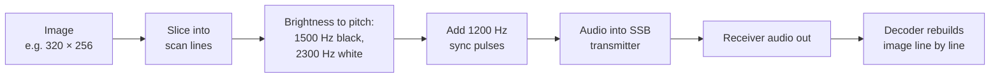
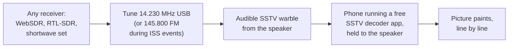

# SSTV

Of all the digital-mode party tricks in this book, none delights a newcomer like SSTV. Slow-scan television sends _pictures_ by sound: a warbling, sing-song tone lasting a minute or two that, fed into free software — or a phone app held up to a speaker — paints an image line by line onto your screen. Amateurs have been exchanging pictures this way since the 1950s, astronauts transmit them from the International Space Station, and it remains the single best zero-equipment first experiment in the whole hobby.

## Pictures as sound: how scan lines become tones

Television, at its core, is a trick of decomposition: an image is sliced into horizontal **scan lines**, each line into a sequence of brightness values, and those values sent one after another. Broadcast TV does this absurdly fast — millions of picture elements per second, needing megahertz of bandwidth. SSTV asks a lovely question: what if we _slowed down_ until a whole picture fits through an ordinary voice channel, just ~2.5 kHz wide? The answer is an image taking one to two _minutes_ instead of a fiftieth of a second — hence _slow-scan_ — but transmittable by any SSB voice transmitter on [HF](outpost:entry/logbook73.handbook/hf), no special hardware required.

The encoding is elegantly simple. Brightness becomes **pitch**: within the standard SSTV range, `1500 Hz` means black, `2300 Hz` means white, and every grey or colour intensity falls proportionally in between. A special lower tone, `1200 Hz` — outside the picture range so it can never be confused with image content — marks the **sync pulses** that say "new line starts now". The transmitter reads the image left to right, top to bottom, turning each line into a smooth tone glissando; the receiver reverses the mapping, laying pixels down like a dot-matrix printer with a singing voice. Colour images send each line's red, green and blue components (in some modes, luminance and chrominance instead) as separate tone sweeps.

```viz
{
  "type": "wave",
  "title": "One scan line as sound: brightness becomes pitch",
  "caption": "As the line is read out, the tone squeezes higher for bright picture areas and relaxes lower for dark ones — this smooth glissando, repeated line after line, is the SSTV warble.",
  "xLabel": "one scan line, left → right",
  "traces": [
    { "kind": "fm", "freq": 16, "mod": 1.2, "depth": 2.5, "label": "scan-line tone (1500–2300 Hz)", "tone": "primary" }
  ]
}
```



Because the picture is just audio, everything you know about voice signals applies: an SSTV transmission fits where an SSB voice fits, propagates identically, and can be recorded, replayed and decoded later. It is [Modulation](outpost:entry/logbook73.handbook/modulation) doing gentle, visible work — arguably the most _intuitive_ digital mode there is, because you can watch the demodulation happen a line at a time.

Strictly, classic SSTV is an **analogue** mode (the tone varies continuously with brightness, nothing is bits), which is precisely why it degrades so charmingly — more on that below. Digital image modes exist too, but "SSTV" on the air almost always means the analogue original.

## The mode zoo: Martin, Scottie and friends

Like [digital voice](outpost:entry/logbook73.handbook/digital-voice), SSTV grew several dialects — different resolutions, line timings and colour orders. Sender and receiver must use the same mode, and helpfully, every transmission begins with a short **VIS code** (vertical interval signalling): a brief tone sequence identifying the mode, which decent software reads to switch modes automatically. The ones you will actually meet:

| Mode       | Approx. time | Resolution | Where you'll hear it                          |
| ---------- | ------------ | ---------- | --------------------------------------------- |
| Martin M1  | ~114 s       | 320 × 256  | European favourite on HF                      |
| Martin M2  | ~58 s        | 320 × 256  | Faster, softer image                          |
| Scottie S1 | ~110 s       | 320 × 256  | The other HF favourite, big in the Americas   |
| Scottie S2 | ~71 s        | 320 × 256  | Quicker Scottie                               |
| Scottie DX | ~269 s       | 320 × 256  | Slow and rugged for weak signals              |
| Robot 36   | ~36 s        | 320 × 240  | Quick colour; used in some ISS events         |
| PD120      | ~126 s       | 640 × 496  | Higher resolution; the classic ISS event mode |

(Martin and Scottie are named for their inventors' callsign suffixes — a very amateur-radio way to achieve immortality.) The pattern to notice: more seconds buys more resolution or more robustness. Scottie DX spends four and a half minutes on one image so that each pixel lasts longer and survives fading better; Robot 36 dashes off a picture in half a minute and pays in detail. For casual HF work, Martin M1 and Scottie S1 are the lingua franca — set your software to auto-detect and it will sort itself out.

## Where the pictures are

SSTV activity clusters tightly, which makes it wonderfully easy to find:

- **`14.230 MHz`** (USB) on the 20 m band is _the_ SSTV meeting point — the mode's village square for half a century. Park a receiver there on any reasonable weekend and pictures will come: postcard shots, station photos, callsign cards, sunsets. Nearby `14.233 MHz` catches the overflow, and on 80 m, `3.730 MHz` (LSB) serves Europe's evenings.
- **2 m**: in IARU Region 1, `144.500 MHz` is the image-modes calling frequency, used for local SSTV (FM carries the tones instead of SSB). Activity is sparser but real, especially during contests-of-sorts like image nights some clubs run.
- **The ISS**, the gateway drug. Several times a year, the amateur station aboard the International Space Station transmits commemorative SSTV image series on **`145.800 MHz`** FM, usually in PD120, for days at a time. Any VHF receiver — a ~$25/€25 handheld, an RTL-SDR, even a scanner — plus a phone app decodes pictures _from space_ as the station passes overhead. Whole cohorts of amateurs date their addiction to the hobby from their first noisy ISS image; the [ISS chapter](outpost:entry/logbook73.handbook/iss) covers passes, antennas and award certificates for received images. Event announcements come through ARISS ([ariss.org](https://ariss.org)).

For the freshest activity, watch a DX cluster — LogBook73's DX Cluster page carries the live spot feed — because SSTV transmissions get spotted like DX, and you will see `14.230` lighting up when the pictures flow.

## Your first decode: a phone held to a speaker

Here is the promise made in this chapter's opening, kept. Because SSTV is _audio_, the decoder does not need a cable, an interface, or any connection to the radio at all — a phone's microphone will do.



The recipe in full: install any free SSTV decoder app on your phone (several exist for Android and iOS — search your app store for "SSTV decoder"); open a WebSDR in a browser, or your own receiver, tuned to `14.230 MHz` USB; when you hear the unmistakable rhythmic warble — once heard, never forgotten, a sort of melodic fax — hold the phone near the speaker and watch. The app hears the VIS code, picks the mode, locks to the sync pulses, and an image assembles before your eyes.

It will probably be imperfect: a band of static across the middle where the signal faded, slightly skewed edges, colours shifted by interference. This is the correct aesthetic. Treasure your first bad picture — screenshot it, and log the reception (callsign from the image or the spot, `14.230 MHz`, mode `SSTV`) in LogBook73's **Receive Log**. Pictures received are every bit as loggable as voices heard, and ISS images especially so.

## Transmitting pictures (and doing it politely)

Sending SSTV needs an amateur licence — it is a transmission like any other — but hardly any extra equipment: software (free options abound on every platform, feature-rich ones on Windows especially) generates the audio tones, which reach the radio through a sound-card interface or digital-mode USB connection exactly as [FT8](outpost:entry/logbook73.handbook/ft8) does. Most software adds your callsign as an overlay on the image; identifying your transmissions remains a licence condition even when the "voice" is a picture, and the overlay handles it neatly.

Operating notes learned from decades of village-square custom:

- **Listen first, always.** An image takes two minutes; transmitting over someone's half-sent picture ruins it for everyone watching. The custom is to ask "is the frequency in use?" by voice on the same frequency before sending.
- **Mind your duty cycle.** Like FT8, SSTV transmits continuously at full level for the whole image — a hard workout for transceivers designed around the on-and-off rhythm of speech. Running at half or a third of your radio's rated power keeps the output stage cool; at entry-level power levels this is rarely drama, but the habit is right. (See [RF Power](outpost:entry/logbook73.handbook/rf-power) on duty cycle.)
- **Keep audio clean.** Overdriven audio splatters neighbouring frequencies and _worsens_ your picture. Set levels as carefully as for any digital mode — no ALC action.
- **Content sense.** Callsign cards, station photos, holiday shots, greetings — the culture is postcards, not broadcasting. Your licence conditions on message content apply to pictures exactly as to speech.

A voice contact often wraps around the pictures — a report on how the image arrived ("good colour, some QSB streaks mid-frame"), then another picture back. It is the most sociable digital mode by far.

## Honest expectations: the beauty of imperfection

Set your quality expectations with history in mind: analogue SSTV at 320 × 256 is a technology of the cassette era, and no amount of transmitter power makes it high-definition. Noise appears as coloured speckle and horizontal streaks; fading ([QSB](outpost:entry/logbook73.handbook/amateur-radio)) paints soft bands across the frame; interference draws diagonal rain; a mistimed sync shears the image sideways. A "perfect" copy is merely _good_ — and that is entirely beside the point. The thrill is that a picture crossed an ocean, or fell from orbit, as a minute of song through the static — arriving with the radio path visibly written across it. Ask anyone who has decoded an ISS image on a hand-held antenna in a supermarket car park: the streaks are not damage, they are provenance. If you want pixel-perfect image transfer, the internet exists; if you want _radio_, SSTV shows you exactly what the ionosphere did to every line.

## Try it yourself

1. **The zero-equipment decode.** Tonight: free SSTV app on your phone, WebSDR in your browser tuned to `14.230 MHz` USB, weekend evening for best odds. When the warble comes, hold phone to speaker and watch a picture paint. Total cost: nothing. Total time: fifteen minutes, of which thirteen are waiting and two are grinning.
2. **Log the catch.** Enter the reception in LogBook73's **Receive Log** — callsign (usually overlaid on the image), frequency, mode `SSTV`, and your notes on quality. Attach the callsign and you have an SWL record another amateur may happily confirm.
3. **Catch the ISS.** Watch ARISS announcements for the next SSTV event, use the [ISS chapter](outpost:entry/logbook73.handbook/iss) and a free pass-prediction app or website to find a pass, and decode `145.800 MHz` FM with any VHF receiver. Space pictures, car-park equipment. Event images even earn a downloadable certificate — the friendliest award in radio.
4. **Dissect the sound.** Record one SSTV transmission and look at it in a [waterfall](outpost:entry/logbook73.handbook/ffts-and-waterfalls): you will _see_ the 1200 Hz sync ticks and the brightness sweeps between 1500 and 2300 Hz, the whole chapter drawn on screen by a real signal.
5. **Licensed? Send a postcard.** Install SSTV software, wire audio as for FT8, find a quiet moment near `14.230 MHz`, ask if the frequency is in use, and transmit a callsign card at modest power. Somewhere, someone's screen is painting your picture line by line — and their report of your streaks and speckle belongs in your Console log.

## Key takeaways

- SSTV sends pictures through an ordinary voice channel by mapping brightness to audio pitch — `1500 Hz` black to `2300 Hz` white, with `1200 Hz` sync pulses — taking a leisurely one to four minutes per image.
- Modes differ in speed, resolution and robustness: Martin M1 and Scottie S1 rule casual HF, Robot 36 is the sprinter, PD120 the higher-resolution ISS favourite; the VIS header lets software auto-detect.
- Activity concentrates at **`14.230 MHz`** USB on 20 m, `144.500 MHz` for 2 m images in Region 1, and — the great gateway — **`145.800 MHz`** FM during ISS SSTV events.
- Receiving needs no licence and, thanks to phone decoder apps held to a speaker, no equipment beyond a receiver or WebSDR — the perfect first digital experiment; log every picture in the Receive Log.
- Transmitting needs a licence, FT8-style audio wiring, reduced power for the 100% duty cycle, clean levels, and the courtesy of asking before occupying the frequency.
- Expect and embrace imperfection: streaks and speckle are the radio path made visible, and they are half the charm.

You have now sent voices, bits and pictures over the air — next we open up the protocol underneath APRS and the original amateur data network: [Packet Radio](outpost:entry/logbook73.handbook/packet-radio).
