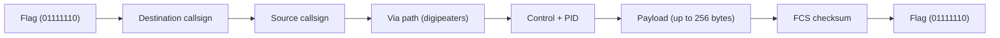
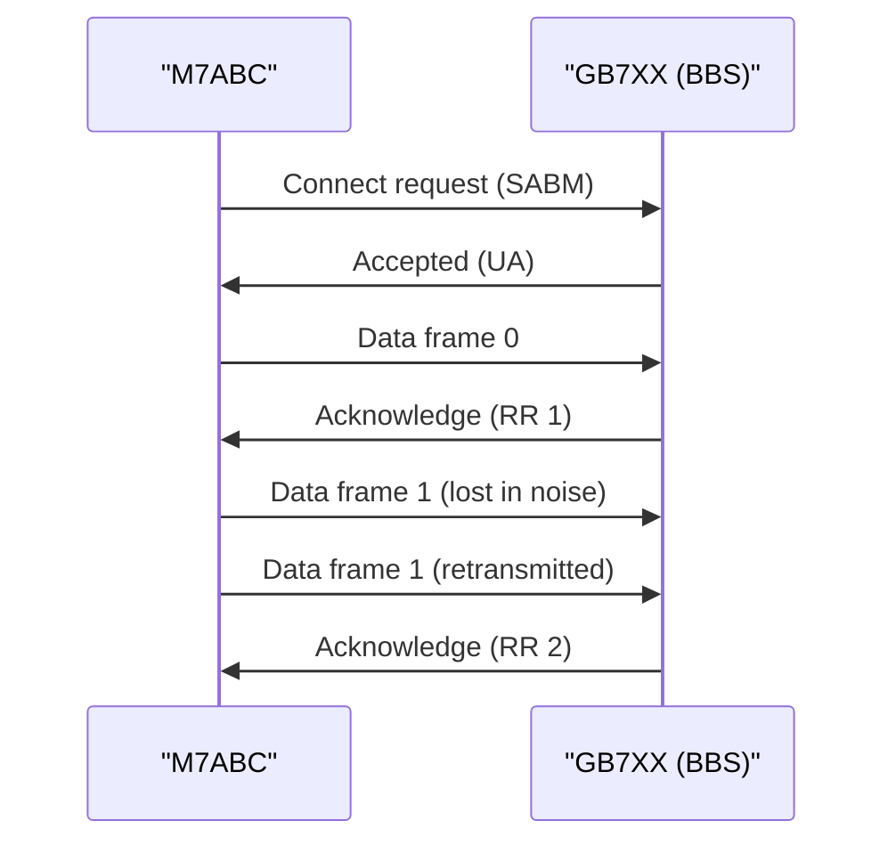
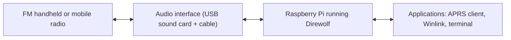

# Packet Radio

Before broadband, before Wi-Fi, before most homes had heard of the internet, radio amateurs were sending emails, chatting on bulletin boards and routing data across the country — by radio, for free, with no infrastructure but their own. That network was **packet radio**, and it still works today exactly as it did in 1985. Better than that: the mode you met in [APRS](outpost:entry/logbook73.handbook/aprs) is packet radio, and the protocol underneath it — a friendly beast called AX.25 — is one of the most instructive things a beginner can study, because it shows you what _every_ digital network does, laid out plainly enough to read with your own eyes.

## The idea: chop the data into parcels

Suppose you want to send a page of text to a friend across town by radio. You could key up and send the whole page in one long burst — but if a single crackle of interference corrupts one character halfway through, the entire page is ruined and must be sent again. And while you are transmitting your monologue, nobody else can use the frequency.

Packet radio takes the approach the postal service would: chop the page into small parcels — **packets** — and send each one separately, wrapped in an envelope that says who it is from, who it is for, and includes a check so the receiver can tell whether the parcel arrived intact. If parcel 7 of 12 gets mangled by a burst of noise, the receiver asks for parcel 7 again, and only parcel 7. Between your parcels, other stations' parcels can share the same frequency, interleaved politely. One channel becomes a party line for data.

This is precisely how the internet works too — the "packet" in "packet radio" and the packets your router shuffles about are the same idea. Amateurs got there remarkably early: the protocol was standardised in the early 1980s, adapted from the commercial X.25 standard and renamed **AX.25** — the A is for Amateur.

## Anatomy of an AX.25 frame

A single parcel is called a **frame**, and its structure rewards a slow look. Every frame, whether it carries an APRS position or a line of a bulletin-board message, has the same envelope:



Taking the fields in turn:

- **Flags** mark where a frame starts and stops — a fixed pattern of bits (`01111110`) that never appears inside the frame, like the tone before a station announcement. The transmitter guarantees this by a trick called bit-stuffing: any time five `1`s occur in a row in the data, it slips in a `0`, and the receiver removes it again.
- **Addresses** are the lovely part: they are plain amateur callsigns. Where an internet packet carries anonymous numeric addresses, an AX.25 frame says, in readable ASCII, `M7ABC` to `G4XYZ`. Each callsign can carry a **SSID** — a number from 0 to 15 after a dash, such as `M7ABC-9` — so one licensee can run several stations (a home station, a car, a node) under one callsign. The address block can also list up to a handful of **digipeaters**: relay stations asked to repeat the frame onward, which is how APRS frames hop across a region.
- The **control byte** says what kind of frame this is — data, acknowledgement, connection request — and carries the sequence numbers that let both ends keep parcels in order. The **PID** (protocol identifier) says what is inside the payload, much as a file extension hints at a file's contents.
- The **payload** is your actual data: up to 256 bytes of it in a standard frame. Text, a position report, a chunk of a message — the envelope does not care.
- The **FCS** (frame check sequence) is the checksum: a 16-bit number computed from every bit in the frame. The receiver does the same computation on what it heard; if its answer differs, at least one bit was corrupted, and the whole frame is silently discarded. AX.25 never delivers _probably right_ data — a frame arrives perfect or not at all.

That last point explains the characteristic feel of packet radio on a marginal path: nothing garbles, nothing hisses. Frames either appear, whole and clean, or they do not appear.

## Connected mode and UI frames: two ways to send a parcel

AX.25 offers two very different services, and knowing which is which unlocks the whole subject.

**Connected mode** is a formal conversation. Your station sends a connection request; the other station accepts; and from then on every data frame is numbered, acknowledged and, if an acknowledgement fails to come back, automatically retransmitted. It is the registered-post service: slower, chattier, but guaranteed. This is what bulletin boards and Winlink use, because an email with paragraph three missing is not an email.



**UI frames** (unnumbered information) are the opposite: fire and forget. No connection, no acknowledgement, no retry — a frame is flung into the air addressed to everyone, and whoever hears it, hears it. It is the postcard-through-every-letterbox service. This is exactly what [APRS](outpost:entry/logbook73.handbook/aprs) uses, and it is the right choice there: a position beacon is refreshed every minute or two anyway, so a lost frame costs almost nothing, and one transmission can inform a hundred listeners at once. Connected mode between two stations would serve one listener and clog the channel with acknowledgements.

The rule of thumb: **broadcast data wants UI frames; point-to-point transfers want connected mode**. The same protocol provides both, distinguished by nothing more than that control byte.

## The TNC: packet's modem, then and now

Between your radio (which handles audio and RF) and your computer (which handles data) sits the device that translates one into the other: the **TNC**, or terminal node controller. It is packet radio's modem — it turns bytes into audio tones for the transmitter, and received audio back into bytes — plus a small brain that assembles frames, computes checksums and keys the transmitter at the right moments.

The TNC has been reincarnated three times:

1. **Hardware TNCs (1980s–90s)**: a dedicated box the size of a paperback, with a modem chip and a microprocessor inside, connected to the computer by serial cable. You typed commands at it (`CONNECT GB7XX`) from a dumb terminal. Thousands still work perfectly and turn up cheaply second-hand.
2. **Sound-card modems (2000s)**: amateurs realised a PC sound card is a perfectly good modem — it can generate and digitise audio tones, and the PC's processor can do the framing in software. The TNC dissolved into a program.
3. **Direwolf (today)**: the modern standard software TNC — free, open-source, and by wide agreement a _better_ modem than most of the old hardware ever was, because it applies modern signal-processing tricks to dig frames out of noise that a 1980s modem chip would have discarded. It runs happily on a Raspberry Pi.

Whatever its form, a TNC usually speaks a beautifully minimal protocol to the computer called **KISS** ("keep it simple, stupid" — genuinely its name), which is why software written in 1990 and software written last year can drive the same equipment.

## 1200 or 9600 baud?

Packet on the amateur VHF/UHF bands runs at two classic speeds, and the difference is more interesting than the numbers suggest.

**1200 baud** packet uses **AFSK** — audio frequency-shift keying. The data is represented by two audio tones, 1,200 Hz and 2,200 Hz, and those tones are fed into an ordinary FM transceiver's microphone input exactly as speech would be. This is FSK riding inside FM, a layering you can unpick with [Modulation](outpost:entry/logbook73.handbook/modulation). Its great virtue is that _any_ FM radio works, unmodified — a ~$25/€25 handheld's speaker and mic connections are enough. Its vice is the speed: about 120 characters per second, a 1980s pace. Here is what one moment of that _braaap_ actually is:

```viz
{
  "type": "wave",
  "title": "1200-baud AFSK: two tones carry the bits",
  "caption": "The data (dashed) picks between two audio tones — the FM transmitter carries them exactly as it would a voice.",
  "xLabel": "time",
  "traces": [
    { "kind": "fm", "freq": 22, "mod": 4, "depth": 2, "label": "audio tones (1,200 / 2,200 Hz)", "tone": "primary" },
    { "kind": "square", "freq": 4, "amp": 0.35, "label": "data bits", "style": "dashed", "tone": "muted" }
  ]
}
```

**9600 baud** packet abandons audio tones and applies the data waveform directly to the FM modulator, bypassing the microphone circuitry entirely. It is eight times faster, but it demands a radio with a dedicated data port whose audio path is flat and unfiltered — microphone and speaker circuits deliberately mangle frequencies outside the speech range, and 9600 baud data does not survive the mangling. Fewer radios qualify, and setup is fussier: the two speeds mix like oil and water on the same channel.

|                        | 1200 baud                     | 9600 baud                      |
| ---------------------- | ----------------------------- | ------------------------------ |
| Method                 | AFSK tones into mic input     | Direct FSK via data port       |
| Radio needed           | Any FM transceiver            | Data-port radio, flat audio    |
| Throughput             | ~120 characters/s             | ~960 characters/s              |
| Tolerance of mis-setup | Forgiving                     | Fussy (levels, filtering)      |
| Where you'll meet it   | APRS (144.800 MHz), most BBSs | Some BBSs, satellites, Winlink |

For a first station, 1200 baud is the unambiguous answer: it works with whatever radio you already own, and nearly all APRS and packet activity worldwide uses it.

## BBSs, nodes and the network that grew

Through the late 1980s and 1990s, amateurs assembled these pieces into a genuine wide-area network. **Bulletin board systems (BBSs)** were the destinations: a station running day and night that you connected to, read messages on, and left mail at — mail which the BBSs then _forwarded among themselves_ overnight, by radio, so a message posted in Cornwall could surface in Scotland a day or two later. **Nodes** — relay stations running software such as NET/ROM — were the junctions: connect to your local node, ask it for a station two hops away, and it handled the onward routing for you, with each hop's errors corrected locally rather than end-to-end.

The public internet absorbed most of that traffic, as it absorbed everything. But packet did not die; it specialised. Today its two thriving descendants are:

- **APRS** — the UI-frame broadcast network from [APRS](outpost:entry/logbook73.handbook/aprs), by far the most packet activity on air, on `144.800 MHz` across Europe.
- **Winlink** — email over radio, done properly: real internet email (with attachments, within reason) sent through volunteer gateway stations by connected-mode packet on VHF, or by HF modes when out of VHF range. For sailors mid-ocean, expeditions off-grid, and emergency communications groups, Winlink is not nostalgia; it is the only email for hundreds of miles. It is the strongest answer to "but why, when phones exist?" — packet needs no infrastructure to survive the day the phones stop.

A handful of traditional BBSs and nodes also survive in many countries, lovingly maintained, and connecting to one feels like finding a working red telephone box: obsolete, charming, and genuinely still connected.

## Building a cheap packet station

Here is the pleasant surprise: a complete, modern packet station costs less than a night out, because you probably own half of it already.



The shopping list:

- **A radio**: any FM transceiver covering 2 m. The ~$25/€25 handheld you may already have is fine to start.
- **A computer**: a Raspberry Pi is the classic choice (small, silent, cheap to run continuously), but any laptop works.
- **An interface**: a USB sound card of the ~$10/€10 sort, plus a cable between it and the radio's speaker/mic sockets. Ready-made interfaces such as the Digirig-style units bundle the sound card, cable and transmit switching into one tidy $30–50 class gadget and remove all the soldering. The one function a bare sound card lacks is **PTT** — pulling the transmit line at the right moment — which ready-made interfaces handle via a serial signal, and Pi builders often wire to a GPIO pin.
- **Direwolf**: free. It decodes and generates the tones, speaks KISS to your applications, and even prints the raw frames as they arrive so you can watch AX.25 with your own eyes.

Two setup notes worth their weight in hours. First, **transmit audio level is everything**: too loud into an FM transmitter causes over-deviation and distorted tones that other stations cannot decode — set levels low and creep up, and keep your signal clean and legal. Second, start in **receive-only** mode, which in most countries needs no licence at all: radio, sound card, Direwolf, and you are decoding the packet network the same afternoon. Transmitting needs your amateur licence — see [Getting Licensed](outpost:entry/logbook73.handbook/getting-licensed) — and packet is fully available to entry-level licensees.

## Try it yourself

Tonight, without transmitting and without a licence:

1. Tune an FM receiver — a handheld, or an RTL-SDR with any FM-capable software — to your region's APRS frequency (`144.800 MHz` in Europe/Africa, `144.390 MHz` in North America). Within minutes you should hear packet's unmistakable voice: a brief _braaap_ of tones, a fraction of a second long. Each braaap is one complete AX.25 frame.
2. Install Direwolf on a laptop or Pi and feed it that audio (a cable from receiver to sound card input, or even a microphone held to the speaker will decode strong frames). Watch the terminal: `M0XYZ-9 > APRS, WIDE1-1: ...` — source, destination, digipeater path and payload, every field from the frame diagram above, in the clear.
3. Note how some frames appear twice within a second or two: the original, then a digipeated copy relayed from a hilltop. You are watching the via-path field doing its work.
4. Log the stations you decode in LogBook73 as receptions — callsign, frequency, time. A week of entries will map your local packet neighbourhood: who beacons, which digipeaters serve your area, and how far 1200 baud reaches from your window.

If that hooks you, the next step is a Winlink account and a connected-mode session to a gateway once you are licensed — receiving your first email delivered entirely by radio is a small, permanent thrill.

## Key takeaways

- Packet radio chops data into **frames**: addressed, checksummed parcels that arrive perfect or not at all, letting many stations share one frequency.
- An **AX.25 frame** wraps the payload in flags, plain-callsign addresses (with SSIDs and a digipeater path), a control byte, and an FCS checksum — a complete network protocol you can read by eye.
- **Connected mode** numbers, acknowledges and retransmits frames (used by BBSs and Winlink); **UI frames** are unacknowledged broadcasts (used by APRS).
- The **TNC** is packet's modem; it evolved from dedicated hardware boxes to sound cards to free software, with **Direwolf** the modern standard.
- **1200 baud AFSK** works through any FM radio's mic input and dominates VHF packet; **9600 baud** is faster but demands a data-port radio and careful setup.
- The BBS network of the 1990s lives on as **APRS** and **Winlink** — email by radio, independent of all infrastructure.
- A Pi, a ~$10/€10 sound interface and the handheld you already own make a complete station; receive-only needs no licence in most countries.

Packet is the old guard of licence-band data — next we meet its licence-free descendant, where tiny solar-powered nodes build self-healing networks across whole cities, in [LoRa & Meshtastic](outpost:entry/logbook73.handbook/lora-and-meshtastic).
