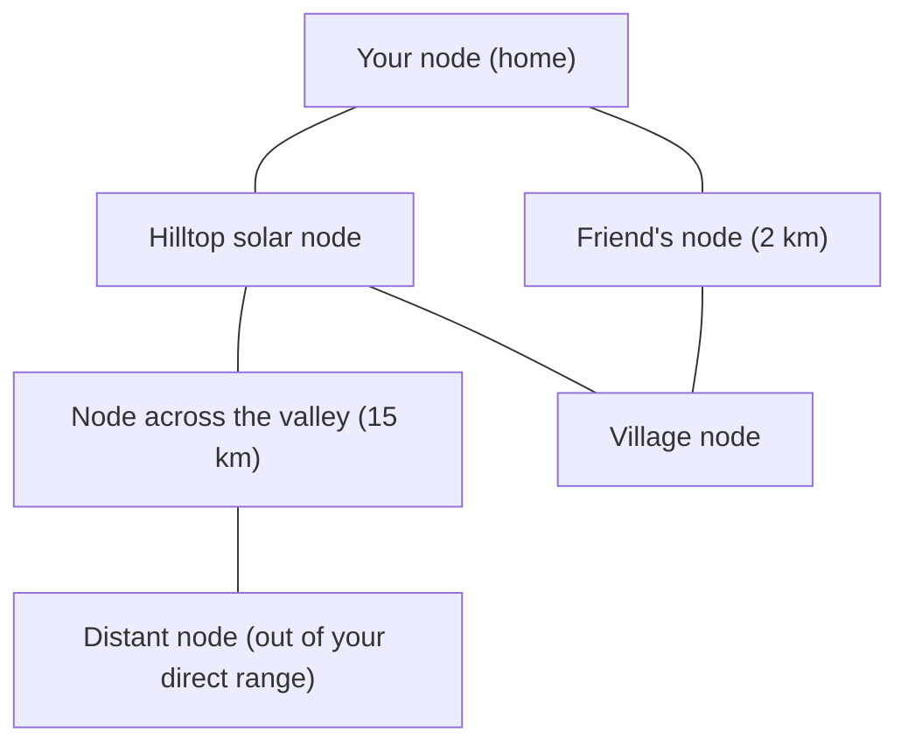
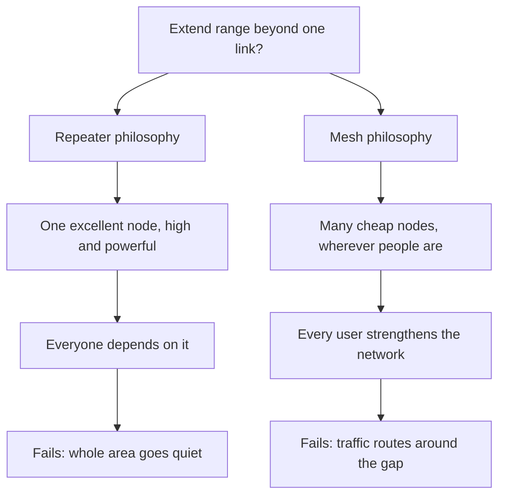

# LoRa & Meshtastic

Somewhere near you, right now, a device the size of a matchbox is running off a small battery, transmitting a hundredth of the power of a handheld radio, and being received clearly fifteen kilometres away. No licence, no infrastructure, no monthly fee. That is **LoRa** — a modulation scheme that rewrote the rules for what tiny signals can do — and **Meshtastic**, the open-source project that turns LoRa boards into a self-organising text-messaging mesh. For a radio beginner it is irresistible twice over: it is the cheapest way to experience real long-distance RF for yourself, and it is a masterclass in the ideas this handbook has been building — trading speed for sensitivity, and asking what a network even needs to be.

## What LoRa does differently

Every mode you have met so far — SSB, FM, the FSK family in [Modulation](outpost:entry/logbook73.handbook/modulation) — keeps its signal about as narrow as the information requires. LoRa does something that sounds perverse: it takes a very slow trickle of data and deliberately _smears_ it across a wide slice of spectrum, using a technique called **chirp spread spectrum (CSS)**.

A **chirp** is a signal whose frequency sweeps steadily — say, gliding from the bottom of a 125 kHz channel to the top, over and over, like a slide-whistle played on repeat. LoRa encodes data as _jumps_ in where each sweep starts: every chirp begins at one of many possible positions in the channel, and the position is the symbol. The receiver knows the sweep rate exactly, so it can "de-chirp" — mathematically unwind the sweep — which collapses each long, smeared chirp back into a single sharp spike whose position reveals the data. On a waterfall display, LoRa is unmistakable:

```viz
{
  "type": "waterfall",
  "title": "LoRa chirps on a waterfall",
  "caption": "Chirp spread spectrum: each sweeping trace is one symbol, and where the sweep starts is the data — the receiver folds every long chirp back into a single sharp spike.",
  "signals": [
    { "f": 20, "width": 4, "kind": "drift" },
    { "f": 45, "width": 4, "kind": "drift" },
    { "f": 70, "width": 4, "kind": "drift" }
  ],
  "xLabel": "frequency",
  "yLabel": "time"
}
```

Here is why that wins. Noise is random: when the receiver unwinds the sweep, noise stays smeared, while the signal — which followed the sweep faithfully for its whole duration — piles up into that one spike. The longer the chirp, the more signal energy accumulates in the spike relative to the ever-random noise around it. Think of it as **spreading a whisper so it survives**: rather than saying one word quickly, the transmitter draws each word out across time and frequency in a pattern only the receiver knows how to fold back up. Folded, the whisper stands clear of the room's chatter — so clear that LoRa routinely decodes signals **below the noise floor**, ten to twenty decibels weaker than anything your ear could detect on a receiver. If you read [FT8](outpost:entry/logbook73.handbook/ft8), this rhymes deliberately: both modes buy sensitivity by spending time.

The knob controlling the trade is the **spreading factor (SF)**, from SF7 to SF12. Each step doubles the chirp length: roughly twice as slow, but able to survive weaker still. At SF12 a short text message takes a second or more of airtime — and can be received at signal levels that would be hopeless for anything else running milliwatts.

| Spreading factor | Speed    | Reach    | Airtime per message |
| ---------------- | -------- | -------- | ------------------- |
| SF7              | Fastest  | Shortest | ~tens of ms         |
| SF9–SF10         | Moderate | Good     | ~hundreds of ms     |
| SF12             | Slowest  | Longest  | ~1–2 s              |

Everything about LoRa says: we have almost nothing to send, so let us send it as robustly as physics allows.

## The ISM bands: radio without a licence

LoRa and Meshtastic live in region-dependent **ISM bands** set aside for **licence-exempt** short-range devices (the same broad family as car key fobs and wireless doorbells): around **868 MHz** in Europe, **915 MHz** in the Americas and Oceania, and **923 MHz** in parts of Asia — which is why hardware comes in regional flavours; buy the version for your region. Anyone may transmit there without any amateur licence, provided the equipment obeys the band's standing rules. Two matter:

- **Power is capped** at modest levels — some tens of milliwatts of effective radiated power on the common sub-bands. Your handheld's 5 W would be over a hundred times the limit; LoRa is designed to thrive under it.
- **Airtime is limited**: in Europe a device may only transmit for a small percentage of the time — a duty cycle of the order of 1%, meaning a few tens of seconds of airtime per hour; other regions use dwell-time limits or frequency hopping to the same end. The band is a commons, and the rule keeps ten thousand quiet devices from becoming one loud mess.

The exact sub-band limits are set out in your region's licence-free rules and do get revised, so check current guidance from your national regulator (Ofcom in the UK, the FCC in the US…) rather than memorising numbers. But the shape of the deal is stable: **no licence, low power, share politely** — and LoRa's below-the-noise sensitivity is precisely what makes low power sufficient.

Notice how different this is from the amateur bands: there, _you_ are licensed and may build and run high-power equipment; here, the _equipment_ is constrained and anyone may use it. Both are legitimate radio; they answer different questions.

## Meshtastic: the network assembles itself

LoRa is only a modulation — a way of getting bits across distance. **Meshtastic** is what turns a bag of LoRa boards into something with a soul: an encrypted, infrastructure-free text messaging network that builds itself.

Each **node** is a small board — typically an ESP32 or similar microcontroller married to a LoRa radio chip, often with a little screen, sometimes GPS, sometimes a solar panel. The hobby knows them by family names — T-Beam-style boards with GPS for vehicles and hiking, Heltec-style boards as pocketable cheap starters, plus purpose-made units in rugged cases — but they are all the same idea: **radio + tiny computer + battery, in the $20–50/€20–50 class**. You pair one to your phone over Bluetooth, and the phone app becomes your keyboard and screen.

The mesh logic is disarmingly straightforward: **every node is a repeater**. When a node receives a message it has not seen before, it waits a random beat and rebroadcasts it. Each message carries a **hop limit** (typically three) that decrements at each retransmission, so messages ripple outward a few rings and then stop, rather than echoing forever. There is no routing table, no central server, no single point of failure — just flooding, tamed.



In that sketch your message to node `F` succeeds even though `F` is far beyond your direct reach: the hilltop node hears you and rebroadcasts, the valley node hears the hilltop, and `F` hears the valley — three hops, arranged by nobody. If the hilltop node's battery dies, traffic finds the longer way round through `B` and `E`. The network heals because the network was never designed; it is simply whatever currently hears whatever.

**Channels and encryption**: Meshtastic groups traffic into channels, each defined by a name and an encryption key (AES). Nodes sharing a key form a private network invisible in content to everyone else; the default public channel lets strangers' meshes interconnect and pass each other's traffic. Encryption is unremarkable on a licence-exempt band — your key fob encrypts too. Hold that thought for the amateur section below, where it becomes a legal issue.

## Realistic range: the honest numbers

Range claims are where newcomers get hurt, so here is the truth. At these UHF frequencies, propagation is strictly line-of-sight-ish — see [UHF](outpost:entry/logbook73.handbook/uhf) — and everything depends on what stands between the antennas:

- **Urban, node in a pocket or on a windowsill**: 500 m to 2 km. Buildings eat UHF.
- **Suburban/rural, node at rooftop height**: 2–10 km, often pleasantly more.
- **Hilltop to hilltop, clear line of sight**: 30 km is routine, 100+ km is achieved regularly, and balloon and mountain experiments have logged hundreds of kilometres on default power.

The pattern to internalise: **height is worth more than everything else combined**. A ~$25/€25 node on a mast or hill outperforms any amount of fiddling at ground level — the same lesson [Antennas](outpost:entry/logbook73.handbook/antennas) teaches for every band. This is why community meshes revolve around a few well-placed solar nodes on high ground, quietly relaying everyone's traffic; and it is why the mesh's _effective_ range is not any single link but the chain: three modest 8 km hops put you 24 km out.

## The amateur crossover — and one sharp legal edge

LoRa modulation does not care what band it is on, and licensed amateurs have adopted it enthusiastically. The flagship is **LoRa APRS** on the 70 cm band (activity in Europe centres near `433.775 MHz`): position beacons using LoRa instead of 1200-baud AFSK, feeding the same APRS ecosystem you met in [APRS](outpost:entry/logbook73.handbook/aprs). The appeal is exactly LoRa's superpower — a tracker transmitting well under a watt gets received at distances that would embarrass a traditional tracker running five, and an iGate is a ~$25/€25 board rather than a radio-plus-computer stack.

On amateur bands you may also run more power and better antennas than the ISM rules ever allow — your licence is the permission slip the hardware lacks. But one rule cuts the other way, and it is sharp: **most countries prohibit encryption on amateur bands** — transmissions must not be obscured to hide their meaning (narrow special cases aside). Meshtastic's default AES encryption, harmless on the ISM bands, is therefore generally not acceptable on 433 MHz. Amateurs bridging these worlds must disable encryption on amateur-band links and identify with their callsign. Same silicon, different bands, different law — check your licence conditions if you plan to experiment here.

## Mesh versus repeater: two philosophies

Set Meshtastic beside the machines in [Repeaters](outpost:entry/logbook73.handbook/repeaters) and you are looking at two answers to the same question — how do we extend range beyond line of sight?



A repeater is a cathedral: one superb, expensive station on the best hill, built and maintained by a dedicated few, serving everyone — and when it is off the air, the region falls silent. A mesh is a market square: no node is special, every participant who switches on _adds_ coverage, and the network's shape tomorrow need not resemble today's. Neither wins outright. The cathedral gives you real-time voice, wide guaranteed coverage and decades of proven service; the square gives you resilience, zero gatekeepers and a network that grows exactly where its users are. A radio amateur is richer for being fluent in both — and it is no accident that the mesh idea is also how packet nodes worked in [Packet Radio](outpost:entry/logbook73.handbook/packet-radio), and how the internet itself routes around damage.

## Try it yourself

This is one of the cheapest complete radio experiences in the hobby, and none of it needs a licence:

1. Buy two Meshtastic-compatible boards for your region's ISM band ($20–50/€20–50 each — Heltec-style boards are the classic starters). Flash the free Meshtastic firmware using the project's web flasher, pair each to a phone, and you have a private, encrypted, off-grid text link before dinner.
2. Test range honestly. Message between them across your home, then your street, then take one for a walk with the other on a windowsill. Note where it drops — then move the windowsill node one storey higher and walk again. You will _feel_ the height rule from [Antennas](outpost:entry/logbook73.handbook/antennas) in your legs.
3. Check the map in the Meshtastic app for strangers: many towns and cities worldwide already have active meshes, and your node may join a conversation that was going on without you.
4. Log what you receive in LogBook73 — each heard node can be logged in the Receive Log with time and signal details like any other station (the Meshtastic tab of **Live Spots** previews this feed with sample data until a live bridge is connected). A fortnight of logs makes the mesh visible: which nodes are solar and steady, which commute, how far each hop reaches, and how the network breathes between weekday and weekend.
5. If you hold a licence, the next rung is a LoRa APRS tracker on 70 cm — the same ~$25/€25 hardware, reflashed, now beaconing under your callsign (encryption off).

## Key takeaways

- **LoRa** uses chirp spread spectrum: data is smeared across wide, slow chirps that the receiver folds back into sharp spikes, decoding signals well **below the noise floor** — a whisper spread thin so it survives.
- The **spreading factor** is the trade dial: each step doubles airtime and buys deeper sensitivity. Time is spent instead of watts.
- LoRa lives in licence-exempt ISM bands that vary by region (**868 MHz** in Europe, 915 MHz in the Americas/Oceania, 923 MHz in parts of Asia), with modest power caps and duty-cycle or dwell-time sharing rules — check your region's licence-free rules for specifics.
- **Meshtastic** makes every node a repeater: encrypted channels, a hop limit, no infrastructure, no owner — the network is whatever currently hears whatever.
- Real-world range runs from about a kilometre in streets to tens of kilometres with height; **elevation beats every other improvement**, and hops chain.
- Licensed amateurs run **LoRa APRS on 433 MHz** with more power — but must switch encryption off, as most countries' amateur licences forbid obscured transmissions.
- Mesh and repeater are rival philosophies: one excellent shared node versus many cheap cooperating ones. Learn both.

You have now pushed signals across a county with milliwatts — time to raise your sights about four hundred kilometres, straight up, in [Satellites](outpost:entry/logbook73.handbook/satellites).
