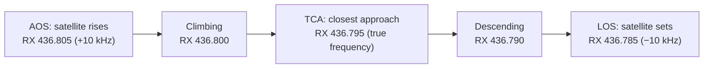
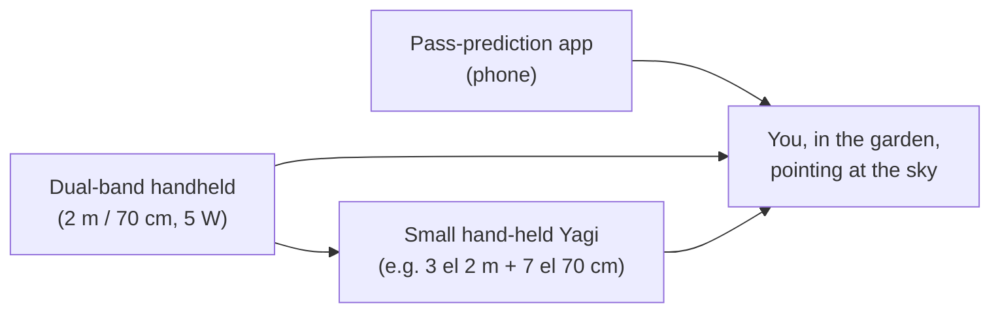

# Satellites

There are repeaters in orbit. Right now, a few hundred kilometres above your head, amateur-built radios are sweeping across the sky at eight kilometres per second, listening on one frequency and retransmitting on another — and you can work through them with a handheld transceiver and an antenna you can hold in one hand. No dish, no mast, no mortgage. Satellite operating is the branch of amateur radio that sounds furthest out of reach and is, in truth, one of the most accessible thrills in the entire hobby. It just demands something different from you: not money, but _choreography_.

## What an amateur satellite actually is

Amateurs have been building and launching satellites since 1961 — OSCAR 1 ("Orbiting Satellite Carrying Amateur Radio") went up barely four years after Sputnik. Today's fleet, coordinated largely through AMSAT organisations worldwide (amsat.org is the stable reference), consists mostly of shoebox-sized CubeSats carrying a transponder: a receiver listening on an **uplink** frequency and a transmitter repeating what it hears on a **downlink**, exactly the role a hilltop machine plays in [Repeaters](outpost:entry/logbook73.handbook/repeaters) — except this hilltop is 500 km tall and moves.

The friendliest class are the **FM satellites** — the "easy sats". Each is a single-channel FM repeater in orbit: one uplink (usually on 2 m or 70 cm), one downlink on the other band, often with a CTCSS tone required, worked with plain FM voice. Which particular satellites are active changes year on year as birds age, re-enter and launch — SO-50 has been the beloved workhorse example for two decades, but treat any list as perishable and check AMSAT's current status page. What does not change is the character: one channel, shared by everyone in the footprint, for the few minutes the satellite is overhead. Contacts are short and formulaic — callsign, locator, thanks — because the channel belongs to a whole continent at once.

The step-two class are the **linear transponder satellites**, which we will meet near the end: instead of one FM channel they relay a whole slice of spectrum, carrying many simultaneous SSB and CW conversations.

## Orbits in plain terms

Nearly all amateur satellites live in **low Earth orbit (LEO)**, a few hundred kilometres up. Orbital mechanics compresses to three facts you can hold in one hand:

- **Low means fast.** At LEO altitude, staying in orbit requires about 7.5 km/s, which takes the satellite around the entire planet in roughly 90–100 minutes. It does not hover; it _streaks_.
- **A pass is short.** From your garden, the satellite is above the horizon only while its ground track crosses your patch of the planet — typically **ten to fifteen minutes** for a good pass, as little as three or four for a low one. Everything about satellite operating flows from this deadline.
- **Polar-ish orbits see everyone.** Most amateur birds are launched into near-polar orbits, crossing high latitudes each lap. Because the Earth rotates underneath the fixed orbital plane, every lap crosses a different stripe of the globe — so over a day the satellite's coverage carpets the whole planet, Aberdeen and Auckland alike. A satellite orbiting above the equator would never serve either. The practical upshot for you: each satellite gives a handful of usable passes per day, arriving in clusters some hours apart.

How do you know when? Every satellite's orbit is published as a **TLE** ("two-line element set") — two dense lines of numbers describing the orbit precisely enough that software can compute, to the second, when the bird rises over _your_ horizon, how high it climbs and where it travels. You will never read a TLE yourself; free pass-prediction apps and websites ingest them and hand you a simple schedule: rise time, maximum elevation, direction. A pass predicted at **30° maximum elevation or higher** is a good first target — comfortably clear of houses and trees, with the satellite thousands of kilometres closer at its peak than a horizon-scraper.

Here is the shape of a complete low-Earth-orbit pass — the three moments that matter and how the signal changes across them:

![Satellite pass geometry for a low-Earth orbit. A LEO satellite rises above the horizon (AOS, Acquisition of Signal — start tracking), climbs to its highest point (TCA, Time of Closest Approach — strongest signal and shortest range), then sets (LOS, Loss of Signal — end of pass). A typical pass: 500 km altitude, orbital speed about 7.6 km/s, maximum elevation 60–90°, duration 5–15 minutes, visible up to about 2,000 km from the ground track. Higher elevation gives a better signal; obstructions, atmosphere and antenna polarisation affect visibility. Doppler shift runs positive (blue-shift) while the satellite approaches, zero at TCA, and negative (red-shift) as it recedes — about ±5 kHz on the 2 m band.](/handbook-figures/satellite-pass.png 'A pass in three acts: AOS (it rises — start tracking), TCA (overhead — best signal), LOS (it sets). Doppler swings from + through zero to − across the pass.')

## Doppler: the sky is detuned

One piece of physics stands between you and your first contact, and it is the same effect that bends the pitch of a passing ambulance. A source rushing towards you arrives _compressed_ — higher in frequency — and rushing away, _stretched_ lower. At 7.5 km/s, the shift matters.

The size of the shift is `Δf = f × v/c`, where `v` is the satellite's speed along your line of sight and `c` is the speed of light. Worked at 70 cm, for a satellite coming nearly straight at you:

`Δf = 435 MHz × (7.5 km/s ÷ 300,000 km/s) ≈ 435,000,000 × 0.000025 ≈ 10,900 Hz`

Call it **±10 kHz at 435 MHz**. A downlink published as `436.795 MHz` actually greets you near `436.805` as the satellite rises, slides down through the true value at closest approach, and departs near `436.785`. Ten kilohertz is about as wide as an FM channel — ignore Doppler on 70 cm and you will hear the satellite for a minute in mid-pass and lose it at both ends, wondering what you did wrong. (On 2 m the same arithmetic gives only about ±3.5 kHz, which FM's bandwidth swallows — one reason many easy sats put the _downlink_ you must chase on 70 cm's less forgiving side, and your uplink on 2 m where the satellite's wide receiver absorbs the error.) Watch a pass on an SDR waterfall and the whole story draws itself:

```viz
{
  "type": "waterfall",
  "title": "Doppler slide through a pass",
  "caption": "One downlink drawing its S-curve down the waterfall: high at AOS, through the true frequency at TCA, low at LOS — the slide your five memory channels will chase.",
  "signals": [
    { "f": 50, "width": 5, "kind": "drift" }
  ],
  "xLabel": "frequency",
  "yLabel": "time (one pass)"
}
```

The classic handheld answer is the **memory-channel ritual**: program five channels with the downlink stepped in 5 kHz hops — for our example, `436.805 / .800 / .795 / .790 / .785` — each paired with the fixed 2 m uplink and tone. During the pass you tap through them in order, roughly every couple of minutes, following the slide. It feels agricultural; it works beautifully.



Three initialisms in that diagram are the vocabulary of every pass: **AOS** (acquisition of signal — rise), **TCA** (time of closest approach — the peak, strongest signal, fastest-moving Doppler), and **LOS** (loss of signal — set).

## The station: less than you fear

Here is the entire equipment list for FM satellite work:



- **A dual-band FM handheld.** Five watts is ample — the satellite is only 500–2,000 km away with nothing in between, a gloriously clean line-of-sight path (compare that with the obstacle course in [Propagation](outpost:entry/logbook73.handbook/propagation)). The one genuinely valuable radio feature is **full duplex**: the ability to _hear the downlink while you transmit on the uplink_. With it, you hear your own voice coming back from space — instant proof you are getting in, and instant feedback to stop doubling with others. Most current handhelds cannot do it; you can absolutely succeed without it, but duplex-capable radios (or two handhelds, one transmitting and one listening) are the seasoned operator's quiet edge.
- **A small handheld Yagi.** The satellites' antennas are modest and your handheld's helical antenna is worse (see [Antennas](outpost:entry/logbook73.handbook/antennas)); a light dual-band Yagi of the Arrow/Elk style — a boom you point like a torch, giving several dB of gain on both bands — transforms passes from "occasionally readable" to "armchair copy". Kits and homebrew designs from a tape measure and PVC pipe cost very little and work embarrassingly well.
- **A pass-prediction app** on your phone, showing where the satellite is in real time and where to point.

That is all. No rotators, no masts, no preamps — those come later, if ever. Your body is the rotator.

## Working your first pass, step by step

1. **Pick the pass.** Choose an FM satellite currently listed as active (check AMSAT's status page), and a pass of 30°+ maximum elevation at a civilised hour. Note AOS time and rise direction.
2. **Program the ritual.** Five memory channels, downlink stepped ±10 kHz in 5 kHz hops, uplink and CTCSS tone fixed. Do this indoors, calmly, the day before.
3. **Scout the ground.** You need open sky along the pass track — a garden, park or hilltop beats a window every time.
4. **At AOS, listen first.** Point the Yagi at the rising point, select the highest memory channel, and slowly sweep. The moment the satellite's receiver footprint fills with your continent you will hear it: callsigns tumbling over each other. Twist the antenna slowly around its boom axis as you track — polarisation of the arriving signal rotates as the satellite tumbles and moves, and a 90° twist of the boom is often the difference between noise and clarity.
5. **Step channels as the pass proceeds**, keeping the downlink loudest, tracking the bird across the sky by ear as much as by app.
6. **Transmit in a gap, near TCA.** Closest approach is where your 5 W is strongest. Give your callsign once, phonetically, with your Maidenhead locator: "M7ABC, IO91". If someone answers, exchange callsigns and locators, thank them, and _stop_ — a whole footprint is waiting for the channel.
7. **Log it.** Satellite contacts record the satellite name alongside the frequencies; note it in LogBook73 while your hands are still shaking slightly. They will be.

Expect the first attempt to be humbling — antenna in one hand, radio in the other, phone balanced somewhere, everything moving. Expect the third attempt to work.

## Step two: linear transponders

When FM passes feel routine, the **linear transponder** birds are waiting. Instead of repeating one channel, a linear transponder relays an entire strip of spectrum — typically tens of kilohertz wide — so a dozen SSB and CW conversations can proceed side by side through one satellite. There is more room, less shouting, and real conversations rather than rapid-fire exchanges.

Two new wrinkles: you will want an all-mode radio (SSB does not exist on FM handhelds), and most linear transponders are **inverting** — to keep the arithmetic honest with Doppler, the passband is flipped, so your LSB uplink emerges as USB on the downlink, and tuning _up_ the uplink moves your signal _down_ the downlink. Doppler must also be tuned continuously rather than in steps, which is why linear-bird operators drift towards computer-controlled radios that track it automatically. It is a genuine step up in fiddliness, and the operators there are famously patient with newcomers who announce themselves as such.

And for amateurs under its footprint there is a remarkable outlier: **QO-100 (Es'hail-2)**, the first amateur transponder in **geostationary** orbit. Parked 36,000 km above Africa, it never rises and never sets — no passes, no Doppler ritual, no ten-minute deadline. Its footprint covers Europe, Africa, the Middle East and much of Asia, available every hour of every day. The price of "no choreography" is different hardware: the uplink is at 2.4 GHz and the downlink at 10 GHz (a small satellite-TV-style dish and an LNB receive it — territory from [Microwave](outpost:entry/logbook73.handbook/microwave)), but complete receive setups are in the ~$50/€50 class, and hearing a geostationary amateur transponder from a bracket on the fence post is a fine rainy-season project.

## Try it yourself

Receiving needs no licence, and tonight is not too soon:

1. Install a satellite pass-prediction app and add two or three currently-active FM satellites (take the list from amsat.org's status page, not from any book — birds change).
2. On the next 30°+ pass, take any handheld or scanner that receives 70 cm FM outdoors, program the five Doppler steps, and just _listen_. Even with the stock antenna a good pass is often audible; with a ~$20/€20 tape-measure Yagi it will be full quieting at TCA.
3. Try the same trick on the International Space Station's downlinks — the subject of the next chapter — which are even easier to hear.
4. Log every satellite reception in LogBook73 with the satellite's name, the frequency you actually heard it on at each stage, and the pass's maximum elevation. After a few passes, compare: how early after predicted AOS did you really hear it? How does maximum elevation correlate with how long you held the signal? You are building your own pass-quality intuition, which no app provides.
5. Licensed? Your next pass is a transmitting one. Entry-level licence power is no obstacle whatsoever — 5 W has been working satellites since before you were licensed.

## Key takeaways

- Amateur satellites are mostly **repeaters in low Earth orbit**: uplink on one band, downlink on another, footprint the size of a continent, passes of **~10 minutes** a few times a day.
- **FM "easy sats"** need only a 5 W dual-band handheld and a small handheld Yagi; which birds are active changes, so check amsat.org's current status.
- **TLEs** feed pass-prediction apps that tell you exactly when and where to point; start with passes above 30° elevation.
- **Doppler shift** at 435 MHz is about **±10 kHz** across a pass (`Δf = f × v/c`); the five-memory-channel ritual steps the downlink down in 5 kHz hops. At 145 MHz it is only ±3.5 kHz.
- **Full duplex** — hearing the downlink while transmitting — is the single most valuable radio feature: you hear yourself coming back from space.
- Keep FM satellite contacts short: one channel serves the whole footprint. Callsign, locator, thanks.
- **Linear transponders** offer SSB/CW and elbow room as step two; **QO-100** gives Europe, Africa, the Middle East and much of Asia a 24-hour geostationary transponder with no passes to chase.

One spacecraft deserves — and gets — a chapter of its own: the biggest, brightest, most human satellite of all, in [ISS](outpost:entry/logbook73.handbook/iss).
