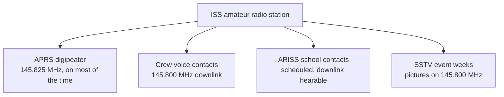
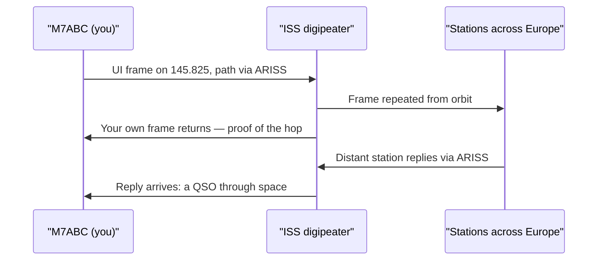

# ISS

Four hundred kilometres above your garden, travelling at 27,600 km/h, there is a laboratory the size of a football pitch with people living inside it — and it has an amateur radio station, permanently installed, switched on most of the time. You can hear it with the cheapest handheld ever made, standing outdoors, holding the radio above your head. On the right evening you can bounce a packet off it, receive a picture from it, or — with luck and timing — talk to a human being in space. The International Space Station is, by a comfortable margin, **the easiest space contact in radio**, and for many amateurs the moment its signal first broke the squelch is the moment the hobby became permanent.

## Why there is a ham station in space at all

Amateur radio has flown on crewed spacecraft since 1983, when astronaut Owen Garriott (callsign `W5LFL`) took a handheld aboard the Space Shuttle and worked earthbound amateurs in his rest breaks. The idea grew into **ARISS** — Amateur Radio on the International Space Station — a volunteer partnership between national amateur societies and the world's space agencies that keeps permanent equipment aboard the ISS and trains crews to use it. Many astronauts hold amateur licences, and the station callsigns are part of the fun: `NA1SS` for the US segment, `RS0ISS` for the Russian segment. The stable, canonical reference for everything in this chapter — current frequencies, equipment status, upcoming events — is **ariss.org**; the frequencies below are long-standing, but when anything seems off, that site is the truth.

Because the ISS is a working outpost with rotating crews, its radio serves several purposes at once — which is why there are several distinct things to hear:

All of it lives on the 2 m band, all of it is FM, and all of it is pure line-of-sight from horizon to horizon. Everything you learned in [Satellites](outpost:entry/logbook73.handbook/satellites) applies directly — the ISS is the biggest, strongest, most predictable bird in the sky.

## The APRS digipeater: the ISS that always answers

The workhorse is the **packet digipeater on `145.825 MHz`**: an AX.25 digipeater — exactly the machinery from [Packet Radio](outpost:entry/logbook73.handbook/packet-radio), running the UI frames you met in [APRS](outpost:entry/logbook73.handbook/aprs) — that listens for frames sent via the path alias `ARISS` and retransmits them back down. Its footprint at any moment is an ellipse thousands of kilometres across, so a single frame digipeated from orbit lands simultaneously in Lisbon and Warsaw. Operators exchange short position beacons and text messages through it, and internet services aggregate what ground stations hear, so afterwards you can see a map of exactly who copied your frame.

Two things make the digipeater the ideal first target. It is on far more often than any human is at the microphone — nearly always, apart from scheduled events and dockings. And it is _impartial_: it answers everyone who reaches it, with none of the pile-up luck that voice contacts involve. A 5 W handheld and a small Yagi will reach it; well-sited stations manage it with even less. For entry-level licence holders, an ISS digipeat is a badge well within reach — your packet frame, repeated by a spacecraft.

## Voice: the pile-up with a view

The crew's voice downlink is **`145.800 MHz` FM** worldwide, with the uplink on `145.200 MHz` in IARU Region 1 (`144.490 MHz` in Regions 2/3) — a simple split you can program into any dual-VFO handheld as a repeater pair, no tone. When an astronaut has free time — often weekend passes — they may pick up the microphone as `NA1SS` and answer calls, general-QSO style, working stations rapid-fire for the length of a pass.

Be honest with yourself about the odds: one human, thousands of listeners, ten minutes. Casual crew passes are unannounced and rare — some crews are keen operators, some never touch the radio in six months. But people genuinely do work them, usually operators who make a habit of _listening on 145.800 during every good evening pass_, so that the rare occasion finds them ready. If you hear `NA1SS` calling, give your callsign once, phonetically, and nothing else; if they come back, exchange greetings in a sentence and clear. You will remember those fifteen seconds for the rest of your life.

**ARISS school contacts** are the scheduled, guaranteed version. Several times a month, somewhere in the world, a school has won an ARISS slot: a ten-minute pass during which pupils queue at a microphone and ask an astronaut their questions directly. The uplink station is often a dedicated telebridge, but the **downlink — the astronaut's answers on `145.800 MHz` — is hearable by anyone under the footprint**. Upcoming contacts are listed on ariss.org; if a pass crosses your sky, you can stand in your garden and listen to a voice from orbit telling a nine-year-old what the Earth looks like at night. Bring a child if you can. This is the best free science lesson in radio.

## SSTV weeks: pictures posted from orbit

Several times a year — often around space anniversaries — ARISS runs **SSTV events**: for a few days, the station transmits a rotating series of images on `145.800 MHz` using slow-scan television, the sound-into-pictures mode from [SSTV](outpost:entry/logbook73.handbook/sstv). Each image takes a couple of minutes to send, in the PD120 style of mode, and between images the transmitter rests briefly.

The receiving chain could hardly be shorter: any radio that hears 145.800 FM, its audio into a phone or laptop running a free SSTV decoder app (even acoustically — decoder apps listening via the phone's microphone next to the handheld's speaker work surprisingly well). A good pass yields one or two complete images; a whole event yields the full commemorative set, and ARISS traditionally issues a certificate and gallery for received pictures. Even a partial image, with the characteristic slant of a signal caught mid-pass, is a treasure: a photograph that travelled to you by two minutes of warbling tones from a spacecraft. Events are announced on ariss.org — put them in your diary the way DXers watch contest calendars.

## Hearing it: genuinely just a handheld

Strip away every accessory and the minimum viable ISS receiver is: **a handheld radio, outdoors, held up during a good pass**. The ISS transmits with more power (typically 5–25 W) from better antennas than almost any other amateur satellite, from only ~420 km up on a high pass. On a 60°+ pass, its FM signal on the stock rubber-duck antenna is not a whisper you strain for; it opens the squelch and _talks_.

The supporting cast, in order of value:

- **Prediction.** Any satellite app predicts ISS passes (it is the most-tracked object in every app's list), and because the ISS is huge and reflective you can often _see_ it — a brilliant, steady star sliding across twilight — while you hear it. Radio and naked-eye astronomy in the same minute. Choose passes above 30° elevation; save the 70° ones for transmit attempts.
- **Open sky.** Outdoors matters more than any equipment upgrade. Buildings block 2 m line-of-sight completely.
- **Doppler — barely.** From the same arithmetic as [Satellites](outpost:entry/logbook73.handbook/satellites): `Δf = 145.8 MHz × (7.5 ÷ 300,000) ≈ 3.6 kHz`. A shift of **±3.5 kHz at 145 MHz is gentle** — FM channels are ~12 kHz wide, so a receiver parked on 145.800 copies the whole pass without retuning. If your radio tunes in 2.5 kHz steps you can chase it for the cleanest audio at the pass edges, but this is polish, not necessity. The tuning ritual that rules 435 MHz work is, here, optional.
- **A small Yagi** (the same handheld beam as for the easy sats) turns "clear copy" into "broadcast quality", and is what lifts your _uplink_ from marginal to reliable when you start transmitting to the digipeater.

## Predicting passes: the friendliest orbit

The ISS orbits at about 420 km, inclined 51.6° to the equator — a tilt chosen for launch sites, not for radio, but generous nonetheless: the station's ground track sweeps everywhere between about 52° north and south, so it crosses the skies of nearly every amateur on Earth several times a day, every day. Its orbit is also the best-measured of any object your app tracks, with TLEs refreshed constantly (the station's altitude sags a little with atmospheric drag and gets boosted back up, so _stale_ predictions drift — let the app update before you trust a rise time to the minute).

Passes arrive in a rhythm worth learning. Because one orbit takes about 93 minutes, usable passes come in **clusters**: catch one, and another follows an hour and a half later, displaced westward and usually lower. Each day the whole pattern slides earlier by roughly half an hour, so a week of convenient evening passes gradually migrates into the afternoon, disappears, and returns a few weeks later. Visible passes add their own constraint — you see the ISS only when your sky is dark but the station, high above, is still sunlit, which confines naked-eye sightings to the hours after dusk and before dawn. Radio has no such vanity: a noon pass sounds identical to a midnight one.

For planning, the practical reading of an app's pass list is: **maximum elevation** decides quality (30°+ to listen comfortably, 60°+ for transmit attempts and SSTV completeness), **duration** runs from ~4 minutes on low passes to ~10 on overhead ones, and **direction** tells you which side of the house to stand on. Ignore the rest until you need it.

## Etiquette: sharing ten minutes with a continent

Every ISS pass is a commons shared by every station across an entire continent, so the culture is strict in a friendly way:

- **Listen before transmitting, always.** Never transmit on 145.800 — it is the downlink; your transmit frequency is the uplink appropriate to the activity, and during school contacts you do not transmit at all: those passes belong to the pupils.
- **On the digipeater, beacon sparingly.** One or two frames per pass, not a barrage every five seconds. The channel fits only a few frames a second for the entire footprint; a station machine-gunning beacons deafens everyone. Send, wait, listen for your return, try once more later.
- **On voice, call once and briefly.** Callsign, phonetically, once. Endless calling on the uplink jams the very pile-up you are trying to win.
- **Keep any contact minimal**: callsign, name, locator at most. Thirty other stations are holding their breath in the queue.
- **Log honestly** — heard is heard, worked is worked. A reception report of the digipeater is a real achievement; log it as what it is.

None of this is gatekeeping; it is arithmetic. Ten minutes, one channel, half a continent. The etiquette is what makes the arithmetic bearable — and operators who listen twice as much as they transmit are, not coincidentally, the ones who end up in the log of `NA1SS`.

## Try it yourself

This is the chapter to act on _this week_ — no licence needed for any step but the last:

1. Install any satellite-tracking app, find the next ISS pass over 30° elevation at a convenient hour, and note rise time and direction.
2. Program a handheld (or any receiver, or an RTL-SDR) with `145.800 MHz` FM and `145.825 MHz` FM, squelch just closed.
3. Stand somewhere with open sky at AOS. Watch for the visible station if it is twilight. On 145.825 you are listening for packet's short _braaap_ bursts; on 145.800, for voice or SSTV tone if anything is scheduled.
4. Decode what you catch: pipe 145.825 audio into Direwolf and read the AX.25 frames (`RS0ISS` will appear as the digipeating station); during an SSTV week, point a decoder app at the audio and watch a picture from orbit paint down your screen line by line.
5. Log every reception in LogBook73 — station heard, frequency, pass details. ISS receptions make satisfying log entries: the DX is only 400 km away, but the bearing is _up_.
6. Once licensed: on a high pass, send a UI frame via `ARISS` on 145.825 with your locator, then check an APRS aggregation site for which ground stations heard your digipeated frame. Frame in space, name on the map.

## Key takeaways

- The ISS carries a permanent amateur station (`NA1SS`, `RS0ISS`) under the **ARISS** programme; **ariss.org** is the stable source for frequencies, status and events.
- The **APRS digipeater on `145.825 MHz`** is the reliable target: on most of the time, answers everyone, reachable with 5 W and a small Yagi.
- **Voice passes** use `145.800 MHz` down worldwide, with the uplink regional (`145.200 MHz` in Region 1, `144.490 MHz` in Regions 2/3) — rare, unannounced, unforgettable; **school-contact downlinks** are scheduled and free to hear.
- **SSTV event weeks** send commemorative images on 145.800 that a handheld plus a phone app can decode.
- Doppler at 145 MHz is only **±3.5 kHz** — FM swallows it; hearing the ISS genuinely requires no more than a handheld outdoors on a good pass.
- Etiquette is load-bearing: listen first, beacon sparingly, call once, keep contacts to seconds — ten minutes of channel serves half a continent.
- Emotionally and practically, the ISS is **the easiest space contact in radio** — start here before any other bird.

From the easiest space path we turn to the hardest one amateurs attempt — bouncing signals off the Moon itself, in [Moonbounce (EME)](outpost:entry/logbook73.handbook/moonbounce-eme).
