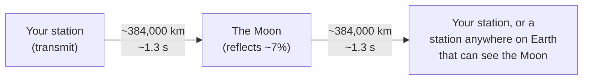
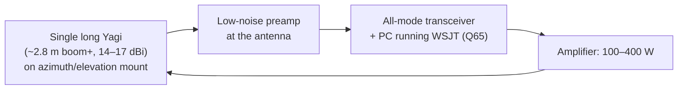

# Moonbounce (EME)

Every other path in this handbook stays decently close to home: the ionosphere is under 400 km up, the ISS not much further. This chapter is about aiming your antenna at the Moon — using a lump of rock 384,000 km away as a passive reflector, so that your signal leaves Earth, crosses deep space, glances off another world and comes all the way back. Amateurs call it **EME** (Earth–Moon–Earth), or simply **moonbounce**, and it is the ultimate weak-signal path: the longest distance, the harshest losses, the faintest echoes in all of amateur radio. It is also, by common consent among those who have done it, the most romantic thing you can do with a transmitter.

## The path: 770,000 kilometres and a bad mirror

The geometry is stark. The Moon orbits at an average of 384,400 km, so the round trip is about **770,000 km** — two thousand times further than a satellite pass, seventy times further than any two points on Earth can be apart. Radio travels at the speed of light, and even light takes its time here: your signal arrives back roughly **2.5 seconds** after it left. Key your transmitter, say your callsign, release — and your own voice returns as a ghostly echo, delayed by the width of the Earth–Moon system. EME operators never quite stop finding that eerie.



And the Moon is a _terrible_ mirror. It is not polished metal but dark, dusty rock, scattering radio energy in all directions and returning only about 7% of what strikes it. Worse, only a whisker of your transmitted energy hits the Moon at all — from Earth it subtends about half a degree of sky, a coin held at arm's length — and the scattered remnant then spreads across space all over again on the way home. Losses compound on losses.

Yet look at the other side of the ledger: anyone on Earth who can see the Moon at the same moment as you shares the path. A station in Japan, in Chile, in New Zealand — if the Moon is above both horizons, the distance between you is irrelevant. EME is the only terrestrial-equipment path with no maximum range. One reflector, half the planet in the footprint, no ionosphere required (though the ionosphere still meddles, as we shall see).

## The link budget: brutal, then beautiful

Let us put numbers on "faint", using the currency from [Decibels](outpost:entry/logbook73.handbook/decibels). The total round-trip path loss at 144 MHz — spreading out, weak reflection, spreading back — comes to roughly **250 dB**. Sit with that figure a moment. 250 dB is a factor of 10²⁵. A local FM contact might involve 120 dB of loss; strong HF DX perhaps 140 dB. EME asks you to survive a hundred billion times more loss than working the other side of the world.

Here is a realistic 2 m entry-level budget, line by line:

| Ledger line                     | Value   | Running total |
| ------------------------------- | ------- | ------------- |
| Transmitter: 400 W              | +56 dBm | +56 dBm       |
| Your Yagi's gain                | +17 dB  | +73 dBm       |
| Earth–Moon–Earth path loss      | −252 dB | −179 dBm      |
| Receiving station's Yagi        | +17 dB  | −162 dBm      |
| **Signal arriving at receiver** |         | **−162 dBm**  |

Is −162 dBm workable? The receiver's noise floor in a 2.5 kHz bandwidth is about −140 dBm (from [Noise](outpost:entry/logbook73.handbook/noise) and [Sensitivity](outpost:entry/logbook73.handbook/sensitivity)), so the echo sits around **22 dB _below_ the noise** — utterly inaudible to any human ear, invisible on any S-meter. And this is the miracle of the modern era: the digital modes of the WSJT family, **JT65** and its successor **Q65**, decode structured, slow, heavily error-corrected signals down to roughly 25 dB below the noise in that bandwidth. Our ledger lands a whisker inside the possible. That is not an accident; it is the whole story of modern EME — the budget closes by a few dB, and every choice you make is about defending those few dB.

```viz
{
  "type": "spectrum",
  "title": "An EME echo against the noise floor",
  "caption": "The lunar echo sits well below the noise — inaudible to any ear, invisible on any S-meter, yet Q65's slow, error-corrected averaging still digs it out.",
  "noiseFloor": 0.25,
  "components": [
    { "f": 50, "amp": 0.12, "label": "EME echo", "tone": "primary" }
  ],
  "xLabel": "frequency"
}
```

It also explains history's shape. In the CW-only decades, closing the budget needed enormous antenna arrays and legal-limit power at both ends — EME was a cathedral pursuit for a handful of giants. The WSJT modes (from the same family as [FT8](outpost:entry/logbook73.handbook/ft8), written by the same Nobel-laureate radio amateur, Joe Taylor `K1JT`) handed back around 15 dB. Fifteen decibels is a thirty-fold power saving, or three-quarters of your antenna farm — which is precisely why a single-Yagi station is now a real EME station.

## The Moon is not a cooperative partner

Beyond raw loss, the path has personality quirks, and knowing them beforehand saves bewilderment.

**Libration fading.** The Moon rocks gently as it orbits — motions called _libration_ — so the rough terrain reflecting your signal is always shifting slightly relative to you. Thousands of glinting mountains and crater walls each return their own echo, and these micro-echoes drift in and out of agreement. The result is that EME signals _shimmer_: they smear slightly in frequency and rise and fall over seconds, like sunlight glittering off wavelets rather than one clean reflection off glass. The slow WSJT modes average through the shimmer; CW operators learn to ride it.

**Polarisation roulette.** From [Antennas](outpost:entry/logbook73.handbook/antennas), a receiving antenna wants the incoming wave's polarisation to match its own. EME twists polarisation two ways. Passing twice through the ionosphere rotates it (_Faraday rotation_) by an amount that changes with the hour and the state of the Sun — see [Propagation](outpost:entry/logbook73.handbook/propagation) for the machinery. And geometry adds a fixed twist: "horizontal" in England and "horizontal" in Texas are not parallel planes on a curved Earth, so widely separated stations are cross-polarised by their very locations. On 2 m the combined effect can swing a contact from easy to impossible for an hour at a time — one reason serious stations build cross-polarised antennas they can switch electrically, and the rest of us schedule patience.

**Everything moves.** The Moon rises, crosses the sky and sets like everything else, so your antenna needs pointing — in both azimuth and elevation — and Doppler shift of up to a few hundred hertz at 144 MHz must be tuned out (the software helps). Best conditions cluster around the Moon's _perigee_ — its monthly closest approach, worth a couple of dB — and when the Moon sits in a quiet part of the radio sky, since a beam aimed near our own galaxy's noisy plane points a sensitive antenna at nature's own transmitter.

## What a real entry station looks like

Strip away the mythology of giant dish arrays; here is the honest 2026-era doorway, on the 2 m band where activity and beginner success concentrate:



- **One long Yagi** for 144 MHz, on a rotator that can also tilt upward (or the time-honoured budget dodge: work only your _moonrise and moonset_, when the Moon sits near the horizon and a fixed antenna — helped by a few dB of ground-reflection gain — can reach it).
- **A low-noise preamplifier at the antenna**, because with signals 20 dB under the noise, receiver noise figure is life itself — the reasoning built in [Amplifiers](outpost:entry/logbook73.handbook/amplifiers) and [Sensitivity](outpost:entry/logbook73.handbook/sensitivity). Feedline loss before the preamp is unforgivable; loss after it barely matters.
- **100–400 W** of clean power. With one Yagi, 100 W will work the big stations on good days; 400 W makes you workable by medium ones. (Mind your licence: entry-level power limits usually make EME transmit a later ambition — check your licence terms. Receive-only needs no licence at all, so there is no wait.)
- **WSJT software** running Q65, with its 60-second transmit/receive cycles and standardised exchanges. EME contacts are sparse affairs — callsigns, a signal report, acknowledgements, several minutes of ritual — closer to a handshake across an abyss than a chat.
- **Patience and a calendar.** Activity concentrates around perigee weekends and organised activity periods; the online EME community coordinates schedules gladly, and the big stations _enjoy_ being someone's first.

The honest budget for that transmit station is comparable to a decent HF setup — four figures, not fairy tales. But notice what fell out of the requirements: no dish, no acre of phased arrays, no kilowatt. One aerial, one amplifier, free software, and the Moon.

## Hearing the Moon first: EME as an SWL goal

Here is the loveliest secret in this chapter: **receiving EME needs no licence, no amplifier and no schedule** — and hearing your first lunar echo of _someone else's_ signal is nearly the full emotional payload at a tenth of the cost.

The big EME stations — multi-Yagi arrays running high power — put signals onto the Moon that a modest station can copy. With a single 2 m Yagi (even a hand-steered one on a photographic tripod), a preamp, and any SSB-capable receiver or SDR feeding WSJT software, point at the Moon during an activity weekend and watch the waterfall around the 144 MHz EME calling region. When Q65's decode line prints a callsign — a signal that left a station on another continent, struck another world, and fell into your garden — you will understand why people build the big arrays. Add it to your log in LogBook73 as the reception it is: the DX column reads a few hundred kilometres; the true path column, if you kept one, would read 768,000.

Receive-only first is not a consolation prize. It is how many of the best EME operators started, and it front-loads every skill — Moon tracking, noise management, WSJT operation — before a single expensive watt is spent.

## Project Diana, and why people do this

On 10 January 1946, a team of US Army Signal Corps engineers at Fort Monmouth, New Jersey — **Project Diana**, named for the Moon's goddess — aimed a modified radar at the rising Moon and, 2.5 seconds after each pulse, watched the echo return. It was the first time human beings had touched another world with anything at all and received an answer. Radar to the Moon in 1946; footprints on it took another twenty-three years. Radio got there first.

Amateurs, being amateurs, immediately wanted it for themselves. After years of near-misses, the first two-way amateur EME contact came in the 1950s, and by the 1960s club-built dishes were bridging continents off the Moon. Every technique in this chapter — the preamps, the digital modes, the polarisation tricks — is part of a seventy-year relay race of amateurs handing each other decibels.

And that, finally, is the _why_. Nobody needs EME; a phone call is cheaper and the internet is faster. People do it because the Moon rises over your street the same as it rises over anyone's, and with your own hands you can build a station that reaches out and touches it — because "impossible, minus a few decibels we found down the back of the sofa" is the most amateur-radio sentence ever written. Operators who have worked a hundred countries on HF will still tell you their first lunar echo — their own signal, back from the Moon, 2.5 seconds late — was the moment the sky felt genuinely within reach. It is the romance of the hobby, distilled: patience, physics and a very long way home. And there is a quiet poetry available on any clear night even before you own a single piece of equipment: look up at the Moon and know that, right now, somebody's CQ is glancing off it.

## Try it yourself

1. Tonight, no equipment: find the Moon, hold your hand at arm's length, and cover it with your little fingernail. Everything in this chapter fits behind that fingernail — that is the target, and that is the mirror.
2. Set up WSJT-X or similar software and learn the Q65/JT65 screens on ordinary terrestrial signals first, so that the software is an old friend before the Moon is involved.
3. During an EME activity weekend (the EME community's calendars and amsat.org point to them), try receive-only: a 2 m Yagi on a tripod, preamp if you have one, SDR or all-mode receiver, antenna aimed by eye at the Moon. Watch the waterfall near the 144 MHz EME segment for the slow, shimmering traces, and let the software dig for decodes.
4. Log any decode in LogBook73 with the station's details, and note the Moon's elevation and your setup — repeat attempts turn EME reception from luck into technique.
5. When it hooks you — mind the RF safety habits from earlier chapters as power grows: high power near a low-pointing antenna deserves respect for both neighbours and exposure limits, so keep beams above head height and follow your national regulator's EMF guidance.

## Key takeaways

- EME bounces signals off the Moon: a **770,000 km round trip**, a **2.5-second echo delay**, and a path shared by everyone who can see the Moon at once — no maximum range.
- The Moon reflects only ~7% of what hits it; round-trip path loss at 144 MHz is about **250 dB**, leaving echoes ~20+ dB below the noise floor.
- **JT65/Q65 digital modes** decode down to roughly −25 dB SNR, returning ~15 dB to the budget — the single change that turned EME from giants-only into a one-Yagi pursuit.
- **Libration** makes signals shimmer and fade; **Faraday rotation plus Earth's geometry** spins polarisation — patience and scheduling are part of the equipment.
- A realistic entry station: one long 2 m Yagi with elevation (or moonrise-only), an antenna-mounted preamp, 100–400 W and WSJT software.
- **Receive-only EME is a superb SWL goal**: hearing a big station's lunar echo needs a Yagi, a preamp and free software — and no licence.
- Project Diana touched the Moon with radar in **1946**, twenty-three years before boots did; amateurs have been narrowing the decibels ever since.

From the grandest path in radio back to the most practical of tools: next we set up a free, fast receiver program and find our first signals with it, in [SDR++](outpost:entry/logbook73.handbook/sdr-plus-plus).
