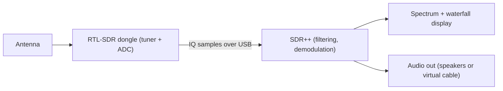
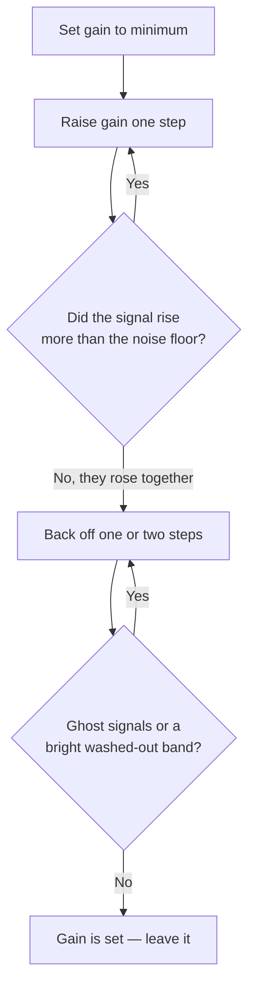
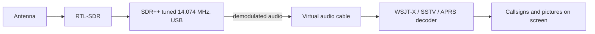

# SDR++

Everything you have read about receivers, waterfalls and modes becomes real the moment you run an SDR program for the first time — and **SDR++** is the one this handbook recommends you start with. It is free, open source, fast, and runs on Windows, macOS, Linux and even a Raspberry Pi, so whatever computer you own is already most of a radio station. This chapter walks you from a blank screen to hearing your first five signals, and then shows how to pipe SDR++ audio into decoder programs so the pictures and data modes from earlier chapters start appearing on your screen too.

## What SDR++ is and why we start here

An SDR receiver, as you saw in [Software Defined Radio](outpost:entry/logbook73.handbook/software-defined-radio), splits the job of a radio in two: a small hardware dongle captures a slice of spectrum and hands it to your computer as [IQ samples](outpost:entry/logbook73.handbook/iq-signals), and software does everything a receiver's knobs and filters used to do. SDR++ is that software — a general-coverage receiver program whose "front panel" is a spectrum display, a waterfall and a handful of on-screen controls.

There are other fine choices (SDR#, GQRX, SDR-Console, CubicSDR), and nothing in this chapter is wasted if you later switch — the concepts are identical. SDR++ earns its place as the first one because it looks and behaves the same on every operating system, supports almost every hobby SDR out of the box (RTL-SDR, Airspy, SDRplay, HackRF and more), and is light enough to run happily on a Raspberry Pi. Learn it once and you can sit down at nearly any SDR anywhere.

Everything in this chapter is receive-only, and receiving needs no licence in most countries — this is exactly the "listen first" apprenticeship that generations of amateurs served with shortwave sets, now supercharged. Log what you hear as receptions in LogBook73 as you go.

## Installing it

Rather than freeze instructions that will drift out of date, here is the shape of the job — the project's official releases page always has current builds for each platform:

- **Windows**: download the Windows release, unzip it anywhere, and run the program — there is no installer. One extra step: an RTL-SDR dongle needs the WinUSB driver, installed once with the small **Zadig** utility (the RTL-SDR quick-start guides walk through it). If SDR++ lists no RTL-SDR device, the driver is almost always the reason.
- **macOS**: download the macOS build, or install via a package manager such as Homebrew. Device drivers are not needed; the dongle just appears.
- **Linux**: install from your distribution's packages or the project's releases. You may need to add a `udev` rule so your user account may access the USB device — a one-time, well-documented step.
- **Raspberry Pi**: use the Linux ARM build. A Pi 4 or later runs SDR++ comfortably and makes a lovely dedicated monitoring receiver.

Plug the dongle into a USB port (an extension lead helps keep computer noise away from it), attach the small antenna that came with it — or better, any outdoor wire — and start the program.

## First run: source, sample rate, start

SDR++ organises its controls into panels down the left-hand side. The top one, **Source**, is where every session begins.

1. **Select your source.** Choose `RTL-SDR` (or your device) from the drop-down, then pick your specific dongle in the device list below it.
2. **Choose a sample rate.** This sets how wide a slice of spectrum you capture at once — `2.4 MSPS` (million samples per second) is a sensible RTL-SDR default, giving you about 2.4 MHz of visible spectrum. Wider shows more at once; narrower is kinder to a slow computer.
3. **Press the play button** at the top. The waterfall should start scrolling. If it is a wall of solid colour or utterly blank, don't worry — that is the next section's job.



That is the entire signal chain. Every control you are about to meet lives inside the SDR++ box.

## The gain ritual — the step everyone fumbles

Here is the single most common beginner mistake with any SDR: leaving the gain wrong and concluding the dongle, the antenna or the whole hobby is broken. **Gain** is how much the dongle amplifies the antenna signal before digitising it, and an RTL-SDR gives you a manual slider from 0 to about 49 dB. There is no universally correct setting — it depends on your antenna, your location and the band — so you learn a short ritual instead.

**Too much gain (overload)** looks dramatic: the waterfall's background brightens to a hiss-coloured wash, phantom copies of strong stations appear at frequencies where nothing should be (the images and intermod of [Overload & Ghost Signals](outpost:entry/logbook73.handbook/overload-and-ghost-signals)), broadcast FM seems to exist everywhere at once, and strong signals grow wide "skirts". The receiver's analogue-to-digital converter is being driven past its ceiling, and the damage is spread across everything. More gain is _not_ more sensitivity once you are past this point — it is less.

**Too little gain** looks like nothing: a dark, quiet waterfall where even strong local stations barely make a faint trace, and audio that is mostly hiss. The signals are arriving but they are too small to use the converter's [dynamic range](outpost:entry/logbook73.handbook/dynamic-range).

The ritual, then — do this every time you change band or antenna:

1. Turn the gain to minimum. The waterfall goes nearly black.
2. Tune to the kind of signal you want to hear, or just watch the band.
3. Raise the gain in steps. Signals rise out of the dark — and, crucially, so does the _noise floor_, the fuzzy background level.
4. Keep raising it while signals grow **faster** than the background. At some point another notch of gain lifts the background hiss as much as the signal — the signal-to-noise ratio has stopped improving.
5. Back off a notch or two from there. Done.



You are hunting the best signal-to-_noise_ ratio, not the loudest waterfall. Ten seconds of this ritual is worth more than any amount of squinting at a misadjusted band. (Some devices offer automatic gain control — fine for casual FM listening, but learning the manual ritual teaches you what your receiver is actually doing.)

## Tuning, and choosing the right demodulator

The vertical line on the spectrum with a shaded region around it is your **VFO** — the variable frequency oscillator, or in plain terms "where you are listening" ([Oscillators](outpost:entry/logbook73.handbook/oscillators) explains the name). Click anywhere on the spectrum or waterfall to jump the VFO there; drag it for fine tuning; type an exact frequency into the large frequency readout; scroll the mouse wheel to step. The shaded region around the line is the demodulator's filter bandwidth — the slice of spectrum actually turned into audio — and you can drag its edges to widen or narrow it.

Tuning gets you _to_ a signal; the **demodulator** decides whether it makes sense. As [Modulation](outpost:entry/logbook73.handbook/modulation) explained, different services wiggle the carrier differently, so SDR++ offers a row of mode buttons. Choosing the wrong one gives garbled or silent audio even when the signal is strong — the second most common beginner stumble after gain.

| Mode button | Use it for                                             | Typical bandwidth |
| ----------- | ------------------------------------------------------ | ----------------- |
| `WFM`       | Broadcast FM radio stations                            | ~200 kHz          |
| `NFM`       | Amateur 2 m/70 cm voice, repeaters, PMR446/FRS, marine | ~12 kHz           |
| `AM`        | Airband, medium-wave/shortwave broadcast               | ~6–10 kHz         |
| `USB`       | Amateur SSB above 10 MHz, most HF data modes           | ~2.7 kHz          |
| `LSB`       | Amateur SSB below 10 MHz (80 m, 40 m)                  | ~2.7 kHz          |
| `CW`        | Morse code                                             | ~200 Hz           |
| `RAW`       | Passing unprocessed IQ to another program              | —                 |

A useful habit: identify the signal _by its waterfall shape first_ (the skill from [FFTs & Waterfalls](outpost:entry/logbook73.handbook/ffts-and-waterfalls)), then pick the mode. A 200 kHz-wide giant is WFM; a 12 kHz blob that appears when someone talks is NFM; a carrier line with sidebands is AM; a ragged ~3 kHz smear with no carrier is SSB; pencil-thin dashes are CW.

```viz
{
  "type": "waterfall",
  "title": "What you'll see on first tune",
  "caption": "Left to right: a wide FM giant, a bare carrier line, an SSB smear with no carrier, and pencil-thin CW dashes — name the shape first, then press the mode button.",
  "signals": [
    { "f": 15, "width": 16, "kind": "fm" },
    { "f": 45, "kind": "carrier" },
    { "f": 65, "width": 7, "kind": "ssb" },
    { "f": 88, "kind": "cw" }
  ],
  "xLabel": "frequency"
}
```

## A quick tour of the rest of the interface

- **Spectrum and waterfall** fill the window: spectrum on top (instantaneous power against frequency), waterfall below (the same, scrolled into history). Two sliders — often the most-ignored and most-valuable controls — set the display's **min and max levels**. If your waterfall is all one colour, adjust these first: bring the minimum up to just below the noise floor and the display snaps into contrast. This changes only what you _see_, never what you hear.
- **Zoom** narrows the displayed span so a 2.7 kHz SSB signal stops being a sliver. Zoom in generously; beginners almost always work too zoomed-out to tune accurately.
- **Squelch**, in the radio panel, mutes audio below a set strength — essential for FM monitoring, where an idle channel is loud white noise. Raise it until the hiss just cuts out; a signal stronger than the threshold opens it again. Leave squelch fully off for SSB and CW, where you must hear the quiet.
- **Audio panel** selects the output device (speakers, headphones — or a virtual cable, coming shortly) and volume. The **SNR meter** above it is your honest friend: it reports how far the signal sits above the noise in dB, which is a far better tuning aid than loudness.
- **Module manager** (in settings) lets you enable extras such as the frequency manager, a recorder, and network audio — SDR++ is plugin-based, and several gems ship disabled.

## First five things to hear

Each of these is chosen to be findable on day one and to teach a different mode. Log every one as a reception in LogBook73 — your logbook does not care that you are not licensed yet.

1. **Broadcast FM, 88–108 MHz, mode `WFM`.** Your confidence check: enormous signals that prove the whole chain works. If you cannot hear a strong national broadcaster, the problem is drivers, gain or antenna — fix that before hunting anything subtle.
2. **Airband, 118–137 MHz, mode `AM`.** Aviation still uses AM, and aircraft at altitude are line-of-sight to huge areas ([VHF](outpost:entry/logbook73.handbook/vhf) explains why). Scan the band and listen for the clipped exchanges between pilots and controllers. Transmissions are short — squelch helps.
3. **2 m amateur repeaters, 145.600–145.800 MHz, mode `NFM`.** Repeater outputs sit in this range across IARU Region 1; in the Americas try 146–148 MHz — check your national band plan. Evenings are busiest. You will hear real local amateurs — the very people who will be on the other end once you hold a callsign. [Repeaters](outpost:entry/logbook73.handbook/repeaters) decodes what you hear.
4. **Licence-free walkie-talkies, mode `NFM`.** Builders, farms, families — in Europe, PMR446's sixteen channels at 12.5 kHz spacing start at 446.00625 MHz; in the Americas, the FRS equivalent lives around 462–467 MHz. Weak and local, so a decent antenna helps.
5. **40 m amateur SSB, 7.0–7.2 MHz (to 7.3 in Region 2), mode `LSB` — with a caveat.** Here honesty is due: a bare RTL-SDR is a VHF/UHF device, and its tuner does not reach HF properly. Most current RTL-SDR dongles offer a **direct-sampling** mode that hears HF after a fashion — it works, and it is free to try, but it is deaf-ish, easily overloaded and image-prone. An **upconverter** (which shifts HF up into the dongle's range) does the job properly, and a purpose-built HF-capable SDR does it better still. Whichever route: tune 7.1–7.2 MHz on an evening, mode LSB, and slowly tune across a signal until Donald Duck becomes a human. Your first HF voice from hundreds of kilometres away is a genuine moment.

## The frequency manager: stop re-finding things

Once you have found something good, save it. SDR++'s **frequency manager** (enable it in the module manager if it is not visible) keeps named bookmarks — frequency, mode and bandwidth together — organised into lists you might arrange by band or interest: `Airband`, `2 m repeaters`, `Shortwave broadcast`. Bookmarks can be shown on the spectrum itself, so labelled markers annotate the band as you tune across it. Ten minutes spent bookmarking your local repeaters, a few airband channels and your favourite broadcasters turns every future session from a search into a visit. Keep the frequency manager and LogBook73's Saved Frequencies page in step — the same bookmarks where you tune and where you log.

## Feeding decoders: the virtual audio cable

SDR++ demodulates, but it does not decode [FT8](outpost:entry/logbook73.handbook/ft8), [SSTV](outpost:entry/logbook73.handbook/sstv) or [APRS](outpost:entry/logbook73.handbook/aprs) — dedicated programs do (WSJT-X for FT8, an SSTV decoder for pictures, and so on). Those programs expect audio from a _sound card input_, as though a microphone were listening to a radio's speaker. The trick is a **virtual audio cable**: a software device that appears to SDR++ as an output and to the decoder as an input, piping audio between programs silently and losslessly.

- **Windows**: install a virtual cable driver (VB-Cable is a well-known free one). It appears as an extra playback and recording device.
- **macOS**: BlackHole is the popular free equivalent.
- **Linux**: PulseAudio and PipeWire can create loopback/null-sink devices natively — no extra software.

Then: in SDR++'s audio panel, set the output to the virtual cable; in the decoder, set the input to the same cable. Tune SDR++ to the right frequency in the right mode — `USB` at `14.074 MHz` for 20 m FT8, for instance — and decodes start appearing.



Two details catch people out. First, _levels_: the decoder wants healthy but unclipped audio — use SDR++'s volume and the decoder's level meter, aiming out of the red. Second, _mode and bandwidth_: FT8 needs USB with a normal ~3 kHz filter width, not FM, and not a narrowed filter that chops off half the stations. When a decoder shows nothing, it is nearly always level, mode or being 1 kHz off frequency — not a broken cable.

## Try it yourself

Tonight's mission, in order:

1. Install SDR++, select your RTL-SDR, set `2.4 MSPS`, and press play.
2. Perform the gain ritual on broadcast FM until you can explain, out loud, why your chosen setting is right.
3. Adjust the waterfall min/max sliders until the noise floor is dark and signals glow.
4. Work through the "first five" list, choosing the demodulator from the waterfall shape before pressing the mode button. Log each catch as a reception in LogBook73 with frequency, mode and time.
5. Bookmark everything you found in the frequency manager.
6. Stretch goal: install a virtual audio cable and WSJT-X, tune `14.074 MHz` USB in the late afternoon, and watch callsigns from across your continent decode from signals you can barely see.

## Key takeaways

- SDR++ is a free, cross-platform SDR receiver: hardware captures IQ samples, and the program is the entire rest of the radio.
- Every session starts the same way: select the source, set the sample rate, press play.
- Gain is a ritual, not a setting: raise it while signals grow faster than the noise floor, then back off. Overload looks like a bright wash and ghost signals; too little looks like a dark, dead band.
- Identify signals by waterfall shape, then choose the demodulator — WFM, NFM, AM, SSB and CW each suit different services.
- A bare RTL-SDR is honest at VHF/UHF; for HF, direct sampling is a free taste, an upconverter or HF-capable SDR is the real meal.
- The frequency manager saves your finds; a virtual audio cable feeds SDR++ audio into decoders like WSJT-X for FT8, SSTV and more.

You have been clicking blocks someone else wired together — next, in [GNU Radio](outpost:entry/logbook73.handbook/gnu-radio), you get the box of blocks itself and build a receiver with your own hands.
