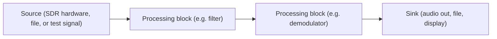
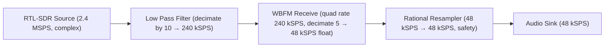

# GNU Radio

In [SDR++](outpost:entry/logbook73.handbook/sdr-plus-plus) you drove a receiver that someone else had built. **GNU Radio** hands you the parts instead: a huge box of signal-processing LEGO bricks — filters, [mixers](outpost:entry/logbook73.handbook/mixers), demodulators, audio outputs — that you snap together on screen into a radio of your own design. It is the tool researchers use to prototype satellite modems and the tool a beginner can use, this afternoon, to build a working FM broadcast receiver from five blocks and actually understand every one of them. This chapter builds that receiver with you, and is honest about the learning curve on the far side of it.

## Radios from LEGO blocks

Recall the central idea of [Software Defined Radio](outpost:entry/logbook73.handbook/software-defined-radio): once an antenna signal has been turned into a stream of numbers, everything a radio does — filtering, mixing, demodulating — is arithmetic on that stream. A conventional SDR program performs one fixed arrangement of arithmetic. GNU Radio instead gives you each operation as a separate **block** with inputs and outputs, and lets you wire them together however you please. Want a receiver that listens to two frequencies at once? Wire the same source into two demodulators. Want to see the signal between two stages? Splice a scope in. The radio is whatever the wiring says it is.

You do not need to program to start. **GNU Radio Companion (GRC)** is the graphical editor where you drag blocks onto a canvas and draw the wires. (Under the hood it generates a Python program, which is a lovely on-ramp to programming later — but the canvas is enough for everything in this chapter.) GNU Radio is free and open source, and installs on Linux, Windows and macOS; Linux is its native home and generally the smoothest ride, and the project's documentation keeps current install instructions for each platform.

## What a flowgraph is

A design in GNU Radio is called a **flowgraph**: blocks connected by arrows, with samples flowing along the arrows like water through pipes. Three kinds of block matter:

- **Sources** produce samples: an SDR dongle, a file of recorded IQ, a pure test tone.
- **Processing blocks** transform samples: filters, demodulators, resamplers, multipliers.
- **Sinks** consume samples: your sound card, a file, a spectrum display.

When you run the flowgraph, samples pour out of the source, pass through each block in turn, and drain into the sinks — millions per second, for as long as you let it run. Every flowgraph needs at least one source and one sink; a signal with nowhere to go is an error, not a radio.

Blocks connect through coloured **ports**, and the colours are a type system: blue ports carry **complex** samples (IQ pairs, the natural language of SDR hardware — see [IQ Signals](outpost:entry/logbook73.handbook/iq-signals)), orange carries **float** (ordinary real numbers, the natural language of audio), and other colours carry integers and bytes. GRC will refuse to wire blue to orange, and this is a kindness: an IQ stream is not audio, and a program that pretended otherwise would only produce noise. When types genuinely must change — complex RF becoming float audio — a block does the conversion explicitly, and in our receiver the demodulator is exactly that block.

## A tour of GNU Radio Companion

Open GRC and you see three areas: a large **canvas** in the middle, a searchable **block library** down one side, and a **console** along the bottom where messages appear when flowgraphs run (or refuse to).

Every new flowgraph starts with two blocks already placed. **Options** holds settings for the flowgraph as a whole. **Variable**, named `samp_rate`, is your first meeting with GNU Radio's most important habit: rather than typing the number `2400000` into six different blocks, you define it once as a variable and type `samp_rate` everywhere it is needed. Change the variable, and every block that uses it updates together. Double-click any block to open its properties and see which fields reference variables.

Working on the canvas is pleasantly tactile: drag blocks from the library (or press Ctrl+F and type to search — with thousands of blocks, searching beats browsing), click one port then another to wire them, and press the run button to start. A block drawn in red is misconfigured or mis-wired; hover over it and GRC explains why. Nothing runs until the graph is error-free, which sounds strict but saves you from the far worse experience of a program that runs and silently does the wrong thing.

### Sample rates: the number one beginner confusion

Here is the concept that trips up more GNU Radio beginners than everything else combined. Every stream in a flowgraph has a **sample rate** — how many samples per second it carries — and _blocks do not know or check it_. A wire happily carries 2.4 million samples per second into a block configured as though it were receiving 48 thousand, and GNU Radio raises no error. The flowgraph runs; the output is wrong — audio like chipmunks or treacle, spectra with the wrong span, demodulators producing garbage.

So _you_ must do the bookkeeping. An RTL-SDR source configured for `2.4 MSPS` produces 2,400,000 samples per second. Your sound card wants exactly 48,000. Somewhere between the two, the rate must come down by a factor of 50 — and it comes down only where a block explicitly changes it. A **decimating** filter with decimation 5 outputs one sample for every five in; a **Rational Resampler** multiplies the rate by a fraction you choose. Get the chain of rates wrong and the maths downstream is wrong, with no error message to tell you so. The habit that saves you: annotate, on paper or in block names, the sample rate on every wire. Our FM receiver below does exactly this.

One special block exists purely because of sample rates: **Throttle**. Hardware sources release samples at their real-world rate — 2.4 MSPS means 2.4 million each second, and the flowgraph naturally runs at that pace. But a _simulated_ source (a test tone, a file) can generate samples as fast as your CPU allows, so a hardware-free flowgraph would race at 100% CPU. Throttle deliberately limits the flow to the stated rate to stop that. The rule is simple: **no hardware in the flowgraph → exactly one Throttle; hardware present → no Throttle**, because two things pacing the same stream fight each other and cause stutters.

## Build it: an FM broadcast receiver

Time to build something real. Broadcast FM is the perfect first target: the signals are enormous, you know what success sounds like, and the flowgraph needs only five blocks. Here is the whole design — then we justify every block's existence.

Set the `samp_rate` variable to `2.4e6` (GNU Radio accepts scientific notation), then place and wire:

**1. RTL-SDR Source.** The hardware's representative on the canvas: it delivers the dongle's IQ stream, `samp_rate` complex samples per second, centred on whatever frequency you set. Set the centre frequency to a strong local station — `93.5e6` for 93.5 MHz, say — and RF gain to roughly 30 dB (the gain ritual from [SDR++](outpost:entry/logbook73.handbook/sdr-plus-plus) applies here too; too high overloads, too low buries the station in hiss). _Why it exists:_ something must produce samples, and this block is the antenna's doorway into software. (Depending on your install, the block may be named RTL-SDR Source or appear via the general Soapy/osmocom source blocks — same job.)

**2. Low Pass Filter.** Set cutoff frequency `100e3` (100 kHz), transition width `50e3`, and **decimation 10**. A broadcast FM signal is about 200 kHz wide, but our source hands us 2.4 MHz of spectrum containing perhaps a dozen stations. This block, built from the theory in [Filters](outpost:entry/logbook73.handbook/filters), keeps ±100 kHz around the centre — one station — and discards the rest. And because the surviving signal no longer needs 2.4 MSPS to describe it, the block also decimates by 10: output rate `240 kSPS`. _Why it exists:_ selectivity (one station, not twelve) and thrift (why make every later block process ten times the samples it needs?).

**3. WBFM Receive.** The heart: wideband FM demodulation. Set its _quadrature rate_ to `240e3` — this is the sample rate of its **input**, our first live example of the bookkeeping rule, since typing the wrong number here yields distorted audio and no error — and its decimation to 5. It converts complex RF (blue port in) into recovered audio (orange float port out) at `48 kSPS`. _Why it exists:_ everything so far has been moving and trimming the FM signal; this block actually undoes the [modulation](outpost:entry/logbook73.handbook/modulation), turning frequency wiggle back into sound.

**4. Rational Resampler.** Interpolation 48, decimation 48 — which changes nothing, and that is deliberate. Our arithmetic already lands exactly on 48 kSPS (2.4 M ÷ 10 ÷ 5), so the block is an idle safety valve; but the _pattern_ matters, because real designs rarely land exactly. An Airspy source at 3 MSPS, or a different filter choice, leaves you at an awkward rate, and this is the block that converts by any ratio you need (interpolation 48, decimation 50 would turn 50 kSPS into 48 kSPS). _Why it exists:_ sound cards accept only certain rates, and nature rarely cooperates; keeping the block in the chain means changing two numbers rather than redesigning.

**5. Audio Sink.** Sample rate `48000`. The sound card's doorway out of software. _Why it exists:_ samples must drain somewhere, and this somewhere is your ears.

No Throttle — the RTL-SDR is hardware and paces the graph itself. Press run. After a moment's filter start-up you should hear the station. If you do, pause and appreciate what happened: you built a working superhet-era radio out of arithmetic, and you can explain the purpose of every stage — a claim few owners of black-box radios can make.

If you _don't_ hear it: red block → read its hover message; runs but silent → check audio device and RF gain; distorted or chipmunk audio → recheck every sample-rate field against the diagram, because one of them disagrees. A console printing repeated `aU` or `O` letters is reporting audio underruns/overruns — the computer is not keeping up, so lower the source sample rate or close other programs.

Improve it while it runs: add a **QT GUI Frequency Sink** wired in parallel after the source (a live spectrum display — wire one output to two inputs freely), and replace the hard-coded centre frequency with a **QT GUI Range** widget named `freq` to get a tuning slider. Congratulations: you are no longer using a radio, you are _designing_ one.

## Where to go next — and the licence line

Everything downstream of your dongle is now yours to experiment with, and the receive side is a licence-free playground: try an AM airband receiver (the demodulator becomes complex-to-magnitude — AM really is that humble), an NFM receiver for 2 m, or feeding demodulated audio to the decoders you met for [FT8](outpost:entry/logbook73.handbook/ft8) and [SSTV](outpost:entry/logbook73.handbook/sstv). Recording IQ to a file and experimenting on the recording is a wonderful trick: the same ten seconds of spectrum, replayed through a hundred different flowgraphs.

**Transmitting is different in kind, not degree.** An RTL-SDR physically cannot transmit; hardware like the HackRF, PlutoSDR or LimeSDR can — and the moment a flowgraph drives a transmit-capable device, you need an amateur licence ([Getting Licensed](outpost:entry/logbook73.handbook/getting-licensed)) and the discipline that comes with it: a software-defined transmitter with a mis-set rate or missing filter will cheerfully splatter harmonics and spurs across other people's spectrum. That is precisely why a [TinySA](outpost:entry/logbook73.handbook/tinysa) matters, and why transmit experiments start into a dummy load. None of this is meant to frighten — SDR transmitting is a joy — but it belongs _after_ the licence, not before.

## When GNU Radio is the wrong tool

An honest section, because choosing tools well is a skill. If you just want to _listen_ — tune around, chase signals, monitor a repeater — GNU Radio is the wrong tool, in the way a box of engine parts is the wrong tool for driving to the shops. [SDR++](outpost:entry/logbook73.handbook/sdr-plus-plus) does that job better in every way: instantly, ergonomically, with bookmarks and squelch. Likewise, if a mature decoder exists — WSJT-X for FT8, purpose-built SSTV and [APRS](outpost:entry/logbook73.handbook/aprs) software — use it; hundreds of expert-years are baked in, and your rebuilt version will be worse for a long time.

GNU Radio is the right tool when the _insides_ are the point: when you want to understand a signal chain by building it, decode something no polished app covers, prototype an experiment, or eventually transmit something of your own design. Learners genuinely benefit from both: SDR++ for the listening, GNU Radio for the understanding.

And the learning curve deserves plain words: it is real, and it is long. GNU Radio assumes, and gradually teaches, ideas from digital signal processing — sample rates, filter design, complex signals — and beginners commonly bounce off it once before it clicks. That is normal, not a verdict on you. The strategy that works is the one this chapter used: build tiny things that run, change one block at a time, watch what breaks, and keep a working copy of every flowgraph before you improve it. Each small working radio makes the next one easier.

## Try it yourself

1. Install GNU Radio and open GNU Radio Companion. Before touching hardware, build the classic hello-world: **Signal Source** (complex, 1 kHz tone) → **Throttle** → **QT GUI Frequency Sink**, all at `samp_rate = 32000`. Run it and see your tone as a spike on a spectrum.
2. Delete the Throttle, add your RTL-SDR source, and build the five-block FM receiver above, saying out loud what each block does and what sample rate leaves it.
3. Break it on purpose: set WBFM's quadrature rate to `480e3` and listen. Now you know what a sample-rate mismatch _sounds_ like — the most valuable debugging instinct in all of GNU Radio.
4. Add the frequency slider widget and tune across the FM band you explored in SDR++.
5. Log your session's catches in LogBook73 — a station received on a radio you built yourself deserves a note in the comments field.

## Key takeaways

- GNU Radio turns radio design into wiring blocks on a canvas: sources produce samples, processing blocks transform them, sinks consume them — the flowgraph _is_ the radio.
- Port colours are types: blue complex IQ, orange float audio; conversions happen only in blocks built to convert.
- Sample rates are bookkeeping that _you_ must do — blocks trust the numbers you type, and mismatches produce wrong results rather than error messages. Annotate every wire.
- Throttle paces hardware-free flowgraphs only: no hardware → exactly one Throttle; hardware → none.
- A real FM receiver is five blocks — source, low-pass decimating filter, WBFM demodulator, resampler, audio sink — and each exists for a reason you can now state.
- Receiving and experimenting are licence-free; driving transmit-capable hardware needs a licence and care. And when you only want to listen, close GRC and open SDR++.

You now have the knowledge and the tools — next, [Building Your First Station](outpost:entry/logbook73.handbook/building-your-first-station) turns them into a plan, a shopping list and your first week on the air.
