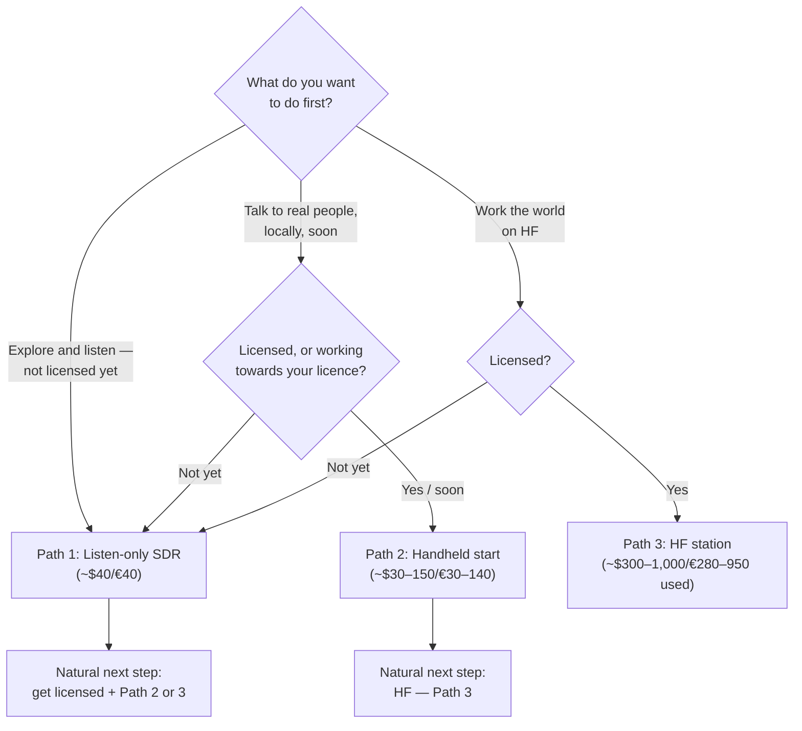
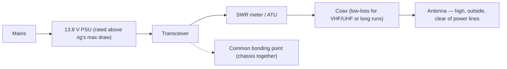

# Building Your First Station

Forty-five chapters of waves, decibels and flowgraphs have all been pointing at one moment: the day there is a station in your home with your name on it. This chapter is the plan for that day. It offers three honest paths — priced in realistic classes for the real-world market, frank about what will frustrate you on each — plus the shack basics that every path shares, advice for the used-gear market where most first stations are actually born, and a first week of operating for each route. There is no single right answer here; there is the right answer _for you_, and a flowchart to help you find it.

## First principles: antenna first, radio second

Before the paths, one rule that outranks everything else in this chapter: **spend on the antenna before you spend on the radio**. A $1,000/€1,000-class transceiver on a poor indoor antenna will be outperformed, hour after hour, by a $300/€300-class one on a decent outdoor wire. The antenna works for you on transmit _and_ receive, it never needs replacing when technology moves on, and — as [Antennas](outpost:entry/logbook73.handbook/antennas) argued — it is the most cost-effective watt you will ever buy. When any budget below feels tight, take the money from the radio column and move it to the antenna column. You will never regret it in that direction; people regret it in the other direction constantly.

> Prices in this chapter are indicative **classes**, quoted as rough $/€ equivalents; the used market moves, currencies drift, and your country's import duties are its own adventure. Treat every figure as "this order of magnitude", then check tonight's real listings.

The second rule follows from the first: get the signal to the antenna without squandering it. Feedline choice and length matter, especially at VHF/UHF — the numbers are in [Transmission Lines](outpost:entry/logbook73.handbook/transmission-lines), and they reappear below in the shack-basics section.

## Choosing your path

The paths are cumulative, not exclusive: many amateurs run all three from one desk, and the SDR from Path 1 remains useful forever as a band monitor and test instrument.

## Path 1: the listen-only SDR station (~$40/€40)

**What you buy:** an RTL-SDR dongle from a reputable maker with a TCXO (a temperature-stable crystal oscillator, so it doesn't drift) — roughly $30–40/€30–40 — plus a few metres of wire, some inexpensive coax and a USB extension lead. If HF matters to you from day one, budget another $40–60/€40–60 for an upconverter or stretch towards a budget HF-capable SDR.

**What you get:** the whole of chapters [SDR++](outpost:entry/logbook73.handbook/sdr-plus-plus), [FFTs & Waterfalls](outpost:entry/logbook73.handbook/ffts-and-waterfalls) and half the digital-modes part of this handbook, live on your screen. Broadcast, airband, [repeaters](outpost:entry/logbook73.handbook/repeaters), satellites, [FT8](outpost:entry/logbook73.handbook/ft8) decoding, [SSTV](outpost:entry/logbook73.handbook/sstv) pictures — all without a licence, because receiving is free almost everywhere. This is also, quietly, the best possible exam preparation: by the time you sit your licence exam you will have _seen_ modulation, propagation and interference rather than memorised them.

**What frustrates:** you cannot talk back — expect the itch to transmit to arrive within weeks. Bare RTL-SDRs are mediocre on HF (direct sampling works, grudgingly). Indoors, modern homes are an RF war zone: switch-mode power supplies, Ethernet, solar inverters and LED lights fill the spectrum with hash ([Noise](outpost:entry/logbook73.handbook/noise) explains why this is the real limit). Every metre you get the antenna away from the house pays off enormously.

**Natural next upgrade:** your licence itself ([Getting Licensed](outpost:entry/logbook73.handbook/getting-licensed)) — the best money-per-happiness upgrade in the hobby — then Path 2 or 3. On hardware: a better SDR (Airspy, SDRplay, RSP-class) or a dedicated HF antenna before any of that.

## Path 2: the licensed handheld start (~$30–150 / €30–140)

**What you buy:** once your callsign arrives ([Getting Licensed](outpost:entry/logbook73.handbook/getting-licensed)), a dual-band 2 m/70 cm FM handheld. The market splits sharply. At the bottom, Chinese handhelds (Baofeng and similar, $25–40/€25–40) genuinely work and have brought thousands of people into the hobby — the [Baofeng UV-5R guide](outpost:entry/logbook73.guide.uv-5r) walks the archetype through, menu by menu; their weaknesses are honest ones — wide-open front ends that overload near strong transmitters ([Overload & Ghost Signals](outpost:entry/logbook73.handbook/overload-and-ghost-signals)), mediocre supplied antennas, and menus designed by committee. At $100–150/€95–140, handhelds from the established amateur makers (Yaesu, Icom, Kenwood and peers) bring better receivers, better build and saner ergonomics. Either is a legitimate start. Whichever you choose, the first accessory is a better antenna: a quality whip transforms a cheap handheld, and a **speaker-mic** spares you holding the radio at your face.

**What you get:** actual conversations, at last — your voice, your callsign, real people. Local repeaters, simplex with club members, hilltop portable operating where a handheld plus height works minor miracles ([VHF](outpost:entry/logbook73.handbook/vhf) explains why height beats power). Repeater nets are the traditional home of the nervous first transmission, and every amateur remembers theirs; nobody is grading you.

**What frustrates:** the rubber-duck-indoors problem. A handheld in a living room is the worst radio arrangement in amateur service — the antenna is tiny, low, and surrounded by house. If you hear little, the radio is rarely broken; the location is. Coverage from home may be one or two repeaters, and quiet ones at that; daytime activity can be sparse (evenings and club nets are livelier). Programming repeater offsets and CTCSS tones by hand is fiddly — free programming software (CHIRP is the household name) and your club's channel list fix that in an evening.

**Natural next upgrade:** a proper antenna — a dual-band vertical or J-pole, outside and high, fed with decent coax — which upgrades your coverage far more than a new radio would. After that, either a 25–50 W mobile rig used as a base station, or the HF itch takes over and Path 3 begins.

## Path 3: the HF station (~$300–1,000 / €280–950 class, used-market realism)

**What you buy:** this is the path where the used market matters, because new entry-level HF transceivers start around $600–900/€560–850 and the used market offers superb value below that. Realistic shape of a $300–1,000 (€280–950) budget:

| Item                                 | Typical outlay      | Notes                                                       |
| ------------------------------------ | ------------------- | ----------------------------------------------------------- |
| Used 100 W HF transceiver            | $250–600 / €230–560 | 1990s–2010s sets from the big makers remain excellent       |
| 13.8 V power supply (20 A+)          | $50–120 / €45–110   | See shack basics below                                      |
| Wire antenna (dipole or end-fed)     | $20–80 / €20–75     | Or near-free if home-made — the best first project there is |
| Coax, connectors, rope, insulators   | $30–60 / €28–55     | Don't starve this line                                      |
| ATU (antenna tuning unit), if needed | $0–150 / €0–140     | Many rigs include one; fine for mild mismatches             |

A $300/€300-class station (older used rig, home-made dipole, careful shopping) is genuinely achievable and will work the world; $1,000/€950 buys a newer used transceiver with a waterfall display and comfort everywhere. Note that an entry-level licence's lower power limit (see your licence terms) does not make a 100 W rig pointless: you turn the power down, and keep headroom and resale value.

**What you get:** the full game. [Propagation](outpost:entry/logbook73.handbook/propagation) as a daily companion, DX on [HF](outpost:entry/logbook73.handbook/hf), FT8 that proves dead bands are merely quiet, awards, contests, morning greyline mysteries. An HF station rewards attention for decades.

**What frustrates:** antennas need _space_ — a 40 m half-wave dipole is about 20 m end to end — so town gardens force compromises (loaded verticals, end-feds, stealth wire) that all work but all trade something. Urban noise is the other tax: the same house-generated hash that bothered Path 1 can sit at S7 on 80 m. And solar-cycle reality: band openings come and go with the Sun, and some days genuinely are poor. The amateurs who thrive treat that as weather, not betrayal.

**Natural next upgrade:** almost always antenna, not radio — higher, longer, or more resonant. Then your next licence class for more power, a [NanoVNA](outpost:entry/logbook73.handbook/nanovna) if you haven't one already, and only much later a fancier transceiver.

## Shack basics: the unglamorous parts that decide everything

**Power supply.** An HF transceiver wants nominally 13.8 V DC and draws serious current on transmit — a 100 W rig pulls around 20 A. Buy a supply rated comfortably _above_ the radio's maximum (a 25–30 A supply for a 20 A radio), because a supply run at its ragged edge runs hot and sags. Two families exist: **linear** supplies (heavy, silent on the airwaves) and **switch-mode** (light, cheap, and — if poorly made — a noise generator sitting a metre from your receiver). Good amateur-grade switch-mode supplies are fine; anonymous bargains are how people install an S5 noise source in their own shack.

**Grounding and bonding — and a safety note.** Keep the two ideas separate. _Electrical safety earthing_ belongs to your house wiring: never remove or "improve" it yourself, and treat anything mains-side as a job for a qualified electrician. _RF grounding and bonding_ is the amateur practice of connecting station equipment chassis together and to a common point, so everything sits at the same potential — it tames tingles from RF on microphones and helps noise. Outdoor antennas deserve respect too: keep every antenna and rope far from overhead power lines (a distance greater than the span could ever fall), and disconnect antennas when thunderstorms threaten. None of this is alarming in practice; it is seatbelt-grade routine.

**Coax.** For HF at 100 W over modest runs, RG-58-class cable is acceptable and RG-8X/Mini-8 class is comfortable. For VHF/UHF, or any run beyond ~15–20 m, step up to RG-213 or a low-loss foam cable — at 435 MHz thin coax quietly eats half your signal, exactly as the tables in [Transmission Lines](outpost:entry/logbook73.handbook/transmission-lines) warned. Buy decent connectors, fit them carefully (or buy pre-terminated), and keep water out of outdoor joints with self-amalgamating tape; wet coax is the classic slow-death fault.

**And once more: antenna first.** Every coin and every hour spent getting the antenna higher, longer and further from the house buys more signal than the same coin spent anywhere else in this diagram.

## Buying used without being burnt

Most first HF stations are used, and the used amateur market — club sales, rallies and hamfests, your national society's classifieds — is unusually honest. But go in with a checklist:

- **Buy where you can try.** A rig demonstrated receiving _and transmitting_ (into a dummy load, watching power output) tells you most of what matters. Check every band, work the main controls, and listen for scratchy volume pots and flaky displays.
- **Ask the classic questions.** Has it been used with high power or heavy digital duty cycles (hard on PA stages)? Any repairs? Is it a smoker's rig (you can smell that in the post)? Original box and manual suggest a careful owner.
- **Know the going rate.** A few evenings watching completed sales teaches you the fair price of any common model; anything dramatically cheaper has a reason.
- **Let the club help.** This is the big one. A local club ([Amateur Radio](outpost:entry/logbook73.handbook/amateur-radio) explains how to find yours) gives you experienced eyes for a viewing, members upgrading who sell honest gear at fair prices to newcomers, and club sales and rallies where the seller will be seen again — a powerful warranty. Clubs also lend and demonstrate, which can save you from buying the wrong thing entirely.
- **Budget for the boring extras.** Microphone missing? Odd connector? A used bargain plus $60/€55 of forgotten accessories is not a bargain. Check what is in the box.

## Your first week on the air

A plan per path — because the fastest way to a silent, dusty station is to buy one without deciding what its first week looks like.

**Path 1 (SDR):** Day 1–2, install SDR++ and work the "first five things to hear" list. Day 3–4, string the longest wire you can outdoors and compare the noise floor against the supplied whip — your first real experiment. Day 5–7, virtual audio cable plus WSJT-X on `14.074 MHz`, and watch a continent decode. Log every catch as a reception in LogBook73.

**Path 2 (handheld):** Day 1, program your local repeaters (club channel list plus CHIRP). Day 2–3, listen to the repeater at its busy times until the rhythm of overs feels familiar. Day 4, the big one: key up and give your callsign — "M7XYZ listening through" is a complete, correct first transmission. Day 5–7, join the club net, try a simplex contact on the 2 m FM calling channel (`145.500 MHz` in Region 1 — check your band plan), and take the handheld up the nearest hill to feel what height does.

**Path 3 (HF):** Day 1–2, antenna up and checked with an SWR meter or [NanoVNA](outpost:entry/logbook73.handbook/nanovna) _before_ serious transmitting — see [SWR](outpost:entry/logbook73.handbook/swr). Day 3, a listening day across 40 m and 20 m, morning and evening, to learn the bands' moods. Day 4–5, first contacts: FT8 if you want the gentlest start (the software does the talking), or answer a loud CQ on SSB — answering is far easier than calling, and [Making Contacts](outpost:entry/logbook73.handbook/making-contacts) scripts the whole exchange for you. Day 6–7, call CQ yourself, and start chasing whatever caught your imagination: counties, countries, or just a longer conversation.

## LogBook73 from day one

A logbook is not the paperwork you owe the hobby; it is the memory of the station you are building — and you do not need a licence to start it. LogBook73's reception logging is built for Paths 1's SDR sessions: every broadcast station, repeater and FT8 decode you record becomes a personal map of what your location and antenna can hear, and comparing receptions before and after an antenna change is the cheapest test equipment you will ever own. The **Repeaters** and **Saved Frequencies** pages keep your growing lists of machines and channels organised alongside the log rather than in a drawer of sticky notes, and the **stations directory** builds itself from every station you log. And once you are licensed and the QSOs start, the **Awards** page quietly turns your log into goals — DXCC entities worked, all six continents, CQ zones — which is exactly the nudge a new station needs in its first quiet months. Whatever path you chose today, open the log tonight.

## Try it yourself

1. Run the flowchart above honestly and write down your path — then write down the _antenna_ you can realistically put up, before you look at a single radio advert.
2. Price your chosen path with tonight's real listings: one candidate radio or SDR, one antenna, the coax and connectors to join them, and (Path 3) the power supply. The total is your genuine budget, not the radio's sticker price.
3. Find your nearest amateur radio club via your national society's club finder (RSGB in the UK, ARRL in the US, DARC in Germany…) and note their next meeting — take your shopping list with you.
4. Create your station's home in LogBook73: add your local repeaters to the Repeaters page, and log at least one reception this week, even if it is only broadcast FM on an RTL-SDR.

## Key takeaways

- Antenna first, radio second — every time budgets are tight, move money from the radio to the antenna and feedline.
- Three honest paths: listen-only SDR (~$40/€40, no licence needed), licensed handheld ($30–150, real conversations, location matters more than the radio), and used-market HF ($300–1,000 class, the full game with space and noise as the taxes).
- The shack's unglamorous trio — a generously rated 13.8 V supply, sensible bonding plus antenna safety, and coax chosen for the frequency and run length — decides more than the transceiver's brochure does.
- Buy used through and around a club: try before buying, learn fair prices, and prefer sellers who will see you again.
- Give the station a first week's plan; stations with plans get used, stations without gather dust.
- Log from day one — receptions before the licence, QSOs after — and let the log measure every antenna experiment.

With a station taking shape, the last stops are the reference shelf: every term in one place in the [Glossary](outpost:entry/logbook73.handbook/glossary).
