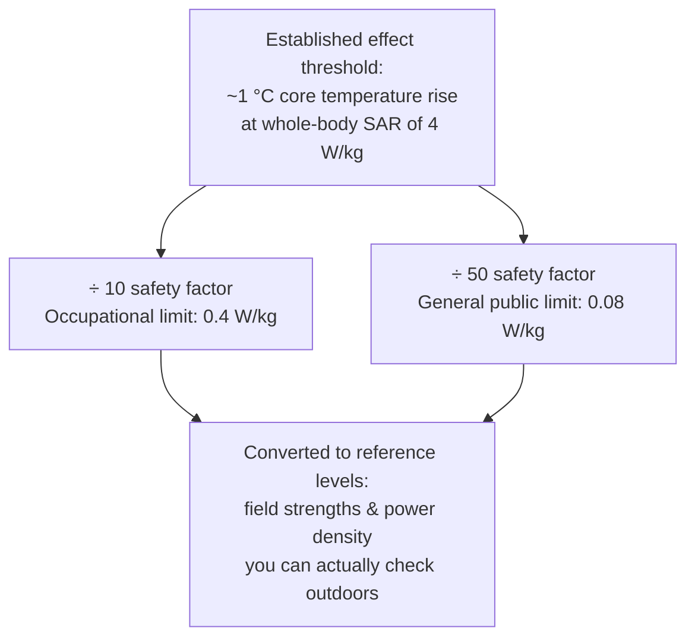
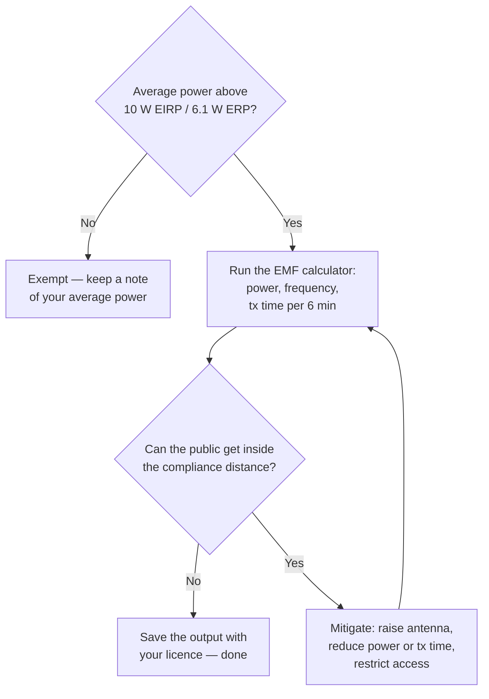
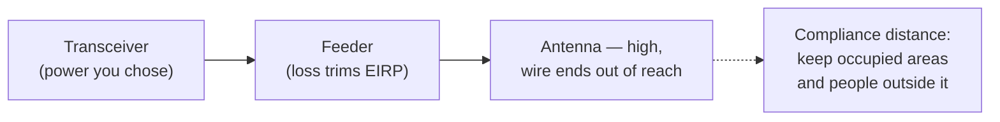

# RF Safety & EMF Exposure

Every transmitter in [your new station](outpost:entry/logbook73.handbook/building-your-first-station) fills the space around its antenna with electromagnetic fields — that is the whole point of it. So it is fair, and in many jurisdictions a legal duty, to ask: how strong is too strong, who decides, and how do you assess your station? Exposure guidelines incorporate conservative reduction factors, and many modest amateur stations comply through thoughtful antenna placement and operating practice, but the result must come from the method accepted where you operate. This chapter explains the science in plain words, shows how power, duty cycle and distance affect a simplified estimate, and finishes with practical habits for reducing exposure.

> **Scope and source basis — reviewed 26 August 2026.** The exposure science and reference levels below use the [ICNIRP 2020 RF guidelines](https://www.icnirp.org/en/activities/news/news-article/rf-guidelines-2020-published.html). The legal worked examples use [Ofcom's current UK EMF policy](https://www.ofcom.org.uk/spectrum/electromagnetic-fields/policy) and the FCC's [2019 rule order](https://docs.fcc.gov/public/attachments/FCC-19-126A1.pdf) plus [2021 effective-date notice](https://docs.fcc.gov/public/attachments/DA-21-363A1.pdf). Physics is portable; legal duties, exemptions and accepted assessment methods are jurisdiction-specific and must be confirmed with the operator's current regulator.

## Non-ionising, and why that word matters

Start with the physics, because it defuses most of the fear you will meet online. Radiation comes in two profoundly different kinds. **Ionising** radiation — X-rays, gamma rays, the far ultraviolet — arrives as photons energetic enough to knock electrons off atoms and break chemical bonds, which is how it can damage DNA. **Non-ionising** radiation cannot do that, no matter how many photons arrive, because each individual photon carries too little energy for the job.

Radio is spectacularly non-ionising. A photon's energy is proportional to its frequency, and breaking a typical chemical bond takes an energy of a few electron-volts — roughly what a visible-light photon carries. A `145 MHz` photon carries about `0.0000006` electron-volts: millions of times too weak. Turning up the power does not help it along, any more than throwing more table-tennis balls will ever crack a window that needs a brick. Visible light from your desk lamp is closer to ionising than any radio wave is; only beyond the ultraviolet does light start breaking bonds.

So what _can_ strong RF fields do to tissue? The answer, established across decades of research reviewed by bodies such as the **International Commission on Non-Ionizing Radiation Protection (ICNIRP)**, is **heating**. Tissue absorbs RF energy and warms, exactly as food warms in a microwave oven — the same physics, at vastly different power levels. Every exposure limit you will meet in this chapter exists to keep that heating trivially small: the limits are set so far below the level at which your body core temperature could rise even one degree that normal exercise warms you far more.

Two honest framing points before we go on. First, research into other possible effects continues, as it should, and the scientific reviews are updated as evidence accumulates — the current international consensus is that heating is the established effect and the limits protect against it with wide margins. Second, none of this makes strong fields something to shrug at: put your hand on a radiating antenna and RF will burn you, quite conventionally, through heating. Respect, not fear, is the operating mode — the same attitude you already bring to mains electricity and ladders.

## Measuring exposure: SAR and power density

Two quantities do almost all the work in this subject, and both are friendlier than they sound.

**SAR — specific absorption rate** — measures how fast tissue absorbs RF energy, in watts per kilogram (`W/kg`). It is the fundamental quantity: heating depends on absorbed power per unit of body mass. SAR comes in two flavours: _whole-body_ SAR (total absorbed power averaged over your entire mass — this is what limits general warming) and _local_ SAR (absorption in the most-exposed 10 grams of tissue — this is what matters for a handheld's antenna a few centimetres from your head). The trouble with SAR is that you cannot measure it in a garden; it lives inside bodies and is assessed with laboratory phantoms and computer models.

**Power density** is the practical stand-in: how much RF power flows through each square metre of space, in watts per square metre (`W/m²`). Fields spread out as they leave an antenna, so power density falls rapidly with distance — in the far field it follows the inverse-square law, dropping fourfold every time you double the distance. Power density (and its cousins, electric and magnetic field strength) _can_ be calculated or measured at a spot in your garden, which is why regulations are usually written in these terms: the standards bodies work out what external field corresponds to the SAR they want to cap, add conservatism, and publish that as a **reference level** you can check against.

One more idea completes the toolkit: **averaging time**. Heating is slow — your body needs minutes to warm — so limits are defined as averages over minutes (ICNIRP uses 30 minutes for whole-body exposure and 6 minutes for local exposure), not as instantaneous peaks. That single fact will do a great deal of work for your station in a moment, because amateur transmissions are bursty. Hold onto it.

## The limits: ICNIRP and its safety margins

ICNIRP publishes widely used RF exposure guidelines, most recently revised in 2020; each regulator decides whether and how to adopt them. The logic behind the numbers is worth seeing, because it shows how much margin an adopting jurisdiction builds in:



The starting point is the exposure associated with a body-core temperature rise of about 1 °C — itself no injury, merely the operational threshold of concern. Workers (trained, aware, able to move away) get a limit ten times below that; the **general public** — which in the standards means everyone else, of every age and state of health, unaware of the exposure — gets a limit _fifty_ times below it: a whole-body SAR of `0.08 W/kg`. For local exposure the head and torso limit is `2 W/kg` in any 10 g of tissue.

Translated into general-public reference levels — the numbers a station assessment actually uses — ICNIRP 2020 gives, for whole-body exposure averaged over 30 minutes:

| Frequency range | General-public reference level                     |
| --------------- | -------------------------------------------------- |
| 0.1–30 MHz      | field strength: `300/f⁰·⁷ V/m` (≈ 77 V/m at 7 MHz) |
| 30–400 MHz      | `2 W/m²`                                           |
| 400–2000 MHz    | `f/200 W/m²` (so 5 W/m² at 1 GHz)                  |
| 2–300 GHz       | `10 W/m²`                                          |

So the headline is: **a few watts per square metre, depending on frequency** — tightest (2 W/m²) around 30–400 MHz where human bodies happen to absorb RF most efficiently (an adult is not far from a resonant antenna on the low VHF bands), relaxing to 10 W/m² at microwave frequencies. At HF below 30 MHz the limits are expressed as field strengths instead, but the spirit is identical. Occupational levels are five times higher again. These are averages over half an hour of the _incident_ field where a person could actually be — not the field at the antenna wire itself.

## Peak, average and duty cycle

Here is where amateur operating turns out to be kinder than the raw numbers suggest. The limits are time averages; your transmitter is rarely a continuous one. Two separate factors shrink your average power below the number on the radio's dial, and [RF Power](outpost:entry/logbook73.handbook/rf-power) introduced both.

First, **duty cycle within a transmission**. FM, RTTY and the digital modes transmit at full, constant power whenever keyed. CW is on only during dits and dahs — planning guides commonly assume around 40–50 % of key-down time. SSB is the gentle one: power follows your voice, touching peak power only on syllable crests, and exposure calculators typically assume a plain SSB voice averages only about **20 % of its peak power** (more, perhaps 40–50 %, with heavy speech processing). Treat all of these as the well-established rules of thumb they are — they come from the assumptions built into regulators' and societies' calculators, not from your particular voice.

```viz
{ "type": "wave", "title": "Why SSB averages low", "caption": "An SSB signal reaches full power only on voice peaks — averaged over time it is roughly a fifth of its peak power, which is why exposure limits, written as time averages, sit further from typical operating than the dial suggests.", "xLabel": "time", "traces": [ { "kind": "am", "freq": 30, "mod": 2.5, "depth": 0.8, "label": "SSB — power follows speech", "tone": "primary" }, { "kind": "envelope", "mod": 2.5, "depth": 0.8, "style": "dashed", "label": "speech envelope", "tone": "muted" } ] }
```

Second, **transmit/receive ratio**. Even a keen operator listens. In a contact you might transmit half the time; [FT8](outpost:entry/logbook73.handbook/ft8) is beautifully predictable — it transmits for about 12.6 s of each 15-second slot but alternates transmit and receive periods, so continuous operating works out near 40–50 % transmit time (the RSGB's calculator pre-fills about 42 %). Note the trap hiding in that comparison: FT8 is a _full-duty_ mode while transmitting, so 100 W of FT8 delivers a far higher average power than 100 W of casual SSB. Digital-mode operators routinely run reduced power partly for exactly this reason (their PA thanks them too).

An assessment therefore asks not "what does the meter peak at?" but "how many watts, averaged over the worst six minutes of a busy session?" — and for most stations the answer is a fraction of the transceiver's rating.

## The UK example: Ofcom's EMF licence condition

How does all this become law? Countries differ, so let us walk through one complete, real example — the United Kingdom — and then look outward. Since 2021, UK licence classes that authorise more than 10 W EIRP / 6.1 W ERP — including the Amateur Radio Licence — carry an **EMF condition**: affected licensees must ensure that wherever the general public can be, the ICNIRP general-public limits are met when they transmit.

The shape of the obligation is friendly, and hinges on one threshold:

- If your station never exceeds an average radiated power of **10 W EIRP** (equivalently **6.1 W ERP**) — averaged over any six minutes, with peaks below 100 W EIRP — no assessment is required. (EIRP, from [Decibels](outpost:entry/logbook73.handbook/decibels), is transmitter power times antenna gain relative to an isotropic radiator.) Ofcom does ask you to keep a simple note showing your average power is under the threshold. Most handhelds live here: `5 W` into a whip of about 2 dBi gain is roughly `8 W` EIRP.
- Above the threshold, you carry out a **compliance check** — most easily with Ofcom's free EMF calculator (or an equivalent such as the RSGB's, which adds amateur niceties like per-mode duty factors). You enter three things: maximum radiated power, frequency, and your maximum transmit time in any six-minute period. It returns a **compliance distance**: keep members of the general public further from the antenna than this while transmitting, and you comply.
- You then keep the calculator output (a screenshot or PDF is fine) with your licence as your **record**, and only redo the exercise when you change something that could increase exposure — a new antenna, more power, a different location for the mast. Ofcom's officers may ask to see the record during a station inspection.



Two definitions make the condition much easier to meet than it first sounds. "General public" means family, neighbours, visitors and passers-by — **not you**, the licensee, whom the condition does not require to be protected (though applying the same distances to yourself is plain good sense). And the distance is measured from the _antenna_ — which is exactly why the age-old advice to get antennas high and away from the house ([Antennas](outpost:entry/logbook73.handbook/antennas)) quietly solves compliance as a side effect. Emergency communications are exempt while the emergency lasts. The current details and both calculators are on [Ofcom's EMF pages](https://www.ofcom.org.uk/spectrum/electromagnetic-fields/faqs) and the [RSGB's EMF pages](https://rsgb.org/main/technical/emc/emf-exposure/).

## A worked assessment: 100 W and a wire dipole

Numbers make this concrete. Take the classic first HF station: `100 W` on the 20 m band (`14.2 MHz`) into a half-wave dipole. A dipole's gain is `2.15 dBi`, a factor of 1.64, so peak EIRP ≈ `164 W` (feeder loss would trim this — see [Transmission Lines](outpost:entry/logbook73.handbook/transmission-lines) — but let us stay conservative and ignore it). That is far above 10 W EIRP, so an assessment is needed. The simple far-field sum the calculators are built on says power density `S = EIRP / (4πd²)`; setting `S` to the `2 W/m²`-class general-public level and solving for distance:

`d = √(164 / (4π × 2)) ≈ 2.6 m`

**Far-field illustration — continuous key-down carrier: about 2.6 metres.** This deliberately simplified inverse-square sum is not an Ofcom compliance result; it only shows how power, duty cycle and distance scale. Now let averaging do its work:

| Operating style                                     | Average EIRP | Far-field illustration               |
| --------------------------------------------------- | ------------ | ------------------------------------ |
| Continuous carrier (worst case)                     | 164 W        | ≈ 2.6 m                              |
| FT8, non-stop (~42 % transmit time)                 | ≈ 69 W       | ≈ 1.7 m                              |
| SSB chat (transmit half the time, ~20 % voice duty) | ≈ 16 W       | under 1 m by this simplified sum     |
| SSB chat at 50 W                                    | ≈ 8 W        | below the UK average-power threshold |

Read that table for scale, not as permission to transmit. Near-field behaviour close to an HF antenna is not represented by the far-field formula, and accepted assessment methods may impose additional conservative distances. A dipole hung at a sensible height — 8 or 10 metres up, ends clear of the garden fence — is a strong starting point, but **the regulator's calculator or another accepted method supplies the compliance distance**. High power changes the picture in proportion — in the far field, a tenfold EIRP increase stretches distance by √10 ≈ 3.2× — which is why serious contest stations think genuinely hard about antenna siting.

## Beyond the UK: the same physics, local paperwork

The paperwork varies by country — check your regulator's current rules, exactly as you did for [your licence](outpost:entry/logbook73.handbook/getting-licensed). One more worked example deserves a paragraph: the **United States**. The FCC sets its own exposure limits rather than adopting ICNIRP. Its 2019 rule change — effective 3 May 2021, with a two-year review period for existing parties — replaced service-specific evaluation lists with streamlined, service-neutral exemption formulas. A US amateur station must either meet those exemption criteria or perform an RF exposure evaluation, using the same ingredients you met above: power, gain, distance, frequency and duty cycle. The FCC's order points amateurs to OET Bulletin 65 Supplement B; the ARRL also publishes a calculator and plain-English guidance at [arrl.org/rf-exposure](https://www.arrl.org/rf-exposure). Elsewhere, start with the national regulator: the physics is universal, the paperwork is local.

## Practical habits around the shack

Beyond the assessment, a handful of habits keep you comfortably inside the limits without thinking about them daily.

**Antenna placement does almost everything.** Height and separation from occupied spaces — the bedroom window, the neighbour's patio, the bus stop — are the master variables, and they are the same variables that make antennas _work well_ ([Antennas](outpost:entry/logbook73.handbook/antennas)). An antenna you can touch from a deckchair is a poor radiator in every sense.

**Never touch a transmitting antenna or bare feeder.** RF burns are the one genuinely common RF injury among amateurs: RF voltage on a wire end, an ATU terminal or a whip can reach hundreds of volts and burns skin on contact — deeper than it looks, because the current flows beneath the surface. Wire ends are the high-voltage points ([SWR](outpost:entry/logbook73.handbook/swr) explained those standing waves), so sling them out of reach, and make "is anyone near the antenna?" part of your transmit habit, especially portable.

**Handhelds: small numbers, sensible habits.** A typical 5 W handheld on its stock antenna is below the UK's 10 W EIRP threshold, but rules elsewhere differ and its antenna sits centimetres from your head, which is local-SAR territory. The costless improvements: follow the manufacturer's separation instructions, use the lowest power that works (often 0.5–1 W through a nearby repeater), and prefer a speaker-microphone — which [Building Your First Station](outpost:entry/logbook73.handbook/building-your-first-station) recommended for comfort anyway.

**Amplifiers and microwaves: scale your respect with EIRP.** High power plus high gain is the combination that concentrates fields: 10 W into a 30 dBi dish is 10 kW EIRP in a narrow beam. On the [microwave](outpost:entry/logbook73.handbook/microwave) bands, never look into an open waveguide or stand in front of a dish feed while it can transmit — eyes dissipate heat poorly and are the tissue to protect. The rule costs nothing: point the beam, then power it; power down before you work at the feed.



**And keep perspective.** The limits already contain a 50-fold margin below a threshold that is itself harmless; your assessment shows you are outside the distance at which even those cautious limits could be reached. Do the five-minute sum, file the screenshot, place the antenna like an amateur who wants DX — and this topic is handled.

## Try it yourself

1. Work out your own station's peak EIRP: transmitter power × antenna gain (as a ratio), minus feeder loss. A dipole is 2.15 dBi (×1.64); [Decibels](outpost:entry/logbook73.handbook/decibels) has the conversions. Is your _average_ over a busy six minutes above or below 10 W EIRP?
2. Run a real calculator — Ofcom's or the RSGB's if you are in the UK, ARRL's if you are in the US, or your national society's equivalent — for your usual band, power and mode. Save the output as a PDF: that file _is_ the compliance record.
3. Repeat the calculation for the same power on SSB and on FT8 and compare the compliance distances. Watching duty cycle move the answer teaches more than any paragraph here.
4. Walk your garden (or portable site) and pace out the worst-case distance from your antenna's nearest point to anywhere the public can stand. Most readers discover they comply several times over — now you have the number that proves it.

## Key takeaways

- Radio is **non-ionising**: its photons are millions of times too weak to break chemical bonds, and the established effect of strong RF fields is gentle tissue **heating** — which the limits cap with huge margins.
- Exposure is measured as **SAR** (`W/kg`, in tissue) and assessed in practice via **power density** and field-strength **reference levels**; ICNIRP's general-public levels are a few `W/m²` depending on frequency (`2 W/m²` at 30–400 MHz, `10 W/m²` above 2 GHz), averaged over minutes. Its basic restrictions apply reduction factors to established adverse-effect thresholds, including a factor of 50 for general-public whole-body exposure in the relevant RF range.
- Limits are **time averages**, so duty cycle matters: SSB averages roughly 20 % of peak power, CW ~40–50 %, FM and digital modes 100 % while keyed — 100 W of FT8 is a much bigger average than 100 W of SSB.
- In the UK, the **Ofcom EMF licence condition** (since 2021) requires stations above **10 W EIRP / 6.1 W ERP** average to check compliance — calculator, compliance distance, keep the record; below the threshold you are exempt.
- A simplified far-field illustration for a **100 W HF dipole station** lands in the few-metre range, but it is not a compliance assessment; use the regulator's calculator or another accepted method, especially in the antenna's near field.
- The **FCC** replaced service-specific evaluation lists with service-neutral exemption formulas effective in 2021: a US station must be exempt-by-criteria or evaluated; elsewhere, check your regulator — the physics is universal, the paperwork is local.
- Practical habits: antennas high and away from people, never touch a radiating antenna or feeder (RF burns are real), keep handheld antennas away from your head, and treat high-gain microwave feeds with beam-pointed-away discipline.

Fields under control, the next worry is subtler: your transmitter upsetting the neighbours' electronics, and theirs upsetting your receiver — on to [EMC & Interference](outpost:entry/logbook73.handbook/emc-rfi).
