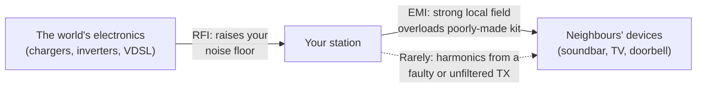
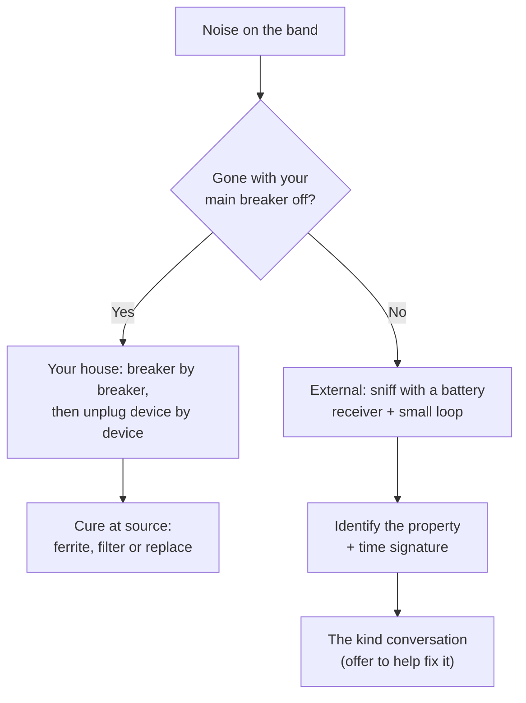
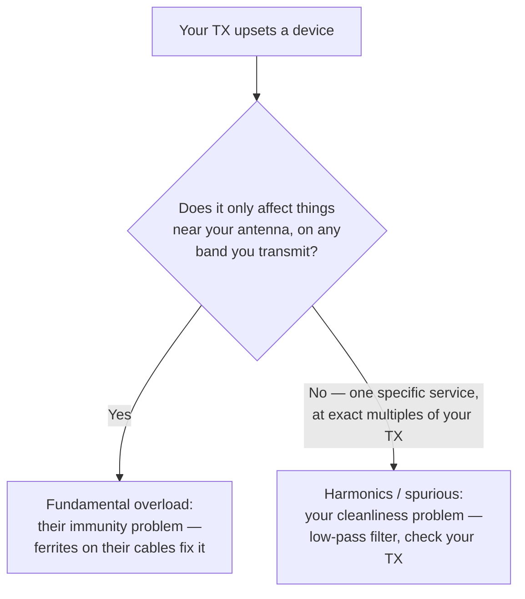

# EMC & Interference

Sooner or later, every station meets interference — and it arrives from both directions. One day the bands are buried under a buzzing hash that turns out to be your own phone charger; another day a neighbour knocks to say your voice is coming out of their soundbar. Both problems have the same physics, the same toolkit and, happily, the same cures. This chapter is about **EMC** — electromagnetic compatibility, the art of electronic devices coexisting without upsetting each other — and it will turn you from a victim of interference into the person on your street who can actually fix it.

## Interference is a two-way street

Amateurs talk about interference as if it were one thing, but there are two distinct directions, and they need different mindsets:

- **Interference _to_ you (RFI)**: the electronic din of modern life raising your noise floor, so the weak DX you should hear is submerged. [Noise](outpost:entry/logbook73.handbook/noise) explained why this — not receiver quality — is the real limit at most home stations. Here we go deeper into the hunt and the cures.
- **Interference _from_ you (EMI)**: your perfectly legal transmissions upsetting a neighbour's television, soundbar or doorbell. This is the direction that frightens newcomers most, and the one most surrounded by myth.



The myth worth killing immediately: when your transmission appears in someone's speakers, it almost never means your signal is dirty or illegal. A modern commercial transceiver in good order transmits a clean signal well within the spurious-emission limits every licence requires. What usually happens instead is **fundamental overload**: your perfectly clean signal is simply _strong_ near your own house — you are, after all, deliberately radiating tens of watts a garden away — and a poorly designed device lets that strong field in through its cables, whereupon its semiconductor junctions rectify the RF into audio. The fault, in the engineering sense, lies with the device's poor **immunity** (its ability to ignore signals not meant for it). But "legally it's their problem" is a terrible opening line for a conversation with a neighbour, so this chapter ends with a social playbook as well as a technical one.

Keep the two directions and the two failure modes — overload versus genuinely spurious emissions — separate in your head, and every interference problem becomes diagnosable.

## The modern noise zoo

[Noise](outpost:entry/logbook73.handbook/noise) introduced the culprits; here is the field guide an interference detective needs — how each offender sounds on a receiver and looks on a waterfall ([FFTs & Waterfalls](outpost:entry/logbook73.handbook/ffts-and-waterfalls) taught you to read one):

- **Switch-mode power supplies (SMPS)** — phone chargers, laptop bricks, router supplies. They chop the mains tens of thousands of times a second, and cheap ones radiate the harmonics of that switching right across HF: a **comb of buzzing carriers spaced every few tens of kHz**, marching across the waterfall, often drifting slowly as the supply warms up. The single most common source, and usually the easiest to fix.
- **LED lighting and dimmers** — each bulb hides a tiny SMPS; a house full of them is a choir. The giveaway is the light switch: noise that appears at dusk when the lights go on, room by room.
- **Solar PV inverters** — a powerful switching converter with metres of DC cabling for an antenna. Broad, rasping hash across HF that **follows the Sun**: strongest at midday, gone at night. Installation-dependent — good ones are nearly silent.
- **VDSL broadband** — internet over telephone wires using spectrum up to about 17 MHz (higher-rate profiles further still), turning the line into an accidental antenna. Looks like a **broad plateau of raised noise with sharp band edges** on the waterfall. Notches are supposed to protect amateur allocations; reality varies, and full-fibre rollout is slowly retiring this one.
- **PLT / powerline-network adaptors** — data over the house mains, occupying much of HF. Compliant units notch the amateur bands; non-compliant ones are notorious wideband polluters.
- **Plasma TVs, induction hobs, treadmills, aquarium heaters, electric fences** — the long tail: everything from broad evening-time hash to a metronomic tick once a second.

```viz
{
  "type": "spectrum",
  "title": "Two signatures worth memorising",
  "caption": "A switch-mode supply paints an evenly spaced comb of harmonics; VDSL raises a broad plateau with sharp edges. Both sit on top of the natural floor and neither arrives by propagation — they are local, and therefore fixable.",
  "noiseFloor": 0.15,
  "components": [
    { "f": 8, "amp": 0.45, "label": "SMPS comb" },
    { "f": 16, "amp": 0.42 },
    { "f": 24, "amp": 0.4 },
    { "f": 32, "amp": 0.36 },
    { "f": 40, "amp": 0.33 },
    { "f": 70, "amp": 0.3, "width": 24, "tone": "muted", "label": "VDSL plateau" }
  ],
  "xLabel": "frequency →"
}
```

The common thread: none of this arrives via the ionosphere. Man-made noise reaches you by **direct radiation from cables acting as antennas**, or conducted along the mains wiring your whole street shares. Local origin is the good news of this entire chapter — a local source can be found, and what can be found can usually be silenced.

## Detective work: the hunt

Interference hunting is a process of elimination, and the order matters — always halve the search space before examining suspects one by one.

**Step 1 — the power-cut test.** On battery power only (a portable shortwave receiver, a handheld with HF receive, or a laptop-plus-SDR unplugged from the mains), note the noise, then switch off your house's **main breaker** for sixty seconds. If the noise vanishes, the source is in your own home — the most common result and the best one, because you control every plug in it. If it stays, it is external: a neighbour or infrastructure.

**Step 2 — narrow by circuit, then by device.** Power restored, flip breakers one circuit at a time, watching the noise. Once one circuit is guilty, unplug its devices one by one — and be suspicious of things you'd never suspect: chargers plugged in with nothing attached, "off" televisions (standby supplies still switch), doorbell transformers.

**Step 3 — sniff with a portable receiver.** For sources outside your walls, take the battery-powered receiver for a walk. Tune to the noise on a quiet frequency, shorten or remove the antenna as you close in (so the receiver only hears strong, nearby fields), and follow the loudness. A small magnetic loop — even a few turns of wire on a plastic former — makes a fine direction-finding probe with a sharp null. Noise typically peaks under a specific stretch of mains wiring, beside one house's solar array, or at a pole-mounted junction. Note the **time signature** as evidence: sun-following says PV, evenings say lighting and TVs, 24/7 says chargers, routers or VDSL.



**Step 4 — the neighbour conversation, done kindly.** If the trail ends at someone else's house, remember they almost certainly have no idea their gadget radiates — and may be suffering the same noise on their own DAB radio or Wi-Fi. Lead with curiosity, not accusation: "I chase radio interference as a hobby and I think a device near here might be faulty — it could be interfering with your own kit too. Mind if we try switching a couple of things off for a minute?" Offer to supply and fit the cure yourself. An amateur who turns up with a bag of ferrites and fixes a neighbour's crackling FM radio has made an ally for life; one who opens with regulations has made the opposite.

## The cures: ferrites, filters and distance

Almost every cure attacks the same weakness: **cables acting as antennas**. Noise leaves a gadget (and RF enters one) mostly along its leads, flowing as **common-mode current** — current travelling the same direction on all conductors of a cable at once, using the whole lead as a radiating (or receiving) antenna, rather than the equal-and-opposite differential currents that carry the intended power or signal. Block the common-mode current and the cable stops being an antenna, while the wanted signal inside is untouched.

The tool for that is the **ferrite choke**: a ring or clamp of magnetic ceramic slipped over the cable. To differential currents it is invisible; to common-mode current it looks like a lossy impedance of hundreds or thousands of ohms that absorbs the RF as a trace of heat. Two practical rules multiply their effect. First, **turns count**: impedance rises roughly with the square of the number of passes through the core, so looping a lead three times through a clip-on is many times better than clipping it over a straight cable. Second, **material ("mix") matters** — ferrite recipes trade permeability against frequency:

| Mix    | Chemistry | Sweet spot for choking              | Typical amateur use                                          |
| ------ | --------- | ----------------------------------- | ------------------------------------------------------------ |
| **31** | MnZn      | ~1–10 MHz, still good across all HF | Low-band and all-round HF feedline chokes, mains lead chokes |
| **43** | NiZn      | ~25–300 MHz (slight edge 14–30 MHz) | Upper-HF, VHF/UHF cables, USB and Ethernet leads             |

If you buy one core for HF work, make it mix 31; for VHF/UHF and computer-cable cleanup, mix 43. (Numbers courtesy of the manufacturers' data — ferrite behaviour is well documented, so you never need to guess.)

Where to apply all this:

- **On the offending device**: ferrite on the mains lead, as close to the device as possible, several turns if the lead allows; ferrite on output leads too (the DC lead of a charger radiates just as happily). If the device is a cheap supply, the honest fix is often a better supply — pocket money against a lifetime of hash.
- **On your own coax**: a **common-mode choke** at the antenna feedpoint — many turns of coax through stacked mix-31 toroids, or a purpose-made choke balun — stops the braid carrying house noise up to the antenna on receive, and RF back down into the shack on transmit. One choke, both directions helped. [Transmission Lines](outpost:entry/logbook73.handbook/transmission-lines) explains why the outside of the braid behaves as a separate conductor.
- **Balanced antennas, fed properly**: a dipole fed through a choke ([Antennas](outpost:entry/logbook73.handbook/antennas)) inherently rejects much common-mode pickup that end-fed and random wires invite.
- **Mains filters**: a plug-in mains EMI filter can block noise arriving by conduction into your shack supply — useful, but secondary to ferrites at the source.
- **Distance, always distance**: near-field strength falls fast with metres. An antenna at the far end of the garden, high and away from the house, escapes most of the din that a loft antenna sits inside. This is the cheapest 20 dB you will ever buy.

## Earthing and bonding, in one careful paragraph

Two different things share the word "earth", and confusing them is both a performance and a safety mistake. **Safety earthing** is part of your house's mains installation — the protective conductor that makes fuses and breakers trip during a fault. It belongs to a qualified electrician: never disconnect, "improve" or add to it yourself, and never let RF experiments touch the consumer unit. **RF grounding and bonding** is the amateur practice of strapping your station's equipment chassis together with short, wide conductors to a single bonding point, so everything sits at one RF potential — it tames RF-on-the-microphone tingles, helps chokes do their job, and gives static a path. The two systems must coexist correctly (your national wiring regulations say how — the RSGB's EMC leaflets cover the UK case in detail), so when in doubt, ask an electrician who understands radio, and see [RF Safety & EMF Exposure](outpost:entry/logbook73.handbook/rf-safety) for the wider safety picture.

## When you are the problem

Now the other direction: your transmitter and the neighbour's soundbar. Diagnosis comes down to one question — is the offending energy **on your frequency, or not?**



**Fundamental overload** is by far the more common. Your clean signal, at legal power, is simply enormous a few metres away, and consumer gear built to a price lets it in — usually along speaker leads, HDMI cables and mains leads acting as receiving antennas, after which any semiconductor junction rectifies SSB into the distorted, quacking audio that mystifies its owner. The cure is exactly the ferrite toolkit above, applied to _their_ cables (with permission and charm): several turns of the speaker or power lead through a mix-31 or mix-43 core at the device usually kills it outright. Nothing about your transmitter changes, because nothing about it was wrong.

**Harmonics and spurious emissions** are the rarer case where the problem genuinely is yours. Every transmitter emits weak energy at integer multiples of its frequency — transmit on `7.1 MHz` and the second harmonic lands at `14.2 MHz`, the third at `21.3 MHz` ([Transmitters](outpost:entry/logbook73.handbook/transmitters) explains why). Modern rigs suppress these far below the limits your licence sets, but a failing PA, a home-built transmitter or an overdriven amplifier can misbehave. The classic cure is a **low-pass filter** in the antenna line ([Filters](outpost:entry/logbook73.handbook/filters)), passing your band and crushing everything above it — and the classic check is a [TinySA](outpost:entry/logbook73.handbook/tinysa) on a sample of your output, so you _know_ your signal is clean before anyone asks.

```viz
{
  "type": "spectrum",
  "title": "What a low-pass filter does to your transmission",
  "caption": "The fundamental sails through the filter's passband; the second and third harmonics — already weak — are pushed towards nothing. Clean transmitters plus an LPF leave overload as the only remaining explanation.",
  "components": [
    { "f": 20, "amp": 1.0, "label": "fundamental" },
    { "f": 40, "amp": 0.28, "label": "2nd harmonic" },
    { "f": 60, "amp": 0.16, "label": "3rd" }
  ],
  "mask": { "kind": "lowpass", "from": 0, "to": 30 },
  "xLabel": "frequency →"
}
```

One more self-check: a well-behaved station keeps its own house tidy — a choked feedline, an antenna as far from all houses (including yours) as the plot allows, and power no higher than the contact needs. The same measures that cut your received noise also cut the field you impose on the neighbourhood. EMC virtue is symmetrical.

## The social playbook

When the knock on the door comes, the first minutes decide the next five years, so have a script:

1. **Stay warm, take it seriously, thank them for coming to you** — most people expect a fight and are disarmed by "let's figure this out together".
2. **Gather facts like an engineer**: which device, which cable layout, what time, and — crucially — does it happen on all your bands and modes or one? Keep a simple log of your transmissions so you can correlate ("was it around 7:30 last night? That was me on 40 m").
3. **Demonstrate willingly.** A short, scheduled test transmission while you both listen turns an argument into an experiment.
4. **Fix it at your expense.** A few ferrites cost less than a takeaway; fit them (with the owner's permission) and re-test. Nine cases in ten end here, with a friend made.
5. **If it persists**, verify your own cleanliness (TinySA, LPF), then escalate to the people whose job this is — the next section. Never let it become personal; you will live next to these people longer than any interference lasts.

## Where to get help

You are not alone with any of this — national societies maintain serious EMC expertise precisely because interference is the hobby's oldest shared problem:

- The **RSGB EMC Committee** (UK) publishes a set of free [EMC leaflets](https://rsgb.org/main/technical/emc/) — practical guides on finding interference, curing breakthrough to neighbours' equipment, and station earthing — and runs an EMC helpdesk for members.
- The **ARRL** (USA) maintains extensive [RFI resources](https://www.arrl.org/radio-frequency-interference-rfi) — including its long-running RFI Desk, the _ARRL RFI Book_ and a "Sounds of RFI" gallery for matching your noise to a culprit by ear.
- Other national societies — DARC in Germany, RAC in Canada and their counterparts — offer equivalents, and the IARU coordinates EMC work internationally; your local club almost certainly contains one member who has fought your exact problem before.
- **Regulators last** (Ofcom in the UK, the FCC in the US, and their peers): a genuine option for severe, unfixable cases such as non-compliant PLT or a faulty inverter whose owner refuses to engage — but a last resort, after your evidence and your diplomacy are in order.

## Try it yourself

1. **Run the power-cut test properly.** With a battery receiver or unplugged laptop-and-SDR, record your noise floor on 40 m and 20 m, kill the main breaker for a minute, and record it again. The difference in dB is your own home's contribution — write it in a LogBook73 note as your baseline.
2. **Convict one device.** Restore power circuit by circuit, then unplug suspects until one specific gadget is guilty. Cure it (ferrite turns or a better supply) and measure the improvement.
3. **Wind a feedline choke.** A dozen turns of thin coax through a mix-31 toroid (or tightly through three big clip-ons) at your antenna feedpoint; compare band noise before and after.
4. **Check your own cleanliness.** With a [TinySA](outpost:entry/logbook73.handbook/tinysa) and a suitable attenuated sample, look for your second harmonic while transmitting into a dummy load — enjoy the reassurance of seeing it far below your fundamental.
5. **Build a signature library.** Screenshot your waterfall's recurring offenders (the comb, the plateau, the tick) and note their time patterns; next time something new appears, you will recognise the family it belongs to.

## Key takeaways

- Interference runs both ways: the world's electronics raising your noise floor (RFI), and your strong local field overloading poorly immune devices (EMI) — and in the second case your signal is almost never actually dirty.
- The modern noise zoo — SMPS combs, LED choirs, sun-following solar hash, VDSL plateaus, PLT — is **local**, reaching you by radiating cables and mains wiring, which is exactly why it can be hunted and fixed.
- The hunt is elimination: power-cut test, then breaker by breaker, then device by device, then a battery-powered sniff walk — with the neighbour conversation done as an offer of help, never an accusation.
- Ferrite chokes are the universal cure: turns multiply the effect, mix 31 owns HF, mix 43 owns upper-HF-to-UHF, and a common-mode choke on your own coax helps receive and transmit at once.
- Keep safety earthing (the electrician's domain — never touch) rigorously separate from RF bonding (your domain — chassis strapped to one point).
- When you interfere: diagnose overload versus harmonics, fix overload with ferrites on the affected device, prove your own cleanliness with an LPF and a TinySA, and lean on your national society's EMC resources — RSGB leaflets, the ARRL RFI Desk — before any regulator.

With the shack quiet and the neighbours friendly, there is a wonderful alternative to fighting the noise at all: take the radio somewhere the noise floor is nature's own, in [Portable & Off-Grid](outpost:entry/logbook73.handbook/portable-operating).
