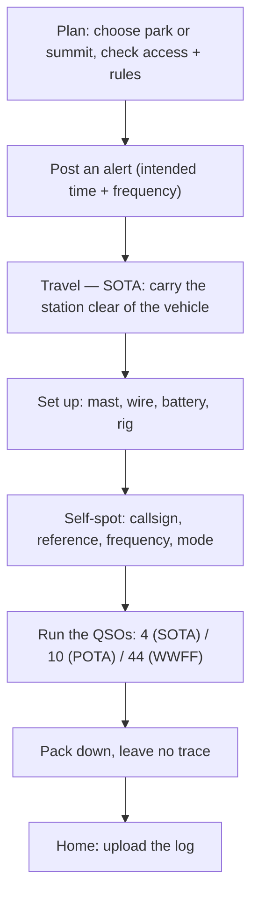
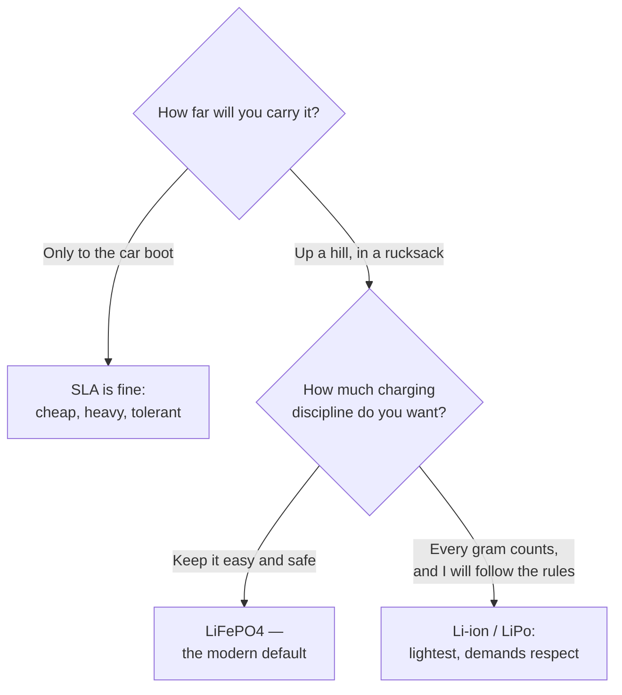

# Portable & Off-Grid

Everything in [Building Your First Station](outpost:entry/logbook73.handbook/building-your-first-station) assumed a desk, a mains socket and a roof. This chapter takes all of that away on purpose — because some of the best operating in amateur radio happens from a picnic bench in a national park, a windy summit at dawn, or a beach with a telescopic whip planted at the tideline. Portable operating is radio reduced to its essentials: a small rig, a battery, a wire, and whatever antenna height nature is willing to lend you. It is also, thanks to the activation programmes, the easiest way a newcomer will ever experience a pile-up from the fun side.

## Why radio gets better outdoors

Three things change the moment you leave the house, and all three work in your favour.

First, **the noise goes away**. Chapter [Noise](outpost:entry/logbook73.handbook/noise) explained that the real limit on a home HF station is usually the electrical hash of the building around it — switch-mode supplies, solar inverters, LED lighting. A hilltop or a rural park has none of that. Operators who fight an S7 noise floor at home routinely find S1 in the field — worth more than any amplifier, because signals you have never heard from the shack are suddenly easy copy on 5 W.

Second, **antennas get easy**. At home you negotiate with fences, neighbours and planning rules. In a field you have space for a full-size wire, and often a tree or a lightweight mast to hang it from — the antenna advantages of [Antennas](outpost:entry/logbook73.handbook/antennas) without the property compromises.

Third, and most cheerfully, **the pile-up flips**. The activation programmes below turn _you_ into the interesting station. Post a spot saying you are on the air from a park or summit and, within minutes, stations start calling _you_ — a taste of being DX that normally costs a plane ticket. For a newcomer still nervous about calling CQ, having a queue of patient, friendly callers is the best possible training. [Making Contacts](outpost:entry/logbook73.handbook/making-contacts) teaches the ordinary QSO, and [Worked Activations](outpost:entry/logbook73.handbook/activation-scripts) gives you complete SOTA, POTA and pile-up conversations.

## Parks on the Air (POTA)

**Parks on the Air** is a worldwide programme built around a list of registered parks and protected areas — national parks, forests, nature reserves — each with a reference like `GB-0154` or `US-2170`. The game has two roles. An **activator** takes a station _to_ a park and operates from inside its boundary. A **hunter** (POTA's word for the stations at home) works activators from wherever they are — hunting needs no special gear at all, and is a lovely way to fill a new logbook.

The core rule is simple: a **valid activation is ten QSOs from within the park in one UTC day** (the UTC day runs 0000–2359 UTC, which may not match your local date). Any bands and modes count, each contact must be a real two-way exchange made by a human — fully automated QSOs are not allowed — and the activator uploads the log to the POTA system afterwards. Two friendly details are worth knowing. Hunters get credit for a park contact even if the activator never reaches ten, as long as the log is uploaded. And there are **no points in POTA** — the culture is deliberately awards-and-fun rather than scores: awards for parks activated, parks hunted, park-to-park contacts (two activators working each other, prized on both sides), but no leaderboard-first ethos. It makes POTA famously relaxed and beginner-friendly: parks are typically reachable by car, so you can start with your full home go-kit and a folding chair.

LogBook73 tracks all of this for you: log your park contacts with their references and your POTA tracker shows parks worked and activated as the totals climb. When you are ready for the whole programme — how a reference is built, exactly where inside a park you may sit, activating two parks at once, the awards that really exist, and the log file that either uploads or bounces — [Parks on the Air (POTA)](outpost:entry/logbook73.handbook/pota) is the long version of this section.

## Summits on the Air (SOTA)

**Summits on the Air** is POTA's older, hillier sibling: a worldwide award scheme built on lists of qualifying summits, each with a reference like `G/LD-003` or `W7A/AP-001`. Here the two roles are called **activator** and **chaser**, and — unlike POTA — SOTA _does_ keep score, gently.

Every summit is worth **1 to 10 points** depending on its height band, and many mountain associations add a **seasonal bonus** (often three extra points) for braving qualifying summits in winter. A valid activation needs just **four QSOs, each with a different station**. But the mountaineering rules are what give SOTA its character:

- You must operate from within the **activation zone** — the area within 25 vertical metres of the summit. You do not need to stand on the exact top, which matters when the true summit is a crag in a gale.
- You may reach a summit by road, but the **operation must be away from the vehicle**: not in or close to it, with no station connection to it, and with the activation team carrying all equipment to the operating site. The station must use portable power rather than mains or a fossil-fuel generator.
- Contacts **via terrestrial repeaters do not count** — SOTA QSOs are direct, though any band and mode is welcome, and a handheld on 2 m FM has qualified thousands of summits.
- An activator can claim a given summit's points **once per calendar year** — the scheme rewards visiting _more_ summits, not camping on one.

Chasers score the summit's points for working an activator, from the comfort of home. The long-service awards have the best names in radio: **1,000 activator points makes you a Mountain Goat; 1,000 chaser points makes you a Shack Sloth.** Both are cherished. Log your summit contacts with references and your SOTA tracker keeps the tally, whichever animal you are becoming. SOTA is the most rule-bound of these programmes and the most misquoted, so if you intend to stand on a hill and know that what you are doing counts, read [Summits on the Air (SOTA)](outpost:entry/logbook73.handbook/sota) — it takes the summary above apart properly, including how much of it varies from one country to the next.

## WWFF and the wider family

**WWFF — World Wide Flora & Fauna** — is a third worldwide programme, older than POTA, centred on protected nature areas with references like `GFF-0010`. Its distinctive rule is scale: a valid activation for activator awards needs **44 QSOs**, though you may combine several visits to the same reference to reach the total, and hunters get credit from the very first logged contact regardless. The number 44 is a WWFF tradition in itself, used as a greeting the way others use 73. Many parks carry both a POTA and a WWFF reference, so one afternoon's operating can feed both — and your WWFF totals live alongside the others in the awards page. Beyond these three you will meet lighthouses, islands, castles and beaches on the air; the pattern is always the same — a list of places, a threshold of QSOs, and an excuse to be outdoors with a radio.

## Anatomy of an activation

Whatever the programme, an activation day has the same shape:



The **alert** and the **spot** are the social machinery that makes small signals succeed. An alert, posted in advance on SOTAwatch (for SOTA) or the POTA site, says "I intend to be on this summit around 1000 UTC near 7.090 MHz" — chasers plan their morning around alerts. A **spot** says "I am on the air _right now_, here" — and **self-spotting is normal and encouraged in both programmes** the moment you are actually transmitting (posting a spot before you are on the air is the one etiquette sin, because fifty people will tune to an empty frequency). With mobile coverage, self-spotting is a thirty-second job on a phone; without it, tools exist to raise a spot over the radio itself, and answering another activator's CQ works too. [Alerts & Spots](outpost:entry/logbook73.handbook/alerts-and-spots) walks through what each of those posts should say and every route for getting one out when your phone reads _No Service_. The result of a good spot is startling the first time: a quiet frequency becomes eight stations calling you inside two minutes. Take a breath, work them one at a time, and enjoy it — this is the pile-up on easy mode, because every caller wants you to succeed.

## Power in a rucksack

Off-grid operating stands on its battery, and the honest comparison looks like this:

| Chemistry                            | Nominal voltage    | Weight (for similar usable energy) | Cycle life           | Field notes                                                                                   |
| ------------------------------------ | ------------------ | ---------------------------------- | -------------------- | --------------------------------------------------------------------------------------------- |
| Sealed lead-acid (SLA)               | 12 V               | Heavy — roughly 3× LiFePO4         | A few hundred cycles | Cheap and tolerant, but voltage sags in use and only ~half the rated Ah is usably deliverable |
| **LiFePO4** (lithium iron phosphate) | 12.8 V             | Light                              | 2,000–5,000+ cycles  | The modern default for 13.8 V radio gear — see below                                          |
| Li-ion packs (e.g. 18650-based)      | 3.6–3.7 V per cell | Lightest per Ah                    | ~500–1,000 cycles    | Energy-dense; 3S (11.1 V) is a little low for full power, 4S is too high unregulated          |
| LiPo (lithium polymer)               | 3.7 V per cell     | Lightest                           | Hundreds             | From the drone world; superb power-to-weight but demands genuine respect — see safety notes   |

**LiFePO4 has quietly become the answer** for most portable amateurs, for three converging reasons. Its four-cell pack is nominally 12.8 V and holds a remarkably **flat discharge curve** — around 13.2–13.3 V for most of its capacity — which is almost exactly what "13.8 V" amateur gear wants; the radio delivers full power until the battery is nearly empty, instead of derating as the voltage sags the way lead-acid does. It survives **thousands of charge cycles** where SLA manages a few hundred. And it weighs roughly a third as much as lead-acid for the same _usable_ energy, because a LiFePO4 pack can be run nearly flat while deep-discharging SLA below about half wrecks its lifespan. Every reputable pack includes a **BMS** (battery management system) — a small circuit that balances the cells and cuts off on over-charge, over-discharge and short circuit.

```viz
{ "type": "wave", "title": "Discharge under load: LiFePO4 vs lead-acid (stylised)", "caption": "LiFePO4 holds a near-constant voltage until it is almost empty; lead-acid sags steadily, starving a 13.8 V radio of full power long before its amp-hours are gone.", "xLabel": "Capacity used", "traces": [ { "kind": "points", "points": [[0, 0.75], [0.05, 0.58], [0.2, 0.54], [0.5, 0.51], [0.8, 0.46], [0.9, 0.38], [0.96, 0.05], [1, -0.6]], "label": "LiFePO4", "tone": "primary" }, { "kind": "points", "points": [[0, 0.62], [0.1, 0.42], [0.3, 0.22], [0.5, 0.02], [0.7, -0.22], [0.85, -0.45], [1, -0.68]], "label": "Lead-acid", "style": "dashed", "tone": "muted" } ] }
```

**Why LiPo demands respect.** LiPo packs power drones for a reason — astonishing current from very little weight — but the same chemistry burns fiercely if punctured, over-charged or charged unbalanced, and a damaged cell can ignite hours later. If you use LiPo: charge only on a balance charger designed for it, inside a fire-resistant charging bag, never unattended; store packs at their storage voltage (about 3.8 V per cell), never full; and retire any pack that is swollen or has taken a knock. If that list sounds like a chore, that is the argument for LiFePO4, which is the docile member of the lithium family: no oxygen-releasing chemistry, hugely more tolerant of abuse, and content with an inexpensive dedicated charger.



### Sizing the battery: a worked example

Battery sizing is one multiplication, done honestly. You need three numbers: receive current, transmit current, and how much of the time you actually transmit.

Take a typical 10 W portable HF rig — the class of radio covered in the [Xiegu X6100 guide](outpost:entry/logbook73.guide.x6100) — drawing about `0.7 A` on receive and about `3 A` on SSB transmit. During a busy activation you might be transmitting a third of the time:

- Average current = (⅔ × 0.7 A) + (⅓ × 3 A) ≈ `1.5 A`
- A 3-hour activation: 3 h × 1.5 A = `4.5 Ah`
- Add a third for margin (cold, pack ageing, an unexpected extra hour): ≈ `6 Ah`

So a **6 Ah LiFePO4** — under a kilogram — runs that whole activation with headroom. Run the same sum for a 100 W transceiver drawing ~20 A on transmit and the average becomes ~7 A, needing 25–30 Ah (~4 kg of LiFePO4) for the same outing — which is exactly why portable operators gravitate to 5–10 W and spend the saved kilograms on a better antenna. One honesty note on duty cycle: the ⅓ figure suits SSB, where you only draw full current on voice peaks. CW is harder work and digital modes are hardest — an FT8 transmission is a continuous carrier for 12.6 s of every 15 — so budget a higher transmit fraction for those modes.

### Charging and cold weather

Charge each chemistry with a charger built for it: a LiFePO4 pack wants a LiFePO4 charger (charging to about 14.4–14.6 V, then stopping — no float), not a lead-acid charger, and lithium of any kind should never be charged unattended in a bag or car. The big cold-weather rule is specific and worth memorising: **never charge any lithium battery below 0 °C**. Below freezing, charging deposits metallic lithium inside the cells — invisible, permanent damage that can later cause an internal short; a good BMS blocks charging in the cold for exactly this reason. _Discharging_ in the cold is safe but weaker — capacity drops noticeably near freezing — so winter activators carry the battery inside a jacket on the ascent and set it on a sit-mat rather than on snow. Warm battery, happy battery.

## Antennas that pack small

The portable antenna problem is the shack antenna problem with a rucksack constraint, and the field has settled on a small family of answers. All of them work; they trade efficiency, band-agility, weight and set-up time differently.

**The end-fed half-wave (EFHW)** is the current favourite. A single wire one half-wavelength long on the lowest band — about 20 m of wire for the 40 m band — fed at its end through a small 49:1 impedance transformer. Because a half-wave's end sits at very high impedance, the same wire is also resonant on its harmonics, so one 40 m wire covers 40, 20, 15 and 10 m with no tuner and no radials. One support, one wire, one small box: hard to beat.

**The linked dipole** is the SOTA classic: a dipole with small connectors ("links") part-way along each leg. Open or close the links and the same antenna becomes resonant on each chosen band — maximally efficient everywhere, no tuner, at the cost of lowering the apex to change bands. **A random-wire with a 9:1 transformer and a tuner** trades that efficiency for total flexibility, and rigs with a built-in ATU (antenna tuning unit) make it painless. **Telescopic verticals** — a 5–6 m collapsing whip on a spike or tripod, with a few radial wires on the ground — set up in two minutes on terrain with nothing to hang wire from, and a vertical by the sea over salt water is a genuine DX weapon on the low bands.

All the wire options need height, which is where the **squid pole** comes in: a telescopic fibreglass fishing-pole-style mast, 6–10 m long yet collapsing to under a metre and weighing a few hundred grams. Guy it with three cords or lash it to a fence post, hoist the wire as an inverted-V, and you have a respectable antenna farm from a rucksack side pocket. Check any antenna with a [NanoVNA](outpost:entry/logbook73.handbook/nanovna) at home first — field time is precious — and remember everything [SWR](outpost:entry/logbook73.handbook/swr) taught you travels with you.

## Field craft: weather, safety and leaving no trace

SOTA's culture is explicitly one of **self-reliance**: activators are hill-walkers first and radio operators second, and that ordering keeps people safe. The radio is never worth a risk.

- **Weather rules the day.** Summit weather can be a season away from valley weather and can turn in minutes. Check a mountain forecast, carry wind- and waterproofs beyond what the car park suggests, and abandon any activation when conditions say so — the summit scores the same next month. Never be the highest point holding an aluminium pole in a thunderstorm; if storms threaten, pack down and descend.
- **Navigate like a walker, not like a phone.** Carry a map and compass you can actually use; phone batteries die fastest in the cold, and you may be spending yours on spotting. Tell someone your route and your turn-back time — and honour the turn-back time even when the summit is twenty minutes away.
- **Leave no trace.** Carry out everything, guy lines and tent pegs included; sweep your operating spot before leaving. Keep antennas clear of paths so nobody garrottes themselves on your brilliant invisible wire, and cheerfully explain what you are doing to curious passers-by — every activator is an ambassador.
- **Respect the site's own rules.** Parks may require permits or restrict where you can drive a spike or sling a line over a tree; a two-minute check of the reference's notes beforehand keeps the programme welcome there.
- A watt-level portable station poses no meaningful RF exposure concern at normal antenna distances, but the habits from [RF Safety & EMF Exposure](outpost:entry/logbook73.handbook/rf-safety) still apply: keep people out of arm's reach of a transmitting antenna.

## Logging in the field

Pile-ups and numb fingers are a hostile environment for logging, so keep it frictionless. Many activators still swear by **paper** — a waterproof notebook and a pencil (pens fail wet and cold) — transcribing at home. The phone alternative has one classic failure mode: no signal. LogBook73 sidesteps it — the app installs as a PWA (a web app that behaves like a native one) and **works offline**, so you can log QSOs on a summit with no coverage and let everything sync when you are back in the world. The QSO entry form has fields for **park and summit references**, so capture the reference with each contact — your own when activating, the other station's when they give one — and your awards trackers update themselves the moment you are home, with no re-typing. Activators have one last duty either way: upload the log to the programme (POTA and WWFF accept ADIF files; SOTA takes CSV or direct entry), because until you do, none of your callers get their credit.

## Try it yourself

1. **Hunt before you activate.** This week, from home, work one park or summit activator. Find live activity via the POTA spots page or SOTAwatch, listen for the reference, and log the QSO in LogBook73 with the reference filled in — then watch it appear in your POTA or SOTA tracker. Ten minutes, no rucksack required.
2. **Run the battery maths for your own rig.** Find its receive and transmit current in the manual, assume a third of the time transmitting, and size a battery for a 3-hour outing with a one-third margin. Write the answer down — it is the first line of your go-kit list.
3. **Scout your nearest reference.** Look up the closest registered park and (if you have hills) the closest summit on the programmes' maps. Note the access rules. You now have a first activation waiting for a sunny Saturday.
4. **Pack a one-bag station** — rig, battery, antenna, mast or throwing line, logging kit, waterproofs — and weigh it. Every future gear decision starts from that number.

## Key takeaways

- Portable operating trades mains power for a low noise floor, room for full-size antennas, and — via the activation programmes — a friendly pile-up where _you_ are the DX.
- The thresholds: **POTA** needs 10 QSOs in a UTC day (no points, awards culture); **SOTA** needs 4 QSOs from the activation zone, a carried and vehicle-independent portable station, no terrestrial repeaters, and summits score 1–10 points once per calendar year; **WWFF** needs 44 QSOs, accumulable over visits.
- Alert before you go, **self-spot the moment you are on the air** — both programmes encourage it — and always upload your log, because your callers' credit depends on it.
- **LiFePO4 is the portable battery default**: a flat ~13.2 V discharge curve that suits 13.8 V gear, thousands of cycles, a third the weight of lead-acid — and one iron rule: never charge any lithium below 0 °C.
- Size batteries with one sum: (RX current × RX fraction + TX current × TX fraction) × hours, plus a third for margin — about 6 Ah runs a 10 W rig for a 3-hour activation.
- EFHW wires, linked dipoles and telescopic verticals on a squid pole cover almost every portable antenna need; choose by terrain, weight and how often you change bands.
- Be a walker first: weather, navigation, a turn-back time and leave-no-trace come before any QSO count.

The next four chapters take the summaries above and give each one the room it deserves: [Summits on the Air (SOTA)](outpost:entry/logbook73.handbook/sota), [Parks on the Air (POTA)](outpost:entry/logbook73.handbook/pota), [Alerts & Spots](outpost:entry/logbook73.handbook/alerts-and-spots), then [Worked Activations](outpost:entry/logbook73.handbook/activation-scripts) with complete conversations — and every term this handbook has used, from activation zone to zero-beat, is waiting in the [Glossary](outpost:entry/logbook73.handbook/glossary).
