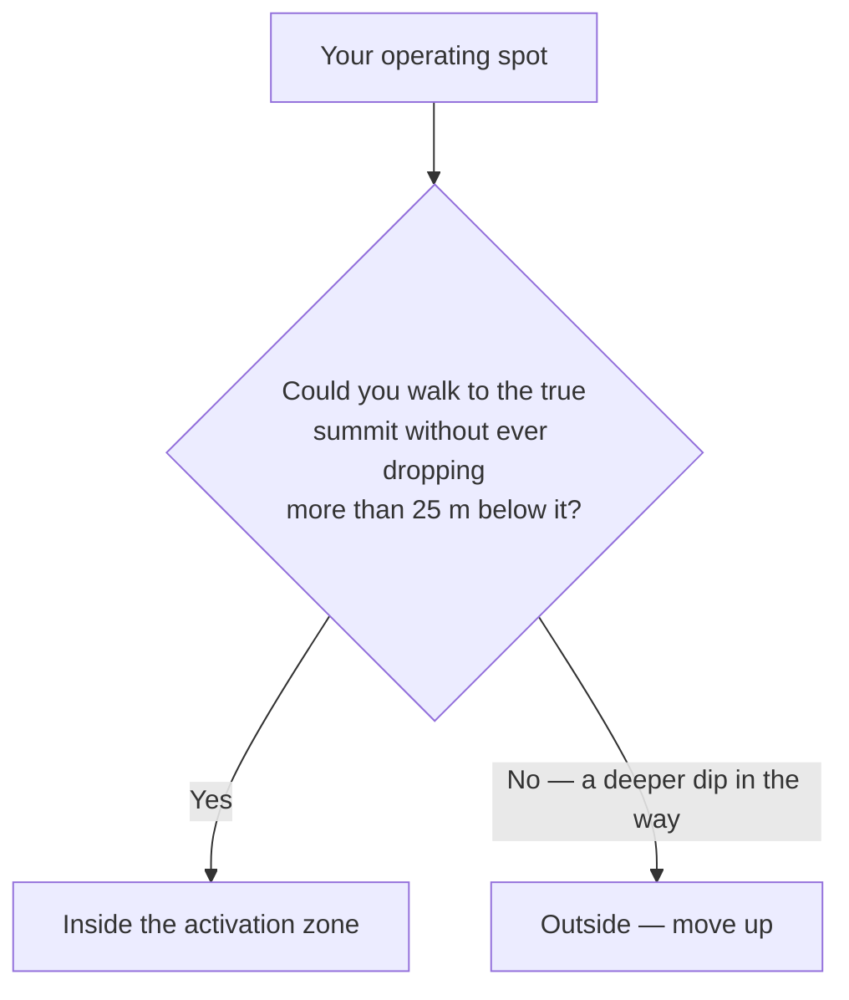
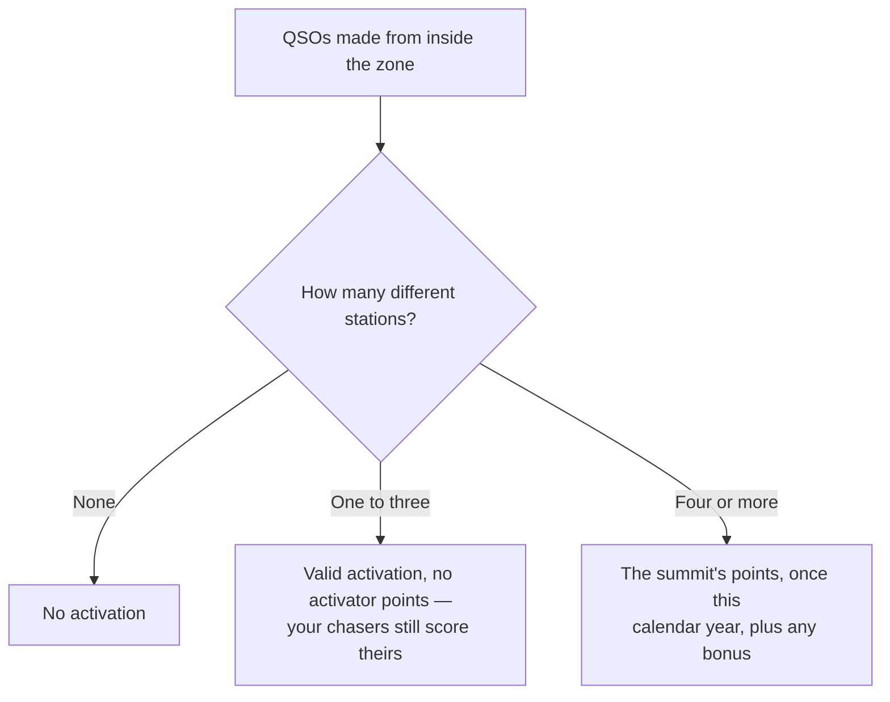
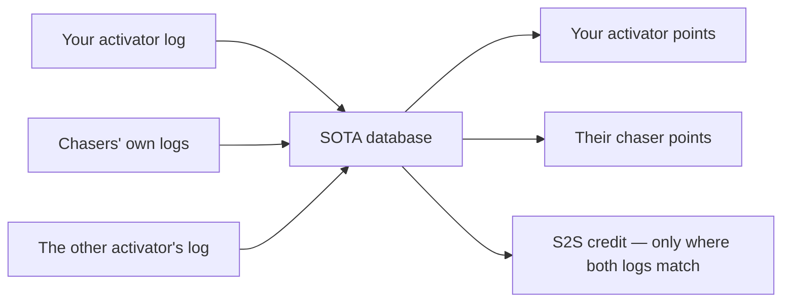

# Summits on the Air (SOTA)

[Portable & Off-Grid](outpost:entry/logbook73.handbook/portable-operating) gave Summits on the Air three paragraphs: four QSOs, twenty-five metres, one to ten points. That is enough to follow the game from an armchair, but not enough to stand on a hill and know whether what you are doing counts — and SOTA is the most rule-bound of the outdoor programmes, with the most misquoted rules in amateur radio. This chapter is the working version: how summits are named, what the activation zone actually is, how the scoring really works, and what one activation looks like from alert to upload.

> **Rules snapshot — reviewed 26 August 2026.** This chapter uses SOTA General Rules document `S0.1`, issue 1.21 (1 June 2022), from the [official General Rules page](https://www.sota.org.uk/Joining-In/General-Rules). The current Association Reference Manual controls local height bands, seasonal bonuses, access notes and any justified activation-zone variation; land access, safety and licence conditions remain local obligations.

## How a summit gets its name

Every SOTA summit has a three-level address, and it is worth learning to read.

At the top is the **Association** — usually a country, or a state or province of a large one. Its identifier is the ITU-allocated callsign prefix where the DXCC entity has not been subdivided, or that prefix plus a subdivision letter where it has: the rules' own examples are `G` for England and `W2`, `W5O`, `W7U` in the United States. Inside each Association are **Regions**, each with a two-character identifier, and inside each Region the summits are numbered `001` to `999`. Assembled with a slash and a hyphen you get the international reference: `G/LD-003` is England, Lake District, summit three. Region identifiers may not be `AF`, `AN`, `AS`, `EU`, `NA`, `OC` or `SA`, so a summit is never confused with an Islands on the Air continent code — and the database enforces the shape strictly, so a mistyped reference is rejected before a human sees it.

An Association may be a whole DXCC entity, one state or province of a subdivided large one, or several small neighbouring entities grouped together — which is why England, Scotland and Wales are separate Associations while the United States is dozens of them. In mid-2026 SOTA's database listed around 225 live Associations across six continents, some 1,500 Regions and just over 170,000 summits, unevenly spread: Mexico–North lists over 11,000, England 173 in ten Regions, the Isle of Man five.

What qualifies a hill is not its height but its **prominence** — how far you must descend from its top before you can climb to anything higher. SOTA is a P150m programme: normally 150 metres, with a limited derogation to 100 metres where P150 summits are sparse, and 100 metres as the absolute floor. This is why a country's highest point is occasionally absent while an unremarkable moorland bump is listed.

One rule catches newcomers: a summit counts only **from the date its reference was issued**, never retrospectively.

To find summits near you, start with your Association's page in the SOTA database, which lists every Region and summit with height, points and grid reference, then read the **Association Reference Manual** (ARM) for the local parameters and access notes. The ARM is what turns the general rules into your hills.

## Where the rules live

SOTA's documents are volunteer-maintained and they change, so check them rather than trust any summary — including this one.

- **General Rules**, the master document `S0.1`, issue 1.21 of 1 June 2022: <https://www.sota.org.uk/Joining-In/General-Rules>
- **Association Reference Manuals** — your height bands, seasonal bonus and zone distance — linked from each Association's page on <https://www.sota.org.uk>
- **The database**, for log upload, summit search and your score: <https://www.sotadata.org.uk>
- **SOTAwatch**, for alerts and spots: <https://sotawatch.sota.org.uk>
- **Award rules**: <https://sota-shop.co.uk/award-rules/>
- **The reflector**, the official forum where the Management Team answer questions: <https://reflector.sota.org.uk>

Rule 3.12.4 sets the precedence: the General Rules beat the ARM and every other programme document, and the English version beats any translation. The rules change rarely — issue 1.21 replaced one that had stood since 2015 — but ARM parameters can change yearly.

## The activation zone, exactly

This is the rule people get wrong, so here it is in the programme's own words. Rule 3.5: each Association defines "the Vertical Distance from the precise summit, within which a Summit operation will be considered valid… This Vertical Distance will normally be 25 metres." Rule 3.7.1 adds the operator's side: "The operating position must lie within a closed contour line at the permitted maximum Vertical Distance below the summit… The Operating Position is taken to be the position of the operator."

Three things follow, each correcting a common belief:

- **It is not a radius.** The zone is bounded by a _closed contour enclosing the true summit_ — the loop you get by drawing the line 25 metres below the top all the way round. "Somewhere 20 metres lower down the mountain" is not the test.
- **It is the operator that counts**, not the antenna and not the radio. Your wire may leave the zone; you may not.
- **25 metres is a default, not a universal constant.** It is an Association parameter, and a Manager may justify another figure. Every ARM checked for this chapter uses 25 metres — but check yours.

SOTA's own plain-English version is the one to carry up the hill: _from where I am standing, is there a path to the summit that would take me no more than 25 metres below the summit?_ That handles the case a radius never could — 20 metres below the top but on the far side of a 30-metre dip puts you outside.



The rules give two reasons, and both shape the etiquette: operating from the exact top "may be difficult or even impossible", and "it is also important that SOTA operations do not disturb the enjoyment of the mountains by others". On a crowded top, dropping down the leeward side is both the polite and the sanctioned thing to do.

The zone settles other questions too. If part of it lies outside private property you may be able to activate from there, which is why summits on private land stay listed. And where a summit sits on a border, you may operate from anywhere in the zone including the part in the neighbouring country — but your callsign must reflect the DXCC entity you are standing in.

## What counts as a valid activation

Here is the rule that gets garbled most, verbatim: "At least one QSO must be made from the Summit to qualify an activation. In order for the activation to qualify for the points attributed to that Summit, a minimum of four QSOs must be made, each of which must be with a different station."

Two thresholds, then, not one.



Three QSOs is not a failure. It is a real activation that scores you nothing — and because your chasers' points depend on your log, upload it anyway. The rules ask for exactly that: submit the log even when no claim is being made.

The remaining rules are short:

- A QSO must "comprise an exchange of callsigns and signal reports". Giving the summit reference is strongly recommended rather than required in every contact — on slow CW, repeated every few QSOs — and since chasers mis-identify summits often, asking an activator to confirm it is entirely proper.
- **QSOs with stations inside the same activation zone do not count.** You cannot qualify a summit by working the three friends who walked up with you, though a station on the same mountain but outside the zone is fine.
- You must be entitled to use the callsign **without supervision**, which rules out a lower-class licensee using a club or special-event call to reach extra power or an extra band.
- **Points follow the person, not the callsign.** Two operators sharing one rig can both claim the summit, but each must personally make four QSOs with four different stations.

Must the four QSOs fall inside one UTC day? The General Rules do not say. A Management Team member's published answer on the reflector is that the UTC roll-over "does not delimit an activation except when the activator wishes it to", the database storing only the date of the first QSO — so an activation spanning midnight may be filed as one, or split into two. Treat that as a clarification rather than rules text.

## Scoring: points, bonuses and the calendar year

Six height bands exist, and their points are fixed worldwide:

| Band   | 1   | 2   | 3   | 4   | 5   | 6   |
| ------ | --- | --- | --- | --- | --- | --- |
| Points | 1   | 2   | 4   | 6   | 8   | 10  |

There is no three-, five-, seven- or nine-point summit anywhere. What is _not_ fixed is the height earning each band: those thresholds are set per Association and printed in its ARM, and Associations with few high peaks may leave the upper bands unused entirely.

| Association               | A 10-point summit starts at |
| ------------------------- | --------------------------- |
| England (G)               | 900 m                       |
| Wales (GW)                | 950 m                       |
| Scotland (GM)             | 1,100 m                     |
| Victoria, Australia (VK3) | 1,500 m                     |
| Washington, USA (W7W)     | 2,500 m                     |

A 900-metre hill is a ten-pointer in England, an eight-pointer in Wales and a six-pointer in Scotland: three Associations, one country, three answers. Never assume your neighbours' arithmetic.

### The seasonal bonus

Many Associations add a **seasonal bonus**, tightly constrained: only one per year in any Region, at most four months long, and **always worth exactly three points**. A winter bonus applies only to summits above a stated height; a summer bonus applies to all of them. The intent is stated plainly — during the bonus period "extra safety equipment is necessary plus the skills to use it" — and it need not be a winter bonus, since monsoon and summer-heat bonuses are allowed too.

| Association                    | Bonus period    | Minimum height | Bonus    |
| ------------------------------ | --------------- | -------------- | -------- |
| England (G)                    | 1 Dec – 15 Mar  | 500 m          | 3 points |
| Washington, USA (W7W)          | 1 Dec – 31 Mar  | 1,500 m        | 3 points |
| New Zealand North Island (ZL1) | 1 Jun – 15 Sep  | 1,200 m        | 3 points |
| Victoria, Australia (VK3)      | 15 Jun – 14 Oct | 1,200 m        | 3 points |

Southern-hemisphere winter falls mid-year, so the bonus does too, and the height gate ranges from 500 to 1,500 metres in these four alone.

### Once per calendar year — with one exception

An activator may claim a summit's points "once in any calendar year", however often they activate it, and claims them per expedition regardless of how many QSOs above four they make. Calendar year, not rolling twelve months: a summit activated on 31 December can be scored again the next day. The bonus is the one thing you can collect twice in a year — activate a qualifying summit in July, return in December, and the database will not re-credit the points, but it will add the winter bonus.

### Chaser points are a different animal

Chasers score the summit's band value too, from an armchair. Three things differ:

- Chasers are limited to **one scoring QSO per summit per UTC day** (0000–2359 UTC), where activators are limited per calendar year.
- Chasers **get no seasonal bonus** — it is offered only to activators undertaking expeditions.
- Only one QSO with a given expedition scores: working the same summit on 40 m and again on 2 m does not double your score, nor does working a second operator on that top the same day.

Unlike POTA hunters, **SOTA chasers must submit their own logs**. And an activator may claim chaser points for QSOs with other summits during their own expedition — which is where the next section begins.

## The rules that give SOTA its character

### Vehicles: what the rule actually says

You will read almost everywhere — in older guides, in club talks, and in the summary in [Portable & Off-Grid](outpost:entry/logbook73.handbook/portable-operating) — that the final approach must be made under your own steam, on foot or by bicycle or on horseback. That _was_ the rule: issue 1.20, in force from 2015 to 2022, permitted "the use of a bike (non-motorized) or animals to enter the Activation Zone", and everyone inferred the rest. **That sentence was deleted in issue 1.21 in June 2022**, and the words "on foot", "walk", "bicycle" and "animal" appear nowhere in the current text.

What survives is narrower. Operations "must not be in, or in the close vicinity of, a motor vehicle", "no part of the station may be connected in any way to the motor vehicle", and "all equipment must be carried to the site by the Activation team" — while summits accessible by road "can still be included in the programme".

So a road to the top is not a disqualification; parking at the top and operating out of the boot is. Walk away from the car with your kit in your hands and you are inside the rule, however you reached the car park — and because the kit must be carried by the _activation team_, a companion may share the load. There is also a published accommodation for disabled operators: the Management Team may issue a waiver for a mobility scooter or electric wheelchair, though operating from a car inside the zone remains against the rules.

### Power: batteries or better

"All equipment must be operated from a portable power source (batteries, solar cells, etc). Operation is expressly forbidden using permanently installed power sources or fossil-fuel generators of any kind."

Two prohibitions there, not one. Mains and permanent installations are out — but so is a generator, including a small petrol one you carried up yourself. Batteries and solar are named as acceptable, which is why the stations in [Portable & Off-Grid](outpost:entry/logbook73.handbook/portable-operating)'s battery section are sized the way they are.

### Repeaters, satellites, and one genuine gap

"QSOs via terrestrial repeaters do not count towards the QSO total. Contacts via artificial satellites or free balloon borne repeaters are permitted." The chaser rule says the same the other way round, and adds kites to the permitted list.

The operative word is **terrestrial**. SOTA's own FAQ admits how odd the line looks — satellites are effectively repeaters too — and says the Management Team decided the difference was such that satellite contacts are valid. The rationale offered on the reflector is that if you use a repeater to contact four stations, what you have really done is contact the repeater four times.

Now the honest gap: **the current rules say nothing about internet-linked modes.** EchoLink, IRLP, DMR and C4FM talkgroups, hotspots and internet gateways appear nowhere in issue 1.21, in the FAQ, or in the reflector's main thread on the repeater rule. If you want to activate through one, do not take this chapter's word for it in either direction — ask the Management Team.

### Almost everything else is permitted

"All modes and amateur radio bands are valid for the Programme," and "there are no specified SOTA frequencies." There is no SOTA calling channel; CW, SSB, FM, FT8 and the rest count equally, and a handheld on 2 m FM has qualified thousands of summits where the population below is dense enough. The rules' one piece of frequency advice is to stay offset from the QRP calling frequencies — 7.030 and 14.060 MHz for CW, 7.090 and 14.285 MHz for SSB in the Region 1 plan; check your own band plan — because loud chasers will follow you there.

Two rules give the Management Team the last word. Access permission is a **validity condition**, not advice: "Activating a summit where permission has not been given or implied by 'open access' will invalidate the activation." And a catch-all requires operations to be conducted "in the spirit of the programme", failing which "the points for the Activation will be forfeited and other sanctions may be applied". If you are building an argument about why something technically complies, you have already answered the question.

## Summit to Summit

Summit to Summit — always **S2S** — is two activators working each other, each on their own hill, and it is the most-loved thing in SOTA. Part of that is difficulty: two small stations, two compromised sites, often two five-watt radios and no big antenna at either end. Part of it is that the score is generous.

An S2S contact scores **your summit's points plus theirs**, credited independently to both ends. Seasonal bonuses are excluded. Your own summit follows the activator rule (once per calendar year); theirs follows the chaser rule (once per UTC day). Contacts before 1 February 2013 do not count.

SOTA's published worked example makes the three scores clear. On a winter day one operator activates Shining Tor (`G/SP-004`, a two-pointer, plus the three-point winter bonus) and works another activating Gun, a one-pointer:

|                | Activator     | Chaser | S2S                 |
| -------------- | ------------- | ------ | ------------------- |
| On Shining Tor | 5 (2 + bonus) | 1      | 3 (own 2 + their 1) |
| On Gun         | 1             | 2      | 3 (own 1 + their 2) |

Repeat the same pair the next day and the Shining Tor operator scores 0 activator points, 1 chaser point and only 1 S2S point: their own summit is spent for the year, so only the other summit's value counts.

One warning: **S2S credit requires both logs.** Only cross-matched entries count, so if the other operator never uploads, or the details do not match, the contact quietly fails to appear.



S2S award tiers run 250, 500, 1,000, 2,500 and 5,000 points, with endorsements from 10,000 upwards.

## The awards

The two famous ones sit at the same number. **1,000 activator points makes you a Mountain Goat; 1,000 chaser points makes you a Shack Sloth.** Short-wave listeners have their own 1,000-point trophy, and the SWL section is open to anyone, licensed or not: you log a QSO you heard between an activator and another amateur, under the rules chasers follow.

Certificates come at 100, 250, 500, 1,000, 2,500 and 5,000 points and onwards, separately in the Activator, Chaser and SWL sections, in two flavours — **All Summits**, where every qualifying activation counts, and **Unique Summits**, where a summit counts once however often you visit. The Goat and the Sloth belong to the All Summits family.

Beyond those the programme names **SOTA Complete**, for both activating _and_ chasing the same summit, from 100 through 250, 500 and 1,000; **Mountain Explorer**, for activating in different Associations, Bronze at 5 up to Amethyst at 50, plus a continent-spanning series from Tourist to Globetrotter; **Mountain Hunter**, its chaser counterpart, based on contacting at least two summits in each of five Associations; a **Microwave Award**, where height is irrelevant and what counts is a contact of at least 50 km on a named band from 1.2 GHz upwards; and **12, 10 and 6 metre Challenge awards**.

None of it arrives automatically: certificates and trophies "are issued upon request, by the Management Team's Awards Administrator, based on logs uploaded to the on-line database", for a charge that covers costs. QSL cards are not required; the database is the proof.

## Submitting the log

The database's preferred format is a plain text file it calls **V2** — one QSO per line, up to ten comma- or tab-separated fields:

`V2, My Callsign, My Summit, Date, Time, Band, Mode, His Callsign, [His Summit], [Comment]`

SOTA's own worked examples:

```
V2,G3WGV,G/LD-008,24/04/03,1202,7.0MHz,CW,G4ELZ
V2,G3WGV,G/SC-008,08/06/03,1407,7.0MHz,CW,DL0DAN/P,DM/BW-019,S2S entry
V2,G3WGV,,10/06/03,1023,432MHz,FM,G4TJC,G/SP-015,Simon (chaser entry)
```

Read those three lines and the system falls out. **Which summit field you fill decides what the record is**: your summit filled makes it an activator entry; your summit blank and theirs filled makes it a chaser entry; both filled makes it an S2S. Dates are recommended as `DD/MM/YYYY`, times UTC on the 24-hour clock. Notice what is missing: **signal reports are not uploaded**, even though exchanging them is required for the QSO to be valid.

Three rules save most of the pain:

- **One file, one activation.** "If you activate the same summit on several days you must upload each activation in a separate file, otherwise the file will be assumed to only contain a single activation."
- **There is no edit button.** To fix a chaser entry, delete and re-enter it; to fix an activator log, copy the activation, correct the copy, then delete the original.
- **SOTAwatch and the database are separate systems**, with separate registrations and passwords.

Experienced users can bulk-upload ADIF instead, where `my_sota_ref` is the summit you are on and `sota_ref` the summit you worked — SOTA warns loudly to export only the SOTA entries, not your whole log.

LogBook73 speaks this directly. Log QSOs with the references filled in — yours in **My SOTA ref**, theirs in the SOTA ref field — and Import / export offers a **V2 CSV** per activation, plus a chaser-log CSV of every QSO where the other station was on a summit. The same download sits in a portable session while an activation is armed.

## A worked activation, from alert to upload

One outing, start to finish. The summit is The Cloud, `G/SP-015` — 343 metres, one point, near Congleton, and by the England ARM's own account SOTA's most activated hill. Our operator is the handbook's usual example callsign, `M7ABC`.

Want the words as well as the plan? Follow the complete [2 m FM activation](outpost:entry/logbook73.handbook/activation-scripts#transcript-1--sota-on-2-m-fm-start-to-finish), then practise the [40 m pile-up with a partial call and an S2S](outpost:entry/logbook73.handbook/activation-scripts#transcript-2--sota-on-40-m-ssb-with-a-small-pile-up).

**The night before.** Post an **alert** on SOTAwatch: callsign, full reference, date, ETA as four digits of UTC, and intended frequencies and modes in the documented comma-separated form (SOTAwatch's own example is `7.030-cw, 14.250-ssb`). Alerts let chasers plan their morning — and if you intend to work CW, the alert is also what arms **RBNHole**, which watches the Reverse Beacon Network and spots you automatically when a skimmer hears your callsign, over a window its author documents as roughly an hour before your alerted time to three hours after. No alert, no automatic spot.

**On top.** Park legally, carry everything from the car, and check the ARM's access notes before you go — permission is a validity condition, not a courtesy. Find the true summit, apply the test, and settle out of the wind. Nothing connects to the car; power comes from the battery in your bag.

**Get spotted.** Self-spotting is permitted and routine, but post the spot once you are actually transmitting: a "QRV in ten minutes" spot on the frequency you then call CQ on can suppress your own automatic spot, because the gateway reads the real ones as duplicates. Off-grid there are radio routes — APRS, an SMS gateway, or a spot encoded into an HF digital transmission — all needing registration in advance, so set them up and test them at home.

**Work the pile.** You need four different stations for the point. Give the reference often — chasers mis-hear it constantly. If another activator calls, take the S2S: you gain their summit's value on top of your own, and so do they.

**Home.** Capture callsign, UTC time, band and mode for every QSO, plus the other station's reference for any S2S — a portable session, armed with programme SOTA and `G/SP-015`, stamps your reference onto each one, counts towards the four and works offline. Export the V2 CSV for that reference and UTC day, upload it, and check in a day or two that any S2S cross-matched, while the totals land in your SOTA tracker. Three QSOs only? Upload it anyway — your chasers earned theirs.

## Try it yourself

1. **Read your own parameters.** Open your Association's ARM and find the parameter table: the zone distance, the six height bands, and the seasonal bonus dates and minimum height. Write them on a card for your rucksack — they are the only numbers that are yours.
2. **Run the zone test on a map.** Pick a summit near you and trace the contour 25 metres below its top all the way round. That closed loop — not a circle on the map — is where you may sit.
3. **Chase before you activate.** Find a spot on SOTAwatch, work the activator, log the QSO with the summit reference filled in, then download the SOTA chaser CSV from Import / export and read the V2 lines you just generated.
4. **Do a dry run.** Arm a portable session with programme SOTA and any reference, log four dummy contacts, and watch the counter reach its target and offer the export. Better at the kitchen table than in the wind.

## Key takeaways

- A reference is Association / Region / summit — `G/LD-003` — and what qualifies a hill is **prominence** (normally 150 metres), not height.
- The activation zone is a **closed contour enclosing the true summit**, normally 25 vertical metres below it; the **operator** must be inside it, and the test is "could I reach the top without dropping more than 25 metres?"
- **One QSO makes a valid activation; four QSOs with four different stations earn the points.** A three-QSO day still deserves an upload: your chasers' credit comes from your log.
- Points run 1, 2, 4, 6, 8, 10 by height band, but **the heights differ by Association** — a 900 m hill can be worth 10 points or 6. The seasonal bonus is always exactly 3 points, with dates and a height gate that vary by Association.
- Activators score a summit **once per calendar year** (bonus excepted); chasers score it **once per UTC day**, get no bonus, and must submit their own logs.
- Drive-up summits are legal, operating in or near the vehicle is not; power must be portable; terrestrial repeaters do not count, satellites and balloons do, internet-linked modes are unaddressed.
- Summit to Summit pays your summit's points plus theirs to **both** operators, excludes bonuses, and counts only when both logs match.

If you want those four QSOs to come easily on five watts and a wire, the next stop is [CW Operating](outpost:entry/logbook73.handbook/cw-operating) — the mode that quietly owns SOTA's HF activity, and the one the spotting gateways were built for.
