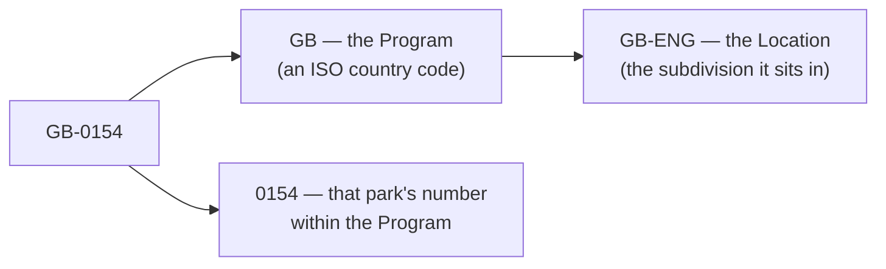
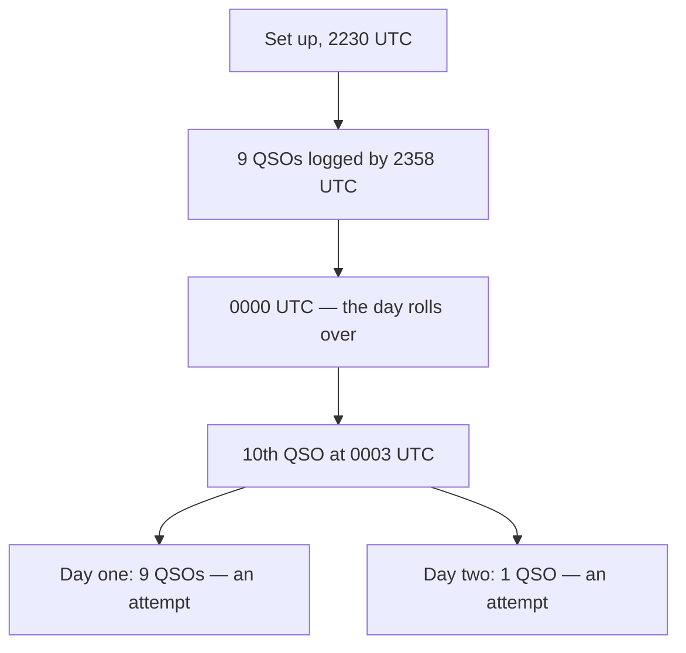
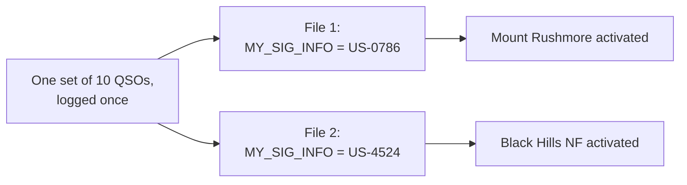
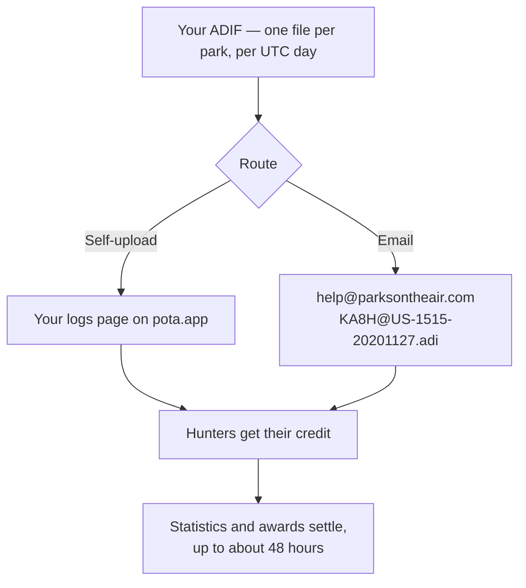

# Parks on the Air (POTA)

[Portable & Off-Grid](outpost:entry/logbook73.handbook/portable-operating) gave Parks on the Air two paragraphs and a promise: ten contacts from inside a park and you have done it. This chapter is the rest of it — the reference system, the boundary rules, the awards that actually exist, the log file that either uploads cleanly or bounces, and a walk-through of a first activation. POTA forgives almost everything except carelessness about where you are sitting and which UTC day you are in.

One warning first: POTA changes its rules, and issued two revisions in the weeks before this review. Guides published even a few months ago can be wrong in specific, checkable ways, and there is a section below listing the important changes.

> **Rules snapshot — reviewed 26 August 2026.** This chapter is scoped to the official [POTA Rules version 1.3, dated 18 August 2026](https://docs.pota.app/docs/rules.html), plus the dated programme-data snapshot stated below. Your radio licence, local law, landowner rules and the current POTA rules take precedence over this guide.

## The shape of the game

POTA has two roles and no points.

An **activator** carries a station into a listed park and operates from inside its boundary. A **hunter** — POTA's word for everyone else — works activators from home, the office car park, or another park. Hunting needs no special equipment and no travel, and it is where almost everyone starts.

Every POTA award is a count of something plain: parks activated, parks hunted, contacts made from one park, parks reached on a given band. No total counts for more because someone else's site was harder to reach. That single decision is why POTA reads as relaxed where [Summits on the Air](outpost:entry/logbook73.handbook/portable-operating) reads as sporting.

## Reading a park reference

A POTA reference is a prefix, a dash and a number: `GB-0154`, `US-2170`, `CA-5082`.

The prefix is the **Program** code, and this is the detail that trips up experienced amateurs: it is an ISO country code, **not** an amateur-radio callsign prefix. `GB` is Great Britain because that is the ISO code, not because anyone signs `GB`. Approach POTA expecting DXCC prefixes and you will guess wrong about half the time.

Three terms sit behind that. A **Program** is the ISO country. A **Location** is the subdivision inside it — `GB-ENG`, `US-GA` — and it matters at log-submission time. A **DX Entity** is the DXCC entity, which POTA tracks for its DX awards but deliberately does not use for organising the list.

The number is zero-padded to four digits but not fixed at four: of the 93,767 references in POTA's own park export on 28 July 2026, 11,386 had already run past 9,999 into five digits — `US-13528`, `FR-16488`. (WWFF, below, is always four, which is one way to tell them apart at a glance.)

That same export held 89,625 active references across 236 prefixes and 248 live Programs, led by France 14,078, the United States 12,930, Australia 11,320, Great Britain 6,978 and Canada 5,919 — so by park count POTA is not a North American programme with an overseas fringe. Those totals climb monthly; treat any figure you read, these included, as a dated snapshot.

### What qualifies as a park, and what that does not tell you

POTA's rule for _new_ references is narrow, but version 1.3 changed its boundary. Eligible parks generally come from a country's **two highest tiers of government** (or its sole tier where only one exists). Third-party management can qualify only where the whole relevant tier uses formal third-party arrangements. POTA also expects formal government web presence with a boundary map, allowing a civil-agency, GIS or local source only for countries and tiers with less web presence. Existing references can predate the current qualification rule.

More importantly: **being listed tells you nothing about your right to operate there.** Listing is a database decision; access is a matter for the landowner, the managing agency and your local law.

### Finding parks near you

Start at `pota.app`, which carries the map alongside the spotting page, your logs and the statistics — browse, tap a park, read its detail page. For route planning the whole list downloads from `pota.app/all_parks.csv`. Then follow the detail page's link to the **park's own agency website**, because that is what decides whether you can go. POTA is blunt about this: "Use maps provided by Parks on the Air as guidelines only. Refer to official park websites and agencies to find the official boundaries."

In LogBook73 the park directory syncs nightly from POTA's own data, so the POTA reference field on the detailed entry form and in a portable session autocompletes as you type and reads the park's name back — the quickest way to catch a transposed digit before it reaches a log file.

## What counts as a valid activation

**A successful activation requires a minimum of ten QSOs from a listed park within a single UTC day.** That is the whole rule, and every word in it is load-bearing.

Everything else is generous. All bands and modes count, including the WARC bands (30 m, 17 m, 12 m). POTA sets **no power limit at all**, beyond your licence conditions, your band plan and the ordinary obligation to use no more than you need. It "does not require a specific exchange in a QSO", so callsign and a report is plenty — most activators add the park number for the hunters' benefit. And there is no callsign-format rule: no `/P`, no `/R`, nothing. Log what you actually sent over the air.

Three restrictions do bite:

- **Both operators must take direct action.** Fully automated contacts are prohibited — which bans robot QSOs, not digital modes. FT8 and FT4 are entirely welcome.
- **No relays.** Both stations must hear each other well enough to log each other's callsigns accurately. A third station passing callsigns or reports along is "effectively playing the part of a land repeater and therefore invalidating the contact".
- **No land repeaters.** POTA draws the line at the Kármán line: a Land Repeater sits below it, a Satellite Repeater above. Satellites count; the machine on the hill does not. You may use a repeater to _ask_ for direct contacts, then move.

### The UTC day, and why it catches people

The UTC day runs 0000 to 2359 UTC and has nothing to do with your local calendar. Your ten contacts must all fall inside one of them.

Nine and one is not ten. It is two failed attempts, and no appeal changes it. Know where the boundary falls in your local clock before you start, and either finish comfortably before it or plan two separate tens.

The rule cuts the other way too. Multiple sessions at the same park, in the same state or province, on the same UTC day count as **one** activation and the contacts pool — work six before lunch, walk, come back and work five more, and that is an eleven-QSO activation. And just after 0000 UTC small pile-ups form as hunters re-work the same activators for the new day's credit, which is a gift if you are still on the air.

### Ten is an activator threshold only

If you finish on seven, your hunters still get their credit — as long as you upload. POTA is explicit: "Courteous activators will still submit logs for unsuccessful activations to ensure their hunters get credit for the QSOs." A short log is never wasted; it is just not an activation.

The mirror of that is the most common beginner misunderstanding in POTA: **hunters never submit logs.** If you worked a park last Tuesday and nothing has appeared on your dashboard, there is nothing for you to upload and nothing to fix — the activator has not uploaded yet.

## Boundaries: where you may actually sit

**The activator and all equipment must be within the park's boundary and on public property.** "All equipment" includes the far end of a wire antenna, which is the detail that turns a comfortable-looking pitch into an invalid one. Straddling does not work either: "If an activator is straddling the park or state lines, they are, therefore, not fully within the boundary and are out of compliance with the rule." There is no partial credit for mostly-inside.

The rest of the access rules are unusually permissive, and this is where POTA diverges hardest from SOTA:

- **Vehicles are fine.** "Activations from vehicles, RVs, etc., parked on public property within the park's boundary are permissible." Drive in, mag-mount on the roof, work ten stations through the windscreen — a perfectly legitimate POTA activation.
- **Aeronautical activation is allowed**, from airspace directly above the park.
- **You may not trespass** to reach public land, and you may not operate from private property "even if the private property is adjacent to, or surrounded by, park property".
- A park counts as open when the public has civil and legal access, or when a permit is obtainable. Partial seasonal closure does not automatically close the whole park.

One distance figure exists in the whole rulebook. Where a **trail or river is itself a POTA reference** rather than part of a bounded land park, "the activator and the station equipment must be on public property within 30.5 meters (100 feet) from the edge of the trail or river". That corridor applies only to standalone trail and river references — it is not a general tolerance around any boundary.

## Two-fers, n-fers and how they are credited

Where park boundaries overlap, one activation can credit several references — POTA calls these multi-loc activations, or by their nicknames, two-fers and three-fers.

The geometry is strict: "Such a multi-park activation requires an overlapped area where all activated parks' boundaries intersect. The intersection must entirely contain the activator and the station equipment." Being inside park A _and_ inside park B is not enough — you must be inside the region where they overlap, and so must your antenna.

POTA's own worked example: Mount Rushmore, `US-0786`, sits inside the Black Hills National Forest, `US-4524`, so operating within Rushmore's boundary activates both. The other common case is a linear trail crossing a land park — sit in the trail's 100-foot corridor where it passes through and you have a two-fer without moving.

**One set of ten QSOs credits every overlapping reference.** You do not need twenty contacts for a two-fer. What you do need is one log file per reference:

In practice that is a find-and-replace: build the ADIF with the first park in `MY_SIG_INFO`, save it, replace every occurrence with the second park number, save under a new filename, upload both.

## Park to Park

Two activators working each other is a **Park to Park** (P2P) contact, prized on both sides and the fiddliest mechanism in POTA — worth understanding before you need it.

P2P credit comes from matching the two activators' logs, with a **15-minute tolerance**: "P2P match requires that the QSO times in both activators' logs coincide within 15 minutes." All the required fields must agree, and **callsigns must match exactly**. POTA's own example is the trap: "If I record my callsign as N3VEM/M and the other activator records my callsign as N3VEM, the QSOs will not match." Log what was actually sent, and if you are running a modifier, say it clearly.

You record the _other_ station's park in `SIG_INFO`. POTA calls this "strongly recommended (although not required)", which is technically true and practically misleading — without it you get an ordinary hunter credit instead of a P2P.

Working an n-fer activator needs one more step, because each ADIF line earns at most one P2P credit. To claim all three parks of a three-fer, list the same QSO three times, identical except for a different `SIG_INFO` on each: "Failure to do so will give you only one P2P credit and two hunter credits." Altering the times to make the lines look distinct does not help — the de-duplication is not keyed on time. The arithmetic then multiplies: a two-fer working a three-fer collects six P2P credits, and so does the other operator.

Both logs must arrive for any of it to match. If the other operator never uploads, your P2P quietly does not exist.

## The awards that really exist

POTA's award list is long, largely automatic and enjoyably strange. Two main ladders run in parallel — parks activated, parks hunted — sharing their thresholds.

| Tier     | Parks activated / hunted |
| -------- | ------------------------ |
| Bronze   | 10                       |
| Silver   | 20                       |
| Gold     | 30                       |
| Platinum | 40                       |
| Diamond  | 50                       |
| Sapphire | 75                       |

Above Sapphire the **Advanced** ladder takes over, every step named after an endangered plant or animal: Arizona Agave at 100, Enrubio at 200, Ouachita Mountain Goldenrod at 300, and so on in hundreds through Western Prairie Fringed Orchid at 1,000 — then in steps of 500, finishing at Tasmanian Devil for 20,000.

The specialist awards are where POTA's character shows:

- **Rover** — full activations at several references in a single UTC day: Warthog 5, Rhino 10, Cheetah 15, Ostrich 20, Leopard 25, Lion 30. Each reference needs its own valid ten QSOs, and the award repeats. "Rover" is an award category, not a callsign suffix — POTA has no `/R`.
- **Repeat Offender** — for loving one park. Tier One runs Oasis 20, Fox Den 40, Bear Cave 60, Fishing Hole 80, Eagle's Nest 100, counting activations for an activator or QSOs for a hunter, and then repeats indefinitely.
- **Kilo** — activators only: 1,000 QSOs from the same park.
- **James F. LaPorta N1CC** — QSOs from ten different parks on ten different bands, activator or hunter.
- **Six Meter "6 Pack"** — activators, ten 6 m contacts from each of six different parks; hunters, at least one 6 m QSO from six different parks.
- **Operator to Operator** — hunter-side, in increments of 50 starting at 50. **DX awards** go in increments of 5 DX entities, and **Worked All References** wants every park in a given state or territory.
- **Early Shift and Late Shift** — for unsociable hours. Late Shift is the eight-hour window beginning 18:00 UTC, Early Shift the six-hour window beginning 02:00 UTC, both sliding by an hour for every 15 degrees of longitude the park pin sits from the Greenwich meridian: `18 − (longitude / 15)` and `2 − (longitude / 15)`, rounded to the nearest hour. A park near 0° therefore has a Late Shift of 1800–0200 UTC; one at 75° west, 2300–0700 UTC. Each park's detail page shows its own times.

Some honest gaps: **Park to Park** is listed and described in a line but has no published numeric tiers, the two Shift awards define their time windows precisely and never state a contact count, and the DX ladder gives no ceiling. If a guide quotes you a number for any of those, it is not coming from POTA.

### The five events

POTA runs exactly five official events a year and is "not affiliated with any other amateur radio activities, such as state park QSO parties, and meet-ups". Four are **Support Your Parks** weekends, on the third full Saturday and Sunday (UTC) of January, April, July and October; the fifth is **New Year's Week**, 1–7 January. Their awards are deliberately trivial — one QSO as an activator, or one park hunted, per season — because the point is turnout. The old June plaque event was retired in 2023.

## POTA and SOTA are not the same hobby

The rule differences matter less than the cultural ones, but they cause each other:

|                      | POTA                              | SOTA                                        |
| -------------------- | --------------------------------- | ------------------------------------------- |
| Qualifying threshold | 10 QSOs, one UTC day              | 4 QSOs for points; 1 to log the activation  |
| Score                | None — awards are counts          | Summits worth 1–10 points by height band    |
| Repeat the same site | Freely, any day                   | Points once per calendar year               |
| Vehicles             | Operate from the car if you like  | Not in or near a vehicle; carry your kit in |
| Power source         | Anything, no limit                | Portable only; no mains, no generators      |
| The other side       | Hunters submit nothing            | Chasers submit their own logs               |
| Log route            | Self-upload ADIF                  | Self-upload CSV or ADIF                     |
| Repeaters            | Land repeaters no, satellites yes | Terrestrial repeaters no, satellites yes    |

Because SOTA scores summits by height it rewards effort, altitude and a certain amount of weather; because POTA scores nothing it rewards showing up, and a folding chair, a picnic table and a battery from the boot of the car is not a lesser version of the game — it is the game. That is why POTA is the sensible first programme for almost everybody: you can find out how you handle a small pile-up without simultaneously finding out how you handle hypothermia. Get comfortable there, then open the SOTA tracker and start looking at hills.

## One field, two references: POTA and WWFF

Many protected areas carry both a POTA reference and a **World Wide Flora & Fauna** one, and a single afternoon can feed both logs. It is worth knowing how far that convenience goes, because the programmes are unaffiliated — POTA's documentation does not mention WWFF anywhere — and their rules disagree in ways that matter on the day.

WWFF references are built differently: the ITU-allocated callsign prefix, then `FF`, then always four digits, as in the rulebook's own example `ONFF-0010`. One picnic bench can carry two entirely unrelated numbers that share nothing but the grass.

The differences that change what you actually do:

- **44 QSOs, not ten** — but they accumulate. "The 44 QSOs can be accrued over multiple activations." Twenty-two today and twenty-two next week is a WWFF activation; that is impossible in POTA, where the UTC day is absolute.
- **No n-fers at all.** "Activators are only permitted to activate one reference area at a time." Where references overlap you pick one, finish it, and only then start the second — a POTA two-fer is two sequential WWFF activations.
- **You do not upload your own log.** WWFF logs go to a national coordinator or log manager, who uploads them: "Activators do not upload their own logs." Submission is final; WWFF will not edit data afterwards.
- **A signal report is required** for a valid WWFF QSO, where POTA requires no particular exchange. WWFF also forbids aeronautical mobile and remote operation, but _allows_ operating from a building inside the boundary — which POTA forbids.

In practice: one set of contacts, logged once with both references on your side, exported twice and sent in two directions. Do that in LogBook73 and the WWFF tracker and POTA tracker fill in from the same entries — but remember that 44 has to come from somewhere, and ten is a long way short.

## Submitting the log

POTA takes **ADIF** files and nothing else. The required fields are small:

| Field                            | What it holds                       |
| -------------------------------- | ----------------------------------- |
| `STATION_CALLSIGN` or `OPERATOR` | you                                 |
| `CALL`                           | them                                |
| `QSO_DATE`                       | UTC date                            |
| `TIME_ON`                        | UTC time, `HHMM` or `HHMMSS`        |
| `BAND`                           | with its unit — `20M`, not `20`     |
| `MODE` or `SUBMODE`              | if both are present, `SUBMODE` wins |

The optional fields are where POTA lives: `MY_SIG` and `SIG` carry the literal string `POTA`; **`MY_SIG_INFO` is the park you are in** and **`SIG_INFO` is the park the other operator is in**. `MY_STATE` covers parks spanning subdivisions. Timing is taken from the start of the QSO, not its completion, and callsign fields accept only `A–Z`, `0–9` and `/` — no accents, no other punctuation.

Self-upload has been available since July 2022 and is the normal route. The email route wants a specific filename shape: `callsign@parkNumber-activationDate.adi`, as in `KA8H@US-1515-20201127.adi`, with the state appended for a park spanning subdivisions — `W8MSC@US-4239-20181231-US-MI.adi`. One file may cover several UTC days, but only one park in one location. **There is no deadline**; POTA asks only that "courteous operators upload their logs without excessive delay, as hunters depend on the activator's log for credit/awards".

### Why files get rejected

The documented causes, roughly in the order they catch people:

- **A missing dash in a park reference.** "If you forget and just have for example US1234, the file will be rejected. This goes for Your park and the P2P parks." One character, whole file bounced.
- **`CALL` equal to `STATION_CALLSIGN` or `OPERATOR`** — "a station or operator cannot work themselves".
- **QSOs dated in the future**, which is what a wrong system clock produces.
- **Duplicate QSOs**, where uniqueness is your account plus `CALL`, `MODE`, `QSO_DATE`, `BAND`, `MY_SIG_INFO`, `SIG_INFO` and location.
- **Invented ADIF field names for P2P.** Only the documented fields are read.

Do not bother de-duplicating first — "There is no need to make an effort to identify and remove duplicate QSOs before uploading... and there is no penalty." POTA is not a contest. You cannot edit or delete a submitted log yourself either: use the "Request Support" button beside it on your logs page, and the help desk will remove it so you can upload a corrected file. Volunteers "will not modify existing QSOs for you".

Club and group logs need care: every QSO must carry **both** `STATION_CALLSIGN` (the club call) and `OPERATOR` (the individual), and the file must go through an account designated for the club — pushed through a personal account it is rejected, because that account does not recognise the other operators. Once a file is in, contacts appear on hunters' dashboards with no published turnaround, and statistics settle "up to 48 hours" later; hunters are asked to wait a month before reporting a missing QSO.

In LogBook73 a portable session handles all of this: arm an activation with a programme and reference, and every QSO gets your park stamped on it automatically, offline if there is no signal. The activation summary then exports a POTA ADIF **per UTC day**, filtered to that reference, named `CALL@REF-YYYYMMDD.adi`, with `MY_SIG`/`MY_SIG_INFO` set and any park-to-park contacts in `SIG`/`SIG_INFO`. A session crossing 0000 UTC produces two files — exactly what POTA wants.

## Recently changed — where older guides are now wrong

This is the section to read twice, because the web is full of confidently outdated POTA advice.

**Passing the mic became mandatory on 10 July 2026.** Version 1.2 required operators activating together under separate callsigns to take turns and for each activator to communicate with each hunter; current version 1.3 retains that rule. As recently as May 2026 the wording made passing the mic optional. The effect: two amateurs sharing one radio under their own callsigns can no longer both claim a contact from a single over. Guides written before mid-July 2026 may be wrong about this.

**Park qualification changed on 18 August 2026.** Version 1.3 replaced the older state/provincial-or-federal/national wording with the two-highest-government-tiers test and added the narrow whole-tier third-party-management route described above. Older explanations that categorically exclude every locally managed or third-party-managed park no longer state the full rule.

**US parks moved from `K-` to `US-` on 20 March 2024**, numbers unchanged — `K-0001` became `US-0001` — with the territories split onto their own ISO prefixes: American Samoa `AS`, Guam `GU`, Northern Marianas `MP`, US Minor Outlying Islands `UM`, Puerto Rico `PR`, US Virgin Islands `VI`. Any article printing `K-####` references predates March 2024.

**Great Britain consolidated on 22 March 2024, and this one renumbered.** The separate `G`, `GI`, `GM` and `GW` entities became one `GB` Program. England kept its numbers (`G-0001` became `GB-0001`), but Northern Ireland was re-sequenced into `GB-0772`–`GB-0805`, Scotland into `GB-0806`–`GB-0994` and Wales into `GB-0995`–`GB-1217`. **A pre-2024 `GM-0001` is not today's `GB-0001`** — work from an old British park list and every non-English number in it is wrong. The reorganisation is finished: all Programs now follow ISO-3166-2 and no further changes are scheduled.

**The relay prohibition is new**, added in December 2024 — POTA's own changelog dates it 2022, but that entry contradicts both its archives and the matching announcement. From the same month, **the Outstanding Operator Award is dead**; it still appears on the awards page marked "This award is retired and not being issued at this time", while older lists present it as live.

**Management changed in October 2024.** Founder Jason Johnston `W3AAX` stepped aside from day-to-day management, Rick Parent `W0ZAP` took over operations, and a Board of Directors was formed. Articles describing POTA as one person's programme are describing 2023.

**`parksontheair.com` no longer holds the rules.** It is a landing page and shop; its FAQ URL returns an error. Everything documentary lives at `docs.pota.app`. One relic to know when you get there: the official ADIF reference page still describes `MY_SIG_INFO` as "the POTA program prefix (K, VE, etc.)" while every worked example on the same page correctly uses `US-` and `CA-`. Follow the examples, not that sentence.

## Where the rules live

POTA's rules document declares itself the tie-breaker: "If the information documented in the rules section differs from information provided elsewhere on the site (guides etc.), the rules section will take precedence." When a guide and the rules disagree, the rules win — this chapter included.

| What                                      | Where                                                                         |
| ----------------------------------------- | ----------------------------------------------------------------------------- |
| The rules (version 1.3, 18 August 2026)   | `https://docs.pota.app/docs/rules.html`                                       |
| Definitions                               | `https://docs.pota.app/docs/glossary.html`                                    |
| Every award and its thresholds            | `https://docs.pota.app/docs/awards.html`                                      |
| The five events and their dates           | `https://docs.pota.app/docs/events.html`                                      |
| Submitting logs                           | `https://docs.pota.app/docs/activator_reference/submitting_logs.html`         |
| ADIF field-by-field                       | `https://docs.pota.app/docs/activator_reference/ADIF_for_POTA_reference.html` |
| Park to Park mechanics                    | `https://docs.pota.app/docs/activator_reference/park_2_park.html`             |
| Spots, map, your logs, statistics         | `https://pota.app`                                                            |
| WWFF Global Rules (v5.10, September 2025) | `https://wwff.co/wwff_cont/uploads/2025/09/WWFF-Global-Rules-V_5.10.pdf`      |

POTA is self-policing — "a self-regulated, community-monitored program" — with no adjudication panel and no published sanctions schedule; suspected violations go to `help@parksontheair.com` with enough evidence to prove the case.

## A first activation, start to finish

For a line-by-line voice example, open the complete [POTA conversation, pile-up and park-to-park exchange](outpost:entry/logbook73.handbook/activation-scripts#transcript-3--pota-on-20-m-ssb-with-a-park-to-park) and keep it beside this checklist while you practise.

1. **Pick a park you can walk out of** — twenty minutes away, with a car park. Check its agency website for opening times, permits, and any rule about pegs or lines over trees.
2. **Read the boundary properly.** On the agency's map rather than POTA's, decide where you will sit and where both ends of the antenna will land. If the wire crosses the line, move.
3. **Pick a quiet time, and set the clock.** Mid-morning or early evening on 40 m or 20 m will find hunters; avoid the hour before 0000 UTC on a first outing. A wrong clock produces future-dated QSOs that get rejected.
4. **Arm the activation.** In a portable session, choose POTA, type the reference until autocomplete confirms the park's name, and start. Every QSO from now on carries your park.
5. **Get spotted.** Self-spotting is explicitly allowed — "you may self-spot yourself on the Parks on the Air spotting page; anyone (including hunters) can also spot/respot you". Spots expire about 30 minutes after the last one, so re-spot as you go and mark QRT when you finish. With no signal, ask your first contact to spot you.
6. **Work ten.** Callsign, report, park number, next. Say the reference often — hunters are logging it. Keep going past ten; the count is a floor, not a target.
7. **Note any park-to-park contacts carefully**: exact callsign, their park number, accurate time. Fifteen minutes of tolerance sounds generous until both clocks drift.
8. **Pack down, leave nothing, upload.** Export the POTA ADIF for that UTC day, check the reference has its dash, and upload at `pota.app/#/user/logs`. Then watch your POTA tracker, giving the statistics up to 48 hours to catch up before worrying.

## Try it yourself

1. **Hunt one park tonight.** POTA activator spots feed the DX cluster and the Chase page, so you can see who is on the air without leaving the app. Work one, log it with the park reference, and watch it land in your POTA tracker. That is half the programme done.
2. **Look up your three nearest references** on `pota.app`, then open each one's agency website and find the real boundary. Notice how often the two do not quite agree — that habit is the whole safety net.
3. **Do a dry run of the log file.** Log four imaginary contacts in a portable session with a made-up reference, export the POTA ADIF, open it in a text editor, find `MY_SIG_INFO` and confirm the dash is there. Then delete the QSOs. Five minutes now, no bounced file later.
4. **Write down your local UTC-day boundary** — what time 2359 UTC is on your clock, summer and winter — and keep it where you will see it before an evening activation.

## Key takeaways

- A POTA reference is an **ISO country code**, a dash and a number — `GB-0154`, not a callsign prefix — and the numbers have run past four digits in the larger programmes.
- A valid activation is **ten QSOs from inside the boundary in one UTC day**; same-day sessions pool, but nine-plus-one across midnight is two failures.
- **You and all your equipment must be inside** — and inside the _overlap_ for a two-fer, where one set of ten credits every park but each reference needs its own log file.
- **Hunters never upload anything.** All credit flows from the activator's file, so upload even a short log.
- POTA keeps **no points**, permits cars, sets no power limit and forgives duplicates, which is why it is the better first programme and why SOTA feels like a different sport rather than a harder version.
- Log submission is **ADIF only**, one file per park per UTC day, `MY_SIG_INFO` for your park and `SIG_INFO` for theirs — and a missing dash rejects the whole file.
- **Check the date on anything you read**: passing the mic became mandatory in July 2026, US and British parks were re-prefixed and renumbered in March 2024, and the rules at `docs.pota.app` overrule every guide including this one.

Go and do it — and every term used here, from activation zone to zero-beat, is waiting in the [Glossary](outpost:entry/logbook73.handbook/glossary).
