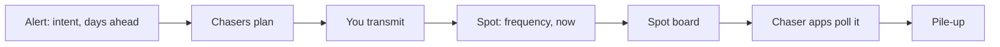
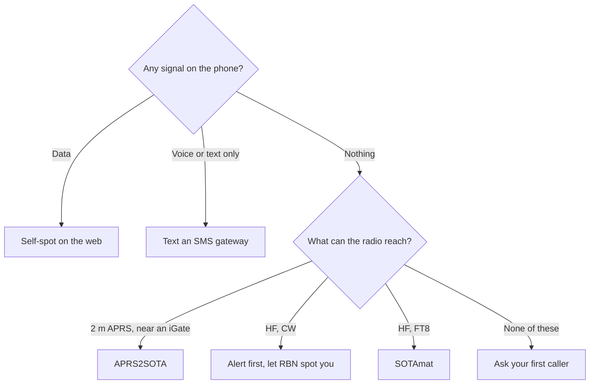
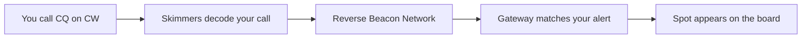

# Alerts & Spots

Your five watts from a hilltop are not the problem. A short wire and a small radio will cross a continent on a decent afternoon — but only for someone who happens to be tuning your exact frequency at your exact minute. What turns a lonely CQ into a queue of patient callers is not power; it is one short line of text, posted where the right few thousand people are watching. [Portable Operating](outpost:entry/logbook73.handbook/portable-operating) called that line the social machinery of the hobby. This chapter takes it apart: what it should say, who may post it, and — the genuinely interesting part — how to get one off a hillside with no mobile signal at all.

## Two different promises

Two things get posted, and beginners routinely conflate them.

An **alert** is a promise about the future: "I intend to be on `GW/NW-070` on Saturday at about 1000 UTC, working 7 MHz CW and 14 MHz SSB." It goes up days or hours ahead, from a warm kitchen with a real internet connection. Chasers read alerts the way you read a train timetable — they plan a morning around them and are already listening when you arrive.

A **spot** is a statement about the present: "on `7.032` CW **now**." It is posted at the moment you are actually transmitting, and its entire value is freshness.

An alert nobody acts on costs nothing; a spot nobody sees costs you the activation. But the alert does a second job that is easy to miss and that this chapter keeps returning to: **your alert is what arms the automatic spotting systems.** For a CW operator on a summit, an alert posted the night before is very often the reason a spot appears at all.



A spot can also reach the board without you posting it — from a chaser who found you by accident, or from a machine. That is the trick behind the no-data sections below.

## SOTAwatch: what the form actually asks for

**SOTAwatch** is Summits on the Air's spot and alert board, at `sotawatch.sota.org.uk`. Anyone may post: SOTA's own FAQ says all that is needed is to register and log in, and its acceptable use policy asks only that your username be a callsign or registered SWL number genuinely yours. One trap catches nearly everyone — **SOTAwatch and the SOTA Database are separate systems with separate registrations and separate passwords.** The board where you post spots is not the site where you upload logs. Sign up for both.

At the time of writing the **Add Spot** form asks for the activating callsign, the association code, the summit code, a frequency, a mode from a fixed list (AM, CW, Data, DV, FM, SSB, Other) and a comment. Two details matter when you are cold and hurried. **Frequency is in megahertz** — the form's own examples are `5.3985`, `7.030` and `145.500`. And **the comment is capped at about 60 characters**: "mention report, condx, etc.", as the help text puts it, not a place for sentences.

A **Closest Summit** button fills the summit in from your phone's location, and there are **QRT** and **TEST** toggles. Selecting either disables the frequency and mode boxes, because an "I'm finished" or "please ignore" spot carries no frequency — and chasers can filter both out of their view, which is why you use the toggles rather than typing "QRT" into an ordinary spot. You can edit or delete a spot you posted; you cannot touch anyone else's.

The **Add Alert** form wants a full summit reference (`GM/WS-001`), a date, an **ETA as four digits of UTC with no colon** — `1215`, not `12:15` — and a frequency-and-mode string of up to about 40 characters, formatted as the help text shows: `7.030-cw, 14.250-ssb`. A bare band number is common and accepted; real alerts read `5-cw, 7-cw, 14-cw, 21-cw`.

One honest caveat: SOTAwatch has no published user manual, so the above was read out of the live web app — accurate as deployed, not a specification. If a field looks different, believe the site. SOTA's written rules about the board are short: only operations from valid SOTA summits may be spotted or alerted, spots that merely repeat a previous spot get removed on busy days, and it is not a message board.

## The POTA spotting page

Parks on the Air works from `pota.app`, and its rules are refreshingly explicit: **you may self-spot, and anyone — including hunters who have not worked you — may spot or re-spot you.** The number to remember is the expiry. A spot **disappears about 30 minutes after the last spot**, or immediately if the comment marks you QRT. That single choice explains a lot of POTA behaviour: activators re-spot themselves periodically, and logging apps offer to do it for them, because a stale spot vanishes rather than misleading people.

POTA requires no particular exchange and publishes no recommended frequencies, so the comment is where the useful colour goes. Its activator guide is blunt about the fallback: "If you cannot self-spot, ask your first contact on the air to spot you, and repeat your request once in a while to keep your spot fresh." One warning from the same rules: if you are also feeding a contest or a QSO party from the same chair, **that other programme may forbid self-spotting** even though POTA permits it.

## Self-spotting, and the one etiquette sin

Self-spotting is normal in both programmes and nobody thinks less of you for it. This is not DX operating, where announcing yourself is frowned upon; it is the mechanism the whole activity runs on.

One convention does matter, and it deserves an honest framing: **do not post a spot until you are actually transmitting.** No rulebook says this — not SOTA's acceptable use policy, not its activator guidelines, not POTA's rules. It is community convention, learned by watching fifty people tune to an empty frequency.

There is also a hard technical reason, documented since the early days of automatic spotting. If you post a "QRV in ten minutes" spot on `7.032` and then call CQ on `7.032`, the automatic gateway treats the incoming machine reports as duplicates of the spot already sitting there — and posts nothing. Your getting-ready spot has suppressed your real one. The documented fix is to put **only the band** in a getting-ready spot, or to call CQ at least a kilohertz from the frequency you announced. Etiquette and engineering point the same way: spot when you key up, not before.

The rest is small. Stay on or near the frequency you spotted, because chasers are pointing radios at a number, and mark yourself QRT when you leave.

## Getting spotted with no mobile data

Here is the situation the rest of this chapter exists for. The antenna is up, the radio works, and your phone says **No Service**. Everything above assumed a web form.



One warning applies to all of them: **every service below is run by a volunteer, in their own time, at their own expense.** Formats change, phone numbers get retired, gateways fall over and get restarted when somebody notices. A wrong character fails _silently_ — no error, no bounce, no spot, and you standing on a hill with no way to debug it. So treat the syntax here as an explanation of the shape of these things and take the authoritative version from each service's own page before you set out, and test from home: every one of these services says so, and most have a test mode that does everything except post.

### Text it in: the SMS gateways

If you have enough signal for a text but not for data — a very common state on a British hill — you can text a spot in.

SOTA's gateway is run by Andy, `MM0FMF`, and documented on the official site under Joining In → SOTA SMS Format. You **register in advance** by email, giving your callsign and mobile number; spots are accepted only from a registered handset. The format is:

`CALLSIGN ASSOCIATION SUMMIT FREQUENCY MODE COMMENT`

The details that catch people out are all small ones:

- **Callsign shortcuts.** `!` and `%` both mean "my registered callsign, with `/P` on the end". `$` means the same callsign **without** `/P`, and so does a trailing full stop — `W6ABC` spots as `W6ABC/P`, `W6ABC.` spots as `W6ABC`.
- **Frequency is in megahertz and must contain exactly one separator**, which may be a full stop, a comma or a colon: `5.3985`, `7,190` and `14:283` are all fine and all display as a dot. No separator, or two, and you get no spot. The comma and colon exist because some phone keypads make a full stop awkward.
- **The summit dash is optional** — `LD001` and `LD-001` both work.
- **The comment is about 60 characters and it is fussy.** An apostrophe stops the spot posting at all, and anything after a comma is cut off.

Sending `! gm ws001 145.450 fm QRV in 10 Mins` produces a spot reading `MM0FMF/P on GM/WS-001 145.450 fm` with the comment attached. Give a full callsign instead of the shortcut and you spot somebody else. One quiet advantage: the gateway does not consult the SOTA database, so it can still post when the database itself is down.

Two things this book will not print: the gateway's **phone numbers** — several countries run forwarding nodes, and at least one widely-copied third-party page still lists a retired US number — and the **registration email address**. Take both from `sota.org.uk` in the week you need them. And if you carry a **Garmin inReach**, do not assume it behaves like a phone: inReach is known to block messages to the virtual numbers these gateways use, so the SOTA page asks inReach users to contact the operator directly about registration.

**There is no universal SMS syntax.** Spain runs its own gateway that accepts the format above _and_ an alternative taking your SOTAwatch login with the frequency **in kilohertz** — the opposite convention. Australia's ParksnPeaks has its own field order, covers POTA, SiOTA, WWFF and several national park schemes, and passes SOTA spots through to SOTAwatch. Find the gateway for where you are actually standing.

### Send it over APRS: APRS2SOTA

If you carry a 2 m radio that can send [APRS](outpost:entry/logbook73.handbook/aprs) messages, you can raise a SOTAwatch spot over the air with no phone at all. The service is **APRS2SOTA**, developed, run and funded single-handedly by Stewart Wilkinson, `G0LGS`, and documented at **sotaspots.co.uk**. A note on that address, because it is widely misremembered: sotaspots.co.uk is the **APRS2SOTA user guide**, not an SMS service — the SMS gateway above is a separate thing run by a different person. APRS2SOTA feeds SOTAwatch only, not POTA and not WWFF.

- It must be an **APRS message**, addressed to the callsign **`SOTA`** or **`APRS2SOTA`**. No SSID is needed on the addressee (set it to zero if your radio insists); any SSID on your own callsign is fine. A position beacon or plain packet will not do — the server never sees those.
- **Three things are mandatory**: the summit reference, an operating frequency, and a mode from `AM`, `CW`, `DATA`, `DV`, `FM`, `SSB`, `OTHER`. A callsign and a short comment are optional, and any callsign must come before any comment.
- The preferred order is `<Ass/Ref> <Freq> <Mode> [callsign] [comment]`, and nothing is case sensitive.
- **If you attach frequency units, attach them with nothing in between** — the guide's own valid forms are `7031.2k`, `10111.5kz`, `144.320mh`, `10368.120MHz`.
- Separators can be a space or any of `' " \` ^ # @ % , : ; < > | _ ~`, which is why the site's three worked examples look so unalike:

```
ON/on-010 144.320 ssb on/G0LGS/P Calling Now
G/CE-001;144320;SSB Need 2 more
w6/ct-071%na6mg%7063%cw%CQ CQ
```

**You must register before your spots are accepted** — email the operator with your name and callsign, in English, from an address where your callsign can be verified. After that: identical spots inside ten minutes are suppressed; there is a rate limit of five messages in any five minutes, after which the server ignores you for another five; `QRT` or `TEST` in the comment flags the spot accordingly; and there is **no way to edit or delete** a spot once sent, so if you get it wrong, send another. It also answers query commands over APRS, so you can ask it for recent spots or alerts from the hill. This is no niche curiosity — its statistics page reported over 1,600 registered users and more than 35,000 spots since 2012.

**The path.** Neither APRS2SOTA nor its multi-programme cousin publishes a recommended digipeater path, so treat this as ordinary APRS good manners rather than a documented requirement: ask for as few hops as will reach an [iGate](outpost:entry/logbook73.handbook/aprs-igates), and read [APRS Paths](outpost:entry/logbook73.handbook/aprs-paths) first. One failure mode applies to any APRS route: if the only iGate that hears you is **receive-only**, your spot still posts, but nothing can come back to you on RF. You will see silence and assume failure. It is not.

A sibling service, **APSPOT** by Josh `VK2MES`, takes spots over APRS, SMS _and_ Winlink and routes them to SOTA, POTA, WWFF and SiOTA. Its APRS messages go to the callsign `APSPOT` in the form `! <Activity> <Ref> <Frequency In MHz> <Mode> <Comment>`; over SMS your callsign goes immediately after the `!` **with no space**. Its own site calls it highly experimental, so check it is alive before depending on it.

### Send it over HF: SOTAmāt

**SOTAmāt**, by Brian `AB6D`, does something genuinely clever: it spots you using nothing but your HF radio.

You configure candidate spots in the free app while you still have internet at home. On the summit the app computes — entirely offline — a short encoded suffix, which you append to your callsign in an [FT8](outpost:entry/logbook73.handbook/ft8), FT4, PSK31 or RTTY transmission. Monitoring stations that understand callsign suffixes report what they hear, SOTAmāt's server decodes the suffix back into one of your prepared spots and posts it to SOTA or POTA. No phone signal, no satellite, no APRS — just HF. You pre-configure the options because of simple arithmetic: an FT8 message holds thirteen characters, leaving the author about 20.7 bits, so the suffix is an index into your prepared choices rather than free text.

The honest limitation is the receive network. Ordinary FT8 software ignores callsign suffixes, so most of the FT8 world cannot see a SOTAmāt message at all; it depends on a modest number of volunteer stations running particular software — roughly a hundred worldwide at the time of writing. **What limits you is usually their coverage, not your signal.** Its author's own disclaimer deserves repeating: this is a hobby project and must never be relied on for anything to do with safety.

### Let the skimmers do it: RBN auto-spotting

If you work [CW](outpost:entry/logbook73.handbook/cw-operating), the best answer to the no-data problem may be to do nothing at all on the summit.

The **Reverse Beacon Network** is a worldwide mesh of automated receivers — "skimmers" — that continuously decode CW and report every callsign heard calling CQ, with frequency, speed and signal-to-noise ratio. A gateway watches that firehose, matches callsigns against activation announcements, and posts spots.



For SOTA the gateway is **RBNHole**, written by Andrew `VK3ARR`. Per its author's documentation you need no registration with RBNHole itself — what you need is a **SOTAwatch alert**, posted in advance, using **the callsign you will actually transmit**. It then spots you from about an hour before your alerted time to about three hours after; that window can be shifted with a marker such as `S-3 S+12` in the alert's comment field, and you can opt out for one outing with `RBNN` or `NoRBNHole` in the comments. It stays quiet for ten minutes after spotting you, and re-spots when you change band. Its spots are recognisable because they carry the skimmer's report: `[RBNHole] at W6YX 20 WPM 10 dB SNR`. Those parameters come from the tool's own page, which carries no revision date — check it before relying on the exact numbers, and note that only CW is documented, so do not expect it to spot an FT8 activation.

POTA's own RBN gateway arms differently: it matches your callsign against **either** the current POTA spots **or** your scheduled activations, preferring the former. That gives two ways in — schedule the activation in advance, or post one manual spot and let the machines keep its frequency current afterwards. POTA's CW guide recommends sending at least some CQs from the radio's memory keyer, because skimmers decode clean, evenly-spaced code far more reliably than a tired fist; it also warns that skimmers treat `TEST` exactly like `CQ`, so a "test" transmission can spot you for real.

How much of modern spotting is machines? On a single eleven-hour sample of SOTAwatch taken while researching this chapter, **about 30% of spots came from automated gateways rather than a human typing** — RBNHole most of all, then SOTAmāt, then the SMS and APRS gateways. One snapshot, not an average, but the direction is unmistakable.

### Ask a human

The oldest method still works, needs no infrastructure and is free. Work one station — found by tuning, or by calling into an apparently empty band — give your reference clearly and ask them to spot you, repeating the request occasionally to keep it fresh. Some logging apps let a chaser at home spot _another_ operator in one tap for exactly this purpose. It works in reverse too: if you are at home and find an activator with no spot against their name, post one. You have just built their pile-up.

## The apps people actually use

| Tool                              | Platform           | What it does                                                                           | Needs data to post?  |
| --------------------------------- | ------------------ | -------------------------------------------------------------------------------------- | -------------------- |
| SOTAwatch / pota.app in a browser | Any                | The boards themselves                                                                  | Yes                  |
| Ham2K Portable Logger (PoLo)      | iOS, Android, free | Field logger that self-spots to POTA, SOTA, WWFF and others                            | Yes                  |
| SOTA Goat                         | iOS, paid          | Whole summit database offline, activation-zone compass, view and post spots and alerts | Only to post         |
| SOTA Spotter                      | Android            | Long-standing SOTA client that can post by internet or SMS gateway                     | Not on the SMS route |
| SOTAmāt                           | iOS, Android, free | Off-grid spotting over HF, plus SMS, email and inReach routes                          | No                   |

The pattern is worth internalising: an app's **database** can live in your pocket, but an app's **spot** has to reach a server somehow. SOTA Goat will show you every summit in the world with no signal and still cannot post one — not a flaw, just the shape of the problem, and the reason the gateway routes above exist.

Ham2K PoLo is the one to look at first if you want a free field logger with spotting built in: typing `SPOTME` into the callsign field self-spots you, `QRV`, `QSY` or `QRT` in the other-station field posts the obvious thing, and after a spot it offers to keep re-spotting automatically at roughly ten-minute intervals — tuned precisely to POTA's expiry.

## What LogBook73 does with all this

LogBook73 sits on the receiving side of every system above, and the boundary is worth stating plainly: **the app reads spots; it does not post them.** Raising a spot is still a job for the programme's own page or one of the gateways.

What it does is put them in one place. The DX cluster page aggregates SOTA, POTA and WWFF activator spots alongside the human DX cluster, the Reverse Beacon Network, PSK Reporter and APRS — each source colour-coded and filterable, so "who is on a summit right now" and "who is calling CQ on 20 m" are one screen rather than five browser tabs. Its band map tab re-sorts the RBN feed by band and frequency, and Chase ranks the same spots against the gaps in your own awards.

The tab worth knowing as an _activator_ is **My signal**, at /dx-cluster?tab=mysignal. Enter your callsign, press Start listening, and it streams live reception reports of **your** transmissions from the Reverse Beacon Network and PSK Reporter — the same machinery RBNHole uses to spot you, shown raw. Key up from home before an activation and you can see which skimmers hear you and how loudly, and so whether the auto-spotting path is likely to work from your intended band and time.

For the outing itself, a portable session counts QSOs towards your programme's threshold, exports a submission-ready file per UTC day, and works entirely offline — so the one thing that never depends on a signal is the log.

## Try it yourself

1. **Read the boards for a week.** Open /dx-cluster, filter to the SOTA and POTA sources, and watch. You will start recognising automated spots by their wording — the RBNHole ones carry the skimmer, the speed and the SNR — and get a feel for how fast spots appear and expire.
2. **Watch yourself being skimmed.** From home, open /dx-cluster?tab=mysignal, enter your callsign, press Start listening and call CQ. Seeing your own signal reported by a receiver two countries away, with a dB figure attached, is the moment automatic spotting stops being abstract.
3. **Register with one gateway before you need it.** Whichever suits your kit, sign up from the sofa and send the test message its documentation describes. There is a human at the other end, so it is not a thing to start at a trailhead.
4. **Spot somebody else.** Next time you work an activator whose callsign is not on the board, post it for them — thirty seconds, and the friendliest thing in the hobby.

## Key takeaways

- An **alert** is a promise about the future and a **spot** a statement about the present — and on SOTA the alert also arms automatic spotting, so post one even if you think nobody reads it.
- Self-spotting is normal in both programmes; the one convention that matters is **do not spot until you are actually transmitting**, because a premature spot misleads chasers _and_ can suppress your own automatic spot as a duplicate.
- POTA spots expire after about **30 minutes** — re-spot, or ask a caller to. SOTA publishes no equivalent lifetime, so do not assume one.
- With no mobile data there are five routes: an **SMS gateway**, **APRS2SOTA** (documented at sotaspots.co.uk, which is an APRS service, not an SMS one), **SOTAmāt** over HF itself, **RBN auto-spotting** if you work CW and posted an alert, and simply **asking your first contact**.
- Formats are unforgiving and fail silently — one apostrophe, one missing frequency separator, one space in the wrong place and there is no spot and no error. Take the syntax from each service's own page, test from home, and carry a second route: these are volunteer projects with no uptime guarantee, and none belongs in a safety plan.
- LogBook73 reads all of these feeds at /dx-cluster and shows the chasers' view of your own signal at My signal — but posting the spot remains a job for the programme's site or a gateway.

Every term used here — activation zone, skimmer, iGate — is waiting in the [Glossary](outpost:entry/logbook73.handbook/glossary).
