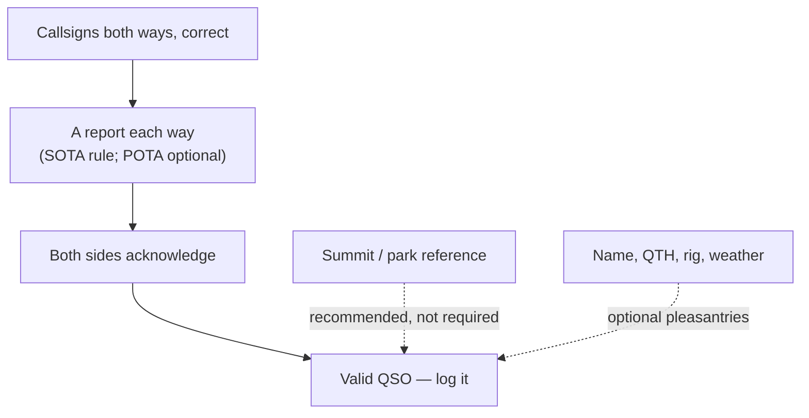
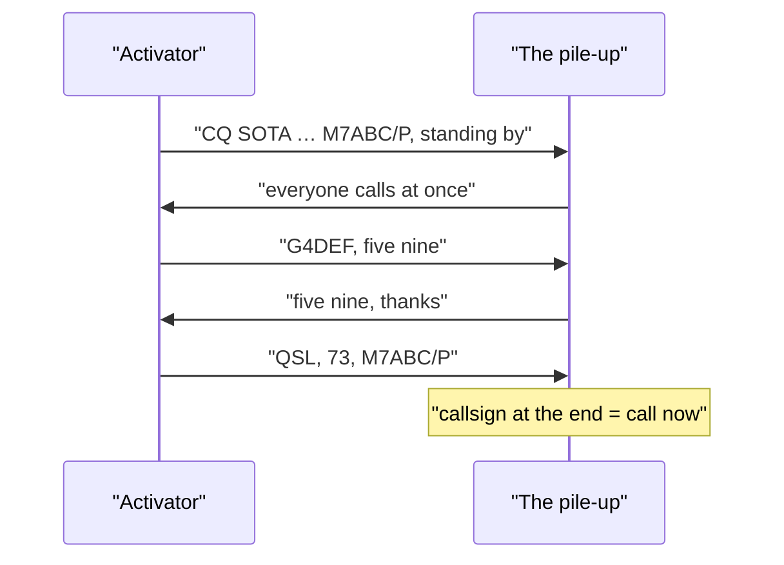

# What to Say: Worked Activations

[Portable & Off-Grid](outpost:entry/logbook73.handbook/portable-operating) told you what the activation programmes are and what a valid activation needs. What it could not do is stand next to you on the summit and tell you the words. That is this chapter's only job: complete, realistic transcripts of activation contacts — 2 m FM, SSB, CW, from the activator's chair and the chaser's — plus a phrase bank you can copy onto a card and take up the hill. The general phrase-book is [Making Contacts](outpost:entry/logbook73.handbook/making-contacts) and the Morse procedure is [Operating CW](outpost:entry/logbook73.handbook/cw-operating); this chapter assumes both rather than repeating them.

**Jump straight to an example:** [SOTA on 2 m FM](outpost:entry/logbook73.handbook/activation-scripts#transcript-1--sota-on-2-m-fm-start-to-finish) · [SOTA HF pile-up](outpost:entry/logbook73.handbook/activation-scripts#transcript-2--sota-on-40-m-ssb-with-a-small-pile-up) · [POTA and park-to-park](outpost:entry/logbook73.handbook/activation-scripts#transcript-3--pota-on-20-m-ssb-with-a-park-to-park) · [CW activation](outpost:entry/logbook73.handbook/activation-scripts#transcript-4--a-cw-activation-line-by-line) · [the chaser's side](outpost:entry/logbook73.handbook/activation-scripts#transcript-5--the-chasers-side).

Every callsign below is invented. The programme references are illustrative and may name real locations, so treat all of these details as placeholders: verify and substitute your own rather than copying them into a log.

## First, the calming bit

The exchange is short. Genuinely short — often eight seconds, rarely more than twenty. And nobody is judging your phrasing; both big programmes say so in their own documentation rather than leaving it to reassurance from a friend.

POTA's official Hunter Guide, addressing the people who will be calling you: _"This is how many learn to call CQ, handle pileups, and answer a CQ. Please be patient and considerate with new activators. You are a part of their learning!"_ The SOTA General Rules put the same duty on chasers: _"Chasers must operate with care to help the Activator, who may well be operating in difficult conditions."_

They have been told in writing to be kind to you, and they want something from you — your callsign in their log. That makes them motivated helpers, not judges. The worst realistic outcome of a fumbled over is that somebody says it again.

And **you are in charge.** POTA's Activator Guide is blunt — _"Control your pileups. It's your activation, so you call the shots."_ SOTA's activating page agrees: _"it's the activator who must set the pace."_ Beginners are usually too polite to impose structure; both programmes are telling you that you may.

## The three things that must happen

Everything here hangs on this skeleton. In any activation QSO, on any mode, in either programme:

1. **They get your callsign, correctly.**
2. **You get their callsign, correctly.**
3. **Both of you acknowledge** — some signal that each side has what it needs.

Plus, in SOTA, a signal report each way, because that one is a rule. Here is the clause verbatim — the single most useful sentence a first-time activator can read:

> _"QSOs must comprise an exchange of callsigns and signal reports; it is strongly recommended that the summit identifier be given during each contact. Where the summit identifier is not given in each contact (for example in slow CW QSOs) it should be repeated frequently every few QSOs."_

Read it twice, for what it does **not** say. The summit reference is _strongly recommended_, not required. POTA is looser still: its Rules page states that _"Parks on the Air does not require a specific exchange in a QSO"_ — no report, no reference, nothing beyond enough to log the contact. Your park number reaches the hunter through the log you upload afterwards (the ADIF field `MY_SIG_INFO`), not through the air. POTA's Hunter Guide even tells hunters to _"Go ahead and work someone calling 'CQ POTA,' even if you don't know what park they are at."_

So if you forget your reference on QSO three, nothing is broken — say it on QSO four. A SOTA chaser does need it eventually, because unlike a POTA hunter they file their own log, and the rules tell them to ask: _"Ask the Activator for the summit reference if you have not heard it stated."_

The thresholds: **SOTA** — one QSO qualifies the activation, four with four different stations earn the summit's points. **POTA** — ten QSOs from the park inside one UTC day.

## Rule, convention, or one operator's habit

This distinction matters more than any script. A beginner who mistakes a convention for a rule operates stiffly, apologises for things that were never wrong, and freezes when a habit copied from a video turns out to be optional.

| Practice                                                               | Status                   | Notes                                                                                              |
| ---------------------------------------------------------------------- | ------------------------ | -------------------------------------------------------------------------------------------------- |
| Exchange callsigns and reports (SOTA)                                  | **Rule**                 | General Rules 3.7.1 clause 8                                                                       |
| No contacts via terrestrial repeaters                                  | **Rule**                 | Both programmes; satellites are fine. POTA does permit using a repeater to _ask_ for a simplex QSO |
| Ten QSOs per UTC day (POTA); four different stations for points (SOTA) | **Rule**                 |                                                                                                    |
| No rag-chewing, station rundowns or tuning up on the activator         | **Rule in SOTA**         | Named as malpractice in General Rules 3.7.3, with sanctions                                        |
| Saying the summit or park reference on air                             | **Convention**           | "Strongly recommended" in SOTA, entirely optional in POTA                                          |
| Calling "CQ SOTA" / "CQ POTA"                                          | **Convention**           | No programme document prescribes any CQ wording                                                    |
| Full callsign once, never a fragment                                   | **Convention**           | IARU guidance and the DX Code of Conduct agree — treat it as firm                                  |
| Adding `/P` to your callsign                                           | **Convention** in the UK | See below                                                                                          |
| How often you repeat the reference in a pile-up                        | **Habit**                | Respected operators do it every QSO, every few QSOs, and only on request                           |
| Sending the report twice ("579 579")                                   | **Habit**                | Sensible when you are weak; others think it wastes time                                            |
| Ending an over with `BK` on CW                                         | **Habit**                | Argued both ways by experienced activators                                                         |

If you hear something odd on air, it is usually somebody's reasoned personal system rather than a standard you missed. One well-known activator deliberately gives persistent multi-callers a deflated report as a corrective; another sends his own callsign at the start _and_ end of every QSO because he chases summit-to-summit without internet access.

### The `/P` question, settled

In the UK, `/P` is **not required**. Ofcom's guidance says so directly: _"Any suffix, following the 'slash' ('/') symbol may be added to the transmitted call sign, so long as the station remains identifiable. Suffixes are not mandated by, or referenced in, the amateur radio licence."_ Neither SOTA nor POTA has ever required it either.

But Ofcom adds a sentence that matters: _"When used, the suffix becomes part of the call sign."_ POTA's park-to-park matching needs **exact** callsign agreement between the two logs — sign `M7ABC/P` while the other activator logs `M7ABC` and the match silently fails, costing you both the credit. So decide, and be consistent: say what you log and log what you say. UK opinion is genuinely split — `/P` stands out in a pile-up and is common in some areas, but it is longer to send on CW and awkward on some confirmation systems. Suffix rules vary by licensing jurisdiction, so check your own licence; in the UK, both choices are correct.

One thing that is not optional: an Intermediate `2`-format callsign **must** take a Regional Secondary Locator when you cross a border, because `20AAA` would not conform to the international regulations. A `2E0` holder activating a Welsh summit signs `2W0`; an `M0` holder may use `MW0` or stay `M0`, as they please.

### Where the UK and North America differ

Most POTA material online is American. Four differences that will otherwise trip you up:

- **The 2 m FM calling channel.** The UK calls on **145.500 MHz** (the RSGB band plan lists it as "FM calling"); North America uses **146.520 MHz**. UK convention is to move off the calling channel once you have made contact; the American framing is softer — move off if it gets busy.
- **"State" has no UK equivalent.** POTA's guide says activators typically want _"Callsign, Signal Report, and State"_. That is a North American habit; substitute a county, a town, or nothing.
- **UK park references start `GB-`.** Great Britain was consolidated into one POTA programme, so older material showing `G-0081` is superseded and American `US-` examples do not map onto your parks.
- **Activity density runs opposite.** UK and European SOTA has a dense chaser population, so four QSOs is usually easy. UK POTA is much thinner than the American videos suggest and ten QSOs is genuinely harder — plan a second band.

## Transcript 1 — SOTA on 2 m FM, start to finish

The easiest possible first activation: a handheld, a half-wave whip, a summit. SOTA bars terrestrial repeaters, so everything here is simplex. You are `M7ABC/P` on `G/LD-013`.

**Listen first**, for a minute, on 145.500. Then call there — UK SOTA activators call on the calling channel and move off afterwards, and repeated calling there is accepted for SOTA in a way it would not be for an ordinary chat, because you are trying to raise anyone at all from a hilltop.

> **You:** "CQ SOTA, CQ SOTA, this is Mike Seven Alfa Bravo Charlie stroke Papa, Mike Seven Alfa Bravo Charlie stroke Papa, SOTA activation on Golf stroke Lima Delta zero one three, listening."

Note the ending: **"listening"**, not "over". "Over" means _over to you_, and at the end of a CQ there is no "you" yet. Note also "stroke Papa" — if you use a suffix, say it that way, because "Victor Romeo two Oscar portable" could be `VR2OP` or `VR2O/P`.

> **G4DEF:** "Mike Seven Alfa Bravo Charlie stroke Papa, Golf Four Delta Echo Foxtrot."
>
> **You:** "Golf Four Delta Echo Foxtrot, good morning, thanks for the call. Shall we move to 145.400? One-four-five decimal four-zero-zero."
>
> **G4DEF:** "145.400, see you there."

Now the exchange, on the working channel:

> **You:** "Golf Four Delta Echo Foxtrot, this is M7ABC stroke Papa on 145.400. You are five and nine here, full quieting. The summit is Golf stroke Lima Delta zero one three, Lima Delta zero one three. Over."
>
> **G4DEF:** "Thanks, five nine, and you are five and seven with me, five-seven, a bit of noise on the tail but perfectly readable. Golf stroke Lima Delta zero one three copied, thank you. Name's Dave, near Carlisle. Over."
>
> **You:** "Thanks Dave, all copied, five-seven noted. 73 and thanks for the summit. G4DEF, this is M7ABC stroke Papa."
>
> **G4DEF:** "73, good luck with the rest. G4DEF."

A complete, valid, points-scoring SOTA QSO in about twenty seconds.

**Reports on FM** drop the T (tone) and give readability and strength only. Full-scale and easy to hear is 59; easy but not full-scale, 56 or 57; some noise present, 44 or 45; struggling, 33 or below. Many operators skip numbers and say "full quieting" or "about ninety percent quieting", which is arguably more informative given that most handhelds have a crude S-meter or none. Both are normal, there is a long-running friendly argument about which is better, and no activation has ever been invalidated by a report.

**Continue on 145.400** — the working channel you moved to — and this time two stations answer at once, with a third talking over the pair of them.

> **You:** "CQ SOTA, M7ABC stroke Papa on Golf stroke Lima Delta zero one three, listening."
>
> _(two stations reply simultaneously; you catch "…Juliett Kilo Lima" and a fragment)_
>
> **You:** "Station ending Juliett Kilo Lima only, please — go ahead."
>
> **M0JKL:** "Mike Zero Juliett Kilo Lima."
>
> **You:** "M0JKL, you are five and three here, five-three, quite noisy. Over."
>
> **M0JKL:** "Copied five-three… _(fading)_ …you're two-two with me…"
>
> **You:** "M0JKL, say again your report please? You are in the noise here. Over."
>
> **M0JKL:** "You are two and two, two-two, but readable. Golf stroke Lima Delta zero one three, thank you."
>
> **You:** "Two-two copied, thank you, that's a good one from up here. 73. M0JKL, M7ABC stroke Papa."
>
> _(as you release, a third station transmits without waiting)_
>
> **2E0FGH:** "Two Echo Zero Foxtrot Golf Hotel!"
>
> **You:** "2E0FGH, stand by please — 2E0FGH, you are next, go ahead."

Notice what you did with the out-of-turn caller: nothing dramatic, no lecture. You acknowledged, imposed order in four words, and worked them. That is the whole technique.

**When they stop coming**, broaden the invitation — it is accepted practice to say words to the effect of _"any callsign with a signal report, you don't have to be a SOTA chaser"_, because the rules require nothing whatever of the other station. And ask for help:

> **You:** "…and if anyone hearing me could post a spot on SOTAwatch, 145.400 FM, that would be very welcome — no phone signal up here."

Asking your first contact to spot you is normal, expected behaviour in both programmes, not an imposition. Then close:

> **You:** "Last call from Golf stroke Lima Delta zero one three, M7ABC stroke Papa, any further calls?" _(pause)_ "Nothing heard — thank you everyone, that's four in the log, going QRT and heading down. 73 all, M7ABC stroke Papa clear."

Announcing a last call and a QRT is strong convention in both programmes, and chasers want it: without it they sit on your frequency calling into an empty summit.

## Transcript 2 — SOTA on 40 m SSB, with a small pile-up

HF changes three things: you must check the frequency is free, callers arrive in a heap, and you will work partial callsigns.

Neither programme publishes official frequencies. SOTA's rules say plainly _"There are no specified SOTA frequencies"_ and POTA's guide says _"POTA does not have recommended frequencies."_ European SOTA SSB gathers loosely around 7.118, 7.120 and 14.285 MHz by convention alone — take yours from live alerts and spots, and avoid the international QRP calling frequencies, which the SOTA rules warn against because loud chasers cause interference there.

> **You:** "Is this frequency in use? This is M7ABC stroke Papa." _(pause)_ "Is this frequency in use? M7ABC stroke Papa." _(silence)_
>
> **You:** "CQ SOTA, CQ SOTA, CQ SOTA, this is Mike Seven Alfa Bravo Charlie stroke Papa, Mike Seven Alfa Bravo Charlie stroke Papa, Summits on the Air from Golf stroke Lima Delta zero one three, standing by."
>
> _(a wall of callers, five deep)_
>
> **You:** "Golf Four Delta Echo Foxtrot, five nine, five-nine."
>
> **G4DEF:** "Five nine, thanks, five-nine to you, Golf stroke Lima Delta zero one three confirmed. 73."
>
> **You:** "QSL, 73, M7ABC stroke Papa."

That last over is the mechanic of running a pile-up. **"QSL"** confirms you received their report, and **your callsign at the end is the starting gun** — it tells the queue you are finished and tells anyone who just tuned in who you are. International guidance specifically criticises "QSL, QRZ" with no callsign, because the pile-up is then left guessing who it is calling.

**Picking a partial call.** You will rarely copy a whole callsign out of a heap, so come back with the fragment you did get, plus a report:

> **You:** "The station with Zulu Zulu, five nine, go ahead with your full call."
>
> **F5ZZQ:** "This is _Foxtrot Five_… Foxtrot Five Zulu Zulu Quebec, Foxtrot Five Zulu Zulu Quebec."
>
> **You:** "Foxtrot Five Zulu Zulu Quebec, five nine, five-nine."
>
> **F5ZZQ:** "Five nine, QSL, merci, 73."
>
> **You:** "QSL, 73, M7ABC stroke Papa."

Note the asymmetry beginners miss: it is completely normal for **you** to use a partial call and not acceptable for a **caller** to send one. When a caller corrects you they should emphasise the part you missed with a tiny pause, exactly as F5ZZQ did.

**When you get it wrong and they insist**, that is not rudeness — a wrong callsign in your log means no credit for them.

> **You:** "M0JKM, five nine."
>
> **M0JKL:** "Please confirm my call — Mike Zero Juliett Kilo _Lima_, Lima Lima, M0JKL."
>
> **You:** "Apologies — M0JKL, Mike Zero Juliett Kilo Lima, five nine."
>
> **M0JKL:** "That's correct, five nine to you, 73."
>
> **You:** "Five-nine copied, thank you, 73. M0JKL, M7ABC stroke Papa."

**Summit-to-summit is often given priority.** Another activator will announce it. Taking them next is a friendly convention rather than a SOTA rule — the activator still controls the pile-up — but most callers will stand aside when asked.

> **2E0PQR/P:** "Summit to summit! Two Echo Zero Papa Quebec Romeo stroke Papa, summit to summit."
>
> **You:** "Summit to summit, go ahead, and everyone else please stand by."
>
> **2E0PQR/P:** "2E0PQR stroke Papa, you are five and seven here, and I'm on Golf stroke Sierra Papa zero zero four, Sierra Papa zero zero four."
>
> **You:** "Golf stroke Sierra Papa zero zero four copied, thank you — you are five and five here, five-five, five watts this end. 73 and enjoy your summit."
>
> **2E0PQR/P:** "Five-five copied, thank you. 73 and enjoy yours."
>
> **You:** "73, 2E0PQR stroke Papa. M7ABC stroke Papa."

Strictly, SOTA does not require summit references to be passed on air even for a summit-to-summit; the rulebook asks only for callsigns and reports, and where each activator gets the other's reference is up to them. Experienced operators argue this both ways. But the summit-to-summit award is credited by **cross-matching both logs**, so a wrong summit in either one means no credit — which is why almost everyone exchanges them on air anyway.

> **You:** "Last call on 7.118 from Golf stroke Lima Delta zero one three… nothing heard. I'm going to QSY to 14.285, one-four decimal two-eight-five, in about two minutes. Thanks all, M7ABC stroke Papa."

Announce the new frequency, not just "QSY". Chasers ask for this more than anything else: four seconds from you saves them a wasted quarter of an hour.

## Transcript 3 — POTA on 20 m SSB, with a park-to-park

POTA's Hunter Guide contains the only sanctioned worked example of a phone exchange either programme publishes. Recast with invented callsigns, the shape it teaches is:

> **You:** "CQ CQ Parks on the Air, this is Mike Seven Alfa Bravo Charlie at Golf Bravo dash zero one five four, standing by for a call."
>
> **M0JKL:** "Mike Zero Juliett Kilo Lima."
>
> **You:** "Mike Zero Juliett Kilo Lima, QSL?"
>
> **M0JKL:** "Roger roger, you are five eight into Norfolk, excellent signal here. Over."
>
> **You:** "Thanks for the five eight into Norfolk. You are five seven into park Golf Bravo dash zero one five four. QSL?"
>
> **M0JKL:** "Roger roger."
>
> **You:** "Thanks, 73."
>
> **M0JKL:** "Thanks for GB-0154, 73."

Look at what the hunter sends: callsign in phonetics, then a report and a location. **No park reference from the hunter, and no "portable".** The activator volunteers the reference; the hunter merely thanks them for it. ("Portable" is not part of a CQ either — POTA's own example contains no such word. Some operators say it; it is neither required nor standard.)

**Then a pile-up arrives.** Reports and park references make this a useful teaching pattern, but POTA does not require a particular on-air exchange. Your job is simply to work one caller at a time and log each callsign correctly.

> **You:** "CQ POTA, this is M7ABC at Golf Bravo dash zero one five four, standing by."
>
> _(several hunters call together; only the ending “X-ray Yankee Zulu” is clear)_
>
> **You:** "Station ending X-ray Yankee Zulu only, please — everyone else stand by."
>
> **EA4XYZ:** "Echo Alfa Four X-ray Yankee Zulu, Echo Alfa Four X-ray Yankee Zulu."
>
> **You:** "EA4XYZ, thank you. You are five and seven, five-seven, into park Golf Bravo dash zero one five four."
>
> **EA4XYZ:** "Five-seven copied. You are five and nine into Madrid, five-nine."
>
> **You:** "Five-nine copied, thank you, 73. M7ABC."

That final callsign tells waiting hunters that the QSO is complete and identifies you for anyone who has just tuned in. If the partial call had not returned, ask once more — _"X-ray Yankee Zulu only"_ — then move on rather than letting the whole queue call again. A hunter should send their **full** callsign; answering with a partial is the activator's way of selecting one voice from the overlap.

**The park-to-park, mid-pile-up.** This is the one case where exchanging references genuinely matters.

> **You:** "CQ POTA, M7ABC at GB-0154, standing by."
>
> **G4DEF/P:** "Park to park! Golf Four Delta Echo Foxtrot stroke Papa, park to park."
>
> **You:** "Park to park, go ahead — everyone else stand by please."
>
> **G4DEF/P:** "Golf Four Delta Echo Foxtrot stroke Papa, you are five nine into Golf Bravo dash one two four zero, one-two-four-zero. Over."
>
> **You:** "Golf Bravo dash one two four zero copied, thank you. You are five eight into Golf Bravo dash zero one five four, zero-one-five-four. QSL?"
>
> **G4DEF/P:** "QSL, GB-0154 in the log, 73 and enjoy the park."
>
> **You:** "73, thanks for the park-to-park."

Three things make that work, and none is a rule about what you say. POTA credits park-to-park by **matching the two uploaded logs**, so each of you records the other's reference in the ADIF `SIG_INFO` field — strongly recommended, not strictly required. The two logged times must **coincide within 15 minutes**, which is generous, though a wrong UTC date or an hour of British Summer Time left in your clock will break it. And **callsigns must match exactly**: `G4DEF/P` against `G4DEF` will not match. If a park-to-park station is calling and the activator picks you instead, work them and mention it — _"…and there's a park-to-park in the pile-up for you."_

## Transcript 4 — a CW activation, line by line

The Morse itself is [Operating CW](outpost:entry/logbook73.handbook/cw-operating)'s subject; this is only the activation script. Assume 15 wpm and a rig with a memory keyer.

> **You send** — `QRL?` … _(pause)_ … `QRL?`
>
> _"Is this frequency in use?" Note the question mark: `QRL` without one asserts that **you** are busy. A few seconds of silence means it is yours._

> **You send** — `CQ CQ SOTA DE M7ABC/P M7ABC/P SOTA G/LD-013 PSE K`
>
> _"Calling anyone, for SOTA. From M7ABC portable, twice. The summit is G/LD-013. Please — over to anyone." Send your callsign at least twice: the Reverse Beacon Network's skimmers need the word `CQ` plus two to four repetitions to spot you, and clean, evenly spaced code decodes far better than a wobbly straight-key fist. Send at least the first CQ from the keyer memory._

> **A chaser sends** — `F5ZZQ`
>
> _Full callsign, once. That is all a chaser should ever send when calling._

> **You send** — `F5? BK`
>
> _"The station starting F5 — who? Back to you." Coming back with a fragment is correct and universal for an activator. `BK` = break, your turn._

> **F5ZZQ sends** — `F5ZZQ F5ZZQ`

> **You send** — `F5ZZQ 559 559 BK`
>
> _Their call (so they know you have it right), your report sent twice in case you are weak at their end, back to them. Honest reports are the norm in SOTA and POTA, not the contest reflex of `599` — and repeating the digits is a habit with a reason, not a rule._

> **F5ZZQ sends** — `TU 339 339 BK`
>
> _"Thanks, you are 339 here." A weak-signal refinement many chasers use: prefer doubled figures — `229`, `339`, `559`, `599` — because they survive a repeat request far better than `329` or `449`._

> **You send** — `RR TU 73 DE M7ABC/P EE`
>
> _"Roger roger, thanks, best regards, from M7ABC portable." The final `EE` is two dits: the CW wave goodbye. The chaser answers with `EE` or a single `E`._

> **You send** — `QRZ DE M7ABC/P SOTA G/LD-013 K`
>
> _"Who is calling? M7ABC portable, on G/LD-013, over." Your callsign at the end is the starting gun, exactly as on SSB._

Three things will happen during the run, each with a short answer:

> **A chaser sends** — `REF?` or `SOTA?`
>
> _"Repeat your summit reference." Send `G/LD-013 G/LD-013 BK`. In POTA the equivalent question is `QTH?`._

> **A chaser sends** — `PSE QRS`
>
> _"Please send slower." Better than slowing the characters is widening the gaps between them — most people copy fast characters fine given thinking time. It works in reverse: if you are the slow one, put `PSE QRS 12 WPM` in your **alert** as well as on the air. Activators consistently report that the alert is where it actually gets honoured._

> **You cannot copy at all** — `SRI QRM PSE AGN`, or just `?`
>
> _"Sorry, interference, please repeat." A bare `?` means "say again" and is perfectly polite._

> **You send** — `LAST CL DE M7ABC/P K` … _(nothing)_ … `TU QRT 73 DE M7ABC/P EE`
>
> _"Last call… thanks, closing down, 73." `LAST CL` is the recognised CW form, and it genuinely pulls in stations who were waiting for conditions to improve._

One counter-intuitive point, because it explains why a pile-up sometimes sounds like a single unreadable tone: POTA's own CW guide tells hunters **not** to zero-beat you. _"Hunters, please dial your transmit frequency somewhere between 20 and 100 Hz off the activator's frequency when you hear or anticipate a pileup."_ Stations exactly on your frequency merge into one note; a small offset makes each separable. You can help by listening 50–100 Hz away from your own transmit frequency.

### CW shorthand for activations

| Sent                  | Means                                                                            |
| --------------------- | -------------------------------------------------------------------------------- |
| `QRL?`                | Is this frequency in use? (without the `?`: "I am busy")                         |
| `CQ SOTA` / `CQ POTA` | Calling for an activation contact — and `CQ` is the word the skimmers listen for |
| `K` / `KN`            | Over to anyone / over to you only                                                |
| `BK`                  | Break — your turn, straight back                                                 |
| `R` / `RR`            | Received (send it only if you copied 100 %)                                      |
| `TU` / `TNX`          | Thank you / thanks                                                               |
| `UR`                  | Your, you're                                                                     |
| `ES`                  | And                                                                              |
| `AGN` / `PSE AGN`     | Again / please repeat                                                            |
| `?`                   | Say again                                                                        |
| `RST?`                | Repeat your signal report                                                        |
| `REF?` / `SUMMIT?`    | Repeat your summit reference (SOTA)                                              |
| `QTH?`                | Where are you? (POTA's equivalent question)                                      |
| `S2S` / `P2P`         | Summit-to-summit / park-to-park — announce it and expect priority                |
| `QRS` / `QRQ`         | Send slower / send faster                                                        |
| `QSB` / `QRM` / `QRN` | Fading / interference from stations / natural static                             |
| `SRI`                 | Sorry                                                                            |
| `CFM`                 | Confirmed — I got everything                                                     |
| `5NN`                 | `599`, with the nines cut to `N` because it is shorter to send                   |
| `LAST CL`             | Last call before I close or move                                                 |
| `QSY 10118`           | Moving to 10.118 MHz — always give the frequency                                 |
| `QRT`                 | Closing down                                                                     |
| `73`                  | Best regards (already plural)                                                    |
| `EE`                  | Dit-dit: the goodbye wave                                                        |

Cut numbers are contest practice, and only `N` for 9 (occasionally `T` for 0) has genuinely naturalised into activation CW. You will hear `5NN` constantly and should learn to read it — but sending an honest `559` is completely normal.

## Transcript 5 — the chaser's side

Chasing is where most people should start, and it is a different skill: one chance, in a queue, and everything depends on timing.

**You see a spot.** LogBook73's Chase page ranks live spots against the gaps in your own logbook, so a summit or park you have not worked floats to the top.

**Then you do nothing for a minute.** This is the part beginners skip. Listen through one complete QSO and learn the activator's rhythm — where their over ends and what word they finish with. Activators are creatures of habit, and calling before their final "over" or `K` loses the first syllable of your callsign.

> **M7ABC/P:** "…QSL, 73, M7ABC stroke Papa."
>
> _(you wait — genuinely wait, four or five seconds, until the crash of callers has thinned)_
>
> **You:** "Golf Four Delta Echo Foxtrot." _(once, in full, then stop and listen)_
>
> **M7ABC/P:** "Two Echo Zero Foxtrot Golf Hotel, five nine."

They came back to somebody else. **Say nothing.** Calling over a contact in progress is named as malpractice in the SOTA General Rules, with sanctions attached. Wait it out.

> **M7ABC/P:** "QSL, 73, M7ABC stroke Papa."
>
> **You:** "Golf Four Delta Echo Foxtrot."
>
> **M7ABC/P:** "Delta Echo Foxtrot, five and three, five-three."
>
> **You:** "This is _Golf Four_ — Golf Four Delta Echo Foxtrot, five-three copied, and you are five and seven here, five-seven. Over."
>
> **M7ABC/P:** "G4DEF, QSL, five seven, thank you, 73."
>
> **You:** "73, thanks for the summit."

Three habits carry the whole of chasing. **Full callsign, once** — calling repeatedly is worse than useless, because while you are transmitting you are not listening, and the classic failure is a multi-caller who missed the activator coming back to them. **Wait** five to seven seconds after the previous contact ends; holding back gets you heard clear of the pack. And **if you cannot hear them, do not call** — SOTA's rules name that as misconduct. If you are running low power, hang back: a pile-up rarely lasts more than a few minutes and there is almost always a lull within five.

**Then log it — and here the programmes diverge completely.** In **SOTA**, chasers submit their own log, so you need the summit reference (from the air or from the spot: the rules say "obtained", not "exchanged"). In **POTA**, hunters submit nothing at all — _"As a hunter, you do not submit any logs"_ — and your credit appears automatically when the activator uploads, which may take days. That is why asking a POTA activator for their park number mid-pile-up serves no POTA purpose whatever; it is only ever for your own logbook.

One more asymmetry: in SOTA only **one QSO per summit per UTC day** counts for you, whatever the band. In POTA you may work the same activator again on a different band, mode or park — and doing so actively helps them towards their ten. If a POTA activator is struggling and changes band, work them again.

## The phrase bank

The whole activation, on one card. Substitute your own callsign, reference and frequency.

| When                                           | Say                                                                                                            |
| ---------------------------------------------- | -------------------------------------------------------------------------------------------------------------- |
| Opening call (SOTA)                            | "CQ SOTA, CQ SOTA, this is [call] stroke Papa, [call] stroke Papa, SOTA activation on [reference], listening." |
| Opening call (POTA)                            | "CQ POTA, CQ Parks on the Air, this is [call] at [reference], standing by for a call."                         |
| Checking the frequency                         | "Is this frequency in use? This is [call]." — twice, then it is yours                                          |
| Giving a report                                | "[their call], you are five and nine, five-nine."                                                              |
| Confirming and inviting the next caller        | "QSL, 73, [your call]."                                                                                        |
| Asking for a repeat                            | "Say again your report, please." / "Say again your callsign?"                                                  |
| You only caught part of a call                 | "The station with [fragment], go ahead with your full call."                                                   |
| Restoring order                                | "[fragment] only please — everyone else stand by."                                                             |
| Yielding to a summit-to-summit or park-to-park | "Summit to summit, go ahead — everyone else stand by."                                                         |
| Standing by                                    | "…listening" or "…standing by" — never "over" at the end of a CQ                                               |
| Asking to be spotted                           | "If anyone hearing me could post a spot — [frequency], [mode] — it would be very welcome."                     |
| Moving                                         | "QSY to [frequency in full], in about two minutes."                                                            |
| Last call                                      | "Last call from [reference], [your call] — any further calls?"                                                 |
| Going QRT                                      | "Nothing heard — thanks everyone, going QRT. 73 all, [your call] clear."                                       |

## What not to say, and why

- **Do not rag-chew an activator with a queue waiting.** This is the big one, and in SOTA it is not merely rude but in the rulebook: _"Making over-long overs, giving a full breakdown of your station and asking unnecessary questions delays the Activator and infuriates other Chasers."_ The alternative is genuinely nice — do the short exchange, wait for the pile-up to die, then call back and chat properly. Activators love that.
- **Do not ask for a QSL card on air.** Neither programme needs one: _"QSL cards are not required, as the SOTA database can be used to verify your QSOs"_, and POTA hunter credit is automatic. Put your policy on your online profile rather than negotiating it in front of thirty waiting stations.
- **Do not tune up on the activator's frequency.** The SOTA rules call this _"the height of bad manners"_, and the activator is running a few watts into a wire in the wind.
- **Do not tail-end.** Transmitting on the end of someone's over to be the last one heard is named as malpractice by SOTA and advised against by international guidance and the DX Code of Conduct alike. (POTA's hunter guide does recommend tail-ending — but that sits in its FT8 section, where transmissions occupy fixed 15-second slots and it is harmless. It does not apply to voice or CW.)
- **Do not send a partial callsign.** Not "Zulu Zulu Quebec" but "Foxtrot Five Zulu Zulu Quebec" — bad practice, and in many countries not legal.
- **Do not invent phonetics.** Standard ITU/NATO words only. The reason is acoustic rather than pedantic: a weak activator reconstructs "Lima" from its consonant pattern through the noise and will never get "London".
- **Do not answer deliberate interference.** Ignore it completely; acknowledging it is what feeds it.
- **Do not police "QRZ".** Strictly it means only "who called me?", and international guidance is firm that ending a CQ with it is wrong — yet you will hear it used to mean "I'm listening again" thousands of times, by very good operators. Know the strict meaning; correct nobody.

Two for activators: do not spot yourself before you are actually transmitting, or fifty people will tune to an empty frequency; and keep SOTAwatch spots factual, because SOTA's rules restrict the board to _"key frequency, mode, time and callsign data"_ and POTA's chattier spot-comment culture does not transfer.

## Try it yourself

1. **Write the card.** Copy four rows out of the phrase bank above: your opening call, "you are five and nine, five-nine", "QSL, 73, [your call]", and the last call. That is the whole activation. Read it off the card for your first ten contacts — most operators did.
2. **Chase one activator this week.** Open Chase, pick a spotted summit or park, listen through one full QSO before transmitting, then give your full callsign once. Log it in the Console with the reference filled in and watch it land in your SOTA or POTA tracker.
3. **Rehearse out loud.** In the car, say the pile-up cycle twenty times: _"[their call], five nine, five-nine"_ … _"QSL, 73, [your call]"_. It needs to be muscle memory, because the wind will take everything else.
4. **Do a 2 m FM activation on a local hill.** A handheld, a half-wave whip, four contacts, Transcript 1 as the script. Use a portable session — it is built for activations, works offline with no phone signal, and holds the reference so nothing needs re-typing at home.
5. **If you are learning Morse**, run one activation script in the Morse trainer at 10 wpm. The activation exchange is the most rigidly predictable CW there is, which makes it the easiest real CW to copy.

## Key takeaways

- Three things must happen: your callsign across correctly, theirs across correctly, and both sides acknowledging — plus a report each way, which is a rule in SOTA and optional in POTA.
- **The summit or park reference does not have to be passed on air.** SOTA "strongly recommends" it; POTA requires no specific exchange at all and delivers the park number through the activator's uploaded log.
- Tell rule from convention from one operator's habit: "CQ SOTA", saying `/P`, repeating the reference every QSO and sending the report twice are all optional — and Ofcom has confirmed `/P` is not required in the UK at all.
- You run the pile-up; both programmes say so explicitly. Your callsign at the end of each QSO is the starting gun for the next caller.
- As a chaser: full callsign, once, after a five-second pause; never call over a contact in progress or a station you cannot hear; if you are weak, wait for the lull rather than fight it.
- Yield to summit-to-summit and park-to-park callers and exchange references with them — those awards are credited by cross-matching both logs, and POTA's match needs exact callsigns within 15 minutes.
- Announce a last call before you close and give the frequency in full when you move — and never start a long conversation with a queue waiting, which in SOTA is written into the rules.

When a phrase in this chapter is still opaque, every term the handbook uses is defined in the [Glossary](outpost:entry/logbook73.handbook/glossary).
