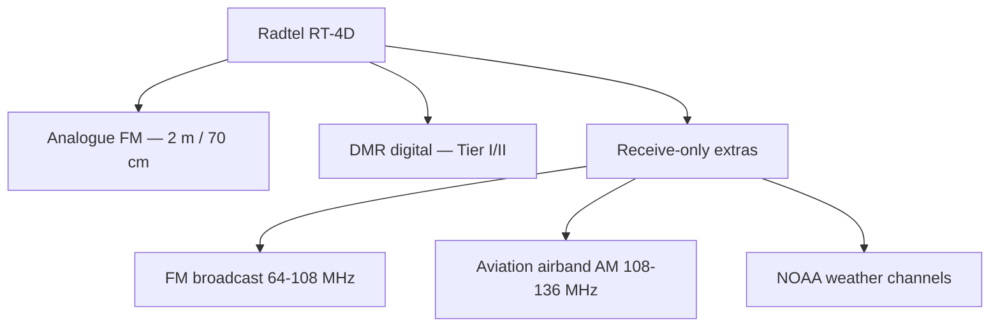
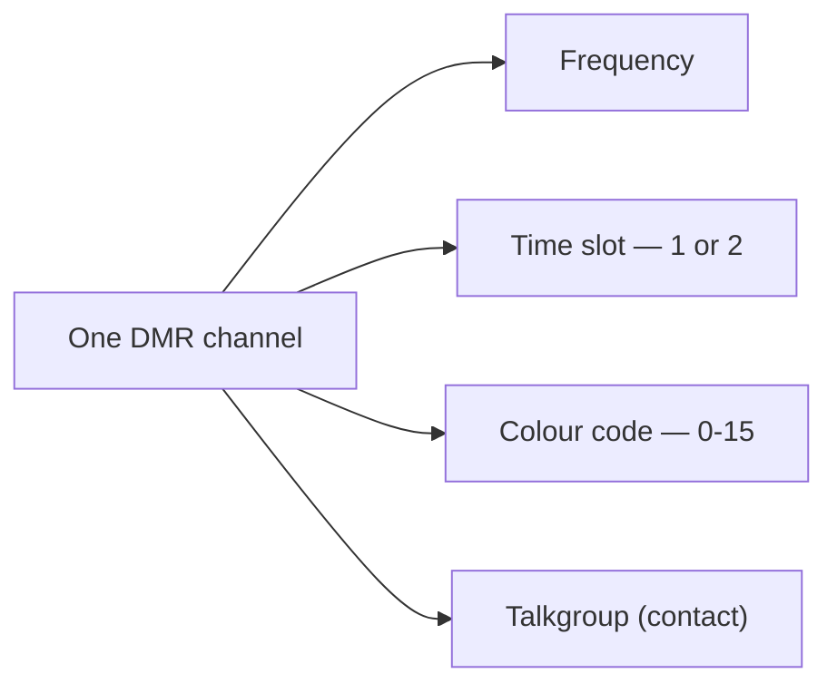

# Why the RT-4D (cheap DMR, done properly)

The Radtel RT-4D is a budget dual-band analogue-and-DMR handheld, and for many operators it is an accessible way to explore digital voice. That design delivers real capability and a few real compromises, and this guide is honest about both — because a simple radio understood properly is worth far more than expensive equipment left baffling in a drawer.

## Why cheap DMR radios exist at all

DMR — Digital Mobile Radio — was never designed for amateurs. It is a commercial two-way radio standard, written by the European Telecommunications Standards Institute for taxi firms, security teams, festivals and factories: fleets that need clear audio, private talkgroups and two conversations squeezed onto one repeater channel. That commercial heritage is exactly why a radio like the RT-4D can be so cheap. The chipsets, the codecs and the manufacturing were paid for by an enormous professional market, and amateur radio gets to ride along on the same silicon at hobby prices.

The RT-4D is a "Tier I/II" DMR set, which is the part of the standard amateurs use: simplex and conventional repeater operation on the 2 m (144 MHz) and 70 cm (430 MHz) bands. It speaks ordinary analogue FM too, so the same radio talks to your local FM repeater and your club's simplex net as happily as it talks to the worldwide DMR networks. If the phrase "digital voice" is new to you, start with the handbook's [digital voice](outpost:entry/logbook73.handbook/digital-voice) overview and the [DMR overview](outpost:entry/logbook73.handbook/dmr) — this guide assumes you will lean on those for the deep theory and keeps itself focused on _this radio's_ menus and buttons.

## What the RT-4D actually is

Under the small monochrome LCD sits a genuinely capable little radio. Here is the honest specification, taken straight from the manual rather than the marketing:

| Feature                | The RT-4D                                                                                      |
| ---------------------- | ---------------------------------------------------------------------------------------------- |
| Modes                  | Analogue FM (F3E) and DMR digital (4FSK), Tier I/II                                            |
| Transmit — EU version  | 144–146 MHz and 430–440 MHz                                                                    |
| Transmit — USA version | 144–148 MHz and 420–450 MHz                                                                    |
| Receive                | FM broadcast 64–108 MHz, aviation airband AM 108–136 MHz, and digital/FM 136–174 & 400–470 MHz |
| Channels               | 1024, organised into up to 256 zones                                                           |
| Display                | Monochrome LCD, dual-standby (watch two channels)                                              |
| Sub-tones              | CTCSS / DCS on analogue; colour code on DMR                                                    |
| Extras                 | SMS text, NOAA weather, FM broadcast radio, Stun/Kill/Revive                                   |
| Connectors             | Removable antenna, Kenwood 2-pin speaker/mic/programming port, USB-C                           |
| Size / weight          | ~112 × 61 × 38 mm, ~198 g; 7.4 V battery                                                       |

A few of those rows deserve a plain-English word. **The transmit bands depend on which market version you bought** — the numbers above are the two common ones, and other regions may differ, so always transmit within your own [licence conditions](outpost:entry/logbook73.handbook/getting-licensed) and national band plan rather than trusting a spec sheet. The receiver reaches further than the transmitter, as budget handhelds usually do: it will pick up the FM broadcast band, aviation airband in AM, and the NOAA weather channels, none of which you transmit on. And the number that surprises people is **1024** — that is a lot of channels, and DMR needs most of them, which is the first hint that this radio expects to be programmed by software rather than thumbed in by hand.

## The honest picture: cheap has a shape

Two compromises come with the price, and knowing them up front makes you a better operator, not a disappointed one.

**The front end is broad, not fussy.** To cover such a wide receive range so cheaply, the RT-4D uses less selective input filtering than a premium handheld. In an ordinary spot you will never notice; near a broadcast, paging or cellular transmitter, or on a large outdoor antenna, it can overload and serve up [ghost signals](outpost:entry/logbook73.handbook/overload-and-ghost-signals) — apparent stations that are not really on the frequency you are tuned to. Treat a "repeater" that appears on an odd frequency next to a transmitter site with suspicion before you believe it.

**DMR is not plug-and-play.** This is the big one, and it is not a fault of the RT-4D specifically — it is true of every DMR handheld. A DMR radio out of the box, with no setup, cannot really _do_ anything useful on the digital side. Before it becomes a working digital radio you need three things arranged, and they take an evening to sort out the first time.

### One: a DMR ID

Every DMR transmission carries a unique numeric identity, the way an APRS packet carries a callsign. You cannot invent one — you apply, free, at RadioID.net, prove you hold an amateur licence, and receive a seven-digit number. That number goes into the radio once, at `Digital Set → Personal ID`, and it travels with everything you send. Until you have it, you can _listen_ to DMR all day, but you should not transmit. The [DMR networks](outpost:entry/logbook73.handbook/dmr-networks) chapter walks through the whole ID process.

### Two: a code plug

Remember those 1024 channels? A DMR "channel" on this radio is not just a frequency. It is a bundle of four things — **frequency, time slot, colour code, and a talkgroup (called a contact)** — and every talkgroup you want to use needs its own channel entry. That is far too much to type on a keypad, so DMR radios are configured with a _code plug_: a configuration file built on a computer in the vendor's CPS (Customer Programming Software) and loaded down the USB-C cable. You can edit the RT-4D by keypad in a pinch, but for real use the CPS is the tool. The [hotspots and code plugs](outpost:entry/logbook73.handbook/dmr-hotspots) chapter explains the file and how to build one.

If those four words are a blur, the [slots, colour codes and talkgroups](outpost:entry/logbook73.handbook/dmr-slots-talkgroups) chapter is the one to read — it is the mental model the whole rest of this guide rests on.

### Three: something to talk through

DMR audio is nearly always relayed by a network. Either you are in range of a DMR repeater that carries networks like BrandMeister, or — far more commonly for a new operator — you run a small personal **hotspot**: a matchbox-sized device that bridges your handheld's radio signal to the internet. With a hotspot on your desk, a budget handheld can reach linked stations around the world; without a repeater or hotspot nearby, DMR falls back to simplex chats with radios in earshot. This is the single fact that most surprises new buyers, so it is worth saying plainly: **the radio is only one part; compatible infrastructure and careful setup are what turn it into a networked digital station.**

## Receiving, transmitting, and staying legal

Two rules sit above everything else in this guide.

**Listening is free; transmitting is licensed.** In most of the world you may _receive_ with a radio like this without any licence — scanning the airband, hearing your local repeaters, following the NOAA weather channels. The moment you _transmit_, you need an amateur licence and a DMR ID, and you must stay inside your allocation. If you are not yet licensed, every receive-only part of this guide is yours to enjoy; the [getting licensed](outpost:entry/logbook73.handbook/getting-licensed) chapter is where to start when you want to key up.

**Encryption stays off.** The RT-4D can encrypt DMR audio (it offers ARC4 and AES options), because it is a commercial radio at heart and commercial users need privacy. On the amateur bands, encryption that obscures the meaning of a transmission is **generally illegal** — amateur radio is an open, self-policing service and must stay readable by anyone. Leave `Encryption` set to `Off` on every channel, full stop. The [DMR operating](outpost:entry/logbook73.handbook/dmr-operating) chapter covers this and the other etiquette that keeps you welcome on the networks: transmitting politely so you never talk over someone, and understanding "promiscuous" receive so you know what you are hearing.

### A word on RF safety

A handheld is a small transmitter held next to your head. The physics is gentle at these powers, but the habits are worth keeping: hold the antenna a few centimetres from your face when you transmit, use the lowest power that does the job, and never key up into a missing or damaged antenna. That is the whole of RF safety for a radio this size; [RF power](outpost:entry/logbook73.handbook/rf-power) has the reasoning if you want it.

## Who this guide is for, and how it is built

You are welcome here whether you have just unboxed your first DMR radio and feel slightly ambushed by the menus, you are an FM operator curious whether digital is worth the bother, or you are an old hand who wants a menu reference that finally explains what every item does. The guide leans towards being useful to a newcomer, with the deep theory cross-linked to the main [handbook](outpost:entry/logbook73.handbook) so this reference can stay practical.

It is built as a set of chapters you can read in order or dip into:

- **Getting Started** — layout, display, and how to think about programming this radio. Read it first.
- **Every Menu Explained** — a reference chapter for each menu group, from Basic Set to Digital Set.
- **DMR chapters** — channels, and getting on the air digitally, step by step.
- **Analogue, Contacts & Zones, and Extras** — the FM side, organising your channels, and the odds and ends (SMS, NOAA, FM radio).
- **Radio Theory** — the _why_, linked out to the handbook's DMR family.
- **Configurations, Troubleshooting and Best Practices** — ready-made setups, the "why won't it…" answers, and how to be a good operator.

Set your expectations kindly on one point: **DMR has a learning curve.** The first evening — ID, code plug, hotspot, first contact — feels like a lot. It is normal, everyone goes through it, and by the second evening it clicks. This guide's job is to make that first evening as short as possible.

## Try it yourself

You can start before you have programmed a single digital channel, and before you are even licensed:

1. Charge the battery fully and fit the supplied antenna finger-tight — never transmit without an antenna attached.
2. Power up and spend ten minutes in **receive only**. Tune the FM broadcast band, then the aviation airband, then find a local FM repeater output if you know one. This proves the radio works and teaches you the volume knob, the display and the `▲`/`▼` keys with zero risk.
3. If you already hold a licence, apply for your **DMR ID** at RadioID.net now — approval can take a day or two, so getting it moving early means it is waiting for you when you reach the DMR chapters.
4. Note down which **market version** you have (check the transmit range in the menu or on the box against the table above) so you know your legal transmit limits before you key up.

Do those four things and you arrive at the next chapter with a working radio, an ID on the way, and no bad habits to unlearn.

## Key takeaways

- The RT-4D is a budget dual-band handheld that does both **analogue FM and DMR digital** — an accessible doorway into digital voice.
- Cheap DMR exists because DMR is a **commercial standard**; amateurs ride on silicon paid for by the professional market.
- It **receives** widely (FM broadcast, airband AM, NOAA, 1024 channels across 256 zones) but **transmits** only within its market-version 2 m / 70 cm allocation.
- DMR is not plug-and-play: you need a **DMR ID** from RadioID.net, a **code plug** built in CPS over USB-C, and usually a **repeater or hotspot** to be useful — the deep theory lives in the [handbook DMR family](outpost:entry/logbook73.handbook/dmr).
- Remember the channel model — a DMR channel is **frequency + time slot + colour code + talkgroup** — and keep **encryption off**, because it is generally illegal on the amateur bands.
- Receiving is licence-free almost everywhere; **transmitting needs a licence and a DMR ID**, and the lowest sensible power keeps you safe and considerate.
- Expect a learning curve on day one; it clicks on day two, and this guide is here to shorten the gap.

Ready to pick it up and learn your way around it? Start with [Getting Started: Layout, Display & Modes](outpost:entry/logbook73.guide.rt-4d/getting-started).
