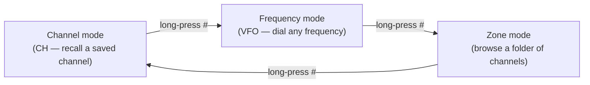
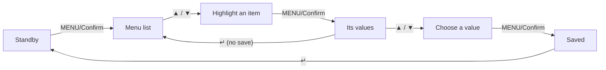

# Getting started: layout, display and keys

The quickest way to fall out with a new radio is to press the wrong button in the first five minutes and end up somewhere baffling with no way back. So before we open a single menu, let's get oriented: what each control does, what the little mono screen is telling you, and the two or three ideas — VFO and channel, zones, A and B — that the whole RT-4D is built around. Twenty unhurried minutes here and the rest of the guide will feel obvious, digital voice and all.

## The front panel

There is not a lot to an RT-4D, and every control earns its place. Don't try to memorise them; just get a feel for what does what as we walk down the radio, top to bottom.

1. **Antenna (top).** The supplied antenna screws in finger-tight — never force it, and **never transmit without an antenna attached**, because a transmitter with nowhere to send its power can damage itself. Any replacement must suit the intended band, connector and operating environment; more in [Antennas](outpost:entry/logbook73.handbook/antennas).
2. **Power / volume knob (top).** This one control switches the radio on with a click and sets the loudness — clockwise for on and louder, anticlockwise to the click for off. That is all it does, which is a mercy on a radio with this many features.
3. **Indicator LED.** A small light on the front: it glows **red on transmit** and **green on receive** (when a signal opens the squelch). A quick glance confirms you really are keying up — handy when you are not sure the PTT has taken.
4. **LCD.** A monochrome screen showing frequency or channel, mode tags and status icons. It rewards a careful read, so it gets its own section next.
5. **Microphone and speaker.** The grille carries both — speak across it at a hand's width, not pressed to your lips, and your audio will sound far cleaner.
6. **PTT and two side keys.** On the left edge sits the **PTT** (press-to-talk) and, above or below it, **side-key 1** and **side-key 2**. Both side keys are programmable and each has a _short_ and a _long_ press, so two physical buttons give you four quick functions — monitor, torch, power level and more, all assigned in [Keys](outpost:entry/logbook73.guide.rt-4d/keys).
7. **The control keys.** Below the screen: **MENU/Confirm** (enter the menu and say "yes"), the **↵ / Return** key (back out, cancel, and a couple of clever extra jobs we will meet shortly), and **▲ / ▼** to move up and down.
8. **Numeric keypad `0`–`9`, `*` and `#`.** In frequency mode you type a frequency straight in — far quicker than winding `▲`/`▼`. Each of these keys has a second life too, covered just below.
9. **Type-C and 2-pin ports (side).** The **USB Type-C** port charges the radio and — far more importantly — carries the programming cable that talks to Radtel's CPS software on a computer. Beside it, a **Kenwood-style 2-pin** port takes an earpiece/microphone and also serves as a programming connection. We will lean on that Type-C port a great deal once we reach DMR.

> **The single most useful habit:** when you get lost, press **↵ (Return)** a few times. It backs you out of any menu to the standby screen, undoing nothing. There is no way to dig yourself so deep that you cannot escape.

## Reading the display

The screen looks busy at first because it is packing a lot of state into a small space — but every symbol is just a setting you can see at a glance instead of diving into a menu to check. Learn the handful below and the radio stops keeping secrets.

| Symbol                                              | What it means                                                                                          |
| --------------------------------------------------- | ------------------------------------------------------------------------------------------------------ |
| `VFO` / `CH` / `Zone-XXX`                           | Which display mode you are in — tuning a raw frequency, recalling a stored channel, or browsing a zone |
| `▶`                                                 | Marks the **main working band** (the one the PTT transmits on)                                         |
| `D-XXXX`                                            | A **digital (DMR)** channel and its number                                                             |
| `A-XXXX`                                            | An **analogue FM** channel and its number                                                              |
| `XXXX`                                              | The plain channel number                                                                               |
| `T1` / `T2`                                         | The digital **time slot** — slot 1 or slot 2 (a DMR idea, explained below)                             |
| `AM` / `FM`                                         | The analogue **modulation** in use                                                                     |
| `CXX`                                               | The digital **colour code** (e.g. `C01`) — DMR's equivalent of an access tone                          |
| `CTC` / `DCS`                                       | An analogue **sub-tone** (CTCSS or DCS) is set on this channel                                         |
| `ENC`                                               | **Encryption is on** — and on the amateur bands it must not be (see below)                             |
| `MUT`                                               | A decoded sub-tone is muting the audio until the right tone arrives                                    |
| `H` / `L`                                           | Transmit **power**: high or low                                                                        |
| `W` / `N`                                           | Channel **bandwidth**: wide (≈25 kHz) or narrow (≈12.5 kHz)                                            |
| `HD`                                                | A digital **call is being held** (hang-time after an over)                                             |
| `R` / `T`                                           | **Reverse** (swap TX/RX) or **talk-around** (transmit on the repeater's output)                        |
| Battery, clock, signal, padlock, scanning, envelope | Charge, time, received signal strength, keypad lock, scan running, unread SMS                          |

Two of these deserve a note now because they are pure DMR and new to anyone coming from an analogue handheld. The **colour code** (`CXX`) is a number, `0`–`15`, that a DMR repeater checks before it will relay you — think of it as a digital gatekeeper, the counterpart to the analogue sub-tone. The **time slot** (`T1`/`T2`) is subtler still: a single DMR frequency is sliced into two rapid, alternating time slots, so two separate conversations can share one channel without hearing each other. Both ideas are unpacked properly in [DMR Slots & Talkgroups](outpost:entry/logbook73.handbook/dmr-slots-talkgroups); for now, just know what the tags on the screen are pointing at.

## The multi-function keys

Three keys do double or triple duty, and the RT-4D leans on them heavily. Once these click, the radio feels much smaller.

- **↵ (Return).** Its everyday job is **cancel / back out of a menu**. But it also **switches between the A and B channels** (more on those shortly), and it opens a signalling mode that depends on where you are: on an **analogue** channel it becomes **DTMF entry** (typing the touch-tones some systems use), and on a **digital** channel it opens **dial-call** mode to place a private DMR call. In any text or DTMF field, it also deletes the character to the left.
- **`*` (star).** A **short press** cycles how a stored channel is labelled on screen — number only, number-and-name, or name only — so you can show as much or as little as you like. A **long press locks the keypad** (the padlock icon appears), which stops pocket-dialling; long-press again to unlock. In DTMF it is the `*` tone, and in text entry it deletes.
- **`#` (hash).** A **long press cycles the three display modes** — channel mode → frequency mode → zone mode — which is the button you will reach for most in these early sessions. A short press is the `#` DTMF tone, and it also toggles the input method (numbers, letters) when you are naming something.

The numeric keys `0`–`9` follow the same pattern: a **short press** types a digit (or a character, when you are naming a channel), while a **long press** fires a user-assigned function once you set one up in [Keys](outpost:entry/logbook73.guide.rt-4d/keys).

## Three ways to see the radio: frequency, channel and zone

Everything on the RT-4D hangs off one basic question: are you dialling a raw frequency by hand, recalling one you saved earlier, or browsing a whole folder of them? Those are the three **display modes**, and a **long press of `#`** walks you around the loop.

**Frequency mode** (the screen shows `VFO`) gives you the whole band to roam. Type a frequency on the keypad or step it with `▲`/`▼`, and the radio goes there. This is where you _set things up_ — find a repeater, add its offset and tone, choose a power level — before storing the result.

**Channel mode** (the screen shows `CH` and a `D-` or `A-` number) recalls those stored channels. A channel is far more than a frequency: it remembers the offset, the sub-tone or colour code, the bandwidth, the power and a name, all in one recall. This is where you live day to day.

**Zone mode** groups channels into folders. The RT-4D holds a generous **256 zones** — a zone might be "Local repeaters", another "DMR talkgroups", another "PMR446" — and browsing by zone keeps a big channel list manageable. Building zones is covered in [Contacts & Zones](outpost:entry/logbook73.guide.rt-4d/contacts-zones); for now, know the mode exists and that long-`#` reaches it.

## Area A and Area B: dual watch

The RT-4D keeps **two channels live at once** — call them **Area A** and **Area B**, shown as an upper and lower line, with the `▶` marking whichever one is the main working band. The **↵ key swaps** which is which. Only the main band transmits on the PTT; the other sits alongside it, listening.

Switch on **Dual Standby** (in the Basic Set menu) and the radio watches _both_ areas, hopping between them so a call on either one stops it and lets you hear. It is the classic "keep an ear on two things" trick: park your local [repeater](outpost:entry/logbook73.handbook/repeaters) on A and the 2 m calling channel on B, and the radio minds both. If you would rather one of the side keys act as a PTT for Area B, the **Slaver PTT** option in [Keys](outpost:entry/logbook73.guide.rt-4d/keys) does exactly that.

## Working the menu

The menu is a numbered list of nine groups, and you drive it with three movements. Nothing you do here can break the radio — a change only takes effect when you confirm it, and `↵` always backs you out.

In words: **MENU/Confirm** opens the menu and says "yes"; **▲ / ▼** move the highlight; **MENU/Confirm** again drops into an item's values; you pick one and press **MENU/Confirm** to save; **↵** steps back without saving. Menu groups run `01 Basic Set`, `02 Key Define`, `03 Analog Set`, `04 Digital Set`, `05 Channel Set`, `06 Zone Set`, `07 Message`, `08 FM Radio` and `09 Time Manage` — every item is spelled out in the [Menu Reference](outpost:entry/logbook73.guide.rt-4d/menu-reference).

## Your first contact: an analogue FM repeater

Digital voice is the reason many people buy this radio, but the friendliest first QSO is a plain **analogue FM** one through a local repeater — no DMR ID required, and it proves your radio transmits and receives before you add any complexity. Here is the hand-programmed path; the software path comes later.

1. **Long-press `#`** until the screen shows `VFO` (frequency mode).
2. **Type the repeater's output frequency** on the keypad — the frequency you _listen_ on. Find it in your national repeater listing.
3. **Set the offset.** A repeater receives on a different frequency from the one it transmits on, so your radio must shift up or down when you key up. In `05 Channel Set`, set **`12 Offset Dir`** (`+` or `−`) and **`13 Offset Freq`** to your band's standard shift (commonly 600 kHz on 2 m, 1.6 MHz on 70 cm — check your band plan).
4. **Add the access sub-tone.** Most repeaters open only when they hear a quiet **CTCSS** sub-tone under your voice; the screen shows `CTC` once one is set. Because the sub-tone lives with the channel and is fiddly to enter by keypad, the details are gathered in the [Analogue](outpost:entry/logbook73.guide.rt-4d/analog) chapter (and it is a two-second job in CPS).
5. **Listen first**, then key up with your callsign. The LED goes **red** as you transmit and **green** as the repeater comes back.
6. **Save it.** In `01 Basic Set → 27 Save CH`, store the lot to a channel number, and give it a name so you never dial it again. Long-press `#` back to channel mode and it is there whenever you want it.

This is exactly the workflow the rest of the guide builds on: set it up in frequency mode, then save it as a channel. Do it once and DMR will feel like the same dance with two extra steps.

## Why DMR channels belong in CPS

You _can_ build a DMR channel from the keypad — the menus for personal ID, colour code, slot, contact and admit criteria are all there — but you will not enjoy it, and it is easy to fat-finger a talkgroup number. A **DMR channel** is a bundle of settings — **frequency + time slot + colour code + talkgroup (contact)** — and a useful radio needs dozens of them, plus a contact list of talkgroup names.

That is what **CPS** (Customer Programming Software) is for: Radtel's free application, run on a computer, talks to the radio over the **USB Type-C cable** and lets you type channels into a table, drag them into zones, import a ready-made contact list, and write the whole lot in one go — a **code plug**. It also saves a **backup**, so a fumbled factory reset costs you nothing. Before you transmit on DMR at all you will need a free **DMR ID from RadioID.net** ([DMR Networks](outpost:entry/logbook73.handbook/dmr-networks) explains why), and one honest rule that never changes: the **`ENC` encryption** setting stays **off**, because obscuring your speech is not permitted under amateur licence conditions anywhere ([DMR Operating](outpost:entry/logbook73.handbook/dmr-operating), [Getting Licensed](outpost:entry/logbook73.handbook/getting-licensed)).

We will do all of this — ID, code plug, zones, your first digital QSO — step by step in [Getting On DMR](outpost:entry/logbook73.guide.rt-4d/dmr-getting-on). For the background theory of how digital voice works at all, [Digital Voice](outpost:entry/logbook73.handbook/digital-voice) and the [DMR overview](outpost:entry/logbook73.handbook/dmr) are the places to read at leisure.

## Try it yourself

With a charged battery and the antenna fitted:

1. **Power on and set the volume** with the top knob. Press a side key set to **monitor** (or the equivalent) and you will hear the background hiss — that is the receiver actually listening.
2. **Cycle the display modes.** Long-press `#` a few times and watch the screen swap between `VFO`, `CH` and zone — the loop from the diagram above.
3. **Dial the calling channel.** In `VFO`, type `145.500` — the 2 m FM calling frequency in Region 1 (check your own band plan) — and listen at a busy time of day.
4. **Read the tags.** Note the `H`/`L`, `W`/`N` and `FM` symbols around the frequency; each is a live setting you now know the meaning of.
5. **Swap A and B.** Press `↵` and watch the `▶` marker jump between the two lines — the two channels the radio is watching.

Nothing here can harm the radio, and `↵` always brings you home.

## Key takeaways

- One **power/volume knob** runs the radio; the **LED** is red on transmit, green on receive; the **PTT** and **two programmable side keys** (short _and_ long press) sit on the left edge.
- The `↵`, `*` and `#` keys are **multi-function**: `↵` cancels and swaps A/B, `*` cycles the channel label and locks the keypad, and a **long-press `#`** cycles the **frequency / channel / zone** display modes.
- Read the screen at a glance: `D-`/`A-` mark digital vs analogue channels, `T1`/`T2` the DMR **time slot**, `CXX` the **colour code**, `CTC`/`DCS` an analogue sub-tone, and `H`/`L`, `W`/`N` the power and bandwidth.
- **Area A and Area B** keep two channels live; `↵` swaps them and **Dual Standby** watches both. The menu is nine numbered groups, driven by **MENU/Confirm → ▲/▼ → MENU/Confirm**, with `↵` to escape.
- Cut your teeth with a **hand-programmed analogue repeater** (frequency → offset → tone → save), then build **DMR channels in CPS** over the Type-C cable — and get a **DMR ID** first, with **encryption off**, always.

With the radio's shape in your hands, the natural next step is the map of every menu it holds — turn to the [Menu Reference](outpost:entry/logbook73.guide.rt-4d/menu-reference).
