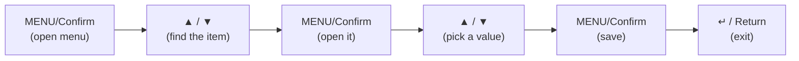
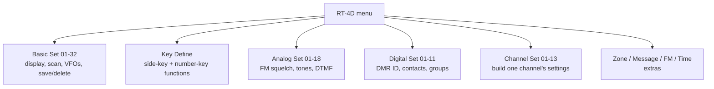

# Menu reference — documented options at a glance

The RT-4D packs a lot into a small screen, and its menu is where all of it lives — squelch and power you touch daily, DMR settings you set once, and a scattering of features you may never need. This page is the map. It lists every menu item on the radio, grouped the way the set itself groups them, so you can find any setting at a glance and jump to the page that explains it properly.

Think of this as the index, not the manual. Each table says what an item does and what values it offers; the deep explanations — how a DMR channel is built, how to set up analogue repeaters, how the keys work — live on the sibling pages linked from each group. Nothing here needs learning by heart. Skim it once so you know what exists, then come back whenever you are hunting for a setting.

## How the menu is organised

Press **MENU/Confirm** (the key marked with the menu symbol, also `DTMF A`) to open the menu. Move through items with **▲** and **▼**, press **MENU/Confirm** again to open an item and to save your choice, and press **↵ / Return** to step back out or leave the menu without changing anything. That same pattern — enter, move, confirm, back out — works everywhere, so once it is in your fingers the whole menu opens up.

The RT-4D sorts its settings into a handful of named groups. The map below shows what each one is for and which guide page unpacks it. The rest of this page is one table per group.

Two things are worth keeping straight before you dive in. A **DMR channel** on this radio is not just a frequency — it is a frequency plus a **time slot** plus a **colour code** plus a **talkgroup** (which the radio calls a Contact). That mental model is the whole of [DMR slots and talkgroups](outpost:entry/logbook73.handbook/dmr-slots-talkgroups), and the Channel Set and Digital Set groups below are where you fill in those four ingredients. And **Encryption**, which appears in two of the groups, is generally not permitted on the amateur bands anywhere — leave it Off and see [Getting Licensed](outpost:entry/logbook73.handbook/getting-licensed) and [DMR operating](outpost:entry/logbook73.handbook/dmr-operating).

## Basic Set (01-32)

The general-behaviour group: how the display looks, how scanning works, how the two working areas (A and B) are set up, and the housekeeping items for saving and deleting channels. The daily-driver items here are covered in [Getting Started](outpost:entry/logbook73.guide.rt-4d/getting-started); the key and scan items are expanded in [Keys](outpost:entry/logbook73.guide.rt-4d/keys) and [Extras](outpost:entry/logbook73.guide.rt-4d/extras).

| Item              | What it does                                                               | Values                           |
| ----------------- | -------------------------------------------------------------------------- | -------------------------------- |
| 01 Radio Name     | Your set's alias, sendable over analogue as an ID                          | Text (edit)                      |
| 02 Voice Prompt   | Spoken confirmation of key presses and menus                               | Off / On                         |
| 03 Key Beep       | The local beep when you press a key (only you hear it)                     | Off / On                         |
| 04 Lock Timer     | Auto keypad lock after idle                                                | Off / 5 s-600 s                  |
| 05 Backlight      | Screen backlight behaviour                                                 | Off / On / Auto                  |
| 06 Light Timer    | How long the backlight stays on after a press                              | Timer                            |
| 07 Brightness     | Backlight brightness                                                       | 0-4                              |
| 08 Menu Exit      | Auto-leave the menu after idle                                             | Timer                            |
| 09 State Timer    | Cycle the idle screen through voltage / time / date                        | Timer                            |
| 10 Dual Standby   | Watch both working areas at once                                           | Off / On                         |
| 11 TX priority    | Which area transmits: always main (`Edit`) or follow the busy one (`Busy`) | Edit / Busy                      |
| 12 Freq Step      | VFO tuning step                                                            | 0.25-5M kHz (many steps)         |
| 13 Talk Around    | Transmit on the repeater's output (simplex bypass)                         | Off / Talk Around / Invert Freq  |
| 14 Save Mode      | Receiver battery-save duty cycle                                           | Off / 1:1 / 1:2 / 1:3            |
| 15 Scan Mode      | How the scanner resumes after a signal                                     | TO time / CO carrier / SE search |
| 16 Scan Direction | Which way the scanner sweeps                                               | Up / Down                        |
| 17 Scan Dwell     | How long it pauses on activity                                             | 0-30                             |
| 18 Scan Return    | Where it lands when you stop scanning                                      | Original CH / Current CH         |
| 19 Alarm Type     | What the Alarm key does                                                    | Local / Remote / Local+Remote    |
| 20 Main PTT TX    | Which area the PTT keys                                                    | Area A / Main Area               |
| 21 Area A Mode    | How area A selects: memory, zone or dial                                   | CH / Zone / Freq                 |
| 22 Area A Show    | What area A shows on screen                                                | CH No / Freq / Alias             |
| 23 Area A Zone    | The active zone in area A                                                  | Zone 1-256                       |
| 24 Area B Mode    | As item 21, for area B                                                     | CH / Zone / Freq                 |
| 25 Area B Show    | As item 22, for area B                                                     | CH No / Freq / Alias             |
| 26 Area B Zone    | As item 23, for area B                                                     | Zone 1-256                       |
| 27 Save CH        | Store the current settings into a memory slot                              | CH 0001-1024                     |
| 28 Delete CH      | Erase a memory channel                                                     | Channel picker                   |
| 29 Instruction    | On-screen barcode linking to the user manual                               | —                                |
| 30 Version        | Firmware version (read-only)                                               | —                                |
| 31 LCD Contrast   | Screen contrast                                                            | Level                            |
| 32 Initialization | Factory reset — wipes your settings                                        | Confirm                          |

## Key Define

Where you choose what the customisable keys do. The RT-4D lets you assign short and long presses on the two side keys, turn Side-key 1 into a second PTT for the B band (`Slaver PTT`), and give each number key a long-press function. The full walk-through, with recommended assignments, is in [Keys](outpost:entry/logbook73.guide.rt-4d/keys).

| Item           | What it does                            | Values        |
| -------------- | --------------------------------------- | ------------- |
| Slaver PTT     | Makes Side-key 1 a PTT for the B band   | Off / On      |
| Side key 1 (S) | Short-press function for side key 1     | Function list |
| Side key 1 (L) | Long-press function for side key 1      | Function list |
| Side key 2 (S) | Short-press function for side key 2     | Function list |
| Side key 2 (L) | Long-press function for side key 2      | Function list |
| 0-9 Press Long | Long-press function for each number key | Function list |

The functions you can assign include `Monitor(Ana)` (open the analogue squelch), `H/L Power`, `Dual Standby`, `TX Priority`, `Scanning`, `Backlight`, `Roger Beep`, `FM Radio`, `Talkaround`, `Alarm`, `Freq Detect`, `Single Tone` (1750 Hz burst), `Status Query`, `Remote Monitor`, `Color Code Scan`, `Remote Stun / Kill / Wake Up`, `Online Check`, `LCD Brightness` and `NOAA Mode`. The remote Stun/Kill/Wake commands and NOAA weather mode are explained in [Extras](outpost:entry/logbook73.guide.rt-4d/extras).

## Analog Set (01-18)

Everything to do with plain FM: the analogue squelch, transmit tones and roger beeps, microphone and speaker gain, and the DTMF (touch-tone) signalling block. All of this is covered properly in [Analogue operation](outpost:entry/logbook73.guide.rt-4d/analog).

| Item              | What it does                                    | Values                               |
| ----------------- | ----------------------------------------------- | ------------------------------------ |
| 01 SQ level       | Analogue squelch threshold                      | 0-10 (middle typical)                |
| 02 TX Start Tone  | Tone sent as you start transmitting             | Setting                              |
| 03 TX End Tone    | End-of-over tone: roger beep or your radio name | Off / Roger 1 / Roger 2 / Radio Name |
| 04 Single Tone    | Tone-burst frequency for repeater access        | 1750 Hz (typical)                    |
| 05 Mic Gain       | Analogue microphone gain                        | 0-31                                 |
| 06 SPK Gain       | Speaker/audio gain                              | 0-63                                 |
| 07 Detect Range   | Frequency range the Freq Detect key searches    | Range                                |
| 08 Repeater Delay | Squelch-tail / turnaround delay                 | 0-2000 ms                            |
| 09 DTMF Delay     | Delay before a DTMF string is sent              | Timing                               |
| 10 DTMF Interval  | Gap between DTMF digits                         | Timing                               |
| 11 DTMF Duration  | Length of each DTMF digit                       | Timing                               |
| 12 DTMF Mode      | When a DTMF string is sent                      | Off / TX start / TX end / Both       |
| 13 DTMF Select    | Which stored DTMF string is active              | 01-16                                |
| 14 DTMF Display   | Show received DTMF on screen                    | Off / On                             |
| 15 DTMF TX Gain   | DTMF transmit level                             | 0-127                                |
| 16 DTMF RX TH     | DTMF receive threshold                          | 0-127                                |
| 17 DTMF Control   | Enables remote Stun / Kill / Monitor over DTMF  | Off / On                             |
| 18 Time Calibrate | Set the clock from a remote command             | Remote                               |

## Digital Set (01-11)

The DMR identity and address-book group. This is where your **DMR ID** lives — the unique number you must obtain free from [RadioID.net](https://radioid.net) before you transmit on DMR, explained in [DMR networks](outpost:entry/logbook73.handbook/dmr-networks) — along with your Contacts (talkgroup and personal addresses) and the RX Group Lists that decide which talkgroups you hear. Contacts and groups get their own walk-through in [Contacts and zones](outpost:entry/logbook73.guide.rt-4d/contacts-zones).

| Item              | What it does                                                                            | Values        |
| ----------------- | --------------------------------------------------------------------------------------- | ------------- |
| 01 Personal ID    | **Your DMR ID** (from RadioID.net)                                                      | 1-16776415    |
| 02 Call Tone      | Tone when a call is received                                                            | Setting       |
| 03 Call End Tone  | Tone when a call ends                                                                   | Setting       |
| 04 Group Hold     | How long a group call is held open                                                      | ms            |
| 05 Single Hold    | How long a private call is held open                                                    | ms            |
| 06 SQ level       | Digital squelch threshold                                                               | 0-16          |
| 07 Mic Gain       | Digital microphone gain                                                                 | 0-15          |
| 08 SPK Gain       | Digital audio gain                                                                      | 0-15          |
| 09 Contacts Set   | Add/edit/delete Contacts; the `All Call` entry can't be removed                         | ID 1-16776415 |
| 10 Group List Set | Build the RX group list (↵ selects a member, background turns black; ↵ again deselects) | Member picker |
| 11 Encryption Set | Define an encryption key — **not for amateur use**                                      | Key 1-256     |

## Channel Set (01-13)

The most important DMR group: this is where you build a single channel out of its four ingredients — slot, colour code, contact (talkgroup) and, for repeaters, the offset — plus its power, name and admit rule. Because getting these right is the whole art of DMR, they have a dedicated page: [Building DMR channels](outpost:entry/logbook73.guide.rt-4d/dmr-channels). The general theory sits in the [DMR overview](outpost:entry/logbook73.handbook/dmr).

| Item           | What it does                                        | Values                              |
| -------------- | --------------------------------------------------- | ----------------------------------- |
| 01 DMR Mode    | Single-slot, or dual-slot Double Capacity (DCDM)    | Dual Slot Off / On                  |
| 02 DMR Slot    | The channel's time slot                             | Slot 1 / Slot 2                     |
| 03 Color Code  | The channel's colour code (must match the repeater) | 0-15                                |
| 04 Contacts    | The talkgroup or ID this channel transmits to       | Contact / All Call                  |
| 05 RX Group    | Which RX group list this channel uses               | Group list                          |
| 06 Encryption  | Per-channel encryption — **leave Off on ham**       | Off / Key 1-256                     |
| 07 TX Politely | The admit rule before you may transmit              | Impolite / Carrier Match / CC Match |
| 08 TX Power    | Transmit power for this channel                     | Low / High                          |
| 09 Scan Add    | Include this channel in scans                       | Add / Remove                        |
| 10 TOT         | Time-out timer: max length of one over              | Off / 5 s-600 s                     |
| 11 CH Alias    | The channel's on-screen name                        | Text                                |
| 12 Offset Dir  | Repeater shift direction                            | + / −                               |
| 13 Offset Freq | Repeater input/output offset                        | Frequency                           |

The `TX Politely` item is worth a word here because it is unique to digital: `Impolite` transmits regardless, `Carrier Match` holds off while any signal is present, and `CC Match` holds off only if a matching colour code is already on the channel. It is the DMR equivalent of a busy-lockout, and [DMR operating](outpost:entry/logbook73.handbook/dmr-operating) explains why "TX Politely" is the courteous default on shared repeaters.

## Zone, Message, FM Radio and Time

The remaining groups are the extras: your zones (banks of channels), the built-in SMS text messaging, the broadcast FM receiver, and the clock and scheduler. [Zones](outpost:entry/logbook73.guide.rt-4d/contacts-zones) organise your channels into manageable banks; the messaging, FM radio, NOAA weather and timer features are all covered in [Extras](outpost:entry/logbook73.guide.rt-4d/extras).

| Group       | What it does                            | Notable items / values                                            |
| ----------- | --------------------------------------- | ----------------------------------------------------------------- |
| Zone Set    | Organise channels into named banks      | Up to 256 zones, up to 1024 channels each                         |
| Message     | Send and store DMR text messages        | New SMS, Inbox, Outbox, Drafts, Default SMS, Clear All            |
| FM Radio    | The broadcast FM receiver (listen only) | Work Mode (CH/freq), RX Standby, Scan Mode, Area (16 ch), Channel |
| Time Manage | Clock, auto power-off and scheduler     | APO, APO Timer, System Time, Clock 1-4, Schedule (List 1-128)     |

## A note on programming

You can reach every setting above from the keypad, and for a first channel or two that is fine. But the fast, sane way to load contact lists, zones and dozens of channels is the free **Radtel CPS** (Customer Programming Software) over the USB-C cable — you build a **code plug** on a computer and write it to the radio in one go. That workflow, and where to find ready-made DMR code plugs, is the subject of [DMR hotspots and code plugs](outpost:entry/logbook73.handbook/dmr-hotspots). Programming a whole talkgroup set by hand, digit by digit, is a job nobody enjoys twice.

## Key takeaways

- The menu splits into six groups — **Basic Set**, **Key Define**, **Analog Set**, **Digital Set**, **Channel Set**, and the **Zone/Message/FM/Time** extras — and every setting on the radio lives in one of them.
- Navigate the same way everywhere: **MENU/Confirm** to enter and to save, **▲/▼** to move, **↵/Return** to back out.
- A DMR channel is built in **Channel Set** and **Digital Set** from four ingredients — frequency, time **slot**, **colour code** and **contact** (talkgroup) — the model from [DMR slots and talkgroups](outpost:entry/logbook73.handbook/dmr-slots-talkgroups).
- Your **DMR ID** (Digital Set 01, Personal ID) must come from [RadioID.net](https://radioid.net) before you transmit — see [DMR networks](outpost:entry/logbook73.handbook/dmr-networks).
- **Encryption** appears in both Digital Set and Channel Set; leave it **Off** — it is generally unlawful on the amateur bands.
- **TX Politely** (Channel Set 07) is DMR's courtesy rule — `Carrier Match` or `CC Match`, not `Impolite`, on shared repeaters.
- For anything beyond a channel or two, program with **Radtel CPS over USB-C** rather than the keypad — [DMR hotspots and code plugs](outpost:entry/logbook73.handbook/dmr-hotspots).

With the whole menu mapped, the next step is to put the Channel Set and Digital Set groups to work and actually build a working DMR channel: [Building DMR channels](outpost:entry/logbook73.guide.rt-4d/dmr-channels).
