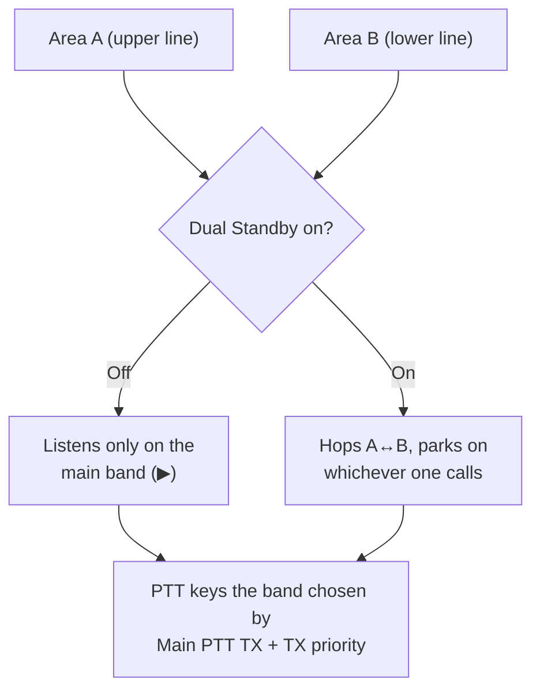

# Basic settings: operating, dual-watch and areas

The RT-4D listens to two channels at once, and almost every "why is it doing that?" moment in the first week traces back to not quite grasping how those two channels — Area A and Area B — share one radio. This page takes the operating half of the `01 Basic Set` menu slowly: the dual-watch system that keeps an ear on both bands, the two settings that decide which band your PTT actually keys, how each area picks its channel, where the tuning dial lands, how the radio naps to save battery, how you talk past a repeater, and the emergency alarm. Get these clear and the radio stops surprising you.

Everything here lives in `01 Basic Set`, reached by pressing **MENU/Confirm** and scrolling with **▲/▼** — the navigation drilled in [Getting Started](outpost:entry/logbook73.guide.rt-4d/getting-started), and mapped item-by-item in the [Menu Reference](outpost:entry/logbook73.guide.rt-4d/menu-reference). Nothing on this page can harm the radio: a change only takes hold when you confirm it, and **↵ (Return)** always backs you out. The display symbols and the scan, key and DMR settings each have their own chapter; here we cover the operating heart of the set.

## How to read these pages

Each item carries a one-glance verdict, the scheme used across this handbook's radio guides:

| Symbol | Meaning                                                    |
| ------ | ---------------------------------------------------------- |
| ✅     | Set it like this and forget it — right for almost everyone |
| ⭐     | Genuinely useful, depending on how you operate             |
| ⚠️     | Advanced — understand it before you enable it              |
| ❌     | Leave it off unless you have a specific reason             |

## The two Areas, and dual watch

Picture the RT-4D's screen as two stacked lines. The upper line is **Area A**, the lower is **Area B**, and a small **▶** marker sits against whichever one is currently the **main working band** — the band your PTT transmits on. Pressing **↵** swaps the ▶ from one line to the other. That is the whole idea: the radio holds two channels ready at all times, and you choose which is "live" for transmit.

The catch is that an RT-4D has only **one receiver**. It cannot genuinely listen to two frequencies in the same instant. So "watching both" is a rapid trick called _dual watch_ (or dual standby): the receiver hops between Area A and Area B many times a second, sampling each, and the moment one of them carries a signal it stops hopping and parks there so you hear the whole over. When the channel goes quiet again, the hopping resumes. It feels like two receivers; it is really one very busy one.

The classic use is one repeater plus one calling channel: park your local [repeater](outpost:entry/logbook73.handbook/repeaters) on Area A and the 2 m FM calling frequency on Area B, switch dual watch on, and the radio minds both while you get on with your day. It is equally happy watching an analogue channel on one line and a DMR channel on the other — the two areas are independent, so mixing modes is fine.

### 10 Dual Standby — ✅ On when you want two channels

Turns the A↔B hopping on or off.

- **Does:** `On` makes the receiver watch both areas and stop on whichever becomes active; `Off` leaves it listening only to the main band (the ▶ line). A dual-standby icon shows on screen when it is running.
- **Inside:** with it off, the single receiver stays parked on the main band — snappier squelch, a touch less battery drain, and no chance of missing the start of a call because the radio was momentarily listening to the other line. With it on, the receiver time-shares, so a call arriving on one area during the split-second it is sampling the other can clip the first syllable.
- **Values:** `Off` / `On`.
- **Recommendation:** ✅ **On** whenever you genuinely want to keep an ear on two channels; **Off** for single-channel simplicity when you are only interested in one frequency. Most owners run it on — it is the reason the radio has two lines in the first place.
- **The trap:** hearing a call on Area B does **not** automatically mean your reply goes to Area B. Which band the PTT keys is decided by the next two settings, so read on before you assume.
- **Should you change it?** On for everyday two-channel monitoring; off when you want the simplest possible behaviour.

## Which Area does the PTT key?

This is the pair of settings that catch everyone out. Dual watch lets you _hear_ both areas, but when you press the PTT the radio has to transmit on exactly one of them — and two menu items, working together, decide which. Get these two matched to how your brain expects the radio to behave and the "I answered on the wrong band" mistake disappears.

### 20 Main PTT TX — ⭐ set to `Main Area`

Chooses whether the PTT is glued to Area A, or follows the ▶ marker.

- **Does:** `Area A` makes the main PTT **always** transmit on Area A, no matter which line shows the ▶. `Main Area` makes the PTT transmit on **whichever area is currently main** — the one the ▶ is against, which you flip with **↵**.
- **Inside:** it decides what "the PTT" means. With `Area A`, Area B becomes a receive-only monitor line — you can listen to it all day but you can never key it with the front PTT (a side key set as `Slaver PTT` in [Keys](outpost:entry/logbook73.guide.rt-4d/keys) can transmit on the B band separately). With `Main Area`, both lines are equal: the ▶ decides, and **↵** moves it.
- **Values:** `Area A` / `Main Area`.
- **Recommendation:** ⭐ **`Main Area`** for most people — it makes **↵** a genuine "which channel am I working?" switch and lets you transmit on either band. Choose `Area A` only if you deliberately want Area B as a locked listen-only band (say, monitoring a busy talkgroup you never answer) and want to be certain the PTT can never key it by accident.
- **Should you change it?** Set `Main Area` once; revisit only if you adopt a fixed "A talks, B only listens" style.

### 11 TX priority — ⭐ `Busy` is the intuitive choice

When dual watch stops on the _other_ area, does your PTT follow the conversation there, or stay put?

- **Does:** with dual standby running and a signal arriving on the area that is _not_ currently main, `Edit` keeps transmitting on your chosen main band regardless; `Busy` temporarily makes the **busy** area the main band, so your reply goes back to where the call just came in.
- **Inside:** this is the fix for the dual-watch trap. Say Area A is your main band but a friend calls you on Area B. With `Edit`, pressing PTT still transmits on A — you answer into an empty channel and nobody hears you. With `Busy`, the radio has already promoted B to main because it went active, so your reply naturally lands on B where your friend is listening.
- **Values:** `Edit` / `Busy`.
- **Recommendation:** ⭐ **`Busy`** for a beginner — it makes dual watch behave the way your instinct expects: you hear a call, you press PTT, you answer on that channel. Choose `Edit` if you have a fixed transmit channel (net control on one repeater, say) and never want the incoming traffic on the other line to drag your transmitter onto it.
- **Common mistakes:** running `Edit` while dual-watching two active channels and quietly transmitting your answers on the wrong one. Whichever mode you pick, glance at the **▶** marker before a long over — it never lies about where you are about to key.
- **Should you change it?** `Busy` to start; move to `Edit` only once you have a deliberate single-transmit-channel workflow.

## Setting up each Area

Each area is configured independently through three little settings — how it picks a channel, what it shows you, and which zone it draws from. Items `21`–`23` do this for Area A, and `24`–`26` are the identical trio for Area B. Because they are mirror images, we cover each idea once and note that the B versions behave the same.

### 21 / 24 Area A/B Mode — ✅ match how you operate that band

Sets whether an area recalls stored channels, browses a zone, or dials a raw frequency.

- **Does:** `CH` puts the area in **channel (memory) mode** — it recalls a saved channel by number. `Zone` puts it in **zone mode** — it steps through the channels inside the active zone (a named folder, up to 256 of them). `Freq` puts it in **frequency (VFO) mode** — you type or step a raw frequency by hand.
- **Inside:** the three modes are the same three you met in [Getting Started](outpost:entry/logbook73.guide.rt-4d/getting-started), but here you set them **per area** rather than for the whole radio. That is the quietly powerful bit: Area A can sit in `CH` mode recalling your local repeater while Area B is in `Freq` mode so you can tune around by hand — two completely different working styles live side by side.
- **Values:** `CH` / `Zone` / `Freq`.
- **Recommendation:** ✅ **`CH` or `Zone`** for the band you use day to day, so a single button-press lands on a fully-formed channel (offset, tone, colour code and all). Keep one area in `Freq` when you want a scratchpad for tuning around and finding new activity. DMR really only works from stored channels — a [DMR channel](outpost:entry/logbook73.handbook/dmr-slots-talkgroups) is frequency plus slot plus colour code plus talkgroup, far too much to dial by hand — so keep your digital area in `CH` or `Zone`.
- **Should you change it?** Yes, to suit each band's job. There is no single "correct" answer; it is how you like to work.

### 22 / 25 Area A/B Show — ✅ `Alias` once channels are named

Chooses what the area displays for a stored channel.

- **Does:** `CH No` shows the bare channel number, `Freq` shows the actual frequency, and `Alias` shows the text name you gave the channel.
- **Inside:** this is pure presentation — it changes nothing the radio does, only what the line reads. (The **`*`** key also cycles the label live from the standby screen, as noted in [Getting Started](outpost:entry/logbook73.guide.rt-4d/getting-started); this menu sets the default.)
- **Values:** `CH No` / `Freq` / `Alias`.
- **Recommendation:** ✅ **`Alias`** once you have labelled your channels ("GB3XX", "TG235", "PMR-1") — a name you read at a glance beats a number you have to remember. Use `Freq` if you prefer to see the exact frequency, or `CH No` if you think in channel numbers. Whichever you read fastest.
- **Should you change it?** A taste setting — pick it once per area.

### 23 / 26 Area A/B Zone — ⭐ point the area at the right folder

Selects which zone the area is currently browsing.

- **Does:** picks the active **zone** (a bank of channels, numbered `Zone 1` to `Zone 256`) for that area. Only channels inside the chosen zone are reachable with **▲/▼** while the area is in `CH` or `Zone` mode.
- **Inside:** zones are how a big channel list stays manageable — "Local repeaters" in one, "DMR talkgroups" in another, "PMR446" in a third. Because each area has its own zone pointer, Area A can browse your repeater zone while Area B sits in your DMR zone. Building and naming zones is covered in [Contacts & Zones](outpost:entry/logbook73.guide.rt-4d/contacts-zones).
- **Values:** `Zone 1`–`Zone 256`.
- **Recommendation:** ⭐ Set each area to the zone that holds the channels you want on that line. This is the setting to reach for when an area seems to be "missing" a channel — it is usually looking in the wrong zone.
- **Should you change it?** Yes, whenever you want an area to work a different group of channels.

## Where the dial lands: Freq Step

### 12 Freq Step — ✅ `12.5` kHz for amateur work

How far the frequency jumps for each press of **▲/▼** in frequency (VFO) mode.

- **Does:** sets the tuning increment. The RT-4D offers an unusually long list: `0.25`, `1.25`, `2.5`, `5`, `6.25`, `10`, `12.5`, `20`, `25`, `50`, `100` and `500` kHz, then the big jumps `1M` (1 MHz) and `5M` (5 MHz).
- **Inside:** the synthesiser can only land on a grid of frequencies, and the step is that grid's spacing. It does **not** change your transmit bandwidth — that is the wide/narrow (`W`/`N`) setting on the channel — only where the dial stops as you tune. Match the grid your target service uses and every channel lands dead on frequency.
- **Values:** `0.25` / `1.25` / `2.5` / `5` / `6.25` / `10` / `12.5` / `20` / `25` / `50` / `100` / `500` kHz / `1M` / `5M`.
- **Recommendation:** ✅ **`12.5` kHz** is the sensible home setting — it suits modern 2 m and 70 cm amateur voice and DMR, which is a `12.5` kHz service. Switch to **`25` kHz** for older wide-band amateur allocations and AM airband listening. **`5`** or **`6.25`** kHz help on services that use those grids; the tiny **`0.25`**/**`1.25`** kHz steps are for precise fine-tuning; and the big **`100` kHz / `1M` / `5M`** jumps are for skating quickly across a band to find where the activity is, then stepping back down. One honest limit: there is no `8.33` kHz step, so the European VHF airband's `8.33` kHz channels cannot be tuned exactly — fine for casual listening, not precise. Always check your national band plan for the grid where you are.
- **Common mistakes:** blaming a "deaf" radio for missing a repeater when the real fault is a step that never quite lands on frequency — dialling in `12.5` kHz on a `25` kHz allocation, for instance.
- **Should you change it?** Yes, to suit whatever you are tuning; `12.5` kHz is the default to return to.

## Stretching the battery: Save Mode

### 14 Save Mode — ✅ `1:2` for everyday listening

Lets the receiver doze between checks so the battery lasts longer.

- **Does:** micro-sleeps the receiver while idle, waking briefly to sample the channel. The ratio sets how long it sleeps against how long it listens — higher saves more.
- **Inside:** idle listening is where a handheld quietly spends most of its charge. Rather than run the receiver continuously, the radio powers it down for a fraction of a second, wakes, checks for a signal, and sleeps again. The trade-off is real: a call arriving _during_ a sleep window is not heard until the next wake, so the very first fraction of a transmission can be clipped. The higher the ratio, the more it sleeps and the more it can miss.
- **Values:** `Off` / `1:1` / `1:2` / `1:3`.
- **Recommendation:** ✅ **`1:2`** is the comfortable everyday choice — genuinely useful extra standby time you will not notice in normal use. Push to **`1:3`** if you are stretching a long shift and do not mind the occasional clipped syllable. Set it **`Off`** when catching the very start of every call matters — running a net, or listening for brief weak calls where the first word is the whole message. Note that battery-saving naps mostly help on a single channel; with **Dual Standby** on, the receiver is already busy hopping, so the saving is smaller.
- **Common mistakes:** chasing a phantom "the radio keeps missing the start of calls" fault when the cure is turning Save Mode down or off.
- **Should you change it?** Set `1:2` and leave it; drop to `Off` only for critical listening.

## Talking through — or around — a repeater: Talk Around

### 13 Talk Around — ⭐ `Off` normally, a handy tool when needed

Lets you bypass the repeater and work another station directly, or check who is on its input.

A repeater listens on one frequency (its **input**) and re-transmits on another (its **output**) so it can cover a wide area; your radio normally transmits on the input and listens on the output, using the offset. This setting temporarily rearranges that.

- **Does:** `Off` is normal repeater operation — transmit on the input, listen on the output. `Talk Around` makes both transmit **and** receive sit on the repeater's **output** frequency, turning that frequency into a plain simplex channel — you talk directly to nearby stations without touching the repeater at all. `Invert Freq` (a **reverse**) **swaps** your transmit and receive, so you listen on the repeater's input and transmit on its output. A **`T`** (talk-around) or **`R`** (reverse) tag appears on screen.
- **Inside:** think of the offset as an arrow the radio applies when you key up. `Talk Around` throws the arrow away so both ends land on the output. `Invert Freq` flips the arrow so it points the other way. Both are momentary tools, not something you leave set.
- **Why it exists:** two uses, both genuinely handy. `Talk Around` lets two nearby stations chat directly on the output frequency — sparing the repeater and everyone else on it — when they are close enough to hear each other. `Invert Freq` answers "can we work each other directly, without the repeater?": listening on the input lets you hear whether the other station is reaching the machine at full strength or barely making it, which tells you if a direct simplex contact would work.
- **Values:** `Off` / `Talk Around` / `Invert Freq`.
- **Recommendation:** ⭐ **`Off`** for normal work. Reach for `Talk Around` or `Invert Freq` as deliberate, temporary tools — and because they are momentary, most operators assign **Talkaround** to a side key (see [Keys](outpost:entry/logbook73.guide.rt-4d/keys)) rather than diving into this menu each time.
- **Common mistakes:** leaving `Invert Freq` set and wondering why you can suddenly hear a repeater's users but the machine no longer repeats you — you are transmitting on its output. If the `T` or `R` tag is showing unexpectedly, that is the culprit.
- **Should you change it?** Only as a temporary tool; return it to `Off` after.

## The emergency Alarm

### 19 Alarm Type — ⚠️ understand it before you trigger it

Decides what the assignable **Alarm** function does when you fire it.

- **Does:** `Local` sounds a loud siren from the radio's own speaker and nothing more. `Remote` transmits an alarm over the air to alert others but stays silent locally. `Local+Remote` does both — siren _and_ over-the-air alert.
- **Inside:** the Alarm is a panic/attention feature, triggered from a side key or number key you assign in [Keys](outpost:entry/logbook73.guide.rt-4d/keys) — there is no dedicated alarm button. `Local` is a personal noise-maker (finding a dropped radio, scaring off a nuisance). `Remote` and `Local+Remote` actually **transmit**, sending an alert on your current channel, which is why they demand thought before use.
- **Values:** `Local` / `Remote` / `Local+Remote`.
- **Recommendation:** ⚠️ **`Local`** for most people — a purely local siren cannot embarrass you on the air. Choose `Remote` or `Local+Remote` only if you have a real plan for it and are certain the transmitted alert is welcome on the channel you are using, and within your licence conditions. An alarm that keys up unexpectedly — a knocked side key in a bag — is exactly the kind of accidental transmission to avoid.
- **Common mistakes:** setting a transmitting alarm type, assigning it to an easily-brushed side key, and broadcasting an alert without meaning to.
- **Should you change it?** Leave it `Local` unless you have a specific, agreed reason to transmit an alert.

## Try it yourself

Make the A/B system concrete in five minutes, with a charged battery and antenna fitted:

1. In `01 Basic Set`, set **`10 Dual Standby`** to `On`, **`20 Main PTT TX`** to `Main Area`, and **`11 TX priority`** to `Busy`.
2. Put **`21 Area A Mode`** to `Freq` and dial `145.500` MHz (the 2 m FM calling channel in Region 1 — check your own band plan). Put **`24 Area B Mode`** to `Freq` and dial a local repeater's output.
3. Watch the screen: two lines, a **▶** against one. Press **↵** and see the ▶ jump — that is the main band moving between A and B.
4. Note which line lights up when a signal arrives — the receiver parks there. With `TX priority = Busy`, the ▶ follows it, so a reply would land on the right channel.
5. Flip **`12 Freq Step`** between `12.5` and `25` kHz and step with **▲/▼** to feel the grid change.

You have now built the dual-watch behaviour from its parts, and the settings above stop being abstract.

## Key takeaways

- The RT-4D holds two channels — **Area A** and **Area B** — but has **one receiver**: **`10 Dual Standby` On** makes it hop between them and park on whichever calls. There is no true simultaneous reception.
- **↵** swaps the **▶** main-band marker; the PTT keys the band chosen by **`20 Main PTT TX`** (set `Main Area` so ↵ picks the transmit band) and **`11 TX priority`** (set `Busy` so a reply lands on the channel that just called you). Glance at the ▶ before a long over.
- Each area is configured on its own: **`21`/`24` Mode** (`CH`/`Zone`/`Freq`), **`22`/`25` Show** (`Alias` once channels are named), and **`23`/`26` Zone** (which folder it browses) — the setting to check when a channel seems "missing".
- **`12 Freq Step`** is `12.5` kHz for modern amateur and DMR, `25` kHz for legacy wide-band and airband; the big `100 kHz`/`1M`/`5M` steps skate across a band, and there is no `8.33` kHz airband step.
- **`14 Save Mode`** at `1:2` buys standby time you never notice; set it `Off` only when catching the first syllable matters, such as net control.
- **`13 Talk Around`** is a temporary tool: `Talk Around` works simplex on the repeater's output, `Invert Freq` reverses TX/RX to check a direct path — leave it `Off` and don't forget it set.
- **`19 Alarm Type`** stays `Local` unless you have a real reason to transmit an alert; a knocked side key should never key up the radio by surprise.

With the operating and dual-watch settings in hand, the next job is to read everything the little screen is telling you at a glance — turn to [Understanding the display](outpost:entry/logbook73.guide.rt-4d/basic-display).
