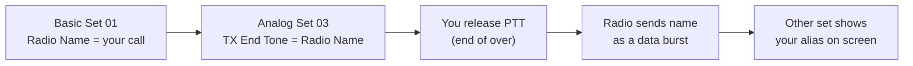
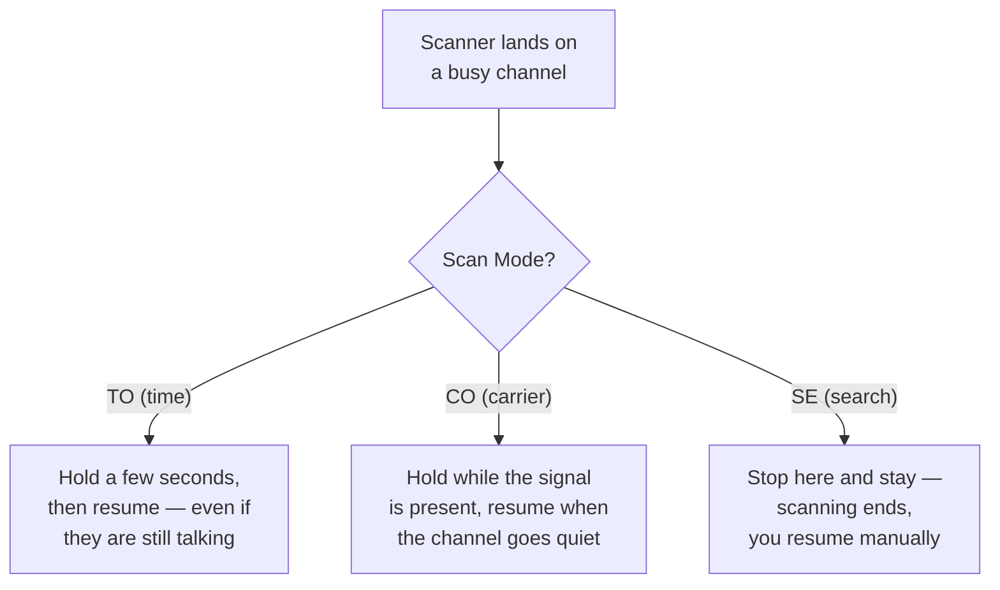

# Basic settings: display, scanning and housekeeping

The RT-4D's `Basic Set` group is a grab-bag of thirty-odd settings, and roughly half of them have nothing to do with what leaves the antenna — they decide how the radio looks, how it talks back to you, how it sweeps the band looking for activity, and how you save, wipe and reset. None of these will get you into trouble on the air, but the right choices make the set pleasant to live with, and a couple of them (the scan behaviour especially) change how the radio feels every single day. This page walks the display, scanning and housekeeping items one at a time, so you know not just what each does but when and why you would reach for it.

You open any of these the same way you open everything: press **MENU/Confirm** (the key marked with the menu symbol, also `DTMF A`) to enter, move with **▲/▼**, press **MENU/Confirm** again to open an item and to save your choice, and press **↵/Return** to back out. That pattern is covered in [Getting Started](outpost:entry/logbook73.guide.rt-4d/getting-started), and the whole menu is mapped in the [Menu Reference](outpost:entry/logbook73.guide.rt-4d/menu-reference). The _on-the-air_ Basic Set items — the two working areas, dual standby, frequency step and battery save — belong with daily operating and are covered separately; here we take the display, scan and housekeeping items that the rest of the guide skips over. Throughout, each item carries the same one-glance verdict used across this guide: ✅ set it and move on · ⭐ genuinely useful, depends how you operate · ⚠️ advanced, understand it first · ❌ leave it off.

## Identity and feedback: Radio Name, Voice Prompt, Key Beep

These three decide how the radio _presents_ itself — the label it carries, whether it speaks, and whether it clicks.

### 01 Radio Name — ⭐ set it to your callsign

`Basic Set → 01 Radio Name` is a short text label you type for the radio itself.

- **Does:** lets you edit a name (letters, numbers) using the keypad's multi-tap text entry, the same way you would type an old mobile-phone text. On its own it is just a label the radio wears.
- **The clever part:** on analogue FM the RT-4D can _transmit_ this name as your alias. Set `Analog Set → 03 TX End Tone` to `Radio Name`, and at the end of each over the radio sends a short data burst carrying the name, which appears on the screen of any receiving Radtel (and many other MDC/alias-capable sets). It is a lightweight way to identify without speaking your callsign every time — though it never replaces a proper spoken identification within your licence conditions.

- **Values:** free text (edit).
- **Recommendation:** ⭐ Put your **callsign** here. It costs nothing, and a lost or borrowed radio then plainly shows whose it is. Turning it into a transmitted alias (via `TX End Tone`) is optional and only meaningful on analogue — on DMR your identity travels differently, tied to your **DMR ID**, as explained in [Building DMR channels](outpost:entry/logbook73.guide.rt-4d/dmr-channels). Set the name once; decide the alias behaviour when you set up your analogue channels in [Analogue FM, tones & DTMF](outpost:entry/logbook73.guide.rt-4d/analog).

### 02 Voice Prompt — leave to taste

`Basic Set → 02 Voice Prompt` is a synthesised voice that announces what you are doing.

- **Does:** speaks menu items and actions aloud as you navigate — "menu", "channel", and so on — so you can operate partly by ear.
- **Why it exists:** it genuinely helps while the numbered menu is still unfamiliar, and it is a real accessibility aid for anyone who cannot read the small mono LCD easily.
- **Values:** Off / On.
- **Recommendation:** Leave **On** for your first week if the announcements help you learn which item is which; most operators switch it **Off** once the menu is in muscle memory, because a talking radio gets wearing on a quiet net. It changes nothing you transmit — pure preference.

### 03 Key Beep — ✅ On while learning

`Basic Set → 03 Key Beep` is the little confirmation tone on each keypress.

- **Does:** sounds a short beep whenever a key registers. Only _you_ hear it — it is not transmitted.
- **Why it matters:** with the radio on your belt, in gloves, or in the dark, the beep is the difference between knowing a press landed and jabbing the same key three times.
- **Values:** Off / On.
- **Recommendation:** ✅ Keep it **On** while you are learning the set — it confirms every step through the menu. Turn it **Off** for silent operation on a net or in a quiet room. A taste setting once the radio is familiar.

## The screen: backlight, brightness and contrast

Four items govern the LCD — how it lights, how long it stays lit, how bright it burns, and how sharp the text reads. On a handheld the backlight is one of the biggest drains on the battery, so these are worth a moment's thought rather than leaving at the factory guess.

### 05 Backlight — ✅ Auto

`Basic Set → 05 Backlight` sets the fundamental behaviour of the screen light.

- **Does:** chooses whether the backlight is always **Off**, always **On**, or **Auto** (lights on activity, then goes dark). "Activity" means a keypress or an incoming signal.
- **Inside:** the backlight is a small but constant load. Left **On** it can noticeably shorten a day's standby; left **Off** you cannot read the screen in shade or dark; **Auto** gives you light exactly when you are looking and darkness the rest of the time.
- **Values:** Off / On / Auto.
- **Recommendation:** ✅ **Auto** is right for almost everyone — the screen lights when you touch it or a call comes in, then times out. Choose **On** only when the radio runs on mains or a car supply and battery is no object; **Off** only if you are squeezing maximum standby from a tired pack and can live blind. Works hand-in-hand with the next item.

### 06 Light Timer — ✅ a few seconds

`Basic Set → 06 Light Timer` decides how long the **Auto** backlight lingers after the last press.

- **Does:** sets the delay before the light fades back to dark following activity.
- **Recommendation:** ✅ A few seconds is the comfortable middle — long enough to read a frequency or menu, short enough that the light is not burning while the radio sits idle in your hand. Shorten it to save every last milliamp; lengthen it if you find the screen keeps dying before you have finished reading. It only bites when `05 Backlight` is set to **Auto**.

### 07 Brightness — ✅ to taste

`Basic Set → 07 Brightness` sets how hard the backlight burns.

- **Does:** steps the backlight intensity from `0` (dimmest) to `4` (brightest).
- **Inside:** brighter means easier to read in daylight but a heavier current draw and a screen that dazzles at night.
- **Values:** `0`–`4`.
- **Recommendation:** ✅ A middle setting (`2`) suits most conditions. Push to `4` for bright sun, drop towards `0` for a dark shack or car where full brightness is glare and drain both. If a side key is assigned to `LCD Brightness` you can step this without diving into the menu — see [Keys](outpost:entry/logbook73.guide.rt-4d/keys).

### 31 LCD Contrast — ⭐ adjust if the text looks washed out

`Basic Set → 31 LCD Contrast` tunes the sharpness of the mono display.

- **Does:** shifts the contrast of the liquid-crystal screen — how black the dark pixels look against the background — independently of the backlight.
- **Why it exists:** mono LCDs drift with temperature and viewing angle; a screen that reads crisply indoors can go faint and grey in the cold, or muddy in heat. Contrast is the fix.
- **Values:** a level (adjust up or down).
- **Recommendation:** ⭐ Leave it at the factory level unless the text looks washed-out, ghosting or too dark to read. If it does, nudge it a step at a time until the characters are crisp. Distinct from `07 Brightness`: brightness is the _lamp behind_ the glass, contrast is the _ink_ on it. Change contrast when the text is unclear, brightness when the whole screen is too dim or too dazzling.

## Timing: State Timer, Menu Exit and Lock Timer

Three "how long before…" settings that keep the radio tidy when you are not touching it — what the idle screen shows, when the menu gives up, and when the keypad locks itself.

### 09 State Timer — ⭐ handy on the idle screen

`Basic Set → 09 State Timer` controls the little status line the radio cycles through when it is just sitting there.

- **Does:** rotates the idle display through **voltage**, **time** and **date** on a timer, so a glance tells you the battery state and the clock without pressing anything.
- **Inside:** rather than dedicate screen space to all three, the radio shows one at a time and swaps every so often; the State Timer sets how quickly it cycles.
- **Recommendation:** ⭐ Genuinely useful — the **voltage** read-out is a far better fuel gauge than the crude battery bars, giving you real warning as a healthy pack sags towards empty. Leave it running so the figure comes round often enough to catch. Set the clock itself in the `Time Manage` group, covered in [Extras](outpost:entry/logbook73.guide.rt-4d/extras). A comfort feature, not a critical one.

### 08 Menu Exit — ✅ leave at default

`Basic Set → 08 Menu Exit` is an idle timer for the menu itself.

- **Does:** if you open the menu and then do nothing, this decides how long before the radio backs out on its own and returns to the operating screen.
- **Why it exists:** it stops the radio being stranded half-way through a menu — buried in an item, screen lit, ignoring the channel — because you got distracted or dropped it back in your pocket mid-edit.
- **Recommendation:** ✅ The default is sensible; leave it. Lengthen it only if you find the menu closing on you while you stop to think, shorten it if you would rather it snapped back to listening quickly. A beginner need never touch this.

### 04 Lock Timer — ⭐ On if it lives in a pocket

`Basic Set → 04 Lock Timer` is the automatic keypad lock.

- **Does:** after the set period of inactivity, the keypad locks itself so stray presses do nothing; a padlock icon shows on the screen. You can always lock or unlock by hand with a long-press of **✱**.
- **Inside:** a countdown restarts every time you press a key; when it reaches zero with no activity, the lock engages. The PTT and side keys generally keep working so you can still transmit and monitor while locked.
- **Values:** Off / `5 s`–`600 s`.
- **Recommendation:** ⭐ Set a modest delay (say `15`–`30 s`) if the radio rides in a pocket, bag or belt clip — it stops "pocket dialling" your way into the menu or nudging off-channel without you noticing. Leave it **Off** if the auto-lock keeps catching you mid-operation and you would rather lock by hand when needed. Lean towards enabling it for a set that lives on your person.

## Scanning: how the RT-4D sweeps the band

Scanning steps the radio through a list of channels (or across a range of frequencies), pausing when it finds someone talking so you can listen without babysitting the dial. Four Basic Set items shape how that sweep behaves — and the most important, by a distance, is what the radio does the _moment_ it lands on a busy channel. Get that one right and scanning does what you expect; get it wrong and it either races past conversations or jams forever on the first stray carrier. (Which channels are in the sweep is set per-channel by `Channel Set → 09 Scan Add`, and scanning itself is often assigned to a side key — see [Keys](outpost:entry/logbook73.guide.rt-4d/keys).)

### 15 Scan Mode — ⭐ CO for following conversations

`Basic Set → 15 Scan Mode` is the resume rule: when the scanner hits activity, what makes it move on again.

- **Does:** offers three behaviours. **TO** (Time-Operated) pauses for a fixed spell then resumes _regardless_ of whether the signal is still there. **CO** (Carrier-Operated) holds on the busy channel for as long as the carrier is present and resumes only once it drops. **SE** (Search) stops dead on the first signal it finds and hands control back to you — the sweep ends there.

- **Why it exists:** the three answer three different jobs. **TO** is for _sampling_ a busy band — you want a taste of each active channel then onward, never getting stuck. **CO** is for _following_ — sit on a conversation until the talkers finish, so you never lose the thread mid-over. **SE** is for _hunting_ — you are trying to locate one particular signal and want the radio to stop and let you work it.
- **Values:** TO / CO / SE.
- **Recommendation:** ⭐ **CO (carrier)** is the best all-round default — the radio parks on an active QSO and only moves on when the channel actually clears, so you hear whole conversations rather than fragments. Switch to **TO** when you want to keep skimming a lively band, and **SE** only when you are chasing a single signal and happy for the scan to end on it. Whatever you pick, set the squelch (`Analog Set → 01 SQ level`) properly first, or the scanner will stall on plain noise. This is the one scan setting worth understanding before you press scan.

### 16 Scan Direction — ✅ Up

`Basic Set → 16 Scan Direction` sets which way the sweep runs.

- **Does:** scans **Up** (ascending channels or frequencies) or **Down** (descending).
- **Recommendation:** ✅ Either is fine — **Up** is the natural default. It only really matters when you are hunting across a frequency range and want to bias the sweep in one direction. Pick one and forget it.

### 17 Scan Dwell — ⭐ short by default

`Basic Set → 17 Scan Dwell` sets how long the scanner pauses on a channel before deciding.

- **Does:** the hold time (roughly `0`–`30` in the radio's units) the sweep waits on a channel — in `TO` mode, how long it lingers on activity before resuming; more generally, how patiently it samples each stop.
- **Inside:** too short and the scanner can skip past a channel before a weak or intermittent signal fully opens the squelch; too long and it crawls, spending seconds on quiet channels while you wait for it to come round to the busy one.
- **Values:** `0`–`30`.
- **Recommendation:** ⭐ A short-to-middle value keeps the sweep brisk and responsive. Lengthen it if you find the scanner racing past channels before you can tell whether anyone is there; shorten it if the whole cycle feels sluggish. Works alongside `Scan Mode` — in `CO` the dwell matters less, since the radio holds on the carrier anyway.

### 18 Scan Return — ⭐ Original CH

`Basic Set → 18 Scan Return` decides where the radio ends up when you _stop_ scanning.

- **Does:** on stopping the sweep, it lands either on **Original CH** — the channel you were on before you started scanning — or **Current CH** — wherever the scanner happened to be sitting when you pressed stop.
- **Why it exists:** two habits. Some operators treat scanning as a quick look around and want to be dropped back on their home channel afterwards (**Original**). Others use the scanner to _find_ a new channel to settle on and want to stay there (**Current**).
- **Values:** Original CH / Current CH.
- **Recommendation:** ⭐ **Original CH** is the tidier default — you scan, you glance, you stop, and you are back home on your calling channel where people expect to find you, never accidentally left parked somewhere odd. Choose **Current CH** if you routinely scan _to_ pick a channel and want to keep it. Pure workflow preference — pick the one that matches how you use scan.

## Housekeeping: saving, deleting, information and reset

The tail of the Basic Set group is admin: storing a channel, erasing one, finding the manual, checking the firmware, and the big red reset. These are the levers you pull occasionally rather than daily, but two of them deserve real care.

### 27 Save CH — ✅ how a memory is born

`Basic Set → 27 Save CH` stores the settings you have dialled up into a numbered memory slot.

- **Does:** takes whatever you have set — frequency, tones, power, name, and for DMR the slot, colour code and talkgroup — and writes it into a channel memory (`0001`–`1024`) so you can recall it instantly rather than re-entering everything.
- **Why it matters:** a stored channel carries _all_ its settings with it. That is the whole point of memories: set a repeater up once, save it, and every recall gets the offset, tone and bandwidth exactly right without a single keystroke on the air.
- **Values:** channel number `0001`–`1024`.
- **Recommendation:** ✅ This is how you build a usable radio. For one or two channels the keypad is fine; for a whole bank, the free **Radtel CPS** software over the USB-C cable is far faster and less error-prone, as explained in [DMR hotspots and code plugs](outpost:entry/logbook73.handbook/dmr-hotspots). Save a fresh channel to an empty slot so you do not overwrite one you meant to keep.

### 28 Delete CH — ⭐ tidy, with a moment's care

`Basic Set → 28 Delete CH` erases a stored memory.

- **Does:** removes a channel from memory, opening the slot. A channel picker lets you choose which one goes.
- **Recommendation:** ⭐ Use it to clear out duplicates and channels you no longer use so your zones stay readable. Check the number twice before you confirm — there is no undo, and it is easy to delete the channel next to the one you meant. If you keep a code plug backed up on the computer with CPS, a mistaken deletion is a quick re-write rather than a rebuild.

### 29 Instruction — the QR to the manual

`Basic Set → 29 Instruction` shows a barcode on the screen.

- **Does:** displays a scannable code (a QR/barcode) that points a phone to the online user manual. There is nothing to set — it is a shortcut to the documentation.
- **Recommendation:** Handy to know it is there when you are away from a computer and need to look something up. Scan it with a phone camera; it changes nothing on the radio. That is the whole feature.

### 30 Version — read-only firmware check

`Basic Set → 30 Version` reports the firmware version.

- **Does:** displays the radio's firmware/software version. It is read-only — there is nothing to change.
- **Recommendation:** You will rarely open it, but it is the thing to check if a support forum or a CPS release asks which firmware you are running, or when deciding whether an update applies to your set. Note it down once; leave it otherwise.

### 32 Initialization — ⚠️ the reset, back up first

`Basic Set → 32 Initialization` is the factory reset.

- **Does:** restores the radio's settings to their factory defaults. It is the cure for a set that has been mis-configured into confusion — squelch, display, scan and menu options all return to how they left the factory.
- **The caution:** a reset is a blunt instrument. The RT-4D's manual does not spell out precisely which data a reset preserves and which it clears, so **do not assume your stored channels, contacts and zones survive it** — treat a reset as potentially wiping everything you have programmed. Because so much of a DMR radio's value is in its code plug (all those channels, talkgroups and zones), the golden rule is: **read your radio out to CPS over the USB-C cable and save that file before you ever reset.** With a backup on the computer, an accidental or necessary reset is a five-minute re-write; without one, it can mean rebuilding your whole configuration by hand.
- **Recommendation:** ⚠️ A tool for a real problem, not a casual tidy-up. Reach for it when the radio is behaving so strangely that starting clean is genuinely the fastest fix — and only _after_ you have a code-plug backup. A beginner should not go anywhere near it out of curiosity. If you only want to clear one bad channel, use `28 Delete CH` instead; if the whole thing is a mess and you have a backup, `Initialization` is the clean slate.

## Key takeaways

- **`01 Radio Name`** is worth setting to your callsign — it labels a lost radio, and via `Analog Set → 03 TX End Tone = Radio Name` it can ride out as an on-screen alias at the end of each analogue over (never a substitute for proper identification).
- The display quartet — **`05 Backlight` Auto**, **`06 Light Timer`** a few seconds, **`07 Brightness`** to taste, **`31 LCD Contrast`** only if the text looks off — balances readability against the backlight's real drain on the battery.
- **`09 State Timer`** cycles voltage/time/date on the idle screen; the voltage read-out is a far better fuel gauge than the battery bars. **`04 Lock Timer`** is worth enabling for a radio that rides in a pocket.
- Scanning's decisive setting is **`15 Scan Mode`**: **CO (carrier)** follows conversations to their end, **TO (time)** samples a busy band, **SE (search)** stops on the first signal for you to work — set the squelch properly first or the sweep stalls on noise.
- **`18 Scan Return` Original CH** drops you back on your home channel when you stop scanning; `16 Scan Direction` and `17 Scan Dwell` are minor tuning you can leave near default.
- **`27 Save CH`** bakes every setting into a numbered memory — the point of the radio; use **Radtel CPS** for more than a channel or two. **`28 Delete CH`** has no undo, so check the number.
- **`32 Initialization`** is a blunt factory reset that may wipe your channels, contacts and zones — **back the code plug up to CPS first**, and treat it as a last resort, not a curiosity.

With the display, scan and housekeeping switches settled, the next job is the one the RT-4D exists for — building a proper digital channel from its slot, colour code and talkgroup: [Building DMR channels](outpost:entry/logbook73.guide.rt-4d/dmr-channels).
