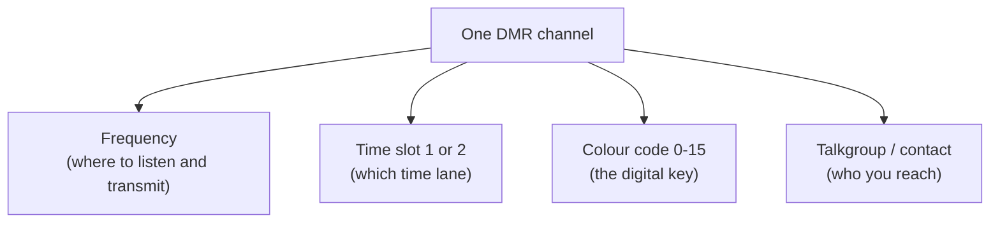
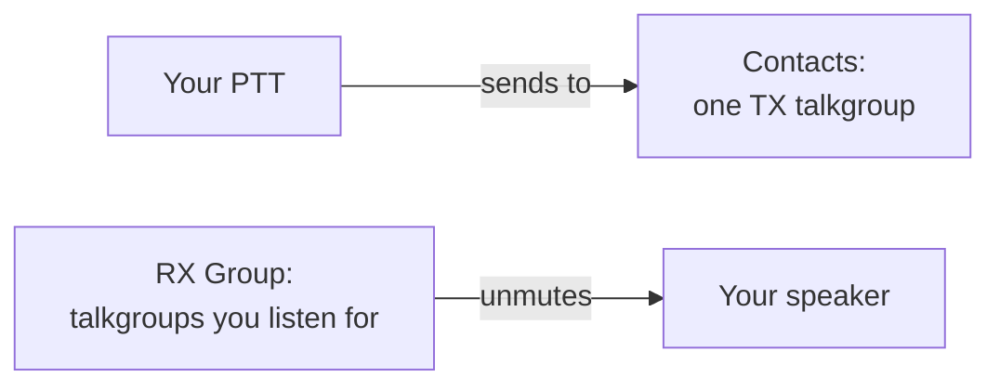
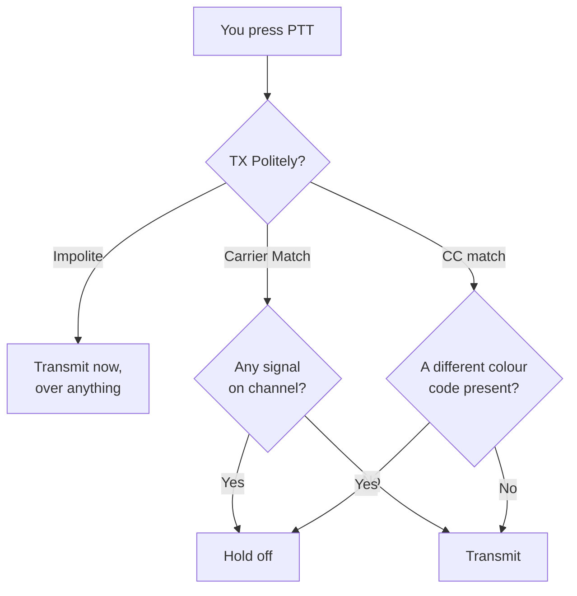

# DMR channels: slot, colour code and talkgroup

A DMR channel is not just a frequency. It is a small bundle of four settings that all have to agree with the far end before a single word gets through — and on the RT-4D those four live across two different menus, which is exactly where newcomers come unstuck. Learn the bundle once and the rest of digital voice falls into place. This page is the heart of the guide: what each item does, why it exists, and what to set it to.

The deep, universal theory behind all of this lives in the handbook, and this page links out to it generously rather than repeating it. If you have not yet read [DMR overview](outpost:entry/logbook73.handbook/dmr) and [Slots, colour codes & talkgroups](outpost:entry/logbook73.handbook/dmr-slots-talkgroups), skim them first — everything below will land better.

## The mental model: a DMR channel = frequency + slot + colour code + talkgroup

On an analogue FM radio a "channel" is a memory that stores a frequency, a power level and maybe a sub-tone. A DMR channel stores more, because a DMR conversation does not live on a frequency the way an FM one does. It lives on a numbered **talkgroup**, carried in a numbered **time slot**, gated by a **colour code**, on a **frequency**. Get any one of the four wrong and you are met with total silence — no error, no hiss, nothing.

Hold that picture as you read the menus. A single physical frequency can carry two conversations at once because DMR splits it in time into two slots (the [slots and talkgroups](outpost:entry/logbook73.handbook/dmr-slots-talkgroups) chapter explains the two-lane road in full). The colour code is the digital equivalent of a CTCSS tone — a number that must match or your radio stays deaf and mute. The talkgroup is who you are actually talking to.

Throughout this page each item carries the same one-glance verdict used across the guide: ✅ set it and move on · ⭐ genuinely useful, depends how you operate · ⚠️ advanced, understand it first · ❌ leave it off. You reach any menu with **MENU/Confirm**, move with **▲/▼**, save with **MENU/Confirm** and back out with **↵/Return**, as covered in [Getting Started](outpost:entry/logbook73.guide.rt-4d/getting-started).

## Two menus, one channel: Channel Set and Digital Set

The RT-4D splits DMR settings across two menu groups, and knowing which is which saves a lot of hunting.

- **`05 Channel Set`** holds everything that belongs to _this one channel_: its slot, colour code, the talkgroup it transmits to, the group list it listens to, its power, its time-out and so on. Change channel and these change with it.
- **`04 Digital Set`** holds the radio-wide digital settings and the _libraries_ the channels draw from: your **Personal ID** (your DMR ID), the master **Contacts Set** list, and the **Group List Set** of receive lists. A channel's `Contacts` and `RX Group` items are pointers into these libraries.

So you build a contact or a receive list _once_ in Digital Set, then any number of channels in Channel Set can point at it. In practice almost everyone builds all of this on a computer with the Radtel CPS software over the USB-C cable — a "code plug" — because typing talkgroups on a keypad is slow and error-prone. [Hotspots & code plugs](outpost:entry/logbook73.handbook/dmr-hotspots) covers CPS; the [Contacts & Zones](outpost:entry/logbook73.guide.rt-4d/contacts-zones) page covers doing it on the radio itself.

## DMR Mode and Slot — the time lanes

### DMR Mode — ✅ set to match the channel

`Channel Set → 01 DMR Mode` chooses whether the channel uses one time slot or both.

- **Does:** with **Dual Slot off** the channel is single-slot — the ordinary case. With **Dual Slot on** it enables **DCDM** (Double Capacity Direct Mode), packing two independent simplex conversations onto one frequency by using both slots.
- **Why it exists:** through a repeater, both slots are always in play — the repeater sources the timing that keeps the two lanes separate. On simplex there is no repeater to keep time, so DCDM works by having one radio inject a sync signal the others follow, doubling how many simplex QSOs fit on a frequency.
- **Values:** Dual Slot off / on.
- **Recommendation:** ✅ For simplex, leave **Dual Slot off** — the amateur DMR simplex calling frequencies assume single-slot direct mode, and it is the most compatible choice. Turn **Dual Slot on** only for a repeater channel that uses it, or a coordinated simplex group that has all agreed to run DCDM.
- **Common mistake:** enabling DCDM on a simplex channel when the group has not — radios then silently fail to decode each other because they disagree on the slot structure.

### DMR Slot — ⭐ match the repeater's published slot

`Channel Set → 02 DMR Slot` picks **Slot 1** or **Slot 2**.

- **Does:** selects which of the two TDMA time lanes this channel uses through a repeater.
- **Why it exists:** each talkgroup on a repeater is assigned to a particular slot by the repeater's owner — a common convention puts busy wide-area traffic on one slot and local traffic on the other, so a worldwide net does not tie up the local lane.
- **Values:** Slot 1 / Slot 2.
- **Recommendation:** ⭐ Set whatever the repeater's listing specifies for the talkgroup you want. On a plain simplex channel (Dual Slot off) the slot does not matter — leave it on **Slot 1**.
- **Common mistake:** the right talkgroup on the _wrong slot_ routes nothing, and can block the other conversation the repeater is carrying. Always confirm slot _and_ talkgroup together from the published list.

## Colour Code — ✅ the digital key

`Channel Set → 03 Color Code` sets a number from `0` to `15`. (The menu spells it "Color"; think of it as the colour code shown on the display as `CXX`.)

- **Does:** stamps every transmission with a code number. A repeater or receiving radio ignores anything whose colour code does not match — exactly as an FM radio ignores a signal without the right [CTCSS tone](outpost:entry/logbook73.handbook/dmr-slots-talkgroups).
- **Inside:** unlike CTCSS, the colour code is not a sub-audible tone but a field decoded from the digital signalling. It lets two nearby repeaters share one frequency without hearing each other, and it feeds the "colour-code" admit rule described under TX Politely below.
- **Why it exists:** to keep adjacent systems from interfering and to give the repeater a way to reject stray traffic.
- **Values:** `0`–`15`. **Colour code 1** is the de-facto amateur default.
- **Recommendation:** ✅ Set whatever the repeater or simplex group publishes; on simplex, everyone in the group uses the same one. When in doubt, `1`.
- **Common mistake:** a wrong colour code is the classic "my radio is dead" complaint — the repeater will not key and you hear nothing at all, with no warning.

## Contacts and RX Group — who you reach, who you hear

These two are the crux of DMR routing, and the RT-4D keeps them deliberately separate: the talkgroup you _transmit_ to, and the list of talkgroups you _receive_.

### Contacts — ⭐ your transmit talkgroup

`Channel Set → 04 Contacts` picks, from the master `Digital Set → 09 Contacts Set` list, the single destination your PTT sends to.

- **Does:** sets where your audio is routed when you transmit — either a **Group Call** (a talkgroup number such as `91` Worldwide or `235` UK-wide) or a **Private Call** (one person's DMR ID).
- **Inside:** the network reads this number off your transmission and routes your voice to every repeater and hotspot subscribed to that talkgroup. This is the mental shift from analogue: routing is by _group number_, not by frequency. There is one built-in **All Call** contact that cannot be deleted.
- **Why it exists:** a talkgroup is a virtual channel that can span the world. Programming one channel per talkgroup you use — each pointing at the right number on the right slot — is how you "change channels" on DMR.
- **Values:** any Group Call or Private Call in your contacts database (Contact ID `1`–`16776415`).
- **Recommendation:** ⭐ Build a contact per talkgroup you use and point the channel at it. Which number to program depends on the network — see [DMR networks](outpost:entry/logbook73.handbook/dmr-networks): **BrandMeister** uses the raw number (`91` = `91`), whereas **TGIF** wants a `4` prefix zero-padded to seven digits (TGIF `777` = `4000777`). Programme the wrong form and it will not connect.
- **Common mistake:** treating a _dynamic_ talkgroup like a permanent one — a user-activated group drops off the repeater after 10–15 minutes of quiet and must be re-triggered by transmitting on it.

### RX Group — ⭐ the talkgroups you listen for

`Channel Set → 05 RX Group` selects a receive list from `Digital Set → 10 Group List Set`.

- **Does:** sets which talkgroups the channel will _unmute for_, independent of the single one it transmits to. One channel can therefore monitor several groups on the same slot.
- **Inside:** in Group List Set you press **↵/Return** to add a talkgroup to a list (its background turns black to show it is selected) and ↵ again to remove it. A channel then points at that whole list.
- **Why it exists:** so you can sit on your favourite talkgroup but still hear a call arrive on a regional or special-event group, rather than missing everything except the one you transmit to.
- **Recommendation:** ⭐ Add every group you want to hear on that slot, and pair it with the transmit contact you actually intend to answer on.
- **Common mistake:** if a talkgroup is _not_ in the RX Group list, you stay silent even though its traffic is physically present on your slot — you sit in apparent silence on a busy repeater. (Some radios offer a "promiscuous" monitor that ignores the list and decodes everything; the [DMR operating](outpost:entry/logbook73.handbook/dmr-operating) chapter covers when that helps.)

## TX Politely — ⭐ the admit rule

`Channel Set → 07 TX Politely` decides _when_ the radio is allowed to transmit when you press PTT. It is DMR's manners setting, and worth understanding properly.

- **Impolite:** transmit regardless of what is on the air. This will key straight over a conversation in progress — reserve it for controlled testing, never routine use.
- **Carrier Match:** transmit only if the channel is completely idle. _Any_ signal — even a different colour code or slot — blocks you. This is the most cautious setting.
- **CC match:** transmit if the slot is free, or if the only signal present carries _your_ colour code. In other words it defers to a stranger's system (a different colour code on the same frequency) but still lets you key into your own busy repeater.
- **Recommendation:** ⭐ Use **CC match** as the default for repeater channels — polite to the wider band without locking you out of your own machine. Use **Carrier Match** on shared simplex frequencies to avoid doubling with anyone at all. Keep **Impolite** for the bench only.
- **Common mistake:** leaving it on **Impolite** and transmitting over live QSOs — poor etiquette that the [DMR operating](outpost:entry/logbook73.handbook/dmr-operating) chapter (TX politely, promiscuous, encryption-off) treats as a cardinal sin.

## Encryption — ❌ off, and it is not optional

`Channel Set → 06 Encryption` offers **Off** or one of keys `1`–`256` (the keys themselves are built in `Digital Set → 11 Encryption Set`).

- **Does:** scrambles the digital payload so only radios holding the same key can decode you. To talk encrypted, three things must match: the same encryption type, serial number and key value.
- **Recommendation:** ❌ **Off on every amateur channel — always.** Amateur regulations essentially everywhere forbid transmissions that obscure their meaning: FCC Part 97.113(a)(4) in the US, Ofcom Clause 19 in the UK, and equivalents under your own national regulator. The feature exists only because these are commercial-heritage radios where encryption is legal on business licences.
- **Also know:** even unencrypted, DMR is _not_ private — anyone with a compatible radio can monitor it — so encryption buys no legal privacy and lands you outside your licence. See [Getting Licensed](outpost:entry/logbook73.handbook/getting-licensed) and [DMR operating](outpost:entry/logbook73.handbook/dmr-operating).
- **Common mistake:** switching it on "to test it", then wondering why nobody can understand you (they hear silence or garble) while you quietly break the law.

## Power, time-out and repeater offset

The remaining Channel Set items are the practical housekeeping — familiar from analogue, with a DMR twist.

### TX Power — ⭐ lowest that holds the link

`Channel Set → 08 TX Power` chooses **Low** or **High**. On the RT-4D High is roughly 4–5 W, Low around a watt.

- **Recommendation:** ⭐ Use the **lowest power that keeps a solid digital link**. DMR is "digital cliff" — the audio is perfect until the link marginally fails, then drops abruptly to robotic garble, so more watts is not always better. Into a nearby [hotspot](outpost:entry/logbook73.handbook/dmr-hotspots) on your desk, **Low** is plenty and avoids overloading the little MMDVM board; save **High** for weak or distant repeaters. The general reasoning is in [RF power](outpost:entry/logbook73.handbook/rf-power).

### TOT — ⭐ a sensible ceiling

`Channel Set → 10 TOT` (time-out timer) cuts your transmission after a set time: **Off**, or `5 s`–`600 s`.

- **Recommendation:** ⭐ Set something like **60–120 s** so a stuck PTT cannot hold a repeater's slot open and block everyone else. If your overs keep getting chopped mid-sentence, it — or the repeater's own timer — is set too short. Leave gaps between overs anyway so the network and other stations can key in.

### Offset Dir and Offset Freq — ⭐ for repeater channels

`Channel Set → 12 Offset Dir` (`+`/`−`) and `13 Offset Freq` set the transmit shift for a repeater.

- **Does:** a repeater listens on one frequency and transmits on another. You store the _output_ (listen) frequency as the channel and let the offset direction and size work out where to transmit.
- **Recommendation:** ⭐ Set both to your repeater's published values. Offset sizes and directions differ by band and region — check your national band plan or the repeater's listing rather than assuming. On simplex, direction and offset are irrelevant (transmit and receive on the same frequency).

The other Channel Set items — `09 Scan Add` (include this channel when scanning) and `11 CH Alias` (its display name) — are covered in [Contacts & Zones](outpost:entry/logbook73.guide.rt-4d/contacts-zones) and the [Menu Reference](outpost:entry/logbook73.guide.rt-4d/menu-reference).

## Personal ID — ✅ your DMR ID, set once

`Digital Set → 01 Personal ID` holds your **DMR ID**, a number from `1` to `16776415`.

- **Does:** rides on every transmission you make. The network maps it to your callsign for the display and logging — this is _why_ DMR shows who is talking.
- **Recommendation:** ✅ Enter your own unique 7-digit ID, issued free by **RadioID.net** after you upload proof of licence (verification typically takes a day or two). The first three digits are your country's Mobile Country Code; one ID serves you on every network worldwide. Set it once and forget it.
- **Common mistake:** transmitting with a made-up or borrowed ID — collisions break routing and you appear as an unknown or duplicate station. You genuinely cannot get on DMR properly without your own. Details in [DMR networks](outpost:entry/logbook73.handbook/dmr-networks).

## A worked example — one channel, end to end

Suppose your club runs a 70 cm DMR repeater. Its listing (always check the published details — these numbers are illustrative) says: output frequency `439.4000 MHz`, a `−` offset, **colour code 1**, **Worldwide (TG 91)** static on **Slot 1**, **UK-wide (TG 235)** on **Slot 2**. You want a channel to work TG 235.

1. In `Digital Set → 09 Contacts Set`, create a Group Call contact "UK 235" = `235` (BrandMeister uses the raw number).
2. In `Digital Set → 10 Group List Set`, make a list that includes `235` (and add `91` too if you want to hear worldwide traffic).
3. In `Channel Set`: frequency `439.4000 MHz`; `12 Offset Dir` = `−` and `13 Offset Freq` = the published shift; `01 DMR Mode` = Dual Slot off; `02 DMR Slot` = **Slot 2**; `03 Color Code` = `1`; `04 Contacts` = "UK 235"; `05 RX Group` = your list; `06 Encryption` = **Off**; `07 TX Politely` = **CC match**; `08 TX Power` = **Low** to start; `10 TOT` = `120 s`.

Four things had to agree with the repeater — frequency, slot, colour code and talkgroup — and now they do. Press PTT and your voice routes onto TG 235 across the network.

## Try it yourself

- **Say the model out loud.** Point at any DMR channel in your radio and name its four parts: frequency, slot, colour code, talkgroup. If you cannot state all four, you do not yet know what that channel does.
- **Register for a DMR ID** at RadioID.net now, if you have not — nothing on DMR works until you have one, and verification takes a day or two, so start the clock.
- **Build one channel by hand** on the radio for a local repeater or a hotspot, following the worked example above. Doing it once on the keypad teaches you what the CPS software is doing for you later.
- **Break it on purpose (off the air, into a dummy load or with PTT unpressed):** set the colour code wrong, then right, and note how the display's `CXX` changes. Understanding the silent-failure mode is the best inoculation against the "my radio is dead" panic.

## Key takeaways

- A DMR channel is **frequency + time slot + colour code + talkgroup** — all four must agree with the far end or you get total silence, no warning.
- Settings live in **two menus**: `05 Channel Set` for this channel's slot, colour code, TX contact, RX group, power, time-out and offset; `04 Digital Set` for your **Personal ID** and the contact/group _libraries_ the channels point at.
- **Colour code** (default `1`) is the digital CTCSS; **Contacts** is the one talkgroup you transmit to; **RX Group** is the list of talkgroups you hear — keep them consistent.
- **TX Politely** is your admit rule: **CC match** for repeaters, **Carrier Match** for shared simplex, **Impolite** only on the bench.
- **Encryption stays Off** on every amateur channel — obscuring meaning is against amateur licence conditions almost everywhere, and DMR gives no real privacy anyway.
- Set **TX Power** to the lowest that holds the "digital cliff" link, give **TOT** a sane ceiling, and match **Offset Dir/Freq** to the repeater's listing.
- You need your **own** 7-digit DMR ID from RadioID.net before you transmit — never invent or borrow one.

With the four settings understood, the next step is getting on the air for real — registering, picking a repeater or hotspot, and making your first digital call in [Getting On DMR](outpost:entry/logbook73.guide.rt-4d/dmr-getting-on).
