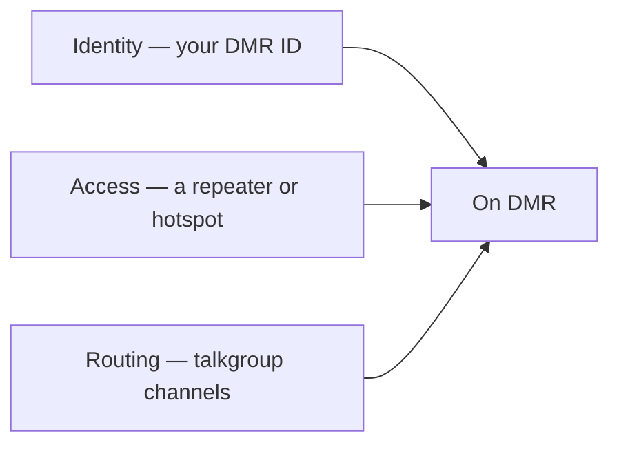
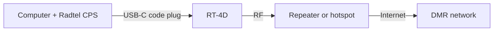
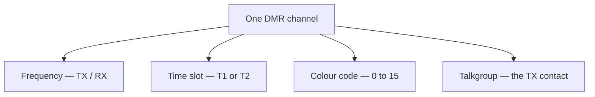

# Getting on DMR: your ID, a code plug and a hotspot

Owning a DMR radio and being _on_ DMR are two different things. Before your RT-4D can say a single word on a digital network it needs three things: an identity of its own, a way to reach the network, and the routing details that tell the network where your voice should go. This page walks you through all three in the order you will actually meet them — get a number, feed the radio from a computer, find a repeater or a hotspot, then build your very first talkgroup channel and key up. The deep theory behind each step lives in the [handbook's DMR chapters](outpost:entry/logbook73.handbook/dmr); here we keep our hands on this radio.

## The three things you need before you key up

It helps to hold the whole journey in your head before you start pressing buttons. Analogue FM asks almost nothing of you — a frequency, maybe a [CTCSS](outpost:entry/logbook73.handbook/repeaters) tone, and you talk. DMR (Digital Mobile Radio, an open [digital-voice](outpost:entry/logbook73.handbook/digital-voice) standard borrowed from commercial radio) asks for more, because it is a networked system rather than a lonely carrier.

- **Identity.** Every DMR operator transmits a unique numeric ID that the network resolves back to your callsign. You obtain it once, for free, from [RadioID.net](https://radioid.net/), and type it into the RT-4D as your `Personal ID`.
- **Access.** Your handheld's RF has to land on something connected to the internet-based network — a DMR repeater on a hilltop, or (far more common at home) a personal hotspot on your desk.
- **Routing.** A DMR channel does not just point at a frequency; it points at a **talkgroup** — a numbered "room" on a network. You build one channel per talkgroup you want to visit.

Miss any one of the three and you will sit there keying up into silence. The rest of this page fills each in.

## Step one: get a DMR ID and put it in Personal ID

You cannot transmit on DMR without a DMR ID, and you are not allowed to invent one — the network hands them out so that every station on air is a real, licensed operator. Go to [RadioID.net](https://radioid.net/), create an account, and submit your callsign together with proof of your amateur licence (a copy of your licence record — whatever your national regulator issues, be that Ofcom, the FCC or another). A volunteer checks it against the licence databases and, usually within a day or two, emails you a number that is normally seven digits long.

That one number works everywhere. You do **not** register separately for each network — the same ID logs you into [BrandMeister](https://brandmeister.network/), TGIF, DMR-MARC and the rest. The [DMR networks](outpost:entry/logbook73.handbook/dmr-networks) chapter explains the wider registry; the only part the RT-4D cares about is where the number goes.

On the radio, that home is `Digital Set` → `01 Personal ID`. The menu accepts a value from `1` to `16776415` — that ceiling is not arbitrary; it is the largest number the DMR data burst can carry, so every legitimate ID fits inside it. Type your seven digits, confirm, and the radio will now stamp that identity onto every digital transmission. Other operators' radios read it and display your callsign and name, provided they have loaded the user database (more on that in a moment).

> One ID, one transmitter at a time. If you later run a hotspot _and_ the radio on the network simultaneously, give the extra device a two-digit suffix (RadioID lets you add `01`, `02`… to your base number). Two transmitters sharing the same bare ID confuse the network's routing.

## Step two: feed the radio from a computer

You _can_ build DMR channels from the RT-4D's keypad — every field is reachable through the menus, and we will walk one through by hand below so you understand what each part means. But almost nobody programmes a DMR radio that way for real, and here is the honest reason.

A working DMR radio wants two big things that are painful to type on a numeric keypad: a **contact list** of talkgroups (and, ideally, a database of tens of thousands of user IDs so incoming calls show a callsign instead of a bare number), and a **channel for every talkgroup/slot/colour-code combination** you use. Do that by hand and you will be there all weekend. So DMR radios are programmed by computer, using the manufacturer's software over the USB-C cable — the Type-C port on the side of the RT-4D.

For this radio that software is the **Radtel CPS** (Customer Programming Software). You install it on a Windows PC, plug the radio in with the supplied USB-C cable, read the radio's current configuration into the software, edit it on a comfortable screen with a keyboard and mouse, and write it back. The saved file — your whole configuration in one bundle — is called a **code plug**. The full concept, including where to get the RadioID user database to import as your contact list, is covered in [DMR hotspots & code plugs](outpost:entry/logbook73.handbook/dmr-hotspots); treat the CPS as the workshop where you assemble everything this page describes.

Inside the CPS you will build, in roughly this order: **Contacts** (each talkgroup as a numbered entry), a **Group List** or two (which talkgroups a channel is allowed to _hear_), **Channels** (the four-ingredient recipe below), and **Zones** (banks that group channels together — the RT-4D supports up to 256 zones with up to 1024 channels in each, so you might make a "Local repeater" zone and a "Hotspot" zone). Everything below maps one-to-one onto both the CPS and the on-radio menus, so learning one teaches the other.

## Step three: reach a network — repeater or hotspot

Your RT-4D's RF has to arrive somewhere connected to the internet. There are two doors.

### A DMR repeater

A DMR repeater is a shared, higher-power machine, usually up on a mast, that a whole region uses. If there is one in range, you simply programme a channel to match its published frequency pair, [time slot, colour code and talkgroups](outpost:entry/logbook73.handbook/dmr-slots-talkgroups) and you are on. The catch is coverage: you need to be within its footprint, and you share its two time slots with everyone else using it. Directories such as RepeaterBook list local DMR repeaters together with the exact slot, colour code and talkgroup each one carries — that table is what you copy into your channels.

### A personal hotspot

Most amateurs get onto DMR from home a different way: a **hotspot**. This is a tiny digital modem — think a matchbox running roughly 10–20 mW — that bridges your handheld's RF to the DMR network over your home Wi-Fi or Ethernet. No local repeater required; it just needs internet. Popular examples run the free **Pi-Star** (or WPSD) software on an MMDVM board plugged into a Raspberry Pi, or an all-in-one unit like a SharkRF openSPOT. In the hotspot's own configuration you set your DMR ID, its RF frequency, its colour code, whether it is simplex or duplex, and which network it logs into. The [DMR hotspots](outpost:entry/logbook73.handbook/dmr-hotspots) chapter walks that setup end to end.

Two things about hotspots decide how you programme the matching RT-4D channel:

- **Frequency.** Pick a clear simplex frequency for the hotspot, well away from real repeater inputs, inside your 70 cm (or 2 m) band plan. Your radio channel's TX and RX frequencies both equal that one frequency.
- **Simplex vs duplex.** A simplex hotspot transmits and receives on one frequency and has effectively one usable slot — BrandMeister treats it as time slot 2. A duplex hotspot uses a TX/RX split and behaves like a miniature two-slot repeater. Programme your channel to match: simplex means TX frequency = RX frequency; a duplex hotspot uses the offset fields.

Either way, the network you are aiming at is the same. Which door you use only changes the frequency and slot details on the channel — the identity and the talkgroup routing are identical.

## Step four: build your first talkgroup channel

Here is the idea that makes DMR finally click: a **DMR channel = frequency + time slot + colour code + talkgroup**. Analogue needs a frequency and maybe a tone; DMR bundles four things, and getting all four right is the whole game. "Changing talkgroups" is really "selecting a different channel", which is why you end up with one channel per talkgroup.

Let us build one channel by hand so the pieces are concrete. First, the talkgroup needs to exist as a **contact**. Go to `Digital Set` → `09 Contacts Set`, add a new contact, and give it the talkgroup's number as its `Contact ID` (the same 1–`16776415` range as your own ID). For example, make a contact called "WW 91" with ID `91` for the Worldwide talkgroup, or "Parrot" with ID `9990` for the echo-test service. The radio also keeps one `All Call` contact that cannot be removed — leave it be.

Now the channel itself, in `Channel Set`. Work down these fields:

| RT-4D field                        | What to set                                                           | Why                                                                                        |
| ---------------------------------- | --------------------------------------------------------------------- | ------------------------------------------------------------------------------------------ |
| `03 Color Code`                    | Match the repeater/hotspot (hotspots commonly `1`)                    | The colour code is DMR's version of a CTCSS tone; wrong value and you are silently ignored |
| `02 DMR Slot`                      | `Slot 1` or `Slot 2` per the published slot (simplex hotspot: slot 2) | Slots carry separate conversations; the wrong one lands you elsewhere                      |
| `04 Contacts`                      | The talkgroup contact you just made                                   | This is _who you call_ when you key up                                                     |
| `05 RX Group`                      | A Group List that includes that talkgroup                             | This is _what you hear_ come back                                                          |
| `07 TX Politely`                   | `Carrier Match` (see below)                                           | Stops you transmitting over an in-progress call                                            |
| `08 TX Power`                      | `Low` for a nearby hotspot, `High` for a distant repeater             | Lowest power that does the job                                                             |
| `12 Offset Dir` / `13 Offset Freq` | Simplex hotspot: no offset. Repeater/duplex: the published split      | Sets RX≠TX for a repeater                                                                  |
| `11 CH Alias`                      | A readable name, e.g. "HS 91 WW"                                      | So the channel list makes sense at a glance                                                |
| `06 Encryption`                    | **`Off`**                                                             | Encryption is generally illegal on the amateur bands — leave it off, always                |

A couple of these deserve a sentence more.

**TX Politely** is the RT-4D's admit criteria — the rule it follows before letting you transmit. `Impolite` keys up regardless of what is on the channel; `Carrier Match` refuses to transmit while any signal is present; `CC match` refuses only if a signal with the _same colour code_ is present. `Carrier Match` is the courteous default and the one to learn with; the reasoning lives in [DMR operating](outpost:entry/logbook73.handbook/dmr-operating).

**Encryption stays off.** The RT-4D has an encryption menu (`Digital Set` → `11 Encryption Set`, and the per-channel `06 Encryption`) because it is a commercial-heritage radio. On the amateur bands, ciphering that obscures the meaning of your transmission is prohibited in essentially every country — your callsign must remain identifiable. Leave every encryption setting `Off`. See [Getting Licensed](outpost:entry/logbook73.handbook/getting-licensed) if you want the licence-conditions background.

When you save the channel it appears in the display prefixed `D-` for digital, with `T1`/`T2` showing the slot and `CXX` showing the colour code — a quick way to confirm at a glance that the four ingredients are what you meant.

## Borrow before you build

You do not have to assemble all of this from a blank sheet. Almost every beginner starts from a shared **starter code plug** — a ready-made file for a particular region or radio that already contains sensible talkgroup contacts, a working set of channels, the imported user database and a tidy zone layout. You load it into the Radtel CPS, change the `Personal ID` to your own DMR ID, adjust the hotspot frequency to yours, write it to the radio, and you are on the air in minutes instead of hours.

Then, once you can hear traffic and the parts make sense, edit it: add the talkgroups you actually use, prune the ones you do not, and build a couple of channels by hand so the four ingredients stop being abstract. A borrowed code plug is a scaffold, not a cage — and it is far easier to learn by changing something that already works than by staring at an empty CPS.

## Try it yourself

You will need your DMR ID and access to a repeater or hotspot for the last step, but the groundwork you can do today:

1. **Register.** Apply for your DMR ID at [RadioID.net](https://radioid.net/) now — approval takes a day or two, so start the clock. While you wait, read [DMR networks](outpost:entry/logbook73.handbook/dmr-networks) so you know what BrandMeister and TGIF are.
2. **Enter it.** When the number arrives, set `Digital Set` → `01 Personal ID`. That one step is the difference between a receive-only DMR radio and one that can transmit.
3. **Make a Parrot contact.** In `Digital Set` → `09 Contacts Set`, add a contact with ID `9990` named "Parrot". BrandMeister's Parrot records your transmission and plays it straight back — the DMR equivalent of a mic check, and it bothers nobody.
4. **Build the channel.** Make one channel pointed at that Parrot contact on your hotspot's frequency, slot and colour code, with `TX Politely` on `Carrier Match` and `Encryption` `Off`.
5. **Key up, pause, talk.** DMR takes a fraction of a second to set up the call, so the first half-second is clipped. Press PTT, pause a beat, then speak. If Parrot plays you back, all four ingredients are right and you are genuinely on DMR.

If Parrot stays silent, the usual culprit is the **colour code** — check it matches your hotspot before you suspect anything else, then the slot, then that your `Personal ID` is actually set.

## Key takeaways

- Being on DMR needs three things in order: an **identity** (`Personal ID`), **access** (a repeater or hotspot), and **routing** (talkgroup channels).
- Your DMR ID is free from [RadioID.net](https://radioid.net/), licence-verified, usually seven digits, and works on every network — enter it once at `Digital Set` → `01 Personal ID`.
- DMR radios are built from a computer: the **Radtel CPS** over USB-C writes a **code plug** holding contacts, channels and zones — hand-keying is possible but impractical.
- Most people reach the network via a small **hotspot** (Pi-Star and friends) rather than a repeater; match your channel's frequency and simplex/duplex mode to it.
- A **DMR channel = frequency + time slot + colour code + talkgroup** — build one channel per talkgroup, and remember a wrong colour code fails silently.
- Keep **encryption `Off`** on the amateur bands, use `TX Politely` = `Carrier Match`, and test with a Parrot call to `9990`.
- Starting from a **borrowed code plug** and editing it is the fastest, least painful way in.

With DMR under your belt, it is worth remembering the RT-4D is a capable analogue set too — next we cover [running it on analogue FM](outpost:entry/logbook73.guide.rt-4d/analog).
