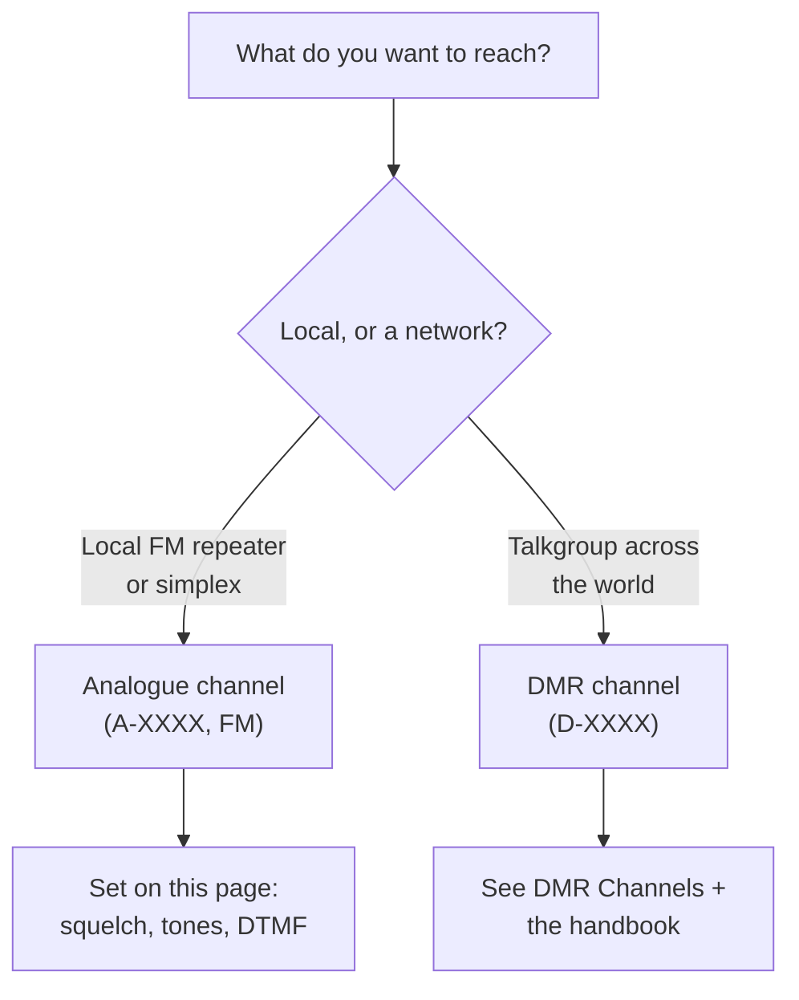
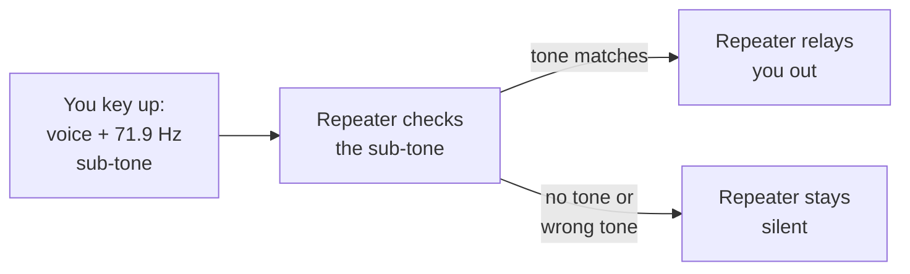

# Analogue FM, tones and DTMF

The RT-4D wears "DMR" on the box, but strip that away and you still have a thoroughly capable analogue FM handheld — and for most people, most days, analogue FM is what actually gets used. Your nearest club repeater is probably FM. The simplex natter after a meeting is FM. Everything you learned on a [UV-5R](outpost:entry/logbook73.guide.uv-5r/overview) applies here. This page is the RT-4D as an old-fashioned FM radio: the **Analog Set** menu that shapes how you sound, the sub-tones that unlock repeaters, talk-around and reverse, and the whole DTMF signalling suite — including the slightly alarming Stun, Kill and Remote Monitor features.

Everything below is reached the same way, covered in [Getting Started](outpost:entry/logbook73.guide.rt-4d/getting-started): press **MENU/Confirm**, step to the item with **▲/▼**, press **MENU/Confirm** to edit, choose the value, and confirm to save. The **↵/Return** key backs out.

## When you want analogue, and when you want DMR

The RT-4D switches personality per channel. On the display, an **A-XXXX** tag (with **FM** and a **W**/**N** width marker) means you are on an analogue channel; a **D-XXXX** tag (with **T1/T2** for the time slot and **CXX** for the colour code) means you are on a digital DMR channel. Same radio, two completely different conversations.

Reach for **analogue FM** when you want to talk to whatever is actually near you without any infrastructure: a local FM repeater, a simplex chat, a field day, listening to the aircraft band (the RT-4D receives AM aviation, `108–136 MHz`) or the built-in FM broadcast radio. Analogue is universal — every ham radio ever made speaks it — and it needs nothing but a frequency and, sometimes, a tone.

Reach for **DMR** when you want the network: talkgroups that reach across a country or the world through linked repeaters and hotspots, cleaner audio at the fringe, and text messages. DMR is a different mental model — frequency _plus_ time slot _plus_ colour code _plus_ talkgroup — and it needs a [DMR ID](outpost:entry/logbook73.handbook/dmr-networks) before you may transmit. All of that lives in [DMR Channels](outpost:entry/logbook73.guide.rt-4d/dmr-channels) and the deep theory in [Digital Voice](outpost:entry/logbook73.handbook/digital-voice) and the [DMR overview](outpost:entry/logbook73.handbook/dmr).

Neither is "better". A well-run local FM repeater and a global BrandMeister talkgroup are just different tools. Keep both kinds of channel in your [zones](outpost:entry/logbook73.guide.rt-4d/contacts-zones) and switch as the moment asks.

## The Analog Set menu, item by item

Menu **03 Analog Set** is where the radio's analogue voice is shaped. Most of it you set once and forget; a couple of items you will nudge by ear. The one-glance verdict used across this guide applies: ✅ set and forget · ⭐ useful, depends how you operate · ⚠️ understand before you touch · ❌ leave off for amateur use.

| #     | Item           | What it does                       | Values                                       | Verdict          |
| ----- | -------------- | ---------------------------------- | -------------------------------------------- | ---------------- |
| 01    | SQ level       | Analogue squelch threshold         | 0–10                                         | ✅ middle (~4–6) |
| 02    | TX Start Tone  | Tone/alert sent as you key up      | On/off style                                 | ⭐ off           |
| 03    | TX End Tone    | Roger beep or alias at end of over | Off / Roger beep1 / Roger beep2 / Radio name | ❌ off for ham   |
| 04    | Single Tone    | The tone-burst frequency (1750 Hz) | e.g. 1750 Hz                                 | ⭐ regional      |
| 05    | Mic Gain       | Microphone sensitivity             | 0–31                                         | ✅ default       |
| 06    | SPK Gain       | Speaker/audio gain                 | 0–63                                         | ✅ default       |
| 07    | Detect Range   | Frequency window for Freq Detect   | band range                                   | ✅ default       |
| 08    | Repeater Delay | Squelch-tail / turnaround delay    | 0–2000 ms                                    | ⭐ small         |
| 09–17 | DTMF … Control | The DTMF signalling suite          | —                                            | see below        |
| 18    | Time Calibrate | Remote clock-set feature           | —                                            | ✅ ignore        |

### SQ level — ✅ middle

The squelch: how strong a signal must be before the radio lets any sound through the speaker. At `0` the gate is wide open and you hear a constant hiss; crank it toward `10` and only strong signals break through. The manual recommends the **middle** of the range, and that is sound advice — start around `4–6`, raise it a notch if the squelch keeps chattering open on noise, drop it if you suspect you are missing weak stations. It is one of the few settings worth tuning live, by ear, to wherever you are standing.

### Mic Gain and SPK Gain — ✅ leave at default

**Mic Gain** (`0–31`) sets how hot your microphone runs — too low and you sound faint and distant, too high and you sound distorted and over-driven. **SPK Gain** (`0–63`) sets the audio level going to the loudspeaker. Both ship at sensible defaults. If a regular contact tells you your audio is thin or blown out, adjust Mic Gain a couple of steps and ask again; otherwise leave both alone. Note the digital side has its own separate Mic/SPK gain under [Digital Set](outpost:entry/logbook73.guide.rt-4d/dmr-getting-on).

### TX Start Tone and TX End Tone — mostly ❌

These two add sounds to your transmission. **TX End Tone** offers `Off`, `Roger beep1`, `Roger beep2`, or `Radio name` — the first two append a short "roger beep" when you release the PTT to signal "I've finished, over to you"; `Radio name` sends the alias you set in Basic Set as an identifying burst. **TX Start Tone** adds an alert as you key up.

On the amateur bands, ❌ **leave the roger beep off**. Amateurs say "over" and identify by callsign; a beep on the end of every over is widely felt to be irritating and just makes others sit through an extra tone. Roger beeps are perfectly at home on licence-free family channels ([PMR446 in Region 1, FRS in North America](outpost:entry/logbook73.handbook/repeaters)), less so on a repeater. Assign a side key to toggle the roger beep (see [Keys](outpost:entry/logbook73.guide.rt-4d/keys)) if you switch between the two worlds.

### Single Tone — ⭐ your region's tone burst

**Single Tone** sets the frequency of the RT-4D's tone burst — the classic `1750 Hz` in Europe and the UK. A tone burst is a brief, audible single tone sent at the _start_ of your over that an older repeater listens for as its "wake up" signal, before continuous sub-tones (CTCSS) took over. You fire it by assigning **Single tone (1750 Hz)** to a side key in [Key Define](outpost:entry/logbook73.guide.rt-4d/keys) and pressing it as you begin transmitting.

Set it once to your region's convention — 1750 Hz across most of Europe; North American machines use CTCSS instead and the burst goes unused. Many modern repeaters want a continuous sub-tone _as well_ as, or instead of, a burst, so a tone burst alone will not always open the machine. Check your local repeater's listing.

### Repeater Delay — ⭐ a small value

**Repeater Delay** (`0–2000 ms`) holds the audio muted for a short moment around the end of a received signal, hiding the little burst of noise — the "squelch tail" or "kerchunk" — you otherwise hear when a repeater drops its carrier. A modest value (a couple of hundred milliseconds) tidies that away and makes conversations sound cleaner. Set it too long and the first fraction of the next station's over gets swallowed too. If you would rather keep the carrier-drop as a natural end-of-over cue, set it to `0`. There is no wrong answer, only taste.

**Detect Range** and **Time Calibrate** are niche: the first sets the frequency window used by the Freq Detect key feature (which measures a nearby signal's frequency and sub-tone), the second is a remote clock-setting facility. Leave both at default.

## Getting into a repeater: CTCSS and DCS

Most FM repeaters do not relay every signal they hear — that would let distant noise and interference key them up all day. Instead they listen for a quiet **sub-audible tone** riding under your voice, and only repeat you if it is present. This is the single most common reason a beginner's radio "can hear the repeater but can't get into it": the frequency and offset are right, but the tone is missing. The whole concept — access tones, offsets, why repeaters exist — is explained in [Repeaters](outpost:entry/logbook73.handbook/repeaters); here is how the RT-4D handles it.

There are two flavours. **CTCSS** (the RT-4D shows **CTC**) sends one of a standard set of low-frequency tones, from about `67 Hz` to `250 Hz`, continuously under your audio. **DCS** (shown **DCS**) sends a continuous slow digital code instead. A repeater is configured for one specific tone or code; you must send exactly that one. Your radio can also _require_ a matching tone to open its own squelch on receive — when it is decoding an incoming sub-tone the display shows **MUT**.

On the RT-4D, a sub-tone is a **property of the channel**, not a live dial you spin. You attach the tone when you build the analogue channel — set the transmit (and, if you want tone squelch, the receive) tone along with the frequency, offset direction and offset amount. By far the easiest way to do this is the Radtel CPS software over the USB-C cable, where a whole repeater lives on one tidy row of a spreadsheet; the same code-plug workflow that programmes your DMR channels, described in [Configs](outpost:entry/logbook73.guide.rt-4d/configs) and [DMR Hotspots](outpost:entry/logbook73.handbook/dmr-hotspots). When a tone is active, the display shows **CTC** or **DCS**.

If you know a repeater is there but do not know its tone, assign **CTC/DCS scan** to a side key: the radio steps through the standard tones while you hold the machine open, and stops when it finds the one that is being sent. Note the value down and store it in the channel.

### Talk-around and reverse

A repeater listens on one frequency (its _input_) and transmits on another (its _output_), separated by the **offset** — commonly `−0.6 MHz` on 2 m or `−1.6 / −5 MHz` on 70 cm, depending on band and region. Two features let you break out of that split:

- **Talk-around** puts you on the repeater's _output_ frequency for both transmit and receive, so you talk directly to another local station, simplex, without going through the machine at all — handy when you are close together and want to keep the repeater free. The display shows **T**.
- **Reverse** swaps your transmit and receive frequencies, letting you listen on the repeater's _input_ to check whether you can hear the other station directly (i.e. work them simplex). The display shows **R**.

On the RT-4D this lives in **Basic Set → Talk Around** (`Off` / `Talk Around` / `Invert Freq`), and is best assigned to a side key via [Key Define](outpost:entry/logbook73.guide.rt-4d/keys) so you can flip it in a moment. It is a receive-and-transmit convenience, not a repeater setting — it never changes the machine, only where _your_ radio sits.

## The DTMF suite

**DTMF** — Dual-Tone Multi-Frequency — is the same pair-of-tones-per-key system as an old touch-tone telephone. On a radio it is used to send short strings of digits over the air: to open a phone-patch or autopatch, to page a specific station, or to command remote equipment. The RT-4D has a full DTMF encoder configured in **Analog Set** items `09–17`, and it sends DTMF from the keypad when you are in DTMF input mode (the **↵/Return** key in analogue mode).

| Item          | Sets                                          | Values                         |
| ------------- | --------------------------------------------- | ------------------------------ |
| DTMF Delay    | Pause before the first digit is sent          | ms                             |
| DTMF Interval | Gap between digits                            | ms                             |
| DTMF Duration | How long each digit tone lasts                | ms                             |
| DTMF Mode     | When a stored code is auto-sent               | Off / Tx start / Tx end / Both |
| DTMF Select   | Which stored code slot is active              | 01–16                          |
| DTMF Display  | Show the digits on screen as sent             | On / Off                       |
| DTMF TX Gain  | Transmit level of the DTMF tones              | 0–127                          |
| DTMF RX TH    | Receive decode threshold                      | 0–127                          |
| DTMF Control  | Enables the remote Stun/Kill/Monitor commands | On / Off                       |

The timing values (**Delay**, **Interval**, **Duration**) matter when you are talking to a system that is fussy about how fast the digits arrive; the defaults suit most amateur autopatches. **DTMF Mode** can fire a pre-stored code automatically at the start or end of every over — useful for a system that expects an identifier, needless for casual use, so `Off` is the honest default. **DTMF Select** picks which of the 16 stored code slots is live, and **DTMF Display** simply shows the digits as they go out.

Be honest with yourself about how much of this you will use. DTMF autopatch and paging were staples of 1990s repeater life; on today's amateur bands they are a novelty in many places, kept alive by a handful of legacy systems. It is a fine thing to have and understand, but do not expect to reach for it often. If your local scene has a DTMF-controlled repeater or gateway, its operators will tell you the exact codes.

## Stun, Kill and Remote Monitor — treat with care

The last, and most eyebrow-raising, corner of the RT-4D's signalling is remote control of _other_ radios. With **DTMF Control** turned on (Analog Set `17`), and matching function keys assigned, the radio can send commands that a target radio obeys:

- **Remote Stun** — temporarily disables a target radio (it stops transmitting, sometimes receiving too) until it is woken again.
- **Remote Kill** — a deeper disable.
- **Remote Wake Up** — the reverse, re-enabling a stunned radio.
- **Remote Monitor** — commands a target radio to key up and transmit for about 15 seconds so you can hear its surroundings.

These come straight from the commercial and public-safety world these chipsets are built for, where a fleet manager needs to silence a lost or stolen radio, or check on a lone worker. On the amateur bands they are almost never appropriate: they interfere with another operator's equipment, and Remote Monitor in particular is a covert transmission that raises obvious privacy and licence questions. Read [DMR Operating](outpost:entry/logbook73.handbook/dmr-operating) and [Getting Licensed](outpost:entry/logbook73.handbook/getting-licensed) before you even consider them, and assume the default answer is "leave these features unassigned".

If you do run a small analogue fleet where these features are legitimate (and within your licence), one rule is non-negotiable: **always set the Activate/wake-up code before you stun or kill a radio.** Without a stored revive code, a stunned or killed radio cannot be brought back over the air — you have bricked it until it is reprogrammed by cable. Set the wake code, test the wake code, _then_ use the others.

## Try it yourself

Programme and use one analogue repeater from the keypad, end to end:

1. On an analogue channel (an **A-XXXX**, **FM** channel), set the repeater's _output_ as your frequency, then set **Channel Set → Offset Dir** and **Offset Freq** to the machine's shift — say `−0.6 MHz` for a 2 m repeater.
2. Attach its access tone as a channel property — for example CTCSS `71.9 Hz` — so **CTC** appears on the display. (Do not know the tone? Assign **CTC/DCS scan** to a side key and let the radio find it while the repeater is talking.)
3. Set **SQ level** to the middle, **Bandwidth** to whatever the repeater listing specifies (usually narrow, **N**), and **TX End Tone** to `Off`.
4. Listen. When it is clear, key up, say your callsign, and drop. If the machine's "kerchunk" tail annoys you, nudge **Repeater Delay** up to `200 ms`.
5. Now assign **Talkaround** to a side key, press it (**T** appears), and you are transmitting simplex on the output frequency — a direct chat with a nearby station, no repeater involved. Press it again to return.

Do that once and analogue FM on the RT-4D holds no more mysteries. Save the finished channel into a [zone](outpost:entry/logbook73.guide.rt-4d/contacts-zones) so it is one twist of the knob away next time.

## Key takeaways

- The RT-4D is a full analogue FM handheld as well as a DMR radio — an **A-XXXX / FM** channel is your route to local repeaters, simplex, the aircraft band and FM broadcast; reach for **DMR** only when you want the [network](outpost:entry/logbook73.handbook/dmr).
- In **Analog Set**, the settings that matter are **SQ level** (squelch, middle by ear) and, occasionally, **Mic/SPK Gain**; leave **TX End Tone** (the roger beep) `Off` for amateur use.
- Repeaters open on a sub-tone: attach **CTCSS** (**CTC**) or **DCS** to the channel — easiest in CPS — and use **CTC/DCS scan** to discover an unknown one; the theory is in [Repeaters](outpost:entry/logbook73.handbook/repeaters).
- **Single Tone** is the `1750 Hz` burst for older European machines; **Talk-around** (**T**) and **reverse** (**R**), set in Basic Set, let you work simplex on a repeater's frequencies.
- The **DTMF suite** (Delay/Interval/Duration/Mode/Select/Display/gains) is a capable but nowadays-niche encoder — good to understand, rarely needed, `Off` by default.
- **Stun, Kill and Remote Monitor** are commercial fleet features that are almost never appropriate on the amateur bands — leave them unassigned, and if you ever use them, set the **Activate/wake code first** or you cannot revive a stunned radio.

Next, give your channels names and companions: your DMR [Contacts and Zones](outpost:entry/logbook73.guide.rt-4d/contacts-zones).
