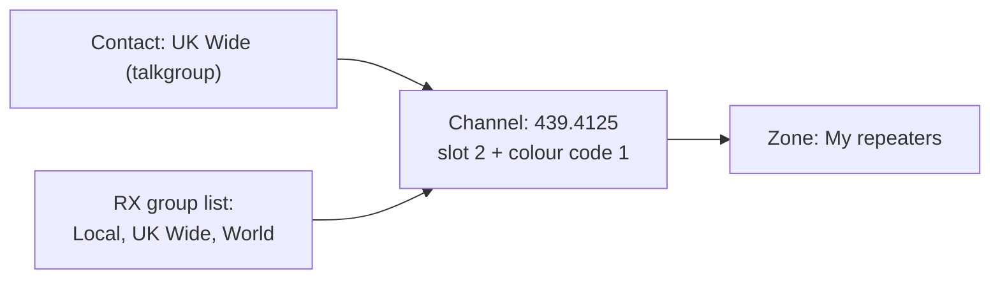
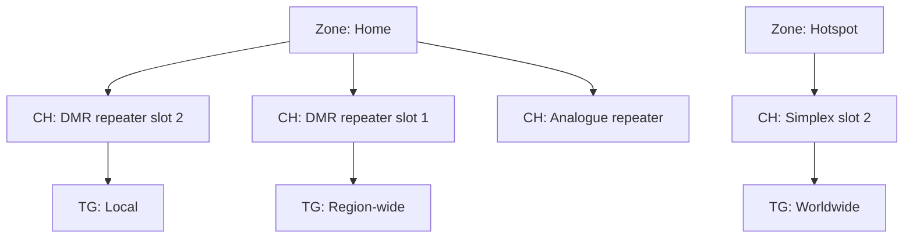
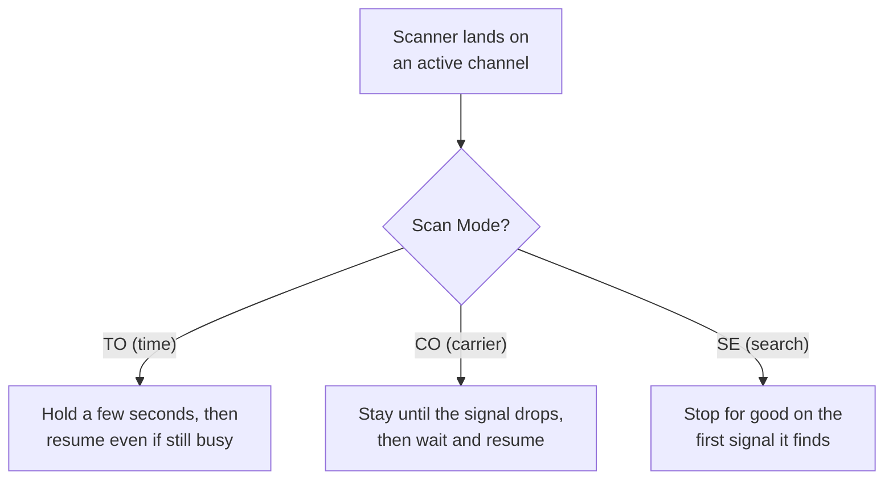

# Contacts, talkgroups, zones and scanning

Once you have a couple of DMR channels working, the next question is always the same: how do I keep dozens of them straight, and how do I make sure I hear the right people? That is what this page is about — the RT-4D's address book of talkgroups and contacts, the receive lists that decide who reaches your speaker, and the zones that file all those channels into tidy, purpose-built drawers. Get these three ideas clear and a radio that holds 1024 channels stops being intimidating and starts feeling like a well-organised toolbox.

None of this is deep theory — the theory lives in the handbook, and we link to it as we go. Here we are concerned with which RT-4D menus hold each piece and how they fit together. Every menu is reached the way [Getting Started](outpost:entry/logbook73.guide.rt-4d/getting-started) describes: **MENU/Confirm** to open, **▲ / ▼** to move, **MENU/Confirm** to save, **↵ / Return** to back out.

## The digital address book — Contacts Set

A DMR **contact** is just an entry in the radio's address book that points at a number. That number is either a **talkgroup** (a shared conversation channel that many people join — for a full explanation see [Slots & talkgroups](outpost:entry/logbook73.handbook/dmr-slots-talkgroups)) or an individual person's **DMR ID** for a private one-to-one call. The RT-4D does not care which; both are stored the same way, as a name and an ID between `1` and `16776415`.

You manage them under **Digital Set → 09 Contacts Set**, where you can add, edit and delete entries. Each contact needs three things: a friendly name (so the screen shows "UK Wide" rather than a bare number), the ID itself, and its call type — group call or private call. In practice you will build a small library: the talkgroups you actually use, plus a handful of individual IDs for people you speak to directly.

### All Call — the one you cannot delete

Every RT-4D carries a built-in contact named **All Call** that you cannot remove. All Call is a special DMR address (ID `16777215`) that every radio listening on that slot and colour code will hear, regardless of their own talkgroup or receive list. It is the digital equivalent of a general call to anyone within earshot.

Treat it with respect. Because everyone hears it, All Call cuts across whatever conversation is already running on the slot — useful in a genuine net or emergency, antisocial as an everyday habit. On busy networks and repeaters, All Call is often discouraged or blocked outright. Leave it as the un-deletable curiosity it is, and reach for a normal talkgroup for ordinary contacts.

### Private calls and DMR IDs

To call one person directly, you store their personal DMR ID as a private-call contact. Your own ID lives separately under **Digital Set → 01 Personal ID** — you must have one, issued free from RadioID.net, before you transmit at all. Why that matters, and how IDs and networks fit together, is covered in [DMR networks](outpost:entry/logbook73.handbook/dmr-networks). A private call is still sent in the open and is not remotely private in the security sense; it simply addresses one radio rather than a group.

## From contact to channel — how they connect

Here is the idea that unlocks everything else: a contact is not a channel. A DMR **channel** on the RT-4D is a bundle of four things — a **frequency**, a **time slot**, a **colour code**, and a **talkgroup (contact)** — the mental model from [Slots & talkgroups](outpost:entry/logbook73.handbook/dmr-slots-talkgroups). The contact is the "who"; the channel is the "who, where and how" wrapped together.

Each channel points at your address book in two places, both under **Channel Set** (covered in full in [DMR channels](outpost:entry/logbook73.guide.rt-4d/dmr-channels)):

- **04 Contacts** — the **TX contact**. This is the talkgroup or ID your voice goes _to_ when you press PTT on this channel. Pick "UK Wide" here and everything you say on this channel goes to that talkgroup.
- **05 RX Group** — the **receive group list** this channel listens to (more on building those lists next). This is the set of talkgroups you _hear_ on this channel.

So one talkgroup, stored once in Contacts Set, can be the TX contact on several different channels — one per slot, per repeater, per hotspot. You build the contact once and reuse it.

## The receive list — Group List Set

The **TX contact** decides where your voice goes; the **RX group list** decides which talkgroups reach your speaker on a given channel. Without it, a DMR channel would only ever hear the single talkgroup you transmit on — and you would miss everything else passing through that slot.

You build these lists under **Digital Set → 10 Group List Set**. Open a list and you see your contacts; pressing **↵** on a member selects it (its background turns solid black to show it is in the list), and pressing **↵** again deselects it. Add the talkgroups you want this list to monitor, save, and then attach the finished list to a channel via **Channel Set → 05 RX Group**.

A sensible list for a repeater channel might include your local talkgroup, a regional one and a worldwide one, so you hear activity on all three while still transmitting only to whichever talkgroup that channel is set for. This is closely tied to **promiscuous mode** and DMR listening etiquette — how much you monitor, and how you behave when you hear a conversation you are not part of — which [DMR operating](outpost:entry/logbook73.handbook/dmr-operating) covers properly. Keep the list focused: a group list stuffed with every talkgroup you can think of turns a quiet channel into a firehose.

## Zones — organising by purpose, not band

A **zone** is simply a labelled group of channels — a drawer in the filing cabinet. The RT-4D gives you a generous **256 zones**, each holding up to **1024 channels**, edited under **Zone Set (menu 06)**, where you name a zone and choose which channels belong to it. In day-to-day use you flip between zones rather than scrolling one enormous channel list, and each of the radio's two working areas remembers its own zone (**Basic Set → 23 Area A Zone** and **26 Area B Zone**, each `Zone1`–`Zone256`).

The single most useful habit is to **organise zones by purpose, not by band**. It is tempting to make a "2 m zone" and a "70 cm zone", but that is rarely how you operate. You think in terms of _where you are_ and _what you are doing_ — at home, on the commute, at the club, on the hotspot — and a good zone plan mirrors that. A mixed zone that puts your local analogue repeater, your local DMR repeater and a couple of simplex calling channels side by side is far more useful than one split down the middle by frequency.

### A worked zone plan

Here is a plan that suits a lot of operators. Names are yours to choose; the point is the grouping.

| Zone        | What lives in it                                                                    | Why it is grouped this way                                                                |
| ----------- | ----------------------------------------------------------------------------------- | ----------------------------------------------------------------------------------------- |
| `1 Home`    | Local analogue repeater, local DMR repeater (both slots), a simplex calling channel | Everything you reach from the house, analogue and digital together                        |
| `2 Hotspot` | Your hotspot's simplex channels, one per talkgroup you use                          | All your hotspot conversations in one drawer — see [DMR hotspots](outpost:entry/logbook73.handbook/dmr-hotspots) |
| `3 Simplex` | Analogue and DMR simplex calling frequencies                                        | Direct radio-to-radio work, no infrastructure                                             |
| `4 Travel`  | Repeaters along a regular route or a club's patch                                   | Load it before a journey; skip it the rest of the time                                    |
| `5 Monitor` | Weather/NOAA, PMR446/FRS, anything you only listen to                               | Receive-mostly channels kept out of the way                                               |

Notice that analogue and digital channels sit happily in the same zone. The RT-4D does not force a split — an `A-XXXX` analogue channel and a `D-XXXX` digital channel can be neighbours, and switching between them is just moving up or down the channel list.

Building all of this by hand on the keypad is possible but slow. The far easier route — especially once you have more than a handful of channels — is the Radtel CPS software over the USB-C cable, where you type contacts, group lists, channels and zones on a proper keyboard and load them as one **code plug**. That workflow is explained in [Configs & code plugs](outpost:entry/logbook73.guide.rt-4d/configs) and, in general terms, in [DMR hotspots](outpost:entry/logbook73.handbook/dmr-hotspots).

## Scanning — sweeping across analogue and digital

Scanning steps automatically through a set of channels looking for activity, stopping when it finds some. On the RT-4D it works across both modes at once: an analogue repeater and a DMR channel can share a scan list, and the radio decides "busy" appropriately for each.

### Choosing what gets scanned

A channel joins the scan only if you add it. Under **Channel Set → 09 Scan Add**, set a channel to **Add** to include it or **Remove** to leave it out. The natural unit to scan is a zone: add the channels in a zone to the scan, and a single scan sweeps that whole purpose-built drawer. Start scanning with the function you have mapped to a side key (see [Keys & side-buttons](outpost:entry/logbook73.guide.rt-4d/keys)).

### How the scanner behaves — Scan Mode

When the scanner lands on an active channel it has to decide when to move on, and **Basic Set → 15 Scan Mode** picks the rule. The RT-4D offers three:

- **TO — time-operated.** Pause on the signal for a set spell, then carry on scanning whether or not the channel is still busy. Good for sampling a lot of activity without getting stuck.
- **CO — carrier.** Stay on the signal until it drops, then resume. This lets you follow a whole conversation rather than clipping in and out of it — the sensible everyday default.
- **SE — search.** Stop on the first signal found and stay there. Useful when you are trying to locate which channel a group is using.

### Tuning the sweep

Three more settings shape the scan, all in **Basic Set**:

- **16 Scan Direction** — sweep `Up` or `Down` through the list. A matter of taste.
- **17 Scan Dwell** — `0`–`30`, roughly how long the scanner lingers before moving on (in the time-operated sense). Longer dwell means you sample each active channel for longer.
- **18 Scan Return** — where the radio settles when you stop scanning: `Original CH` returns to the channel you started from, `Current CH` keeps you on wherever the scan last stopped. `Current CH` is handy when you want to answer the station the scan just found.

## Dual standby — watching two channels at once

Separate from scanning, **dual standby** lets the radio keep half an ear on a second channel while sitting on your main one. The RT-4D has two working areas, A and B; turn on **Basic Set → 10 Dual Standby** and it alternates its receiver between them, so you can monitor, say, a local repeater in Area A and a hotspot in Area B without choosing between them.

A couple of companions matter here. **Basic Set → 20 Main PTT TX** decides which area transmits when you key up — `Area A` always uses A, or `Main Area` follows whichever area is currently active. And each area's mode and zone are set independently (**21–26 Area A/B Mode, Show, Zone**), so the two can be entirely different setups. Dual standby is not the same as scanning many channels — it watches exactly two — but for "keep me on the repeater but tell me if anything happens on the hotspot" it is exactly the tool.

## Try it yourself

Build one clean zone from scratch and prove the whole chain works:

1. In **Digital Set → 09 Contacts Set**, add one talkgroup contact — a name and its ID as a group call. Check your network's talkgroup list ([DMR networks](outpost:entry/logbook73.handbook/dmr-networks)) for the number; do not guess it.
2. In **Digital Set → 10 Group List Set**, make a list and press **↵** to add that talkgroup (its background goes black). Save.
3. On a DMR channel ([DMR channels](outpost:entry/logbook73.guide.rt-4d/dmr-channels)), set **Channel Set → 04 Contacts** to your new talkgroup and **05 RX Group** to your new list. Set **09 Scan Add** to `Add`.
4. In **Zone Set (06)**, make a zone called `Test` and put that channel in it. Switch Area A to it via **Basic Set → 23 Area A Zone**.
5. Set **Basic Set → 15 Scan Mode** to `CO`, then start a scan from your side key and watch it hold on activity until the signal drops.

If you can talk to that talkgroup and hear it come back, every link in the chain — contact, list, channel, zone, scan — is doing its job.

## Key takeaways

- A **contact** (Contacts Set 09) is an address-book entry pointing at a talkgroup or a person's DMR ID; **All Call** is the built-in, un-deletable everyone-hears-it contact — use it sparingly.
- A DMR **channel** is frequency + slot + colour code + contact; **Channel Set → 04 Contacts** sets who you transmit _to_, **05 RX Group** sets who you _hear_.
- The **RX group list** (Group List Set 10) decides which talkgroups reach your speaker on a channel — press **↵** to select members; keep the list focused.
- **Zones** (256 of them, 1024 channels each) are drawers you organise **by purpose, not by band** — mix analogue and digital freely; build them fast in the CPS.
- **Scan Add** (Channel Set 09) chooses what gets scanned; **Scan Mode** `TO`/`CO`/`SE` (Basic Set 15) sets the behaviour, with **CO** the friendly default for following a whole conversation.
- **Scan Direction/Dwell/Return** fine-tune the sweep; **Dual Standby** (Basic Set 10) watches exactly two areas at once rather than a whole list.
- Encryption is a separate matter and stays **off** on the amateur bands — that and listening etiquette live in [DMR operating](outpost:entry/logbook73.handbook/dmr-operating).

With your channels, contacts and zones organised, the remaining odds and ends — SMS, FM radio, NOAA weather, timers and the stun/kill features — are gathered in [Extras & odds and ends](outpost:entry/logbook73.guide.rt-4d/extras).
