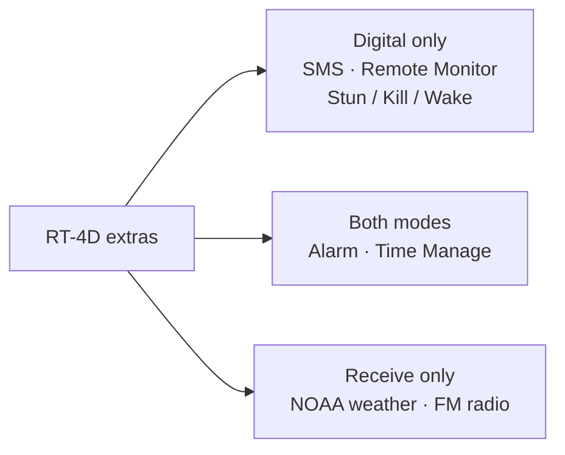
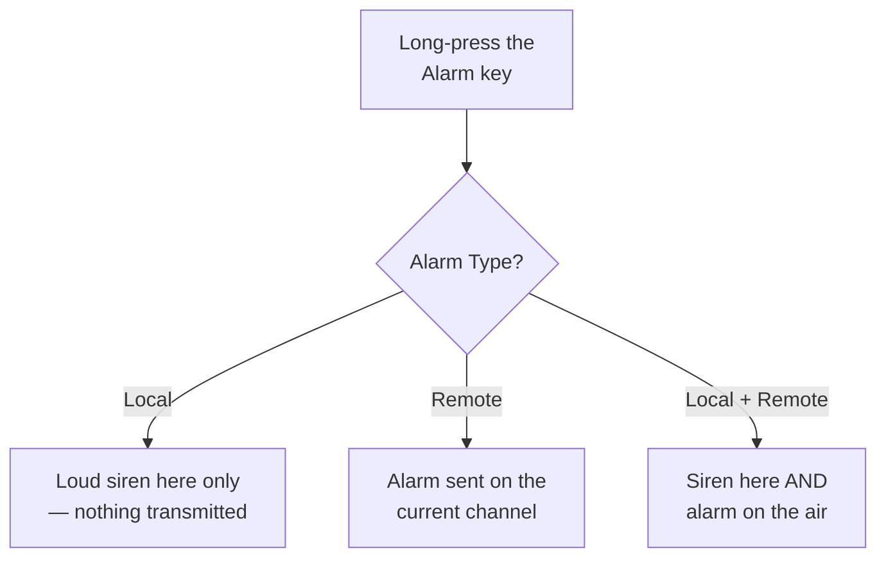
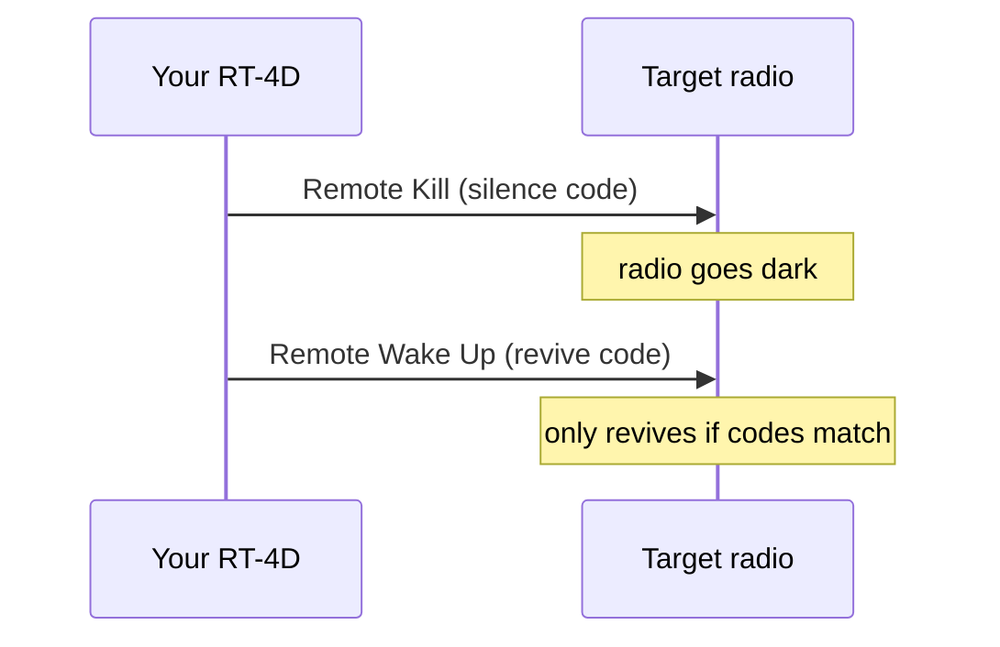

# SMS, NOAA, FM radio and safety features

Beyond talking, the RT-4D carries a drawer full of extra tools — text messages that ride on the DMR signal, weather channels, an FM broadcast radio, an emergency alarm, and a set of fleet-management commands that can reach out and silence another radio. Some are genuinely handy, some are receive-only curiosities, and a couple are powerful enough that you should understand them fully before you ever press the key. This page walks the lot, keeps straight which are digital-only, and is honest about the ones inherited from the radio's commercial life.

Each feature carries the same one-glance verdict used across this guide: ✅ set it and forget it · ⭐ genuinely useful, depends how you operate · ⚠️ advanced, understand it first · ❌ leave it off. Most live under **MENU**; a few are only reachable by assigning them to a side key or number key in [Keys & Function Buttons](outpost:entry/logbook73.guide.rt-4d/keys).

## DMR text messages (SMS) — ⭐ digital only

DMR carries more than voice. The same 4FSK data stream that ferries your speech can also carry short text, and the RT-4D can compose, send and store it. Everything here lives under **MENU → 07 Message**, and none of it works in analogue FM — text messaging is a purely digital feature, so you need a [DMR ID](outpost:entry/logbook73.handbook/dmr-networks) and a channel set to a [talkgroup or contact](outpost:entry/logbook73.handbook/dmr-slots-talkgroups) before a message can go anywhere.

The menu splits into the pieces you would expect from any messaging system:

| Item            | What it does                                                                      |
| --------------- | --------------------------------------------------------------------------------- |
| `New SMS`       | Compose a fresh message with the keypad, then choose who it goes to               |
| `Inbox`         | Messages received from other radios (the unread-mail icon appears on the LCD)     |
| `Outbox`        | Messages you have sent, kept so you can resend                                    |
| `Drafts`        | Half-written messages saved for later                                             |
| `Default SMS`   | A canned message you can fire off with one action — handy for a stock "on my way" |
| `Clear All SMS` | Wipes the lot                                                                     |

Addressing works exactly like a call: a message can go to a single radio (a private message to one DMR ID) or to a talkgroup (everyone monitoring that group hears the beep and can read it). On a repeater or [hotspot](outpost:entry/logbook73.guide.rt-4d/dmr-getting-on), a message hops onto the network and reaches its target the same way your voice does — including radios far outside RF range, if the network routes there.

Typing on a keypad is slow, which is the honest limit of on-radio SMS: it is superb for a short, pre-agreed exchange ("QSY 2", "at the car park") and painful for anything longer. Most operators set a **Default SMS** for the one message they send often and leave freeform typing for emergencies. As with all things DMR, sending SMS across a network still counts as amateur operation — keep it plain-language and within your [licence conditions](outpost:entry/logbook73.handbook/getting-licensed), the same as voice.

## NOAA weather channels — ⭐ receive only, region-dependent

The RT-4D can tune the North American weather service. Assign **Noaa Mode** to a key (see [Keys & Function Buttons](outpost:entry/logbook73.guide.rt-4d/keys)) and a press drops you onto a bank of eleven fixed frequencies carrying continuous forecasts and severe-weather alerts:

| #   | Frequency     | #   | Frequency     |
| --- | ------------- | --- | ------------- |
| 1   | `162.400` MHz | 7   | `162.550` MHz |
| 2   | `162.425` MHz | 8   | `161.650` MHz |
| 3   | `162.450` MHz | 9   | `161.750` MHz |
| 4   | `162.475` MHz | 10  | `161.775` MHz |
| 5   | `162.500` MHz | 11  | `162.000` MHz |
| 6   | `162.525` MHz |     |               |

These are the channels used by NOAA Weather Radio in the United States and by Environment Canada's equivalent — a public service that broadcasts around the clock and cuts in with warnings for storms, floods and other hazards. It is **receive only**: you listen, you never transmit. Nudge through the channels until one comes in clearly; the nearest transmitter is usually the strongest.

A word of honesty for readers outside North America: this band is allocated differently elsewhere. In much of ITU Region 1, `161–162` MHz is maritime VHF or land-mobile, so these frequencies will carry something quite different — or nothing your radio can decode. NOAA Mode is a genuine safety asset if you are within range of a weather transmitter, and a novelty if you are not. Check what these frequencies mean in your own country's band plan before relying on them.

## FM broadcast radio — ✅ your commute companion

Under **MENU → 08 FM Radio** sits an ordinary FM broadcast receiver, tuning the `64–108` MHz band that carries music and news stations. It is completely separate from the amateur side of the radio and, again, **receive only** — the RT-4D cannot and must not transmit on the broadcast band.

The sub-menu offers a `Work Mode` (tune by frequency or by stored channel), an `RX Standby` behaviour, a `Scan Mode` (stop on one station or sweep the whole range), an `Area` of up to 16 stored stations, and the `Channel` list itself. Scan the band once, store your favourite stations, and you have a pocket radio for the drive or the workshop.

The clever part is what happens when a call arrives. Like most dual-purpose handhelds, the RT-4D keeps half an ear on your amateur channel while the FM radio plays: when a signal appears on your working channel, the music ducks so you hear the call, then returns when the channel goes quiet. That makes the FM radio a pleasant background companion rather than a distraction — you will not miss a call because you were enjoying the afternoon show.

## Alarm — ⚠️ understand it before you trigger it

The RT-4D includes an emergency alarm, inherited from the lone-worker features of commercial radios. You set its behaviour under **MENU → 01 Basic Set → 19 Alarm Type**, then assign **Alarm** to a key to trigger it. There are three modes:

- **Local** — a _local_ alarm only: the radio sounds a loud siren to attract attention nearby. It does not transmit.
- **Remote** — transmits an alarm on the current channel to alert others who are listening.
- **Local + Remote** — does both at once: siren here, alarm on the air.

Two honest points. First, this is **not a substitute for the emergency services** — a real emergency means dialling your national emergency number, not keying a radio. Second, the transmitting modes put an alarm onto a shared channel, which is a serious act: [licence conditions](outpost:entry/logbook73.handbook/getting-licensed) everywhere permit genuine emergency communication, but firing the alarm as a test, or onto a channel where it disrupts others, is misuse. If you keep the alarm available at all, **Local** (siren only, no transmission) is the safest default, and a key that is hard to press by accident is wise. Many operators leave it on Local precisely to avoid an embarrassing — or unlawful — accidental transmission.

## Stun, Kill, Wake & Remote Monitor — ⚠️ commercial tools, handle with respect

Here is the corner of the RT-4D that most plainly betrays its commercial parentage. These are **fleet-management commands**: they let one radio reach across the air and control another. On the amateur bands they are rarely appropriate, and one of them carries a trap that can permanently brick a radio. All of them are **digital features** that work by sending an _individual call_ to a specific target [DMR ID](outpost:entry/logbook73.handbook/dmr-networks) (analogue versions exist too, gated behind `03 Analog Set → 17 DTMF Control`). You assign each one to a key in [Keys & Function Buttons](outpost:entry/logbook73.guide.rt-4d/keys).

| Command            | What it does to the target radio                                           |
| ------------------ | -------------------------------------------------------------------------- |
| **Remote Monitor** | Forces the target to transmit for ~15 seconds so you hear its surroundings |
| **Remote Stun**    | Disables the target's transmit — it can still receive but cannot talk      |
| **Remote Kill**    | Disables the target more completely — it goes dark                         |
| **Remote Wake Up** | Revives a stunned or killed radio, _if_ the codes match                    |
| **Online Check**   | Pings a target to see whether it is powered on and in range                |

In a business fleet this makes sense: a dispatcher can silence a radio that was lost or stolen, check whether a unit is switched on, or monitor a lone worker who has gone quiet. On the amateur bands, sending any of these to another operator's radio uninvited is at best rude and quite possibly a breach of your licence — you may not disrupt other stations. Treat them as features to understand, not to use casually.

### The one warning that matters most

**Always set an Activate (revive) code before you ever use Stun or Kill.** These commands work as a matched pair: a radio is silenced by one code and revived by another. If you kill a radio without having a wake-up code configured, there is no over-the-air way to bring it back — the radio is effectively bricked until reprogrammed by cable. This is the single most costly mistake people make with these features. If you experiment with Stun and Kill at all, do it only between two radios you own, with the codes written down first, and test **Remote Wake Up** before you trust it.

If a channel is set up for this at all, the safest posture for amateur use is to leave these keys unassigned. There is almost never a good reason to stun another ham's radio, and every reason not to risk killing one you cannot revive.

## Time Manage — ✅ tidy housekeeping

The gentlest group of all, under **MENU → 09 Time Manage**, keeps the radio's clock and its power habits in order:

- **APO** and **APO Timer** — _auto power off_. The radio switches itself off after a set idle period, so a handheld left on in a bag does not quietly flatten its battery overnight. Set a timer that suits you and forget it.
- **System Time** — sets the clock the LCD can display (turn the display on via `01 Basic Set → 09 State Timer`). DMR networks can also nudge the time automatically.
- **Clock 1–4** — up to four alarm clocks, each with its own type and timer, if you like the radio waking you or reminding you of a net.
- **Schedule (List 1–128)** — a scheduler for timed actions, up to 128 entries.

None of this touches how you sound on the air, so there is nothing to get wrong. Set **APO** to protect the battery, set the clock if you want a timestamp on the display, and leave the rest unless a scheduled reminder appeals.

## Try it yourself

- **Send a text.** With two DMR radios (or one radio and a [hotspot](outpost:entry/logbook73.guide.rt-4d/dmr-getting-on)) on the same talkgroup, open **MENU → 07 Message → New SMS**, type a short line, and send it to the group. Watch the unread-mail icon appear on the other radio and open its `Inbox`. Then set a **Default SMS** and fire it in one action.
- **Find the weather.** If you are in North America, assign **Noaa Mode** to a key and step through the eleven channels until one comes in — the continuous forecast tells you it is working. Elsewhere, tune the same frequencies and note what your region actually uses them for.
- **Store an FM station.** Open **MENU → 08 FM Radio**, scan the broadcast band, and save a favourite station to the `Area` list. Then key up a friend on your amateur channel and confirm the music ducks for the call and returns afterwards.

## Key takeaways

- **SMS** is a genuinely useful digital-only tool: short text over DMR to a single radio or a whole talkgroup — set a **Default SMS** for the message you send often, and keep it plain-language like any amateur traffic.
- **NOAA weather** and the **FM broadcast radio** are both **receive only** — you never transmit on either. NOAA's eleven channels are a North American service; check what those frequencies mean in your own band plan.
- The **Alarm** has Local, Remote and Local + Remote modes; it is not the emergency services, and **Local** (siren only) is the safest default to avoid an accidental on-air alarm.
- **Stun, Kill, Wake, Remote Monitor** and **Online Check** are digital fleet-management commands aimed at another radio — rarely appropriate on ham, and best left unassigned.
- **Always set an Activate/revive code before Stun or Kill** — kill a radio without one and there is no over-the-air way back; test **Remote Wake Up** between your own radios first.
- **Time Manage** is harmless housekeeping: set **APO** to save the battery, set the clock for a timestamped display, and ignore the rest unless a reminder appeals.

With the extras understood, the last piece is making the radio yours: what every button does and how to load the two side keys and number keys with the functions you actually reach for, in [Keys & Function Buttons](outpost:entry/logbook73.guide.rt-4d/keys).
