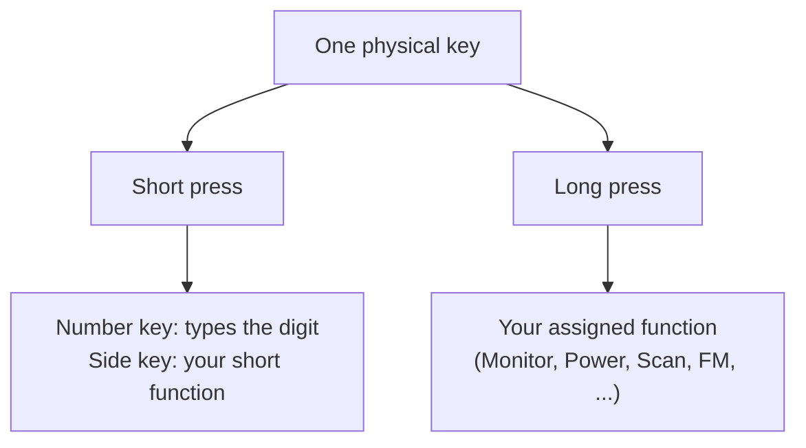
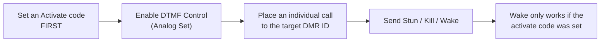

# Programmable keys and side-key functions

The RT-4D has only a handful of buttons, yet it can do dozens of things — and the trick is that most of those things live behind keys you get to _choose_. The two side keys, the ten number keys and even a second PTT can each be pointed at a function you actually use, so the radio fits your hands instead of the other way round. Get this right once, in the `02 Key Define` menu, and every day afterwards a single press does the job you meant it to. Get it wrong and you will fumble through menus for something that should have been a thumb-tap.

This page is about _your_ keys on _this_ radio: what can be assigned, where, and a sensible layout for someone who works both DMR and analogue FM. The deeper operating ideas the functions touch — [talkgroups and slots](outpost:entry/logbook73.handbook/dmr-slots-talkgroups), [DMR etiquette](outpost:entry/logbook73.handbook/dmr-operating), [repeaters](outpost:entry/logbook73.handbook/repeaters) — live in the handbook, and this page links out to them as it goes.

## What Key Define lets you change

Open `MENU → 02 Key Define`. Inside are four things you can set, and they map onto the physical controls exactly as you would expect.

- **Slaver PTT** — a simple on/off that turns **Side-key 1** into a second push-to-talk for the _B_ band.
- **Side key 1 S / L** — the function for a **short** press and a **long** press of the upper side key.
- **Side key 2 S / L** — the same pair for the lower side key.
- **0–9 Press Long** — a function for a **long** press of each of the ten number keys.

That gives you, in total, up to fourteen assignable actions: two side keys × two press-lengths, plus ten long-pressed numbers. (A _short_ press of a number key still types that digit for entering frequencies, channels or DTMF — only the long press is yours to assign.)

### Slaver PTT — the B-band talk button

The RT-4D watches two channels at once (dual standby), and normally your PTT transmits on whichever is the main working band. **Slaver PTT** ("slaver" here just means _secondary_) turns Side-key 1 into a dedicated transmit button for the **B** band, so the big PTT keys the A band and the side key keys the B band. It is genuinely handy if you keep, say, a DMR talkgroup on one band and a local analogue repeater on the other, and want to answer either without first swapping which band is "main".

The cost is that Side-key 1 is then spoken for — you lose its short/long functions to the second PTT. Most single-band-at-a-time operators leave **Slaver PTT off** and keep Side-key 1 free for Monitor and power. Turn it on only once you are genuinely running two bands and find yourself constantly switching the main band just to reply.

### The long-press number keys

Every digit `0`–`9` can hold a function on a long press. This is where the radio's "everything" list really pays off: you have ten more slots than the two side keys give you, so the features you use weekly but not hourly — the FM broadcast radio, a frequency counter, [weather channels](#weather-and-safety-functions) — can each live on a number you will remember. A long press of a number that has _no_ function assigned simply does nothing, which is why a fresh radio feels like the number keys are "dead".

## The full list of assignable functions

Any of the slots above can be pointed at any function in the table below. The verdict column uses the same one-glance shorthand as the rest of this guide: ✅ everyday, ⭐ useful depending how you operate, ⚠️ powerful — understand it first, ❌ not for the amateur bands.

| Function             | What it does                                                                                                                              | Verdict        |
| -------------------- | ----------------------------------------------------------------------------------------------------------------------------------------- | -------------- |
| **Monitor (Ana)**    | Forces the squelch fully open on the **analogue** channel so you can hear a weak signal buried in the noise. Momentary.                   | ✅ everyday    |
| **H/L Power**        | Toggles the current channel between **High** and **Low** transmit power.                                                                  | ✅ everyday    |
| **Scanning**         | Starts and stops channel/frequency scanning (behaviour set by `Basic Set → Scan Mode`).                                                   | ✅ everyday    |
| **Talk Around**      | Transmits on the repeater's _output_ (its listening frequency), or reverses the shift — for working a station directly, off the repeater. | ⭐ useful      |
| **Color Code Scan**  | Sweeps [colour codes](outpost:entry/logbook73.handbook/dmr-slots-talkgroups) to find which one a DMR signal is using.                                            | ⭐ useful      |
| **Freq Detect**      | Measures a nearby transmitter's frequency (and any sub-tone) within the range set in `Analog Set → Detect Range`.                         | ⭐ useful      |
| **FM Radio**         | Opens the broadcast **FM radio** (64–108 MHz).                                                                                            | ⭐ useful      |
| **NOAA Mode**        | Jumps to the North American weather channels (see below).                                                                                 | ⭐ regional    |
| **Send Single Tone** | Sends the `1750 Hz` tone burst set in `Analog Set → Single Tone`, to open older tone-burst repeaters.                                     | ⭐ regional    |
| **Dual Standby**     | Toggles watching two channels at once on/off.                                                                                             | ⭐ useful      |
| **TX Priority**      | Switches the `Edit`/`Busy` rule for which band the main PTT transmits on.                                                                 | ⭐ useful      |
| **LCD Brightness**   | Steps the backlight brightness (0–4).                                                                                                     | ⭐ taste       |
| **Backlight on/off** | Toggles the backlight.                                                                                                                    | ⭐ taste       |
| **Status Query**     | Sends a DMR status/enquiry message.                                                                                                       | ⚠️ advanced    |
| **Online Check**     | Pings another DMR radio to see if it is on the air (an individual "are you there?").                                                      | ⚠️ advanced    |
| **Remote Monitor**   | Silently keys a _target_ DMR radio to transmit for ~15 s, so you can hear its surroundings.                                               | ⚠️ advanced    |
| **Remote Stun**      | Disables a target DMR radio over the air.                                                                                                 | ⚠️ advanced    |
| **Remote Kill**      | Disables a target DMR radio more deeply.                                                                                                  | ⚠️ advanced    |
| **Remote Wake Up**   | Re-enables a radio that was stunned/killed — _if_ an activate code was set first.                                                         | ⚠️ advanced    |
| **Roger Beep**       | Toggles the end-of-over beep on the analogue channel.                                                                                     | ❌ off for ham |
| **Alarm**            | Triggers the local/remote alarm set by `Basic Set → Alarm Type`.                                                                          | ⚠️ safety      |

A few of these lean entirely on other menu settings to work at all: **Send Single Tone** needs its tone chosen in [Analog Set](outpost:entry/logbook73.guide.rt-4d/analog), **Freq Detect** needs a sensible `Detect Range`, and every **Remote** command needs `Analog Set → DTMF Control` switched on — more on that in a moment.

## A layout that suits a DMR + analogue operator

There is no single "correct" layout, but the everyday functions want to be under your thumb, and the rare-but-scary ones want to be somewhere you will not hit by accident. Here is a starting point that has served many mixed DMR/FM operators well; adapt it once you know which features you reach for.

| Slot                 | Function        | Why here                                                                                                        |
| -------------------- | --------------- | --------------------------------------------------------------------------------------------------------------- |
| **Side-key 1 short** | Monitor (Ana)   | The one control you tap by ear, mid-QSO, to check a fading analogue signal.                                     |
| **Side-key 1 long**  | H/L Power       | The [lowest power that does the job](outpost:entry/logbook73.handbook/rf-power) is a per-contact choice — keep it one long press away. |
| **Side-key 2 short** | Scanning        | Start/stop a sweep without leaving where your thumb already is.                                                 |
| **Side-key 2 long**  | Talk Around     | Working a station off the back of a repeater is an occasional but valuable move.                                |
| **Long-press `1`**   | FM Radio        | Broadcast radio while you wait — easy to remember on key 1.                                                     |
| **Long-press `2`**   | Color Code Scan | Handy when a DMR signal will not decode and you suspect the colour code.                                        |
| **Long-press `3`**   | Freq Detect     | Point-and-measure a nearby signal's frequency.                                                                  |
| **Long-press `9`**   | NOAA Mode       | Weather channels tucked on a high number (North America).                                                       |
| **Slaver PTT**       | Off             | Leave Side-key 1 free until you truly run two bands at once.                                                    |

Notice what is **not** on a side key: the remote commands and the alarm. Those go on number keys, if anywhere at all, precisely because a long-press number is harder to trigger by mistake than a prominent side key. Roger Beep is best simply left unassigned on the amateur bands — an automatic beep after every over is discouraged there, as [DMR operating](outpost:entry/logbook73.handbook/dmr-operating) and the analogue etiquette both explain.

## The functions that reach out — handle with care

Several assignable functions do not just change _your_ radio; they send a command to _someone else's_. On DMR these are addressed to a specific radio by its [DMR ID](outpost:entry/logbook73.handbook/dmr-networks), and they only fire when you have first placed an **individual call** to that ID.

- **Remote Monitor** makes a distant radio transmit for about fifteen seconds so you can hear what is around it.
- **Remote Stun / Kill** disable a distant radio over the air.
- **Remote Wake Up** brings a stunned or killed radio back — but _only_ if an **activate code** was set beforehand.
- **Online Check** and **Status Query** are the gentler cousins: "are you there?" and a short status message.

Two hard rules before you go near these. First, **set an activate (wake-up) code before you ever stun or kill anything** — a killed radio with no code cannot be revived over the air and may need a trip to a programmer or the workshop. Second, these are fleet-management tools from the radio's commercial life; on the amateur bands, deliberately disabling _another operator's_ station is not something to do casually, and doing it to a radio that is not yours to manage is plainly out of order. They exist for a club or group that manages a shared set of radios by agreement. On a personal handheld you will most likely leave all of them unassigned, and that is a perfectly good answer. Remote commands also depend on `Analog Set → DTMF Control` being on, so they simply will not work until you deliberately enable that.

### Weather and safety functions

**NOAA Mode** jumps the radio onto the eleven North American weather-radio channels (around `162.400`–`162.550 MHz`, plus `161.650`, `161.750`, `161.775` and `162.000 MHz`) for continuous forecasts and hazard alerts. It is genuinely useful in the field — but only where that service exists; outside North America the channels are silent, so the function is worth assigning only if you are in a region NOAA covers.

The **Alarm** function triggers whatever `Basic Set → Alarm Type` is set to — `Local` (a siren and flash on the radio itself, no transmission), `Remote` (an alarm sent on the channel) or `Local + Remote`. Treat it the way you would any alerting feature: understand it before you assign it, keep it off an easily-brushed key, and remember it is **not** a link to the emergency services — a real emergency means the local emergency number, not a radio alarm. If you keep it at all, `Local` is the safest choice because it never transmits by accident.

## Try it yourself

1. Open `MENU → 02 Key Define`. Set **Side-key 1 short** to **Monitor (Ana)** and **Side-key 1 long** to **H/L Power**, then save and exit.
2. On an analogue channel, give the short press a try — you should hear the squelch fall open into hiss for as long as the momentary check lasts. Hold the same key and watch the `H`/`L` tag on the display flip.
3. Assign **FM Radio** to **long-press `1`**. Back on the main screen, hold `1` and confirm the broadcast band opens; a short tap of `1` should still just type the digit.
4. Decide, honestly, whether you will ever run two bands at once. If not, confirm **Slaver PTT** is **off** so Side-key 1 stays yours.
5. Leave every **Remote** command unassigned for now. Come back to them only once you have read [DMR operating](outpost:entry/logbook73.handbook/dmr-operating) and have a real, agreed reason — and an activate code — to use them.

## Key takeaways

- Key Define gives you up to fourteen slots: **Side-key 1 & 2** (short and long each) and a **long press on every number key** `0`–`9`; short presses of numbers still type digits.
- **Slaver PTT** turns Side-key 1 into a second PTT for the **B** band — useful when you genuinely run two bands, but it costs you that key's other functions, so leave it **off** until you need it.
- Put the everyday functions — **Monitor (Ana)**, **H/L Power**, **Scanning**, **Talk Around** — on the side keys where your thumb already rests; park weekly features like **FM Radio**, **Freq Detect** and **Color Code Scan** on number keys.
- **NOAA Mode** and **Send Single Tone (1750 Hz)** are regional: weather channels are a North American service, and the tone burst opens older Region 1 repeaters.
- The **Remote Monitor / Stun / Kill / Wake** commands act on _other_ people's radios, need `DTMF Control` on, and demand an **activate code set before any kill** — they are fleet tools, best left unassigned on a personal amateur handheld.
- **Roger Beep** is best left off the amateur bands, and the **Alarm** is a local safety feature, not a line to the emergency services — keep it off an easy-to-brush key.

With your keys laid out the way you work, the next step is to understand _why_ the settings behind them behave as they do — the theory that ties squelch, slots, colour codes and admit criteria together in [What the Settings Really Mean](outpost:entry/logbook73.guide.rt-4d/theory).
