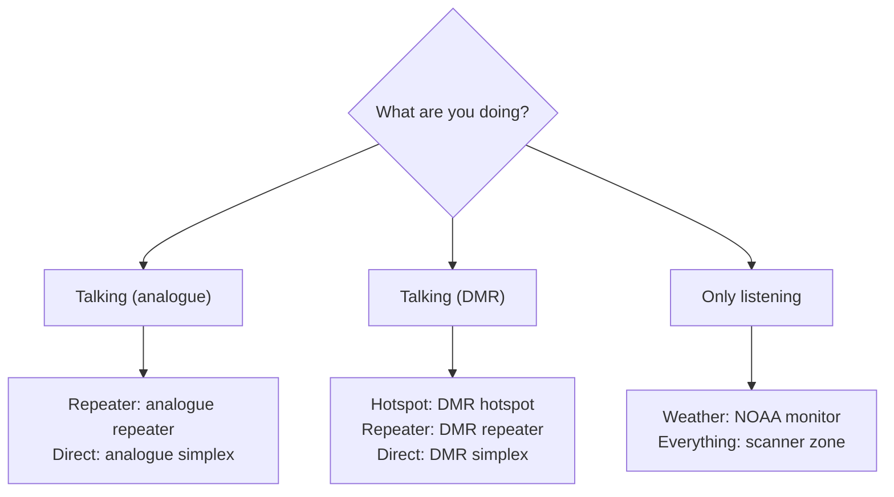
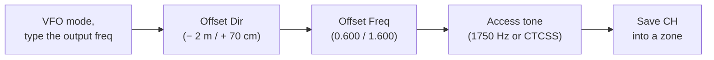
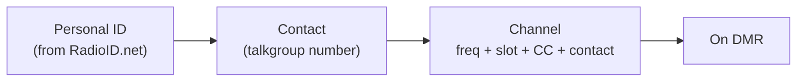

# Ready-made configurations

You have met every menu; now here is where they come together. This page is a cookbook — a set of ready-made stations you can copy straight onto the RT-4D, each one a short "why you'd want it" and a table of settings with the values to enter. Some are pure analogue and take five minutes on the keypad; the DMR ones lean on a computer and the [Radtel CPS](outpost:entry/logbook73.guide.rt-4d/dmr-getting-on), because a digital channel needs contacts that have to exist first. Pick the recipe that matches what you are about to do, apply it, and you are on the air correctly the first time.

## How to use these recipes

Every table names a setting the way the rest of this guide does: the menu **group** then the **item** — for example `Channel Set` → `08 TX Power`. Reach any of them with **MENU/Confirm**, move with **▲**/**▼**, and press **MENU/Confirm** again to save, exactly as in the [menu reference](outpost:entry/logbook73.guide.rt-4d/menu-reference). Two habits make all of this painless.

- **Build analogue channels in VFO mode, then save them.** Frequency, step, offset and tone are edited on a VFO, then stored with `Basic Set` → `27 Save CH` into a memory slot and organised into a [zone](outpost:entry/logbook73.guide.rt-4d/contacts-zones). Do it once and you never touch the menus again.
- **Build DMR channels in software.** For anything digital, or for more than a handful of analogue channels, the free Radtel CPS over the USB-C cable turns an afternoon of thumb-work into five minutes and gives you a **code plug** — a backup you can re-flash after a fumbled reset. The recipes below mark which ones really want the CPS.

### The house defaults every recipe assumes

Rather than repeat the same lines in every table, set these once as your baseline. They are the "good operator" defaults from the menu chapters, and every recipe inherits them unless it says otherwise.

| Setting                          | Value         | Why                                                                            |
| -------------------------------- | ------------- | ------------------------------------------------------------------------------ |
| `Analog Set` → `01 SQ level`     | 4-5           | Silences the hiss but still lets weak signals through                          |
| `Digital Set` → `06 SQ level`    | middle        | Sensible digital squelch                                                       |
| `Channel Set` → `08 TX Power`    | Low           | The lowest power that does the job — see [RF Power](outpost:entry/logbook73.handbook/rf-power)        |
| `Channel Set` → `07 TX Politely` | Carrier Match | Refuses to transmit onto a channel someone else is using                       |
| `Channel Set` → `06 Encryption`  | Off           | Encryption is generally illegal on ham — [always off](outpost:entry/logbook73.handbook/dmr-operating) |
| `Channel Set` → `10 TOT`         | 180 s         | Cuts a stuck transmission before it hogs the channel                           |
| `Basic Set` → `14 Save Mode`     | 1:2           | Sensible receive battery-save                                                  |
| `Basic Set` → `04 Lock Timer`    | 10 s          | Stops pocket-dialling the menu                                                 |
| `Basic Set` → `05 Backlight`     | Auto          | Screen off when idle, to save the battery                                      |
| `Analog Set` → `03 TX End Tone`  | Off           | No courtesy beep on amateur voice                                              |

Everything that follows changes only the handful of settings that make each station what it is. Remember the two mental models this whole radio runs on: an **analogue channel** is a frequency plus maybe a [CTCSS](outpost:entry/logbook73.handbook/repeaters) tone and an offset, while a **DMR channel = frequency + time slot + colour code + talkgroup** — the model from [DMR slots and talkgroups](outpost:entry/logbook73.handbook/dmr-slots-talkgroups).

## Analogue voice

The RT-4D is a capable analogue FM set as well as a DMR one, and these two recipes cover almost all everyday FM use: talking through a [repeater](outpost:entry/logbook73.handbook/repeaters) and talking directly to another station. Both live on the 2 m (144 MHz) and 70 cm (430 MHz) amateur bands the radio transmits on, and both are comfortable to hand-key — no computer needed.

### A first analogue repeater channel

A repeater listens on one frequency and re-transmits on another, so a channel for it needs the output frequency, a shift to the input, and usually an access tone. Build it in VFO mode, then save it. The frequencies, offsets and tones below are **examples** in the ITU Region 1 (Europe) convention — always take the exact figures from your national repeater listing (RepeaterBook, or your national society's directory), which is the final word.

| Setting                          | 2 m example              | 70 cm example            | Why                                       |
| -------------------------------- | ------------------------ | ------------------------ | ----------------------------------------- |
| VFO frequency                    | `145.700`                | `433.000`                | The repeater's **output** (what you hear) |
| `Channel Set` → `12 Offset Dir`  | −                        | +                        | Region 1 shift direction                  |
| `Channel Set` → `13 Offset Freq` | `0.600`                  | `1.600`                  | The published input/output split          |
| Access tone                      | 1750 Hz burst _or_ CTCSS | 1750 Hz burst _or_ CTCSS | How you open the repeater (see below)     |
| Bandwidth                        | Narrow (most machines)   | Narrow                   | Match the listing                         |
| `Channel Set` → `08 TX Power`    | Low                      | Low                      | Lowest power that gets in cleanly         |

**Opening the repeater.** Many European machines are woken by a short **1750 Hz toneburst**. Set that frequency at `Analog Set` → `04 Single Tone`, then assign the `Single Tone` function to a side key in [Key Define](outpost:entry/logbook73.guide.rt-4d/keys) so you can send it with a press. Other repeaters — and most machines outside Europe — instead need a continuous **CTCSS sub-tone**: the exact tone the keeper publishes must be set on the channel so the repeater knows your signal is meant for it. Whichever your listing specifies, set it and nothing more; sending the wrong access signal, or none, leaves the repeater silent.

Listen first to confirm the machine is there and idle, then key up briefly with your callsign to test access. Store the finished channel with `Basic Set` → `27 Save CH` and give it a name so it is one twist of the knob away tomorrow.

### An analogue simplex channel

Simplex is the simplest station there is: transmit and receive on the same frequency, direct to another station with no repeater in between. It is just the house defaults with the offset and tone cleared off.

| Setting                         | Value                                     | Why                                              |
| ------------------------------- | ----------------------------------------- | ------------------------------------------------ |
| VFO frequency                   | `145.500` (a Region 1 FM calling channel) | A shared simplex frequency                       |
| `Channel Set` → `12 Offset Dir` | none                                      | Simplex — same frequency both ways               |
| Access tone                     | none                                      | Hear everyone on the channel, not just one group |
| `Basic Set` → `13 Talk Around`  | Off                                       | On only for the trick below                      |
| `Channel Set` → `08 TX Power`   | Low                                       | Raise only if you are not making the contact     |

**Worked example.** You and a friend agree to meet on a clear simplex frequency in your band plan. Both dial it in VFO mode, leave the offset off, no tone, power Low, and call. Store it afterwards. A calling channel such as `145.500` is a doorway, not a room — announce yourself there, then move to a working frequency to chat.

**Common mistake:** leaving a duplex offset or a TX tone set from a repeater channel, then wondering why nobody answers on simplex — you are transmitting 0.6 MHz away, or opening a repeater that is not there. Offset off, tone off, for direct contacts. (`Talk Around` is the reverse of this problem: it lets you transmit on a repeater's _output_ to reach a nearby station directly when the repeater is down — handy, but leave it Off for normal use.)

## DMR voice

These three recipes get you onto digital: a hotspot on the desk, a repeater on a hilltop, and a direct simplex contact. All three assume you have already done the groundwork in [DMR — getting on](outpost:entry/logbook73.guide.rt-4d/dmr-getting-on): a `Personal ID` from [RadioID.net](https://radioid.net/) entered at `Digital Set` → `01 Personal ID`, and the talkgroup you want created as a **contact** at `Digital Set` → `09 Contacts Set`. Because those contacts have to exist before a channel can point at one, all three are **best built in the Radtel CPS** — a code plug lets you paste in a whole contact list and the RadioID user database at once. See [DMR hotspots and code plugs](outpost:entry/logbook73.handbook/dmr-hotspots).

### A DMR hotspot channel

A **hotspot** is a tiny personal modem — a matchbox running roughly 10-20 mW — that bridges your handheld to the DMR network over your home internet. It is how most amateurs get on DMR from home. A simplex hotspot transmits and receives on one frequency, so TX equals RX; [BrandMeister](https://brandmeister.network/) treats a simplex hotspot as **time slot 2**.

| `Channel Set` item | Value (example)                                    | Why                                                     |
| ------------------ | -------------------------------------------------- | ------------------------------------------------------- |
| VFO frequency      | `438.800` (a clear simplex freq in your band plan) | Both TX and RX equal this one frequency                 |
| `12 Offset Dir`    | none                                               | Simplex hotspot — no split                              |
| `03 Color Code`    | `1`                                                | Match the hotspot (its config sets this; `1` is common) |
| `02 DMR Slot`      | Slot 2                                             | A simplex hotspot uses slot 2                           |
| `04 Contacts`      | the talkgroup contact, e.g. "Parrot" ID `9990`     | Who you call when you key up                            |
| `05 RX Group`      | a group list including that talkgroup              | What you hear come back                                 |
| `08 TX Power`      | Low                                                | The hotspot is on your desk                             |
| `11 CH Alias`      | e.g. "HS Parrot"                                   | So the channel list makes sense                         |

**Test it first.** Point your very first hotspot channel at the **Parrot** contact (ID `9990`): BrandMeister records your over and plays it straight back. Press PTT, pause half a second (DMR takes a moment to set up the call), speak, release. If Parrot plays you back, all four ingredients are right. If it stays silent, check the **colour code** first — it fails silently when wrong — then the slot.

### A DMR repeater channel

A DMR repeater is a shared, higher-power machine, usually on a mast, with a TX/RX split just like an analogue repeater — but it also carries a slot, a colour code and a set of talkgroups. Copy all of those from the listing; a directory such as RepeaterBook publishes the exact slot, colour code and talkgroup each machine carries.

| `Channel Set` item                 | Value (example)                                   | Why                                          |
| ---------------------------------- | ------------------------------------------------- | -------------------------------------------- |
| VFO frequency                      | `439.000` output (example)                        | What you hear                                |
| `12 Offset Dir` / `13 Offset Freq` | −, `9.000` (example)                              | The published split — check the listing      |
| `03 Color Code`                    | as published (often `1`)                          | DMR's version of a sub-tone; wrong = ignored |
| `02 DMR Slot`                      | per the talkgroup's slot                          | Slots carry separate conversations           |
| `04 Contacts`                      | the talkgroup, e.g. "Local" or "WW 91"            | Who you call                                 |
| `05 RX Group`                      | a group list with the talkgroups on that repeater | What you hear                                |
| `07 TX Politely`                   | Carrier Match                                     | Don't transmit over an in-progress call      |
| `08 TX Power`                      | High                                              | A repeater may be miles off                  |

**Why one channel per talkgroup.** A DMR repeater carries several talkgroups across its two slots. Because a channel fixes the slot and the TX contact, "changing talkgroups" really means "selecting a different channel" — so you build one channel per talkgroup/slot pairing you use, and group them in a zone named for the repeater. The [DMR networks](outpost:entry/logbook73.handbook/dmr-networks) chapter explains what those talkgroups actually are.

### A DMR simplex channel

Two DMR radios can talk directly, no network at all — useful on a work site or a summit. There is a widely used convention for it: a simplex frequency, colour code `1`, slot `1`, and the simplex talkgroup `99`.

| `Channel Set` item | Value (example)                                | Why                                                          |
| ------------------ | ---------------------------------------------- | ------------------------------------------------------------ |
| VFO frequency      | `433.450` (a common Region 1 DMR simplex freq) | TX = RX                                                      |
| `12 Offset Dir`    | none                                           | Simplex                                                      |
| `03 Color Code`    | `1`                                            | Both radios must match                                       |
| `02 DMR Slot`      | Slot 1                                         | The simplex convention                                       |
| `04 Contacts`      | a contact "Simplex 99" ID `99`                 | The agreed simplex talkgroup                                 |
| `05 RX Group`      | a group list including `99`                    | So you hear the other radio                                  |
| `06 Encryption`    | Off                                            | [Illegal on ham](outpost:entry/logbook73.handbook/dmr-operating) — always           |
| `01 DMR Mode`      | Dual Slot Off                                  | Single-slot simplex; Dual Slot On is the advanced DCDM trick |

Both radios must match on **every** ingredient — frequency, colour code, slot and talkgroup — or they simply will not hear each other, and DMR gives you no reassuring hiss to tell you why. Set them together and test at arm's length first.

## Listening (receive only)

The RT-4D receives far more widely than it transmits, and these two recipes are legal for anyone — receiving is not transmitting. Do not key up on frequencies that are not amateur allocations.

### A NOAA weather monitor

In North America, the NOAA Weather Radio network broadcasts continuous forecasts and alerts on seven VHF frequencies (with some regional variants). The RT-4D has a built-in **NOAA Mode** that scans them for you — assign it to a side key or a long-press number key in [Key Define](outpost:entry/logbook73.guide.rt-4d/keys), or store the channels yourself.

| Channel | Frequency | Channel | Frequency |
| ------- | --------- | ------- | --------- |
| WX1     | `162.400` | WX7     | `162.550` |
| WX2     | `162.425` | —       | `161.650` |
| WX3     | `162.450` | —       | `161.750` |
| WX4     | `162.475` | —       | `161.775` |
| WX5     | `162.500` | —       | `162.000` |
| WX6     | `162.525` |         |           |

These are the eleven weather frequencies the RT-4D's NOAA mode covers. They are FM, receive-only, and mostly relevant in North America — elsewhere they are simply quiet. **Never transmit** on them.

### A scanner zone

A scanner zone is a bank of channels the radio watches in turn, pausing on whichever one comes alive. Build the channels (analogue or DMR) as above, then tell the scanner how to behave and mark which channels join in.

| Setting                           | Value                            | Why                                      |
| --------------------------------- | -------------------------------- | ---------------------------------------- |
| `Channel Set` → `09 Scan Add`     | Add (on each channel to include) | Only tagged channels are scanned         |
| `Basic Set` → `15 Scan Mode`      | CO (carrier)                     | Pause on activity, resume when it clears |
| `Basic Set` → `16 Scan Direction` | Up                               | Which way it sweeps                      |
| `Basic Set` → `17 Scan Dwell`     | 5                                | How long it lingers on a signal          |
| `Basic Set` → `18 Scan Return`    | Current CH                       | Where it lands when you stop             |
| Side key                          | `Scanning` function              | Start/stop scanning with a press         |

Put the channels you want to watch — your local calling channels, a repeater or two, a simplex frequency — into one [zone](outpost:entry/logbook73.guide.rt-4d/contacts-zones), tag each with `Scan Add`, and start the scan from your side key. `Scan Mode` **CO** (carrier-operated) pauses while there is a signal and moves on when it clears; **TO** (time-operated) always moves on after a fixed time; **SE** (search) hunts across a range. CO is the natural choice for monitoring known channels.

## A go-bag setup

A radio kept for when the power or the phones are down should be configured for **weeks of readiness, then hours of use** — maximum standby, minimum fuss. Programme it, charge it, and let it sleep.

| Setting                       | Value                             | Why                                                           |
| ----------------------------- | --------------------------------- | ------------------------------------------------------------- |
| `Basic Set` → `14 Save Mode`  | 1:3                               | Longest receive battery-save between checks                   |
| `Channel Set` → `08 TX Power` | Low                               | Conserve the battery; raise only when you must reach someone  |
| `Basic Set` → `05 Backlight`  | Off (or short Auto)               | Every second of screen costs charge                           |
| Side key                      | `Monitor(Ana)`                    | One press opens the squelch to dig out a weak analogue signal |
| Side key                      | `NOAA Mode`                       | Weather alerts at a press (where relevant)                    |
| Local channels                | pre-stored in an "Emergency" zone | No menu-diving in a crisis                                    |

**Notes.** Store your area's calling channels and the two or three most useful repeaters — analogue _and_ DMR — in a zone named so you can find them by feel. Because a DMR channel needs its contacts and colour codes exactly right, build this zone in the CPS and keep the code plug file somewhere safe: re-flashing a known-good configuration is the fastest recovery from any muddle. Keep a spare charged battery, the USB-C charging lead, and a written copy of your key frequencies and your callsign in the bag, and top the battery up every few months. In a real emergency, [monitor first, transmit briefly, and stay within your licence conditions](outpost:entry/logbook73.guide.rt-4d/best-practices) — a working radio you know how to use beats a clever one you don't.

## Try it yourself

Two of these you can do today without any network at all:

1. **Save an analogue simplex channel by hand.** Tune a clear simplex frequency in your band plan on a VFO, leave the offset and tone off, set power Low, and store it with `Basic Set` → `27 Save CH`. Name it. You have just made your first channel without a computer.
2. **Set up a scanner zone.** Put that channel plus your nearest repeater into a zone, tag both with `Channel Set` → `09 Scan Add`, set `Scan Mode` to CO, and start scanning from a side key. Listen for an evening and you will learn which channels are busy where you live.
3. **Build a Parrot hotspot channel in the CPS.** If you have a hotspot and your DMR ID, make a contact `9990` "Parrot", build one channel pointed at it (colour code `1`, slot `2`, `Encryption` Off), write the code plug, and key up. A clean playback means all four DMR ingredients are correct.

## Key takeaways

- Set the **house defaults once** — TX Politely Carrier Match, Encryption Off, TX Power Low, TOT 180 s — and every recipe inherits good manners; each config changes only the few settings that define it.
- **Analogue channels hand-key comfortably**: tune on a VFO, add offset and access tone, then `Basic Set` → `27 Save CH` into a zone.
- **DMR channels want the Radtel CPS** because they point at contacts that must exist first — build the code plug on a computer and keep it as your backup.
- A DMR channel is **frequency + slot + colour code + talkgroup**; a wrong **colour code fails silently**, so test every new one against a **Parrot** call to `9990`.
- **Transmit only on your amateur allocations** at the lowest power that works; the NOAA weather channels and any scanner catches outside the ham bands are **receive-only**.
- **Keep encryption Off** everywhere on the amateur bands, and give the go-bag radio maximum `Save Mode`, a pre-built "Emergency" zone, and a saved code plug.

When a recipe doesn't behave — no transmit, no repeater access, a silent Parrot, a scan that won't stop — the next chapter is your first stop: [Troubleshooting](outpost:entry/logbook73.guide.rt-4d/troubleshooting).
