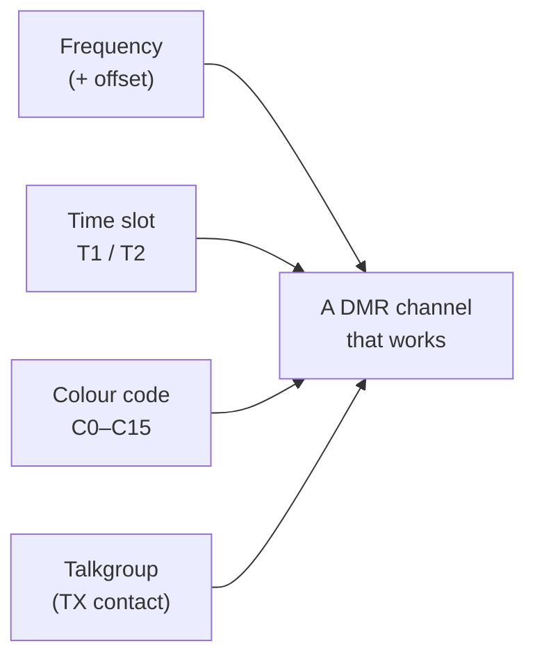
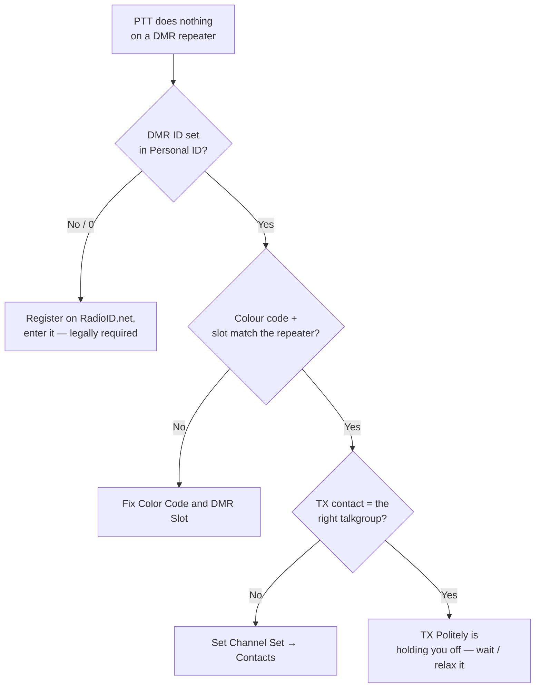
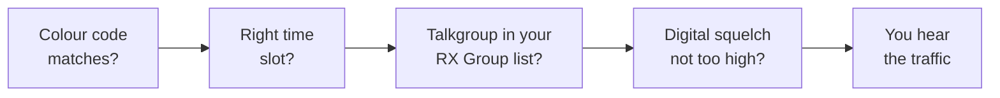
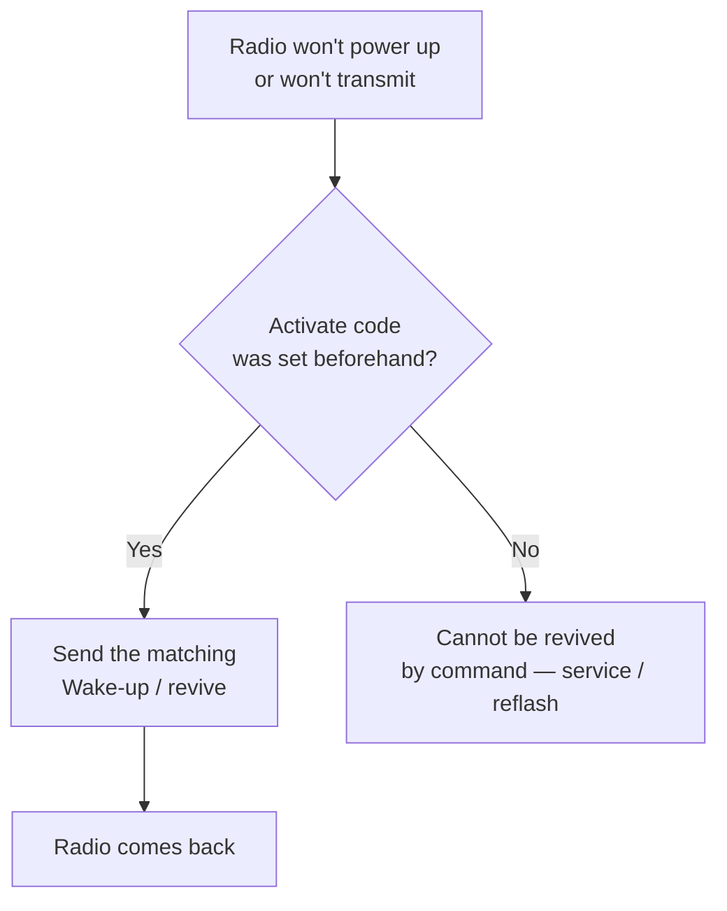

# Troubleshooting

Almost every "my RT-4D is broken" moment turns out to be one value in the wrong menu, not a fault in the metal — and on a [DMR](outpost:entry/logbook73.handbook/dmr) radio there are simply more values to get wrong than on a plain analogue set. That is oddly reassuring: a settings problem is one you can fix in under a minute once you know where to look. This chapter is a calm, symptom-first field guide to the questions that send DMR newcomers to the forums at midnight — why the repeater ignores you, why the channel is silent, why the programming software won't connect — with the likely cause and the fix for each.

## How to troubleshoot a DMR radio without panic

Two habits make everything below faster.

First, **read the LCD before you touch a menu.** The RT-4D packs the whole state of a DMR channel into a few symbols: `D-XXXX` for a digital channel (versus `A-XXXX` analogue), `T1`/`T2` for the [time slot](outpost:entry/logbook73.handbook/dmr-slots-talkgroups), `CXX` for the colour code, `H`/`L` for power, and a little `ENC` if encryption is on. Nine faults in ten are already spelled out on that screen — the wrong slot, a colour code that doesn't match the repeater, an `ENC` you never meant to switch on. Learn to read it the way you did in [Getting Started](outpost:entry/logbook73.guide.rt-4d/getting-started).

Second, **hold the four-part model of a DMR channel in your head.** A working digital channel is always _four_ things lined up at once:

Miss any one of the four and the channel misbehaves in a way that _looks_ like a hardware fault but isn't. Most of this chapter is really just "which of the four is wrong, and how do you tell?" Everything below follows the shape **symptom → likely cause → fix**, with the causes ranked roughly by how often they are the culprit.

## "DMR won't key the repeater"

You can hear the digital [repeater](outpost:entry/logbook73.handbook/repeaters) idling, you press PTT, and nothing gets through — no reply, sometimes a rejection tone, sometimes just silence. A DMR repeater is a fussy doorman with four separate locks, and any one of them keeps you out. Walk them in order.

**You have no DMR ID.** Every DMR transmission carries your unique numeric identity, and the radio ships with `Personal ID` unset. Without it the network has no idea who you are, and a well-run repeater or [BrandMeister](outpost:entry/logbook73.handbook/dmr-networks) server will refuse you outright. You must register (free) at RadioID.net, receive your seven-digit ID, and enter it once under _Digital Set → Personal ID_. This is not optional and it is not a per-channel setting — it is your on-air callsign in numeric form. The whole subject of IDs and networks is in [DMR IDs & Networks](outpost:entry/logbook73.handbook/dmr-networks).

**The colour code is wrong.** A DMR [colour code](outpost:entry/logbook73.handbook/dmr-slots-talkgroups) (`C0`–`C15`) is the digital equivalent of a CTCSS access tone — the repeater only opens for the right one. If _Channel Set → Color Code_ doesn't match the value in the repeater's listing, the machine hears a valid signal it refuses to relay. Read the `CXX` tag on your LCD against the directory entry; they must be identical.

**You are on the wrong time slot.** A DMR repeater carries two conversations at once on one frequency by splitting time into two slots. Most talkgroups are assigned to a _specific_ slot — a regional group on `T2`, a worldwide group on `T1`, say — and keying the wrong one drops your traffic into the void. Set _Channel Set → DMR Slot_ to the slot the repeater assigns for that talkgroup; the `T1`/`T2` tag confirms it.

**The TX contact is the wrong talkgroup.** On DMR you don't just transmit — you transmit _to_ a [talkgroup](outpost:entry/logbook73.handbook/dmr-slots-talkgroups), and that talkgroup is the channel's TX contact. If _Channel Set → Contacts_ points at the wrong group (or at nothing), your voice goes somewhere no one is listening. Set it to the talkgroup you actually want, defined first in _Digital Set → Contacts Set_ as covered in [Contacts & Zones](outpost:entry/logbook73.guide.rt-4d/contacts-zones).

**TX Politely is blocking you.** The RT-4D's admit criteria — _Channel Set → TX Politely_ — decides _when_ the radio is allowed to key up. `Carrier Match` refuses to transmit while any signal is present on the frequency; `CC Match` refuses only when it detects a signal on your own colour code (i.e. your slot is genuinely busy). Both are good manners, but if the channel is occupied — or your squelch is hearing noise as a carrier — the PTT stays locked and it feels dead. Wait for a real gap. `Impolite` transmits regardless and is the wrong default on shared amateur channels; use a matched setting and learn to wait. The etiquette behind all of this lives in [DMR Operating](outpost:entry/logbook73.handbook/dmr-operating).

If all four locks are right and it _still_ won't go through, the mundane causes remain: you may be out of range (raise _Channel Set → TX Power_ from `Low` to `High`, or fit a better [antenna](outpost:entry/logbook73.handbook/antennas)), or the repeater's network link may simply be down.

## "I hear nothing on the DMR channel"

The repeater is clearly there — other operators' radios light up — but yours sits mute. Receiving DMR is _also_ a chain of matching conditions, and it fails silently. Check them in this order.

**The colour code doesn't match.** Just as on transmit, the RT-4D only _decodes_ a digital signal whose colour code matches _Channel Set → Color Code_. A mismatch and the radio treats a perfectly strong DMR carrier as noise to ignore. This is the single commonest reason a busy repeater sounds dead.

**You're monitoring the wrong slot.** If the traffic you want is on `T2` and your channel is set to `T1`, you hear nothing of it — the two slots are, for listening purposes, two separate channels. Match _Channel Set → DMR Slot_ to where the talkgroup lives.

**The talkgroup isn't in your RX Group list.** This is the DMR-specific trap that catches everyone. Your channel only unmutes for talkgroups named in its receive group list — _Channel Set → RX Group_, built from members you tick under _Digital Set → Group List Set_. A talkgroup that isn't on that list is decoded and then discarded, so the repeater's activity never reaches your speaker. Add the group to the list, or select a group list that already contains it.

This is also where the handbook idea of **promiscuous mode** comes in: some DMR radios let you hear _every_ talkgroup on a slot regardless of the RX list, which is superb for learning what a repeater carries. The RT-4D unmutes strictly by its RX group list, so if you want to monitor everything, the practical route is to include the talkgroups you care about in the group list rather than expecting an all-hear toggle. The concept, and why operators use it while listening but narrow down before transmitting, is in [DMR Operating](outpost:entry/logbook73.handbook/dmr-operating).

**Digital squelch set too tight.** _Digital Set → SQ level_ (0–16) sets how strong a digital signal must be before the radio opens. Wound up high, it can gate out weaker-but-perfectly-decodable traffic. Bring it down a step or two if marginal signals never break through.

## "Analogue won't open the repeater"

Not everything on the RT-4D is digital — half its life is ordinary FM, and an analogue repeater fails for the classic analogue reasons, covered in full in the [Analogue chapter](outpost:entry/logbook73.guide.rt-4d/analog).

| Symptom                             | Likely cause                   | Fix                                                                                      |
| ----------------------------------- | ------------------------------ | ---------------------------------------------------------------------------------------- |
| Repeater never relays your FM       | Wrong or missing sub-tone      | Set the CTCSS/DCS the listing specifies; the `CTC`/`DCS` tag should show                 |
| You transmit on the wrong frequency | Offset direction or size wrong | Set _Channel Set → Offset Dir_ (`+`/`−`) and _Offset Freq_ to your band plan             |
| Older machine ignores you entirely  | It wants a 1750 Hz toneburst   | Assign _Single Tone (1750Hz)_ to a side key (via [Keys](outpost:entry/logbook73.guide.rt-4d/keys)) and send it |
| Squelch never opens on reply        | Analogue squelch too tight     | Lower _Analog Set → SQ level_ (0–10; middle is the sensible start)                       |

The offsets and tones are _not_ the RT-4D's invention — they belong to each repeater, and your national directory (RSGB's ETCC list in the UK, RepeaterBook elsewhere) is the final word. A tone that is close but not identical fails as completely as no tone at all.

## "I can transmit but nobody can hear me"

Your PTT keys, the red LED lights, and yet you raise no one — analogue or digital.

**You are outside your transmit band.** The RT-4D _receives_ far more widely than it may legally transmit: FM broadcast, aviation airband, and the full 136–174 / 400–470 MHz digital range all come in, but transmit is confined to your market's amateur allocations (144–148 / 420–450 MHz on the USA version, 144–146 / 430–440 MHz on the EU version, others differ). Tune a VFO to a broadcast or airband frequency and the transmitter is either dead or, at best, radiating where you must not. Bring the active channel back inside your [licence](outpost:entry/logbook73.handbook/getting-licensed)'s amateur bands — never seek a way to defeat the limit.

**You keyed the wrong band's PTT.** The RT-4D runs two areas, A and B, and _Basic Set → Main PTT TX_ decides which one the main PTT transmits on — the active main band, or Area A specifically. If _Key Define → Slaver PTT_ has turned side-key 1 into the B-band PTT, it's easy to transmit on the area you didn't mean. Check which area is marked as the working band (the `▶`) and press the PTT that matches it.

**A low battery is refusing to transmit.** A nearly flat 7.4 V pack makes a dirty signal, and the radio would rather receive-only than radiate badly. Receive keeps working, which is confusing. Charge it.

## "The programming software won't connect"

Sooner or later you will want to build channels, contacts and [zones](outpost:entry/logbook73.guide.rt-4d/contacts-zones) in software rather than by keypad — it is the only sane way past a handful of channels, and the standard way [code plugs](outpost:entry/logbook73.handbook/dmr-hotspots) are managed. When the Radtel CPS refuses to see the radio, it is almost always the physical link, not the radio.

| Cause                         | Tell-tale                 | Fix                                                                  |
| ----------------------------- | ------------------------- | -------------------------------------------------------------------- |
| Charge-only USB-C cable       | Nothing enumerates at all | Use a genuine _data_ cable — many bundled leads carry power only     |
| Missing / wrong USB driver    | Radio not on any COM port | Install the driver the CPS supplies; on Windows check Device Manager |
| Wrong COM port selected       | CPS times out reading     | Pick the port that appears when you plug the radio in                |
| Radio not fully on / asleep   | Read fails part-way       | Power the radio on, full battery, leave it un-dimmed while reading   |
| App or cable dropped mid-read | Partial read, error       | Reseat the USB-C connector, close and reopen the CPS, retry          |

Two rules save most of the grief. **Always read _from_ the radio before you write** — that pulls its current code plug into the app as your safety net. And **keep a saved backup** of a known-good code plug: if a write goes wrong, you restore in seconds instead of rebuilding by hand. The RT-4D also carries a USB-C port alongside the older Kenwood 2-pin accessory socket; make sure you are on the Type-C data port the CPS expects.

## "My radio is dead and won't revive"

This is the frightening one, and it is entirely self-inflicted — so let us be clear about it. The RT-4D supports the DMR **Stun / Kill / Wake-up** commands: an operator with the right individual-call setup can remotely disable a radio, and _Kill_ can render a unit apparently lifeless.

The rule the manual is emphatic about: **always set an Activate code _first_.** Kill and Wake-up rely on _Analog Set → DTMF Control_ being enabled and on the individual-call and code settings being in place _before_ anything goes wrong. If a radio is killed and no Activate code was ever configured, there is no command that brings it back — that is the whole point of the feature as an anti-theft measure, and it cuts both ways. Configure the codes when you set the radio up, keep them written down somewhere safe, and treat Stun/Kill as tools you understand before you ever point them at a radio. Never send a Kill as a test on a live channel. These live among the assignable functions in [Keys & Extras](outpost:entry/logbook73.guide.rt-4d/extras).

If the radio is dark for a _non_-command reason — a botched firmware flash, say — that is a service-and-reflash job, not a Wake-up; back up your code plug before you ever touch firmware so a bad write is an inconvenience rather than a loss.

## "Scan skips channels or won't stop"

Scanning has its own small crop of surprises, all in _Basic Set_.

- **A channel never gets scanned.** It isn't in the scan list — set _Channel Set → Scan Add_ to `Add` on every channel you want swept.
- **Scan won't pause on a signal, or races past.** That is the resume behaviour in _Basic Set → Scan Mode_: `TO` (time-operated) resumes after a fixed dwell, `CO` (carrier) holds until the signal clears, and `SE` is a search sweep. Pick `CO` if you want it to _stay_ on a busy channel.
- **It pauses forever on one channel.** A stuck signal — or `CO` mode plus an open squelch. Tighten the squelch (analogue _Analog Set → SQ level_ or digital _Digital Set → SQ level_) so noise doesn't count as activity.
- **It jumps back to the wrong channel after scanning.** _Basic Set → Scan Return_ chooses `Original CH` (where you started) or `Current CH` (wherever it stopped). Set whichever you prefer. The dwell time and direction sit right beside it as _Scan Dwell_ and _Scan Direction_.

## Try it yourself

Prove the two things DMR newcomers most often get wrong, so you never wonder in the field:

1. **Prove your four-part channel is right before you key.** Pick a DMR repeater from your directory and, on its channel, read the LCD out loud against the listing: frequency, `T1`/`T2` slot, `CXX` colour code, and the TX contact talkgroup in _Channel Set → Contacts_. Confirm _Digital Set → Personal ID_ holds your real RadioID.net number. Only then key up briefly with your callsign. You have just run the "won't key the repeater" checklist in reverse.
2. **Prove your software link before you rely on it.** With a data USB-C cable and the driver installed, open the Radtel CPS and _read from_ the radio. When its current code plug appears, save it as a named backup. You have now confirmed the cable, driver and port all work — and banked the safety net that turns any future mistake into a quick restore.

Both drills take five minutes and turn the checklists above into muscle memory.

## Key takeaways

- **Read the LCD first** — `D-XXXX`, `T1`/`T2`, `CXX` and `ENC` spell out most "faults" before you open a single menu.
- **A DMR channel is four things at once** — frequency, slot, colour code and talkgroup — and nearly every "won't key" problem is one of the four out of line, plus a missing `Personal ID`.
- **Silent DMR receive is usually colour code, slot, or the RX Group list** — a talkgroup that isn't on your list is decoded and discarded, so the channel sounds dead.
- **TX Politely and out-of-band limits are protecting you, not failing** — `Carrier`/`CC Match` wait for a clear slot, and the transmitter refuses frequencies outside your amateur allocation.
- **Programming failures are almost always the cable, driver or port** — use a _data_ USB-C lead, read before you write, and keep a backup code plug.
- **Set an Activate code before you ever need it** — a killed RT-4D with no code cannot be revived by command; keep the codes safe and treat Stun/Kill with respect.

With the radio behaving, the last thing left is the operator — how to sound good on DMR, stay legal and be welcome on any talkgroup: [Best Practices & Etiquette](outpost:entry/logbook73.guide.rt-4d/best-practices).
