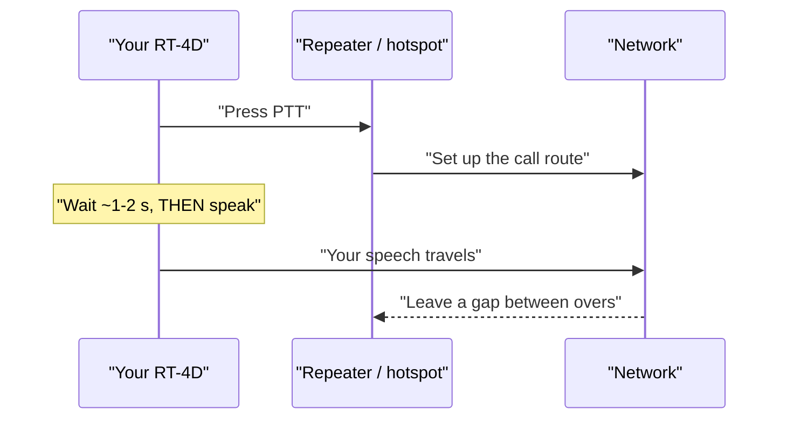
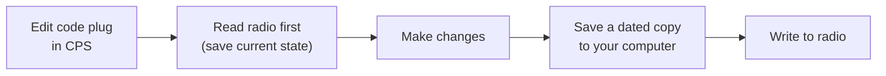

# Best practices and etiquette

A radio that works is not the same as a radio worked well. The RT-4D will happily let you transmit at full power onto a busy network, on a frequency you are not allowed to use, without your callsign attached — and nobody but you can stop it doing so. This chapter gathers the handful of habits that turn a capable handheld into a good station: power discipline, staying in-band and within your [licence conditions](outpost:entry/logbook73.handbook/getting-licensed), keeping encryption off, minding [DMR](outpost:entry/logbook73.handbook/dmr) etiquette, identifying properly, treating the battery and antenna with respect, and keeping a backup of your code plug. None of it is difficult. All of it marks you out as someone worth answering.

## Run the least power that does the job

The RT-4D gives you two transmit levels — `Channel Set → 08 TX Power`, set per channel to **Low** or **High** — and a spare function key you can assign to **H/L Power** in `Key Define` for a one-press switch. The temptation, especially when a contact is marginal, is to reach straight for High. Resist it. The right habit is to start Low and step up only when a contact genuinely needs it.

Why does this matter on a handheld that puts out only a few watts? Three reasons. First, on a [DMR network](outpost:entry/logbook73.handbook/dmr-networks) your signal usually only needs to reach a nearby repeater or [hotspot](outpost:entry/logbook73.handbook/dmr-hotspots) — once it is on the internet backbone, an extra watt buys you nothing. Second, more power means more heat and a flatter battery; the RT-4D draws up to about 1500 mA transmitting, and every over at High is charge you will want back later in the day. Third, running low power is a courtesy to everyone sharing the band — you put less energy into other people's receivers and cause fewer of the [overload and ghost-signal](outpost:entry/logbook73.handbook/overload-and-ghost-signals) problems a crowded band already suffers.

There is a deeper principle here that the handbook covers in full under [RF power](outpost:entry/logbook73.handbook/rf-power): the relationship between transmit power and range is not linear. Doubling your power does not double your reach — on VHF and UHF, antenna height and a clear path matter far more than raw watts. A Low-power signal from a good spot beats a High-power signal from a dead one nearly every time. Treat High as the tool you occasionally need, not the setting you leave on.

## Transmit only where you are allowed

The RT-4D receives far more widely than it may transmit. Its receiver spans FM broadcast (`64–108 MHz`), the AM aviation band (`108–136 MHz`) and the digital ranges (`136–174` and `400–470 MHz`) — but the _transmit_ range is deliberately narrow and depends on which market version you bought:

| Market version | 2 m transmit  | 70 cm transmit |
| -------------- | ------------- | -------------- |
| USA            | `144–148 MHz` | `420–450 MHz`  |
| EU             | `144–146 MHz` | `430–440 MHz`  |

Those are the factory transmit limits, and they are a floor, not a permission slip. Your actual allowance is set by _your_ [licence class and national band plan](outpost:entry/logbook73.handbook/getting-licensed), which may be narrower still — a Foundation or entry-level licence in some countries restricts power or sub-bands. The rule to carry in your head is simple: **listen anywhere the radio can hear, transmit only on amateur allocations you are licensed to use.**

That NOAA weather receive, the airband, the FM broadcast band, marine and PMR/FRS channels you can tune — all of them are receive-only for an amateur set. The `Key Define → NOAA Mode` weather channels (`162.400`–`162.550 MHz` and neighbours) are a listen-only convenience, not a place to key up. Keying an amateur transmitter onto a non-amateur service is both illegal and, on frequencies like marine or aviation, potentially dangerous. When in doubt, receive, and check your band plan before you transmit anywhere new.

## Keep encryption switched off

The RT-4D has an encryption engine — `Channel Set → 06 Encryption` and `Digital Set → 11 Encryption Set`, offering ARC4 and AES key slots. **On amateur bands you must leave it off.**

Amateur radio is, by international convention and almost every national licence, an _open_ service: transmissions must not be encrypted or obscured, precisely so that anyone can identify who is talking and confirm the rules are being followed. Scrambling your audio so only a chosen few can decode it breaks that principle and, in most countries, the law. The technical detail — that three conditions (encryption type, serial number and key value) must all match for two encrypted radios to understand each other — is genuinely clever, and genuinely irrelevant to you, because you will never use it on the air. Leave both encryption settings on **Off** and forget the feature exists.

The one honest exception is that some radios ship with a channel in a code plug set to encryption by mistake, and the symptom is baffling: you can hear a talkgroup but nobody can hear you, or your audio comes out as a short burst of nonsense. If a DMR contact seems one-way, check `Channel Set → 06 Encryption` reads **Off** before you blame the network. The full etiquette-and-legality picture lives in [DMR operating](outpost:entry/logbook73.handbook/dmr-operating).

## Mind the DMR etiquette

Analogue FM is a shouting match — key up and you are on. DMR is a switchboard, and the network needs a moment to route your call. That single fact drives most of digital etiquette.

**Leave the gap.** After you press PTT, wait a beat — a second or two — before you start speaking, so the network has finished setting up the path. Start talking the instant you key and your first word or two gets clipped off before anyone hears it. Likewise, leave a clear pause between overs: on a linked network another station, or a different repeater in the chain, needs that gap to grab the channel. A rushed, gapless exchange locks everyone else out.

**Use the right slot and colour code.** A DMR channel is a bundle of four things — frequency, [time slot, colour code and talkgroup](outpost:entry/logbook73.handbook/dmr-slots-talkgroups) — and on the RT-4D those are `Channel Set → 02 DMR Slot`, `03 Color Code`, and `04 Contacts`. Talkgroups are often assigned to a specific time slot by local convention (many networks put wide-area talkgroups on one slot and local ones on the other). Transmit on the wrong slot and you either reach nobody or stamp on a busy conversation you cannot hear. Match the code plug your local repeater keeper publishes.

**Don't talk over a net.** Scheduled nets — a club's weekly on-air meeting — own their talkgroup for the duration. If you hear one running, either join it properly when the controller invites check-ins or wait until it finishes. Keying up mid-net to make an unrelated call is the digital equivalent of talking across a room.

**Disconnect dynamic talkgroups.** On networks like BrandMeister, keying up a talkgroup you are not statically subscribed to creates a _dynamic_ connection that stays live on that time slot for several minutes after you stop. If you called a distant talkgroup for one quick chat, drop it when you are done — the usual convention is to key up the disconnect talkgroup (commonly `TG 4000` on BrandMeister) from the RT-4D's dial-call mode. Leaving a dynamic talkgroup connected means your local repeater keeps relaying that far-off traffic to everyone nearby, which is nobody's idea of a good neighbour. The mechanics of subscriptions and hotspots are in [DMR hotspots](outpost:entry/logbook73.handbook/dmr-hotspots).

**Set TX Politely so the radio waits for you.** `Channel Set → 07 TX Politely` decides whether the radio will let you transmit onto a channel that is already busy. Prefer **Carrier Match** (won't transmit while any signal is present) or **CC match** (won't transmit only when a matching colour code is present); avoid **Impolite** (transmits regardless), which is how you end up doubling with someone you could not hear.

## Identify correctly

Two forms of identity matter on the RT-4D, and both need setting up before you transmit.

**Your DMR ID.** Every DMR transmission carries a numeric ID that the network and other radios use to know who you are. You must obtain your own from [RadioID.net](outpost:entry/logbook73.handbook/dmr-networks) — it is free, tied to your callsign, and issued once — then enter it at `Digital Set → 01 Personal ID`. Until that field holds _your_ ID, do not transmit on DMR: an unregistered or borrowed ID is both against network rules and untraceable back to you, which defeats the whole point of amateur identification.

**Your callsign, on air.** A DMR ID is a number; your licence still requires you to identify by callsign under your national rules — typically at the start and end of a contact and periodically during it. Set `Basic Set → 01 Radio Name` to your callsign so it travels as an alias with your digital transmissions, but do not treat that as a substitute for saying it: the alias is a convenience, and speaking your callsign is the obligation. A good habit is to give your callsign every few minutes and whenever you hand back, exactly as you would on analogue.

## Battery, antenna and RF safety

Digital radios are not fragile, but two failures are worth avoiding on purpose.

**Never transmit without the antenna fitted.** A transmitter expects to see an antenna as its load; key up with the antenna removed (or a badly matched one fitted) and the power has nowhere to go but back into the final amplifier, which can damage it. The RT-4D has a removable antenna, so make it a ritual: antenna on and finger-tight before PTT, every time. If you fit a different antenna — a longer whip, a magnetic mount for the car — check its [SWR](outpost:entry/logbook73.handbook/swr) before you rely on it, because a poorly matched antenna wastes your power and stresses the radio.

**Keep the antenna clear of your head, and mind RF exposure.** As with any handheld, hold the set so the antenna is not against your face, and do not transmit at High power with the antenna touching skin for long periods. A few centimetres of separation is enough at these power levels; the underlying reasoning is in [RF safety and exposure](outpost:entry/logbook73.handbook/rf-safety).

**Look after the cell.** The RT-4D runs on a 7.4 V lithium pack, charged over the side Type-C port. `Basic Set → 14 Save Mode` (Off / 1:1 / 1:2 / 1:3) puts the receiver into micro-sleep between checks and noticeably stretches standby — turn it on for a day out, off when you are on mains power and want the receiver fully awake. Dim the backlight and shorten `Basic Set → 06 Light Timer` to save more. Cold weather flatters no lithium cell, so carry a spare or a USB power bank and the Type-C lead for a long session.

## Keep your code plug clean, and back it up

Almost every serious DMR user programs the radio with **CPS software over the USB-C cable**, not by keypad. The keypad is fine for changing a setting on the bench, but building the contact list, the [talkgroups](outpost:entry/logbook73.handbook/dmr-slots-talkgroups), the [zones](outpost:entry/logbook73.guide.rt-4d/contacts-zones) and the channel-per-talkgroup structure that DMR needs is an afternoon of thumb-work by hand and five minutes in software. That file — your _code plug_ — is the real configuration of the radio, and it deserves the same care as any document you would hate to retype.

Three habits keep it clean:

- **Read before you write.** Before making changes, read the radio's current code plug into the CPS and save it — that is your rollback if an edit goes wrong.
- **Keep dated backups.** Save a copy of the code plug each time you make a meaningful change, named with the date. A `Basic Set → 32 Initialization` (factory reset), a corrupted write, or a firmware update can wipe the radio; a backup turns a disaster into a two-minute restore.
- **Prune what you never use.** A tidy code plug — the local repeaters and talkgroups you actually work, in sensibly named zones — is far easier to operate than a 1024-channel dump imported from someone else. Delete the dead channels; you will find the radio faster in the field.

One more safety item lives here. The RT-4D supports **Remote Stun / Kill / Wake Up** (assignable in `Key Define`, gated behind `Analog Set → 17 DTMF Control`). These let one radio disable another over the air — a legitimate club or fleet feature, and a footgun if misused. The manual's own warning is the one to heed: **always set an Activate (revive) code first**, or a stunned radio cannot be woken again. For a personal amateur station you will most likely leave these disabled entirely.

## Try it yourself

Spend ten minutes turning these habits into settings:

1. **Set your identity.** Enter your RadioID.net ID at `Digital Set → 01 Personal ID` and your callsign at `Basic Set → 01 Radio Name`. Confirm both read back correctly.
2. **Check every DMR channel's manners.** For your local repeater channels, confirm `Channel Set → 06 Encryption` is **Off**, `07 TX Politely` is **Carrier Match** or **CC match**, and `08 TX Power` is **Low**. Assign a function key to **H/L Power** so stepping up is deliberate.
3. **Back up the radio.** Connect the USB-C cable, open the Radtel CPS, read the current code plug, and save it with today's date. You now have a restore point — the single best insurance a DMR operator can have.
4. **Practise the gap.** On your next DMR contact, count "one" after pressing PTT before you speak, and leave a clear pause before you hand back. Notice how much cleaner the exchange sounds.

## Key takeaways

- **Start Low, step up only when needed** — on a networked mode, antenna and path beat raw watts, and Low power saves your battery and your neighbours' receivers.
- **Transmit only in-band and within your licence.** The RT-4D hears broadcast, airband, NOAA and more, but those are receive-only — key up solely on amateur allocations you are authorised to use.
- **Encryption stays off.** It is illegal on amateur bands in almost every country; leave `Channel Set → 06` and `Digital Set → 11` set to Off, and check them if a DMR contact goes one-way.
- **Respect DMR routing** — leave a gap after keying and between overs, use the correct slot and colour code, don't talk over nets, and drop dynamic talkgroups (often `TG 4000`) when you are done.
- **Identify properly** — a RadioID.net DMR ID in `Personal ID`, your callsign in `Radio Name`, and your callsign spoken on air; a number is not a substitute for saying who you are.
- **Never transmit without the antenna fitted**, keep it clear of your head, check SWR on any new antenna, and mind RF exposure at High power.
- **Program in CPS, read before you write, and keep dated code-plug backups** — the configuration is the radio, and a backup turns a wiped set into a two-minute restore.

Good operating is mostly small, quiet habits repeated until they are automatic — and they are the same habits, whichever DMR radio you eventually own. To understand _why_ these rules exist, from time slots to networks to the shape of a digital call, go back to the deep theory in the handbook: [DMR: an overview](outpost:entry/logbook73.handbook/dmr).
