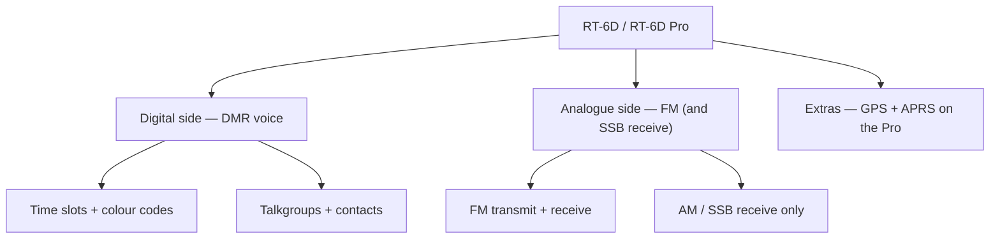
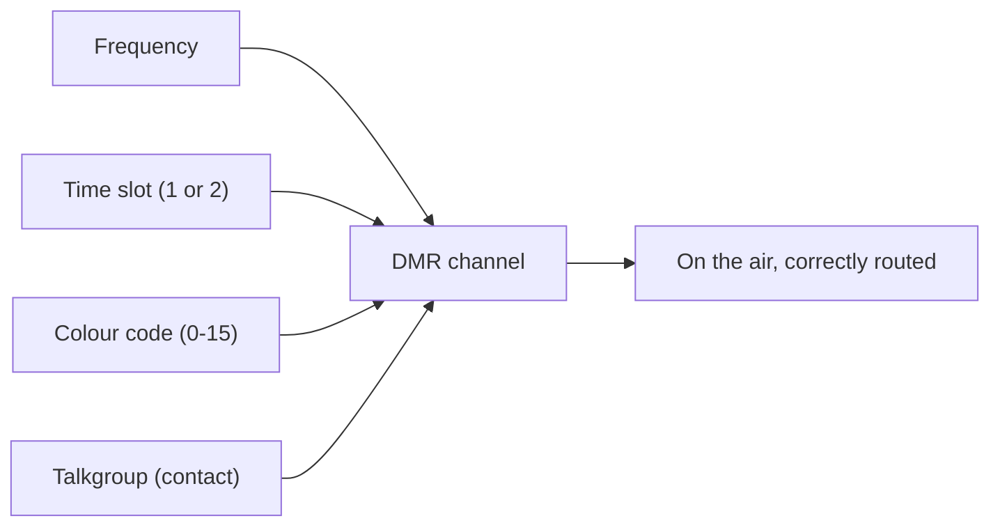

# Why the RT-6D (colour DMR with GPS and APRS)

Somewhere between a first analogue handheld and a shack full of digital gear sits a radio like the Radtel RT-6D: a colour-screen dual-band handheld that speaks DMR — the digital voice mode used on networked repeaters and hotspots the world over — but keeps a foot in the ordinary analogue world too. It puts a lot of capability into a budget handheld, and like most radios in that class its little manual leaves much of it unexplained. This guide is the explanation, and it takes the radio seriously because plenty of people meet DMR for the first time through exactly this kind of set.

## What the RT-6D actually is

The RT-6D — and its GPS-equipped sibling the RT-6D **Pro** — is a **DMR** handheld with an analogue side. DMR (Digital Mobile Radio) is an international digital voice standard (ETSI TS 102 361), the same one used by the big amateur DMR networks; we cover the whole idea in the handbook's [DMR overview](outpost:entry/logbook73.handbook/dmr). What sets the RT-6D apart from a plain analogue handheld is that on a digital channel your voice is encoded into data, sent in numbered **time slots**, and routed by a **talkgroup** number rather than just landing on a frequency. On an analogue channel it behaves like any FM handheld you have used before.

In plain terms, this radio gives you:

- **DMR digital voice** on the 2 m (144 MHz) and 70 cm (430 MHz) amateur bands, with the full DMR toolkit — a personal `DMR ID`, colour codes, two time slots, talkgroup lists, and dual-slot (`DCDM`) operation.
- **Analogue FM** transmit and receive on the same bands, with `CTCSS`/`DCS` tone squelch, repeater offsets and the usual conveniences.
- **A colour screen and dual VFO**, so you can watch two channels (A and B) at once instead of squinting at a single mono line.
- **SSB receive** — a genuine surprise at this price — letting you listen to single-sideband signals as well as AM and FM (receive only; you cannot transmit SSB).
- **GPS and APRS on the RT-6D Pro**: a built-in satellite receiver for position, plus an [APRS](outpost:entry/logbook73.handbook/aprs) engine that can beacon your location and act as a one-hop digipeater.

The bands are honest and narrow. Transmit is `136–174` and `400–470` MHz — the 2 m and 70 cm amateur allocations sit inside those — while receive stretches down to broadcast FM (`64–108` MHz) and up through the aviation AM band. **Transmit only where your licence permits**, which for most amateurs means your 2 m and 70 cm allocations at your permitted power, and nothing else.

## The RT-6D and the RT-4D: same core, more extras

If you have read the [RT-4D guide](outpost:entry/logbook73.guide.rt-4d/overview), or you own an RT-4D, here is the useful shorthand: **the RT-6D shares the RT-4D's entire DMR core.** The DMR ID handling, colour codes, slots, talkgroup lists, `TX Politely` behaviour, promiscuous mode, dual-slot operation, encryption settings, SMS, and the 1024-channel / 256-zone structure are the same on both radios. Everything you learn about getting onto DMR carries straight across.

What the RT-6D adds on top is a set of comforts and extras:

| Feature                                        | RT-4D  | RT-6D          | RT-6D Pro  |
| ---------------------------------------------- | ------ | -------------- | ---------- |
| DMR core (ID, slots, colour codes, talkgroups) | Yes    | Yes            | Yes        |
| Screen                                         | Mono   | **Colour**     | Colour     |
| VFO display                                    | Single | **Dual (A/B)** | Dual (A/B) |
| SSB receive                                    | No     | **Yes**        | Yes        |
| Built-in GPS                                   | No     | No             | **Yes**    |
| APRS beacon / digipeater                       | No     | No             | **Yes**    |

Because the shared ground is so large, this guide leans on the DMR chapters of the main [handbook](outpost:entry/logbook73.handbook) for the deep theory rather than repeating it, and spends its own pages on operating **this** radio and its extras. Where a topic is pure DMR fundamentals — what a talkgroup is, how the two networks-of-repeaters idea works — we send you to the handbook; where it is "which menu, which value, on the RT-6D", we answer it here.

### A DMR channel is not just a frequency

The single most important idea to carry into this guide is that a **DMR channel is more than a frequency.** On analogue radio a channel is essentially one number — the frequency — plus maybe a tone. On DMR a working channel is four things bundled together:

Get any one of those wrong and you will hear nothing, or hear the wrong conversation, or transmit into a slot nobody is listening to. That is why DMR radios are almost always programmed with a computer — the RT-6D is set up with Radtel's CPS (Customer Programming Software) over its USB-C jack, building a **code plug** of channels, contact lists and zones. The [slots and talkgroups](outpost:entry/logbook73.handbook/dmr-slots-talkgroups) chapter unpacks each of those four ingredients; [DMR hotspots and code plugs](outpost:entry/logbook73.handbook/dmr-hotspots) covers the CPS side.

## The honest picture

No radio at this price is without compromise, and knowing the limits is part of using it well.

- **It is a budget wideband set.** The broad receive coverage — broadcast FM, airband AM, SSB — comes from a front end that is less selective than a premium handheld's. Near a strong transmitter site you may hear overload, intermodulation or "ghost" signals that are not really on the frequency displayed. In everyday portable use you will rarely notice; on a big antenna or beside a broadcast mast, suspect intermod before you believe an odd signal. The [ghost signals](outpost:entry/logbook73.handbook/overload-and-ghost-signals) chapter explains the effect.
- **SSB receive is a listening bonus, not a transceiver.** You can demodulate single sideband to eavesdrop on HF-style signals fed in from an external antenna, but you cannot transmit SSB, and the same cheap-front-end caveats apply. Treat it as a fun extra rather than a reason to sell your HF rig.
- **The extras are firmware-driven and evolving.** DMR SMS, the GPS track logger, and (on the Pro) APRS all work, but budget-radio firmware moves fast and features vary between production batches. This guide flags where a feature is solid and where it is rough.
- **It can be made to transmit out of band.** Like most radios of its kind, its transmitter can be pushed outside the amateur allocations. Do not. Transmit only where your licence allows, at the lowest power that does the job.

None of this is a deal-breaker. A careful operator with a modest radio, transmitting cleanly and in-band, is worth far more to the hobby than an expensive rig gathering dust. This guide's recommendations always push that way: lowest sensible power, correct colour codes and slots, no accidental digipeating, and always within licence conditions.

### Encryption: leave it off

The RT-6D can encrypt DMR voice (it offers ARC4 and AES key options). On amateur bands, **encryption is generally illegal** — the amateur service is built on open, identifiable communication, and most licence conditions forbid obscuring the meaning of a transmission. Keep every encryption setting **off**. We repeat this deliberately because the menu makes it easy to switch on by accident; the [DMR operating](outpost:entry/logbook73.handbook/dmr-operating) chapter explains the reasoning, along with the etiquette of `TX Politely`, promiscuous listening and identifying yourself properly.

## Before you can transmit on DMR

One piece of admin comes before your first digital transmission: you need a **DMR ID**. This is a unique number, tied to your callsign, that identifies you on the DMR networks — issued free from RadioID.net once you can show you are a licensed amateur. You enter it into the radio's `Personal ID` field, and it travels with every digital call you make. Without it you cannot meaningfully get onto the networked side of DMR. The [DMR networks](outpost:entry/logbook73.handbook/dmr-networks) chapter walks through what the ID is for and how the networks (BrandMeister and others are named there only as examples) route your talkgroups around the world.

Analogue FM needs no such registration — only your licence — so you can be on the air in FM the moment the radio is charged, and grow into DMR when your ID arrives.

## Who this guide is for, and how it is arranged

You are welcome here whether you are a brand-new licensee who has just unboxed an RT-6D, an analogue operator taking a first careful step into digital voice, an RT-4D owner who upgraded for the colour screen and GPS, or a listener exploring what the receiver can hear (receiving needs no licence — only transmitting does). The DMR theory is universal; the menu specifics are this radio's.

The guide is built in sections you can read in any order, though the early ones reward being read first:

- **Getting Started** orients you — the layout, the keys, the colour display, and how DMR and analogue live side by side.
- **Every Menu Explained** is the reference: the RT-6D's menu is large, and this maps every group.
- **DMR Channels** and **Getting on DMR** take you from a blank code plug to your first digital contact.
- **Analogue & SSB** covers the FM side and the SSB-receive trick.
- **Contacts & Zones**, **GPS & APRS** (Pro), and **Extras** cover the surrounding features.
- **Theory**, **Configurations**, **Troubleshooting** and **Best Practices** are the why, the ready-made setups, the "why won't it…", and the how-to-be-a-good-operator.

Recommendations lean gently towards UK amateur practice — for example, European and UK APRS lives on `144.800` MHz FM, not the North American `144.390` — but the underlying ideas are global, so wherever you are, take the concepts and check your own national band plan and licence conditions.

## Try it yourself

Before you programme anything, spend ten minutes just meeting the radio — no computer, no code plug:

1. **Charge the battery fully** and fit the supplied antenna finger-tight. Never transmit without an antenna attached.
2. **Power on and turn the volume up.** Note the two-line colour display: region **A** and region **B**, each showing its own channel.
3. **Press `VFO/MR`** to toggle between VFO (tune-a-frequency) and channel mode, and press `A/B` to move the main-band highlight between the two lines. Getting fluent with these two keys makes everything later easier.
4. **Tune region A to broadcast FM** and confirm you can hear a local station — proof the receiver works, no licence needed since you are only listening.
5. **Do not key up yet.** Save your first transmission for after Getting Started, once you know your channel is set correctly and inside your allocation.

That short handling session tells you the radio is healthy and gives you the muscle memory for the menus to come.

## A word on safety

A handheld is a transmitter held next to your head. Keep the antenna a few centimetres from your face when transmitting, use the lowest power that does the job, and never key up into a damaged or missing antenna. That is essentially the whole of RF safety for a radio this size; [RF Power](outpost:entry/logbook73.handbook/rf-power) has the reasoning if you want it.

## Key takeaways

- The RT-6D / RT-6D Pro is a colour dual-VFO Radtel handheld that does **DMR digital voice** and **analogue FM**, with **SSB receive** as a listening bonus.
- It shares its **entire DMR core with the RT-4D** — the RT-6D adds a colour screen and dual VFO and SSB receive; the **Pro** adds built-in **GPS and APRS**.
- A DMR channel is **frequency + time slot + colour code + talkgroup**, not just a frequency — which is why the radio is programmed with CPS over USB-C into a code plug.
- You need a **DMR ID from RadioID.net** before transmitting on DMR; analogue FM needs only your licence.
- **Keep encryption off** — it is generally illegal on amateur bands — and transmit only in-band, at the lowest sensible power, within your licence conditions.
- The deep DMR theory lives in the handbook's DMR family; this guide covers operating **this** radio and links out generously.

Ready? Let's pick it up and learn our way around it — [Getting Started: Layout, Keys & the Colour Display](outpost:entry/logbook73.guide.rt-6d/getting-started).
