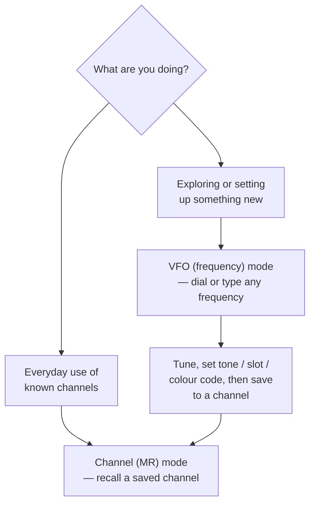
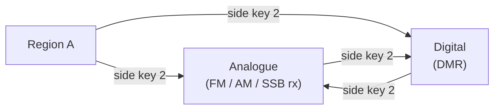
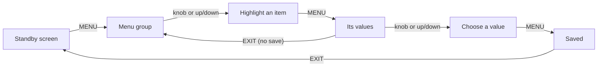

# Getting started: layout, colour display and keys

The fastest way to be put off a radio is to press the wrong button in the first five minutes and land somewhere baffling with no idea how to get back. The RT-6D adds a twist the cheaper analogue handhelds don't have — it speaks **DMR**, a digital voice mode — so there is a little more to learn, but not much, and none of it is hard. Before we touch a single menu, let's get oriented: what every control does, what the colour screen is telling you, and the two or three ideas the whole radio is built around. Twenty minutes here and the rest of the guide will feel obvious.

## The front panel

There is not a lot to the front panel — a handful of controls, each earning its place. Don't try to memorise them; just get a feel for what does what as we walk through them, roughly top to bottom.

1. **Antenna.** The supplied antenna screws in finger-tight — never force it, and never transmit without it attached, because a transmitter with nowhere to send its power can damage itself. Any replacement must suit the intended band, connector and operating environment; more in [Antennas](outpost:entry/logbook73.handbook/antennas).
2. **The two top knobs.** One is the **channel / menu knob** — your main selector. In channel mode it steps through your stored channels; in the menu it moves the highlight; in frequency mode it tunes up and down. The other is the **volume / power knob**: click it clockwise to switch the radio on and set the volume, back anticlockwise to the click for off. That is all it does, which is a mercy on a radio with this many features.
3. **PTT.** The large press-to-talk bar on the left edge. Hold it to transmit on whichever region — A or B — is currently the main band (more on that shortly), release it to receive.
4. **Side key 1.** Just below the PTT. By default it is your **monitor** key — hold it to force the squelch open and hear whether a weak signal is really there. It can be reassigned; one useful option is **Slaver PTT**, which transmits on the _other_ region (B) while your main PTT stays on A.
5. **Side key 2.** In frequency (VFO) mode this key **switches the current region between analogue and digital** — the single most important key on this radio to understand, and it gets its own section below.
6. **Yellow button.** A definable key: out of the box it does one thing, but you can assign it to a function you use often (torch, power switch, a jump to the talkgroup list, and many more) in [Keys & Custom Functions](outpost:entry/logbook73.guide.rt-6d/keys).
7. **Alarm button.** Triggers the radio's alarm feature. It is worth knowing where it is mostly so you don't press it by accident — its behaviour, and why to treat the transmitting alarm modes with care, is covered in [Extras](outpost:entry/logbook73.guide.rt-6d/extras).
8. **Indicator LED.** A small light that glows **green on receive** and **red on transmit**. A quick glance confirms the PTT has actually taken — handy when you are not sure.
9. **Colour display.** The screen shows two channels at once and rewards a proper read, so it gets its own section next.
10. **Keypad, microphone and speaker.** The numeric keypad types frequencies and channel numbers directly; the mic and speaker sit where you'd expect. There is also an **Ear/Mic port** for a headset or speaker-mic.
11. **Type-C jack.** A single USB-C socket handles **both charging and programming** — the same cable that tops up the battery connects the radio to a computer running the Radtel CPS software. We'll come back to why that matters at the end.

> **The single most useful habit:** when you get lost, press **↵/EXIT** a few times. It walks you back out of any menu to the standby screen, undoing nothing. There is no way to get so deep you cannot escape.

## Reading the colour display

The standby screen looks busy because it is showing you two radios at once — region **A** and region **B**, stacked. Once you know the anatomy of one row, you know both. The colour is not decoration: each channel can carry an **alias colour** (Blue, Green, Red, Yellow, White, Fuchsia, Pink, Orange, Tomato, Cyan or Golden) so you can tell your repeaters, simplex and monitoring channels apart at a glance.

```viz
{
  "type": "display",
  "title": "RT-6D — the dual-region standby display",
  "caption": "Two regions at once. Region A here is a digital DMR channel (note the D and slot/colour-code tags); region B is an analogue FM channel. The active region is the one the main PTT transmits on.",
  "screen": {
    "rows": [
      { "vfo": "A", "freq": "439.4375", "mode": "FM", "power": "H", "tone": "CT", "zone": "Zone 1 - 001", "active": true },
      { "vfo": "B", "freq": "145.500", "mode": "FM", "power": "L", "zone": "Zone 1 - 002" }
    ],
    "topIcons": ["LOCK", "SCAN", "100%"],
    "bottomTags": ["D", "T1", "C01", "S9"]
  },
  "callouts": [
    { "n": 1, "x": 8, "y": 16, "label": "Region A / B", "side": "left" },
    { "n": 2, "x": 34, "y": 16, "label": "Frequency", "side": "left" },
    { "n": 3, "x": 88, "y": 14, "label": "Power H / L", "side": "right" },
    { "n": 4, "x": 86, "y": 30, "label": "Zone - channel", "side": "right" },
    { "n": 5, "x": 62, "y": 50, "label": "Active region", "side": "right" },
    { "n": 6, "x": 22, "y": 95, "label": "DMR tags + S9 meter", "side": "left" }
  ]
}
```

The stylised figure above can't draw every DMR glyph, so here is what the real screen shows, element by element:

1. **Region letter** — `A` or `B` — tells you which of the two rows you are reading.
2. **The frequency** is the big number: what that region is tuned to.
3. **Power** shows as `H` or `L` (high or low).
4. **Zone and channel** appear in channel mode: which zone (folder) you're in and the channel number within it, plus the **channel alias** name if the channel has one.
5. **One row is highlighted** — the **active**, or main, region. This matters: the main PTT transmits on _this_ row, and menu changes apply to _this_ row. The `A/B` key moves the highlight.
6. **The digital / analogue tags** are the ones worth learning, because they tell you at a glance what kind of channel you're on:
   - **`DMR D`** appears on a digital channel; on an analogue channel you'll instead see **`AM`** or **`FM`** — the receive standard.
   - **`T1` / `T2`** shows which **time slot** a digital channel uses (DMR splits one frequency into two conversations; the full story is in [DMR: Slots, Colour Codes & Talkgroups](outpost:entry/logbook73.handbook/dmr-slots-talkgroups)). On an analogue channel this same spot shows the modulation instead.
   - **`Cxx`** (for example `C01`) is the **colour code** — a digital channel's "combination lock" that must match the repeater. On an analogue channel the same position shows the CTCSS/DCS sub-tone, with `ENC` if encrypted or `MUT` when a decoded tone is present.
7. **The `S9` meter** is the field-strength (signal) gauge; on a digital channel it doubles as the last-call record.
8. **Status icons** along the top appear as needed: a padlock when the keypad is locked, a scan symbol while scanning, a beep icon, and the `RR`/`TR` flags for offline and reversed-frequency states.

Don't worry about memorising the DMR tags now — you'll meet each one properly when we build a digital channel in [DMR Channels](outpost:entry/logbook73.guide.rt-6d/dmr-channels). For today, the useful reflex is: **`DMR D` means digital, `AM`/`FM` means analogue.**

## VFO and channel: the two ways to tune

Every setting on this radio hangs off one basic choice: are you dialling a frequency by hand, or recalling one you saved earlier? Those are the two **modes**, and the `VFO/MR` key swaps between them.



**VFO (frequency) mode** gives you the whole band to roam. Type a frequency on the keypad — a **long press of `#`** switches the keypad to entering a transmit frequency directly — or wind the channel knob, and the radio goes there. This is where you _set things up_: find a repeater, add its offset and tone (analogue) or its slot and colour code (digital), choose a power level, and then store the lot into a channel so you never repeat the work.

**Channel (MR) mode** recalls those stored channels. A channel is not just a frequency: it remembers the frequency, the offset, the tones or the DMR slot / colour code / talkgroup, the power level and a name — all in one recall. This is where you live day to day: spin to "GB7 local" and everything is already correct.

Two things trip people up. First, **channel mode has nothing to recall until you have stored at least one channel**, so on a brand-new radio `VFO/MR` can seem to do nothing. Store a channel and it springs to life. Second, most per-channel settings are edited in **VFO mode** and then saved back — a stored channel is a snapshot, so you change it by re-tuning in VFO mode and overwriting the memory. The `*` key, by the way, cycles what a channel row _shows_ — number, frequency or alias — which is handy but changes nothing about the channel itself.

## Analogue or digital: the side-key 2 toggle

Here is what makes the RT-6D different from a plain FM handheld. It holds **both** analogue channels — ordinary FM, the mode every entry-level radio uses — and **digital DMR** channels, where your voice is sent as data. In frequency mode, **side key 2 flips the current region between the two.**



Why does this matter on day one? Because it decides what everything else means. On an **analogue** channel you're dealing with the familiar world of FM, squelch tones and — a treat at this price — **SSB receive** for listening to the HF bands (covered in [Analogue & SSB Receive](outpost:entry/logbook73.guide.rt-6d/analog-ssb)). On a **digital** channel you're in DMR territory: time slots, colour codes, talkgroups and a **DMR ID**, the numeric "callsign" every digital transmission carries.

That last point is the one rule to hold on to before you key up on digital: **you cannot legally transmit on DMR until you have your own DMR ID**, a free number you request from RadioID.net that ties every digital over to your callsign. Receiving costs nothing and needs no ID, so you can listen to DMR all you like today — but the moment you want to _talk_ digitally, get the ID first. The whole picture, including how DMR networks like BrandMeister fit together, is in [DMR Networks & IDs](outpost:entry/logbook73.handbook/dmr-networks) and this guide's own [Getting On DMR](outpost:entry/logbook73.guide.rt-6d/dmr-getting-on). For a first contact, though, we'll stay on friendly, familiar analogue FM — no ID required.

## Finding your way around the menu

The menu is a set of numbered groups — Basic Settings, Key Define, Analogue Set, Digital Setting, Channel Settings and the rest — and you drive the whole thing with four movements. Nothing you do here can break the radio: changes take effect only when you confirm them, and `↵/EXIT` always backs you out.



In words: **MENU** opens the menu and confirms a choice; the **channel knob** or the **▲ / ▼** keys move the highlight (a long press on the arrows scrolls fast); **MENU** again drops into an item's values; you pick one and press **MENU** to save; **↵/EXIT** steps back without saving. Walk away and the menu times out on its own and returns to standby.

The keypad has a few dual roles worth meeting now so they don't surprise you later. On a **digital** channel a short press of `#` starts a call — single, group or all-call — while a **long press of `#`** lets you key in a transmit frequency, and the same long press toggles the input method. A **long press of `*`** locks the keypad (a padlock appears up top; repeat to unlock). And on an **analogue** channel the number keys double as a **DTMF** keypad for sending touch-tones. None of this gets in your way in normal use; it's just good to know why a key sometimes does two things. The full map is in the [Menu Reference](outpost:entry/logbook73.guide.rt-6d/menu-reference) and [Keys & Custom Functions](outpost:entry/logbook73.guide.rt-6d/keys).

## A word before you transmit

Two habits will save you grief. First, **which region is active?** The `A/B` key sets it, and the highlighted row is the one your PTT will use — a surprising number of "it transmitted on the wrong frequency" moments come from keying up with the other region active. Second, on digital, **keep encryption off.** The RT-6D can scramble DMR audio with a key, but obscuring the meaning of a transmission is not permitted under amateur licence conditions in essentially any country, so leave it firmly off — the reasoning, and the etiquette of DMR generally, is in [DMR Operating](outpost:entry/logbook73.handbook/dmr-operating).

When it comes to _loading_ channels, you have two routes. **By hand**, using the keypad and menu, is fine for a handful — your local repeaters and a couple of simplex channels. **By software** is the answer for anything more: the RT-6D programs over that same **USB-C cable** using Radtel's **CPS** (Customer Programming Software), which turns an afternoon of thumb-aching menu-diving into a five-minute job — type your channels, contacts and talkgroups into tables, drag them into zones, and write them all at once. Crucially, CPS also lets you **save a backup**, so a fumbled reset costs you nothing. Code plugs, contact lists and CPS are covered in [DMR Hotspots & Code Plugs](outpost:entry/logbook73.handbook/dmr-hotspots) and this guide's [Contacts & Zones](outpost:entry/logbook73.guide.rt-6d/contacts-zones).

## Try it yourself

With a charged battery and the antenna fitted, let's make a first, receive-then-call analogue contact — no DMR ID needed, only your licence.

1. **Power on and set the volume** with the volume knob. Hold **side key 1** briefly to open the squelch and you'll hear the background hiss — that's the receiver actually listening.
2. **Make sure the region is analogue.** Press `VFO/MR` until the zone/channel tags disappear (you're now in frequency mode), then press **side key 2** until the row shows **`FM`** rather than **`DMR D`**.
3. **Type a calling frequency.** Key in `145.500` on the keypad — the 2 m FM calling channel in Region 1 (check your national band plan elsewhere). Watch the display update.
4. **Listen at a busy time of day.** Adjust the volume and, if signals seem to be hiding, hold side key 1 (monitor) to open the squelch fully.
5. **Set the other region a job.** Press `A/B` to highlight region B and tune it to your nearest repeater's output so you can watch both at once.
6. **Make a call, within your licence conditions.** With region A active and the channel clear, give a short call — your callsign, "listening on 145.500" — at **low power** (plenty for a first go). If someone comes back, you've made your first QSO on the RT-6D. Log it in LogBook73.

Nothing here can harm the radio, and `↵/EXIT` always brings you home. Getting licensed first if you're not yet is covered generically in [Getting Licensed](outpost:entry/logbook73.handbook/getting-licensed); the reason to reach for low power lives in [RF Power](outpost:entry/logbook73.handbook/rf-power).

## Key takeaways

- The **two top knobs** select/tune and set volume/power; the **PTT** transmits on whichever region is active, with **side key 1** as monitor (or Slaver PTT for region B) and the **Yellow** and **Alarm** keys as extras. The LED glows **green on receive, red on transmit**.
- The **colour screen shows regions A and B at once**; the highlighted one is active. Learn the tags: **`DMR D`** means digital, **`AM`/`FM`** means analogue, with **`Tx`** the time slot, **`Cxx`** the colour code, `H/L` the power and `S9` the signal meter. Channel **alias colours** help you tell channels apart.
- **`VFO/MR`** swaps frequency mode (for setting up) and channel mode (for daily use); **side key 2** flips the active region between **analogue and digital** — the toggle that changes what everything else means.
- The menu is driven by **MENU → move → MENU → EXIT**; changes apply only when confirmed, and `↵/EXIT` always escapes. A **long press of `#`** enters a transmit frequency; a **long press of `*`** locks the keypad.
- To talk on **DMR you need a free DMR ID** from RadioID.net and you must keep **encryption off**; an analogue FM contact needs neither — only your licence.
- Program a few channels by hand and many via **CPS over USB-C**, keep a **backup**, and organise everything into **zones** by purpose.

With the layout, the display and the two modes clear, the natural next stop is the map of the whole set — every menu group and what lives in each: [Menu Reference](outpost:entry/logbook73.guide.rt-6d/menu-reference).
