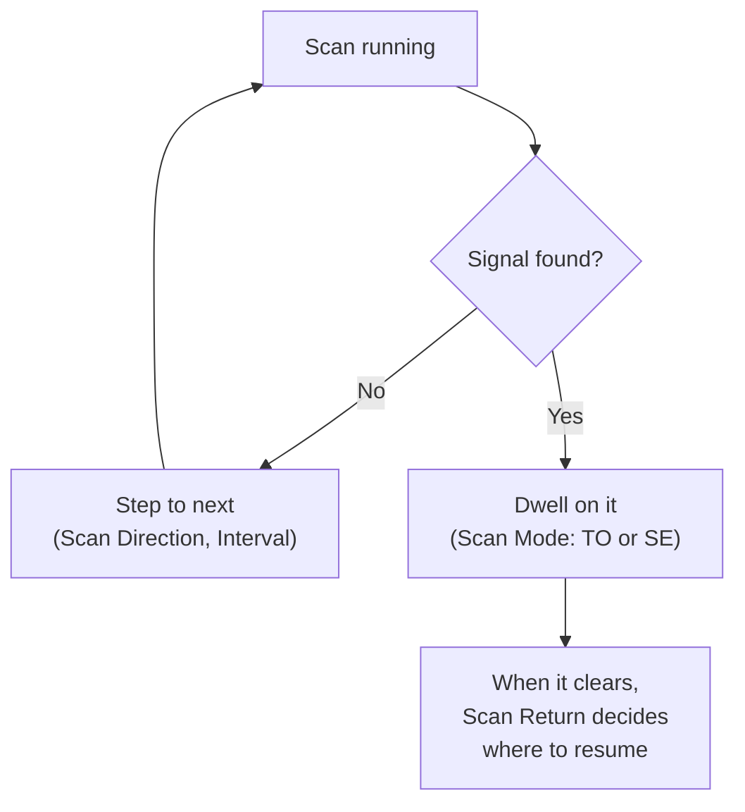

# Menu reference — documented options at a glance

The RT-6D packs more menus than most handhelds you will meet — around forty items in **Basic Settings** alone, with separate menus for analogue and digital, a **Zone** builder, an **SMS** inbox, the broadcast FM tuner, and (on the **Pro**) a whole **GPS** and **APRS** section. That breadth is the price of a radio that does analogue FM, SSB receive and full [DMR](outpost:entry/logbook73.handbook/dmr) in one pocket. This page is the map: every menu, grouped the way the radio groups them, with what each item does and the values it accepts. Treat it as a reference to skim, not a chapter to memorise — you will only ever touch a handful of these regularly.

## How to move around the menus

You reach the menu with the **MENU** key and step through items with **▲ / ▼** (a long press scrolls fast). Press **MENU** again to open an item, **▲ / ▼** to change the value, **MENU** to save it, and **↵/EXIT** to back out. Nothing you change is committed until you press MENU to confirm, so it is safe to browse.

Two things matter before you start. Many settings live **per channel**, not globally — colour code, talkgroup, bandwidth and power belong to the channel you are on, so change the wrong channel and nothing seems to stick. And most operators never set these menus by hand at all: the RT-6D is normally programmed from a computer over its **USB-C** port using Radtel's CPS software and a saved **code plug**, which is far faster for building lists of channels, [talkgroups and zones](outpost:entry/logbook73.handbook/dmr-slots-talkgroups). The menu is for the odd tweak in the field; the CPS is for the heavy lifting.

Throughout, **(Pro)** marks items that exist only on the RT-6D **Pro** — the GPS and APRS features. Where a setting is really a topic of its own, the "What it does" column links to the page that explains it properly.

## Menu 01 — Basic Settings

The largest group, and the one furthest from the air: display, sound, scanning, the two VFO areas and general housekeeping. Split into digestible tables below.

### Sound, display and general behaviour

| Name               | What it does                                                                                   | Values                                                                                 |
| ------------------ | ---------------------------------------------------------------------------------------------- | -------------------------------------------------------------------------------------- |
| `Radio Name`       | The text label the radio shows for itself (and can send as a TX end tone).                     | Text                                                                                   |
| `Voice Prompt`     | Spoken announcements as you operate.                                                           | On / Off                                                                               |
| `Key Beep`         | The confirmation beep on each keypress (local only — not transmitted).                         | On / Off                                                                               |
| `Lock Timer`       | How long before the keypad auto-locks.                                                         | Off / timed                                                                            |
| `Light Timer`      | How long the backlight stays on after a key.                                                   | Off / timed                                                                            |
| `Brightness`       | Screen backlight level.                                                                        | Levels                                                                                 |
| `Menu Exit`        | How long the menu waits before dropping you back to the main screen.                           | Timed                                                                                  |
| `Dual Standby`     | Watches both A and B areas for signals instead of one.                                         | On / Off                                                                               |
| `TX Priority`      | Which area transmits when both are watched — the one you last **edited**, or the **busy** one. | Edit / Busy                                                                            |
| `Freq Step`        | The tuning increment in VFO mode.                                                              | Step sizes                                                                             |
| `Talk Around`      | Bypass a repeater's offset to work simplex, or invert the shift.                               | Off / Talk-Around / Invert Freq                                                        |
| `Carrier LED`      | Lights the LED green on receive.                                                               | On / Off                                                                               |
| `Alarm Type`       | What the Alarm button does — sound locally, transmit, or both.                                 | Local / Remote / Local+Remote                                                          |
| `CT/DCS Code Show` | Shows the current sub-tone code on screen.                                                     | On / Off                                                                               |
| `CH Alias Colour`  | The colour of the channel-name text on the colour display.                                     | Blue / Green / Red / Yellow / White / Fuchsia / Pink / Orange / Tomato / Cyan / Golden |

The **Alarm Type** and **Talk Around** items reach into operating proper — the alarm modes are covered in [Extras](outpost:entry/logbook73.guide.rt-6d/extras), and Talk Around belongs with [analogue and SSB](outpost:entry/logbook73.guide.rt-6d/analog-ssb).

### The two areas (dual-VFO)

The RT-6D shows two channels at once, **A** and **B**. Each has its own display mode, readout and zone, so the settings come in pairs.

| Name           | What it does                                                               | Values               |
| -------------- | -------------------------------------------------------------------------- | -------------------- |
| `Area A Mode`  | Whether area A tunes by channel, by zone, or as a raw frequency.           | CH / Zone / Freq     |
| `Area A Show`  | What the A readout displays.                                               | CH No / Freq / Alias |
| `Area A Zone`  | Which [zone](outpost:entry/logbook73.guide.rt-6d/contacts-zones) area A draws its channels from. | 1–256                |
| `Area B Mode`  | As Area A Mode, for area B.                                                | CH / Zone / Freq     |
| `Area B Show`  | As Area A Show, for area B.                                                | CH No / Freq / Alias |
| `Area B Zone`  | As Area A Zone, for area B.                                                | 1–256                |
| `Freq Input`   | Digits accepted when you key a frequency directly.                         | 6 / 8 bits           |
| `Reverse CH`   | Swaps TX and RX frequencies (listen on the repeater's output).             | On / Off             |
| `RSSI Refresh` | How often the on-screen signal meter updates.                              | Off / 100–2000 ms    |

### Scanning

The RT-6D's scanner has an unusually full set of controls. A picture helps before the table:

| Name              | What it does                                                                           | Values                |
| ----------------- | -------------------------------------------------------------------------------------- | --------------------- |
| `Scan Mode`       | Time-Operated (pause, then move on) or Signal-Operated (stay until the signal clears). | TO / SE               |
| `Scan Direction`  | Which way the scanner steps through channels.                                          | Up / Down             |
| `Scan Interval`   | The dwell time on each channel while searching.                                        | Timed                 |
| `Scan Dwell`      | How long to hold on a channel once a signal appears.                                   | Timed                 |
| `Scan Return`     | Where scanning resumes — the original channel or the current one.                      | Original / Current CH |
| `Scan Start Freq` | Low edge of a VFO frequency sweep.                                                     | Frequency             |
| `Scan End Freq`   | High edge of a VFO frequency sweep.                                                    | Frequency             |
| `Save Mode`       | Receiver battery-save micro-sleep.                                                     | On / Off              |

### Power management and housekeeping

| Name             | What it does                                          | Values         |
| ---------------- | ----------------------------------------------------- | -------------- |
| `APO`            | Auto power-off after a period of inactivity.          | On / Off       |
| `APO Timer`      | How long before APO acts.                             | Timed          |
| `AWU`            | Auto wake-up — the radio powers itself back on.       | On / Off       |
| `AWU Timer`      | When AWU fires.                                       | Timed          |
| `Save CH`        | Store the current VFO settings into a channel memory. | Channel number |
| `Delete CH`      | Remove a stored channel.                              | Channel number |
| `Initialization` | Factory reset — wipes your settings.                  | Confirm        |
| `Version`        | Firmware version (read-only).                         | —              |
| `DMR Version`    | DMR stack version (read-only).                        | —              |
| `Flash IC`       | Memory chip identity — a 32 MB `25Q256` (read-only).  | —              |

Some of these — `Promiscuous`, `Slot Switch`, `CC Switch`, `DMR Enc off`, `Jump to TG list`, `GPS`, `APRS Beacon` — also appear here as quick jumps and can be bound to a key; they are described in their proper menus below and in [Keys](outpost:entry/logbook73.guide.rt-6d/keys).

## Menu 02 — Key Define

This is where you decide what the programmable buttons do. Each entry picks one function from a long shared list. The full walk-through is in [Keys](outpost:entry/logbook73.guide.rt-6d/keys); the reference is here.

| Name               | What it does                                                                  |
| ------------------ | ----------------------------------------------------------------------------- |
| `Slaver PTT`       | Function of the secondary PTT (transmit the B band).                          |
| `Side key 1 S / L` | Short and long press of side-key 1 (default: open squelch).                   |
| `Side key 2 S / L` | Short and long press of side-key 2 (default: analogue/digital toggle in VFO). |
| `Yellow Key`       | The dedicated yellow button.                                                  |
| `0–9 Long`         | A long press of each number key.                                              |

Any of the above can be set to one of these functions: `None`, `H/L Power`, `Dual standby`, `Tx priority`, `Scanning`, `Brightness`, `Backlight on/off`, `FM radio`, `Talk around`, `Alarm`, `Zone Selection`, `SQ`, `Freq Step`, `DA Switch (VFO)`, `Save CH`, `Monitor`, `VOX`, `Roger Beep`, `CTC/DCS scan`, `Send Single Tone`, `RX Modulation`, `Spectrum` (an analogue spectrum scope), `NOAA CH`, `Remote Monitor`, `Remote Stun / Kill / wakeup`, `Online check`, `Promiscuous`, `New SMS`, `Jump to SMS Menu`, `Dual Slot On-off`, `Slot Switch`, `CC Switch`, `DMR Enc off`, `Jump to TG List`, `GPS` (Pro), `GPS Manual Rec` (Pro), `Query GPS Track` (Pro), `APRS Beacon` (Pro).

## Menu 03 — Analog Set

Global analogue settings: audio levels, VOX, tones and DTMF signalling. These sit alongside the per-channel analogue items in Menu 05. The operating detail lives in [Analogue & SSB](outpost:entry/logbook73.guide.rt-6d/analog-ssb).

| Name                               | What it does                                     | Values                             |
| ---------------------------------- | ------------------------------------------------ | ---------------------------------- |
| `SQ level`                         | Squelch threshold for analogue receive.          | 0–10                               |
| `TX Start Tone`                    | A tone sent as you begin an over.                | On / Off                           |
| `TX End Tone`                      | The roger beep at the end of an over.            | Off / Roger1 / Roger2 / Radio name |
| `Single Tone`                      | The repeater tone-burst frequency.               | 1750 Hz                            |
| `VOX`                              | Voice-operated transmit (hands-free).            | On / Off                           |
| `VOX TH`                           | How loud your voice must be to key VOX.          | 0–254                              |
| `VOX Delay`                        | Hang time before VOX drops.                      | 0–5                                |
| `Detect Range`                     | VOX detection window.                            | Range                              |
| `Repeater Delay`                   | Turnaround delay when relaying.                  | Timed                              |
| `Mic Gain`                         | Microphone level.                                | 0–31                               |
| `A SPK Gain` / `B SPK Gain`        | Speaker gain per area.                           | 0–63                               |
| `A DAC Gain`                       | Audio DAC output level.                          | 0–15                               |
| `Glitch TH`                        | Noise-glitch rejection threshold.                | 0–10                               |
| `DTMF Delay / Interval / Duration` | Timing of DTMF tone sequences.                   | Timed                              |
| `DTMF Mode / Select / Display`     | DTMF preset choice and on-screen display.        | Modes / 01–16                      |
| `DTMF TX Gain`                     | DTMF transmit level (recommended 64).            | 0–127                              |
| `DTMF RX TH`                       | DTMF decode threshold (recommended 24).          | 0–127                              |
| `DTMF Control`                     | Enables DTMF remote control (Stun/Kill/Monitor). | On / Off                           |

## Menu 04 — Digital Setting (DMR)

The heart of the radio. Before any of this can transmit you need a **DMR ID** — a personal number you request once, free, from [RadioID.net](outpost:entry/logbook73.handbook/dmr-networks). Everything about slots, colour codes and talkgroups is explained in the handbook; this menu just holds the values.

| Name                        | What it does                                                                                  | Values               |
| --------------------------- | --------------------------------------------------------------------------------------------- | -------------------- |
| `Personal ID`               | Your [DMR ID](outpost:entry/logbook73.handbook/dmr-networks) — the identity every digital transmission carries.      | 1–16776415           |
| `Call Tone`                 | Alert tone when a call starts.                                                                | On / Off             |
| `Call End Tone`             | Alert tone when a call ends.                                                                  | On / Off             |
| `Group Hold`                | How long a received group call stays selected for a reply.                                    | Timed                |
| `Single Hold`               | As Group Hold, for private (individual) calls.                                                | Timed                |
| `SQ level`                  | Digital squelch.                                                                              | 0–16                 |
| `Mic Gain`                  | Digital microphone level.                                                                     | 0–15                 |
| `A SPK Gain` / `B SPK Gain` | Speaker gain per area.                                                                        | Levels               |
| `Contacts Set`              | The digital contact list — talkgroups and IDs to call. Includes one un-editable **All Call**. | ID 1–16777215        |
| `TG List Set`               | The [talkgroup receive list](outpost:entry/logbook73.guide.rt-6d/contacts-zones) — MENU selects, ↵ deselects.       | Select from contacts |
| `Encryption Set`            | Defines an encryption key slot. Generally **illegal on the ham bands** — leave off.           | Key 1–256            |
| `Send DTMF`                 | Allows DTMF over a digital channel.                                                           | On / Off             |
| `Called Hold`               | Hold time after being called.                                                                 | 0–60                 |
| `Call Log`                  | List of caller IDs the radio has heard.                                                       | View                 |
| `Clear All Log`             | Wipes the call log.                                                                           | Confirm              |
| `Address Book`              | Stored names and IDs.                                                                         | View / edit          |

A word on **Encryption**: DMR supports ARC4 and AES, but obscuring the meaning of an amateur transmission is not permitted under amateur licence conditions anywhere. Keep it **off** on the ham bands — see [DMR operating](outpost:entry/logbook73.handbook/dmr-operating). The contacts, talkgroup list and address book get their own walk-through in [Contacts & Zones](outpost:entry/logbook73.guide.rt-6d/contacts-zones).

## Menu 05 — Channel Settings

These are **per-channel** — they apply only to the channel you have selected, which is exactly why a code plug is the sane way to manage a fleet of them. There are two flavours: one for analogue channels, one for digital.

### Analogue channel

| Name                         | What it does                                                    | Values                                  |
| ---------------------------- | --------------------------------------------------------------- | --------------------------------------- |
| `CTC/DCS`                    | The sub-audible tone/code that gates the channel.               | Tone / code                             |
| `RX CTC/DCS` / `TX CTC/DCS`  | Separate receive and transmit sub-tones.                        | Tone / code                             |
| `TX Freq`                    | The transmit frequency (for split/repeater work).               | Frequency                               |
| `Offset Dir` / `Offset Freq` | Repeater shift direction and size.                              | + / − ; frequency                       |
| `DCS Encrypt`                | DCS variant.                                                    | Standard / Encrypt1–3 / Mute Code       |
| `Mute Code`                  | Selective-call mute code.                                       | Code                                    |
| `Band Width`                 | Channel width — match the repeater or contact.                  | Wide / Narrow                           |
| `Tail Tone`                  | Reverse-tone burst to close a repeater's tail cleanly.          | Off / 55 Hz / 120° / 180° / 225° / 240° |
| `Scrambler`                  | Analogue voice inversion — **not permitted on ham**; leave off. | Off / 1–8                               |
| `Busy Lock`                  | Blocks TX onto a busy channel.                                  | Off / Carrier Match / CTC/DCS Match     |
| `TX Power`                   | Output level for this channel.                                  | High / Low                              |
| `Scan Add`                   | Include this channel in scans.                                  | On / Off                                |
| `TOT`                        | Time-out timer — the maximum length of one over.                | Off / 5 s–600 s                         |
| `CH Alias`                   | The channel's name.                                             | Text                                    |
| `RX Demodulation`            | Receive mode — the RT-6D's party trick includes **SSB**.        | FM / AM / SSB                           |
| `Limit RX/TX`                | Whether the channel can receive, transmit, or both.             | RX+TX / Only RX / Only TX               |

The standout is **RX Demodulation → SSB**: on an analogue channel the RT-6D can _receive_ single-sideband, which opens up HF listening on an external antenna (receive only, with the usual cheap-front-end caveats). That, and the rest of the analogue settings, are covered in [Analogue & SSB](outpost:entry/logbook73.guide.rt-6d/analog-ssb).

### Digital (DMR) channel

Here is the definition that matters most in the whole guide. **A DMR channel is not just a frequency** — it is a frequency **plus** a time slot **plus** a colour code **plus** a talkgroup (contact). Get any one wrong and you will not be heard. The handbook explains why in [Slots & talkgroups](outpost:entry/logbook73.handbook/dmr-slots-talkgroups); this table is the radio's version.

| Name                                     | What it does                                                                             | Values                              |
| ---------------------------------------- | ---------------------------------------------------------------------------------------- | ----------------------------------- |
| `DMR Mode`                               | Single time slot, or dual-slot (DCDM) direct mode.                                       | Dual Slot Off / On                  |
| `DMR Slot`                               | Which of the two DMR **time slots** this channel uses.                                   | 1 / 2                               |
| `Color Code`                             | The DMR "colour code" — must match the repeater, like a CTCSS tone for digital.          | 0–15                                |
| `Contacts`                               | The [talkgroup or ID](outpost:entry/logbook73.guide.rt-6d/contacts-zones) this channel transmits to.           | Contact / All Call                  |
| `RX TG List`                             | The talkgroups this channel will decode.                                                 | Group list                          |
| `Encryption`                             | Digital encryption key — **keep off on ham**.                                            | Off / Key1–256                      |
| `TX Politely`                            | Whether the radio waits for a clear slot before keying — DMR's "listen before transmit". | Impolite / Carrier Match / CC match |
| `TX Power`                               | Output level.                                                                            | Low / High                          |
| `Scan Add`                               | Include in scans.                                                                        | On / Off                            |
| `TOT`                                    | Time-out timer.                                                                          | Off / timed                         |
| `CH Alias`                               | Channel name.                                                                            | Text                                |
| `Offset Dir` / `Offset Freq` / `TX Freq` | Repeater shift for the digital channel.                                                  | + / − ; frequency                   |
| `Promiscuous`                            | Hear **all** talkgroups on the slot, or only yours.                                      | On / Off                            |
| `Channel ID` / `CH ID Selection`         | Use your radio ID or a per-channel ID.                                                   | Radio ID / Channel ID               |
| `Limit RX/TX`                            | Receive, transmit, or both.                                                              | RX+TX / Only RX / Only TX           |

Two of these deserve a flag now and a full treatment in [DMR channels](outpost:entry/logbook73.guide.rt-6d/dmr-channels). **TX Politely** is DMR etiquette baked into firmware: set to a "match" mode it holds your transmission until the slot is free, which is exactly what you want on a busy repeater. **Promiscuous** turned on lets you monitor every talkgroup passing through — brilliant for listening, per [DMR operating](outpost:entry/logbook73.handbook/dmr-operating) — but leave it off when you want to hear only your own group.

## Menus 06–08 — Zones, Messages and FM

| Menu | Name                      | What it does                                                                                        | Values                         |
| ---- | ------------------------- | --------------------------------------------------------------------------------------------------- | ------------------------------ |
| 06   | `Zone Settings`           | Build and name [zones](outpost:entry/logbook73.guide.rt-6d/contacts-zones) — banks of channels you switch between.        | 256 zones × 1024 channels      |
| 07   | `Message`                 | The DMR text-message store: `New SMS`, `Inbox`, `Outbox`, `Drafts`, `Default SMS`, `Clear All SMS`. | —                              |
| 07   | `SMS Format` / `SMS Font` | Message compatibility and character set.                                                            | Default / Moto ; Unicode / GBK |
| 08   | `FM Radio`                | The broadcast FM receiver: `RX Standby` and a 16-slot `CH List`.                                    | 16 FM channels                 |

SMS and the broadcast FM tuner are both covered in [Extras](outpost:entry/logbook73.guide.rt-6d/extras); zones — the single most useful organising tool on a DMR radio — in [Contacts & Zones](outpost:entry/logbook73.guide.rt-6d/contacts-zones).

## Menu 09 — Extend / GPS (Pro only)

Everything from here is **RT-6D Pro** only. If your radio is the plain RT-6D, these menus are absent. The GPS section configures the receiver and its track-logging; the operating detail is in [GPS & APRS](outpost:entry/logbook73.guide.rt-6d/gps-aprs).

| Name                                         | What it does                              | Values                          |
| -------------------------------------------- | ----------------------------------------- | ------------------------------- |
| `GPS On-off`                                 | Powers the GPS receiver.                  | On / Off                        |
| `GPS Baudrate`                               | Serial rate for GPS/PC data.              | Rates                           |
| `UTC Zone`                                   | Your offset from UTC for local time.      | Zone                            |
| `PC Monitor`                                 | Streams GPS data to a computer.           | On / Off                        |
| `Coordinate Type`                            | Position format.                          | Degrees / Deg-Min / Deg-Min-Sec |
| `Speed / Distance / Altitude Unit`           | Units for the readouts.                   | Metric / imperial               |
| `Fixed Lat / Lon / Alt`                      | Manual position when no fix is available. | Coordinates                     |
| `Mileage` / `Mileage Type` / `Clear Mileage` | Distance-travelled odometer.              | —                               |
| `Manual record`                              | Log a single track point now.             | Trigger                         |
| `GPS Auto Record` / `GPS Record Time`        | Automatic track logging and its interval. | On / Off ; timed                |
| `Query Track` / `Clear Track`                | Review or wipe the stored track.          | —                               |

## APRS (Pro only)

The [APRS](outpost:entry/logbook73.handbook/aprs) menu turns the Pro into a position beacon and digipeater. One regional note up front: in **Europe and the UK, APRS lives on `144.800 MHz` FM**, not the North American `144.390 MHz` — set the right channel or your beacons go nowhere. Full setup is in [GPS & APRS](outpost:entry/logbook73.guide.rt-6d/gps-aprs).

| Name                                              | What it does                                                   | Values                    |
| ------------------------------------------------- | -------------------------------------------------------------- | ------------------------- |
| `APRS On-off`                                     | Master switch for APRS.                                        | On / Off                  |
| `Station Mode`                                    | Beacon from a fixed position or from the live GPS fix.         | Fixed coords / GPS mobile |
| `Beacon Setup` / `Beacon Mode`                    | Your callsign-SSID, symbol, comment and how often you beacon.  | —                         |
| `DIGI Setup`                                      | Configures the built-in digipeater (relaying others' packets). | —                         |
| `APRS RX CH` / `APRS TX CH`                       | Which channel receives and sends APRS.                         | Channel                   |
| `Demod Tone`                                      | AFSK tone decoding.                                            | —                         |
| `TX / RX Data Upload`                             | Sends packet data to a PC.                                     | On / Off                  |
| `Beacon Pop-up`                                   | Shows received beacons on screen.                              | On / Off                  |
| `PTT Priority` / `PTT Delay`                      | Voice-over-APRS behaviour and beacon delay.                    | —                         |
| `RX CH Mute`                                      | Mutes the APRS channel's audio.                                | On / Off                  |
| `Beacon Save` / `Beacon List` / `Beacon List CLR` | Store, review and clear heard beacons.                         | —                         |
| `APRS Init`                                       | Resets APRS to defaults.                                       | Confirm                   |

## Try it yourself

Take five minutes to walk the map without changing anything risky:

1. Press **MENU** and step down through **Basic Settings** with **▲ / ▼**, reading each item against the tables above. Notice how far you are from anything that touches the air.
2. Find **`CH Alias Colour`** and give a channel a colour you will recognise — a harmless way to prove the save flow (MENU → change → MENU) works.
3. Open **Digital Setting** and check whether your **`Personal ID`** is set. If it still reads `0` or a placeholder, you have not yet [claimed a DMR ID](outpost:entry/logbook73.handbook/dmr-networks) — do that before you transmit digitally.
4. On a DMR channel, open **Channel Settings** and read off its four defining values — **slot**, **colour code**, **contact** and frequency. Confirm they match a repeater you can hear. This is the check you will run constantly once you are on the air.

## Key takeaways

- The RT-6D groups its menus as **Basic Settings** (display, scan, dual-VFO), **Key Define**, **Analog Set**, **Digital Setting**, per-channel **Channel Settings** (analogue and digital), **Zone**, **Message**, **FM**, and — on the **Pro** only — **GPS** and **APRS**.
- Most items are set once from a computer via **USB-C and CPS** as a saved **code plug**; the menu is for field tweaks, and **channel settings apply per channel**.
- A **DMR channel = frequency + time slot + colour code + talkgroup** — all four live in the digital Channel Settings, and all four must match the repeater.
- You need a **DMR ID** from RadioID.net in `Personal ID` before transmitting digitally; **encryption and analogue scrambling stay off** on the amateur bands.
- **TX Politely** is listen-before-transmit good manners, and **Promiscuous** lets you monitor every talkgroup — both are digital-channel settings worth knowing.
- The **Pro's** GPS and APRS menus are absent on the plain RT-6D, and in Europe/UK **APRS is `144.800 MHz`**, not the US frequency.

Next, we turn the biggest table into practice and build a working digital channel from scratch in [DMR channels](outpost:entry/logbook73.guide.rt-6d/dmr-channels).
